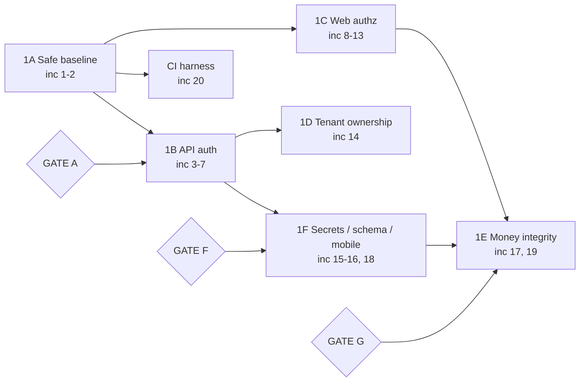

# Phase 1 — Executive Plan

## 1. Where we are

Phase 0 audited commit `41fe2f68`. Both repositories are still at that commit, both working trees are
clean, and **zero** commits have landed since — so the application code is byte-identical to what was
audited, and Phase 1A was therefore a test of whether the Phase 0 findings are *correct*, not whether
they have drifted. Eight specialists re-opened every cited line and re-derived every measurement
independently; a ninth pass designed the implementation order. The result is a revalidated finding set and
a 20-increment sequence. **The headline "99 revalidated items" — used here previously and still at `04:26`
and `06:54` — is withdrawn as unsupported:** it is not reconcilable from the published tables. The only
document-verifiable count is the **43 rows** of doc 02's revalidation summary tables (`02 §1.1-1.9`: 41 ID
rows plus 2 cleared entries); docs 03-06 carry further per-area items never numbered into one register. So
99 is an unaudited aggregate — publish a single register with the arithmetic, or do not quote a figure.
Nothing has been implemented. Phase 1A produced plans and evidence only.

## 2. What Phase 1A changes about the Phase 0 picture

This is the section that matters most, because it is what you do not already know. Phase 0 was broadly
right, but it was wrong or imprecise in nine places, and it missed several things that are worse than
anything it found.

### 2.1 Reclassified

| Phase 0 finding | New status | What actually holds |
|---|---|---|
| `CustomAuth` authenticates on the token id | **CONFIRMED_AND_WORSE** | It is worse in kind, not degree. A request with **no `Authorization` header at all** falls straight through to the controller: `app/Http/Middleware/CustomAuth.php:23-24` opens `if ($token)`, and `:54` is `return $next($request);` *outside* that block. So all 211 routes in `routes/api.php` are anonymously reachable, not just forgeable. Phase 0 also located the defect in the route table (22 registrations lacking middleware); it is in the middleware itself, which guards 189 of 211 routes. |
| Role escalation (SEC-F3) | **CONFIRMED_AND_WORSE** | The severe exploit is the inverse of the one described and needs no knowledge of the super-admin role id. Every self-registered merchant is attached to one shared global `admin` role, so an attacker edits **their own** role, submits `name='super admin'`, and `app/Http/Controllers/RoleController.php:182-183` rewrites `users.type` for every user on that role — platform-wide — in one request. |
| Mass assignment in `UserController::update` (SEC-F4) | **CONFIRMED_AND_WORSE** | A third limb Phase 0 missed: `password` is in `$fillable` and `app/Models/User.php:77-80` casts it `hashed`, so `PUT /users/1` with a password field is a direct super-admin takeover, independent of the type limb. |
| "Totals are partly client-supplied" | **CONFIRMED_AND_WORSE, mechanism narrowed** | The product subtotal *is* derived server-side. The defect is precise: tax is read from the request at `app/Http/Controllers/PaymentController.php:1127`, persisted at `:1322` and folded into the charged total at `:1327`; `payment_status` is the literal `'Paid'` at `:1354`. And **the whole write path is duplicated** at `:2015`, `:2207`, `:2235` — a fix applied once leaves the other path exploitable. |
| Impersonation is unrestricted (SEC-F6) | **CONFIRMED → CRITICAL / P0** | **Supersession note: Phase 0 rated this HIGH; the Phase 1A revalidation marked it REFUTED. Both verdicts are withdrawn.** The refutation rested on `grep -rn impersonate routes/*.php` returning 0 — it does return 0, but the conclusion is false, because the routes are not *named* "impersonate". `routes/web.php:766` registers `store/{id}/login-with-admin` → `StoreController::LoginWithAdmin` (`app/Http/Controllers/StoreController.php:716-723`), which calls `Impersonate::take()` at `:720` behind exactly one check: `auth()->check()` — *is anyone logged in*, not *may you do this*. No ownership check, no permission check, no type check, no Policy; `ExitAdmin` (`:725-730`) has none either. The encrypted id is not a mitigation: `APP_KEY` is populated in the committed `.env` (committed at `3c39c160`), so the `decrypt($id)` payload is forgeable for any user id. And registration is open and self-elevating — `routes/auth.php:18` sits in the guest group, and `app/Http/Controllers/Auth/RegisteredUserController.php:104` sets `'type' => 'admin'`. Full chain: anonymous visitor → register → forge an encrypted id → `GET /store/{forged}/login-with-admin` → an authenticated session as **any** user, including the platform super admin. That is platform takeover, not a latent landmine. |
| `stores` is missing custom-domain columns | **REFUTED** | Domains live in the `settings` table plus `plans.enable_domain`/`enable_subdomain`, all of which are created by existing migrations. Creating `stores` domain columns would add a second source of truth. Do not pay to fix this. |
| Money columns are single-precision float | **NARROWED** | Under Laravel 11 a bare `float()` emits `float(53)`, which MySQL maps to DOUBLE — so the columns Phase 0 flagged are double-precision. The genuinely single-precision columns are ones Phase 0 did **not** flag, e.g. `orders.reward_points` (`database/migrations/2024_01_23_061635_create_orders_table.php:41`). Which shape is live is BLOCKED pending the schema dump. |
| `users.deliverysyria_secret` missing | **NARROWED** | It fails **closed**: the guard compares against an empty string and returns 403. The consequence is a dead Delivery Syria integration, not an auth bypass. |
| Plaintext token in device storage | **NARROWED to MEDIUM** | Both platforms sandbox the file; it is not remotely exploitable. New compounding factor: Android Auto Backup is on by default, so the token propagates off-device. |
| Flutter TLS / Firebase configs / minification | **REFUTED as issues** | No `badCertificateCallback`, no `HttpOverrides`, no cleartext endpoint — TLS is correct by default. The committed Firebase client configs are public identifiers and must **stay** committed. Minification is downgraded: Flutter AOT means R8 touches only the Kotlin shim. |

That reversal reaches the whole plan: **the committed `APP_KEY` is not a hygiene item, it is an active
exploitation primitive** — it is what defeats the `decrypt()` guard on that route. Every statement
treating `APP_KEY` rotation as merely good practice is superseded. The finding also needs a numbered home:
doc `04:2693` still writes impersonation out of Phase 1 on the withdrawn REFUTED verdict. The fix is small
— a two-method override on `app/Models/User.php` plus one `$this->authorize('impersonate', $user)` in a
controller already being touched for authorization — so it belongs in the authorization increments (8-14),
not a future phase. **PROPOSED — NOT APPLIED.**

### 2.2 New, and not in the Phase 0 baseline

- **Nine API endpoints have no auth middleware at all** — seven merchant admin list endpoints
  (`routes/api.php:163-169`, each carrying only `['AdminApiLog']`) and two order-note **write** endpoints
  (`routes/api.php:203-211`, carrying no `->middleware()` whatsoever). These do not depend on the broken
  middleware, so fixing `CustomAuth` leaves them wide open. They must be closed separately, and they can
  be closed first.
- **Anonymous arbitrary payment-status write.** `routes/web.php:950` sits outside the `auth` group
  (verified at brace depth 1 by two independent tools), and the handler writes an unvalidated attacker
  string onto any order in any store. Two requests, no account. This is the most trivially exploitable
  issue found anywhere.
- **The reachability engine.** Public `/register` grants `type='admin'`, auto-logs in, and attaches the
  single global `admin` role that holds *Edit Role*, *Edit User*, *Reset Password* and *Delete Order*.
  Four CRITICAL findings are therefore anonymous-to-platform-admin, not insider abuse.
- **`PaymentService.php:211` strips the decimal point out of the Paymera gateway amount** — 1250.50 is
  sent as 125050 while 1250 is sent as 1250.
- **BackupRestore cannot restore.** No restore code exists; archives are unencrypted at mode 0777, bundle
  `.env` and the whole `.git` directory, the backup action has no permission check, and a user-supplied
  filename is interpolated unquoted into a `mysqldump` shell command.
- **A route with no authentication middleware returns decrypted Zid integration credentials**
  (`routes/web.php:1146-1153`). Precisely, per doc `03:268-270`: unauthenticated **by middleware**, but not
  wholly unguarded — `routes/web.php:1147` is an `abort_unless` on a hardcoded literal key in the query
  string. That literal is committed in the repository and so trivially discoverable: severity stands
  unchanged, the guard adds a step rather than protection. (The literal is reproduced in no document.)
- **The document root is the application root.** A tracked root `.htaccess` and root `index.php` prove it;
  `.env`'s only guard is nested inside `<IfModule mod_rewrite.c>`, and nothing protects `.git/` — and
  because `.env` is committed at `3c39c160`, a readable `/.git/` recovers it and bypasses that guard.

### 2.3 Three results that make Phase 1 cheaper than Phase 0 assumed

1. **The API authentication fix needs no app release.** The Flutter app already stores and sends the full
   standard Sanctum `Bearer {id}|{secret}` token (`lib/network/network.dart:60`) and already handles 401
   by clearing storage and routing to login. Existing tokens keep working. Backend ships first and alone.
2. **The vendor's own API documentation already requires that token** on 77 of 79 endpoints, including all
   11 `*-guest` endpoints. Closing the pass-through aligns the server with its published contract.
   One route — `place-order-guest` — is absent from that documentation, and that is GATE A.
3. **Order creation does not need the 15 undeclared finance tables.**
   `app/Observers/OrderObserver.php:15-20` swallows the `QueryException` into a log. This refutes the
   claim that the test suite cannot create an order and frees roughly eight increments from the
   owner-gated schema recovery.

## 3. Work packages

| WP | Objective | Scope (increments) | Depends on | Gate |
|---|---|---|---|---|
| **1A — Safe baseline** | Make it impossible for the test suite to reach a real database; make a fresh clone bootable; make `migrate:fresh` succeed; make every fix un-regressable. | 1, 2, 20 | — | None (GATE 0 runs in parallel) |
| **1B — API authentication & anonymous surface** | Close the nine unauthenticated endpoints, activate rate limiting, stop logging credentials, make `CustomAuth` actually verify the token secret, authenticate the Delivery Syria webhook. | 3, 4, 5, 6, 7 | 1A | **A** (before 6), **B** (before 7) |
| **1C — Web authorization** | Bring the administrative order/refund/settings routes inside `auth`, then add Policies and FormRequests for users, roles, addons, orders and finance. | 8, 9, 10, 11, 12, 13 | 1A | **C** (inside 8), **D** (before 12) |
| **1D — Tenant ownership** | Make the admin API require the *right* token, not merely a valid one: explicit per-call-site ownership predicates. Global scopes are deliberately excluded. | 14 | 1B (increment 6) | Standing constraint (model-cache isolation) |
| **1E — Money & checkout integrity** | Server-authoritative totals, a total reconciler, DB transactions, atomic stock, DECIMAL money columns, correct gateway amounts. | 17, 19 | 1A, 1C, 1F (increment 18) | **H** (inside 17), **G** (before 19) |
| **1F — Secrets, schema & mobile release** | Delete credential logging and make Android releases signable; untrack `.env` and move config literals to `env()`; commit catch-up migrations for the 15 undeclared tables. | 15, 16, 18 | 1B | **E** (before 16), **F** (before 18) |

## 4. Implementation sequence

Twenty increments. Full detail — files, acceptance criteria, tests, rollback, Flutter and WorkDo impact,
effort and collisions — is in **doc 04**.

| # | What it does | Risk | Approval |
|---|---|---|---|
| 1 | Test isolation + bootable checkout — the canonical **four**-layer definition in §7 (`tests/bootstrap.php`, `phpunit.xml`, `.env.testing`, `TestCase` guard, `storage/` skeleton) | Near zero — no non-test path loads these files | No |
| 2 | From-zero schema bootability: 5 code-derivable guarded columns + 2 SQLite migration blockers | Low — additive, nullable, `hasColumn`-guarded | No |
| 3 | Close the nine unauthenticated API endpoints; delete the Zid debug route | Low — Flutter safety verified, not assumed | No |
| 4 | Activate API rate limiting; close the merchant-login throttle bypass | Low–medium — app has no `case 429`; start at 120/min | Confirm limit |
| 5 | Redact the API request/response log | Near zero — `handle()` untouched | No |
| 6 | **`CustomAuth` token verification** — the API authentication fix | Medium — 189 routes, one file; no app release needed | **GATE A** |
| 7 | Authenticate the Delivery Syria status webhook | Medium — external coordination | **GATE B** |
| 8 | `routes/web.php` brace move (administrative half) | Medium — silently re-homes 28 declarations | **GATE C** |
| 9 | User management authz: mass assignment, cross-tenant edit, password takeover, audit trail | Medium — `validated()` can silently drop form fields | No |
| 10 | Role authz; delete the `users.type` rewrite | Medium | No |
| 11 | Addon/module install gate (authenticated zip-upload RCE) | Low–medium | Confirm archive formats |
| 12 | Order and refund authorization | Medium–high — busiest controller | **GATE D** |
| 13 | Finance authorization | Medium — verify the Laratrust `permission` alias resolves | Confirm role holders |
| 14 | API tenant ownership predicates (consolidated) | Medium — one pass over a large controller | No |
| 15 | Flutter: delete credential logging, then signing, manifest, Crashlytics | Low — ordered steps inside | Syncfusion licence |
| 16 | Secret hygiene: untrack `.env`, config literals to `env()`, delete the Zid token route, harden `.htaccess` | Low in code; rotation is the real work | **GATE E** |
| 17 | Checkout integrity: server-authoritative totals, reconciler, transactions, atomic stock | High — five order-insert sites, 52 gateways | **GATE H** |
| 18 | Schema recovery: the 15 undeclared tables, `users.plan_id` | Medium — makes silent failures start working | **GATE F** |
| 19 | Money column DECIMAL conversion; Paymera amount | High — the one real API-contract change | **GATE G** |
| 20 | CI as the regression harness | None at runtime | No |

## 5. What is blocked on you, and what is not

**Technically unblocked, and needing exactly two authorizations from you and nothing else: increments 1
through 5.** That is test isolation, a bootable checkout, closure of the nine anonymous API endpoints,
rate limiting and log redaction — four CRITICAL and two HIGH items. **Correction, superseding the earlier
claim that these "proceed now, with no input from you at all": nothing proceeds at all** until **GATE 1**
(authorization to modify the repositories) and **GATE 2** (authorization to commit and push, with a
branch/PR workflow and an explicit end to editing on the server) are granted — doc `07:99-100` marks both
**BLOCKING NOW**, both blocking "Everything". The true claim is narrower: increments 1-5 need those two
authorizations and **no data, no decision, no investigation**.

Increments 8 through 15 then need **seven** owner items, not three — two gates and five narrow
confirmations, each verified in doc 04: **GATE C** (`04:1317`, increment 8), **GATE D** (`04:1691`,
increment 12), the password-workflow confirmation (`04:1420`, increment 9), the accepted archive formats
(`04:1600`, increment 11), a role-holder audit (`04:1795`, increment 13), the `stores()` relation check
(`04:1896`, increment 14) and the Syncfusion licence (`04:2043`, increment 15). None of the seven requires
production data.

**What your inaction costs, precisely:**

| Blocked on you | Cost of delay |
|---|---|
| **GATE A** — who consumes `place-order-guest`, and reject-mode vs one canary release | Increment 6 stops. Until it ships, every API route remains anonymously reachable and any token id is a master key. This is the single most valuable change in the programme. |
| **GATE F** — `SHOW CREATE TABLE` for 15 tables, from a **restored copy**, never the live host | Increments 18 and 19 stop. No finance test can run; the money columns cannot be converted. Roughly 70% of Phase 1 proceeds without it. |
| **GATE E** — rotation authorization | The code half of increment 16 is trivial; the value is entirely in rotation. Until then, every clone ships live credentials. |
| **GATE G** — Paymera's expected amount unit | Increment 19 stops. This is the one fix nobody should specify without your document: wrong in one direction undercharges 100×, in the other **overcharges** 100×. |
| **GATE 0** — is `/.git/` served? What is the document root? | Costs you two minutes and blocks nothing. If `/.git/HEAD` returns 200, every secret is already compromised and rotation jumps the queue. Run it today. |

Separately, the live host could not be reached from this environment at all. Whether the deployment is
internet-exposed, whether its database holds real rows, and whether the committed credentials are the live
ones are **BLOCKED, not cleared**. Your statement that Store Syria has not launched commercially reduces
urgency; it is not evidence for any of those three. The per-area owner checklists are in docs 01–06.

## 6. Approval gates

Nine gates: **0** (parallel, blocks nothing), **A** (before increment 6, the first material stop), **B**,
**C**, **D**, **E**, **F**, **G**, **H**, plus one standing constraint that keeps tenancy global scopes
out of Phase 1 until model-cache isolation can be proven. Each gate's question, the evidence behind it,
the recommended answer and the cost of each option are in **doc 07**.

## 7. The first increment

**Increment 1 — test isolation and a bootable checkout**, as one commit. Today, `php artisan test` from
this checkout would run `migrate:fresh` against the database named in the committed `.env`, and creating
`storage/` is what arms that trap — which is why both land together. Nothing else in this plan is
verifiable until the suite cannot destroy data, and it is the rare P0 whose fix carries no risk, so it is
also the right change on which to prove the review-and-ship workflow.

**The canonical definition — four layers.** This increment had been specified three different ways across
docs 00, 01, 04 and 05 (three layers or four; keeping `bootstrap="vendor/autoload.php"` or changing it),
so there was no single thing to build. This is now the definition every document must match, and it
governs where any still disagrees.

| Layer | File | Change |
|---|---|---|
| **0 — PRIMARY** | `tests/bootstrap.php` | **NEW.** Hard-fails unless the resolved test database is SQLite. Wired by changing `bootstrap="vendor/autoload.php"` to `bootstrap="tests/bootstrap.php"` in `phpunit.xml:4`. |
| 1 | `phpunit.xml` | Uncomment `:25-26` **and** add `force="true"` to both `<env>` entries. |
| 2 | `.env.testing` | **NEW**, tracked. SQLite / `:memory:`, no secrets, and a **fixed, obviously fake** `APP_KEY` committed in the file. |
| 3 | `tests/TestCase.php` | A defence-in-depth assertion — explicitly **not** the primary control. |
| plus | `.gitignore:5`, `storage/**/.gitkeep` | Narrow `/storage/` to contents plus `.gitkeep` re-includes, so the `storage/` skeleton ships. |

**Why Layer 0 is primary and the `TestCase` guard is not.** The previously published `tests/TestCase.php`
guard opens with `parent::setUp();` — and that is where `setUpTraits()` runs `RefreshDatabase`, i.e.
`migrate:fresh`. On that ordering its assertions fire *after* every table has been dropped, so the control
called "the durable protection" would not protect. Status: **FRAMEWORK-DOCUMENTED BEHAVIOUR, UNVERIFIED IN
THIS ENVIRONMENT (BLOCKED)** — `vendor/laravel/framework/src` is absent here, so the ordering cannot be
confirmed from vendor source. The placement is corrected regardless: `tests/bootstrap.php` loads before
the framework or any trait hook and is therefore safe under **either** ordering, and a safety control must
never rest on an unverifiable assumption. The only in-class alternative is to override `refreshDatabase()`
(assert, then call `parent`); `afterApplicationCreated()` does **not** work, because those callbacks also
run after `setUpTraits()`. Nobody should "simplify" this back.

**Why the test `APP_KEY` is a fixed fake, not generated.** An empty `APP_KEY` plus `php artisan
key:generate --env=testing` guarantees a red suite: a blank key makes Laravel throw "No application
encryption key has been specified" for anything touching sessions, cookies or encryption — the entire
Breeze auth Feature suite this increment exists to unblock — and `key:generate` writes into a *tracked*
file, dirtying every tree and inviting an accidental commit. CI gets no key either, so it fails
identically. That is precisely the trap this plan warns about: the team flips `phpunit.xml`, sees red,
concludes "SQLite does not work here", and reverts the most important safety change in the programme. So
`.env.testing` commits a fixed, obviously-fake base64 key — safe to commit **because it protects nothing**
— and `key:generate` is never run against it.

This increment can be **written** but not **verified** here. The dependency install aborted on this
container's egress policy, not on any project defect: `lahirulhr/laravel-payhere` resolves to an
`api.github.com` zipball the proxy rejects, and both `yoomoney/*` packages live on the unreachable
`git.yoomoney.ru`. So `php artisan`, PHPUnit and any boot-dependent analysis **cannot run here** and every
test in this plan is **SPECIFIED, NOT EXECUTED — BLOCKED**. Increment 1's verification happens on the
engineer's machine or in CI, and a CI runner must reach both hosts — or you allowlist them, use a caching
Composer mirror, or drop the two SDKs (all touch `composer.json`, so all are owner decisions). BLOCKED is
never reported as a pass.
