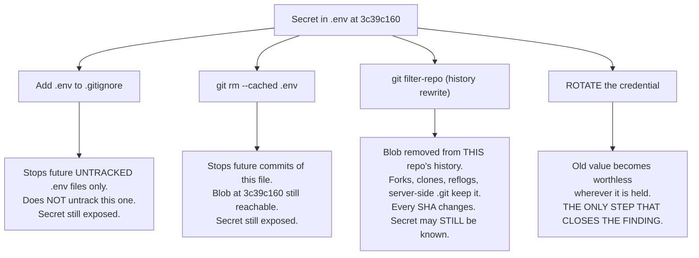
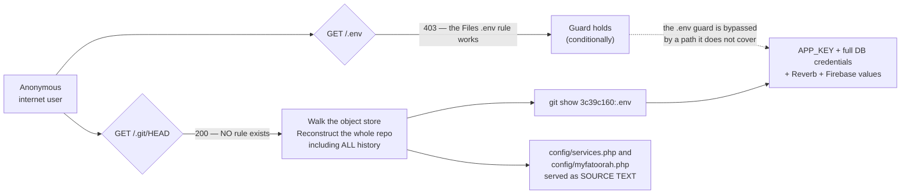
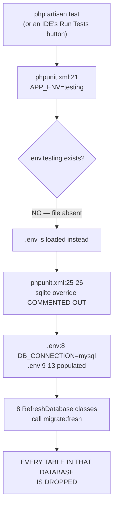

# Work Package 1A — Safe Development Baseline

**This is the factual record for Phase 1A.** It establishes what is true about the two repositories
right now, what secrets exist and what they grant, why the test suite is currently the most
dangerous command in the project, and what the owner must do that no amount of code reading can
substitute for.

Primary source: the R8 baseline-and-secrets revalidation pass, with the R5 schema-recovery pass for
the production-schema prerequisite. Phase 0 baseline: the 13 audit documents committed in
`41fe2f68` under `/home/user/syriastore98/docs/discovery/`, cited by filename and section where
relied upon.

**Three things to take from this document if you read nothing else.**

1. `php artisan test` from this checkout would run `migrate:fresh` against the MySQL database named
   in the committed `.env`. That is a **data-destruction hazard** and it is Increment 1 of the
   implementation plan. Sections 1, 6 and 10 explain why it is currently harmless *in this container*
   and fully live *on the owner's server*, and why that distinction must not be read as a mitigation.
2. `.env` is **both** absent from `.gitignore` **and** still tracked at HEAD. Those are two separate
   defects with two separate fixes, and neither of them removes the file from history. Only
   **rotation** closes the exposure. Section 3 answers both questions separately; Section 4 is the
   ordered rotation plan.
3. Whether any of this is an *incident* or a *backlog* turns on two questions this environment cannot
   answer: is the deployed host internet-reachable, and is `/.git/` readable on it. Section 5 is the
   copy-pasteable runbook. **BLOCKED is not a pass.**

---

## 1. Repository state verification

### 1.1 Both repositories, as measured

| | repo-A | repo-B |
|---|---|---|
| Path | `/home/user/syriastore98` | `/home/user/StoreSyria_app98` |
| Role | Laravel 11 SaaS platform (`laravel/framework ^11.9`) | Flutter merchant app |
| Branch | `claude/pensive-cerf-h6rizn` | `claude/pensive-cerf-h6rizn` |
| HEAD (short) | `41fe2f68` | `d745ec08` |
| HEAD (full) | `41fe2f6884f13fd8d0e3d627e627cbe28e57c66a` | `d745ec08da5244cf50bc35b12fcd804bcf695023` |
| HEAD subject | `Docs: Phase 0 discovery, audit and strategic assessment` | `last update` |
| Working tree | **clean** (`git status --porcelain` → no output) | **clean** (`git status --porcelain \| wc -l` → `0`) |
| Commits since the Phase 0 audit commit | **0** (`git rev-list 41fe2f68..HEAD --count` → `0`) | **0** (`git rev-list d745ec08..HEAD --count` → `0`) |

Status: **VERIFIED.** The orchestrator's state statement is correct and I re-derived every field
rather than accepting it.

### 1.2 What that means for the validity of Phase 0 — proved, not assumed

The orchestrator states that application code is byte-identical to what Phase 0 audited. That is
true, and there is a stronger proof available than "zero commits since":

```
$ git show --stat --oneline 41fe2f68
41fe2f68 Docs: Phase 0 discovery, audit and strategic assessment
 docs/discovery/00-EXECUTIVE-SUMMARY.md            |  107 +
 ... 13 files ...
 13 files changed, 14413 insertions(+)

$ git diff --stat efe05d9f 41fe2f68 -- . ':(exclude)docs/'
   (no output)
```

The Phase 0 audit commit itself touches **only** `docs/discovery/` — 13 files, 14,413 insertions,
**zero** lines of application code, migration, config, route, view or asset. Combined with zero
commits after it, the application tree at `41fe2f68` is identical to the tree Phase 0 read, and also
identical to the tree at `efe05d9f`.

**The consequence for this phase is specific and should be stated plainly: Phase 1A revalidation was
never about drift. There is no drift. It was about whether each Phase 0 finding is CORRECT.** Where
this document departs from Phase 0, from the R8 notes **or from its own earlier wording**, it is
because re-reading the file produced a different answer — not because anything changed. Several such
corrections appear below: §2.3 and §10.2, plus three **supersession notices** in §6.3 (the layer
structure), §6.3 Layer 2 (the test `APP_KEY`) and §6.5 (the guard tests). **Every one is recorded
openly as a reversal, with its evidence and its evidential status — a silent correction would itself
be a defect.**

### 1.3 Commit history worth noticing

```
$ git log --oneline -6          # repo-A
41fe2f68 Docs: Phase 0 discovery, audit and strategic assessment
efe05d9f Chore: Ignore entire storage folder and temporary files
5882399e Chore: Ignore storage log files
f33e8525 Update: Controllers, DataTables and Helper adjustments on server
de014225 Chore: Ignore vendor folder in git
4a5f686a Chore: Ignore uploads and storage folders in git, update composer.json
```

Two of these matter beyond their diffs.

- **`f33e8525` — "Update: Controllers, DataTables and Helper adjustments *on server*".** This commit
  message is first-party evidence that code is edited on the deployed host and committed from there,
  which requires a working `.git` directory on that host. That is the premise behind the
  document-root finding in §5 check 3. **This is an INFERENCE FROM A COMMIT MESSAGE, not a verified
  fact about the host.** It is recorded because it makes the owner's two-minute check in §5 the
  highest-value action in this work package, not because it proves anything.
- **`efe05d9f` — "Ignore entire storage folder".** This is the commit that added `/storage/` to
  `.gitignore:5`. The directory does not exist in the checkout (`ls -d storage` → *No such file or
  directory*), which is why a fresh clone cannot boot Laravel at all — and, as §6.2 explains, why the
  test-isolation hazard is currently masked and will arm itself the moment anyone fixes it.

repo-B's history is short and uninformative for this purpose: `d745ec0 last update`,
`b43f3ac last update before claude`, `75bd5f1 new storesyria`.

### 1.4 Repository shape facts used throughout this document

| Fact | Evidence |
|---|---|
| 22 files tracked at repo-A depth 0, including `.env`, `.htaccess`, `index.php`, `composer.phar`, `error_log`, `_active', 1)` | `git ls-files \| grep -vE "/"` |
| A tracked root `index.php` which is Laravel's `server.php` shim | `/home/user/syriastore98/index.php:10-21` — `if ($uri !== '/' && file_exists(__DIR__.'/public'.$uri)) { return false; }` then `require_once __DIR__.'/public/index.php';` |
| A tracked root `.htaccess`, 37 lines, whose front-controller target is the root shim | `/home/user/syriastore98/.htaccess:26` — `RewriteRule ^ index.php [L]` |
| `public/index.php` and `public/.htaccess` both exist and are complete | `ls -la public/.htaccess public/index.php` → 603 and 468 bytes |
| `public/storage` is a **regular file**, not a symlink | `git ls-files -s public/storage` → mode `100755` (a symlink is `120000`); its 62-byte content is the upstream vendor's absolute build path |
| A root-level `uploads/` tree is tracked and holds 407 real-looking store/product images | `git ls-files uploads \| wc -l` → `407`; `.gitignore:1` ignores `/public/uploads/` but **not** this tree |
| `bootstrap/cache/packages.php` and `bootstrap/cache/services.php` are tracked | `git ls-files bootstrap/cache` |
| `.github/` does not exist | `ls -d .github` → *No such file or directory*; yet `.gitattributes:9` is `/.github export-ignore`, i.e. the upstream skeleton expected one |
| Exactly **one** namespace/path mismatch in the whole of `app/`: `app/Http/Controllers/Customer/Auth/CustomerForgotPasswordController.php:3` declares `namespace App\Http\Controllers\Student\Auth;` while its path requires `App\Http\Controllers\Customer\Auth` | Declared namespace compared against the PSR-4 expected namespace for **every** `.php` file under `app/` (`composer.json` `autoload.psr-4` maps `App\` → `app/`): **1 mismatch, and only this one.** Composer reports the file *"does not comply with psr-4 autoloading standard … Skipping"*, so the class **can never be autoloaded**. **DEAD CODE — severity LOW, priority P3** (scoped below). |
| 62 entries in `composer.json`'s `require` (61 packages plus `php: ^8.2`); **no** `ext-*` requires and **no** `config.platform` | `jq -r '.require \| keys \| length'` → `62`; `jq -r '.require \| keys[] \| select(startswith("ext-"))' \| wc -l` → `0`; `jq '.config.platform // "none"'` → `"none"` |

The last row is a real, small, high-value defect in its own right: with nothing pinning the runtime,
staging and CI drift becomes a runtime surprise instead of a `composer install` failure. §7 proposes
the fix.

**The `Student`-namespace row, scoped precisely — because it is easy to overstate and the overstated
version would be alarming and wrong.** **Customer password reset WORKS.** It is served by
`CustomerLoginController`, not by the mismatched file: `routes/customer.php:85-88`
(`forgotPasswordForm`, `forgotPassword`, `resetPasswordForm`, `resetPassword`) plus an OTP variant at
`routes/customer.php:96-119` (`sendPasswordOtp`, `passwordOtpForm`, `verifyPasswordOtp`,
`resetPasswordOtpForm`, `resetPasswordWithOtp`) — all nine routes re-opened. The mismatched file is
referenced by **no route and no other file**: `grep -rn CustomerForgotPasswordController` across the
tree outside `vendor/` returns **exactly one hit, its own class declaration at `:9`**. So this is
**not a broken feature. It is dead code**: **LOW / P3**, fixed by either correcting the one namespace
line or deleting the file, and it is **hygiene, not Phase 1A work** — it has no numbered increment
and should not acquire one at the cost of a P0.

**Its real value is as provenance evidence.** A stray `Student` namespace in a storefront controller
tree is a fingerprint of copy-paste from an unrelated product — which is consistent with a tree built
on 69 vendor-derived WorkDo addons: parts of it were not written for this product. That matters for the plan's method — it is why every finding in these
documents is cited to a re-opened file:line rather than inferred from how the code is *organised*.

---

## 2. Environment configuration inventory

### 2.1 `.env` structure

`/home/user/syriastore98/.env` is 52 lines: **41 assignments** and 11 blank lines. The inventory in
§3.1 was generated with an `awk` script that classifies each line as POPULATED / EMPTY /
EMPTY-LITERAL(`null`) and prints only the variable NAME and line number — so no value could be
echoed even accidentally.

Four non-credential flag values are stated explicitly below, because they are security-relevant
*settings* rather than secrets, and each was confirmed by matching against a fixed enumeration rather
than by printing the line:

| Setting | Value in the committed `.env` | Why it matters |
|---|---|---|
| `.env:2` `APP_ENV` | `local` | A deployed application running with development-environment semantics. |
| `.env:4` `APP_DEBUG` | `true` | Unhandled exceptions render full stack traces, absolute paths and SQL. If this `.env` is what is deployed, every error is an information-disclosure event. |
| `.env:8` `DB_CONNECTION` | `mysql` | This is the single line that makes the test-isolation hazard destructive (§6). |
| `.env:9` `DB_HOST` | a loopback address | Benign-looking, and dangerous: on the server, loopback **is** the production database. |

Status: **VERIFIED.** Severity of `APP_DEBUG=true` + `APP_ENV=local` in committed configuration:
**HIGH**, priority **P0** on the server, where it is one `.env` edit plus `php artisan config:cache`.

### 2.2 `phpunit.xml`'s environment block

The whole file is 33 lines. The `<php>` block is lines 20-32 and is reproduced exactly:

```xml
20	    <php>
21	        <env name="APP_ENV" value="testing"/>
22	        <env name="APP_MAINTENANCE_DRIVER" value="file"/>
23	        <env name="BCRYPT_ROUNDS" value="4"/>
24	        <env name="CACHE_STORE" value="array"/>
25	        <!-- <env name="DB_CONNECTION" value="sqlite"/> -->
26	        <!-- <env name="DB_DATABASE" value=":memory:"/> -->
27	        <env name="MAIL_MAILER" value="array"/>
28	        <env name="PULSE_ENABLED" value="false"/>
29	        <env name="QUEUE_CONNECTION" value="sync"/>
30	        <env name="SESSION_DRIVER" value="array"/>
31	        <env name="TELESCOPE_ENABLED" value="false"/>
32	    </php>
```

Status: **VERIFIED, line-exact.** Note what this is: every other `<env>` in the block is live. Lines
25 and 26 are the **only** two that are commented out. This is a targeted change, not a wholesale
disable — somebody deliberately made the test suite use the real database connection.

One line outside the `<php>` block matters to Increment 1 and is recorded here for completeness:
`phpunit.xml:4` is `bootstrap="vendor/autoload.php"` (re-opened). §6.3 Layer 1 re-points it at
`tests/bootstrap.php`, which is what installs the **primary** test-isolation guard; a change to
`:25-26` alone leaves that guard uninstalled.

### 2.3 `.env.example` is NOT a usable template — correction to the R8 note

The R8 revalidation notes state that `.env.example` "already carries the identical variable-NAME set,
so it is a complete and useful template already." **That is REFUTED.** I ran the comparison myself:

```
$ comm -23 <(grep -oE '^[A-Z_]+=' .env       | sed 's/=$//' | sort -u) \
           <(grep -oE '^[A-Z_]+=' .env.example | sed 's/=$//' | sort -u)
APP_LOG_LEVEL      BROADCAST_DRIVER   CACHE_DRIVER
DB_DATABASE        DB_HOST            DB_PASSWORD        DB_PORT        DB_USERNAME
FIREBASE_CREDENTIALS   FIREBASE_PROJECT_ID
MAIL_DRIVER
PUSHER_APP_ID      PUSHER_APP_KEY     PUSHER_APP_SECRET
QUEUE_DRIVER
REVERB_APP_ID      REVERB_APP_KEY     REVERB_APP_SECRET   REVERB_HOST   REVERB_PORT   REVERB_SCHEME
VITE_REVERB_APP_KEY   VITE_REVERB_HOST   VITE_REVERB_PORT   VITE_REVERB_SCHEME
```

**25 variables that the running application uses are absent from `.env.example`.** The file is 64
lines and is the **stock Laravel 11 skeleton**, never updated for this project:

- `grep -c REVERB .env.example` → `0`. Same for `FIREBASE` → `0` and `PUSHER` → `0`. Not even as
  comments.
- `.env.example:22` is `DB_CONNECTION=sqlite`, and `.env.example:23-27` carry `DB_HOST`, `DB_PORT`,
  `DB_DATABASE`, `DB_USERNAME`, `DB_PASSWORD` **commented out** — the Laravel 11 default.

Status: **VERIFIED (correcting R8). Severity: MEDIUM. Priority: P1 — and it is a prerequisite for
Increment 16, not a separate nicety.** The moment `.env` is untracked (§4 step 8), `.env.example`
becomes the only template a new developer or a new host has, and it describes neither the database
connection the app actually uses nor Reverb nor Firebase. A fresh clone would be configured to use
SQLite and would have no real-time or push configuration at all, with no indication that anything is
missing.

**Action (not applied):** extend `.env.example` so its active-assignment name set is a superset of
`.env`'s, with **empty values**, in the same commit that untracks `.env`. Add the new `env()` names
from §3.2 at the same time. `.env.example` stays tracked; it is the template, and it must actually be
one.

### 2.4 Configuration that reads the environment, and configuration that does not

| Config | Reads `env()` | Note |
|---|---|---|
| `config/database.php:19` | `'default' => env('DB_CONNECTION', 'sqlite')` | The SQLite fallback exists; `.env:8` overrides it to `mysql`. The `sqlite` connection block is at `config/database.php:34-39`, so the §6 fix is viable. |
| `config/database.php:55` | — | `'strict' => false` on the **mysql** connection (the `mariadb` block at `:75` sets `true`). Out of scope here, load-bearing for the money-integrity work package. |
| `config/queue.php:16` | `'default' => env('QUEUE_CONNECTION', 'database')` | `.env:19` sets `QUEUE_DRIVER`, not `QUEUE_CONNECTION` — a naming mismatch worth checking on the server. |
| `config/services.php:109-110` | `FIREBASE_PROJECT_ID`, `FIREBASE_CREDENTIALS` | Correct pattern. |
| `config/services.php:115-116` | `DELIVERY_FIREBASE_PROJECT_ID`, `DELIVERY_FIREBASE_CREDENTIALS` | The latter defaults to a path under `storage/app/firebase/`. `storage/app` does not exist in this checkout, and no service-account JSON is tracked (§3.4). |
| `config/services.php:119-124` | `WEBUZO_HOST`, `WEBUZO_USERNAME`, `WEBUZO_API_KEY`, `WEBUZO_PORT`, `WEBUZO_VERIFY_SSL` | Currently all unset. A Webuzo API key is **hosting-control-plane** authority — it can create and delete accounts and databases. If this is ever populated it belongs at the **top** of the rotation table, not the bottom. |
| `config/services.php:31, :32, :33, :34` | **No** — hardcoded literals | Zid integration. §3.2. |
| `config/services.php:43, :44` | **No** — hardcoded literals | Delivery Syria. §3.2. |
| `config/myfatoorah.php:10, :20` | **No** — hardcoded literals | MyFatoorah. §3.2. |
| `app/Http/Controllers/PaymentWallPaymentController.php:119` | **No** — hardcoded literal in a *controller* | Paymentwall. §3.2. |

**Environment variables referenced by `config/` but absent from `.env`.** All resolve to `null`, so
nothing is exposed today — but each is a slot where a future secret will land and must therefore be
covered by the rotation policy and the secret scanner from the day it is populated:
`POSTMARK_TOKEN` (`services.php:18`), `AWS_ACCESS_KEY_ID`/`AWS_SECRET_ACCESS_KEY`/`AWS_DEFAULT_REGION`
(`:22-24`), `RESEND_KEY` (`:51`), `SLACK_BOT_USER_OAUTH_TOKEN`/`SLACK_BOT_USER_DEFAULT_CHANNEL`
(`:56-57`), `NMI_API_ENDPOINT`/`NMI_API_USERNAME`/`NMI_API_PASSWORD` (`:101-103`),
`DELIVERY_FIREBASE_PROJECT_ID`/`DELIVERY_FIREBASE_CREDENTIALS` (`:115-116`), and the five `WEBUZO_*`
(`:120-124`).

---

## 3. Secret inventory

> **DISCLOSURE POLICY OBSERVED THROUGHOUT THIS SECTION AND THIS DOCUMENT: no secret value, no
> fragment of a value, and no value length appears anywhere. Variable NAME, file:line, and
> populated-or-empty status only. This is absolute.**

"Blast radius" below assumes the worst case the owner instructed us to plan for: that the deployment
is reachable and holds real data. The owner's statement that Store Syria "is still under development
and has not launched commercially" **reduces urgency** and is treated as such — it is **not** treated
as evidence that the deployment is unreachable, data-free or credential-free, because the owner
explicitly asked for those to be verified separately and §5 is BLOCKED.

### 3.1 `/home/user/syriastore98/.env` — tracked at HEAD, committed at `3c39c160`

| Line | Variable NAME | Status | Grants access to | Blast radius if compromised | Rotation owner / procedure |
|---|---|---|---|---|---|
| 1 | `APP_NAME` | POPULATED | — | None (display string) | n/a |
| 2 | `APP_ENV` | POPULATED | — | Dev-mode semantics in a deployed app | Set `production` on the server |
| 3 | **`APP_KEY`** | POPULATED | **Laravel's master encryption and signing key** | **Decrypt every cookie and session; forge signed URLs; decrypt every `encrypted`-cast column and every `Crypt::` payload. The widest blast radius in the inventory.** | Owner. `php artisan key:generate`. **Invalidates all sessions and makes existing encrypted column data permanently unreadable — §4 step 7. Sequencing-critical; do it LAST.** |
| 4 | `APP_DEBUG` | POPULATED | — | Stack traces, absolute paths, SQL and structure to anonymous users | Set `false` on the server |
| 5 | `APP_LOG_LEVEL` | POPULATED | — | None | n/a |
| 6 | `APP_URL` | POPULATED | — | None | n/a |
| 8 | `DB_CONNECTION` | POPULATED | — | **Enables the §6 test-isolation hazard** | Fixed by Increment 1 |
| 9 | `DB_HOST` | POPULATED (loopback) | DB endpoint | Reconnaissance; **makes §6 destructive on the server** | n/a |
| 10 | `DB_PORT` | POPULATED | DB endpoint | Reconnaissance | n/a |
| 11 | `DB_DATABASE` | POPULATED | Schema name | Target identification | n/a |
| 12 | **`DB_USERNAME`** | POPULATED | **MySQL account** | **Full read/write/DROP on the application schema: every customer, order, billing detail, wallet balance and password hash. Total data theft and total data loss.** | Owner / hosting panel. **Grant-first, zero-downtime path — §4 step 6.** |
| 13 | **`DB_PASSWORD`** | POPULATED | **MySQL account** | As above | As above |
| 15 | `BROADCAST_DRIVER` | POPULATED | — | None | n/a |
| 16 | `CACHE_DRIVER` | POPULATED | — | None | n/a |
| 17 | `CACHE_STORE` | POPULATED | — | None | n/a |
| 18 | `SESSION_DRIVER` | POPULATED | — | None | n/a |
| 19 | `QUEUE_DRIVER` | POPULATED | — | None | n/a |
| 21 | `REDIS_HOST` | POPULATED | Redis endpoint | Reconnaissance | n/a |
| 22 | `REDIS_PASSWORD` | **EMPTY-LITERAL (`null`)** | Redis | **Unauthenticated Redis if the port is reachable.** Cache and session poisoning → auth bypass if sessions live in Redis. | Owner: set `requirepass`, then populate. **Do not leave `null`.** |
| 23 | `REDIS_PORT` | POPULATED | Redis endpoint | Reconnaissance | n/a |
| 25 | `MAIL_DRIVER` | POPULATED | — | None | n/a |
| 26 | `MAIL_HOST` | POPULATED | SMTP endpoint | Reconnaissance | n/a |
| 27 | `MAIL_PORT` | POPULATED | SMTP endpoint | Reconnaissance | n/a |
| 28 | `MAIL_USERNAME` | **EMPTY-LITERAL (`null`)** | — | None now | n/a until populated |
| 29 | `MAIL_PASSWORD` | **EMPTY-LITERAL (`null`)** | — | None now | n/a until populated |
| 30 | `MAIL_ENCRYPTION` | **EMPTY-LITERAL (`null`)** | — | **Unencrypted SMTP** once mail is enabled | Set `tls` |
| 32-34 | `PUSHER_APP_ID`, `PUSHER_APP_KEY`, `PUSHER_APP_SECRET` | **EMPTY** | — | None | n/a |
| 36 | `REVERB_APP_ID` | POPULATED | Reverb/WebSocket app | Channel identification | Owner; regenerate the triple together |
| 37 | `REVERB_APP_KEY` | POPULATED | Reverb client-side key | Subscribe to channels; with weak channel auth, **read other tenants' broadcast events** | Owner; regenerate the triple together |
| 38 | **`REVERB_APP_SECRET`** | POPULATED | **Reverb server authentication** | **Sign channel-auth responses and publish arbitrary events to any channel** — impersonate server-pushed order and payment events to any connected client | Owner; regenerate the id/key/secret triple, update `:43-46`, **rebuild frontend assets**, restart Reverb — §4 step 1.3 |
| 39-41 | `REVERB_HOST`, `REVERB_PORT`, `REVERB_SCHEME` | POPULATED | Endpoint | Reconnaissance | n/a |
| 43 | `VITE_REVERB_APP_KEY` | POPULATED | Client mirror of `:37` | **Public by design** — compiled into the JS bundle. Not a secret. | Rotate with `:37`; **requires an asset rebuild** |
| 44-46 | `VITE_REVERB_HOST`, `VITE_REVERB_PORT`, `VITE_REVERB_SCHEME` | POPULATED | — | Public by design | n/a |
| 51 | `FIREBASE_PROJECT_ID` | POPULATED | Firebase project | Identification | n/a |
| 52 | **`FIREBASE_CREDENTIALS`** | POPULATED | **Firebase Admin — a filesystem PATH or INLINE service-account JSON. Which, is UNKNOWN: the value was not inspected, per the disclosure rule.** | **If inline JSON: full Admin SDK authority — send arbitrary push notifications to every customer device, read and write Firestore/RTDB, mint custom auth tokens. CRITICAL.** If a path: discloses only a path. | **Owner must determine which, FIRST (§4, D2).** If inline: Google Cloud console → delete the key, create a new one, install it as a file **outside the document root**, set this variable to that path. |

Lines 7, 14, 20, 24, 31, 35, 42 and 47-50 are blank.

**Severity: CRITICAL. Priority: P0 for rotation.**

### 3.2 Hardcoded credential literals in `config/` and `app/`

All five re-opened at the cited lines with values masked before printing. Phase 0's four line numbers
are **exact, no drift**. Severity is deliberately **not uniform** — treating them as one bucket would
misdirect the owner's attention.

| # | Key NAME | File:line | Status | Grants access to | Severity / priority |
|---|---|---|---|---|---|
| 1 | `zid.client_secret` | `config/services.php:31` | POPULATED — real | Zid e-commerce platform OAuth app (paired with `client_id` at `:30`, a plain numeric identifier, and `redirect_uri` at `:32`) | **HIGH / P0 to rotate** |
| 2 | `zid.hook_pass` | `config/services.php:34` | POPULATED — real, a readable passphrase and therefore low-entropy by construction (`hook_user` is at `:33`) | **Inbound** Zid webhook HTTP-auth password | **HIGH / P0 to rotate — the nastier of the two.** It authenticates inbound calls, so possession lets an attacker **forge Zid webhook deliveries**, injecting order and catalogue events from outside. |
| 3 | `deliverysyria.api_key` | `config/services.php:44` | POPULATED, **placeholder-shaped** (a repeated-character keyboard mash, not a structured key) | Delivery Syria logistics API (`url` at `:43`) | **MEDIUM / P1, pending owner confirmation (§4, D3). HIGH if live.** Inference from SHAPE, not confirmation. |
| 4 | `api_key` (MyFatoorah) | `config/myfatoorah.php:10` | POPULATED — **MyFatoorah's publicly-documented TEST token** | Nothing of the owner's | **LOW for the value / HIGH and P1 for the SHAPE.** See below. |
| 5 | `private_key` (Paymentwall) | `app/Http/Controllers/PaymentWallPaymentController.php:119` | POPULATED, **placeholder-shaped**, hardcoded in a **controller** rather than config | Paymentwall `Paymentwall_Config` | **MEDIUM / P1, pending owner confirmation (§4, D3). HIGH if live.** |

**On #4, and the file itself settles it.** `config/myfatoorah.php:6-9` is a comment block reading
`Accepted value: / Live Token: https://myfatoorah.readme.io/docs/live-token / Test Token:
https://myfatoorah.readme.io/docs/test-token`, and `:15` is `'test_mode' => true` with `:20`
`'country_iso'` set. So the literal at `:10` is the vendor's own public demo token and there is
**nothing to rotate**. The structural finding is nonetheless HIGH and P1, for a counter-intuitive
reason worth saying out loud: **leaving a hardcoded slot there guarantees that a live
payment-gateway key gets committed on launch day.** Fix the shape now, while the contents are
worthless.

**Reachability of all five.** `config/*.php` are loaded into `config()` on every request, so these
are live integration inputs. They are **not** directly readable over HTTP even with the app-root
document root, because a request for `/config/services.php` is handled by the PHP handler, which
*executes* the file — and the file only `return`s an array, emitting no output. **That protection is
conditional and has two complete bypasses**: a readable `/.git/` serves these files as **source
text** (§5 check 3), and any BackupRestore archive contains them verbatim (§9). Who can reach them:
anyone with repository read access; anonymous internet users **if and only if** §5 resolves badly.

**Minimal fix (not applied).** Replace each literal with `env()` **in the existing config file** —
the exact pattern this same file already uses at `services.php:18, 22-24, 51, 56-57, 101-103,
109-110, 115-116, 120-124`. No new mechanism, no parallel configuration system:

```php
// PROPOSED — NOT APPLIED. config/services.php, replacing lines 29-35:
'zid' => [
    'client_id'     => env('ZID_CLIENT_ID'),
    'client_secret' => env('ZID_CLIENT_SECRET'),
    'redirect_uri'  => env('ZID_REDIRECT_URI'),
    'hook_user'     => env('ZID_HOOK_USER', 'zidhook'),
    'hook_pass'     => env('ZID_HOOK_PASS'),
],

// PROPOSED — NOT APPLIED. config/services.php, replacing lines 42-45:
'deliverysyria' => [
    'url'     => env('DELIVERYSYRIA_URL'),
    'api_key' => env('DELIVERYSYRIA_API_KEY'),
],

// PROPOSED — NOT APPLIED. config/myfatoorah.php:10 and :15:
'api_key'   => env('MYFATOORAH_API_KEY'),
'test_mode' => (bool) env('MYFATOORAH_TEST_MODE', true),

// PROPOSED — NOT APPLIED. PaymentWallPaymentController.php:119 reads config instead of a literal:
'private_key' => config('services.paymentwall.private_key'),
// ...with a new services.paymentwall block in config/services.php reading env('PAYMENTWALL_PRIVATE_KEY').
// Business configuration belongs in config/, not in a controller.
```

Then add the new NAMES to `.env.example` with empty values (see §2.3 — it needs extending anyway).

**Deploy-ordering hazard, which is the only way this change breaks anything.** Add the variables to
the **server's** `.env` first, verify, **then** deploy the config change, **then** re-run
`php artisan config:cache` — otherwise the old literals keep being served from
`bootstrap/cache/config.php` and the rotation appears to have failed. And specify boot-time
validation of required integration config in an existing service provider: `config('services.zid.client_secret')`
returning `null` because the server `.env` lacks the variable is a **silent** failure, not a loud one.
Enumerating the Zid / Delivery Syria / Paymentwall call sites is a **prerequisite** to applying this
and was not done in this work package.

**Confirmed NON-findings in the same sweep, recorded so nobody re-raises them:**
`config/services.php` lines 61-62, 66-67, 71-72, 76-77, 81-82, 86-87, 91-92, 96-97 are all **empty
strings** (cashfree, google, github, linkedin-openid, twitter, bitbucket, slack, facebook) — nothing
to rotate. `config/myfatoorah.php:32` `webhook_secret_key` is **empty**. `app/Models/User.php:79` and
`app/Models/Customer.php:77` are Eloquent `'password' => 'hashed'` **casts**.
`app/Http/Controllers/Api/AuthController.php:34` and `:143` are `'password' => 'nullable'`
**validation rules**. `app/Libraries/PhonePe/PhonePe.php:25` and `:30` are **endpoint URLs**.

### 3.3 repo-B (`/home/user/StoreSyria_app98`)

| Item | path:line | Assessment |
|---|---|---|
| `baseUrl` | `lib/utils/base_api.dart:3`, with a commented alternate at `:4` | **Not a secret** — a hardcoded backend URL. Operationally significant: switching environments requires a source edit and a rebuild, and the commented line at `:4` shows it is already being done by hand. **LOW / P2**, and a prerequisite for useful mobile QA against staging (§7). |
| `google-services.json` | `android/app/google-services.json` (tracked) | Firebase **client** configuration — a project id, an app id and an API key that Google designs to ship **inside the app binary**. Extractable from any APK. **NOT a secret; committing it is standard Flutter practice.** **LOW / P3.** |
| `GoogleService-Info.plist` | `ios/Runner/GoogleService-Info.plist` (tracked) | As above. |
| release `signingConfig` | `android/app/build.gradle.kts:41` | **Release builds are signed with the Android DEBUG keystore**, whose password and alias are universally known. `buildTypes` opens at `:37`, `release` at `:38`, and `:41` is `signingConfig = signingConfigs.getByName("debug")`. `applicationId = "com.syriastore.app"` at `:27`. **HIGH / P1 — before the first distribution, including any beta.** |

**On the two committed Firebase files, both halves of the correct reading matter.** A reviewer who
calls them "leaked credentials" is wrong, and a reviewer who ignores whether the Firebase **Security
Rules** are restrictive is also wrong. The genuine control is server-side: Security Rules not in test
mode, API keys restricted by package name (`com.syriastore.app`) and bundle id, and App Check
enabled. **No repository change is needed.** Deleting these files is the intuitive but wrong move: it
breaks both builds and protects nothing.

**Verified negatives in repo-B, stated so they are not re-investigated:** no API key, token, password
or secret in any `.dart` file under `lib/` — a credential-shaped sweep over `lib/` and `android/`
returns exactly the two `baseUrl` lines and nothing else; `git ls-files | grep -icE
"key.properties|\.jks|\.keystore"` → `0`; a `find` over `android/` and `ios/` for the same → `0`
present on disk. `.gitignore:51-54` already excludes `android/key.properties`, `**/*.keystore`,
`**/*.jks` and `**/*.p12` — the ignore rules are in place, there is simply no key yet.
`.gitignore:55-56` carry `#**/*.env` and `#.env`, **commented out** — which is correct today
(`assets/.env` holds one non-secret flag) and must be uncommented the moment a real secret such as a
charting licence key is added there.

### 3.4 The two questions about `.env`, answered separately

The assignment requires these to be separated, because they are routinely conflated and they have
different fixes.

| Question | Answer | Evidence | Why it matters on its own |
|---|---|---|---|
| **Is `.env` in `.gitignore` now?** | **NO.** | `cat -n .gitignore` returns exactly five lines: `/public/uploads/`, `/storage/app/public/`, `/vendor/`, `/storage/logs/*.log`, `/storage/`. **None is `.env`.** | Nothing prevents the **next** commit from re-adding changes to it, and nothing warns a developer who creates a new `.env.production`. |
| **Is `.env` still tracked?** | **YES.** | `git ls-files .env` → `.env`. `git ls-files -s .env` → mode `100755`. | It is in the index at `41fe2f68`, so it ships with **every clone, every archive, every CI checkout and every `git archive`** — not merely with history. |
| (Related) Is it in history? | **YES, from the initial commit.** | `git log --oneline -- .env` → `3c39c160 Initial commit 98`, the only commit touching it. | Phase 0's `3c39c160` citation is **VERIFIED**. |

### 3.5 Why gitignoring does not purge history — and does not even stop the commits

Two distinct mechanics. Both need stating to the owner, because the intuitive fix addresses neither.

1. **`.gitignore` is consulted only for UNTRACKED paths.** A path already in the index is tracked and
   keeps being staged and committed no matter what `.gitignore` says. The ignore rule becomes
   effective **only after `git rm --cached .env`** removes it from the index. Adding the line alone
   changes nothing at all.
2. **Even after `git rm --cached`, every historical blob stays reachable.** Removing a file going
   forward is not removal. Anyone with the repository, any existing clone, any fork, any CI cache,
   and — if `/.git/` is served over HTTP — any anonymous internet user can run
   `git show 3c39c160:.env`. Only history rewriting (§4.3) addresses the blob, and **only rotation
   (§4.2) addresses the secret.**



**All three of B, C and D are worth doing. Only E actually closes it.** That is why §4 puts rotation
first and the history decision last.

---

## 4. Credential-rotation checklist

> **NOTHING IN THIS SECTION IS TO BE EXECUTED WITHOUT EXPLICIT OWNER AUTHORIZATION.** Several steps
> cause downtime, and one can destroy data permanently if run out of order. **Nothing here has been
> executed. No credential has been rotated, no file changed.** This corresponds to **GATE E** of the
> implementation sequence, and Increment 16 does not proceed until the owner has authorized it.

### 4.1 Four determinations only the owner can make — before any rotation

| # | Determination | Consequence |
|---|---|---|
| **D1** | **Is the deployment internet-reachable, and is `/.git/` readable?** (§5 checks 1 and 3.) | If yes → this is an **active incident**. Rotate in the order below **immediately** and assume every populated credential in §3.1 is known to a third party. If no → it is a hardening backlog. Nothing else in this section changes priority as much as D1. |
| **D2** | **Does `FIREBASE_CREDENTIALS` (`.env:52`) hold inline service-account JSON or a filesystem path?** | If inline → it becomes the **FIRST** rotation, ahead of the database, because it carries full Firebase Admin authority. The owner can see this in one look without reporting the value to anyone. |
| **D3** | **Are `deliverysyria.api_key` (`services.php:44`) and the Paymentwall `private_key` (`PaymentWallPaymentController.php:119`) live credentials or stubs?** | Both literals are placeholder-shaped, which is **inference from SHAPE, not confirmation**. Live → P0. Stub → the `env()` conversion still happens, but no provider call is needed. |
| **D4** | **Locate and inventory every existing BackupRestore archive** under `storage/uploads/Files_Backup` and `storage/uploads/Database_Backup`. | **Each archive contains a pre-rotation `.env` and a full `.git` copy** (§9), at mode `0777`. **Rotation is not complete until these are securely deleted**, because one old archive on disk re-exposes everything just rotated. |

### 4.2 Ordered rotation plan — the order IS the deliverable

**Step 0 — safety net, before touching any credential.** Take a database backup **and verify it is
restorable** into a scratch schema. This cannot be done with the in-repo module: per §9 it has **no
restore path at all**, so do it manually (`mysqldump` to an off-host, encrypted location) and
test-restore it. **Do not skip this** — step 6 can lock the application out of its own database.

**Step 1 — the no-coordination rotations. Each is independent and individually reversible.**

| # | Credential | Procedure | Coordination hazard — state this to the owner |
|---|---|---|---|
| 1.1 | `zid.client_secret` (`services.php:31`) | Zid developer console → regenerate. Convert to `env('ZID_CLIENT_SECRET')`, set in the server `.env`. | The OAuth flow is broken between regenerating and deploying — **minutes**. Any stored Zid access/refresh tokens issued under the old secret must be re-authorised. |
| 1.2 | `zid.hook_pass` (`services.php:34`) | Choose a new high-entropy value; update the **Zid webhook configuration** *and* the server `.env` as `ZID_HOOK_PASS`. | **Inbound webhooks fail while the two sides disagree.** Update the receiver first (accepting old-or-new briefly if the code allows), then the sender, then drop the old. |
| 1.3 | `REVERB_APP_ID` / `REVERB_APP_KEY` / `REVERB_APP_SECRET` (`.env:36-38`) | Regenerate as a **triple** — they must match. Update `.env:43-46` (`VITE_*`) to match, **rebuild frontend assets**, then restart Reverb. | Real-time features are down from the restart until assets are redeployed. **Browsers holding old assets will fail to connect until they reload** — the key is compiled into the JS bundle. |
| 1.4 | `REDIS_PASSWORD` (`.env:22`, currently the literal `null`) | Set `requirepass` on Redis, then populate the variable. | Redis rejects the app between setting `requirepass` and reloading config — **seconds**, but if sessions live in Redis, **every user is logged out**. |
| 1.5 | `deliverysyria.api_key`; Paymentwall `private_key` | **Only if D3 says live.** Rotate with the provider, move to `env()`. | Provider-specific. |
| 1.6 | MyFatoorah `api_key` (`myfatoorah.php:10`) | **Nothing to rotate** — public test token. Do the `env()` conversion **now**, so the live key never becomes a literal. | None. |
| 1.7 | `FIREBASE_CREDENTIALS` (`.env:52`) | **If D2 says inline JSON this moves to the FRONT of step 1.** Google Cloud console → IAM → Service Accounts → delete the exposed key, create a new one, install it as a file **outside the document root**, point the variable at that path. | Push notifications fail between deleting the old key and installing the new one. |

**Step 6 — DATABASE CREDENTIALS. This is the one step with a real outage window. Say so out loud.**

Rotating `DB_USERNAME`/`DB_PASSWORD` (`.env:12-13`) makes the credential the running application is
using invalid **the instant** it changes in MySQL, while `.env` still holds the old one. **The
application is hard-down between those two events** — every page 500s, queue workers die, in-flight
transactions fail.

- **(A) Grant-first, zero-downtime — RECOMMENDED.** Create a **new** MySQL user with an identical
  grant set on the same schema. Update the server `.env` to the new user. `php artisan config:clear`
  (and `config:cache` if used). Restart PHP-FPM, **every** queue worker, and Reverb. Verify the
  application works. **Then** `DROP USER` the old account. Downtime is limited to the process
  restart, and there is a rollback: if the new user's grants are wrong, revert `.env` — the old user
  still exists.
- **(B) In-place `ALTER USER`.** Simpler, and the app is hard-down from the `ALTER` until `.env` is
  updated and every process restarted. **Only acceptable inside an announced maintenance window.**

**Two parts of step 6 that are routinely missed.** (i) **Every** consumer of the credential must be
updated, not just `.env`: any cron job, any `my.cnf`/`.my.cnf`, any backup script, any monitoring
agent, and the hosting panel's own stored copy if one exists. (ii) `php artisan config:cache` **must**
be re-run, or the framework keeps serving the old cached credential from
`bootstrap/cache/config.php` and the rotation appears to have failed.

**Step 7 — `APP_KEY` (`.env:3`). LAST, and only after a deliberate decision, because it is the one
rotation that can destroy data.**

`php artisan key:generate` replaces Laravel's master key. Consequences:

- **Every session and "remember me" cookie is invalidated** — all users logged out. Acceptable.
- **Every value encrypted with the old key becomes permanently unreadable** — any `encrypted`-cast
  column, any `Crypt::encryptString()` payload, any encrypted queue payload in flight.
- Already-issued signed and temporary URLs stop validating.

> **BLOCKED / UNKNOWN, and it is a hard prerequisite: which database columns are encrypted with
> `APP_KEY` has NOT been enumerated.** Do **not** run `key:generate` until someone has grepped for
> `'encrypted'` casts and `Crypt::` usage across `app/`, `packages/` and `themes/` and planned a
> re-encryption migration (decrypt with the old key, re-encrypt with the new) for anything found.
> This matters concretely here: the Zid integration stores `authorization` and `access_token`
> encrypted, which other Phase 1A passes reached via `Crypt::decryptString`.

Sequencing within step 7: **drain the queues first** (encrypted payloads in a pending job will fail
after the change), then rotate, then restart everything.

> **COUNTERWEIGHT TO "LAST", ADDED ON REVALIDATION — the committed `APP_KEY` is not only a
> confidentiality exposure, it is an ACTIVE EXPLOITATION PRIMITIVE.** The impersonation route
> `routes/web.php:766` (`store/{id}/login-with-admin`) resolves its target with `decrypt($id)` in
> `app/Http/Controllers/StoreController.php:718`, immediately before
> `Impersonate::take($request->user(), $user)` at `:720`, and its only authorization is
> `auth()->check()` at `:719` — "is anyone logged in", not "may you do this". **Every line cited in
> this note was re-opened in the working tree.** The `decrypt()` call looks like a mitigation; it is not, because **`APP_KEY` is
> populated in the committed `.env` (§3.1 row 3, committed at `3c39c160`)**, so anyone with the
> repository can forge a valid encrypted payload for any user id. Combined with open
> self-registration (`routes/auth.php:18`, in the guest group) that grants
> `'type' => 'admin'` (`app/Http/Controllers/Auth/RegisteredUserController.php:104`, and again at
> `:184`), the chain runs from anonymous visitor to an authenticated session as any user.
>
> **This supersedes the Phase 1A revalidation's `SEC-F6 REFUTED` verdict. The corrected verdict is
> CONFIRMED / CRITICAL / P0.** The refutation rested on `grep -rn impersonate routes/*.php` returning
> 0 matches. That grep really does return 0 — re-run here, `\| wc -l` → `0` — **but the routes are
> not named "impersonate", so it proved nothing.** `grep -rln 'Impersonate::\|canImpersonate' app/`,
> also re-run here, returns exactly one file: `app/Http/Controllers/StoreController.php`. **A negative
> grep is evidence only about the string it searched for.** The finding is owned by
> 02-P0-SECURITY-REVALIDATION.md and gets its numbered home in
> 04-INCREMENTAL-IMPLEMENTATION-PLAN.md; it is recorded here only for its effect on this step.
>
> **The effect on this step is the point:** `APP_KEY` rotation can no longer be read as
> end-of-queue hygiene whose only cost is sequencing risk. **Until it is rotated, or until the
> authorization hole at `StoreController:719` is closed, the key is what makes that hole
> exploitable.** Step 7 still goes last *within the rotation sequence*, because the data-destruction
> prerequisite above is real and unchanged — but the owner should understand that the clock on it is
> an attacker's clock, not a tidiness backlog, and that **closing the authorization hole does not
> require rotating the key and can therefore happen first.**

**Step 8 — close the door behind you.**

- `git rm --cached .env`; add `.env` and `.env.*` with `!.env.example` and `!.env.testing` to
  `.gitignore` (folded into the Increment 1 diff at §6.3). **Extend `.env.example` in the same
  commit** — per §2.3 it is missing 25 variables including the whole database credential set.
- **WARN EVERY DEVELOPER AND THE SERVER TO SAVE THEIR `.env` OUTSIDE THE REPOSITORY FIRST.** Because
  `.env` is currently **tracked**, the pull that lands this change will **delete** their local `.env`
  — git removes files dropped from the index. This is the single most likely way this step causes an
  outage, and it is entirely avoidable.
- **Securely delete the archives from D4.**
- Set `APP_DEBUG=false` and `APP_ENV=production` in the **server's** `.env`, and change the committed
  `.env.example` default to `APP_DEBUG=false`.
- Harden the web root, and move the document root to `public/` (§5, and see the compatibility note
  there about repo-B's hardcoded base URL).

**Step 9 — verify.** Re-run the §5 runbook. Confirm the application works, queue workers are
processing, Reverb connects, payments reach the gateway in test mode, and `/.env`, `/.git/HEAD`,
`/composer.lock` and `/error_log` all return 403 or 404.

### 4.3 The git-history question — options and a recommendation

**Status: the question is genuinely open and must be decided deliberately, not by default.** `.env`
is reachable from `3c39c160` (verified) and will remain so forever unless history is rewritten.
**Severity HIGH** (the exposure), **priority P0 for rotation, P2 for the rewrite decision.**

**Option A — accept the history; rely on complete rotation.**
Leave `3c39c160` intact. Rotate every populated credential so the historical blobs become worthless.

- *Consequences:* zero disruption. Every clone, branch, PR and CI cache keeps working.
- *Residual risk:* the old values stay readable in history forever, so security rests **entirely** on
  rotation being **complete** — including `APP_KEY`, or every historical cookie, session payload and
  `Crypt::` value remains decryptable by anyone with the history. Anyone auditing the repository
  later will find secrets in history and must be told they are dead.

**Option B — rewrite history** with `git filter-repo --invert-paths --path .env` (preferred over
BFG).

- *Consequences, and they are not small:* **every commit SHA from `3c39c160` forward changes.** That
  means (a) every existing clone is permanently divergent and must be re-cloned — a `git pull` will
  not reconcile it; (b) **every open PR breaks**, because its base and head commits cease to exist;
  (c) the baseline SHAs `41fe2f68` and `d745ec08`, and **every path:line citation anchored to them
  across all 13 Phase 0 documents and the whole Phase 1A plan**, become references to commits that no
  longer exist; (d) any CI cache, deploy marker or SHA-keyed tag is invalidated; (e) the force-push
  must be coordinated, or someone pushes the old history straight back.
- *And it still does not make the secret unknown:* forks, existing clones, local reflogs, any
  server-side `.git` copy and any mirror retain the blob. **A rewrite is not a substitute for
  rotation.** It reduces future casual discovery and nothing more.

**RECOMMENDATION: Option A now — accept the history, rely on complete rotation — with Option B
deliberately DEFERRED to the end of Phase 1.** The reasoning is specific to where this project
stands: Phase 1 is a multi-work-package programme anchored to `41fe2f68`, with 13 audit documents and
an in-flight branch. Invalidating that evidence base today, for a benefit rotation already delivers
in full, is a bad trade. Revisit at a natural boundary — after Phase 1 lands and **before any
external contributor or public mirror exists**, when the cost of invalidating clones is near zero.

**If the owner chooses Option B anyway**, run it as a single scheduled operation: freeze pushes,
rewrite, force-push, have every developer re-clone, recreate every open PR, and **record the old→new
SHA mapping** so the Phase 0 and Phase 1A citations can be retranslated.

---

## 5. Internet-exposure verification

### 5.1 BLOCKED in this environment — reproduced, and not a pass

I ran the check myself rather than relying on the orchestrator's statement:

```
$ curl -sS -m 15 -o /dev/null -w "http_code=%{http_code}\n" https://storesyria.com
curl: (56) CONNECT tunnel failed, response 403
http_code=000
   (exit 56)

$ getent hosts storesyria.com
   (no output — exit 2, the hostname does not resolve)
```

The container's egress policy permits package registries only; arbitrary hosts are refused at the
proxy's CONNECT stage, and DNS does not resolve. **Status: BLOCKED.**

**Therefore this document makes NO CLAIM WHATSOEVER about the deployed site** — not about whether it
is internet-reachable, not about whether it serves commit `41fe2f68`, not about `/.env`, not about
`/.git/`, not about directory listing, not about its document root, and not about `APP_DEBUG`.
**BLOCKED is not a pass.** The runbook below is the owner's substitute.

### 5.2 Why the exposure question dominates everything else

What the repository *does* prove — from files, not from the network — is that **the deployment is
configured and shipped for an application-root document root**, not `public/`:

| Evidence | Reading |
|---|---|
| `/home/user/syriastore98/.htaccess` exists and is **tracked**, 37 lines | A `.htaccess` at the application root has effect only if that directory is served. |
| `/home/user/syriastore98/index.php` exists and is **tracked**; `:10-21` is Laravel's `server.php` shim (`file_exists(__DIR__.'/public'.$uri)` → `return false`; else `require_once __DIR__.'/public/index.php'`) | A front controller at the app root exists only to be the document root's entry point. |
| `.htaccess:26` — `RewriteRule ^ index.php [L]` | Rewrites to the shim **relative to the app root**, not to `public/index.php`. |
| `.htaccess:36` — `RewriteRule ^(css\|assets\|market_assets\|images\|landing\|uploads\|storage\|installer\|js\|vendor)/(.*)$ public/$1/$2 [L,NC]` | Maps asset prefixes **into** `public/`. Meaningful only if requests arrive at the app root. |
| `.htaccess:24-25` — `RewriteCond %{REQUEST_FILENAME} !-d` / `!-f` | Any path that **is** an existing file is served directly by Apache, **before** the front controller runs. |
| `config/services.php:119-124` defines a `webuzo` block (`WEBUZO_PORT` default `2003`) | Webuzo is a shared-hosting control panel, consistent with an app-root document root. |

The limit of the claim, stated honestly: this proves the **repository** is configured for an app-root
document root. It does not prove the **live server** is, because that check is BLOCKED. But a
`.htaccess` whose only protective directive is a `.env` deny rule is not written by someone whose
document root is `public/` — if it were, `.env` would be outside the served tree and the rule would be
pointless.

**And the single protection is fragile in three independent, silent ways.** Verbatim, lines 1-9:

```apache
1	<IfModule mod_rewrite.c>            <-- EVERYTHING below is conditional on mod_rewrite
2	    <IfModule mod_negotiation.c>
3	        Options -MultiViews -Indexes    <-- listing off ONLY if mod_negotiation is also loaded
4	    </IfModule>
5	
6	    <Files .env>
7	        Order Allow,Deny                <-- Apache 2.2 syntax
8	        Deny from all
9	    </Files>
```

- **(a)** The `<Files .env>` block is nested **inside** `<IfModule mod_rewrite.c>`. If `mod_rewrite`
  is not loaded, the entire block — **including the `.env` deny** — silently disappears and `.env`
  becomes a plain-text download. Protecting a secret with a directive conditional on an unrelated
  module is a construction error, not a configuration choice.
- **(b)** `Order` / `Deny from all` is Apache 2.2 syntax. On Apache 2.4 it works **only** while
  `mod_access_compat` is loaded — exactly the kind of module a hardening pass or a distribution
  upgrade removes. The 2.4-native form is `Require all denied`.
- **(c)** If the server is nginx, or Apache with `AllowOverride None`, `.htaccess` is **not read at
  all** and none of this exists.
- The same applies to `Options -Indexes` at `:3`, which is **doubly** nested and therefore
  conditional on both `mod_rewrite` and `mod_negotiation`.

**And `.git/` has no protection at all.** I read both `.htaccess` files in full: there is **no** rule
anywhere for `.git`, `.gitignore`, `composer.lock`, `composer.json`, `.env.example` or `error_log`.



**That is the whole point of check 3 below: the `.env` guard can succeed and the secrets can still
leave, because the guard covers the path `/.env` and not `/.git/`.** It also defeats the one
protection §3.2 relies on — `config/*.php` being executed rather than served.

**Severity: CRITICAL if `/.git/` is served; HIGH for the fragile `.env` guard regardless; HIGH for
`APP_DEBUG=true` in the committed configuration. Priority: P0** — not because it is proven, but
because the check costs two minutes and the downside if unchecked is total credential compromise.
This is **GATE 0** of the implementation sequence: it runs in parallel with Increment 1 and blocks no
code work.

### 5.3 OWNER RUNBOOK

Replace `storesyria.com` with the real host. **Run from a machine OUTSIDE the hosting account** — from
the server itself, loopback would hide the very exposure being tested. **Every command below is
read-only.** Record every answer with a timestamp. **If time is short, run checks 3 and 6 first:
those two change the plan more than all the others combined.**

#### Check 1 — Is the site reachable from the internet at all?

```bash
curl -sS -o /dev/null -w "status=%{http_code} ip=%{remote_ip}\n" -m 20 https://storesyria.com/
```

- **`200` / `301` / `302`** → the site is **live and internet-exposed**. Every subsequent check
  matters and the whole of §4 becomes urgent regardless of the development-stage caveat.
- **`000` / timeout / DNS failure** → not publicly reachable **from where you are standing right
  now**. **This does not prove it is unreachable** — it may be IP-allowlisted, behind a VPN, or on a
  different hostname. Repeat from a second network before concluding anything.
- **`403` / `503`** → something is in front of it (WAF, maintenance mode). Note the `ip=` value; you
  need it to tell whether you are hitting origin or a CDN.

#### Check 2 — Is `/.env` readable over HTTP?

```bash
curl -sS -o /dev/null -w "env=%{http_code} bytes=%{size_download}\n" -m 20 https://storesyria.com/.env
```

- **`403` or `404`** → the `<Files .env>` rule at `.htaccess:6-9` is working **today**. It is
  conditional on `mod_rewrite` (§5.2(a)), so this is a pass that can silently become a fail after an
  unrelated server change. **Rotation still matters.**
- **`200` with any bytes** → **FULL CREDENTIAL COMPROMISE. Stop and treat it as an active incident.**
  Every populated variable in §3.1 must be presumed known to third parties. Start §4 immediately. Do
  not finish the remaining checks first.

#### Check 3 — Is `/.git/` readable? **The severe one.**

```bash
curl -sS -o /dev/null -w "head=%{http_code}\n"   -m 20 https://storesyria.com/.git/HEAD
curl -sS -o /dev/null -w "config=%{http_code}\n" -m 20 https://storesyria.com/.git/config
curl -sS -o /dev/null -w "idx=%{http_code}\n"    -m 20 https://storesyria.com/.git/index
```

- **Any `200`** → **CRITICAL, and worse than check 2 returning 200.** Precisely why: the object store
  is just files, so `HEAD` + `index` + `packed-refs` lets anyone reconstruct the **entire repository
  including every historical commit** — there are tools that do it automatically. Because **`.env` is
  committed at `3c39c160`** (verified), an attacker runs `git show 3c39c160:.env` and obtains
  `APP_KEY`, the full database credential set, and the Reverb and Firebase values — **even though
  check 2 returned 403.** It also hands over `config/services.php` and `config/myfatoorah.php` as
  source text. Treat a 200 here as **total compromise of every secret in §3**.
- **`403` / `404`** → either `.git` is not in the document root (good — likely a build-artifact
  deploy) or something denies it. **Determine which**, by asking the hosting panel whether a `.git`
  directory exists in the document root. If it exists and is merely denied, that denial is as fragile
  as the `.env` one.
- **Run this check first.** Commit `f33e8525` ("…adjustments **on server**") suggests `.git` **does**
  exist on the host — an inference from a commit message, not a fact, and precisely why it must be
  checked rather than assumed either way.

#### Check 4 — Are `/composer.lock` and `/error_log` readable?

```bash
curl -sS -o /dev/null -w "lock=%{http_code} bytes=%{size_download}\n" -m 20 https://storesyria.com/composer.lock
curl -sS -o /dev/null -w "elog=%{http_code} bytes=%{size_download}\n" -m 20 https://storesyria.com/error_log
curl -sS -o /dev/null -w "cjson=%{http_code}\n" -m 20 https://storesyria.com/composer.json
curl -sS -o /dev/null -w "envex=%{http_code}\n" -m 20 https://storesyria.com/.env.example
```

- **`composer.lock` = 200** → **confirms the document root is the app root** (it is a root-level
  tracked file) and hands over a complete, exact dependency inventory across 61 packages including
  the payment and integration SDKs — a precise shopping list for known-CVE matching. Reconnaissance,
  not a credential leak. Prioritise the document-root move.
- **`error_log` = 200** → absolute server filesystem path disclosure. The **committed** copy is 975
  bytes, 5 lines, 5 PHP diagnostics, 3 of them containing absolute paths, and **0** credential-shaped
  tokens (counted, never printed) — so this is path disclosure rather than compromise. **But the live
  file is probably larger than the committed one** and must be reviewed on the server before being
  dismissed.
- **Any 200 here** → the app-root document root is confirmed. Proceed to the document-root move.

#### Check 5 — Is directory listing on?

```bash
curl -sS -o /dev/null -w "pkgs=%{http_code}\n"    -m 20 https://storesyria.com/packages/
curl -sS -o /dev/null -w "storage=%{http_code}\n" -m 20 https://storesyria.com/storage/
curl -sS -o /dev/null -w "uploads=%{http_code}\n" -m 20 https://storesyria.com/uploads/
curl -sS -m 20 https://storesyria.com/uploads/ | head -20
```

- **`200` with an "Index of /…" page** → listing is on, which means at least one of `mod_rewrite` and
  `mod_negotiation` is absent (`Options -Indexes` at `.htaccess:3` is nested inside both). Listing
  turns "you must guess filenames" into "here is everything".
- Pay particular attention to `/uploads/` — the root-level `uploads/` tree is **tracked** and holds
  **407** real-looking store and product images.

#### Check 6 — Is the document root the app root or `public/`?

```bash
curl -sS -o /dev/null -w "root_artisan=%{http_code}\n" -m 20 https://storesyria.com/artisan
curl -sS -o /dev/null -w "pub_prefixed=%{http_code}\n" -m 20 https://storesyria.com/public/index.php
curl -sS -I -m 20 https://storesyria.com/ | sed -n '1,12p'
```

Then confirm **authoritatively in the hosting panel**: read the vhost / "Document Root" field for the
domain. **That is the real answer; the curl results are corroboration.**

- **Document root = app root** → `.env`, `.git/`, `config/`, `app/`, `vendor/` and `storage/` are all
  *inside* the served tree, protected only by `.htaccess` conditionals. **Move the document root to
  `public/`**: it is a one-field change in the hosting panel, requires **no application code change**
  (`public/index.php` and `public/.htaccess` are already correct and complete), and it makes the whole
  class of finding **structurally impossible** rather than conditionally denied.
- **Document root = `public/`** → the committed root `.htaccess` and root `index.php` are vestigial,
  and this finding drops from CRITICAL to repository hygiene. **This single answer changes the
  severity of more findings than any other check.**

#### Check 7 — Is `APP_DEBUG` on in the deployed configuration?

```bash
# On the server, read the flags WITHOUT printing any secret:
grep -E '^(APP_ENV|APP_DEBUG)=' /path/to/app/.env
# From outside, request a URL that cannot exist and look at the error-page shape:
curl -sS -m 20 "https://storesyria.com/this-route-does-not-exist-$(date +%s)" | head -40
```

- **A Laravel debug page** (stack frames, file paths, Ignition styling) → `APP_DEBUG` is on in
  production. Given `.env:4` is `APP_DEBUG=true` and `.env:2` is `APP_ENV=local`, this is the
  **expected** result unless the server's `.env` differs. Set `APP_DEBUG=false` and
  `APP_ENV=production`, then `php artisan config:cache`.
- **A plain styled 404** → debug is off.
- Also run `php artisan about` **on the server** (read-only, prints no secret values) to confirm the
  effective environment and whether configuration is cached.

#### Check 8 — Does the deployed database hold real customer rows? **COUNTS ONLY — never a dump.**

```sql
-- Run on the server, read-only. COUNTS ONLY. Do NOT dump rows.
SELECT 'customers' AS t, COUNT(*) AS n FROM customers
UNION ALL SELECT 'orders',                COUNT(*) FROM orders
UNION ALL SELECT 'order_billing_details', COUNT(*) FROM order_billing_details
UNION ALL SELECT 'delivery_addresses',    COUNT(*) FROM delivery_addresses
UNION ALL SELECT 'delivery_boys',         COUNT(*) FROM delivery_boys
UNION ALL SELECT 'users',                 COUNT(*) FROM users
UNION ALL SELECT 'stores',                COUNT(*) FROM stores
UNION ALL SELECT 'newsletters',           COUNT(*) FROM newsletters
UNION ALL SELECT 'contacts',              COUNT(*) FROM contacts;

-- Real or seeded? Recency and address-domain shape, still printing no PII:
SELECT COUNT(*) FROM customers WHERE created_at > NOW() - INTERVAL 90 DAY;
SELECT COUNT(*) FROM customers WHERE email NOT LIKE '%@example.com'
                                 AND email NOT LIKE '%@test%';
```

- **All counts near zero, or every email `@example.com`** → seed/demo data. This **corroborates** the
  owner's statement and genuinely reduces urgency on the data-breach dimension — **and changes
  nothing about credential rotation**, because `APP_KEY`, the database credentials and the
  Reverb/Firebase values are exposed whether the tables are full or empty.
- **Non-trivial counts in `customers` / `orders` / `order_billing_details` with real-looking emails**
  → there is **real personal data** in the deployed database, the "still under development" framing
  no longer limits the blast radius, and notification obligations may apply.
- **Assess uploaded files too, not just rows.** The root-level `uploads/` tree is tracked in git with
  407 real-looking images, so "no real data" is a claim about files as well as about tables.

#### Check 9 — Which BackupRestore archives exist? *(feeds D4 in §4.1)*

```bash
ls -la /path/to/app/storage/uploads/Files_Backup/ /path/to/app/storage/uploads/Database_Backup/ 2>&1
curl -sS -o /dev/null -w "fb=%{http_code}\n" -m 20 https://storesyria.com/storage/uploads/Files_Backup/
```

- **Any archive present** → each contains a **pre-rotation `.env` and a full `.git` copy** at mode
  `0777` (§9). Inventory and securely delete them as part of §4 step 8; **rotation is incomplete
  while they exist.**
- **The curl returning 200 or a listing** → the archives are **web-reachable**, which escalates this
  to the same severity as check 2 returning 200.

---

## 6. Test isolation — the data-destruction hazard

**Status: CONFIRMED. Severity: CRITICAL. Priority: P0. This is Increment 1 of the implementation
sequence and it blocks every other Phase 1 activity**, because every other work package needs to run
tests, and right now running tests is the single most dangerous thing a contributor can do in this
repository.

### 6.1 The hazard, with every element re-verified

| # | Element | Evidence | Status |
|---|---|---|---|
| 1 | The SQLite override in `phpunit.xml` is commented out | `phpunit.xml:25` `<!-- <env name="DB_CONNECTION" value="sqlite"/> -->` and `:26` `<!-- <env name="DB_DATABASE" value=":memory:"/> -->`. **Every other `<env>` in the block (`:21-24`, `:27-31`) is live** — a targeted commenting-out, not a wholesale disable. | VERIFIED |
| 2 | `.env.testing` is absent | `ls -la .env.testing` → *No such file or directory*. So there is **no second line of defence**: `APP_ENV=testing` from `phpunit.xml:21` would normally make Laravel prefer `.env.testing`, and with the file missing it falls back to `.env`. | VERIFIED |
| 3 | 8 test classes use `RefreshDatabase` | `tests/Feature/Auth/{Authentication,EmailVerification,PasswordConfirmation,PasswordReset,PasswordUpdate,Registration}Test.php`, `tests/Feature/ExampleTest.php`, `tests/Feature/ProfileTest.php`. `grep -rln RefreshDatabase tests/ \| wc -l` → `8`. `RefreshDatabase` runs `migrate:fresh` on first use, which **drops every table** in the target schema. | VERIFIED |
| 4 | The committed `.env` points at a populated MySQL target | `.env:8` `DB_CONNECTION=mysql`; `.env:9` `DB_HOST`, `:10` `DB_PORT`, `:11` `DB_DATABASE`, `:12` `DB_USERNAME`, `:13` `DB_PASSWORD` all **POPULATED** (status only; no value read). | VERIFIED |
| 5 | No guard exists | `tests/TestCase.php` is 10 lines and the class body is a single `//` comment at `:9`. **No `CreatesApplication` trait, no existing `setUp()`.** | VERIFIED — and convenient: it is the natural, uncontested home for the **defence-in-depth** layer, with zero risk of clobbering anything. (The **primary** guard goes in a new `tests/bootstrap.php`; §6.3 explains why it cannot live here.) |

**The chain, stated precisely:** phpunit sets `APP_ENV=testing` (`phpunit.xml:21`) → no `.env.testing`
exists → Laravel loads `.env` → `DB_CONNECTION=mysql` with a populated host, database, username and
password → the first `RefreshDatabase` test calls `migrate:fresh` → **every table in that database is
dropped and recreated empty.**



### 6.2 Reachability — stated honestly, both ways

- **In THIS container: NOT currently reachable.** `.env:9` `DB_HOST` is a loopback address and nothing
  listens on 3306 here, so the connection fails before any DDL runs. A **second, independent**
  blocker: `/storage/` is gitignored (`.gitignore:5`) and the directory is **absent from the
  checkout**, so Laravel cannot write its framework caches and would fail during bootstrap. A
  **third**: `vendor/` is incomplete and `vendor/bin/phpunit` does not exist (§10), so the suite
  cannot even start.
- **On the owner's server, and on any developer machine with a local MySQL holding that database:
  FULLY reachable**, by anyone who types `php artisan test` or `vendor/bin/phpunit`. No
  authentication, no route, no privilege — a single command any developer would reasonably run, and
  which every IDE offers as a one-click button. **The loopback host makes it WORSE on the server, not
  better: on the server, loopback IS the production database.**
- **The `storage/` blocker is SELF-REMOVING.** The first thing anyone does to make the app run is
  create `storage/framework/{cache,sessions,views}` and `storage/logs`. **The moment they do, the trap
  arms, and they will have no idea they armed it.** That is why the `storage/` fix and the
  test-isolation fix must land in the **same commit** — nobody should ever occupy the intermediate
  state.

**Do not let the loopback detail be read as a mitigation. It is a statement about WHICH machine gets
wrecked.**

### 6.3 Proposed remediation — four layers

> **NOT APPLIED. None of the diffs or file bodies below has been written to the repository.** Every
> file touched here affects **only** test execution: `phpunit.xml`, `tests/bootstrap.php` and
> `tests/TestCase.php` are loaded by no non-test path — not by `public/index.php`, not by `artisan` —
> and `.env.testing` is read only when `APP_ENV=testing`. **Zero** production code paths, zero routes,
> zero migrations, zero Flutter impact. This is the rare P0 whose fix has essentially no blast radius,
> which is another reason it goes first.

> **SUPERSESSION NOTICE — this section reverses its own earlier structure, and the earlier version
> erred in the dangerous direction.** The first published version of §6.3 specified **three** layers
> and called `tests/TestCase.php` (Layer 3) "the durable protection" and "the primary control".
> **Both descriptions are withdrawn.** A guard whose first statement is `parent::setUp();` runs
> *after* the database has already been dropped:
> `Illuminate\Foundation\Testing\TestCase::setUp()` is where `setUpTraits()` runs, and
> `setUpTraits()` is what invokes `RefreshDatabase::refreshDatabase()` → `migrate:fresh`. The
> assertions therefore execute once every table in the target schema is already gone. The proposed
> docblock sentence "Runs before any test body and before any DDL" was false; it is deleted below, as
> is the "primary control is Layer 3" claim. **`tests/bootstrap.php` (Layer 0) is the primary
> control.** A silent correction would itself be a defect, so the reversal is recorded here.
>
> **Evidential status of the ordering claim, stated the only honest way.**
> `vendor/laravel/framework/src` is **ABSENT** in this container (§10.2 — the dependency install
> aborted, §8.3), so the `setUp()` → `setUpTraits()` → `refreshDatabase()` → `migrate:fresh` call
> chain **could not be re-opened in framework source here**. Status: **FRAMEWORK-DOCUMENTED
> BEHAVIOUR, UNVERIFIED IN THIS ENVIRONMENT (BLOCKED).** The placement is corrected **regardless**,
> and the reason is the important part: the corrected placement is safe under **either** ordering,
> while the old placement is safe under only one of them. **A safety control must never depend on an
> assumption that cannot be checked in the environment where it is being written.** If the ordering
> is one day confirmed to be the other way round, nothing has been lost — Layer 0 simply fires
> earlier than it strictly had to.

**THE CANONICAL DEFINITION OF INCREMENT 1'S TEST ISOLATION — four layers.** Docs 00, 04 and 05 are
being corrected to match this table. Where any other document still implies three layers, or implies
that `phpunit.xml` keeps `bootstrap="vendor/autoload.php"`, that wording is superseded. **The single governing source for what Increment 1 ships is `04-INCREMENTAL-IMPLEMENTATION-PLAN.md` §Increment 1** — it is the table an engineer follows. This section explains the baseline reasoning behind each layer; where the two ever diverge, doc 04 wins.

| Layer | File | Role |
|---|---|---|
| **0 — PRIMARY** | `tests/bootstrap.php` — **NEW file** | Hard-fails unless the resolved test database is SQLite, **before PHPUnit loads a single test class** — therefore before the framework boots, before any trait hook, and before any DDL can be issued. Wired by `bootstrap="tests/bootstrap.php"` in `phpunit.xml`. |
| 1 | `phpunit.xml` | Uncomment `:25-26` **and** add `force="true"` to both `<env>` entries; re-point `bootstrap=` at `:4`. |
| 2 | `.env.testing` — **NEW file**, tracked | sqlite / `:memory:`, no secrets, and a **fixed, deliberately fake `APP_KEY`** — not a generated one (see Layer 2). |
| 3 | `tests/TestCase.php` | **Defence in depth. Explicitly NOT the primary control**, and documented in its own docblock as running after the framework's trait hooks. |

Shipping in the same commit, and part of the same increment: the `.gitignore` narrowing and the eight
`storage/**/.gitkeep` placeholders (§6.6).

#### Layer 0 — `tests/bootstrap.php`: the PRIMARY control, because it runs before the framework

The full proposed file body is in **05-REGRESSION-TEST-PLAN.md §1.4** and is deliberately not
duplicated here — one source of truth. What belongs in this document is **why it has to be the
primary control, and why no in-class hook can be:**

- It runs **once, before PHPUnit loads any test class**, which is before the framework boots, before
  `setUpTraits()`, and therefore before `migrate:fresh` can be reached at all.
- At that moment the Laravel application does not exist, so it must check the **environment**
  (`DB_CONNECTION` and `DB_DATABASE` via `$_ENV` / `$_SERVER` / `getenv()`), not `config()`. PHPUnit
  applies its `<env>` entries before the bootstrap file runs, so Layer 1's `force="true"` values are
  already in place when it executes — Layer 0 asserts that Layer 1 did its job.
- It is the only layer that also covers a test extending PHPUnit's base class **directly**, and the
  repository already contains one: `tests/Unit/ExampleTest.php:5` `use PHPUnit\Framework\TestCase;`
  and `:7` `class ExampleTest extends TestCase` (re-opened; the file is 16 lines). Layer 3 cannot see
  that class at all.

**Three placements that do NOT work. Recorded explicitly so that nobody "simplifies" the guard back
into the test case.**

1. **`afterApplicationCreated()` does NOT work.** Those callbacks are run from inside
   `parent::setUp()`, in the same window as `setUpTraits()` — so they are not reliably earlier than
   the `migrate:fresh` they exist to prevent. It has the same defect as asserting after
   `parent::setUp()`, while *looking* earlier, which makes it worse.
2. **Asserting *before* `parent::setUp()` does not work either**, because `config()` is unavailable
   until the application has been created, and creating it is what `parent::setUp()` does. That is
   exactly the trap the three-layer version fell into: the only way to reach `config()` is to boot,
   and booting is what drops the tables.
3. **Overriding `refreshDatabase()` on `Tests\TestCase` does not work**, because the
   `RefreshDatabase` trait is used by the *concrete* test class, and in PHP a trait method
   **overrides an inherited method of the same name** on the parent class. (VERIFIED standalone: with
   `class C extends P { use T; }`, `C::f()` resolves to the trait's `f()`, not the parent's — PHP
   8.3.6 CLI, no framework, no application code, no test suite involved.) A parent-level override
   would simply never be called.

**The one in-class placement that does work** is overriding the trait entry point *in each class that
uses the trait*, with trait aliasing so the framework's own implementation stays reachable:

```php
// In-class ALTERNATIVE to Layer 0 — NOT APPLIED, and NOT adopted. Shown for completeness.
// It must be repeated in every class that uses RefreshDatabase (8 of them today), because a method
// declared on the parent would be overridden by the trait (point 3 above).
use Illuminate\Foundation\Testing\RefreshDatabase;
use Tests\Support\TestDatabaseGuard;

class SomeFeatureTest extends TestCase
{
    use RefreshDatabase { refreshDatabase as protected frameworkRefreshDatabase; }

    protected function refreshDatabase(): void
    {
        TestDatabaseGuard::assertSqliteInMemory(                       // see 6.5
            config('database.default'),
            config('database.connections.' . config('database.default') . '.database')
        );

        $this->frameworkRefreshDatabase();
    }
}
```

**Layer 0 is preferred over that override, and the override is not part of Increment 1:** it protects
only classes that use `RefreshDatabase`, it has to be repeated eight times (so it will be forgotten
the ninth), and it is one upstream rename away from being silently bypassed. It is recorded as an
option, not a recommendation.

#### Layer 1 — `phpunit.xml`: uncomment the overrides **with `force="true"`**, and re-point `bootstrap=`

```diff
--- a/phpunit.xml
+++ b/phpunit.xml
@@ -1,6 +1,6 @@
 <?xml version="1.0" encoding="UTF-8"?>
 <phpunit xmlns:xsi="http://www.w3.org/2001/XMLSchema-instance"
          xsi:noNamespaceSchemaLocation="vendor/phpunit/phpunit/phpunit.xsd"
-         bootstrap="vendor/autoload.php"
+         bootstrap="tests/bootstrap.php"
          colors="true"
 >
@@ -20,10 +20,10 @@
     <php>
         <env name="APP_ENV" value="testing"/>
         <env name="APP_MAINTENANCE_DRIVER" value="file"/>
         <env name="BCRYPT_ROUNDS" value="4"/>
         <env name="CACHE_STORE" value="array"/>
-        <!-- <env name="DB_CONNECTION" value="sqlite"/> -->
-        <!-- <env name="DB_DATABASE" value=":memory:"/> -->
+        <env name="DB_CONNECTION" value="sqlite" force="true"/>
+        <env name="DB_DATABASE" value=":memory:" force="true"/>
         <env name="MAIL_MAILER" value="array"/>
         <env name="PULSE_ENABLED" value="false"/>
         <env name="QUEUE_CONNECTION" value="sync"/>
         <env name="SESSION_DRIVER" value="array"/>
         <env name="TELESCOPE_ENABLED" value="false"/>
     </php>
```

**`force="true"` is deliberate and is the part that is easy to get wrong.** Without it, PHPUnit does
**not** overwrite a variable that already exists in the real process environment — so a developer or
CI runner that happens to export `DB_CONNECTION=mysql` would silently win and the override would do
nothing at all.

**The `bootstrap=` change is not cosmetic — it is what installs Layer 0.** `phpunit.xml:4` currently
reads `bootstrap="vendor/autoload.php"` (re-opened). `tests/bootstrap.php` requires
`vendor/autoload.php` itself as its first statement, so nothing is lost by the substitution. Any
document or increment table that omits this one-line change omits the primary control; see the
canonical table above.

#### Layer 2 — a tracked, secret-free `.env.testing`, with a FIXED fake `APP_KEY`

```dotenv
# PROPOSED NEW FILE — NOT CREATED. /home/user/syriastore98/.env.testing
# Loaded automatically when APP_ENV=testing. Contains NO secrets and NO production
# hostnames, so it is safe to commit — and tracking it is what makes it reliable.
# Its single job: make it impossible for a test run to reach a real database.

APP_NAME="Store Syria (testing)"
APP_ENV=testing
# FIXED, DELIBERATELY FAKE key, committed on purpose. It protects nothing, which is
# precisely why it is safe to commit. Do NOT run key:generate against this file.
APP_KEY=base64:AAAAAAAAAAAAAAAAAAAAAAAAAAAAAAAAAAAAAAAAAAA=
APP_DEBUG=true
APP_URL=http://localhost

DB_CONNECTION=sqlite
DB_DATABASE=:memory:
DB_FOREIGN_KEYS=true

BROADCAST_DRIVER=log
BROADCAST_CONNECTION=log
CACHE_DRIVER=array
CACHE_STORE=array
SESSION_DRIVER=array
QUEUE_DRIVER=sync
QUEUE_CONNECTION=sync
MAIL_MAILER=array
MAIL_DRIVER=array

BCRYPT_ROUNDS=4
TELESCOPE_ENABLED=false
PULSE_ENABLED=false

# Deliberately BLANK: no test may contact a third party.
ZID_CLIENT_SECRET=
ZID_HOOK_PASS=
DELIVERYSYRIA_API_KEY=
MYFATOORAH_API_KEY=
MYFATOORAH_TEST_MODE=true
PAYMENTWALL_PRIVATE_KEY=
REVERB_APP_ID=
REVERB_APP_KEY=
REVERB_APP_SECRET=
FIREBASE_PROJECT_ID=
FIREBASE_CREDENTIALS=
DELIVERY_FIREBASE_PROJECT_ID=
DELIVERY_FIREBASE_CREDENTIALS=
WEBUZO_HOST=
WEBUZO_USERNAME=
WEBUZO_API_KEY=
```

> **CORRECTION — the `APP_KEY` line is a reversal of the first published version of this file body,
> and it is the difference between a green suite and an abandoned fix.** The earlier version shipped
> `APP_KEY=` **blank** with the instruction `php artisan key:generate --env=testing`. That is
> withdrawn, for three reasons that compound:
>
> 1. **A blank `APP_KEY` makes Laravel throw "No application encryption key has been specified" for
>    anything touching sessions, cookies or encryption** — which is the **entire Breeze auth Feature
>    suite that Increment 1 exists to unblock** (`tests/Feature/Auth/*`, 6 of the 8 `RefreshDatabase`
>    classes). The suite would go red for a reason that has nothing to do with the two MySQL-only
>    migrations §6.4 already warns about, and nothing to do with SQLite.
> 2. **`key:generate --env=testing` writes into a TRACKED file.** It dirties every developer's working
>    tree on first run, and it invites exactly the accident this whole document exists to stop: a
>    generated key committed to the repository.
> 3. **CI has no key either, so CI fails identically.** §8.2 requires that CI receive **no** `APP_KEY`
>    and refuse to run if a `.env` is present at all — a deliberate invariant that must not be
>    weakened, so the key cannot come from CI secrets.
>
> **That failure mode is the one this plan warns about in its own words** (§6.4, and
> 05-REGRESSION-TEST-PLAN.md §1.5): the team flips `phpunit.xml`, sees red, concludes "SQLite does not
> work here", and reverts the most important safety change in the plan. A blank key would have
> manufactured that outcome on the first run.

**Why committing a fixed fake key is safe, stated plainly so the secret-hygiene rules in §3 are not
read as contradicting it.** `base64:AAAA…A=` decodes to **32 zero bytes** — the decode length was
measured here and is exactly the 32 bytes Laravel's default AES-256-CBC cipher requires, so the key
is well-formed rather than merely non-empty. (That the framework then accepts a well-formed key and
boots is **FRAMEWORK-DOCUMENTED, UNVERIFIED IN THIS ENVIRONMENT** — §8.3; it must be confirmed on
the first run that can actually start.) It is **not a credential**: it is used only by the test suite, against an in-memory SQLite
database that is created and destroyed inside the process, and it encrypts nothing that outlives the
run and nothing anyone could want. It is obviously fake on sight, which is the point — a reader can
tell at a glance that it is not a real key, which is not true of a generated one. **The rule stands:
no real `APP_KEY`, ever, in any tracked file.** `key:generate` must **never** be pointed at
`.env.testing`; if someone runs it, the correct response is `git checkout -- .env.testing`, and the
CI guard in §8.1 is what catches the case where they commit it instead.

#### Layer 2b — the shell override, and an honest statement of its limits

**Laravel's Dotenv loader is documented as immutable** — it calls `Dotenv::createImmutable()`, which
will **not** overwrite a variable already present in the real process environment. So a real exported
environment variable beats anything in `.env`. **Status of that claim:
FRAMEWORK-DOCUMENTED, UNVERIFIED IN THIS ENVIRONMENT (BLOCKED)** — it is asserted here and in four
sibling documents (`02-P0-SECURITY-REVALIDATION.md:4055`, `03-DATABASE-RECOVERY-PLAN.md:628`,
`04-INCREMENTAL-IMPLEMENTATION-PLAN.md:501`, `05-REGRESSION-TEST-PLAN.md:282-283`, each re-opened),
in every case without a citation that could be checked from this container:
`vendor/vlucas/phpdotenv` contains **zero `.php` files** here (`find vendor/vlucas -name '*.php' |
wc -l` → `0`, re-measured), so `createImmutable()` could not be re-opened in source. It is treated as
a **good habit, not a control** — and nothing in the four-layer design depends on it, because Layer 1's
`force="true"` beats the shell for test runs either way (see the caveat below), and Layer 0 reads
whatever actually ended up in the environment rather than trusting how it got there.

```bash
# Paste into the shell before touching this checkout. Intended to make MySQL
# unreachable regardless of what .env says, on the documented-but-unverified
# immutability of the Dotenv loader (see above). A HABIT, NOT A CONTROL.
export DB_CONNECTION=sqlite
export DB_DATABASE=:memory:
```

**Caveat, so nobody over-trusts it:** with `force="true"` in Layer 1, `phpunit.xml` **does** override
the shell for test runs. Layer 2b's value is for everything that is **not** a phpunit run — a
hand-typed `php artisan migrate`, `php artisan db:wipe`, `php artisan tinker`. It is a good habit, not
the primary control. **The primary control is Layer 0** (`tests/bootstrap.php`), for the ordering
reason set out at the top of this section.

#### Layer 3 — the guard that fails loudly. **Defence in depth, NOT the primary control.**

```php
<?php
// PROPOSED REPLACEMENT for /home/user/syriastore98/tests/TestCase.php — NOT APPLIED.
// The current file is 10 lines with an empty class body at :9, so nothing is clobbered.

namespace Tests;

use Illuminate\Foundation\Testing\TestCase as BaseTestCase;
use RuntimeException;
use Tests\Support\TestDatabaseGuard;

abstract class TestCase extends BaseTestCase
{
    /**
     * DEFENCE IN DEPTH — NOT the primary control. The primary control is
     * tests/bootstrap.php (Layer 0), which runs before PHPUnit loads any test class.
     *
     * TIMING, STATED HONESTLY SO NOBODY RELIES ON THIS METHOD FOR SAFETY:
     * parent::setUp() is where the framework runs setUpTraits(), and setUpTraits()
     * is what invokes RefreshDatabase::refreshDatabase() -> migrate:fresh. So the
     * assertions below run AFTER the trait hooks, i.e. potentially after the tables
     * have already been dropped. config() is unavailable before parent::setUp(), so
     * this cannot be made earlier; that is why Layer 0 exists. Do not move these
     * assertions above parent::setUp() (config() would be unavailable) and do not
     * move them into afterApplicationCreated() (it runs in the same window).
     *
     * What this method DOES still buy: it catches a mis-pointed suite that somehow
     * got past Layer 0 (a hand-run phpunit with a different bootstrap, a config
     * cache, a service provider calling DB::setDefaultConnection()), and it fails
     * with a message that explains the hazard.
     *
     * See docs/development/phase-1/01-SAFE-BASELINE.md §6.3.
     */
    protected function setUp(): void
    {
        parent::setUp();

        $connection = config('database.default');

        // Same implementation Layer 0 and the §6.5 tests use. One source of truth.
        TestDatabaseGuard::assertSqliteInMemory(
            $connection,
            config("database.connections.{$connection}.database")
        );

        $driver = \DB::connection()->getDriverName();

        if ($driver !== 'sqlite') {
            throw new RuntimeException(
                "ABORTING TEST RUN: the live PDO driver is '{$driver}', not 'sqlite'. "
                . 'Configuration and the actual connection disagree.'
            );
        }
    }
}
```

**Why the third check earns its place.** The first two read **configuration**, which can be right
while the actually-resolved connection is wrong — a cached config, a `DB::setDefaultConnection()`
call in a service provider, a connection-name alias. `getDriverName()` interrogates the **live PDO
connection** and is the only assertion that cannot be fooled by configuration.

**And the price of that third check, stated because it constrains §6.5.** `DB::connection()`
**opens a real PDO connection to whatever `database.default` currently names.** Here that is
harmless — the two preceding assertions have already established that the name is `sqlite` and the
database is `:memory:`, so the connection it opens is the in-memory one. But it means this method
must **never** be invoked by a test that has deliberately pointed the configuration at MySQL: such a
test would attempt to reach the real database from inside the suite. That is why the guard tests in
§6.5 exercise the extracted assertion directly and never drive `setUp()`.

**Viability confirmed, not assumed:** `config/database.php:19` is `'default' => env('DB_CONNECTION',
'sqlite')`, the `sqlite` connection block exists at `config/database.php:34-39`, and `php -m` confirms
both `pdo_sqlite` and `sqlite3` extensions are loaded. The absent `sqlite3` **CLI** (§10) does **not**
block this: the suite needs the extension, not the CLI.

### 6.4 What the fix breaks — two things, both of which should break

1. **Any test that depends on MySQL-specific behaviour will now fail, and that failure is
   information, not damage.** Candidates: raw `DB::statement()` with MySQL syntax, `JSON_EXTRACT`,
   `FULLTEXT` indexes, `ENUM` columns, MySQL-specific date functions. (`->comment()` on a column is
   harmless — SQLite ignores it.) **BLOCKED / UNKNOWN: I read the 8 `RefreshDatabase` classes' file
   names and their `RefreshDatabase` usage, NOT their bodies.** These are the stock Laravel Breeze
   tests and are very unlikely to contain MySQL-specific SQL, but that is an expectation, not a
   verification, and it **must be checked when the fix is applied**. If some fail, fix or mark those
   specific tests — **never re-point the suite at MySQL.**
2. **A developer deliberately running tests against MySQL loses that ability.** Compatibility note:
   **that is the entire point of the change and is intentional.** If MySQL parity testing is genuinely
   needed, it belongs in a separate, explicitly-named CI job against a disposable service-container
   database with a throwaway password (§8) — never against a configured `.env` target.

**A known, separate blocker that lands in the same window.** Two migrations are MySQL-only and will
abort `migrate:fresh` on SQLite: `database/migrations/2024_06_05_094055_drop_role_name_unique_in_roles_table.php`
(a `SHOW INDEX FROM roles` query, reached because `Schema::hasColumn` succeeds on SQLite) and
`database/migrations/2024_05_29_102438_add_customers_tbale_forienkey_in_user_coupons_table.php`
(`information_schema.KEY_COLUMN_USAGE` queries, and SQLite has no `information_schema`). Uncommenting
`phpunit.xml:25-26` alone therefore yields a **red suite** that will be misread as "SQLite does not
work here". Both need a `if (DB::connection()->getDriverName() === 'mysql')` guard around the
existing code — which produces byte-identical MySQL schema — and that work belongs to Increment 2,
immediately after this one.

### 6.5 Regression tests for the guard itself

The guards *are* the protection, but they need tests so a future refactor cannot quietly remove them.

> **CORRECTION — the two guard tests as first published CANNOT PASS, and they fail for the same
> ordering reason as §6.3.** They were specified as: set `config(['database.default' => 'mysql'])`,
> instantiate an anonymous subclass of `Tests\TestCase`, call `setUp()`, and assert a
> `RuntimeException`. That cannot work. `parent::setUp()` calls `refreshApplication()`, which **builds
> a fresh application container and therefore discards the `config()` mutation the test just made** —
> the guard then reads the real configuration, sees `sqlite`, and does **not** throw. A test that
> claims to prove a safety guard fires, and which cannot actually make it fire, is worse than no test:
> it is a green tick over an open hole. And if it *had* worked, it would have been worse still, because
> Layer 3's third check opens a live PDO connection to whatever `database.default` names — so a test
> that successfully forced `mysql` would try to reach the configured MySQL target **from inside the
> test suite**. **A test for a data-destruction guard must never be able to touch a real database.**
> The old specification is withdrawn; the respecification below replaces it.
>
> **Evidential status, on the same footing as §6.3:** that `parent::setUp()` calls
> `refreshApplication()`, and that doing so discards a prior `config()` mutation, is
> **FRAMEWORK-DOCUMENTED, UNVERIFIED IN THIS ENVIRONMENT (BLOCKED)** — `vendor/laravel/framework/src`
> is absent (§8.3). The respecification does not depend on resolving that: it tests a **pure
> function**, which behaves identically under either reading. That is the point of extracting it.

**Respecified: exercise the guard LOGIC in isolation, never by driving `setUp()`.** That requires the
assertion to be **extracted** into a pure static method that takes the connection name and the
database name and throws. It should be extracted anyway: Layer 0, Layer 3 and the tests then share
**one** implementation rather than three copies that can drift (one source of truth).

```php
<?php
// PROPOSED NEW FILE — NOT CREATED. /home/user/syriastore98/tests/Support/TestDatabaseGuard.php
// Autoloads as Tests\Support\TestDatabaseGuard: composer.json autoload-dev maps "Tests\\" => "tests/"
// (re-opened and verified). PURE: it takes two names, returns nothing, throws. It boots nothing,
// reads no config and opens no connection — which is exactly what makes it testable without a
// database, and what lets Layer 0 call it before the framework exists.

namespace Tests\Support;

use RuntimeException;

final class TestDatabaseGuard
{
    public static function assertSqliteInMemory(?string $connection, ?string $database): void
    {
        if ($connection !== 'sqlite') {
            throw new RuntimeException(
                "ABORTING TEST RUN: the test database connection is '{$connection}', not 'sqlite'. "
                . 'RefreshDatabase would run migrate:fresh and DROP EVERY TABLE in that database. '
                . 'Fix phpunit.xml (DB_CONNECTION/DB_DATABASE overrides, with force="true") or '
                . 'provide .env.testing. Never point the suite at MySQL. '
                . 'See docs/development/phase-1/01-SAFE-BASELINE.md 6.3.'
            );
        }

        if ($database !== ':memory:') {
            throw new RuntimeException(
                "ABORTING TEST RUN: the sqlite database is '{$database}', not ':memory:'. "
                . 'Refusing to run migrate:fresh against a persistent database file.'
            );
        }
    }
}
```

Layer 0 calls it with the two values it read from the environment; Layer 3 calls it with the two
`config()` values. **The tests call it directly, with literals:**

| Test — `tests/Unit/TestIsolationGuardTest.php` | Call | Expected |
|---|---|---|
| `test_guard_rejects_non_sqlite_connection` | `assertSqliteInMemory('mysql', 'anything')` | `RuntimeException`; message contains `ABORTING TEST RUN` and `DROP EVERY TABLE` |
| `test_guard_rejects_persistent_sqlite_file` | `assertSqliteInMemory('sqlite', '/tmp/x.sqlite')` | `RuntimeException`; message contains `not ':memory:'` |
| `test_guard_rejects_absent_configuration` | `assertSqliteInMemory(null, null)` | `RuntimeException` — an unset variable must **fail closed**, not fall through |
| `test_guard_accepts_sqlite_in_memory` | `assertSqliteInMemory('sqlite', ':memory:')` | returns normally, no exception — the positive case, so the guard cannot be "passing" by always throwing |

No `config()`, no application container, no `refreshApplication()`, no PDO handle: nothing to discard
and nothing to connect to. **This class may extend PHPUnit's base class directly** — it needs no
Laravel at all, and it is the one place in this plan where doing so is correct rather than a bypass.

**The wiring is then tested separately, as file content rather than behaviour**, because what can
regress is not the logic but the three lines that attach it:

- `tests/Unit/TestIsolationWiringTest.php::test_phpunit_xml_forces_sqlite_and_uses_the_bootstrap_guard`
  — read `phpunit.xml` and assert all four: `bootstrap="tests/bootstrap.php"`; an
  `<env name="DB_CONNECTION" value="sqlite"` carrying `force="true"`; the same for `DB_DATABASE` /
  `:memory:`; and that neither override sits inside an XML comment. This is the in-repo twin of the CI
  step in §8.1, and **it fails against the current tree** — which is the point.
- `::test_the_shared_guard_is_still_wired_into_both_layers` — assert that `tests/bootstrap.php` and
  `tests/TestCase.php` both reference `assertSqliteInMemory`, so a refactor that deletes one of the
  two call sites turns red instead of going quiet.
- `tests/Feature/Repo/StorageSkeletonTest.php::test_storage_framework_directories_exist_and_are_writable`
  — `is_dir()` and `is_writable()` for `storage_path('framework/cache/data')`, `framework/sessions`,
  `framework/views`, `logs`, `app`. This fails on a fresh clone today, which is exactly the point.
- `tests/Feature/Repo/SecretHygieneTest.php::test_gitignore_excludes_env_files` — assert `.gitignore`
  matches `/^\.env$/m`.

Every test above runs entirely in memory and needs no database — the guard tests because they call a
pure function, the wiring tests because they read files. All of them are **specifications**: none has
been run, and **none can be run here**, because the suite cannot start in this container (§10.2,
§8.3).

### 6.6 The accompanying `.gitignore` change — same commit, not a separate one

`/storage/` being gitignored in its entirety (`.gitignore:5`, added by `efe05d9f`) means a fresh
clone **cannot boot Laravel at all**: `public/index.php:8` references
`__DIR__.'/../storage/framework/maintenance.php'`, and Laravel requires
`storage/framework/{cache/data,sessions,views}` and `storage/logs` to exist and be writable.
**Status: VERIFIED** (`ls -d storage` → *No such file or directory*). **Severity MEDIUM, priority
P1 — and it MUST land in the same commit as §6.3, because fixing it is what arms the hazard.**

```diff
--- a/.gitignore
+++ b/.gitignore
@@ -1,5 +1,28 @@
 /public/uploads/
 /storage/app/public/
 /vendor/
-/storage/logs/*.log
-/storage/
+
+# Narrow the storage ignore from the whole TREE to its CONTENTS, so the
+# skeleton ships and a fresh clone can boot. See 01-SAFE-BASELINE.md 6.6.
+/storage/*.key
+/storage/app/*
+!/storage/app/.gitkeep
+!/storage/app/public/
+/storage/app/public/*
+!/storage/app/public/.gitkeep
+/storage/framework/cache/data/*
+!/storage/framework/cache/data/.gitkeep
+/storage/framework/sessions/*
+!/storage/framework/sessions/.gitkeep
+/storage/framework/testing/*
+!/storage/framework/testing/.gitkeep
+/storage/framework/views/*
+!/storage/framework/views/.gitkeep
+/storage/logs/*
+!/storage/logs/.gitkeep
+
+# Secrets and host-specific or accidental artifacts. See 3.4, 3.5 and 9.4.
+.env
+.env.*
+!.env.example
+!.env.testing
+/error_log
+composer.phar
+/public/storage
```

Then `git add -f` the eight `.gitkeep` placeholders. **The one real risk is accidentally committing
files that were previously ignored** — anything already sitting in `storage/app/` or `storage/logs/`
on a machine that has them. Mitigation: apply on a clean checkout (this one qualifies — `storage/`
does not even exist) and review `git status` before committing.

---

## 7. Staging environment requirements

Staging exists in this plan for three specific jobs, and the requirements follow from them: validate
the document-root move before it touches production (§5 check 6); validate the `.htaccess` deny list
before it 404s real assets; and rehearse the restore drill the project has never had (§9).

### 7.1 Platform

| Component | Requirement | Evidence / note |
|---|---|---|
| PHP | **8.2 minimum; pin staging to the SAME MINOR as production.** | `composer.json` requires `"php": "^8.2"` and `laravel/framework: ^11.9`. This container runs 8.3.6. **Which minor production runs is UNKNOWN** — nothing in the repository pins it. Owner must confirm. |
| PHP extensions | **25 derived from `composer.lock`'s transitive requirements**, plus two the packages do not declare | `ctype, curl, date, dom, fileinfo, filter, gd, hash, iconv, json, libxml, mbstring, openssl, pcre, phar, session, simplexml, sodium, spl, tokenizer, xml, xmlreader, xmlwriter, zip, zlib`. **All 25 verified present here.** Additionally required but declared by no package: **`pdo_mysql`** (the real database) and **`pdo_sqlite`** (the test suite). `intl`, `exif` and `redis` are also present here and are worth matching. **`bcmath` and `gmp` are NOT loaded** here — relevant because the money work package must use `brick/math` rather than `bcadd`. |
| Pinning | **Add a `config.platform` block and explicit `ext-*` requires to `composer.json`.** | `jq '.config.platform // "none"'` → `"none"`; zero `ext-*` requires. Small, high-value: it turns staging/CI drift into a `composer install` failure instead of a runtime surprise. |
| MySQL | **Match the production version EXACTLY.** | `.env:8` is `DB_CONNECTION=mysql`. **The production version is UNKNOWN from the repository** and `composer.lock` cannot say. Owner must read `SELECT VERSION()` off the server. 5.7 and 8.0 differ in utf8mb4 collation defaults, index length limits and `ONLY_FULL_GROUP_BY` — all of which 69 legacy WorkDo modules are likely to trip over. **Do not guess.** |
| Redis | Run **with `requirepass` set**. | `.env:21-23` configure host and port with `REDIS_PASSWORD` **empty**. Staging is the right place to prove the app works with an authenticated Redis **before** fixing it in production. |
| Queue worker | A **supervised** `php artisan queue:work` (systemd or Supervisor) with restart-on-deploy. | `config/queue.php:16` → `'default' => env('QUEUE_CONNECTION', 'database')`; `.env:19` sets `QUEUE_DRIVER` — **a naming mismatch to check on the server.** Without a worker, queued mail, notifications and webhooks silently never run, which looks like "the feature is broken" and wastes QA time. |
| Reverb | Supervised process, **its own id/key/secret triple (never production's)**, and frontend assets **rebuilt** against the staging `VITE_REVERB_*` values. | `config/reverb.php` exists (3,979 bytes); `laravel/reverb: ^1.11`. The key is **compiled into the JS bundle**, so copying production's build to staging silently points staging's browsers at **production's** WebSocket server. |
| Web server | Configure **both** ways at least once: first mirroring production (app-root document root) to reproduce current behaviour, then with the document root at `public/` to validate the §5 fix. | The second configuration is the whole reason staging is on the critical path. |

### 7.2 Storage layout

- **Create the `storage/` skeleton** — it is absent from the checkout (§6.6):
  `storage/framework/{cache/data,sessions,views,testing}`, `storage/logs`, `storage/app/public`,
  writable by the web-server user.
- `bootstrap/cache/` must be writable. It exists and holds tracked `packages.php` and `services.php`
  — note that a **stale** cached manifest changes which service providers and package route files
  load, so staging should clear and rebuild them rather than inherit the committed ones.
- Run `php artisan storage:link` **on each host**. **Do not copy `public/storage` between hosts** —
  the committed one is a **regular file** (git mode `100755`) containing the upstream vendor's
  absolute build path, which is exactly the bug that copying produces. Repairing it is a genuine
  functional fix: public-disk URLs are 404ing today, and some previously-404ing images will start
  resolving. Flag that so it is not mistaken for a regression.
- **Uploads live in two places and this is a trap.** `.gitignore:1` ignores `/public/uploads/`, and
  root `.htaccess:36` maps the `/uploads/` URL prefix into `public/uploads/` — but there is **also** a
  tracked root-level `uploads/` tree holding 407 real store images. **Determine which one the
  application actually writes to before building the staging sync**, or staging will have images
  production does not, or the reverse.
- `storage/uploads/{Files_Backup,Database_Backup}` is where the backup module writes
  (`BackupRestoreController.php:78-81`, `:172-175`) at mode `0777`. **On staging, create it `0750`
  with a deny rule**, so staging does not reproduce the exposure it exists to help fix.

### 7.3 Producing a SCRUBBED database copy

**Never restore a production dump to staging unscrubbed.** Staging is lower-trust by definition: more
people have access, `APP_DEBUG` is often on, and it is rarely patched on the same schedule.

Scrub targets, with every column re-opened in the migration cited:

| Table | Columns to scrub | Evidence (migration:line) |
|---|---|---|
| `customers` | `first_name` `:17`, `last_name` `:18`, `email` `:19`, `profile_image` `:20`, `password` `:23`, `mobile` `:24`, `date_of_birth` `:30`, `firebase_token` `:32`, `google_id` `:35`, `apple_id` `:36`, `facebook_id` `:37`, `password_otp` `:39`, `remember_token` `:44` | `2023_12_15_112855_create_customers_table.php` |
| `order_billing_details` | `first_name` `:18`, `last_name` `:19`, `email` `:20`, `telephone` `:21`, `company_name` `:22`, `address` `:23`, `postcode` `:24`, `country` `:25`, `state` `:26`, `city` `:27`, `delivery_address` `:28`, `delivery_city` `:29`, `delivery_postcode` `:30`, `delivery_country` `:31`, `delivery_state` `:32` | `2024_01_23_065547_create_order_billing_details_table.php` |
| `delivery_addresses` | `full_name` `:17`, `phone` `:18`, `title` `:19`, `address` `:20`, `postcode` `:24`, `delivery_instructions` `:25` | `2023_12_18_062620_create_delivery_addresses_table.php` |
| `delivery_boys` | `name` `:16`, `email` `:17`, `profile_image` `:18`, `password` `:20`, `contact` `:21` | `2023_12_26_112245_create_delivery_boys_table.php` |
| `users` | `name` `:16`, `email` `:17`, `profile_image` `:18`, `password` `:21`, `mobile` `:22`, `remember_token` `:41` | `2014_10_12_000000_create_users_table.php` |
| `orders` | `product_json` `:20` (**may embed customer data — inspect**), `payment_comment` `:28`, `delivery_comment` `:32`, `additional_note` `:42`, and `payment_receipt` | `2024_01_23_061635_create_orders_table.php`; `payment_receipt` added at `2024_10_22_103923_add_payment_receipt_to_orders_table.php:16` |
| `order_notes` | `notes` `:20` | `2024_01_26_100237_create_order_notes_table.php` |
| `newsletters` | `email` `:17` | `2023_12_18_032417_create_newsletters_table.php` |
| `contacts` | `first_name` `:16`, `last_name` `:17`, `email` `:18`, `contact` `:19`, `subject` `:20`, `description` `:21` | `2023_12_18_101425_create_contacts_table.php` |
| `password_reset_tokens` | **TRUNCATE entirely** | `2014_10_12_100000_create_password_reset_tokens_table.php` |
| `personal_access_tokens` | **TRUNCATE entirely** | `2019_12_14_000001_create_personal_access_tokens_table.php` — `token` `:18` is the sha256 of a live API credential |
| `stores` | merchant-identifying contact email/phone | `2023_12_14_090259_create_stores_table.php` |
| `plan_orders` | billing and payment references | `2023_12_11_102124_create_plan_orders_table.php` |
| `order_refunds` | any customer-identifying fields | `2024_02_07_071800_create_order_refunds_table.php` |

**Five things that are routinely forgotten and each of which breaks the scrub:**

1. **`customers.firebase_token` (`:32`) and any `fcm_token`** are **live device push tokens**. If
   staging keeps them, a staging test **sends real push notifications to real customers' phones.**
   Truncate them.
2. **Truncate `personal_access_tokens` and any session table.** A staging copy of the token table is
   a set of working production API credentials.
3. **Uploaded files.** Replace `public/uploads/`, the root-level `uploads/` tree and
   `storage/app/public` with placeholder images. `orders.payment_receipt` means customers upload
   receipts — personal data in file form. **A scrubbed database plus unscrubbed uploads is not
   scrubbed.**
4. **Set every scrubbed password to one known bcrypt hash** so QA can log in as anyone, and **delete
   every real `users` row that is not needed** rather than merely renaming it.
5. **Keep referential integrity: scrub values in place, do not delete rows.**
   `delivery_addresses` has four FK constraints with `onDelete('cascade')`
   (`2023_12_18_062620_...:30-33`), so deleting a customer silently removes their address history and
   distorts testing. `order_notes:26-27` cascades from both `customers` and `orders`.

**Procedure.** Restore the dump into a **scratch schema on a trusted host**, run the scrub SQL there,
verify with the same COUNT and shape queries from §5 check 8 that no real email or phone remains,
**then** dump the scrubbed schema and load it into staging. **Never scrub in place on staging**,
because the unscrubbed data then exists on staging's disk for the duration and in its binlogs
afterwards.

### 7.4 The production schema dump — a separate, owner-gated prerequisite (from R5)

Staging cannot be built from the repository alone, and this is **GATE F** of the implementation
sequence. Fifteen tables that live routed code reads and writes are created by **no migration
anywhere** — `store_wallets`, `store_wallet_transactions`, `store_withdrawals`,
`store_order_financials`, `delivery_earnings`, `currency_rates`, `audit_logs`, `otp_integrations`,
`chatwoot_integrations`, `chatwoot_notification_templates`, `delivery_boy_devices`,
`delivery_boy_notifications`, `zid_stores`, `zid_orders`, `zid_events` — and their column types,
nullability, indexes and foreign keys are **not derivable** from `$fillable`. Additionally
`users.plan_id` has a type that depends on migration execution history
(`2014_10_12_000000_create_users_table.php:28-34` declares `unsignedBigInteger` + FK when `plans`
exists and `string` otherwise — and `plans` is created far later, so a from-zero build always takes
the `else` branch).

**OWNER ACTION, from a RESTORED COPY of a backup, never from the live host:**

```bash
mysqldump --no-data --routines --triggers \
          --single-transaction --skip-lock-tables \
          -h <host> -u <READ_ONLY_user> -p <DATABASE> > storesyria-schema-$(date +%F).sql
```

- `--no-data` is what makes this safe: **DDL only, zero customer rows.**
- `--single-transaction --skip-lock-tables` keeps it from locking a live site.
- Use a **read-only** MySQL account. **Never the application's own credentials.**
- Also capture `SHOW CREATE TABLE` for each of the 15, plus `SHOW COLUMNS FROM users LIKE 'plan_id'`,
  `SHOW COLUMNS FROM orders LIKE 'currency%'`, `SHOW COLUMNS FROM customers LIKE 'deleted_at'` and
  `SHOW COLUMNS FROM users LIKE 'deliverysyria%'`.

> **WARNING — a schema-only dump is STILL SENSITIVE.** Table and column names disclose the data model
> and the integration surface (`zid_stores.access_token`, `users.deliverysyria_secret`), and
> `--routines --triggers` can embed credentials or business logic in `DEFINER` clauses and procedure
> bodies. **Grep it for `DEFINER=` and `IDENTIFIED BY` before sharing it even internally.** Move it
> over a private channel, keep it **out of git**, and delete it when the recovery plan is done.

Also required at the same time, and read-only: a **NULL census**
(`SELECT COUNT(*) FROM <t> WHERE store_id IS NULL` across the 56 `store_id`-bearing tables) and
`SELECT DISTINCT type FROM users`.

---

## 8. CI foundation

**Status: CONFIRMED — there is no CI.** `ls -d .github` → *No such file or directory*. Note
`.gitattributes:9` already carries `/.github export-ignore`, i.e. the upstream Laravel skeleton
anticipated a `.github/` that was never created — so adding one **restores an expected structure
rather than inventing one.** **Severity MEDIUM. Priority P1**, because CI is the mechanism that makes
§4 and §6 **stay** fixed rather than being fixed once.

**Two of its steps should be lifted forward and shipped as standalone guards with Increment 1**, for
a reason that is itself the argument for the whole file: **the repository FAILS BOTH OF THEM TODAY.**
A CI that passed against the current tree would be worthless.

### 8.1 Proposed `/.github/workflows/ci.yml` — WRITTEN HERE, NOT CREATED

```yaml
name: CI

on:
  pull_request:
  push:
    branches: [main, master]

# No production credentials are needed, so none are granted.
permissions:
  contents: read

concurrency:
  group: ci-${{ github.ref }}
  cancel-in-progress: true

jobs:
  static:
    name: Static checks
    runs-on: ubuntu-latest
    steps:
      - uses: actions/checkout@v4
        with:
          fetch-depth: 0          # secret scanning needs history

      - name: Set up PHP
        uses: shivammathur/setup-php@v2
        with:
          php-version: '8.3'
          # Mirrors the 25 ext-* derived from composer.lock, plus pdo_sqlite for tests.
          extensions: ctype, curl, dom, fileinfo, filter, gd, iconv, intl, mbstring, openssl, pdo, pdo_sqlite, phar, simplexml, sodium, tokenizer, xml, xmlreader, xmlwriter, zip
          coverage: none
          tools: composer:v2

      - name: composer validate
        run: composer validate --strict --no-check-publish

      - name: Guard - .env must not be tracked
        run: |
          if git ls-files --error-unmatch .env >/dev/null 2>&1; then
            echo "::error::.env is tracked in git. See docs/development/phase-1/01-SAFE-BASELINE.md 3.4."
            exit 1
          fi

      - name: Guard - phpunit.xml must force sqlite AND load the bootstrap guard
        run: |
          if ! grep -qE '<env name="DB_CONNECTION" value="sqlite"' phpunit.xml; then
            echo "::error::phpunit.xml does not force DB_CONNECTION=sqlite. See 01-SAFE-BASELINE.md 6."
            exit 1
          fi
          if grep -qE '<!--\s*<env name="DB_(CONNECTION|DATABASE)"' phpunit.xml; then
            echo "::error::phpunit.xml sqlite override is commented out. See 01-SAFE-BASELINE.md 6."
            exit 1
          fi
          # Layer 0 is the PRIMARY control (6.3). Without this line it is not loaded at
          # all, and the remaining layers run after the framework's trait hooks.
          if ! grep -q 'bootstrap="tests/bootstrap.php"' phpunit.xml; then
            echo "::error::phpunit.xml does not load tests/bootstrap.php. See 01-SAFE-BASELINE.md 6.3."
            exit 1
          fi
          test -f tests/bootstrap.php || { echo "::error::tests/bootstrap.php is missing. See 6.3."; exit 1; }

      - name: php -l on changed PHP files
        run: |
          base="${{ github.event.pull_request.base.sha || github.event.before }}"
          if [ -z "$base" ] || [ "$base" = "0000000000000000000000000000000000000000" ]; then
            base="$(git rev-parse HEAD~1 || git rev-parse HEAD)"
          fi
          changed="$(git diff --name-only --diff-filter=ACMR "$base" HEAD -- '*.php' \
                     | grep -v '^vendor/' || true)"
          if [ -z "$changed" ]; then echo "No PHP files changed."; exit 0; fi
          echo "$changed" | while read -r f; do
            [ -f "$f" ] || continue
            php -l "$f" || exit 1
          done

  tests:
    name: Tests (sqlite only)
    runs-on: ubuntu-latest
    env:
      # Belt and braces: REAL environment variables. Laravel's Dotenv loader is
      # DOCUMENTED as immutable, so these are expected to win over any .env that
      # reaches a runner -- but that claim is UNVERIFIED here (see 6.3 Layer 2b),
      # so it is not what the job relies on. The explicit assertion below, and
      # Layer 0 inside the suite, are what actually enforce this.
      DB_CONNECTION: sqlite
      DB_DATABASE: ':memory:'
      APP_ENV: testing
    steps:
      - uses: actions/checkout@v4

      - uses: shivammathur/setup-php@v2
        with:
          php-version: '8.3'
          extensions: ctype, curl, dom, fileinfo, filter, gd, iconv, intl, mbstring, openssl, pdo, pdo_sqlite, phar, simplexml, sodium, tokenizer, xml, xmlreader, xmlwriter, zip
          coverage: none
          tools: composer:v2

      - name: Hard guard - refuse to run against anything but sqlite
        run: |
          test "${DB_CONNECTION}" = "sqlite"  || { echo "::error::DB_CONNECTION is not sqlite"; exit 1; }
          test "${DB_DATABASE}"   = ":memory:" || { echo "::error::DB_DATABASE is not :memory:"; exit 1; }
          if [ -f .env ]; then
            echo "::error::A .env file is present in CI. CI must never carry real credentials."
            exit 1
          fi

      - name: Create the storage skeleton (absent from the repo - see 6.6)
        run: |
          mkdir -p storage/framework/{cache/data,sessions,views,testing} storage/logs bootstrap/cache

      # THIS STEP IS THE ONE THAT FAILS IN A RESTRICTED-EGRESS ENVIRONMENT. The runner
      # must be able to reach api.github.com AND git.yoomoney.ru, or the install aborts
      # exactly as it did in this container. See 8.3 before enabling this workflow.
      - name: Install dependencies
        run: composer install --prefer-dist --no-interaction --no-progress --no-scripts

      # NO key:generate. .env.testing carries a FIXED, deliberately fake APP_KEY that is
      # committed on purpose (6.3 Layer 2). Generating one here would write into a tracked
      # file, and CI is never given a real key. This step only proves the fake one shipped.
      - name: Assert the committed fake test key is present
        run: |
          test -f .env.testing || { echo "::error::.env.testing is missing. See 01-SAFE-BASELINE.md 6.3."; exit 1; }
          grep -q '^APP_KEY=base64:' .env.testing || { echo "::error::.env.testing has no fixed test APP_KEY. See 6.3."; exit 1; }

      - name: Run the test suite
        run: vendor/bin/phpunit --testdox

  secrets:
    name: Secret scan
    runs-on: ubuntu-latest
    steps:
      - uses: actions/checkout@v4
        with:
          fetch-depth: 0

      - name: Gitleaks
        uses: gitleaks/gitleaks-action@v2
        env:
          GITHUB_TOKEN: ${{ secrets.GITHUB_TOKEN }}
          GITLEAKS_ENABLE_UPLOAD_ARTIFACT: false
```

### 8.2 Why each step earns its place — and nothing more is included

**A CI nobody trusts is a CI nobody reads.** Every step below is justified individually; everything
else is deliberately excluded with a reason.

| Step | Why |
|---|---|
| `composer validate --strict` | Catches a malformed `composer.json` and a `composer.lock` out of sync with it. Seconds. With **61 direct packages**, lock drift is a real and silent failure mode. |
| **`.env` must not be tracked** | The enforcement arm of §3.4. Without it, `.env` is re-added in six months and nobody notices. Three lines. **Fails against the current tree.** |
| **`phpunit.xml` must force sqlite and load `tests/bootstrap.php`** | The enforcement arm of §6, and the **single most valuable step in the file**. It fails the build if anyone re-comments the overrides — **and** if anyone drops the `bootstrap=` line or deletes `tests/bootstrap.php`, which would silently uninstall the **primary** control (§6.3) while leaving the two `<env>` lines looking correct. **Fails against the current tree** on all three counts — which is the point: the check encodes the fix so the fix cannot silently regress. |
| `php -l` on **changed** files only | Catches parse errors across a large legacy codebase without the runtime of linting all of it. Scoped to the diff so it stays fast and so pre-existing issues in untouched files do not block unrelated work. |
| Tests against sqlite with a **three-way** hard guard (job-level, distinct from §6.3's four layers inside the suite) | Job-level `env:` (real environment variables, which are **documented** to beat `.env` because Dotenv is immutable — **UNVERIFIED here**, §6.3 Layer 2b, so the job does not rest on it); an explicit shell assertion that fails the job if they are wrong; **and a refusal to run if a `.env` file is present at all.** The last one is deliberate: **a `.env` in CI means someone handed CI real credentials**, and that should fail loudly rather than work quietly. |
| Creating `storage/` | Necessary because `/storage/` is gitignored and absent (§6.6). Without it, CI cannot boot the framework. It is also a standing reminder that a fresh clone is not runnable. |
| `--no-scripts` on `composer install` | `composer.json`'s `post-autoload-dump` runs `@php artisan package:discover --ansi`, which **boots the application**; and `post-create-project-cmd` contains `@php artisan migrate --graceful --ansi`, which **must never run in CI**. Both verified in `composer.json`. Disabling scripts removes a whole class of surprise. |
| Gitleaks with `fetch-depth: 0` | Scans **history** as well as the diff, which matters because `.env` is committed at `3c39c160`. |
| `permissions: contents: read` and no secrets beyond `GITHUB_TOKEN` | **CI reads code and nothing else. It must NEVER receive production credentials:** no `DB_PASSWORD`, no **real** `APP_KEY`, no gateway keys, no deploy key. (The suite's `APP_KEY` is the fixed, deliberately fake one committed in `.env.testing` — §6.3 Layer 2. It is not a credential and it is not a CI secret, so the invariant is intact and the suite still boots; that is the whole reason the key is fixed rather than generated.) The tests run against in-memory SQLite **precisely so that no real credential is ever needed**, and the ".env is present" check enforces that invariant. If a future job genuinely needs MySQL parity, it uses an ephemeral service container with a throwaway password generated in the job — never a production credential. |

**Expect gitleaks to FAIL on its first run** and to flag the known items in this report. Triage with
an allowlist that **documents WHY each entry is allowed**: the MyFatoorah public test token at
`config/myfatoorah.php:10` (the file's own comment at `:6-9` links the vendor's published test-token
page), and the roughly 40 `eyJ…` strings under
`packages/workdo/LandingPage/src/Resources/assets/**` which are SVG and CSS path/gradient data and
were verified **not** to be JWTs. **A scanner with an undocumented allowlist is worse than no
scanner.**

**Deliberately excluded, with reasons.** Pint and PHPStan — they would produce thousands of findings
across 69 vendor-derived modules and train everyone to ignore CI; introduce them later, scoped to the
diff. Coverage gates — meaningless with 9 test files. A Flutter job — `flutter` is absent from this
container so the YAML could not be validated; add it, with the release-signing certificate assertion
from §9.5, once staging exists.

### 8.3 The dependency install does not complete here — and will not complete on a restricted runner

**Status: CONFIRMED (measured in this container). The cause is this container's egress policy, NOT a
defect in the project.** It is recorded in §8 rather than only in §10 because it is a **CI
prerequisite**: the workflow in §8.1 cannot pass on any runner with the same restriction, and an
owner who turns the workflow on without reading this will see a red build and blame the plan.

**What was measured.**

| Observation | Evidence |
|---|---|
| `composer install --no-scripts` **ABORTED**, leaving `vendor/` unusable | Read off the artefacts, each re-measured now: `vendor/laravel/framework/src` **absent**; `vendor/composer/installed.json` **was never written** (`ls` → *No such file or directory*), which is the file Composer writes only on a completed install; `find vendor -mindepth 2 -maxdepth 2 -type d ! -empty \| wc -l` → `0` against **236** package directories present; `find vendor -type f \| wc -l` → `10`. `composer.lock` locks **239** packages (200 runtime + 39 dev, re-counted from the lock). **This pass did not run composer** — the abort is inferred from what the earlier attempt left behind, and that inference is what the two rows below pin down. |
| `lahirulhr/laravel-payhere` **v1.0.4** cannot be fetched | Its `dist.url` in `composer.lock:3307` is an `api.github.com` zipball. Re-measured from here: that URL returns **HTTP 403** through the container's proxy. Composer's VCS fallback is `composer.lock:3302`, `github.com/Visanduma/laravel-payhere.git`; the aborted install's **recorded** error for it was *"could not read Username for 'https://github.com'"* — i.e. it fell back to an interactive credential prompt that cannot be answered in a non-interactive install. **That error text is quoted from the earlier run's output, not re-measured here**; the 403 on the dist URL was re-measured. |
| `yoomoney/yookassa-sdk-php` **3.7.1** and `yoomoney/yookassa-sdk-validator` **1.0.2** cannot be fetched | Both are hosted on **`git.yoomoney.ru`** (`composer.lock:14028`, `:14033`, `:14086`, `:14091`). Re-measured from here: `https://git.yoomoney.ru/` returns `http_code=000` with `curl` exit **56** (proxy `CONNECT` timeout). The host is simply unreachable. |

**Consequence, stated the same way everywhere in this plan.** `php artisan`, PHPUnit and any
boot-dependent static analysis **CANNOT RUN HERE**. Every test in this plan — including every guard
test in §6.5 — is **SPECIFIED, NOT EXECUTED**. Status **BLOCKED**, never "passing". Nothing in
§10.1's toolchain list changes that: PHP 8.3.6 and Composer 2.8.12 are present and still cannot
produce a working `vendor/`.

**CI implication.** A runner must be able to reach **`api.github.com`** *and* **`git.yoomoney.ru`**,
or the `Install dependencies` step in §8.1 fails identically. GitHub-hosted runners reach both by
default; a self-hosted runner, a corporate proxy or a locked-down container will not.

**Owner options. ALL THREE TOUCH `composer.json` OR INFRASTRUCTURE POLICY, SO ALL THREE ARE OWNER
DECISIONS, NOT IMPLEMENTER DECISIONS.** They are listed with their costs and no recommendation is
smuggled in:

| Option | What it costs | Note |
|---|---|---|
| **Allowlist both hosts** on the runner / proxy | Infrastructure change only; **no repository change** | The smallest change, and the only one that leaves `composer.json` untouched. |
| **A caching Composer mirror** (Satis / Private Packagist / an artifact cache) | Standing infrastructure to run and keep current | Also fixes the day `git.yoomoney.ru` goes away, which is a real risk for a single-vendor host. |
| **Drop the two SDKs** from `composer.json` | A repository change, and it must be proved that no code path uses them before anything is removed | **Relevance note, offered as context and not as a decision:** YooKassa is a **Russian** payment service and PayHere is a **Sri Lankan** one, so neither is a plausible payment rail for a Syrian store. That makes this option *worth the owner considering*, but it is still a dependency removal from a tree with 69 WorkDo addons, so it needs the usage check first. |

**One more CI detail, small and easy to trip over: CI must not run as root.** Composer emits *"Do not
run Composer as root/super user"* and **auto-disables plugins** in that case, which changes install
behaviour between a developer machine and a root container and makes failures irreproducible. Use the
runner's normal unprivileged user.

**Carried forward:** this is §10.3 item 13, and until it is closed, §10.2's statement that the
owner "must confirm `composer install` completes" is not merely a formality — it is known to fail in
at least one environment.

---

## 9. Backup, restore and rollback

**All 44 files in `/home/user/syriastore98/packages/workdo/BackupRestore` were read.** The headline is
in the name: **it is a backup module with no restore.**

### 9.1 What the code actually does

| Question | Answer | Evidence (`packages/workdo/BackupRestore/src/app/Http/Controllers/BackupRestoreController.php` unless stated) |
|---|---|---|
| What does it back up? | The **entire application root** as a ZIP, excluding only entries whose extension is `zip`, **plus** a `mysqldump` | `:93-95` `$pathsToBackup = [ base_path(), ];`; the `RecursiveIteratorIterator` at `:98`; the sole exclusion at `:106` `if (!in_array($getedFilename, ['.', '..']) && $fileExtension !== 'zip')`; the dump at `:169-206` |
| Where to? | `storage/uploads/Files_Backup` and `storage/uploads/Database_Backup` — **the same host, inside the application root** | `:78-81`, `:172-175`. **No S3, no remote, no off-host copy** — despite `league/flysystem-aws-s3-v3 ^3.28` already being a direct dependency |
| Is it scheduled? | **No. Manual button only.** | `grep -rn "schedule\|Command\|Kernel\|cron"` across the package's PHP returns **only** `:188` and `:190` — the shell command itself. No Artisan command, no `schedule()` registration |
| Is it encrypted? | **No. Clear text, at mode `0777`.** | No encryption call anywhere in the package. `File::chmod(..., 0777)` at `:124-125` and again at `:193-194` |
| Does a RESTORE exist? | **NO.** `show()` `:222-225` and `edit()` `:232-235` are entirely commented out; `update()` `:243-246` has an empty body; a `grep -rni "restore"` across the package's PHP, excluding class, namespace and path names, returns **nothing** | The only non-backup action is `destroy()` `:253-274` |
| Does delete work? | **Probably not.** `destroy()` builds `$filePath` as the **relative** string at `:260` and `:262` with no `base_path()`, while `store()` wrote to `base_path('storage/uploads/...')`. `File::exists()` on a relative path resolves against the PHP process CWD, so the `File::delete()` at `:266` typically will not find the file — the log row is deleted at `:268` and **the archive is orphaned on disk, still `0777`, now invisible in the UI** | `:260`, `:262`, `:265-268` |
| Who can trigger it? | **Any authenticated user** where the module is active | Routes at `packages/workdo/BackupRestore/src/routes/web.php:17-19` — `Route::middleware(['auth','web','PlanModuleCheck:BackupRestore'])` wrapping `Route::resource('backuprestore', ...)`. `app/Http/Middleware/PlanModuleCheck.php:34` enforces the module/plan check only for users whose `type` is **not** `'super admin'`, and super admins fall through to `return $next($request);` at `:83`; its email-verification block at `:21-32` is **entirely commented out** |

The module's own `src/resources/lang/en.json` ships 60+ UI strings including `"Backup And Restore"`,
`"Restore?"` and *"Regularly backing up data ensures that … you can restore your information from a
previous point in time"* — **marketing copy for a capability that is not implemented.**
`module.json` sets `"display": false`, which is the one small mercy.

### 9.2 Three code-level defects worth naming separately

**(a) Shell command injection and database-password disclosure — CRITICAL, P1.**

```
144	                    'database_name' => 'required',          <-- the ONLY rule
154	                $this->backupDatabase($request->database_name);
...
181	            $filename = $database_name . '_' . date('YmdHis') . '.sql';
182	            $backupFilePath = $backupPath . '/' . $filename;
184	            $databaseName = config('database.connections.mysql.database');
185	            $username = config('database.connections.mysql.username');
186	            $password = config('database.connections.mysql.password');
188	            $command = "mysqldump -u {$username} -p{$password} {$databaseName} > {$backupFilePath}";
190	            shell_exec($command);
```

Two defects on line 188. **(i) Command injection:** `$backupFilePath` embeds `$filename`, which embeds
`$database_name`, taken straight from `$request->database_name` at `:154` with `'required'` as its
**only** validation — no `alpha_dash`, no regex, no length limit — interpolated **unquoted** into a
shell string and executed via `shell_exec()`. Anything after a `;` in the filename position runs **as
the web-server user**. That is **remote code execution**, gated only by authentication.
**(ii) Credential disclosure via the process table:** `-p{$password}` puts the database password on
the command line, where `ps`, `/proc/<pid>/cmdline` and any process-accounting or monitoring agent can
read it. On the shared-hosting layout implied by `config/services.php:119-124`, "any local user" is
not a theoretical set.

Proposed fix (**not applied**): tighten the validator to
`['required','string','max:64','regex:/^[A-Za-z0-9_-]+$/']`, and replace the shell string with
`Symfony\Component\Process\Process` using an **argument array** (no shell, so no metacharacter can be
interpreted) with the password passed via the environment (`MYSQL_PWD`) rather than argv.
`symfony/process` is already present transitively via Laravel, so this adds **no dependency**.
`MYSQL_PWD` is better than argv but still readable in `/proc/<pid>/environ` by the same user; the
fully correct form is a `--defaults-extra-file` written `0600` and deleted after — specify that as the
target and `MYSQL_PWD` as the minimum. Also replace the `$e->getMessage()` returns at `:158` and the
equivalent in `store()` with a generic message plus a server-side log; they currently leak absolute
paths and SQL errors to the client. **One real behavioural risk:** `Process` does not use a shell, so
a `PATH` that only worked under `shell_exec`'s shell will now fail — verify `mysqldump`'s absolute
path on the host. **BLOCKED: `mysqldump` is absent from this container, so neither the defect nor the
fix could be demonstrated by execution.**

**(b) `store()` has no permission check, unlike every sibling — HIGH, P1.**

| Action | Line | Guard |
|---|---|---|
| `index()` | `:23` | `module_is_active('BackupRestore')` `:25` **and** `isAbleTo('backup&restore manage')` `:26` |
| `create()` | `:40` | `isAbleTo('backup&restore create')` `:42` |
| **`store()`** | **`:54`** | **NONE** — the body begins at `:56` with `if ($request['files'] != 'on' && $request->database != 'on')` and goes straight to work |
| `destroy()` | `:253` | `isAbleTo('backup&restore delete')` `:256` |

`create()`, which merely **renders the form**, is guarded. `store()`, which performs the **privileged
action**, is not. **The guard is on the view, not the operation: the form is decoration and the
endpoint is the real door.** The composition is the real finding — this missing check converts (a)
from *super-admin-only RCE* into **any-authenticated-user RCE** wherever the module is active, and it
lets any logged-in user produce a full-filesystem ZIP of the application root including `.env`.

Proposed fix (**not applied**): mirror the pattern the same controller already uses — a
Laratrust `isAbleTo('backup&restore create')` guard clause at the top of `store()` returning the
403 JSON shape `store()` already returns elsewhere, so the frontend needs no change; plus
`module_is_active('BackupRestore')` for consistency with `:25`. The Laravel-native target state is a
`BackupRestorePolicy` so the rule lives in one place for all four actions and cannot be omitted from a
fifth — but Phase 1 should take the one-line inline check and **schedule** the Policy, not invent a
new authorization layer. **Compatibility note:** users without that permission will receive 403 where
they previously got a backup. I found **no** caller in repo-B (`lib/utils/base_api.dart:5-132`
declares no backup endpoint) and no route file outside the package, so the risk is low — but
**server-side cron configured outside the repository is UNKNOWN and must be confirmed first.**

**(c) The file backup bundles `.env` and `.git/` into a world-readable archive — HIGH, P1.**
Because `:93-95` is `base_path()` and `:106` excludes only `*.zip`, each archive contains `.env`,
`config/services.php`, `config/myfatoorah.php`, **the entire `.git` directory** — and therefore commit
`3c39c160`'s `.env` — and `vendor/`. Then `chmod 0777`. **This is the mechanism by which every secret
in §3 escapes even if `.env` is untracked, the history is rewritten and the web root is hardened.**
Whether the archives are reachable over **HTTP** is **UNKNOWN**: root `.htaccess:36` maps the
`/storage/` URL prefix into `public/storage/`, and `public/storage` is a broken non-symlink (§1.4), so
the mapping currently does not resolve to the real `storage/` tree. **That is an accident protecting
the archives, not a control**, and it **must be re-verified when `storage:link` is repaired** (§7.2).

### 9.3 What the project needs — backup

1. **Nightly automated database backup**, scheduled as an Artisan command via the **existing**
   `bootstrap/app.php` scheduling hook. `--single-transaction --quick` so it does not lock the site.
2. **Encrypt before it leaves the process.** AES-256 with a key from `env('BACKUP_ENCRYPTION_KEY')`,
   stored in a password manager, **never in the repository.** An unencrypted dump is a customer
   database sitting in a file.
3. **Write off-host**, to a `backups` disk in the **existing** `config/filesystems.php` using the
   **already-present** `league/flysystem-aws-s3-v3`. **No new dependency.** A backup on the machine it
   backs up does not survive host loss or ransomware — the failure modes backups exist for.
4. **Exclude `.env*`, `.git/`, `vendor/`, `node_modules/` and `storage/uploads/`** from the file
   archive. Dropping `vendor/` alone shrinks it by an order of magnitude, and it is reproducible from
   `composer.lock`.
5. **Retention 7 daily / 4 weekly / 12 monthly**, with **separate credentials for the backup
   destination, write-only if the provider supports it**, so an attacker holding application
   credentials cannot delete the backups.
6. **Permissions `0640` for files, `0750` for the directory**, plus `storage/uploads/.htaccess` with a
   deny rule — necessary because root `.htaccess:36` maps the `/storage/` URL prefix into
   `public/storage/`.
7. **Weekly automated integrity check:** can the latest archive be decrypted, and does the dump parse?

**Do NOT add `spatie/laravel-backup`.** The owner's principle is evolve in place and no parallel
systems; this module is the existing mechanism and should be extended, not replaced.

**Compatibility notes.** Tightening `0777` → `0640` will **stop any external process that was reading
these archives as a non-owner** — a cron `rsync` running as a different user, an FTP account. Correct
outcome; must be announced. And excluding `.env` means an archive is **no longer a complete
"restore the whole site" bundle** — the runbook must say that `.env` is provisioned separately, or
someone restores a backup and gets a site with no configuration and no idea why.

### 9.4 What the project needs — restore. **This is the gap, and it is the one that would hurt most.**

1. Implement **`php artisan backup:restore {file}`** requiring `--force` plus a typed confirmation.
   **Artisan, not a web route:** given (b) above, a web restore endpoint would be reachable by
   non-admin users — a one-click data-destruction button for anyone with a login.
2. The documented procedure must be: provision a **scratch** schema → restore there → verify row
   counts and application boot → **only then** repoint or swap. **Never restore over a live schema as
   the first action.**
3. The runbook must state explicitly that `.env` is **not** in the archive (item 4 above) and must be
   provisioned separately.
4. **A quarterly restore drill, into staging, timed and written down.**

> **Say this sentence to the owner plainly: there is currently NO restore path at all, so the
> project's RPO and RTO are both UNBOUNDED.** If these ZIPs have been the only backup, **there has
> never been a tested restore.** A backup that has never been restored is a hypothesis, not a backup.

### 9.5 What the project needs — rollback

1. **Code:** tag every deploy; keep the previous release directory on disk; roll back by repointing a
   symlink. Note that **moving to this model is itself the fix for several findings**, because a
   release-directory deploy means `.git` is not in the document root (§5 check 3).
2. **Database:** every migration must have a working `down()`. The backup module's own migration
   **does** (`2024_09_20_035155_create_backup_restore_logs_table.php` uses `dropIfExists`), which says
   nothing about the other **105** root migrations and **102** package migrations — **UNKNOWN, not
   audited in this work package.** A code rollback past a migration that cannot be reversed is not a
   rollback. Note also that the money-column conversion planned for Increment 19 is **deliberately
   forward-only** with a throwing `down()`, because a `down()` that converted DECIMAL back to float
   would itself destroy precision.
3. **Pre-deploy snapshot:** take a database backup immediately before every migration-bearing deploy,
   and record the commit SHA it corresponds to.
4. **Feature-flag the risky changes** so behaviour can be reverted without a deploy — particularly the
   security fixes that intentionally reject previously-permitted behaviour, where "roll back the
   flag" is far faster than "roll back the release" at 2am.
5. **Mobile rollback is the asymmetric one, and it is currently impossible.** Android release builds
   are signed with the **debug keystore** (`android/app/build.gradle.kts:41`), so (i) Play rejects the
   artifact outright, (ii) a sideloaded debug-signed build can be replaced by anyone who signs with
   the universally-known debug key, and (iii) **once a real key is adopted, every device holding a
   debug-signed build must uninstall before the properly-signed release will install** — Android
   refuses an update whose signature differs. **Fix this before any build reaches a merchant,
   including a beta.** The standard fix is a release keystore kept **outside** both repositories,
   `android/key.properties` (already covered by `.gitignore:51`), a `signingConfigs.create("release")`
   reading from it, and Play App Signing for future rotation. The CI assertion that catches a
   regression is `apksigner verify --print-certs` on the release artifact, asserting the signer
   subject is **not** `CN=Android Debug`. **BLOCKED: `flutter` and `dart` are absent, so neither the
   build nor the fix could be verified here.**

---

## 10. Toolchain availability in this container, and what it prevents

### 10.1 Present, verified

| Tool | Version / state | How verified |
|---|---|---|
| PHP | **8.3.6** (cli, NTS) | `php -v` |
| PHP extensions | All **25** derived from `composer.lock` present, plus `pdo_mysql`, `pdo_sqlite`, `sqlite3`, `intl`, `exif`, `redis`, `gd`, `zip`, `fileinfo`, `sodium` | `php -m` |
| Composer | **2.8.12** | `composer --version` |
| Node / npm | **22.22.0 / 10.9.4** | `node -v`, `npm -v` — not exercised by this work package |
| `git`, `jq`, `awk`, `grep`, `find` | present | used throughout |

**Notably ABSENT among PHP extensions: `bcmath` and `gmp`** (`php -m | grep -icE "^(bcmath|gmp)$"` →
`0`). Recorded because the money-integrity work package depends on it: exact decimal comparison must
use `brick/math`, which is already a resolved dependency, **not** `bcadd`.

### 10.2 Absent or BLOCKED, and exactly what each prevents

Stated as BLOCKED or UNKNOWN. **Never as a pass.**

| Tool / capability | Status | What it prevents |
|---|---|---|
| **Arbitrary network egress** | **BLOCKED** — `curl https://storesyria.com` → `curl: (56) CONNECT tunnel failed, response 403`, `http_code=000`; `getent hosts storesyria.com` → no resolution (exit 2) | **Cannot verify ANYTHING about the deployed host**: reachability, which commit it serves, `/.env`, `/.git/`, directory listing, document root, `APP_DEBUG`. This is the sole reason §5 exists. |
| `mysql` client | **ABSENT** | Cannot connect to, inspect or count rows in any MySQL database. **Cannot determine whether the deployed database holds real customer rows** — §5 check 8 is owner-only for this reason. The owner's "not launched commercially" statement is treated as **reducing urgency, not as evidence.** |
| MySQL server on 3306 | **not listening** | Nothing here can reach the configured database — which is **why §6 is non-destructive in this container and destructive elsewhere.** |
| `mysqldump` | **ABSENT** | Cannot execute or test `backupDatabase()` (`:188-190`) at all. §9.2(a) rests on reading the unquoted interpolation, which is conclusive as to the defect — but **the proposed fix is untested.** |
| `sqlite3` **CLI** | **ABSENT** | Minor, and it **does NOT block test isolation**: the `pdo_sqlite` and `sqlite3` **PHP extensions are both present**, and that is what the suite needs. Only ad-hoc CLI inspection of a `.sqlite` file is unavailable. |
| **`vendor/`** | **INCOMPLETE at the time of writing** — `vendor/autoload.php` present, but `vendor/laravel/framework/src/Illuminate/Support/Str.php` **absent**, `find vendor -maxdepth 2 -type d -empty \| wc -l` → **237**, `vendor/phpunit/phpunit/` is an **empty directory**, and `vendor/bin/phpunit` **does not exist**. A composer process was still running (`ps aux \| grep -c "[c]omposer"` → `1`). **I did not run composer.** | **No artisan command and no test could be executed even if this phase permitted it.** It also means no framework source could be re-opened to verify upstream behaviour. Every statement in this document is therefore a **file-level or code-level** claim, never an observed runtime result. **The owner must confirm `composer install` completes and `vendor/laravel/framework/src/Illuminate/Support/Str.php` exists before Phase 1B.** **UPDATE, and it is not a formality: that install ABORTED.** `vendor/composer/installed.json` was never written and no package directory has any content — the root cause is this container's egress policy and it is measured, with the three unreachable packages named, in §8.3. The same restriction would fail a CI runner identically. |
| `flutter` | **ABSENT** | Cannot build, analyse or test repo-B. The release-signing and hardcoded-base-URL findings are **read-only findings from source**; **neither fix can be verified here.** Whether the app even compiles is **UNKNOWN**. |
| `dart` | **ABSENT** | Cannot run `dart analyze` or any Dart test. |

### 10.3 Open items this environment could not close — carried forward

| # | Item | Status | Who closes it |
|---|---|---|---|
| 1 | Live-host exposure: reachability, `/.env`, `/.git/`, listing, document root, `APP_DEBUG` | **BLOCKED** | Owner — §5, **GATE 0** |
| 2 | Whether the deployed database holds real customer rows or real credentials | **BLOCKED** | Owner — §5 check 8 |
| 3 | Whether `.git` exists in the deployed document root | **UNKNOWN**. Inference from commit `f33e8525`'s message ("adjustments on server") suggests yes — **an inference from a commit message, not a fact** | Owner — §5 check 3 |
| 4 | Whether `.env:52` `FIREBASE_CREDENTIALS` is a path or inline service-account JSON | **UNKNOWN** — the value was not inspected, per the disclosure rule. Changes its severity from LOW to CRITICAL | Owner — §4.1 D2 |
| 5 | Whether `deliverysyria.api_key` (`services.php:44`) and the Paymentwall `private_key` (`PaymentWallPaymentController.php:119`) are live or stubs | **UNKNOWN** — both literals are placeholder-shaped, which is **inference from SHAPE** | Owner — §4.1 D3 |
| 6 | **Which database columns are encrypted with `APP_KEY`** | **UNKNOWN, not enumerated** — and a **hard prerequisite** to rotating `APP_KEY`, because rotation makes such data permanently unreadable | Implementer, before §4 step 7 |
| 7 | Whether the 8 `RefreshDatabase` test bodies contain MySQL-specific SQL | **UNKNOWN** — file names and `RefreshDatabase` usage were read, **not the bodies** | Implementer, when §6.3 is applied |
| 8 | Production MySQL version | **UNKNOWN** — nothing in the repository pins it, and `composer.lock` cannot say | Owner — `SELECT VERSION()`; §7.1 |
| 9 | Whether any external automation calls `POST /backuprestore` | **UNKNOWN** — no caller in repo-B and no route file outside the package, but **server-side cron is unverifiable from here** | Owner, before §9.2(b)'s 403 lands |
| 10 | Whether the proposed `.htaccess` deny list would break real asset URLs | **UNKNOWN** — root `.htaccess:30-31` and `:36` carve out `/packages/workdo/` and nine asset prefixes. **Must be validated on staging** before production | Implementer, on staging |
| 11 | The authoritative production schema for the 15 undeclared tables, `users.plan_id` and `products.cost_price` | **BLOCKED** | Owner — §7.4, **GATE F** |
| 12 | Whether `migrate` from zero actually succeeds | **BLOCKED** — reasoned from files, **not executed** | Implementer, Increment 2 / §7.4 step 4 |
| 13 | Whether `composer install` can complete **at all** in the intended build environment — and which of the three remedies is taken for `api.github.com` and `git.yoomoney.ru` | **BLOCKED** — the install **aborted here**, measured in §8.3; every test in this plan is therefore **SPECIFIED, NOT EXECUTED** | Owner — §8.3; all three options touch `composer.json` or infrastructure policy, so the choice is **not** the implementer's |

---

## Closing statement on scope and state

**Nothing in this work package has been implemented.** No application code, migration, config, route,
view or Flutter source was modified in either repository. No test was run. No migration was run. No
composer or npm command was invoked by this work. Both working trees are clean at `41fe2f68` and
`d745ec08`, verified at the start and unchanged by anything described here. **The only file this work
package wrote is this document**, under `docs/development/phase-1/`.

**Every diff, file body and YAML block above is written to be REVIEWED, not applied.** Nothing in §4
(rotation) or §5 (the exposure runbook, whose SQL and shell commands touch the owner's live systems)
is to be executed without **explicit owner authorization**.

**Three architectural commitments hold across every recommendation above, and they were not
compromised anywhere.** First, **every fix is an in-place change to an existing Laravel mechanism** —
`env()` in the config files that already use it, Laratrust `isAbleTo` exactly as the same controller
already does, `symfony/process` (already present transitively), `config/filesystems.php` with the S3
adapter already in `composer.json`, and the existing scheduler hook. **No new framework, no parallel
system, no second database, no framework migration.** The only new files proposed anywhere are
`.env.testing`, one CI workflow, and files under `tests/` — `tests/bootstrap.php`,
`tests/Support/TestDatabaseGuard.php` and the test classes in §6.5. Second, **several fixes
intentionally reject previously-permitted behaviour, and that is correct, not a regression to apologise for** — the backup
endpoint starts returning 403 to users without the permission; the web root stops serving `/.env`,
`/.git/*` and `/composer.lock`; `database_name` values containing shell metacharacters are rejected;
and the test suite stops running against MySQL. Each carries an explicit compatibility note above.
Third, **where this environment could not check something, it says BLOCKED or UNKNOWN and names who
must close it** — §10.3 is that list, and it is the honest boundary of this document.
