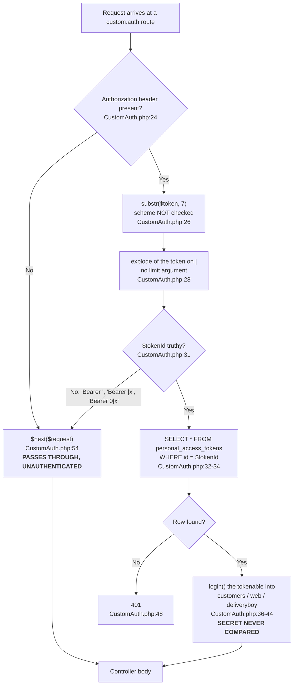

# P0 Security Revalidation

**Purpose.** Phase 0 produced 13 audit documents in `docs/discovery/`. This document re-proves, corrects
or overturns the Phase 0 security findings against the code as it stands at `41fe2f68`, and states for
each one the **reachability chain** — route, every enclosing middleware group, controller line, and who
can reach it. A finding without a reachability chain is a theory; a finding with one is a decision the
owner can act on.

**Scope.** Authentication, authorization, tenant isolation, password reset, privilege boundaries, role
isolation, module/theme install, order mutation, impersonation, configuration exposure, and rate
limiting. The owner named each of these explicitly, so each is addressed below even where the answer is
"no issue found".

**Baseline.** repo-A has **zero** commits since the Phase 0 audit commit `41fe2f68`, so application code
is byte-identical to what Phase 0 audited. This pass is therefore about the **correctness of each
finding**, not about drift.

---

## 0. The two corrections the owner must read first

Revalidation found two places where a Phase 1A specialist note is **wrong**, and in both cases the error
would have changed an implementation decision. They are stated up front rather than buried.

### 0.1 Impersonation is live, routed, and reachable — the REFUTED verdict is overturned

> **SUPERSESSION NOTE — READ THIS BEFORE ANYTHING ELSE IN THIS DOCUMENT.** This pass **reverses** the
> published verdict on SEC-F6. Specialist note `R3-web-authz` recorded it as **REFUTED**; the Phase 0
> audit rated it **HIGH** (and its R-20 restatement called the feature "MISSING — and that is the good
> news"). **All of those verdicts are withdrawn.** The verdict published here is
> **CONFIRMED · CRITICAL · P0 — platform takeover reachable by an anonymous visitor.** §2.10 is the full
> treatment. Nothing has been implemented anywhere in this phase; this is a verdict correction, not a
> code change.

**Why the refutation was wrong, and why it is the most dangerous kind of error.** The note's conclusion
rested on `grep -rn impersonate routes/*.php` returning **no matches**. That grep is **accurate and
reproducible** — re-run in this pass it still returns nothing, and so does the case-insensitive form over
the whole directory:

```
$ grep -rn impersonate routes/*.php      -> (NO OUTPUT, exit status 1)
$ grep -rni "impersonat" routes/         -> (NO OUTPUT, exit status 1)
```

**The command was right and the conclusion was false, because the routes are not named "impersonate".**
They are named `login-with-admin`. A grep keyed on a feature's *name* cannot find a feature whose route
name, URI and handler all use a different word — and a clean grep reads exactly like a clean bill of
health. That is the worst class of false negative: it manufactures positive-looking evidence of absence,
so no reviewer goes back to check.

**The general lesson, and it governs every remaining revalidation in this phase: never conclude absence
from a name-based grep alone.** Absence has to be established from whatever actually enforces the
behaviour — the **call site** (here `Impersonate::`, `canImpersonate`, the trait on the model), the
**registered route table**, or the **vendor API** — never from whether a human-chosen label happens to
appear in a file. Where this document concludes "no such code exists", it states which of those three it
checked.

Searching for the **call site** rather than the feature name is what finds it. The live call uses the
class name with a capital `I`, and the Blade directive lives in `resources/views/`, which the cited grep
did not cover either. A case-insensitive search over the whole non-vendor tree returns the call sites:

```
$ grep -rni "impersonat" --include=*.php app/ routes/ config/ packages/ database/
app/Models/User.php:14:use Lab404\Impersonate\Models\Impersonate;
app/Models/User.php:25:    use HasApiTokens, HasFactory, Notifiable,HasRolesAndPermissions, Impersonate,Billable;
app/Http/Controllers/StoreController.php:28:use Lab404\Impersonate\Impersonate;
app/Http/Controllers/StoreController.php:720:            Impersonate::take($request->user(), $user);
app/Http/Controllers/StoreController.php:727:        Auth::user()->leaveImpersonation($request->user());
config/jwt.php:173:    | should prevent one authentication request from impersonating another,
$ grep -rni "impersonat" --include=*.blade.php resources/
resources/views/partision/header.blade.php:61:                    @impersonating($guard = null)
resources/views/partision/header.blade.php:68:                    @endImpersonating
```

And the routes exist — repo-A `routes/web.php:766-767`:

```php
766    Route::get('store/{id}/login-with-admin', [StoreController::class, 'LoginWithAdmin'])->name('login.with.admin');
767    Route::get('login-with-admin/exit', [StoreController::class, 'ExitAdmin'])->name('exit.admin');
```

**Verdict: SEC-F6 is CONFIRMED — CRITICAL, P0 — not REFUTED.** Full treatment in §2.10. It is a
server-side **platform-takeover** path. The **only** authorization inside the handler is
`auth()->check()` at `app/Http/Controllers/StoreController.php:719` — *is **anyone** logged in*, not *may
**you** do this*. There is **no ownership check, no permission check, no type check and no Policy**, and
`ExitAdmin` (`:725-730`) has no check either. The `type == 'super admin'` test exists only in two Blade
templates, and a Blade `@if` guards the **link**, not the **endpoint**. Chained with open
self-registration (`routes/auth.php:18`, which grants `'type' => 'admin'` at
`app/Http/Controllers/Auth/RegisteredUserController.php:104`) and the `APP_KEY` populated in the
committed `.env`, an **anonymous visitor** can obtain a full authenticated session as **any** user,
including the platform super admin. Severity **CRITICAL**, priority **P0**.

### 0.2 The order-note endpoints DO have a shipped Flutter caller

Specialist note `R2-unauth-admin-api` states, under R2-04, that a search of repo-B "found no caller" for
the order-note endpoints and calls that fix "the lowest-risk fix in the set". That is wrong. The
endpoints are called with hardcoded path strings, so they do not appear in `lib/utils/base_api.dart`,
which is where the note looked:

repo-B `lib/config/repository/order_repository.dart:102-134`:

```dart
102   createNote({ required int orderId, required String noteType, required String note }) async {
107     String endPoint = "/orders/notes/create";
109     var body = { 'store_id': Prefs.getStoreID(), 'order_id': orderId,
112                  'note_type': noteType, 'note': note, };
118     var response = await NetworkHttps.postRequest(endPoint, body);
...
123   deleteNote({ required int orderId, required int noteId }) async {
127     String endPoint = "/orders/notes/delete?store_id=${Prefs.getStoreID()}&order_id=$orderId&note_id=$noteId";
131     var response = await NetworkHttps.deleteRequest(endPoint);
```

Consumed from a post-login screen: repo-B `lib/view/screen/order_screen/order_detail_screen.dart:1546`
(`orderController.deleteOrderNote(`) and `:1852` (`.createOrderNote(`), via
`lib/core/controller/order_controller/order_controller.dart:715` and `:753`.

**The conclusion is still good news, but for a different reason.** Both calls go through
`NetworkHttps.postRequest` and `NetworkHttps.deleteRequest`, which attach the bearer token at
repo-B `lib/network/network.dart:472` and `:896` via `_getAuthHeaders()` (`:54-64`). So adding
`custom.auth` to these two routes is still Flutter-safe — but it is **not** a change to a dead feature,
it touches a live merchant workflow and must be smoke-tested on the app after the route edit. The note's
risk assessment was based on a false premise and should not be relied on.

---

## 1. Revalidation summary table

Verdicts use the Phase 1A vocabulary: **CONFIRMED** (Phase 0 was right), **CONFIRMED_AND_WORSE** (right,
and the real defect is larger), **NARROWED** (Phase 0 overstated; a smaller defensible version holds),
**REFUTED** (not a defect), **BLOCKED** (the environment prevented the check), **NEW** (found during
revalidation).

### 1.1 Authentication — API

| ID | Claim | Phase 0 | Phase 1A verdict | Sev | Pri |
|---|---|---|---|---|---|
| SEC-R1-01 / R2-02 | `CustomAuth` authenticates on `personal_access_tokens.id` and never compares the token secret | CRITICAL | **CONFIRMED_AND_WORSE** | CRITICAL | P0 |
| R2-01 | `CustomAuth` passes anonymous requests through to the controller when no `Authorization` header is present | not recorded | **NEW** | CRITICAL | P0 |
| NEW-custom-auth-forgeable | Same defect, restated from the tenancy side: tenant rules cannot hold above a forgeable identity | not recorded | **NEW** (duplicate of the above, retained for cross-reference) | CRITICAL | P0 |
| NEW-tokens-never-expire | `expires_at` and `abilities` exist in the schema and are never written or read; all tokens carry `['*']` | not recorded | **NEW** | MEDIUM | P2 |
| NEW-sanctum-guard-missing | Ten WorkDo package route files apply `auth:sanctum`; no `sanctum` guard is defined | not recorded | **NEW** | LOW | P3 |
| NEW-unauthenticated-500s | Anonymous requests to `custom.auth` routes crash on a null `Auth::user()` instead of returning 401 | not recorded | **NEW** | LOW | P2 |

### 1.2 Authentication — unauthenticated API surface

| ID | Claim | Phase 0 | Phase 1A verdict | Sev | Pri |
|---|---|---|---|---|---|
| R2-03 / NEW-unauthenticated-admin-list-routes | 7 merchant admin list endpoints carry logging middleware only and take `store_id` from the query string | CRITICAL | **CONFIRMED** | CRITICAL | P0 |
| R2-04 / NEW-unauthenticated-order-notes-write | Order-note create and delete have no middleware at all | grouped with reads | **CONFIRMED_AND_WORSE** (they are writes; and they have a live Flutter caller — §0.2) | HIGH | P0 |
| NEW-delivery-syria-status | `POST /api/delivery-syria/status` has no authentication and makes an authenticated third-party call with the merchant's decrypted credentials | not recorded | **NEW** | HIGH | P1 |
| NEW-zid-debug-endpoint | `GET /api/delivery-syria/zid-statuses-test` is unauthenticated debug scaffolding with a hardcoded store id | not recorded | **NEW** | MEDIUM | P1 |
| (cleared) `POST /api/delivery-syria/orders/update-status` | No middleware | — | **REFUTED as a defect** — the controller self-authenticates correctly (§4.2) | — | — |
| (cleared) `POST /api/admin/adminlogout` | No middleware | — | **REFUTED as a defect** — the controller self-authenticates correctly (§4.2) | — | — |

### 1.3 Authentication — web

| ID | Claim | Phase 0 | Phase 1A verdict | Sev | Pri |
|---|---|---|---|---|---|
| SEC-F2 / NEW-public-mutating-routes | `routes/web.php:939-973` sit inside `web` but outside `auth`, exposing order, refund and settings mutation anonymously | CRITICAL | **CONFIRMED** (boundary verified twice, independently) | CRITICAL | P0 |
| NEW-order-payment-status | The F2 + F7 combination: anonymous arbitrary `payment_status` write on any order in any store | recorded as two separate items | **NEW** (as a single finding) | CRITICAL | P0 |
| NEW-registration-grants-admin | Public self-registration grants `type='admin'`, auto-logs in, and attaches the single global `admin` role | not recorded | **NEW** (the reachability engine for F1/F3/F4/F5) | HIGH | P1 |

### 1.4 Authorization — password reset, privilege boundaries, roles

| ID | Claim | Phase 0 | Phase 1A verdict | Sev | Pri |
|---|---|---|---|---|---|
| SEC-F1 | `StoreController::storeResetPasswordUpdate` has zero authorization; any authenticated user can set any user's password | CRITICAL | **CONFIRMED_AND_WORSE** (the POST handler uses the **raw**, undecrypted id) | CRITICAL | P0 |
| SEC-F4 | `UserController::update` — mass-assignment privilege escalation plus cross-tenant user edit | CRITICAL | **CONFIRMED_AND_WORSE** (a third limb: `password` is fillable and `hashed`-cast) | CRITICAL | P0 |
| SEC-F3 | `RoleController::update` — any merchant can rewrite any role, and it overwrites `users.type` platform-wide | CRITICAL | **CONFIRMED_AND_WORSE** (the worse exploit needs no knowledge of the super-admin role id) | CRITICAL | P0 |
| NEW-audit-oldvalues | `$oldValues` is used six lines before it is defined, so every user-change audit record stores null previous values | not recorded | **NEW** | MEDIUM | P2 |

### 1.5 Authorization — module/theme install, order mutation, impersonation

| ID | Claim | Phase 0 | Phase 1A verdict | Sev | Pri |
|---|---|---|---|---|---|
| SEC-F5 | `AddonController::ThemeInstall` and `ModuleController::install` extract attacker-supplied archives with no authorization and no file validation | CRITICAL | **CONFIRMED** (extraction directory UNKNOWN / deployment-dependent; RCE either way) | CRITICAL | P0 |
| SEC-F7 | `order_payment_status`, `updateStatus`, `order_assign`, `destroy` lack permission checks and tenant scoping | CRITICAL | **CONFIRMED** (with a correction: `order_assign` IS inside the `auth` group) | CRITICAL / HIGH | P0 / P1 |
| SEC-F6 | Impersonation via `lab404/laravel-impersonate` is unrestricted — `auth()->check()` is the only server-side gate, so an anonymous visitor can take the platform over | HIGH (withdrawn) | **CONFIRMED** — §0.1 overturns the R3 note's **REFUTED** verdict **and** Phase 0's HIGH rating; both are superseded | CRITICAL | P0 |

### 1.6 Tenant isolation

| ID | Claim | Phase 0 | Phase 1A verdict | Sev | Pri |
|---|---|---|---|---|---|
| R4-01 | Zero global scopes, zero `Scope` classes, no `app/Policies`, zero `authorize()` calls, one `permission:` middleware declaration | measured | **CONFIRMED** (re-measured independently) | HIGH | P0 |
| R4-02 | `getCurrentStore()` resolves the tenant from the `web`-guard user only and returns `null` for anonymous, customer, delivery-boy, job and command contexts | partial | **CONFIRMED** | HIGH | P0 |
| R4-03 / R2-05 | `changeStore` (web) and `ChangeStore` (API) write `users.current_store` to any store id with no ownership check | missing scopes | **CONFIRMED_AND_WORSE** (the resolver itself is attacker-controlled; the `is_active` guard is a dead `=` typo) | CRITICAL | P0 |
| R4-04 | Cross-tenant IDOR through implicit route-model binding — 68 bound tenant-owned models, none ownership-checked | CRITICAL | **CONFIRMED_AND_WORSE** | CRITICAL | P0 |
| NEW-finance-authorization / NEW-withdrawal-authz | The only `permission:` middleware protects the finance **read**; every finance mutator route carries no middleware, and three withdrawal state-changers have no controller check | not recorded | **NEW** | CRITICAL | P0 |
| NEW-viewusedcoupon-unscoped | `ViewUsedCoupon` resolves `$store` and then ignores it | not recorded | **NEW** | HIGH | P1 |
| NEW-settings-fail-open | `Utility::GetValueByName` drops its `store_id` predicate when the tenant is unknown; `GetValByName`'s cache key omits the setting name and collapses to one shared bucket | not recorded | **NEW** | HIGH | P1 |
| NEW-client-supplied-store-id (R7-N2) | The Flutter app supplies `store_id` from unencrypted local storage in 28 files | not recorded | **NEW** — resolved by this pass: the backend does **not** validate it on the seven list endpoints, so it is exploitable (§2.11.8) | HIGH | P0 |
| R4-05 | The manual `where('store_id', …)` filters can coexist with a global scope, but 780 pass a foreign store id, 40 `orWhere` sites may escape it, and 146 `DB::table()` sites bypass Eloquent entirely | measured | **CONFIRMED** | HIGH | P1 |
| NEW-model-caching-risk | 78 of 95 models use `Cachable` with no config file and a shared file cache store; key derivation unverifiable | not recorded | **BLOCKED** — vendor incomplete | HIGH | P0 gate |
| R4-06 | No evidence forces abandoning the shared-database model | conclusion | **CONFIRMED** | LOW | P3 |

### 1.7 Configuration exposure

| ID | Claim | Phase 0 | Phase 1A verdict | Sev | Pri |
|---|---|---|---|---|---|
| SEC-ENV-01 | `.env` is committed in history and still tracked at HEAD; `.gitignore` does not mention it | CRITICAL | **CONFIRMED_AND_WORSE** (re-verified here: `git ls-files --error-unmatch .env` succeeds) | CRITICAL | P0 |
| SEC-CFG-02 | Hardcoded credential literals in `config/` | HIGH | **NARROWED** — four literals confirmed at the exact lines, but they are not uniformly severe (§3.4) | HIGH / LOW | P0 / P1 |

### 1.8 Rate limiting

| ID | Claim | Phase 0 | Phase 1A verdict | Sev | Pri |
|---|---|---|---|---|---|
| SEC-R1-02 / R2-07 / NEW-throttle-bypass | `ThrottleRequests` is not applied to the `api` middleware group; `RateLimiter::for('api')` is dead code | HIGH | **CONFIRMED** | HIGH | P1 |
| NEW-adminlogin-duplicate-route-throttle-bypass | `DashboardController::login` is registered twice; the URI the shipped app calls is the unthrottled one | not recorded | **NEW** | HIGH | P1 |

### 1.9 Flutter (repo-B) — items bearing on the security fixes

| ID | Claim | Phase 0 | Phase 1A verdict | Sev | Pri |
|---|---|---|---|---|---|
| SEC-20a / R7-02 | The merchant's e-mail and plaintext password are written to the device log on every login attempt | HIGH | **CONFIRMED** at the exact line | HIGH | P0 (app track) |
| SEC-20b / R7-03 | The bearer token is printed on every cold start | not recorded | **CONFIRMED_AND_WORSE** (new site, wider window) | HIGH | P0 (app track) |
| SEC-20c / R7-04 | The network layer logs the bearer token | HIGH | **NARROWED** — it never logs the `Authorization` header; it logs every full response body | MEDIUM | P1 |
| SEC-21 / R7-01 | The Android release buildType is signed with the debug keystore | CRITICAL | **CONFIRMED** | HIGH | P0 (app track) |
| R7-N1 / NEW-auth-header-six-sites | The `Authorization` header is constructed in six places, four of them bypassing the network layer | not recorded | **NEW** | MEDIUM | P2 |
| R7-09 | No certificate pinning | HIGH | **CONFIRMED but DEFERRED** — and nothing weakens TLS either (§4.3) | LOW | P3 |

**Counts — derived from the tables above, with the method stated so anyone can reproduce them.** The
§1.1-§1.9 tables carry **43 data rows**. By the leading verdict token in each verdict cell:
**9 CONFIRMED_AND_WORSE, 13 CONFIRMED** (12 plain plus R7-09's "CONFIRMED but DEFERRED"),
**2 NARROWED, 2 REFUTED** (the two "REFUTED as a defect" rows in §1.2), **16 NEW, 1 BLOCKED** —
9+13+2+2+16+1 = **43**. Of the 43 rows, **41 carry finding IDs**; the other two are those same
"(cleared)" rows in §1.2, which are route-table appearances this pass cleared rather than Phase 0
findings. The 41 ID-bearing rows expand to **54 individual IDs** when compound entries such as
`SEC-R1-01 / R2-02` are counted separately.

**SEC-F6 is counted under CONFIRMED and is deliberately NOT in the REFUTED set.** Its REFUTED verdict was
withdrawn by §0.1. The only REFUTED rows in the tables are the two "(cleared)" API routes (§4.1, §4.2).
§4 additionally records three **supporting non-issues** (§4.3, §4.4, §4.5). They carry no summary-table
row and so are **not in the count above**; they are recorded so nobody over-scopes a fix.

**A previously published aggregate is withdrawn here.** An earlier revision of this line gave
"11 CONFIRMED_AND_WORSE, 14 CONFIRMED, 3 NARROWED, 3 REFUTED, 18 NEW, 1 BLOCKED" for "the items in this
document" — a total of 50, which **does not reconcile against the 43 table rows** and mixes
table-row counts with findings discussed in §2-§7 that have no summary-table row of their own. The
table-derived figures above replace it. **The rule applied here, and it applies to every headline number
in this phase: publish the arithmetic or quote the document-verifiable figure.** Any larger headline (for
example a "99 revalidated items" count) is **not reconcilable from the tables published here** and must
arrive with its own derivation or be replaced by **43 rows / 41 IDs-bearing rows / 54 IDs**.

---

## 2. Confirmed findings, in full

Each subsection gives: the evidence with a quoted snippet at `path:line`; the **reachability chain**
(route → every enclosing middleware group → controller line → who can reach it); the impact; the minimal
Laravel-native fix naming exact files and mechanism; the blast radius; what previously-permitted
behaviour the fix intentionally rejects; and the regression test that proves it.

**Every fix below is a PROPOSAL. Nothing has been applied.**

---

### 2.1 API authentication — `CustomAuth` is not an authentication gate

**ID:** SEC-R1-01 + R2-01 + R2-02 + NEW-custom-auth-forgeable · **Verdict: CONFIRMED_AND_WORSE** ·
**Severity: CRITICAL · Priority: P0**

Phase 0 said "API authentication does not work." That is correct, and it is three independent defects in
one 34-line method, not one.

#### Evidence

repo-A `app/Http/Middleware/CustomAuth.php:21-55`, re-read in full this phase (the file is 56 lines):

```php
21    public function handle(Request $request, Closure $next): Response
22    {
23        $token = $request->header('Authorization');
24        if ($token) {
25            // Extract the token part from the Authorization header
26            $token = substr($token, 7);
27            // Extract the user ID and token from the token string
28            $token = explode('|', $token);
29            $tokenId = $token[0] ?? null;
30            // Check if the token exists in the personal_access_tokens table
31            if ($tokenId) {
32                $tokenExists = \DB::table('personal_access_tokens')
33                ->where('id', $tokenId)
34                ->first();
35                if ($tokenExists) {
36                    if ($tokenExists->tokenable_type == 'App\Models\Customer') {
37                        $customer = Customer::find($tokenExists->tokenable_id);
38                        auth('customers')->login($customer);
39                    } elseif ($tokenExists->tokenable_type == 'App\Models\User') {
40                        $user = User::find($tokenExists->tokenable_id);
41                        auth()->login($user);
42                    } elseif ($tokenExists->tokenable_type == 'App\Models\DeliveryBoy') {
43                        $user = DeliveryBoy::find($tokenExists->tokenable_id);
44                        auth('deliveryboy')->login($user);
45                    }
46
47                } elseif ($tokenId && !$tokenExists) {
48                    return $this->error(['message' => __('Unauthenticated.')], __('Unauthenticated.'), 401 );
49                }
50            }
51
52        }
53
54        return $next($request);
55    }
```

`grep -c hash_equals app/Http/Middleware/CustomAuth.php` → **0**.

**Defect 1 — forgery by integer.** Line 28 splits the header on `|`; line 29 keeps only field 0; lines
32-34 look the row up by **`id`**, the auto-increment primary key
(`database/migrations/2019_12_14_000001_create_personal_access_tokens_table.php:15` declares
`$table->id()`). The 40-character plaintext secret — `$token[1]` — is parsed off at line 28 and **never
referenced again**. The `token` column, which holds the SHA-256 of the secret, is never read. So
`Authorization: Bearer 7|anythingatall`, and equally `Authorization: Bearer 7`, authenticate as the owner
of `personal_access_tokens.id = 7`. Token ids are small sequential integers.

**Defect 2 — silent anonymous pass-through.** There is no `else` on line 24 and no `abort()`. A request
with **no** `Authorization` header falls from line 24 straight to line 54 and `$next($request)` runs with
no authenticated principal and no error. The only 401 in the file, line 48, is reachable *only* when a
header was supplied **and** the id did not match a row. (Line 47's `elseif ($tokenId && !$tokenExists)`
is dead weight — both conditions are already guaranteed by lines 31 and 35.)

**Defect 3 — no expiry, no abilities, no `last_used_at`.** `expires_at` and `abilities` exist in the
schema (same migration, `:19` and `:21`) and are never read. Nothing writes `last_used_at`.

Also note line 26: `substr($token, 7)` blindly drops seven characters with no
`str_starts_with($token, 'Bearer ')` check, so any seven-character scheme prefix is accepted; and line 28
has **no limit argument**, unlike the correct implementation below.



#### The correct implementation already exists, 40 lines away

repo-A `app/Http/Controllers/Api/DashboardController.php:595-643` (`logouto`), re-read in full:

```php
599    if (!$authorization || !str_starts_with($authorization, 'Bearer ')) {   // scheme IS checked
600        return $this->error([...], __('Unauthenticated.'), 401);
605    }
607    $plainTextToken = substr($authorization, 7);
608    $parts = explode('|', $plainTextToken, 2);                              // limit 2
610    $tokenId = $parts[0] ?? null;
611    $tokenValue = $parts[1] ?? null;
613    if (!$tokenId || !$tokenValue) {                                        // BOTH halves required
614        return $this->error([...], __('Unauthenticated.'), 401);
619    }
621    $token = \DB::table('personal_access_tokens')
622        ->where('id', $tokenId)
623        ->first();
625    if (
626        !$token ||
627        !hash_equals($token->token, hash('sha256', $tokenValue))            // THE MISSING LINE
628    ) {
```

Exactly four things `logouto` does that the middleware does not: requires the `Bearer ` scheme; uses
`explode` limit 2 so the secret survives intact; requires both halves; and performs a timing-safe
`hash_equals` of the stored SHA-256 against the SHA-256 of the presented secret. The author knew the
correct shape and did not apply it to the middleware.

#### Reachability chain

Measured, with the exact commands and their real output:

```
$ grep -rn "custom\.auth" --include=*.php routes packages app config | wc -l   ->  189
$ grep -rln "custom\.auth" --include=*.php routes packages app config         ->  routes/api.php   (ONLY file)
$ grep -c  "custom\.auth" routes/api.php                                      ->  189
$ grep -c "^\s*Route::\(get\|post\|put\|patch\|delete\|any\|match\)" routes/api.php  ->  211
$ grep -n "Route::group\|Route::prefix\|Route::middleware\|->group(" routes/api.php
26:// Route::middleware('auth:sanctum')->get('/user', function (Request $request) {    <- COMMENTED OUT
133:Route::prefix('admin')->as('admin.')->group(function(){
```

Occurrences equal lines, so there is exactly one alias per line: **189 distinct routes**, all in
`routes/api.php`. `packages/` contains **zero** uses. There is exactly **one** `Route::group` in the whole
file — `routes/api.php:133`, closing at `:369` — and it declares **no middleware**, only
`prefix('admin')` (a URI prefix) and `as('admin.')` (a name prefix). The only outer layer is the `api`
group applied by `app/Providers/RouteServiceProvider.php:36-38`.

**Complete chain for a protected route:**
`[api group] → custom.auth → APILog | AdminApiLog → controller`.
`APILog` and `AdminApiLog` are pure pass-throughs — `app/Http/Middleware/AdminApiLog.php:19-22` is
`return $next($request);` and nothing else. **Nothing in that chain would reject an unauthenticated
caller first.**

Two concrete paths:

| Route | File:line | Chain | Controller |
|---|---|---|---|
| `POST /api/{slug}/place-order` | `routes/api.php:104` | `[api]` → `custom.auth` → `APILog` | `ApiController::place_order` |
| `POST /api/admin/dashboard` | `routes/api.php:162` | `[api]` → `custom.auth` → `AdminApiLog` | `DashboardController::dashboard` (`:646`) |

**Who can reach it:** anyone, anonymous, over the public internet, on all 189 routes — and thereby become
any merchant/admin `User`, any `Customer` or any `DeliveryBoy`, selected by guessing a small sequential
integer. With no header at all, the request still reaches the controller body un-authenticated.

#### Impact

This defect **defeats every correct ownership predicate in the codebase**. The guards at
`DashboardController.php:4609-4611`, `:6604-6610`, `:7412-7414` and `:3607-3609` are all written
correctly and all scope to the authenticated user's id — and all of them are satisfied by an attacker who
simply picked that merchant's token id. `DELETE /api/admin/destroyCustomer` (`routes/api.php:215`),
`POST /api/admin/wallet/add-balance` and `DELETE /api/admin/deletestore` (`:312`) are all in reach.

#### Minimal Laravel-native fix — PROPOSED, NOT APPLIED

**Option B: keep the `custom.auth` shell; delegate to Sanctum's own lookup.** ~25 lines in **one file**
(`app/Http/Middleware/CustomAuth.php:21-55`). No route edit, no config edit, no controller edit.
`laravel/sanctum v4.0.5` is already pinned in `composer.lock`, and `PersonalAccessToken` is already
imported (unused) in the sibling middleware `app/Http/Middleware/AdminApiLog.php:8`.

Proposed body:

1. `$bearer = $request->bearerToken();` — Laravel's own scheme-correct parser.
2. `if (!$bearer) { return $this->error(['message' => __('Unauthenticated.')], __('Unauthenticated.'), 401); }`
   — this closes the pass-through, and it is the one intentionally behaviour-changing line.
3. `$accessToken = \Laravel\Sanctum\PersonalAccessToken::findToken($bearer);` — one call replaces all
   four missing checks: it splits on `|` with limit 2, finds by id, and verifies with
   `hash_equals(stored, sha256(presented))`.
4. `if (!$accessToken) { return 401; }`
5. `if ($accessToken->expires_at && $accessToken->expires_at->isPast()) { return 401; }`
6. `$tokenable = $accessToken->tokenable;` then **reuse the existing `tokenable_type` branch at lines
   36-44 verbatim** to `->login()` into `customers` / `web` / `deliveryboy`. Preserving the current guard
   semantics exactly is what keeps the **228** `auth('customers')` and **8** `auth('deliveryboy')` call
   sites working (both counts re-measured this phase with
   `grep -rn "auth('customers')" --include=*.php app/ | wc -l`).
7. `$accessToken->forceFill(['last_used_at' => now()])->save();` for an audit trail.

Reuse the 401 envelope that already exists in the same file at line 48 (`$this->error([...], 401)` via
the `ApiResponser` trait), so the JSON response shape the Flutter app parses is unchanged.

Prefer `->setUser()` over `->login()` so no session is written on a stateless API — but defer that to a
separate commit, because `->login()` is current behaviour and this change must alter exactly one thing.

**Option A — swapping the alias for `auth:sanctum` — is REJECTED on two hard blockers, both re-verified:**

```
$ grep -n "sanctum" config/auth.php      ->  (no output)
$ ls config/sanctum.php                  ->  No such file or directory
```

`config/auth.php:38-51` defines exactly three guards — `web`, `customers`, `deliveryboy` — **all with
`'driver' => 'session'`**. There is no `sanctum` guard, so `auth:sanctum` would throw
`Auth guard [sanctum] is not defined` → HTTP 500 on all 189 routes. And even after adding the guard,
Sanctum populates the `sanctum` guard while 236 call sites read `auth('customers')` /
`auth('deliveryboy')` — a 236-site refactor masquerading as a one-line config change. A hybrid (add the
guard **and** keep Option B's `->login()` into the legacy guards) is a reasonable Phase 2 convergence
step, not the minimal Phase 1 fix.

#### Blast radius

Everything behind the 189 routes in `routes/api.php`: customer storefront browse/cart/checkout, merchant
admin CRUD for products/categories/coupons/tax/shipping/reviews/stores, the delivery-boy order flow,
delivery-boy account management, store-wallet credit/debit (`routes/api.php:361-366`), store FCM token
registration (`:147-150`) and order status updates (`:154-157`). Consumers: the Flutter merchant app and
any storefront client. **No WorkDo addon is affected** (`grep -rn custom.auth packages/ | wc -l` → 0) and
`routes/web.php`, `routes/customer.php` and `routes/auth.php` are untouched, so the Blade admin and
storefront are out of scope. That API-only blast radius is precisely why a single-file fix is viable.

Note `DashboardController.php:584` — `$user->tokens()->delete();` on every successful login — so there is
one active token per user, and a successful brute-forcer also evicts the legitimate user.

#### What the fix intentionally rejects

Exactly one class of previously-permitted behaviour, and it is the point of the fix:

- forged `Bearer <id>` requests → 401;
- **header-less requests that today pass through to the controller → 401.**

The second is the one to watch. `routes/api.php:61,64,66,73,77,80,83,85,105,112,118,120` are named
`*-guest` (`search-guest`, `place-order-guest`, `product-detail-guest`, `tax-guest`, …) yet they carry
`custom.auth`. They "work" for anonymous callers **only because the middleware leaks.**

**This is a decision the owner must make before the fix ships, and it is a gate, not an afterthought.**
Evidence that points to keeping the gate: the vendor's own API documentation in-repo,
`packages/workdo/Api/src/documentation/theme.json`, declares an `Authorization: Bearer {id}|{secret}`
header on 77 of 79 documented endpoints **including all 11 `*-guest` endpoints**, and the only two
token-free ones are customer register and customer login — exactly the two routes that carry no
`custom.auth`. So closing the pass-through **aligns the server with its own published contract**. The one
unresolved case is `place-order-guest`, which is absent from that documentation, and
`resources/views/AppSetting/mobile_content.blade.php:106` hands merchants an `/api/{slug}` base URL for a
customer storefront app that is **not in this repository pair**. See §8.2.

Compatibility note for the release notes: *"API endpoints now reject requests without a valid bearer
token. Requests that previously succeeded un-authenticated will receive HTTP 401. This is an intentional
security fix."*

#### Regression test

New file `tests/Feature/Api/CustomAuthMiddlewareTest.php`, SQLite in-memory (gated on §8.1 landing first):

| Test | Asserts | Status today |
|---|---|---|
| `test_request_with_no_authorization_header_is_rejected` | POST a `custom.auth` route with no header → 401, **and** `Auth::guard('customers')->guest()` | **FAILS** — the pass-through proof |
| `test_token_id_without_secret_is_rejected` | mint a token for user A, send `Bearer {$id}` → 401 | **FAILS** — the forgery proof |
| `test_token_id_with_wrong_secret_is_rejected` | send `Bearer {$id}\|` . `str_repeat('a', 40)` → 401 | **FAILS** |
| `test_valid_plain_text_token_authenticates_correct_tokenable` | use the real `$customer->createToken('auth_token')->plainTextToken` → 200 and `auth('customers')->id() === $customer->id` | passes — **this is the Flutter-compatibility assertion** |
| `test_token_belonging_to_user_cannot_authenticate_as_customer` | two tokenable types sharing one integer id space; the `User` token must not populate the `customers` guard | unknown |
| `test_expired_token_is_rejected` | `expires_at` in the past → 401 | **FAILS** |
| `test_malformed_headers_are_rejected` | data provider over `['Bearer ', 'Bearer \|x', 'Bearer 0\|x', 'Basic 1\|x', 'Token  1\|x', '1\|secret']` → 401 for every case | **FAILS for every case** |
| `test_last_used_at_is_updated_on_successful_auth` | the column is written | **FAILS** |

Every "FAILS" above is a reasoned prediction from code that was read, not an observed result. **No test
was run.**

---

### 2.2 Unauthenticated admin API — seven cross-tenant read endpoints

**ID:** R2-03 + NEW-unauthenticated-admin-list-routes · **Verdict: CONFIRMED** ·
**Severity: CRITICAL · Priority: P0**

This finding is **independent of §2.1**. These routes do not *rely* on the broken middleware — they have
no `custom.auth` at all — so fixing `CustomAuth` leaves them wide open. Shipping §2.1 alone would read as
"API auth fixed" while these stayed anonymous.

#### Evidence

repo-A `routes/api.php:163-169`, verbatim, inside the group opened at `:133` that declares no middleware:

```php
163    Route::get('categorylist', [DashboardController::class, 'CategoryList'])->middleware(['AdminApiLog']);
164    Route::get('productlist', [DashboardController::class, 'ProductList'])->middleware(['AdminApiLog']);
165    Route::get('variantlist', [DashboardController::class, 'VariantList'])->middleware(['AdminApiLog']);
166    Route::get('orderlist', [DashboardController::class, 'OrderList'])->middleware(['AdminApiLog']);
167    Route::get('couponlist', [DashboardController::class, 'CouponList'])->middleware(['AdminApiLog']);
168    Route::get('shippinglist', [DashboardController::class, 'ShippingList'])->middleware(['AdminApiLog']);
169    Route::get('taxlist', [DashboardController::class, 'TaxList'])->middleware(['AdminApiLog']);
```

The omission is an oversight, not a design choice: the immediate neighbours at `:161-162` (`currency`,
`dashboard`) and `:171-173` (`addcategory`, `updatecategory`, `deletecategory`) **all** carry
`custom.auth`.

The controllers take the tenant straight from the request, with no auth call and no ownership predicate.
`app/Http/Controllers/Api/DashboardController.php:798-805`:

```php
798    public function CategoryList(Request $request)
799    {
800        $store = Store::find($request->store_id);
801        if (empty($store)) {
802            return $this->error(['message' => __('Store not found!')]);
803        }
804
805        $Category = Category::where('store_id', $store->id)->OrderBy('id', 'desc')->paginate(10);
```

`OrderList` is the instructive one — `:907-926`:

```php
907 public function OrderList(Request $request)
908 {
909     $request->validate([
910         'store_id' => ['required', 'integer'],
911         'delivered_status' => ['nullable', 'integer', 'in:0,1,2,3,4,5,6'],
912         'payment_status' => ['nullable', 'string'],
913         'from_date' => ['nullable', 'date'],
914         'to_date' => ['nullable', 'date', 'after_or_equal:from_date'],
915         'per_page' => ['nullable', 'integer', 'min:1', 'max:100'],
916     ]);
917
918     $store = Store::find($request->store_id);
...
926     $query = Order::where('store_id', $store->id);
```

It **type-validates the attacker's input and then trusts it.** Validation is not authorization — and this
is the clearest instance of that confusion in the API layer.

Per-endpoint tenant source, each line re-opened:

| Route line | Method | Tenant source | path:line |
|---|---|---|---|
| 163 | `CategoryList` | `Store::find($request->store_id)` | `:800` |
| 164 | `ProductList` | `Store::find($request->store_id)` | `:816` |
| 165 | `VariantList` | `Store::find($request->store_id)` | `:889` |
| 166 | `OrderList` | validated, then `Store::find($request->store_id)` | `:910`, `:918` |
| 167 | `CouponList` | `Store::find($request->store_id)` | `:1022` |
| 168 | `ShippingList` | `Store::find($request->store_id)` | `:1038` |
| 169 | `TaxList` | `Store::find($request->store_id)` | `:1054` |

#### Reachability chain

`GET /api/admin/orderlist?store_id=1`
→ `[api group]` (nothing authenticating, proven in §2.1)
→ `AdminApiLog::handle` returns `$next($request)` unchanged (`app/Http/Middleware/AdminApiLog.php:19-22`)
→ `DashboardController::OrderList` (`:907`).

`DashboardController` has no `__construct`, so there is no controller-level middleware.

**Who can reach it: anyone, anonymous, with no header of any kind and no cookie — a GET from a browser
address bar.** `store_id` is a small integer, so every tenant on the platform is enumerable.

#### Impact

What an anonymous caller obtains, per order, for any `store_id` they choose:

- **the customer's first and last name**, falling back to **the customer's e-mail address** —
  `app/Models/Order.php:49-57` declares `'user_name'` in `$appends` and `:209-219` implements
  `getUserNameAttribute()` as
  `trim(($customer->first_name ?? '') . ' ' . ($customer->last_name ?? ''))` with an e-mail fallback;
  `Order` declares no `$hidden`;
- `customer_id`, `is_guest`, `product_json` (the full serialized basket);
- the complete money trail — `product_price`, `coupon_price`, `delivery_price`, `tax_price`,
  `final_price`, `return_price`, `currency_code`, `currency_symbol`;
- `payment_type`, `payment_status`, `payment_comment`, `delivery_comment`, `additional_note`;
- `deliveryboy_id`, `delivered_status` and the full fulfilment timeline.

Plus, from the sibling routes: the complete product catalogue **including `cost_price`**
(`DashboardController.php:850` — the merchant's buy price, i.e. their margin), the coupon list with
codes, and the shipping and tax configuration. Because `:928-942` expose `delivered_status`,
`payment_status` and date-range filters, an attacker can query "all paid orders in the last week" across
every store. That is a usable competitive-intelligence feed, not merely a leak.

#### Minimal Laravel-native fix — PROPOSED, NOT APPLIED

**Two halves, and the first alone looks like a fix and is not. Say so plainly to the owner.**

**Half 1 — authentication (7 single-token edits).** Add `'custom.auth'` as the first element of each
existing `middleware([...])` array at `routes/api.php:163-169`, matching the file's own idiom exactly.

**Half 2 — the tenant check (§2.11.8).** These controllers need `store_id` to belong to the authenticated
user. The canonical predicate already exists **four times in this same file**;
`DashboardController.php:6604` is the clearest form:

```php
$store = \App\Models\Store::where('id', $storeId)->where('created_by', $adminUser->id)->first();
if (!$store && $adminUser->type !== 'super admin') {
    return response()->json([... 403]);
}
```

Preferably extract it once as a **private** `DashboardController::resolveOwnedStore(Request $request)` —
not a new class, not a service layer — so there is one place to audit, and keep the super-admin escape
hatch exactly as `:6605` and `:4614-4622` already express it.

**Do not introduce a global `store_id` scope for this.** The owner's principles forbid blanket global
scopes, `Store::find()` is used legitimately elsewhere, and §2.11.7 shows why a scope here would be actively
dangerous until the model-caching gate is green. Fix the seven call sites.

#### Blast radius

Seven read endpoints covering orders, products, variants, categories, coupons, shipping and tax — the
merchant dashboard's core data. Six of the seven are called by the Flutter app. Because half 2 adds an
ownership predicate, it also touches the super-admin path: a super admin browsing another merchant's
store must still work, which `DashboardController.php:4614-4622` shows how to preserve.

#### What the fix intentionally rejects

Anonymous reads of merchant data stop working. Intentional, and it needs no apology.

**The pre-merge check that the R1 and R2 notes both flagged as unrun has now been run, and it passes.**
All six Flutter-called list endpoints go through `NetworkHttps.getRequest`, which attaches the bearer
token:

```
$ grep -rln "categoryListUrl\|productListUrl\|orderListUrl\|couponListUrl\|shippingListUrl\|taxListUrl" lib/ --include=*.dart
lib/config/repository/product_repository.dart
lib/config/repository/order_repository.dart
lib/config/repository/category_repository.dart
lib/config/repository/shipping_repository.dart
lib/config/repository/tax_repository.dart
lib/config/repository/coupon_repository.dart
lib/utils/base_api.dart
```

each using `NetworkHttps.getRequest` (e.g. `category_repository.dart:8`, `product_repository.dart:12`,
`order_repository.dart:41`, `shipping_repository.dart:10`, `tax_repository.dart:10`,
`coupon_repository.dart:10`). And **no pre-login screen calls any of them** — the only screens reachable
before login are `lib/view/screen/onboarding_screen/`, `lib/view/screen/auth/login_widget.dart` and
`lib/view/screen/welcome_screen.dart`, none of which references a repository. `variantlist`
(`routes/api.php:165`) has **zero** Flutter callers and is absent from `lib/utils/base_api.dart`.

Separately verified: `ANY /api/admin/base_url` (`routes/api.php:160`, also unauthenticated) is called
only from `lib/config/repository/dashboard_repository.dart:8`, whose single caller is
`lib/core/controller/home_controller/home_controller.dart:106` — the post-login dashboard.

#### Regression test

New file `tests/Feature/Api/AdminListEndpointAuthTest.php`:

- `test_admin_list_routes_require_authentication` — data provider over all seven URIs; GET with no
  header; assert 401. **FAILS today**, returning 200 with data.
- `test_orderlist_rejects_authenticated_caller_for_a_store_they_do_not_own` — authenticate as merchant B,
  pass merchant A's `store_id`; assert 403 **and**
  `assertJsonMissing(['user_name' => $customerA->first_name.' '.$customerA->last_name])`. **This one fails
  even after half 1** and is the assertion that proves half 2 landed.
- `test_orderlist_returns_own_store_orders` — the positive case.

Parameterise over all seven so none is fixed and the others forgotten.

---

### 2.3 Unauthenticated admin API — two order-note WRITE endpoints

**ID:** R2-04 + NEW-unauthenticated-order-notes-write · **Verdict: CONFIRMED_AND_WORSE** ·
**Severity: HIGH · Priority: P0**

#### Evidence

repo-A `routes/api.php:203-211`, verbatim, inside the middleware-less `admin` group:

```php
203      Route::post(
204        '/orders/notes/create',
205        [DashboardController::class, 'AddOrderNote']
206    );
207
208    Route::delete(
209        '/orders/notes/delete',
210        [DashboardController::class, 'DeleteOrderNote']
211    );
```

**There is no `->middleware()` call at all on either** — unlike the seven routes in §2.2, these lack even
`AdminApiLog`, so the writes are not logged.

The controller validates shape only — `app/Http/Controllers/Api/DashboardController.php:88-114`:

```php
88 public function AddOrderNote(Request $request)
89 {
90     $validator = \Validator::make($request->all(), [
91         'store_id' => 'required|integer',
92         'order_id' => 'required|integer',
93         'note' => 'required|string|max:5000',
94         'note_type' => 'required|string|in:private_note,to_customer',
95     ]);
...
103     $store = Store::find($request->store_id);
...
111     $order = Order::query()
112         ->where('id', $request->order_id)
113         ->where('store_id', $store->id)
114         ->first();
```

`store_id` and `order_id` are entirely attacker-supplied, and there is no `Auth::user()` check anywhere in
the validated block. The object-to-tenant scoping at `:111-114` is **already correct** — it simply scopes
the order to the attacker's chosen store. That is the whole shape of the defect: the scoping is right and
the `$store` it scopes to is untrustworthy.

`DeleteOrderNote` (`:150-200`) has the same shape and ends in `$note->delete()` at `:195`.

#### Reachability chain

`POST /api/admin/orders/notes/create` with body
`{"store_id":1,"order_id":1,"note":"…","note_type":"to_customer"}`
→ `[api group]`
→ `DashboardController::AddOrderNote` (`:88`)
→ `INSERT`.

Nothing in between. These are `/api/*` routes, so Laravel's CSRF middleware — which lives in the `web`
group — is not in play; no token is needed.

**Who can reach it: anyone, anonymous, on the internet.**

#### Impact

`note_type` is constrained to `in:private_note,to_customer` (`:94`). **`to_customer` is the one an
attacker would pick**: it writes up to 5,000 characters of attacker-controlled text into a note the
merchant's customer sees against their own order. That is stored content injection into the
merchant–customer relationship wearing the merchant's identity — a phishing vector, not merely a
data-integrity bug. `AddOrderNote:138` returns the new note's id, and `note_id` is a small integer, so
`DeleteOrderNote` can be walked to destroy every note in the system.

#### Minimal Laravel-native fix — PROPOSED, NOT APPLIED

Add `->middleware(['custom.auth', 'AdminApiLog'])` to both registrations at `routes/api.php:203-206` and
`:208-211`. Two route edits, zero controller change. The ownership predicate on `$store` is the same
follow-up as §2.2 half 2 and is needed for the same reason: `custom.auth` alone requires only *some*
valid token.

Adding `AdminApiLog` additionally starts logging these calls, which is desirable and affects no client —
but note it must land **after** the log-redaction fix (§2.11), or the new log lines are themselves a
disclosure channel.

**Mechanical hazard for the implementer.** These are the only **multi-line** route registrations in the
affected set. Adding `->middleware([...])` to `:203-206` and `:208-211` **adds lines**, so every line
number below `:211` shifts: `changestore` (`:305`), `view-used-coupon` (`:310`), `delivery-syria/status`
(`:376`) and `zid-statuses-test` (`:381`). **Every later change to this file must locate routes by URI
and controller method, never by the line numbers printed in this document.**

#### Blast radius

Two write endpoints on order notes, plus — per §0.2 — a **live Flutter feature**: the order-detail notes
panel at repo-B `lib/view/screen/order_screen/order_detail_screen.dart:1546` and `:1852`. The calls
already carry the bearer token (repo-B `order_repository.dart:118`, `:131` →
`lib/network/network.dart:472`, `:896` → `_getAuthHeaders()` at `:54-64`), so the route edit is
compatible. It is not, however, a change to dead code, and it must be smoke-tested in the app.

#### What the fix intentionally rejects

Unauthenticated note writes and deletes stop working (401). Compatibility note: order-note create and
delete now require authentication.

#### Regression test

- `test_order_note_create_requires_authentication` — POST a valid body with **no** `Authorization`
  header; assert 401 **and** `assertDatabaseCount('order_notes', 0)`. **FAILS today**: returns 200 and
  writes one row.
- `test_order_note_delete_requires_authentication` — same for the DELETE. **FAILS today.**
- `test_merchant_cannot_add_note_to_another_stores_order` — merchant A's token, merchant B's `order_id`;
  assert 403 and that `order_notes` is unchanged. **Fails even after the route edit** — it proves the
  ownership half.

---

### 2.4 Web route-group boundary — administrative routes outside `auth`

**ID:** SEC-F2 + NEW-public-mutating-routes · **Verdict: CONFIRMED** ·
**Severity: CRITICAL · Priority: P0**

#### Evidence

Phase 0's boundary claim was **verified twice in this phase, by two independent mechanisms**, rather than
taken on trust. Tool 1 is a character scanner that tracks `([{` depth while skipping string literals and
`//`, `#`, `/* */` comments
(`/tmp/claude-0/-home-user/aa95adaa-f623-5e34-b064-1324104547b8/scratchpad/phase1a/groupchain.py`). Tool 2
uses PHP's `token_get_all()` and counts only real brace **tokens**, so it is immune to braces inside
strings and comments
(`/tmp/claude-0/-home-user/aa95adaa-f623-5e34-b064-1324104547b8/scratchpad/phase1a/depth.php`). Tool 2's
output, re-run this phase:

```
$ php depth.php routes/web.php 326 335 336 663 665 700 787 913 937 940 950 953 961 966 973 974
line 326: BRACE DEPTH=1  open-brace lines=[305]
line 335: BRACE DEPTH=2  open-brace lines=[305,326]
line 336: BRACE DEPTH=2  open-brace lines=[305,326]
line 663: BRACE DEPTH=2  open-brace lines=[305,326]
line 665: BRACE DEPTH=2  open-brace lines=[305,326]
line 700: BRACE DEPTH=2  open-brace lines=[305,326]
line 787: BRACE DEPTH=2  open-brace lines=[305,326]
line 913: BRACE DEPTH=2  open-brace lines=[305,326]
line 937: BRACE DEPTH=2  open-brace lines=[305,326]
line 940: BRACE DEPTH=1  open-brace lines=[305]
line 950: BRACE DEPTH=1  open-brace lines=[305]
line 953: BRACE DEPTH=1  open-brace lines=[305]
line 961: BRACE DEPTH=1  open-brace lines=[305]
line 966: BRACE DEPTH=1  open-brace lines=[305]
line 973: BRACE DEPTH=1  open-brace lines=[305]
line 974: BRACE DEPTH=0  open-brace lines=[]
```

Both tools agree exactly. The `open-brace lines=[…]` column is the useful artefact: inside the admin
area a line's open-brace set is `[305, 326]`; from `:940` onward it is `[305]` only — the `auth` closure
is gone.

- `routes/web.php:305` — `Route::middleware(['web'])->group(function () {`
- `routes/web.php:326` — `Route::middleware(['auth', 'xss', 'setlocate', 'verified'])->group(function () {`
- `routes/web.php:938` — `  });` — **this closes the `auth` group**
- `routes/web.php:974` — `});` — closes the `web` group

So every line from `:939` to `:973` runs with the `web` middleware group (session, cookies, CSRF,
`SetLocate`) and **no authentication whatsoever**.

One pedantic wording correction to Phase 0, which said "depth 2 at `:326`": the tokenizer reports depth
**1** *at* `:326`, because that line's own `{` has not been counted when the line starts, and depth **2**
*inside* the group it opens. The substance is exactly as Phase 0 stated.

Full inventory of the window, re-read from the file this phase:

| Line | Route | Handler | In-controller authz? | Effect when hit anonymously |
|---|---|---|---|---|
| 940 | `POST contacts/{slug?}` | `ContactController::store` | — | contact-form write (plausibly intended public) |
| 941 | `GET change-language-store/{lang}` | `LanguageController::changeLanquageStore` | — | language switch (intended public) |
| 943 | `resource newsletter` | `NewsletterController` | — | full CRUD including destroy |
| 944 | `GET shippinglabel/pdf/{id}` | `OrderController::shippinglabel` (`:380`) | none | order and customer address disclosure by enumerable id |
| 945 | `POST order-return` | `OrderController::order_return` (`:431`) | none | create a return against any order |
| 946 | `GET order-view/{id}` | `OrderController::order_view` (`:283`) | **`isAbleTo('Show Order')` at `:285`** | denied for anonymous — see note below |
| 947 | `GET orders/order_view/{id}` | `OrderController::show` (`:274`) | none | order detail disclosure |
| 948 | `GET order-receipt/{id}` | `OrderController::order_receipt` (`:414`) | none | receipt disclosure |
| 949 | `POST order-status-change/{id}` | `OrderController::order_status_change` (`:488`) | none | arbitrary order status change; triggers a customer e-mail |
| 950 | `POST order-payment-status` | `OrderController::order_payment_status` (`:556`) | none | **arbitrary `payment_status` on any order — §2.7** |
| 951 | `resource order-note` | `OrderNoteController` | — | order-note CRUD |
| 953 | `POST update-order-status/{id}` | `OrderController::updateStatus` (`:640`) | none | mark any order delivered |
| 955 | `POST order-return-request` | `OrderController::order_return_request` (`:449`) | none | create a return request |
| 956 | `GET order-view/{id}` | duplicate of `:946` | — | duplicate registration |
| 957 | `POST update-refund-status` | `OrderRefundController::updateRefundStatus` (`:131`) | none | set any refund to `Accept` |
| 958 | `POST cancel-refund-status` | `OrderRefundController::CancelRefundStatus` (`:145`) | none | cancel any refund |
| 959 | `POST refund-stock` | `OrderRefundController::RefundStock` (`:184`) | none | stock adjustment |
| 960 | `POST /update-final-price/{id}` | `OrderRefundController::updateFinalPrice` (`:213`) | none | read-only echo; discloses via `findorFail` |
| 961 | `POST /refund-amount/{id}` | `OrderRefundController::RefundAmonut` (`:229`) | none | **mark any refund `Refunded` with an attacker-chosen amount** |
| 963 | `resource refund-request` | `OrderRefundController` | `index` only (`:27`) | `update` / `destroy` unguarded |
| 964 | `POST refund-settings` | `OrderRefundController::updateStatus` (`:93`) | none | refund-settings tampering |
| 966 | `POST product-page-setting` | `AppSettingController::product_page_setting` | — | store-settings tampering |
| 969 | `GET /pay/{pay}` | `PayUPaymentController::pay` | — | payment init (plausibly intended public) |
| 972 | `POST /format-price` | `ProductController::formatPrice` | — | formatting helper (harmless) |
| 973 | `require customer.php` | storefront routes | own group | storefront (intended public) |

**Note on `:946`.** `order_view` is the one handler in this window that is accidentally safe, purely
because its own check fails closed for a null user — `app/Http/Controllers/OrderController.php:285`:

```php
283    public function order_view(Request $request, $id)
284    {
285        if (auth()->user() && auth()->user()->isAbleTo('Show Order')) {
```

That accident is instructive twice over: it shows the in-controller checks are the *only* thing standing
between these routes and the internet, and it is **evidence that the customer-facing path does not depend
on this route** — which matters for the gate below.

The `themelanguage` middleware on most of these lines adds **no** authentication:
`app/Http/Middleware/ThemeLanguage.php:22-38` only sets the locale from a cookie or the first
`type='admin'` user.

A plausible reading of intent: `:940-941`, `:969`, `:972-973` look deliberately public (storefront
concerns). Everything order-, refund- and settings-related from `:943` to `:966` reads like
administrative routes appended **after** the group's closing brace by accident. The duplicate
`order-view` registration at `:946`/`:956` and the stray indentation at `:942`, `:952` and `:967` are
consistent with careless appending rather than a decision.

Separately, `routes/web.php:978-980`:

```php
978 Route::get('/zid/{storeId}/orders', function ($storeId) {
979     return Zid::store($storeId)->get('/managers/store/orders')->json();
980 });
```

No middleware at all, at brace depth 0 — outside the `web` group too. The adjacent
`/zid/{storeId}/webhooks` at `:982-984` **does** carry `->middleware('auth')`, so the omission on `:978`
is an oversight. Anonymous read of any connected Zid store's orders.

#### Reachability chain

`POST /order-payment-status`
→ `[web group]` (`routes/web.php:305`: session, cookies, CSRF, `SetLocate`)
→ `themelanguage` (locale only)
→ `OrderController::order_payment_status` (`:556`).

**Who can reach it: anyone, anonymous. No account, no session, no registration.** The only barrier is
CSRF, which is not a barrier for a scripted attacker — an anonymous visitor is freely issued a token by
any storefront page in the same session — nor for a victim-side CSRF.

#### Minimal Laravel-native fix — PROPOSED, NOT APPLIED

**Move the closing brace. Do not add a parallel guard.**

1. In `routes/web.php`, relocate the `});` currently at `:938` down to after the last administrative
   route, leaving the genuinely public ones — `:940`, `:941`, `:969`, `:972` and the
   `require __DIR__ . '/customer.php'` at `:973` — outside it.
2. Delete the duplicate `order-view` registration at `:956` (it duplicates `:946`; both are
   `OrderController::order_view` named `order.view`).
3. Add `->middleware('auth')` to `:978`.
4. **Then, and only then,** add the per-handler policies from §2.8 — moving the brace fixes
   *authentication*, not *authorization*, and the handlers still lack ownership predicates.

**The sequencing is mandatory.** Until the brace moves, §2.8's `auth()->user()`-based policy calls are
being asked to defend against a **null** user — which is the very attacker in scope.

Do **not** add a second middleware group or a new `AdminRoutes.php`. That would be a parallel system and
the owner's principles forbid it.

**Re-run both depth tools after the move.** They are the regression check for the move itself: this
finding exists because a `});` moved.

**Line arithmetic for the implementer.** Moving one `});` down past the administrative block shifts
`:939-966` up by one and leaves `:967` onward net unchanged. So the other changes to this file — the
addon/module group (§2.8, `:785-788` and `:913`) and the finance group (§2.11.5, `:164-198`) — sit **above**
the move and are unaffected; the Zid debug closure at `:1146` sits below the `web` group's close at `:974`
and is also unaffected.

#### Blast radius

The largest in this area, and the fix most likely to break something legitimate. Any storefront
JavaScript calling these endpoints **without a session** starts receiving a login redirect (or 401 for
JSON).

**Recommended de-risking: split the window.** Move only the clearly administrative half in the first
commit — `:943` newsletter, `:944` shippinglabel, `:949` order-status-change, `:950`
order-payment-status, `:951` order-note, `:953` update-order-status, `:957`-`:961` the five refund
mutators, `:963` refund-request, `:964` refund-settings, `:966` product-page-setting — and hold the
customer-reachable reads pending the gate below.

**Flutter: no impact expected, and now partially verified.** repo-B `lib/utils/base_api.dart:3` is
`static String baseUrl = "https://storesyria.com/api/admin";`, so the app talks only to
`routes/api.php` — a different file and a different group. The grep that both the R3 and R4 notes flagged
as unrun has now been run:

```
$ grep -rn "order-payment-status\|update-refund-status\|update-order-status\|order-status-change\|order-receipt\|refund-amount\|order-assign\|order-view" lib/ --include=*.dart
(no output)
```

**No repo-B source references any of these web routes.** That removes the single largest unknown the R3
note left open. It does **not** cover the storefront themes — see below.

#### What the fix intentionally rejects

Previously-anonymous order and refund mutation becomes authenticated-only. Intentional, and it needs no
apology.

**But unlike §2.5, there is a real chance a legitimate guest-customer flow rides on these routes**, and
that must be established per-route before the brace moves. Two checks the owner must have someone
complete, neither of which was in scope here:

1. **Guest order tracking.** Grep the three active themes — `themes/greentic`, `themes/stylique`,
   `themes/techzonix` — and `resources/views/` for callers of `order.view`, `order.order_view`,
   `order.receipt`, `order.return` and `order.return.request`. Evidence it is *not* a real guest flow:
   `:946` is already closed to anonymous users by `OrderController:285`.
2. If any genuine guest flow exists, re-home it into `routes/customer.php` — which already exists with
   its own group — behind Laravel's `signed` middleware (already used elsewhere in this repository at
   `routes/auth.php:45`, so the native mechanism is present). **Do not leave it outside `auth`.**

#### Regression test

New file `tests/Feature/Routing/UnauthenticatedRouteBoundaryTest.php`. **This route-table test is worth
more than any individual authorization test**, because this finding happened when a `});` moved, and this
is what makes that class of regression impossible rather than merely caught:

- `test_no_admin_route_is_reachable_without_auth` — iterate `Route::getRoutes()` and assert that every
  route whose controller is `OrderController`, `OrderRefundController`, `AppSettingController`,
  `NewsletterController` or `OrderNoteController` has `auth` in `$route->gatherMiddleware()`. Assert
  against an explicit `PUBLIC_ROUTE_ALLOWLIST` constant naming exactly `contacts.store`,
  `change.languagestore`, `payu.pay` and `format.price`, **so that a future route added outside the group
  fails the test by default.**
- `test_order_payment_status_requires_auth` — assert 401 or a 302 to login, **and**
  `assertDatabaseHas('orders', ['id' => $id, 'payment_status' => $original])`.
- `PublicRouteExposureTest::unauthenticated_cannot_mutate_order_or_refund` — a data provider over the 14
  mutating route names, each asserting the target row is unchanged.

---

### 2.5 Password reset takeover

**ID:** SEC-F1 · **Verdict: CONFIRMED_AND_WORSE** · **Severity: CRITICAL · Priority: P0**

#### Evidence

repo-A `app/Http/Controllers/StoreController.php:638-669`, re-read in full:

```php
638    public function storeResetPassword($id)
639    {
640        $eId = \Crypt::decrypt($id);
641        $user = User::find($eId);
642
643        return view('store.reset', compact('user'));
644    }
645
646    public function storeResetPasswordUpdate(Request $request, $id)
647    {
648
649        $validator = \Validator::make(
650            $request->all(),
651            [
652                'password' => 'required|confirmed|same:password_confirmation',
653            ]
654        );
655
656        if ($validator->fails()) { ... }
661
662        $user = User::find($id);
663
664        $user->forceFill([
665            'password' => Hash::make($request->password),
666        ])->save();
667
668        return redirect()->back()->with('success', 'User Password successfully updated.');
669    }
```

**What checks exist: none.** The method body is password-field validation and nothing else. There is no
permission check, no ownership predicate, no `type` check, no `authorize()`, no FormRequest. This is not
inference — a grep for every authorization construct across the **whole** controller returns no output:

```
$ grep -n "middleware\|authorize\|->can(\|Gate::\|abort(" app/Http/Controllers/StoreController.php
(NO OUTPUT)
```

**Why it is WORSE than Phase 0 stated.** Phase 0 treated this as an encrypted-identifier endpoint. It is
not. The GET form at `:640` decrypts its parameter, but the POST updater at **`:662` uses the raw,
undecrypted `$id` directly as a primary key**. The view confirms the POST target is the plain integer —
`resources/views/store/reset.blade.php:1`:

```blade
{{Form::model($user,array('route' => array('stores.reset.password.update', $user->id), 'method' => 'post')) }}
```

`$user->id`, **not** `\Crypt::encrypt($user->id)`. So the attacker does not need to obtain or forge an
encrypted identifier. `POST /store-reset-password-update/1` is a **sequentially enumerable** account
takeover, and **id 1 is the obvious first target**:
`app/Http/Controllers/Auth/RegisteredUserController.php:110` hardcodes `'created_by' => 1` for every new
merchant, which establishes that **every self-registered merchant is attributed to user id 1** — a strong
indication that id 1 is the installation's first account, though **not proof that it is the super
admin**. The super admin is identified by `type`, not by id (`User::where('type', 'super admin')->first()`
at `database/seeders/PermissionTableSeeder.php:26`), and no seeder pins it to id 1. The finding does not
rest on the id: the handler accepts **any** id with no authorization, so an attacker enumerates until a
`type = 'super admin'` account is hit. (Same correction applied in §2.10.)

**The authorization exists only in the UI.** `resources/views/users/index.blade.php:57-64`:

```blade
57    @permission('Reset Password')
58    <a href="#" class="dropdown-item"
59        data-url="{{ route('stores.reset.password', \Crypt::encrypt($user->id)) }}"
...
64    @endpermission
```

The button is wrapped in `@permission('Reset Password')` — the UI believes this action is
permission-gated. The endpoint it points at enforces nothing. Textbook UI-only authorization.

**The contrast proving omission rather than design.** The same codebase has a correctly guarded twin —
`app/Http/Controllers/UserController.php:296-333`:

```php
296    public function reset($id)
298        if (auth()->user() && auth()->user()->isAbleTo('Reset Password'))
...
312    public function updatePassword(Request $request, $id)
314        if (auth()->user() && auth()->user()->isAbleTo('Reset Password'))
...
329            $user = User::where('id', $id)->first();
330            $user->forceFill([ 'password' => Hash::make($request->password) ])->save();
333            AuditLog::record('user_password_reset', $user);
```

`UserController::updatePassword` checks the permission **and** writes an audit record.
`StoreController::storeResetPasswordUpdate` does neither. Same action, same codebase, one guarded and one
not. (Note `:329` still has no ownership predicate, so even the guarded twin is cross-tenant — fix both.)

#### Reachability chain

`routes/web.php:663`:

```php
663    Route::post('store-reset-password-update/{id}', [StoreController::class, 'storeResetPasswordUpdate'])->name('stores.reset.password.update');
```

Enclosing chain, verified by both depth tools at `DEPTH=2 open-brace lines=[305,326]`:
`[web]` (`:305`) → `[auth, xss, setlocate, verified]` (`:326`) → `StoreController::storeResetPasswordUpdate`
(`:646`).

So authentication **is** required. The full chain to a stranger is:

```
anonymous
  → POST /register                                   routes/auth.php:18, inside Route::middleware(['guest','setlocate']) at :14
  → RegisteredUserController::store()                creates 'type' => 'admin' at :104, Auth::login($user) at :128
  → the 'verified' gate is a NO-OP                   app/Http/Middleware/EmailIsVerified.php:36 — enforces nothing
                                                     unless a super-admin setting email_verification == "on"
  → POST /store-reset-password-update/1              with password + password_confirmation
  → the platform super admin's password is now whatever the attacker chose
```

Each link re-opened. `app/Http/Controllers/Auth/RegisteredUserController.php:100-132`:

```php
100                $user = User::create([
104                    'type' => 'admin',
110                    'created_by' => 1,
...
128                Auth::login($user);
131                $role_r = Role::where('name', 'admin')->first();
132                $user->addRole($role_r);
```

and `app/Http/Middleware/EmailIsVerified.php:35-44`:

```php
35        $settings = getSuperAdminAllSetting();
36        if(isset($settings['email_verification']) && $settings['email_verification'] == "on") {
37            if (! $request->user() || ... ) {
40                return $request->expectsJson() ? abort(403, ...) : Redirect::guest(...);
43            }
44        }
```

**Who can change whose password, exactly: any authenticated user of any type can change any user's
password, including the platform super admin's. Since registration is public and self-service, that means
any anonymous person on the internet, at worst after verifying an e-mail address they control
themselves.** CSRF applies but is no mitigation — the attacker holds their own valid session and token.

#### Minimal Laravel-native fix — PROPOSED, NOT APPLIED

1. **New `app/Policies/UserPolicy.php`** with
   `resetPassword(User $actor, User $target)` returning
   `$actor->isAbleTo('Reset Password') && ($actor->type === 'super admin' || $target->created_by === $actor->creatorId())`.
   A Policy is Laravel-native and is **not** a parallel authorization system — it is the mechanism
   Laratrust permissions should be consulted *from*. `creatorId()` already exists at
   `app/Models/User.php:95-105` and resolves staff to their owning admin.
2. **Register it** in the currently empty `$policies` array —
   `app/Providers/AuthServiceProvider.php:15-17` is literally `protected $policies = [ // ];`.
3. **In `StoreController`**, replace `:662` with
   `$user = User::findOrFail($id); $this->authorize('resetPassword', $user);`
   and apply the identical two lines to `storeResetPassword` (`:638`).
4. **Add the ownership predicate to the guarded twin too** — `UserController::reset` (`:296`) and
   `::updatePassword` (`:312`), whose `:329` lookup is unscoped.
5. **Add `AuditLog::record('user_password_reset', $user)`** to match `UserController.php:333`.

**Do not "fix" this by encrypting the route parameter.** Treating the `Crypt::decrypt` at `:640` as an
authorization control is what produced the bug, and `:662` does not even use it.

#### Blast radius

`storeResetPasswordUpdate` is referenced from exactly four views —
`resources/views/users/index.blade.php:59`, `users/action.blade.php:16`, `store/index.blade.php:103`,
`store/action.blade.php:41`. All four already wrap it in `@permission('Reset Password')`, so adding the
server-side check **aligns the endpoint with what every call site already assumes**; no legitimate UI path
changes. Not reachable from Flutter: it is a `web`-group Blade/CSRF route, absent from `routes/api.php`.

#### What the fix intentionally rejects

Any non-super-admin resetting a password **outside their own tenant** stops working, and users lacking
the `Reset Password` permission lose the ability entirely. Intentional. Because the UI already gates on
the permission, no legitimate button breaks.

The one real behavioural change to preserve: **a super admin resetting a merchant's password must keep
working** — hence the explicit `type === 'super admin'` limb in the policy.

#### Regression test

New file `tests/Feature/Authorization/StoreResetPasswordTest.php`:

- `test_merchant_cannot_reset_another_tenants_password` — seed super admin (id 1) plus a self-registered
  `type=admin` merchant; acting as the merchant,
  `$this->post(route('stores.reset.password.update', 1), ['password'=>'attacker','password_confirmation'=>'attacker'])`;
  assert **403 AND** `Hash::check('attacker', User::find(1)->password)` is **false**. The
  password-unchanged assertion is load-bearing — a 403 alone would pass even if the write happened before
  the check.
- `test_super_admin_can_reset_merchant_password` — the positive case.
- `test_reset_password_is_recorded_in_audit_log`.

---

### 2.6 Privilege boundaries — mass assignment and cross-tenant user edit

**ID:** SEC-F4 + NEW-audit-oldvalues · **Verdict: CONFIRMED_AND_WORSE** ·
**Severity: CRITICAL · Priority: P0**

#### Evidence

repo-A `app/Http/Controllers/UserController.php:207-261`, re-read in full. All five Phase 0 claims
verified at the exact lines, plus a third limb Phase 0 missed:

```php
207    public function update(Request $request, $id)
208    {
210        if (auth()->user() && auth()->user()->isAbleTo('Edit User'))
211        {
212            $user = User::findOrFail($id);
213
214            $exitUser = User::where('email', $request->email)->where('id', '!=', $id)->first();
215            if ($exitUser && $exitUser->created_by != auth()->user()->id) { ... }
...
238            $role          = Role::find($request->role);
239            $input         = $request->all();
240            if ($role) {
241                $input['type'] = $role->name;
242            }
243
244            $user->fill($input)->save();
245
246 AuditLog::record('user_updated', $user, $oldValues, [
247     'name' => $user->name,
248     'email' => $user->email,
249     'type' => $user->type,
250 ]);
251
252 $oldValues = [
253     'name' => $user->name,
254     'email' => $user->email,
255     'type' => $user->type,
256 ];
257
258            if ($role && !$user->hasRole($role->name)) {
259                $user->addRole($role);
260            }
```

- **`:212` has no ownership predicate — CONFIRMED.** `User::findOrFail($id)` on the raw path parameter.
  `Route::resource('users', UserController::class)` at `routes/web.php:336` gives `PUT /users/{id}`, and
  `grep -rn addGlobalScope app/ packages/ | wc -l` → **0**, so the lookup is platform-global.
  **Cross-tenant IDOR confirmed.** `:215` is not an ownership check — it guards the *submitted email's*
  uniqueness, not the *target user's* ownership.
- **`:238` `Role::find($request->role)` is unscoped — CONFIRMED.** The contrast is 47 lines above, in the
  sibling `edit()` method, which **does** scope exactly this lookup —
  `app/Http/Controllers/UserController.php:191`:
  ```php
  191            $roles = Role::where('created_by', '=', auth()->user()->creatorId())->where('store_id', getCurrentStore())->get()->pluck('name', 'id');
  ```
  **The form that renders the dropdown is tenant-scoped; the handler that accepts the submission is
  not.** That is a classic trust-the-client defect and strong proof of omission rather than design.
- **`:241` sets `$input['type']` — CONFIRMED**, to `$role->name` of any role id the attacker names,
  including the global `super admin` role.
- **`:244` `fill()->save()` over `$input = $request->all()` — CONFIRMED.**
- **`'type'` is in `User::$fillable` — CONFIRMED** at `app/Models/User.php:37`, inside the array opening
  at `:32`.

**The third limb Phase 0 missed — account takeover through the same line.** Because `:239` is
`$request->all()` and `:244` is a bare `fill()`, the attacker controls **every** key in `User::$fillable`,
and that array (`app/Models/User.php:32-56`) is much wider than `type`:

```php
32    protected $fillable = [
35        'password',
37        'type',
38        'email_verified_at',
42        'current_store',
45        'plan_id',
49        'storage_limit',
50        'is_active',
51        'created_by',
52        'deliverysyria_secret',
53        'remember_token',
```

and `app/Models/User.php:77-80` casts it:

```php
77    protected $casts = [
78        'email_verified_at' => 'datetime',
79        'password' => 'hashed',
80    ];
```

The `hashed` cast means `fill(['password' => 'x'])` stores `Hash::make('x')` — **a working password**. So
`PUT /users/1` with `password=x` is a direct super-admin takeover through this endpoint, entirely
independent of the `type` limb and independent of §2.5. `'created_by'` additionally lets an attacker
re-parent any user into their own tenant; `'is_active'`, `'plan_id'` and `'storage_limit'` let them
disable accounts and grant themselves plan entitlements; and `'deliverysyria_secret'` at `:52` is the
shared webhook secret that `app/Http/Controllers/Api/DeliverySyriaOrderController.php:157-163` compares
with `hash_equals` — so it is settable through this endpoint too.

**NEW-audit-oldvalues.** `$oldValues` is **used at `:246` and first defined at `:252`** — six lines later.
`grep -n "oldValues" app/Http/Controllers/UserController.php` returns exactly those two lines. Under PHP
8.3 that is an undefined-variable warning and passes `null`, so the audit record for **every** user
modification — including the privilege escalations above — stores null previous values. And `:252` reads
`$user` *after* `:244` has already saved, so it holds the **new** values: a naive reorder would record
new-as-old.

#### Reachability chain

`PUT /users/{id}`
→ `routes/web.php:336` `Route::resource('users', UserController::class)`
→ `[web]` (`:305`) → `[auth, xss, setlocate, verified]` (`:326`) — verified at
`line 336: BRACE DEPTH=2 open-brace lines=[305,326]`
→ `UserController::update` (`:207`)
→ gate: `isAbleTo('Edit User')` (`:210`).

`Edit User` is granted to the single global `admin` role that public registration attaches every merchant
to. Re-verified: `app/Models/Utility.php:2860`
(`$companyRole = Role::where('name', 'LIKE', 'admin')->first();`), `:2867` (`"Edit User"` inside
`$companyNewPermission`), and `:3050-3062`:

```php
3050        foreach ($companyNewPermission as $op) {
...
3059            if (!$companyRole->hasPermission($op)) {
3060                $companyRole->givePermission($op);
3061            }
3062        }
```

**Who can reach it: any anonymous person who registers at `/register`.**

#### Minimal Laravel-native fix — PROPOSED, NOT APPLIED

1. **Highest value per line: new `app/Http/Requests/UpdateUserRequest.php`.** Replace
   `$request->all()` at `:239` with `$request->validated()` and declare an explicit `rules()` allow-list
   — `name`, `email`, `mobile`, `role`, `is_active`. **This single move closes `password`, `type`,
   `created_by`, `plan_id`, `storage_limit`, `email_verified_at` and `deliverysyria_secret` at once.**
   The FormRequest's `authorize()` carries the policy call.
2. **`app/Policies/UserPolicy.php`** `update(User $actor, User $target)` returning
   `$actor->isAbleTo('Edit User') && ($actor->type === 'super admin' || $target->created_by === $actor->creatorId())`;
   call `$this->authorize('update', $user)` immediately after `:212`.
3. **Scope `:238`** to mirror the already-correct `:191`:
   `Role::where('id', $request->role)->where('created_by', auth()->user()->creatorId())->where('store_id', getCurrentStore())->first()`.
   **Keep `:241`'s `type` derivation** — deriving `type` server-side from a *scoped* role is correct; the
   bug is the unscoped lookup.
4. **Snapshot the audit values before the save.** Replace `:244-256` with
   `$oldValues = $user->only(['name','email','type']); $user->fill($input)->save(); AuditLog::record('user_updated', $user, $oldValues, $user->only(['name','email','type']));`
   and delete the stray `:252-256` block. **Reordering alone is not sufficient** — the capture must move
   above `:244`.
5. **Lower priority, separate commit:** remove `'type'` and `'created_by'` from `User::$fillable`.

**These must ship as one commit.** Items 1 and 4 touch the same method six lines apart, and item 4
depends on item 1 being in place to be correct. They cannot be sequenced separately.

While in this file, two adjacent defects found during the read and worth fixing in the same pass:
`UserController.php:147` assigns a store **name** to the integer FK column `current_store`
(`$user->current_store = $storeDetail->name;`), and `UserController.php:398` uses `=` for `==` twice:

```php
398        if (!empty($request->type) && ($request->type = 'admin' || $request->type = 'superadmin')) {
```

which both always passes **and overwrites** `$request->type`. The same typo class appears at
`StoreController.php:627` (§2.11.3). A dedicated sweep is worth one engineer-hour:
`grep -rnE "if\s*\(.*[^=!<>]=[^=].*\)" app/`.

#### Blast radius

`UserController::update` is the merchant-staff management endpoint, driven from
`resources/views/users/index.blade.php`, `users/action.blade.php` and the `users.edit` view.

**The main implementation risk is a correctness risk, not a security one.** Switching to `validated()`
will **silently drop any field the edit form posts that is not allow-listed** — so the `users.edit` Blade
form must be read field by field and every legitimate input added to `rules()`, or merchants will find
edits silently not saving.

Item 5 has wider reach and must come later:
`app/Http/Controllers/Auth/RegisteredUserController.php:104` and `:184` both rely on `'type'` being
fillable at creation, so removing it **will break public registration** unless those two call sites
become explicit assignments. Run `grep -rn "User::create\|->fill("` across `app/` and all 69
`packages/workdo/*` modules first. **Do items 1-4 first.**

#### What the fix intentionally rejects

A merchant can no longer edit users outside their own tenant, assign roles outside their own store, or
set `type` / `password` / `plan_id` / `storage_limit` / `deliverysyria_secret` through this endpoint. All
intentional.

**One genuine functional loss to confirm with the owner:** if any legitimate admin workflow sets a
password via the user-**edit** form rather than the dedicated `UserController::updatePassword` (`:312`),
that shortcut stops working. Users must then use the dedicated reset endpoint — which is the correct
design and is already permission-gated.

#### Regression test

New file `tests/Feature/Authorization/UserMassAssignmentTest.php`:

- `test_type_is_not_mass_assignable` — merchant edits their **own** staff user posting
  `['name'=>'n','email'=>'e@x.test','type'=>'super admin']`; assert 302 **and**
  `assertDatabaseMissing('users', ['id'=>$staff->id,'type'=>'super admin'])`.
- `test_password_is_not_mass_assignable` — post `['password'=>'attacker']`; assert
  `Hash::check('attacker', $staff->fresh()->password)` is **false**. *This asserts the limb Phase 0
  missed.*
- `test_merchant_cannot_edit_user_in_another_tenant` — 403 and the original name preserved.
- `test_role_outside_store_is_rejected` — post the global `super admin` role id; assert `type` unchanged
  and `$staff->hasRole('super admin')` is false.
- `test_audit_log_records_previous_values` — create staff named `Before`, PUT with `After`; assert the
  `user_updated` audit row's old-values payload is non-null **and** equals `['name'=>'Before', …]` while
  the new-values payload equals `['name'=>'After', …]`. **FAILS today** (null old values).

---

### 2.7 Role isolation — global role hijack and the `users.type` rewrite

**ID:** SEC-F3 + the `RoleController` limbs of R4-04 · **Verdict: CONFIRMED_AND_WORSE** ·
**Severity: CRITICAL · Priority: P0**

#### Evidence

repo-A `app/Http/Controllers/RoleController.php:156-195`, re-read in full:

```php
156    public function update(Request $request, Role $role)
157    {
158
159        if(auth()->user() && auth()->user()->isAbleTo('Edit Role'))
160        {
161            $existRole =  Role::where('name', $request->name)->where('store_id', getCurrentStore())->where('id', '!=', $role->id)->first();
162            if ($existRole && $existRole->created_by != auth()->user()->id) {
163                return redirect()->back()->with('error', __('The role is already being used in another account.'));
164            }
165            $validator = \Validator::make( ... 'name' => 'required|max:100|unique:roles,name,' . $role['id'] . ',id,created_by,' . \Auth::user()->creatorId().',store_id,' . getCurrentStore(), 'permissions' => 'required' ... );
...
180            $input['name'] = $request['name'];
181
182            $userIds = DB::table('role_user')->where('role_id', $role->id)->pluck('user_id')->toArray();
183            User::whereIn('id', $userIds)->update(['type' => $input['name']]);
184            $permissions = $request['permissions'];
185            $input['store_id']   = getCurrentStore();
186            $role->fill($input)->save();
187
188            $p_all = Permission::all();
189
190            foreach($p_all as $p)
191            {
192                $role->removePermission($p);
193            }
194
195            $role->syncPermissions($permissions);
```

Four defects compound:

1. **`:156` — no ownership predicate.** `Role $role` is implicit route-model binding on
   `Route::resource('roles', RoleController::class)` at `routes/web.php:335`, i.e. `PUT /roles/{role}`.
   `grep -rn addGlobalScope app/ packages/ | wc -l` → **0**, so the binding resolves **any role row on
   the platform by primary key**, including the seeded `super admin` role. The only gate is
   `isAbleTo('Edit Role')` at `:159` — a *permission*, which the attacker holds, not an *ownership*
   check, which is absent.

2. **`:161-164` guards the wrong thing.** It checks whether some *other* role already uses the submitted
   **name** within the attacker's own store. It never asks whether `$role` — the role being edited —
   belongs to the attacker. Editing the global `super admin` role sails past it, because no role in the
   attacker's own store is named what they submitted.

3. **`:182-183` is the worst line in this finding.**
   `User::whereIn('id', $userIds)->update(['type' => $input['name']])` rewrites `users.type` for **every
   user attached to that role, platform-wide, with no store or tenant filter**, to an attacker-supplied
   string. `users.type` is the de-facto authorization primitive across this codebase —
   `grep -rn "type == 'super admin'" app/ resources/ packages/ | wc -l` → **140** sites, including
   `app/Http/Middleware/XSS.php:27` (super admins skip XSS sanitisation),
   `app/Http/Middleware/PlanModuleCheck.php:34` (super admins skip plan gating),
   `app/Http/Controllers/StoreController.php:43`, `app/Http/Controllers/AddonController.php:21` and
   `:153`, `app/Http/Middleware/EmailIsVerified.php:46`, `app/Models/User.php:97` (`creatorId()`), and
   `app/Helper/helper.php:373`.

4. **`:185-186` steals the role; `:190-195` reseats its permissions.**
   `$input['store_id'] = getCurrentStore()` then `$role->fill($input)->save()` moves the **victim's** role
   into the attacker's store and renames it. `app/Models/Role.php:1-10` is:
   ```php
   7  class Role extends RoleModel
   8  {
   9      public $guarded = [];
   10 }
   ```
   so every column is mass-assignable and the `fill` succeeds. Then `:190-192` strips every permission and
   `:195` `syncPermissions($permissions)` sets them to whatever the attacker posted — with **no
   server-side filter** against `config/superadminaccess.php`. That platform-only permission list
   (`Create Plan`, `Manage Country`, `Manage currency`, `Manage Module`) is enforced **only in Blade** at
   `resources/views/roles/create.blade.php:72`, `:98` and `resources/views/roles/edit.blade.php:92`;
   `grep -rn superadminaccess app/ packages/` returns no hits outside those views.

**Why it is WORSE than Phase 0.** Phase 0 framed this as "can a merchant rewrite the super admin role".
The more severe exploit is the inverse and needs no knowledge of the super-admin role's id. Every
self-registered merchant is attached to **one single shared global `admin` role** —
`app/Http/Controllers/Auth/RegisteredUserController.php:131` and `:208` both do
`Role::where('name', 'admin')->first()`, unscoped, and
`database/seeders/PermissionTableSeeder.php:110-112` / `:128-130` create exactly one such row. So an
attacker edits **their own role** — which they unambiguously hold `Edit Role` on — submits
`name = "super admin"` plus the full permission set, and `:183` promotes **every merchant on the
platform, including themselves, to `type = 'super admin'`** in one request.

Conversely, pointing the same request at the real `super admin` role id renames every genuine super
admin's `type` away from `'super admin'`, so every `type == 'super admin'` check in the codebase fails
for them — a complete, irreversible **lockout of all platform administrators**.

There is **no super-admin bypass** that would make this moot — re-verified:

```
$ grep -rn "Gate::before\|Gate::define" app/ --include=*.php
(NO OUTPUT)
```

and `config/laratrust.php` defines no superuser short-circuit. `isAbleTo` is purely permission-table
driven.

#### Reachability chain

`PUT /roles/{role}`
→ `routes/web.php:335` `Route::resource('roles', RoleController::class)`
→ `[web]` (`:305`) → `[auth, xss, setlocate, verified]` (`:326`) — verified at
`line 335: BRACE DEPTH=2 open-brace lines=[305,326]`
→ `RoleController::update` (`:156`)
→ gate: `isAbleTo('Edit Role')` (`:159`), which `app/Models/Utility.php:2873` includes in
`$companyNewPermission` and `:3050-3062` grants to the global `admin` role.

**Who can reach it: any anonymous person who registers at `/register`.** No insider needed.
`RoleController::edit(Role $role)` at `:133` and `::destroy(Role $role)` at `:216` are bound the same way;
`:219` has the identical permission-without-ownership shape.

#### Minimal Laravel-native fix — PROPOSED, NOT APPLIED

1. **New `app/Policies/RolePolicy.php`** with `update(User $actor, Role $role)` returning
   `$actor->isAbleTo('Edit Role') && $role->store_id === getCurrentStore() && $role->created_by === $actor->creatorId() && $role->name !== 'super admin'`.
   Register it in `app/Providers/AuthServiceProvider.php:15-17` and call
   `$this->authorize('update', $role)` as the **first** statement of `:156`. Apply the same to
   `::destroy` (`:216`).
2. **Delete `:182-183` entirely.** Rewriting `users.type` from a role rename is the actual escalation
   primitive and has no legitimate purpose — Laratrust already owns role membership via `role_user`. If a
   denormalised `type` must be kept, scope it to `created_by === creatorId()` and refuse the reserved
   values `'super admin'` and `'admin'`.
3. **Filter `:190-195` server-side.** When `auth()->user()->type !== 'super admin'`, intersect
   `$request['permissions']` against the ids NOT in `config('superadminaccess')` before
   `syncPermissions()`.
4. **Replace `app/Models/Role.php:9`** `public $guarded = []` with an explicit
   `protected $fillable = ['name','store_id','created_by']`.
5. **Deferred (and the root cause):** make `RegisteredUserController:131`/`:208` select-or-create a
   **per-store** `admin` role. See §5.6.

#### Blast radius

Roles are consulted everywhere via Laratrust `@permission` directives and `isAbleTo` calls across the
admin Blade views and all 69 `packages/workdo/*` modules. **Changing the policy on who may edit a role
does not change how permissions are read**, so module behaviour is unaffected.

The risky change is item 2: `users.type` stops tracking role renames. The type-consumers were grepped —
`StoreController:43`, `AddonController:21`/`:153`, `EmailIsVerified:46`, `User::creatorId():97` — and all
compare against the **literal strings** `'super admin'` / `'admin'`, never against a custom role name, so
dropping the denormalisation does not break them.

#### What the fix intentionally rejects

A merchant can no longer edit roles outside their own store (intentional), nor have a role rename
propagate into `users.type` (intentional — the propagation *was* the bug), nor grant themselves
platform-only permissions (intentional).

**Compatibility note the owner must act on.** If any deployment has merchants whose `users.type` is a
*custom role name* — a consequence of `:183` having already run — those values are already corrupted
relative to the `'admin'` / `'super admin'` vocabulary the rest of the code expects. **The fix does not
repair that.** A one-off audit is needed: `SELECT DISTINCT type FROM users;`. That state is exactly what
cannot be inspected from this container (§8.3).

#### Regression test

New file `tests/Feature/Authorization/RoleEscalationTest.php`:

- `test_role_rename_does_not_rewrite_user_type` (**the key test**) — a merchant renames **their own** role
  to `'super admin'`; assert the response is rejected as a reserved name **and**
  `assertDatabaseMissing('users', ['id'=>$merchant->id,'type'=>'super admin'])`.
- `test_merchant_cannot_edit_role_outside_own_store` — `PUT route('roles.update', $superAdminRole->id)`
  → 403, and `assertDatabaseHas('roles', ['id'=>$superAdminRole->id,'name'=>'super admin'])`.
- `test_role_update_does_not_steal_store_id` — assert `$roleB->fresh()->store_id` is **unchanged**. The
  store_id-theft assertion is the one that matters, and it is the one Phase 0 did not specify.
- `test_super_admin_type_survives_role_update` — assert `User::find(1)->type === 'super admin'` after the
  attempt. **This is the assertion that would have caught `:183`.**
- `test_role_update_cannot_grant_superadminaccess_permission`.

---

### 2.8 Module and theme install — authenticated zip-upload remote code execution

**ID:** SEC-F5 · **Verdict: CONFIRMED** · **Severity: CRITICAL · Priority: P0**

#### Evidence — authorization

repo-A `app/Http/Controllers/AddonController.php:54-65`:

```php
54    public function ThemeInstall(Request $request)
55    {
56
57        $zip = new ZipArchive;
58        try {
59            $res = $zip->open($request->file);
60        } catch (\Exception $e) {
61            return Utility::error(['message' => $e->getMessage()]);
62        }
63        if ($res === TRUE)
64        {
65            $zip->extractTo('themes/');
```

No authorization of any kind. **And the contrast is unambiguous** — a grep for every authorization
construct across the whole controller returns **exactly two hits**:

```
$ grep -n "isAbleTo\|authorize\|super admin\|abort\|Permission denied" app/Http/Controllers/AddonController.php
21:        if (auth()->user() && auth()->user()->type == 'super admin') {     <- index()
153:        if (auth()->user() && auth()->user()->type == 'super admin') {    <- AddonApps()
```

**The method that merely *lists* themes is super-admin-only. The method that *unpacks an attacker-supplied
archive into the application* is open to every authenticated user.** That is omission, not design.

`app/Http/Controllers/ModuleController.php:211-232` is the same, and the contrast is sharper still:

```php
211    public function install(Request $request)
212    {
213        $zip = new ZipArchive;
214        $fileName = $request->file('file')->getClientOriginalName();
215        $fileName = str_replace('.zip', '', $fileName);
216        $return = [];
217        try {
218            $res = $zip->open($request->file);
...
224        if ($res === TRUE) {
226            $tempPath = 'packages/workdo/tmp_' . uniqid();
232            $zip->extractTo($tempPath);
...
251            $extractPath = 'packages/workdo/' . $fileName;
```

```
$ grep -n "isAbleTo" app/Http/Controllers/ModuleController.php
24:        if(auth()->user() && auth()->user()->isAbleTo('Manage Module'))       <- index()
127:        if (auth()->user() && auth()->user()->isAbleTo('Module remove')) {   <- remove()
300:        if(auth()->user() && auth()->user()->isAbleTo('Module Add'))         <- add()
```

`index`, `remove` and `add` each check a dedicated permission. `install` — the one that writes executable
code to disk — checks nothing. **A `Module Add` permission already exists and is already used at `:300`**,
so the correct guard exists in the system and simply was not applied to `:211`.

#### Evidence — file validation

**None, in either controller.** `AddonController:59` and `ModuleController:218` pass `$request->file`
straight to `ZipArchive::open()`. There is no `$request->validate()`, no `mimes:zip`, no `max:` size
limit, no extension check, no FormRequest. `ModuleController:214` takes `getClientOriginalName()` — a
**client-controlled string** — and `:215` strips only the literal `.zip` with `str_replace` (not a suffix
match), then uses the result as a directory name at `:251`. There is no `basename()` and no path
sanitisation.

#### Evidence — where the archive lands, stated precisely

**This is deployment-dependent and I will not overstate it.** Both targets are **relative** paths —
`'themes/'` (`AddonController:65`) and `'packages/workdo/…'` (`ModuleController:226`, `:251`) — which
resolve against the PHP current working directory. `public/index.php` performs **no `chdir()`** (re-read
in full, 17 lines: `:8-10` the maintenance file, `:13` the autoloader, `:16-17` `bootstrap/app.php`).

Measured in this checkout:

```
absent: public/themes
EXISTS: themes
absent: public/packages
EXISTS: packages
```

- **If the CWD is the project root** (`php artisan serve`, many Docker images, some FPM configs):
  extraction lands in the real `themes/` and `packages/workdo/` directories, which exist.
  `packages/workdo/*` is a Composer **path repository** declared in `composer.json` as
  `{"type":"path","url":"packages/workdo/*","options":{"symlink":true}}`, holding all 69 WorkDo modules,
  autoloaded with their ServiceProviders booted. Writing there writes **live, executed application
  code**, and `ModuleController:277-287` even registers an `AddOnManager` row for the upload.
  **→ RCE by code loading.**
- **If the CWD is `public/`** (the common nginx/Apache FPM layout): extraction creates `public/themes/`
  and `public/packages/`, **inside the web root and therefore directly web-served**. `public/.htaccess`
  is Laravel's standard front-controller rewrite, not a PHP-execution restriction.
  **→ RCE by direct request.**

**Both resolutions are remote code execution**, so the extraction directory is **UNKNOWN /
deployment-dependent** while the RCE conclusion is **CONFIRMED either way**. The owner does **not** need
to resolve the CWD question before fixing this.

Secondary note: modern `ZipArchive::extractTo` skips entries containing `..`, so classic Zip-Slip outside
the target is mitigated by the extension. That is irrelevant here — no traversal is needed, because the
target directory is itself either executed or web-served. And it does **not** cover the unsanitised
`$fileName` at `:251`, which is the *destination* path, not an archive entry.

#### Also unguarded in the same controller

`app/Http/Controllers/AddonController.php:46-52`:

```php
46    public function destroy($id)
47    {
48        $theme = Addon::where('theme_id', $id)->first();
49        $theme->delete();
50        File::deleteDirectory('themes/' . $id);
51        return redirect()->back()->with('success', __('Theme Deleted Successfully!'));
52    }
```

No authorization, and an unsanitised `$id` interpolated into `File::deleteDirectory` — **authenticated
arbitrary directory deletion**, via `Route::resource('addon', AddonController::class)` at
`routes/web.php:785`. `AddonController::ThemeEnable` (`:133`, route `:788`) is likewise unguarded. Both
ride the same fix.

#### Reachability chain

```
routes/web.php:787   Route::post('theme-addon', [AddonController::class, 'ThemeInstall'])->name('addon.theme');
routes/web.php:913   Route::post('install-modules', [ModuleController::class, 'install'])->name('module.install');
```

Both verified by both depth tools at `DEPTH=2 open-brace lines=[305,326]`:
`[web]` → `[auth, xss, setlocate, verified]` → handler.

So: **authenticated, but no permission required** — the handlers check nothing and the route group checks
only that *somebody* is logged in.

**Who can reach it: any anonymous person who registers at `/register`** (public, `routes/auth.php:18`;
`type='admin'` plus auto-login at `RegisteredUserController:104`/`:128`; `verified` a no-op per
`EmailIsVerified:36`). **Anonymous internet user to remote code execution in two HTTP requests.** This is
the most severe *class* of finding in this document, even though §2.9's unauthenticated payment-status
write is easier to exploit.

#### Minimal Laravel-native fix — PROPOSED, NOT APPLIED

1. **Route middleware is the right mechanism here, not a Policy** — these are platform-operator actions
   with no per-model subject. Wrap `routes/web.php:785-788` and the module-install route (`:913`) in
   `Route::middleware('can:manage-platform-addons')->group(...)`, with a Gate in
   `app/Providers/AuthServiceProvider.php` as `fn(User $u) => $u->type === 'super admin'`. **One change
   closes `ThemeInstall`, `ThemeEnable`, `AddonController::destroy` and `ModuleController::install`
   together**, and matches the standard the controller's own `:21`/`:153` already set.
2. **Add the guard in the handlers too** — `$this->authorize('manage-platform-addons')` as the first line
   of `AddonController:54` and `ModuleController:211` — so the control does not depend solely on route
   grouping, which is precisely what failed in §2.4.
3. **New `app/Http/Requests/InstallAddonRequest.php`** with
   `'file' => ['required','file','mimes:zip','max:51200']`. `mimes:zip` needs the `fileinfo` extension —
   **verified present** in this container (`php -m` lists `fileinfo`), but confirm on the deployment host.
4. **Sanitise the destination** — `basename()` plus a `preg_match('/^[A-Za-z0-9_-]+$/', $fileName)`
   allow-list before `ModuleController:251`, rejecting otherwise.
5. **Make the paths absolute** — `base_path('themes/')` and `base_path('packages/workdo/')` instead of the
   relative strings at `AddonController:65` and `ModuleController:226`/`:251`. This removes the CWD
   ambiguity permanently and eliminates the web-root resolution outright.
6. **Inspect archive entries before extracting** — iterate `$zip->numFiles` / `getNameIndex()` and reject
   any entry outside a single top-level directory or with a non-allow-listed extension.

Item 1 alone takes this from CRITICAL to a privileged-operator action. Items 3-6 are what make it *safe*
rather than merely *restricted*, and they matter because a super admin uploading a trojanised third-party
addon is a realistic threat for a platform designed to install WorkDo modules.

#### Blast radius

Addon and module installation is a super-admin operation **in the product's own design** — the
surrounding screens are already restricted to `type == 'super admin'` at `AddonController:21`/`:153` — so
restricting the install endpoints aligns them with their own UI. The theme system, the 69 existing
modules and the Flutter app are unaffected: this changes **who may install code**, not how installed code
is loaded or how `AddOnManager` / `module.json` are read (`ModuleController:271-289` untouched).

Item 5 needs testing: if any deployment relies on the CWD being `public/` and serves themes from
`public/themes/`, switching to `base_path()` moves where uploads land. Since `public/themes` does **not**
exist in this checkout while `themes/` does, the root-relative resolution is what the repository is
shaped for, so `base_path()` is the correct target.

#### What the fix intentionally rejects

Any non-super-admin who could previously install a theme or module can no longer do so. Intentional, and
**no legitimate workflow is lost**, because the management *screens* are already super-admin-only — only
the unguarded POST handlers were reachable more widely, which no UI ever offered.

Item 3 additionally rejects non-zip and oversized uploads, which could break an operator relying on an
unusual archive type. **Confirm the accepted formats with the owner before pinning `mimes:zip`.**

#### Regression test

New file `tests/Feature/Authorization/AddonInstallTest.php`:

- `test_merchant_cannot_install_module` — as a self-registered `type=admin` merchant,
  `$this->post(route('module.install'), ['file' => UploadedFile::fake()->create('evil.zip', 10)])`;
  assert **403 AND** `File::exists(base_path('packages/workdo/evil'))` is **false**.
- `test_merchant_cannot_install_theme` — `route('addon.theme')` → 403, and no new directory under
  `base_path('themes')`.
- `test_merchant_cannot_delete_theme_directory` — `$this->delete(route('addon.destroy', 'stylique'))`
  → 403, and `File::isDirectory(base_path('themes/stylique'))` still true. Covers
  `AddonController:46-50`.
- `test_non_zip_upload_is_rejected` — as super admin, upload `evil.php` → 422.
- `test_traversal_filename_is_rejected` — client name `../../public/x.zip` → 422, and nothing written
  outside `base_path('packages/workdo')`.
- `test_super_admin_can_install_valid_module` — the positive case, so the fix is not just a wall.

---

### 2.9 Order mutation — unauthenticated arbitrary payment-status write

**ID:** SEC-F7 + NEW-order-payment-status · **Verdict: CONFIRMED** ·
**Severity: CRITICAL (7a, 7b) / HIGH (7c, 7d) · Priority: P0 / P1**

Each of the four methods was re-read and cited individually, because their severities differ sharply.

#### 7a — `order_payment_status` — CRITICAL, P0, **UNAUTHENTICATED**

repo-A `app/Http/Controllers/OrderController.php:556-564`, verbatim:

```php
556    public function order_payment_status(Request $request)
557    {
558        $order = Order::find($request->order_id);
559        $order->payment_status = $request->payment_status;
560        $order->save();
561        $return['status'] = 'success';
562        $return['message'] = __('Payment status has been changed.');
563        return response()->json($return);
564    }
```

**Permission checks: none. Tenant scoping: none. Validation: none.** `:558` resolves any order on the
platform by attacker-supplied id; `:559` writes an **arbitrary attacker-supplied string** into
`payment_status`; `:560` saves.

Route `routes/web.php:950`, verified by both depth tools at `BRACE DEPTH=1 open-brace lines=[305]` —
**inside `web`, outside `auth`**.

**Reachability chain:**
`POST /order-payment-status` → `[web]` (`routes/web.php:305`) → `themelanguage` (locale only) →
`OrderController::order_payment_status` (`:556`) → `UPDATE orders`.

**Who: anyone, anonymous. Two requests, no account.** For a commerce platform this is direct financial
fraud: mark an order paid, receive the goods. **This is the single most severe and most trivially
exploitable finding in this document, and it belongs at the top of the implementation order** — ahead of
the RCE in §2.8, which at least requires registering an account.

Phase 0 recorded the route-group boundary (§2.4) and the order-controller gaps (this section) as **two
separate items**, and neither entry states the combined consequence. It is recorded here as one finding
so it cannot be lost between them.

Note also `bootstrap/app.php:33-64`'s `validateCsrfTokens(except: [...])` list contains many
payment-callback paths but **not** `order-payment-status` — evidence that no gateway callback depends on
this route.

#### 7b — `updateStatus` — CRITICAL, P0, **UNAUTHENTICATED**

`app/Http/Controllers/OrderController.php:640-654`:

```php
640    public function updateStatus(Request $request, $id)
641    {
642        $order = Order::find($id);
643        if ($order->delivered_status == 0) {
644            $order->delivered_status = 1;
645            $order->delivery_date = Carbon::now();
646        }
647        $order->save();
648
649        return response()->json([
650            'delivered_status' => $order->delivered_status,
651            'delivery_date' => $order->delivery_date,
652            'message' => __('Order Status change successfully.')
653        ]);
654    }
```

No permission check, no tenant scoping, no validation. Route `routes/web.php:953`, verified at
`DEPTH=1 [305]` — **unauthenticated**. Anonymous marking of any order as delivered, which in a
marketplace is the event that typically releases funds and closes the dispute window.

Secondary: `:642` returns `null` for an unknown id and `:643` immediately dereferences it — an
unauthenticated HTTP 500 on any invalid id. Fixed by the same `findOrFail` change.

#### 7c — `order_assign` — HIGH, P1, authenticated

**Correction to the Phase 0 premise:** `order_assign`'s route is `routes/web.php:700`, **not** in the
939-973 window. Verified at `line 700: BRACE DEPTH=2 open-brace lines=[305,326]` — it **is** inside the
`auth` group, so it requires a login.

`app/Http/Controllers/OrderController.php:675-690`:

```php
675    public function order_assign(Request $request, DeliveryBoyNotificationService $notificationService)
676    {
677        $request->validate([
678            'order_id' => 'required|integer|exists:orders,id',
679            'delivery_boy' => 'required|integer|exists:delivery_boys,id',
680        ]);
681
682        $order = Order::find($request->order_id);
683        $deliveryBoy = \App\Models\DeliveryBoy::find($request->delivery_boy);
684
685        if ($order->deliveryboy_id != $request->delivery_boy) {
686            \App\Models\DeliveryEarning::where('order_id', $order->id)->delete();
687        }
688
689        $order->deliveryboy_id = $request->delivery_boy;
690        $order->save();
```

**Permission check: none.** `:677-680` validates *existence* — which is **input validation, not
authorization**, and it is the clearest instance of that confusion in the codebase: the method reads at a
glance like a guarded one. **Tenant scoping: none** — `:682` and `:683` resolve by raw id across all
stores. So any authenticated user (i.e. anyone who registers) can reassign **any store's order to any
delivery boy**, and `:686` **deletes `DeliveryEarning` rows** — a financial record — for any order.

#### 7d — `destroy` — HIGH, P1, permission-checked but unscoped

`app/Http/Controllers/OrderController.php:626-638`:

```php
626    public function destroy(Order $order)
627    {
628
629        if (auth()->user() && auth()->user()->isAbleTo('Delete Order')) {
630            OrderTaxDetail::where('order_id', $order->id)->delete();
631            OrderCouponDetail::where('order_id', $order->id)->delete();
632            OrderBillingDetail::where('order_id', $order->id)->delete();
633            Order::where('id', $order->id)->delete();
634            return redirect()->back()->with('success', __('Order Delete succefully.'));
635        } else {
636            return redirect()->back()->with('error', __('Permission denied.'));
637        }
638    }
```

**This one DOES check a permission** at `:629` — the useful contrast inside the same controller, alongside
`index():267` (`Manage Order`) and `order_view():285` (`Show Order`). But it has **no tenant scoping**:
`Order $order` is implicit binding, and `app/Models/Order.php:63` is a `booted()` containing only a
`static::creating` hook for currency defaults, **not** an `addGlobalScope`. So a merchant holding
`Delete Order` — which `app/Models/Utility.php:2881` grants to the global `admin` role — can permanently
delete **any store's** order, cascading through tax, coupon and billing detail rows at `:630-632`. Those
deletes are **not** wrapped in a transaction, so a partial failure leaves orphaned detail rows.

#### The same shape in `OrderRefundController`

`app/Http/Controllers/OrderRefundController.php:131-143` — anonymous refund approval, any store:

```php
131    public function updateRefundStatus(Request $request)
132    {
133        $RefundId = $request->refund_id;
135        $order = OrderRefund::findOrFail($RefundId);
137        $order->update(['refund_status' => 'Accept']);
```

and `:229-243` — anonymous arbitrary refund amount, any store:

```php
229    public function RefundAmonut(Request $request, $id)
230    {
231        $order = Order::find($id);
232        $order_refund = OrderRefund::findorFail($request->refundId);
233        if($request->isTrendingChecked == 'true')
234        {
235            $order['delivery_price'] = 0.0;
236            $order->save();
237        }
238        $amount = (float) preg_replace('/[^0-9.]/', '', $request->refund_amount);
240        $order_refund->update([
241            'refund_status' => 'Refunded',
242            'refund_amount' => $amount
243        ]);
```

Routes `routes/web.php:957` and `:961`, both at `DEPTH=1 [305]` — unauthenticated. Compare `index()` at
`:25-29`, which **does** check the permission **and** filters by store:

```php
25    public function index(OrderRefundDataTable $dataTable)
26    {
27        if(auth()->user() && auth()->user()->isAbleTo('Manage Order Refund Request'))
28        {
29            $refund_requests = OrderRefund::where('store_id', getCurrentStore())->get();
```

**The author knew the pattern and omitted it on the mutating methods.** The policy work must cover
`OrderRefundController` as well as `OrderController`.

#### Minimal Laravel-native fix — PROPOSED, NOT APPLIED

1. **New `app/Policies/OrderPolicy.php`** and **`app/Policies/OrderRefundPolicy.php`** with
   `update`, `assign`, `delete` and `updatePaymentStatus` abilities, each
   `$actor->isAbleTo('<permission>') && $order->store_id === <the caller's store>`, plus a
   `type === 'super admin'` escape hatch. Register both in `app/Providers/AuthServiceProvider.php:15-17`.
2. **Call `$this->authorize(...)`** in each method — `:556`, `:640`, `:675`, `:626` — and change
   `Order::find()` to `findOrFail()` at `:558`, `:642`, `:682` so a bad id is a 404, not a 500.
3. **Validate the status** — `'payment_status' => ['required', Rule::in([...])]` via a FormRequest. An
   arbitrary string in a status column is a data-integrity bug independent of the authorization bug, and
   the vocabulary already exists: `OrderController::store` validates it at `:55`.
4. **PREREQUISITE: §2.4's brace move.** Without it, `auth()->user()` is null for the very attacker these
   policies defend against.
5. **Wrap `:630-633` in `DB::transaction()`.**
6. **Per the owner's one-source-of-truth rule, do NOT duplicate any of this in Flutter.** Laravel owns
   order state; the app consumes it.

#### Blast radius

`OrderController` is the busiest controller in the system (764 lines) and order state is consumed by the
storefront themes, the admin order screens, the delivery-boy flow, `OrderRefundController`,
`DeliveryEarning` and plausibly several `packages/workdo/*` modules (`AutomaticOrderPrinting` is in the
module list and is an obvious consumer). **This is the highest-traffic change in the plan.**

Two specific risks, both of which are *legitimate* flows that a naive
`$order->store_id === getCurrentStore()` policy would break:

- **(a) The delivery-boy flow.** A delivery boy marking their own assigned order delivered must still
  work, so the policy needs an explicit `$order->deliveryboy_id === $actor->id` limb.
- **(b) Store resolution for API callers.** `getCurrentStore()` is **session-derived** —
  `app/Helper/helper.php:363` reads `auth()->user()` on the default `web` guard — so for API/Flutter
  callers the policy must compare `$order->store_id` against the **token owner's** store, not the
  session's. Get this wrong and every Flutter order action starts failing.

**Both must be designed in from the start, not retrofitted.** They are the owner decision gating this
increment.

#### What the fix intentionally rejects

Anonymous order-status and payment-status changes stop working entirely; cross-tenant order assignment
and deletion stop working; arbitrary status strings are rejected. All intentional, and here there is **no
plausible legitimate guest flow** — no customer-facing feature should let an unauthenticated caller
declare an order paid.

#### Regression test

New file `tests/Feature/Authorization/OrderMutationTest.php`:

- `test_anonymous_cannot_change_payment_status` — seed an order with `payment_status='Pending'`;
  `postJson(route('order.payment.status'), ['order_id'=>$o->id,'payment_status'=>'Paid'])` with no
  authentication; assert 401 or a 302 to login **AND**
  `assertDatabaseHas('orders', ['id'=>$o->id,'payment_status'=>'Pending'])`.
- `test_anonymous_cannot_mark_order_delivered` — same shape against
  `route('order.order_status_update', $o->id)`; assert `delivered_status` unchanged.
- `test_payment_status_must_be_a_known_value` — an authorized merchant posts `'lolwut'` → 422, column
  unchanged.
- `test_merchant_cannot_assign_another_stores_order` — 403, `deliveryboy_id` unchanged, **and**
  `assertDatabaseCount('delivery_earnings', $before)` — the `:686` side effect needs its own assertion.
- `test_merchant_cannot_delete_another_stores_order` — 403, `assertDatabaseHas('orders', …)`.
- `test_anonymous_cannot_mark_refund_refunded` — against `route('refund.amount', $o->id)`; assert
  `refund_status` unchanged.
- `test_delivery_boy_can_still_update_own_assigned_order` — **the positive case that protects the flow
  the fix is most likely to break.**

---

### 2.10 Impersonation — platform takeover; the REFUTED verdict is overturned

**ID:** SEC-F6 · **Phase 0: HIGH (withdrawn) · Phase 1A note verdict: REFUTED (withdrawn) ·
This pass: CONFIRMED** · **Severity: CRITICAL · Priority: P0**

> **SUPERSESSION.** This section **replaces** two earlier verdicts: Phase 0's **HIGH** rating and the
> Phase 1A `R3-web-authz` note's **REFUTED**. Both are withdrawn. See §0.1 for why the refutation was
> wrong — the grep was accurate but keyed on a word the routes do not use — and for the general rule it
> establishes for the rest of this phase. The severity is **CRITICAL, not HIGH**, because the entry point
> is an **anonymous visitor**, not an authenticated insider, and the end state is a session as the
> platform super admin. **PROPOSED — NOT APPLIED:** no code in either repository has been changed.

This section establishes the finding properly.

#### Evidence — the feature is wired, routed and called

**Model layer** — repo-A `app/Models/User.php:14` and `:25`:

```php
14  use Lab404\Impersonate\Models\Impersonate;
...
25      use HasApiTokens, HasFactory, Notifiable,HasRolesAndPermissions, Impersonate,Billable;
```

**Controller** — `app/Http/Controllers/StoreController.php:716-730`:

```php
716    public function LoginWithAdmin(Request $request, $id)
717    {
718        $user = User::find(decrypt($id));
719        if ($user && auth()->check()) {
720            Impersonate::take($request->user(), $user);
721            return redirect('dashboard');
722        }
723    }
724
725    public function ExitAdmin(Request $request)
726    {
727        Auth::user()->leaveImpersonation($request->user());
728        //return redirect('dashboard');
729        return redirect('stores');
730    }
```

with the facade imported at `app/Http/Controllers/StoreController.php:28`
(`use Lab404\Impersonate\Impersonate;`).

**Routes** — `routes/web.php:766-767`:

```php
766    Route::get('store/{id}/login-with-admin', [StoreController::class, 'LoginWithAdmin'])->name('login.with.admin');
767    Route::get('login-with-admin/exit', [StoreController::class, 'ExitAdmin'])->name('exit.admin');
```

**View layer** — `resources/views/partision/header.blade.php:61-68` renders an "Exit Admin Login"
control inside `@impersonating($guard = null)` / `@endImpersonating`, so the UI is built for this feature
and expects it to be in use.

**The only `type` check in the whole feature lives in the Blade templates.** Both call sites wrap the
link in a `type` check; the handler does not:

```blade
resources/views/store/index.blade.php:85      @if (auth()->user()->type == 'super admin')
resources/views/store/index.blade.php:86          <a href="{{ route('login.with.admin', encrypt($user->id)) }}" ...
resources/views/store/index.blade.php:91      @endif

resources/views/store/action.blade.php:21     @if (auth()->user()->type == 'super admin')
resources/views/store/action.blade.php:22         <a href="{{ route('login.with.admin', encrypt($user->id)) }}" ...
resources/views/store/action.blade.php:25     @endif
```

**A Blade `@if` guards the link, not the endpoint.** `StoreController::LoginWithAdmin` checks only that
`decrypt($id)` resolved a user and that *somebody* is logged in. **`auth()->check()` at `:719` is the
ONLY authorization on the path**: there is no ownership check, no permission check, no `type` check, no
`$this->authorize()` call and no Policy. The controller-wide grep in §2.5 already established that
`app/Http/Controllers/StoreController.php` contains **no authorization construct of any kind**. This is
the same UI-only-authorization pattern as §2.5, in the same controller — and `ExitAdmin` (`:725-730`)
carries no check either.

**And the trait's permissive defaults are not overridden:**

```
$ grep -rn "canImpersonate\|canBeImpersonated" --include=*.php app/ packages/workdo/
(NO OUTPUT)
$ ls config/ | grep -i imperson
(NO OUTPUT — the package's config is not even published)
```

The package's `canImpersonate()` and `canBeImpersonated()` both default to **true**. **Whether
`Impersonate::take()` itself consults them is UNKNOWN** — `vendor/lab404/laravel-impersonate/` exists as
a directory but contains **zero `.php` files** (§8.4), so I could not read the source.
`composer.json:29` pins `lab404/laravel-impersonate: ^1.7`. **The conclusion holds either way:** if
`take()` does consult them, both return true and it passes; if it does not, there is no check at all.
There is no effective authorization on this path under either reading, and I am stating that rather than
asserting an unread implementation detail.

Also verified: the package's own `Route::impersonate()` route macro is **not** used anywhere
(`grep -rn "Route::impersonate" routes/ app/ packages/` → no output), so these two application routes are
the entire impersonation surface.

#### Reachability chain

```
GET /store/{encrypted-id}/login-with-admin
  → [web]                                    routes/web.php:305
  → [auth, xss, setlocate, verified]         routes/web.php:326   (verified: line 766: DEPTH=2 [305,326])
  → StoreController::LoginWithAdmin          app/Http/Controllers/StoreController.php:716
  → decrypt($id)                             :718   <- the only APPARENT barrier -- forgeable, because
                                                      APP_KEY is in the committed .env (see below)
  → auth()->check()                          :719   <- the ONLY authorization: "is anyone logged in",
                                                      not "may you do this"
  → Impersonate::take($request->user(), $user)  :720
  → full session as the target user, up to and including the platform super admin
```

#### The full attack chain — four steps, every link re-opened in this pass

```
1. ANONYMOUS VISITOR registers
     routes/auth.php:18   Route::post('register', [RegisteredUserController::class, 'store']);
     inside Route::middleware(['guest','setlocate']) at routes/auth.php:14 -> NO authentication
2. Registration grants administrator type and logs the attacker straight in
     app/Http/Controllers/Auth/RegisteredUserController.php:104   'type' => 'admin',
     (the same assignment again in the other branch at :184; Auth::login($user) at :128)
3. The attacker FORGES the encrypted route parameter for ANY user id
     APP_KEY is POPULATED in the committed, git-tracked .env (name only; no value read or printed),
     committed at 3c39c160 -> decrypt($id) at StoreController.php:718 is not a barrier
4. GET /store/{forged}/login-with-admin   (routes/web.php:766)
     auth()->check() at :719 passes -> Impersonate::take() at :720
     -> FULL AUTHENTICATED SESSION AS THAT USER, INCLUDING THE PLATFORM SUPER ADMIN
```

**That is platform takeover reachable from the open internet, not an authenticated-insider escalation.**
It is why the severity published here is **CRITICAL** rather than Phase 0's HIGH.

**Who can reach it, stated precisely and without overstatement.** The route requires an authenticated
session — and step 1 shows that requirement costs an attacker one registration form (§2.5's chain). The
remaining barrier is that `{id}` must be a valid `Crypt` payload — Laravel's `encrypt()` is AES-256-CBC
with an HMAC, so an attacker **cannot forge an arbitrary target id without `APP_KEY`**. That would be a
genuine cryptographic barrier rather than security by obscurity — **if the key were secret. It is not.**

Two things defeat it, and they are both real:

1. **`APP_KEY` is in the committed, git-tracked `.env`.** Re-verified this phase:
   `git ls-files --error-unmatch .env` **succeeds**, and the variable is present at `.env:3` (name only;
   no value read, printed or logged anywhere in this document). Per the baseline-ops findings, `.env` is
   also reachable from commit `3c39c160` (`git log --oneline -- .env` → that single commit), so **anyone
   with repository read access — any clone, any fork, any CI cache — can mint a valid `encrypt()` payload
   for an arbitrary user id and impersonate the holder of that account.**
   **Citation correction:** earlier wording attached "user id 1 is the super admin" to
   `app/Http/Controllers/Auth/RegisteredUserController.php:110`. That line reads `'created_by' => 1,`,
   which supports **"every self-registered merchant is attributed to user id 1"** — not that user 1 *is*
   the super admin. The super admin is identified by **`type`**, not by id: the seeders resolve it with
   `User::where('type', 'super admin')->first()` (`database/seeders/PermissionTableSeeder.php:26`,
   `database/seeders/DefaultSetting.php:18`) and **no seeder pins it to id 1**. The finding does not
   depend on the claim either way: with `APP_KEY` the attacker can mint a payload for **any** id and
   enumerate ids until one lands on a `type = 'super admin'` account, so the target does not need to be
   known in advance. Whether an anonymous internet user can obtain the key from the web root depends on
   whether `/.git/` is web-served, which is **BLOCKED** here (§8.2) — but note that the chain above does
   not require that: anyone who has ever cloned, forked or CI-cached the repository already has it.
2. **Replay through access logs.** The target id travels as a **path segment**, so every web-server
   access log records a complete, working impersonation URL. Laravel's `encrypt()` payload carries **no
   timestamp and no single-use marker** — unlike a signed URL — so such a URL is **replayable
   indefinitely by anyone who can read the logs**, including a support engineer, a log-shipping
   pipeline, or anyone holding a backup.

So the published severity is **CRITICAL**. Stated with the reasoning visible rather than asserted: the
path is **HIGH considered in isolation** (authenticated privilege escalation gated by a ciphertext with no
expiry), and it becomes **CRITICAL in combination with the committed `APP_KEY`** (§2.13) and open
self-registration — **which is the state the repository is in today**. Severity describes the repository
as committed at `41fe2f68`, not a hypothetical hardened variant of it, so **CRITICAL is the figure that
goes in the tables**. Phase 0's HIGH and the Phase 1A note's REFUTED are both withdrawn.

`ExitAdmin` (`:725-730`) likewise has no check. It also passes an argument to `leaveImpersonation()`,
whose documented signature takes none; whether that is harmful is **UNKNOWN** for the same vendor reason.
Low priority, but fix it in the same pass.

#### The committed `APP_KEY` is an ACTIVE EXPLOITATION PRIMITIVE, not a hygiene item

This finding changes the status of `APP_KEY` across the whole phase, so it is stated as its own
subsection rather than left implicit in the chain above.

`APP_KEY` is **populated in the git-tracked `.env`** (`.env:3`, name only — **no value has been read,
printed, logged or length-measured anywhere in this document**), committed at `3c39c160`
(`git log --oneline -- .env` → that one commit). Until now the phase documents have treated its rotation
as **credential hygiene**: something to do carefully, in order, during the hardening pass. **That
framing is now wrong and must be corrected wherever it appears.**

`APP_KEY` is the **single thing that defeats the only real guard on §2.10's takeover path.**
`StoreController.php:718` calls `decrypt($id)`, and that `decrypt()` is the sole obstacle between a
freshly self-registered account and `Impersonate::take()` at `:720`. Possession of the key converts that
obstacle into **no obstacle at all**, for every user id, permanently. So `APP_KEY` is not merely *a
leaked secret with a wide blast radius* — it is **a working component of a live, anonymous-entry platform
takeover**. Any document that calls its rotation merely hygienic is understating it.

Three consequences the owner must see:

1. **The leak is already irreversible by exposure, not only by exploitation.** The key is in a committed
   blob. Every clone, fork, CI cache and backup that has ever touched this repository holds it. No
   web-server rule, `.htaccess` entry or `/.git/` block retracts that, and the §8.2 BLOCKED question
   about whether `/.git/` is web-served does **not** gate this chain.
2. **It does not even need `.gitignore` to be wrong to stay dangerous.** Per §2.13, untracking `.env`
   leaves every historical blob reachable. Rotation — not untracking — is what ends the primitive.
3. **Rotation is still dangerous to do carelessly, and that tension is real, not a reason to delay.**
   Rotating `APP_KEY` makes every value encrypted under the old key permanently unreadable, and the set
   of such columns is **UNKNOWN — not enumerated**. Doc 01 names it a hard prerequisite in
   `01-SAFE-BASELINE.md` **§4.2, "Step 7 — `APP_KEY`"**, and carries it as an open-questions row ("which
   database columns are encrypted with `APP_KEY`"). The correct response is to run that enumeration
   **with P0 urgency**, not to deprioritise the rotation.

**Cross-references, so this does not have to be rediscovered:**

- **Rotation checklist and ordering** — `01-SAFE-BASELINE.md`, **§3.1** (the secret inventory row for
  `APP_KEY`, marked POPULATED, "the widest blast radius in the inventory") and **§4.2 step 7** (the
  ordered rotation plan). That step correctly puts `APP_KEY` **LAST** in the rotation order and only
  after the encrypted-column enumeration; the *ordering* is right and must be kept. What must be
  corrected there is any suggestion that the **urgency** is hygienic: it is the mitigation for an active
  CRITICAL. (Cross-document references here are given by **section**, not line number, because the other
  Phase 1A documents are being revised in the same pass and line numbers move.)
- **Owner gates** — `07-OWNER-APPROVAL-GATES.md` **§1.6 GATE 5** (credential rotation: authorization,
  ordering and an outage window) and **§1.7 GATE 6** (the git-history purge decision). GATE 5 is the gate
  that unblocks ending this primitive; GATE 6 decides whether the historical blob survives.
- **Within this document** — §2.13 for `.env` tracking and the two `.gitignore` mechanics the owner must
  not be surprised by, and §8.2 for what remains BLOCKED about live exposure.

**Interim mitigation that does not require rotation, and does not wait for it.** The authorization fix
below (`canImpersonate`/`canBeImpersonated` overrides plus `$this->authorize('impersonate', $user)`)
closes §2.10's chain **whether or not the key is still leaked**, because it stops relying on the
ciphertext as a control at all. Ship the authorization fix first; rotate as soon as GATE 5 and the
enumeration allow. **Neither substitutes for the other.**

#### Minimal Laravel-native fix — PROPOSED, NOT APPLIED

1. **Override both trait methods on `app/Models/User.php`**, so the permissive defaults can never be
   inherited silently:
   ```php
   public function canImpersonate(): bool    { return $this->type === 'super admin'; }
   public function canBeImpersonated(): bool { return $this->type !== 'super admin'; }
   ```
   The second limb matters as much as the first: it stops an impersonation chain being used to reach a
   super-admin session.
2. **Do not rely on the trait alone** — the vendor source could not be read, so it is not established
   that `take()` consults those methods. Add the authoritative check in the handler:
   `$this->authorize('impersonate', $user);` backed by a `UserPolicy::impersonate()` (the same policy
   class §2.5 and §2.6 introduce), **or** wrap `routes/web.php:766-767` in the
   `can:manage-platform-addons`-style Gate from §2.8 renamed appropriately. **Both the route guard and
   the in-handler check**, for the reason §2.4 demonstrates: a control that lives only in route grouping
   is one brace away from gone.
3. **Add an audit record.** `AuditLog::record('user_impersonated', $user)` — impersonation is precisely
   the action an owner would need a forensic trail for, and `AuditLog` already exists
   (`app/Http/Controllers/UserController.php:333` shows the call shape).
4. **Replace the ciphertext parameter with a plain id plus the policy.** Keeping `decrypt($id)` as the
   de-facto control repeats the §2.5 mistake. Once the policy is in place, the encryption adds nothing
   and the replay-through-logs vector disappears if the route is also made `POST` with CSRF.
5. **Rotate `APP_KEY`** — and treat it as **mitigation of an active CRITICAL, not as hygiene**, per the
   subsection above and §2.13. The ordering constraint still stands in full: rotate **only after someone
   has enumerated which database columns are encrypted with it**, because rotation makes such data
   permanently unreadable. That enumeration is a named prerequisite in the baseline-ops deliverable
   (`01-SAFE-BASELINE.md` §4.2 step 7) and is gated by doc 07 **GATE 5**, not something to do
   incidentally here. **Items 1-3 do not wait for it** — they close the chain regardless.

**Sequencing note for the implementation plan.** Because the verdict moved from REFUTED to
**CONFIRMED · CRITICAL · P0**, this finding **can no longer sit outside the numbered increments.** It
needs a numbered home in `04-INCREMENTAL-IMPLEMENTATION-PLAN.md` — specifically the increment that is
already touching `StoreController` and introducing the `UserPolicy` for §2.5/§2.6, since the work is a
two-method override on `app/Models/User.php` plus one `$this->authorize('impersonate', $user)` in a
controller that increment already edits. Writing it out of Phase 1 as a "cheap pre-emptive ticket" was
defensible under the REFUTED verdict and is **not** defensible now.

If impersonation is not wanted at all, the cleaner fix is to delete
`StoreController::LoginWithAdmin`/`ExitAdmin` (`:716-730`), the two routes, the two Blade links, the
`@impersonating` block, the `Impersonate` trait at `app/Models/User.php:25` and the import at
`StoreController.php:28`, and drop the Composer dependency. **That is a product decision for the owner,
not a security requirement.**

#### Blast radius

Two routes and two controller methods. Item 1 changes no current behaviour on its own. Item 4 changes the
URL shape, so the two Blade links must change with it. Grep `packages/workdo/` once more before removing
the trait, since a module could reference it via a Blade `@impersonating` directive — one already exists
at `resources/views/partision/header.blade.php:61`.

#### What the fix intentionally rejects

Any non-super-admin who could previously reach this endpoint with a valid ciphertext can no longer
impersonate. Intentional, and **no legitimate workflow is lost**, because both UI entry points are
already `type == 'super admin'`-only — only the unguarded handler was reachable more widely, which no
screen ever offered.

#### Regression test

New file `tests/Feature/Authorization/ImpersonationTest.php`:

- `test_merchant_cannot_impersonate_super_admin` — as a self-registered `type=admin` merchant,
  `$this->get(route('login.with.admin', encrypt(1)))`; assert **403 AND** `auth()->id()` is still the
  merchant's id. **FAILS today** — this is the proof of the finding, and it is the test whose absence let
  the REFUTED verdict stand.
- `test_super_admin_can_impersonate_merchant` — the positive case.
- `test_super_admin_cannot_be_impersonated` — `assertFalse($superAdmin->canBeImpersonated())`.
- `test_impersonation_is_recorded_in_audit_log`.
- Plus a guard in the §2.4 route-table suite — and **it must not key on the word "impersonate"**.
  A guard phrased as "no registered route **URI** contains `impersonate`" **passes vacuously today**,
  because the real URIs are `store/{id}/login-with-admin` and `login-with-admin/exit`. It would report
  green while the hole stays wide open — the same false negative as the original refutation, now baked
  into CI. The guard specified in doc 05 (`05-REGRESSION-TEST-PLAN.md` §2.10,
  `test_no_impersonation_route_exists_without_a_can_middleware`) is phrased that way and **must be
  re-keyed.** Key it instead on what actually enforces the behaviour, in this order of preference:
  1. the **call site in application source** — `Impersonate::` or `canImpersonate` / `canBeImpersonated`
     anywhere under `app/`, asserting that any file invoking `Impersonate::take()` is covered by a
     Policy or `can:` middleware;
  2. the **actual route names** — `login.with.admin` and `exit.admin` (`routes/web.php:766-767`) — and
     the package's `Route::impersonate()` macro, asserting each carries a `can:` middleware;
  3. the **registered route table**, asserting that no route resolving to
     `StoreController::LoginWithAdmin` or `::ExitAdmin` is middleware-free.

  **Do not "simplify" this back to a URI substring match on a feature name.** The whole reason SEC-F6
  survived a revalidation pass is that a name-based match found nothing and was believed.

---

### 2.11 Tenant isolation

**IDs:** R4-01, R4-02, R4-03, R2-05, R4-04, R4-05, NEW-finance-authorization, NEW-withdrawal-authz,
NEW-viewusedcoupon-unscoped, NEW-settings-fail-open, NEW-client-supplied-store-id ·
**Verdict: CONFIRMED / CONFIRMED_AND_WORSE / NEW** · **Severity: CRITICAL · Priority: P0**

#### 2.11.1 The enforcement layer does not exist — R4-01, CONFIRMED

Phase 0's measurements were re-derived independently this phase, not accepted:

```
$ grep -rn "addGlobalScope" app/ packages/ | wc -l                 ->  0
$ grep -rn '\$this->authorize(' app/ packages/ | wc -l             ->  0
$ find . -type d -name Policies -not -path './vendor/*'            ->  (no output)
$ awk 'NR>=14 && NR<=18' app/Providers/AuthServiceProvider.php
      */
     protected $policies = [
         //
     ];
```

Zero global scopes. Zero `authorize()` calls. No `app/Policies` directory. An **empty** `$policies`
array. The permission system is **Laratrust** (`santigarcor/laratrust: ^8.3` in `composer.json`,
`config/laratrust.php`, `app/Models/User.php:11`/`:25`) — **not** spatie — and authorization is done
inside controller bodies via `auth()->user()->isAbleTo('…')`, inconsistently. The only `permission:`
middleware declaration in the entire route tree is `routes/web.php:164`.

Isolation therefore rests entirely on hand-written `where('store_id', …)` filters applied at the
discretion of each query site. **That is the baseline, and it is what every finding below exploits.**

#### 2.11.2 The tenant resolver — R4-02, CONFIRMED

repo-A `app/Helper/helper.php:356-382`, re-opened in full:

```php
356 if (!function_exists('getCurrentStore')) {
357     function getCurrentStore($user_id = null)
358     {
359         // Get the user
360         if (!empty($user_id)) {
361             $user = User::find($user_id);
362         } else {
363             $user = auth()->user();
364         }
365
366         if ($user) {
367             // Check if user has a current store
368             $storeId = $user->current_store;
369             if (!empty($storeId)) {
370                 return $storeId;
371             } else {
372                 // Handle super admin case
373                 if ($user->type == 'super admin') {
374                     return 1; // Default store for super admin
375                 } else {
376                     $store = Store::where('created_by', $user->id)->first();
377                     return $store ? $store->id : null;
378                 }
379             }
380         }
381     }
382 }
```

Answering the question exactly as the owner framed it:

| Context | What `getCurrentStore()` returns | Why |
|---|---|---|
| Authenticated `web` user with `current_store` set | that column's value (`:368-370`) | the normal path |
| Authenticated `web` user with it empty, `type = 'super admin'` | the **hardcoded literal `1`** (`:374`) | there is no "see all tenants" semantic anywhere in the resolver |
| Authenticated `web` user with it empty, otherwise | the first store they created, else `null` (`:376-377`) | — |
| **Anonymous request** | **`null`** | `:366` is false and `:381` has **no `return`** → implicit null. Fail-**open**, not fail-closed |
| **Logged-in customer or delivery boy** | **`null`** | they authenticate on the `customers` / `deliveryboy` guards (`config/auth.php:43-50`), which `auth()->user()` on the default `web` guard (`config/auth.php:16-17`) does not see |
| **Queued job / scheduled command** | **`null`** | no authenticated user; nothing re-establishes one |

The storefront uses a **completely different resolver** — `app/Helper/helper.php:2301-2306`:

```php
2301 if (! function_exists('getStore')) {
2302     function getStore($storeSlug = null)
2303     {
2304         return Store::where('slug', $storeSlug ?? request()->route('storeSlug'))->first();
2305     }
2306 }
```

and a third variant resolves by slug in middleware — `app/Http/Middleware/ActiveTheme.php:21` —
which filters `is_active` while `getStore()` does not, so the two disagree about disabled stores.

**Why this is load-bearing for the plan.** A naive
`addGlobalScope(fn($q) => $q->where('store_id', getCurrentStore()))` would compile to
`store_id = NULL` on every storefront page, every customer API call and every future job — and
`store_id = NULL` matches **no** rows in SQL, so **the entire storefront would render empty.** This is the
single most important constraint on any scope design, and the reason the Phase 1 recommendation is
explicit per-call-site predicates rather than a scope (§2.11.7).

#### 2.11.3 The resolver is attacker-controlled — R4-03 + R2-05, CONFIRMED_AND_WORSE

**This is the finding that makes the manual-filter model worthless rather than merely fragile.**

repo-A `app/Http/Controllers/StoreController.php:624-636`:

```php
624    public function changeStore($id)
625    {
626        $store = Store::find($id);
627        if ($store && $store->is_active = 1) {
628            $user = auth()->user();
629            $user->current_store = $id;
630            $user->update();
631
632            return redirect()->back()->with('success', __('Store Change Successfully!'));
633        } else {
634            return redirect()->back()->with('error', __('Store is locked'));
635        }
636    }
```

Two defects in three lines. There is **no check that `$store` belongs to the caller** — no `created_by`
comparison, no `$user->stores()` membership test, nothing. And `:627` uses **`=` not `==`**, so
`$store->is_active = 1` is an *assignment* that always evaluates truthy: the `is_active` guard is dead
code and the `else` at `:633` is unreachable whenever the id exists.

The identical hole exists in the API the Flutter app consumes —
`app/Http/Controllers/Api/DashboardController.php:3534-3558`:

```php
3534    public function ChangeStore(Request $request)
3535    {
3536        $user = \Auth::user();
3537
3538        $rules = [
3539            'store_id' => 'required',
3540        ];
...
3550        $store = Store::find($request->store_id);
3551        if (!empty($store)) {
3552            $user->current_store = $store->id;
3553            $user->update();
```

`:3539` validates only `'required'` — not even `integer` or `exists`. **And the correct predicate sits 57
lines below, in `DeleteStore`, in the same file** — `:3599-3609`:

```php
3599    $user = \Auth::user();
3600
3601    if (!$user) {
3602        return $this->error([ 'message' => __('Unauthenticated user!'), ]);
3605    }
3606
3607    $store = Store::where('id', $request->store_id)
3608        ->where('created_by', $user->id)
3609        ->first();
```

`DeleteStore` even null-checks `$user` first, which `ChangeStore` does not. **This is a copy-paste
omission, not a design decision.**

**Reachability chains:**

```
GET /change-store/{id}
  → [web] routes/web.php:305 → [auth, xss, setlocate, verified] :326   (verified: line 665: DEPTH=2 [305,326])
  → StoreController::changeStore :624
  WHO: any authenticated, email-verified user — no permission, no role, including a merchant's
       lowest-privileged staff member. One single GET.

POST /api/admin/changestore
  → [api group] → custom.auth → AdminApiLog           routes/api.php:305
  → DashboardController::ChangeStore :3534
  WHO: any caller who satisfies custom.auth — which per §2.1 means ANY caller at all, anonymously.
```

**Exploit chain, end to end:** set `current_store` to the victim's store id → `getCurrentStore()` now
returns the victim's id (`helper.php:368-370`) → every `where('store_id', getCurrentStore())` filter in
the application, **and any future global scope keyed on the same value**, resolves to the victim tenant →
full read **and write** of the victim's products, orders, customers, settings, roles and wallet.

One honest qualification: with **no** header at all, the API route does not escalate — it raises a 500,
because `\Auth::user()` at `:3536` is null and `:3552` dereferences it. So the API variant is **gated on
§2.1**, and §2.1 is trivial. **Severity must not be discounted for that gating.**

**Fix — PROPOSED, NOT APPLIED.** At `StoreController.php:626`, replace the bare find with an
ownership-constrained lookup and fix the typo:

```php
$store = Store::where('id', $id)
    ->where('is_active', 1)
    ->where('created_by', auth()->user()->creatorId())
    ->firstOrFail();
```

`creatorId()` already exists at `app/Models/User.php:95-105` and resolves staff to their owning admin, so
this is Laravel-native and in place. Apply the identical predicate at `DashboardController.php:3550`, add
the null-`$user` guard from `:3601-3605`, and tighten `:3539` to `'required|integer'`. Roughly four
lines, all copied from code already in the file. Longer term the membership test belongs in a
`StorePolicy::switchTo()`.

**One check before shipping:** `app/Models/User.php:158` defines a `stores()` relation. Confirm whether
legitimate multi-store access is ever granted by anything other than `created_by`, or a too-narrow
predicate locks users out of their own stores. `creatorId()` already covers the staff case.

**Flutter: zero impact, and this is the cleanest security win in the whole plan.** Decisive evidence —
the app's store switcher can only ever offer stores the user already owns:
repo-B `lib/view/screen/home_screen/home_screen.dart:250` iterates
`homeController.dashboardData?.store`, and `:263-271` posts the chosen store's id via
`lib/config/repository/dashboard_repository.dart:17-20` to `API.changeStoreUrl`
(`lib/utils/base_api.dart:83` → `/changestore`). And `dashboardData.store` is built server-side at
`app/Http/Controllers/Api/DashboardController.php:663`:

```php
663        $Allstore = Store::where('created_by', $user->id)->get();
```

assembled into `$DashboardData['store']` at `:672`. **The server already only OFFERS owned stores; the
fix makes it also ENFORCE what it offers.** The app sends nothing new.

**Regression test.** `TenantSwitchTest::user_cannot_switch_into_a_store_they_do_not_own` — two stores
under two admins; `actingAs($adminA)->get("/change-store/{$storeB->id}")`; assert 403/404 **AND**
`$this->assertSame($storeA->id, $adminA->fresh()->current_store)` — the discriminator must be **provably
unchanged**. Plus `api_changestore_rejects_foreign_store_id` over `POST /api/admin/changestore`, and
`test_merchant_can_switch_between_own_stores` to guard the Flutter switcher.

#### 2.11.4 Cross-tenant IDOR through implicit route-model binding — R4-04, CONFIRMED_AND_WORSE

68 controller methods bind tenant-owned models by primary key with no ownership check, so **the id is the
only authorization token**. The `RoleController` limbs are covered in §2.7; two further exemplars,
re-opened this phase:

**`app/Http/Controllers/CustomerController.php:75-80` — no checks of any kind:**

```php
75 public function destroy(Customer $customer)
76 {
77     $customer->delete();
78
79     return redirect()->route('customer.index')
80                      ->with('success', __('Customer archived successfully.'));}
```

No `isAbleTo`, no store check, nothing. The inconsistency **is** the bug: the siblings `index()` at
`:84` and `show()` at `:97` both **do** check (`isAbleTo('Manage Customer')`, `isAbleTo('Show Customer')`).
Route `routes/web.php:855` `Route::resource('customer', CustomerController::class)`, inside the
`auth,xss,setlocate,verified` group. **Any authenticated verified user deletes any store's customer by
id.**

**`app/Http/Controllers/ProductController.php:1653-1660` — permission checked, ownership not:**

```php
1653    public function destroy(Product $product)
1654    {
1655        if (auth()->user() && auth()->user()->isAbleTo('Delete Products')) {
1656            $ProductImages = ProductImage::where('product_id', $product->id)->get();
```

then it deletes `ProductImage` rows and unlinks files from disk. Same shape as §2.9's 7d.

**Fix — PROPOSED, NOT APPLIED.** Per-model Policies registered in the empty
`app/Providers/AuthServiceProvider.php:15-17`, plus the one genuinely missing permission check
(`CustomerController:75` needs `isAbleTo('Delete Customer')`). A `BelongsToStore` global scope *would*
fix all 68 bindings wholesale with no controller edits — implicit binding resolves through
`Model::query()`, so a foreign id becomes a 404 — **and that is exactly why it is tempting and why it is
excluded from Phase 1.** See §2.11.7.

#### 2.11.5 Finance authorization — NEW-finance-authorization + NEW-withdrawal-authz, NEW, CRITICAL, P0

**The only `permission:` middleware in the application protects only the finance READ.** repo-A
`routes/web.php:164-198`, re-read:

```php
164 Route::middleware(['auth', 'permission:View Finance Dashboard'])->group(function () {
165     Route::get('/finance', [StoreFinanceController::class, 'index'])
166         ->name('finance.index');
167 });
168 Route::post('/finance/add-balance', [StoreFinanceController::class, 'addBalance'])
169     ->name('finance.add.balance');
171 Route::post('/finance/deduct-balance', [StoreFinanceController::class, 'deductBalance'])
...
183 Route::get('/finance/withdrawals', [StoreFinanceController::class, 'withdrawals'])
186 Route::post('/finance/withdrawals/{id}/approve', [StoreFinanceController::class, 'approveWithdrawal'])
189 Route::post('/finance/withdrawals/{id}/reject',  [StoreFinanceController::class, 'rejectWithdrawal'])
192 Route::post('/finance/withdrawals/{id}/pay',     [StoreFinanceController::class, 'payWithdrawal'])
195 Route::post(
196     '/finance/order-financials/{id}/payment-status',
197     [StoreFinanceController::class, 'updateFinancialPaymentStatus']
198 )->name('finance.order-financial.status');
```

The group **closes at `:167`** and contains only the GET. Every mutator from `:168` to `:198` carries
**no route middleware whatsoever — not even `auth`.** All of these lines sit at column 0, i.e. **outside
the `['web']` group too** (which opens at `:305`). The same is true of `routes/web.php:154-162`
(`currency-rates.index` and `currency-rates.update`).

**Note: `routes/web.php:195-198` (`updateFinancialPaymentStatus`) is outside the group as well and is not
named in any Phase 0 or Phase 1A finding.** It is added to scope here.

Controller-side the picture is uneven. `grep -n "isAbleTo" app/Http/Controllers/StoreFinanceController.php`
returns checks at `:19`, `:71`, `:315`, `:396`, `:494`, `:624` and `:1207`, while
`grep -n "public function"` lists twelve methods — so **`approveWithdrawal` (`:644`), `rejectWithdrawal`
(`:719`), `payWithdrawal` (`:888`), `walletTransactionsApi` (`:1023`) and `deductBalanceApi` (`:1338`)
have no check at all.** And `addBalanceApi` checks at `:1207` while `deductBalanceApi` at `:1338` does
not — a visible empty gap where the `isAbleTo` belongs.

`app/Http/Controllers/StoreFinanceController.php:644-665`:

```php
644    public function approveWithdrawal($id)
645    {
646        $storeId = getCurrentStore();
647
648        try {
649
650            DB::transaction(function () use (
651                $id,
652                $storeId
653            ) {
654
655                $withdrawal =
656                    StoreWithdrawal::where(
657                        'id',
658                        $id
659                    )
660                    ->where(
661                        'store_id',
662                        $storeId
663                    )
664                    ->lockForUpdate()
665                    ->firstOrFail();
```

**The transaction and `lockForUpdate()` are correct. The authorization is simply absent.**

**Reachability, stated precisely because the worse hypothesis does NOT hold.** For an anonymous caller
`getCurrentStore()` returns `null` (§2.11.2), so `where('store_id', null)` matches no row in SQL and
`firstOrFail()` 404s. **Anonymous money movement is NOT demonstrated.** That is an accident of SQL NULL
semantics, not a control. What **is** reachable today:

```
POST /finance/withdrawals/{id}/approve
  → [no route middleware at all]             routes/web.php:186
  → StoreFinanceController::approveWithdrawal  :644
  → effective gate: store_id = getCurrentStore()   :660-662
  WHO: any authenticated web-guard user whose current_store resolves, with NO permission —
       i.e. merchant staff escalating past 'View Finance Withdrawal Requests'.
  Combined with §2.11.3 (store switch): any authenticated user, against any store.
  Combined with §2.1 (CustomAuth): anonymous.
```

**Fix — PROPOSED, NOT APPLIED.** Extend the group at `:164` to wrap `:168-198`, with per-route
`permission:` middleware — the permission names already exist and are already used in the controller
(`Add Finance Balance`, `Deduct Finance Balance`, `Request Finance Withdrawal`,
`View Finance Withdrawal Requests`, `Edit Finance Payment Status`). Add the missing `isAbleTo` to the five
unguarded methods. Preferably introduce a `StoreWithdrawalPolicy` with `approve` / `reject` / `pay`
abilities, since Policies are the house pattern the owner's principles prefer. **Preserve the existing
transaction and `lockForUpdate` exactly.**

**PREREQUISITE, and it must be resolved before the group is extended: confirm the Laratrust `permission`
middleware alias actually resolves.** It is **not** in `bootstrap/app.php`'s alias map — I read all
twelve aliases at `:17-28` (`setlocate`, `themelanguage`, `APILog`, `AdminApiLog`, `xss`, `activeTheme`,
`custom.auth`, `PlanModuleCheck`, `verified`, `guest`, `2fa`, `demo_mode`) and `permission` is not among
them — so it must come from Laratrust's own service provider, which could **not** be verified because
`vendor/santigarcor/laratrust` is one of the 237 empty vendor directories (§8.4). **If it does not
register, `routes/web.php:164` currently throws on every `/finance` request and the one existing
`permission:` declaration is itself broken.** The owner must run `php artisan route:list --path=finance`
once `vendor/` is complete.

**What it intentionally rejects.** A staff user who can currently approve withdrawals without holding the
permission starts getting 403. **Audit which real roles hold the relevant permissions BEFORE shipping**,
or merchants may lose access to their own payout screen. Adding `auth` also changes anonymous requests
from a silent no-op into a login redirect — a visible change for any integration hitting them
unauthenticated.

**Regression test.** `FinanceAuthorizationTest::approve_withdrawal_requires_permission_and_ownership` —
three cases: guest → 401; authenticated user without the permission → 403; merchant B holding the
permission in their own store targeting store A's withdrawal id → 404. **All three** assert
`$withdrawalA->fresh()->status === 'pending'` and that store A's wallet balances are unchanged. Plus
`test_user_with_permission_can_approve` and `test_deduct_balance_api_requires_deduct_permission`.

#### 2.11.6 Two further unscoped reads — NEW, HIGH, P1

**`ViewUsedCoupon` resolves `$store` and then ignores it.**
`app/Http/Controllers/Api/DashboardController.php:3560-3586`:

```php
3560    public function ViewUsedCoupon(Request $request)
3561    {
3562        $store = Store::find($request->store_id);
3563        if (empty($store)) {
3564            return $this->error(['message' => __('Store not found!')]);
3565        }
3566
3567        $rules = [
3568            'coupon_id' => 'required'
3569        ];
...
3580        $UserCoupons = UserCoupon::where('coupon_id', $request->coupon_id)->get()->toArray();
```

**`$store` is never used in the query at `:3580`** — no `store_id` filter, no join through `coupons`.
Route `routes/api.php:310`, `['custom.auth','AdminApiLog']`. So any caller who satisfies `custom.auth`
(trivially, per §2.1) reads **any store's** coupon redemptions — which customer used which code — by
incrementing `coupon_id`. The Flutter app calls this: `lib/utils/base_api.dart:84`
(`viewUsedCouponUrl = '/view-used-coupon'`).

**Fix:** scope through the store at `:3580` —
`UserCoupon::where('coupon_id', $request->coupon_id)->whereHas('coupon', fn($q) => $q->where('store_id', $store->id))->get()`
— mirroring the object-to-tenant scoping already correct at `DashboardController.php:111-114`. Plus the
`resolveOwnedStore()` predicate at `:3562`.

**Settings reads fail OPEN.** `app/Models/Utility.php:181-196`:

```php
181    public static function GetValueByName($name = '', $store_id = '')
182    {
183        // Set the store_id if not provided
184        $store_id = !empty($store_id) ? $store_id : getCurrentStore();
185        $return = null;
186        if (!empty($name)) {
187            // Initialize the query
188            $query = Setting::query();
189
190            // Apply the store_id condition only if it's not empty
191            if (!empty($store_id)) {
192                $query->where('store_id', $store_id);
193            }
194
195            // Return the result as an associative array (pluck)
196            $settings =  $query->pluck('value', 'name')->toArray();
```

When `getCurrentStore()` returns `null` — **every anonymous storefront request, every customers-guard API
request, every job** (§2.11.2) — the `where` at `:192` is **skipped** and `:196` plucks across **every
store in the database**, keyed by a non-unique column, so the **last physical row wins arbitrarily.**

And the cache key is wrong twice — `app/Models/Utility.php:213-242`:

```php
215        $store_id = !empty($store_id) ? $store_id : getCurrentStore();
...
220            $cacheKey = "settings_store_{$store_id}";
...
223            $settings = Cache::rememberForever($cacheKey, function () use ($name, $store_id) {
225                $query = Setting::where('name', $name);
...
229                    $query->where('store_id', $store_id);
...
233                return $query->pluck('value', 'name')->toArray();
234            });
236            if (!empty($settings) && isset($settings[$name])) {
237                $return = $settings[$name];
238            } else {
239                $utility_setting = Self::Setting();
```

The key at `:220` **omits `$name`** while the payload at `:225`/`:233` is for exactly one name — so the
**first** name requested per store is cached `rememberForever` and every other name misses `isset()` at
`:236` and falls through to `Self::Setting()` at `:239` **with no `$store_id` argument**. And when the
tenant is null the key collapses to the literal `settings_store_` — **one bucket shared by all tenants,
forever.** `config/cache.php:18` is `env('CACHE_STORE', 'file')` and `.env` sets `CACHE_STORE=file`, so
that bucket is shared across every process and tenant on the host.

**Fix:** at `:191-193` and `:228-230`, fail **closed** when `$store_id` is empty rather than dropping the
predicate; at `:220` include `$name` in the key and refuse to cache at all when the tenant is null; and
pass `$store_id` through to `Self::Setting($store_id)` at `:239`.

**RELEASE-COUPLING CONSTRAINT.** Failing closed means any page that today renders *some* store's settings
while unauthenticated will start rendering the defaults from `app/Models/Utility.php:35-60` **until a
slug-derived tenant is supplied**. Those two changes must therefore ship **together**, or the storefront
loses its branding. This is the clearest demonstration in the codebase that a correctly-scoped read is
*safer* than the status quo.

#### 2.11.7 The scope question, answered — R4-05 CONFIRMED, and the Phase 1 recommendation

The owner asked whether a global `store_id` scope is the right instrument. **It is the right end state
and it is explicitly NOT a Phase 1 item.** Three measured facts and one unverifiable one decide it:

| Constraint | Measurement | Consequence |
|---|---|---|
| Foreign store ids | **780** of the 1,261 `where('store_id', …)` filters pass a store id from a source other than `getCurrentStore()` — storefront `$store->id`, a related row's `store_id`, a request parameter, an external Zid string, and hardcoded `1` at `app/Models/Utility.php:289` and `:896` | a scope AND-ing `store_id = getCurrentStore()` onto those yields `store_id = A AND store_id = B` → **zero rows**, i.e. silent breakage of working features |
| Unqualified column + joins | **1,261** unqualified `where('store_id', …)` versus only **14** qualified; **39** join sites | an unqualified scope predicate raises *"Column 'store_id' in where clause is ambiguous"* on every joined query |
| Scope-invisible access | **146** `DB::table()` sites and **39** joins | Eloquent scopes do not apply at all, so **the scope is not a complete control** — `RoleController.php:182`'s raw `DB::table('role_user')` is a live example |
| `orWhere` precedence | **40** `orWhere` sites (6 in `app/DataTables/`) | if Laravel does not group the pre-existing wheres, the scope is bypassed for the `or` branch. **UNKNOWN** — the framework source could not be re-opened (§8.4) |

**The coexistence question has a clean answer:** a scope plus an explicit `where` on the same column with
the **same value** is harmless — it compiles to `store_id = 5 AND store_id = 5`, which is logically
identical and which the optimiser collapses. So the existing filters are **redundant, not harmful**, and
should be left in place during any future rollout as defence in depth and cleaned up opportunistically,
never in a big-bang sweep. (This follows from SQL semantics; no query was executed — §8.3.)

**And one gate blocks the whole programme — NEW-model-caching-risk, BLOCKED, HIGH, P0.**
`grep -rln Cachable app/Models/ | wc -l` → **78 of 95** models use the `Cachable` trait from
`genealabs/laravel-model-caching`; `config/laravel-model-caching.php` is **absent** so package defaults
apply; and `CACHE_STORE=file` means one shared file bucket per host. **If those cache keys do not include
the scope's constraint, enabling a scope would CREATE a cross-tenant read where none existed** — the
rollout would make things worse. `vendor/genealabs` is one of the 237 empty vendor directories, so the
key derivation is **UNKNOWN**.

**The proof obligation is one test:** tenant A warms `Product::all()`, tenant B runs the same query,
assert B receives **only** B's rows — run with `CACHE_STORE=file`, not the test default of `array`,
because `array` hides the production failure mode. **Do not enable any global scope until that is green.**

**Therefore the Phase 1 recommendation is: explicit per-call-site ownership predicates (§2.2, §2.3,
§2.11.3, §2.11.5, §2.11.6), not a scope.** That is also what the owner's principles call for — the
canonical predicate already exists four times in `DashboardController` and the fix is to finish applying
the pattern the codebase already contains.

Two models must go on an explicit **DO-NOT-SCOPE** list whenever the scope work does happen, documented
with the reason:

- **`ZidStore` / `ZidEvent`** — their `store_id` is an **external Zid identifier typed as a string**, not
  a foreign key to `stores.id`. `app/Models/ZidEvent.php:44` declares
  `scopeForStoreAndEvent($query, string $storeId, string $eventName)` and
  `app/Console/Commands/ZidProcessEvents.php:78` casts the external payload value with `(string)`.
  Column-name matching would compare a local integer against an external string and **silently return
  zero rows**, stopping the scheduled Zid sync (`routes/console.php:9`) with no error anywhere — the
  worst kind of failure.
- **`User`** — `users` has **no** `store_id`. Membership is `users.current_store` plus `users.created_by`,
  and `current_store` is the **mutable, attacker-writable** switch pointer of §2.11.3. Scoping on it
  would be scoping on attacker-controlled state. `User` needs a Policy keyed on `creatorId()`, which is
  what §2.5 and §2.6 introduce.

#### 2.11.8 The client-supplied `store_id` question is now resolved — NEW, HIGH, P0

Specialist note `R7-flutter` raised this as **UNKNOWN pending R4**: the Flutter app supplies `store_id`
itself, from unencrypted local storage, on authenticated requests in 28 files —
`API.storeIdUrl = '?store_id='` and `API.andStoreIdUrl = '&store_id='` at repo-B
`lib/utils/base_api.dart:10-11`, with the value from `Prefs.getStoreID()`
(`lib/utils/prefer.dart:64-66` → `getStorage!.read(storeId)`), itself set from the login response field
`data.current_store` at `lib/core/controller/auth/auth_controller.dart:172`/`:180`.

**This pass resolves it: the backend does NOT validate it.** §2.2 establishes that all seven list
endpoints do `Store::find($request->store_id)` with no ownership predicate, and §2.11.6 establishes the
same for `ViewUsedCoupon`. So the app-side fact and the server-side gap compose:

```
A merchant edits the plaintext GetStorage JSON file on a rooted device (or simply crafts the request)
  → GET /api/admin/orderlist?store_id=<another merchant's store>
  → §2.2's chain: no auth, no ownership check
  → another tenant's orders, with customer names and e-mail addresses
```

**Severity: HIGH, reachable by any registered merchant — and in fact by anyone, anonymously, per §2.2.**

**The fix is entirely backend-side and requires ZERO app change.** Either ignore the client's `store_id`
and derive the store from the authenticated principal, or validate it (§2.2 half 2) and return **403** on
mismatch. Both options accept today's requests unchanged, because an honest client only ever sends its
own `store_id`, which always satisfies the predicate (`Prefs.setStoreID()` is fed from the
server-provided owned-store list — §2.11.3). **Do not touch the 28 app files.**

**One constraint that is easy to get wrong and expensive to discover: use 403, never 401, for a tenancy
denial.** repo-B `lib/network/network.dart:285-288` maps **any** 401 to `_handleUnauthorized()`, and
`:333-341` is:

```dart
333   static Future<void> _handleUnauthorized() async {
334     await Prefs.clear();
335
336     if (Get.currentRoute != '/login') {
337       Get.offAll(
338             () => NormalLoginWidget(),
339       );
340     }
341   }
```

It wipes **all** local storage and force-navigates to login. **Returning 401 for an authorization failure
would log the merchant out on every tenancy denial** — a brutal regression that will look like a broken
app.

**Regression test.** repo-A `test_store_id_from_another_tenant_is_rejected` — authenticate as merchant A,
request `?store_id=<merchant B's store>`; assert **403** and assert **zero** of B's rows appear in the
response body. Paired with `test_own_store_id_still_succeeds` to prove the shipped app is not bricked.

#### 2.11.9 Shared database — R4-06, CONFIRMED

**No evidence forces abandoning the shared-database model.** Every defect in this document is an
application-layer authorization defect: a missing ownership predicate (§2.2, §2.11.3, §2.11.5), a
forgeable authenticator (§2.1), a route outside its middleware group (§2.4, §2.11.5), a fail-open read
(§2.11.6), UI-only authorization (§2.5, §2.10). **Not one is a property of the single schema.** The schema
design is already sound and merely unenforced — 56 of 89 `Schema::create` tables carry an indexed
`store_id`.

Splitting the database would multiply 105 application plus 102 package migrations across N tenants, break
the 39 join sites and 146 `DB::table()` sites, require rewriting data access in all 69
`packages/workdo/*` addons, and contradict the owner's EVOLVE-DO-NOT-REBUILD and no-second-database
constraints — **while leaving the two worst findings fully exploitable**, since both the `CustomAuth`
forgery and the store-switch hole operate *within* whatever database the attacker's session is already
pointed at. **Keep the shared database. Fix the authenticator, fix the resolver, add the predicates.**

---

### 2.12 The API log writes credentials and tokens in cleartext

**ID:** R2-06 · **Verdict: CONFIRMED_AND_WORSE** · **Severity: HIGH · Priority: P1**

Two findings in one: the middlewares enforce nothing while *looking* like protection in the route table,
and what they log is a credential store.

#### Evidence

repo-A `app/Http/Middleware/AdminApiLog.php`, read in full (36 lines):

```php
19    public function handle(Request $request, Closure $next)
20    {
21        return $next($request);
22    }
23
24    public function terminate($request, $response)
25    {
26        Log::channel('API_log')->info(' *********************************** API START *********************************** ');
27        Log::channel('API_log')->info('API URL');
28        Log::channel('API_log')->info($request->url());
29        Log::channel('API_log')->info('request');
30        Log::channel('API_log')->info($request);
31        Log::channel('API_log')->info(PHP_EOL);
32        Log::channel('API_log')->info('response');
33        Log::channel('API_log')->info($response);
34        Log::channel('API_log')->info(' *********************************** API END *********************************** ');
35    }
```

`handle()` at `:19-22` is `return $next($request);` **and nothing else — a pure pass-through that enforces
nothing.** `app/Http/Middleware/APILog.php` is byte-identical in substance, and both carry the same
unused `use Laravel\Sanctum\PersonalAccessToken;` import at `:8`. A reviewer scanning
`routes/api.php:163-169` sees a middleware array and may assume it guards something. **It does not.**

Line `:30` passes the `Illuminate\Http\Request` **object** to a string-typed logger, so it is
stringified; `:33` does the same for the `Response`. `Illuminate\Http\Request` extends
`Symfony\Component\HttpFoundation\Request`, whose `__toString()` emits the raw HTTP message — request
line, **all headers**, then the **raw body**.

**This specific mechanism is stated as HIGH-CONFIDENCE INFERENCE from the documented Symfony contract,
not as a line re-opened** — `vendor/symfony/http-foundation` is one of the 237 empty vendor directories
(§8.4). **The fix is correct either way**, because an explicit allow-list is right regardless of how
verbose the current output is. The owner can settle it with one command once `vendor/` is populated:
`php -r 'require "vendor/autoload.php"; $r = Illuminate\Http\Request::create("/x","POST",["password"=>"SENTINEL"]); $r->headers->set("Authorization","Bearer SENTINEL2"); echo (string) $r;'`
and check whether `SENTINEL` / `SENTINEL2` appear.

Destination — `config/logging.php:134-139`, re-read:

```php
134        'API_log' => [
135            'driver' => 'daily',
136            'path' => storage_path('logs/api.log'),
137            'level' => 'debug',
138            'days' => 15,
139        ],
```

**Fifteen days of rolling plaintext.** What lands there, by route:

| Route | path:line | What is captured |
|---|---|---|
| `POST api/adminlogin` | `routes/api.php:47` | the merchant's **plaintext e-mail and password** in the body — and at `:33` the **response**, which per `DashboardController.php:585-586` contains the **freshly minted `plainTextToken`** |
| `POST api/admin/adminlogin` | `routes/api.php:134` | same |
| `POST api/admin/delivery-login` | `routes/api.php:315` | the delivery boy's **plaintext credentials** |
| `POST api/{slug}/register` | `routes/api.php:46` | the customer's **chosen password** |
| `POST api/{slug}/forgot-password-verify-otp` | `routes/api.php:51` | the **password-reset OTP** |
| `POST api/{slug}/forgot-password-save` | `routes/api.php:52` | the **new password** |
| `POST api/{slug}/change-password` | `routes/api.php:95` | the **old and new passwords** |
| `POST api/admin/updatepassword` | `routes/api.php:286` | the **new admin password** |
| `POST api/admin/deliveryboysReset-password/{id}` | `routes/api.php:345` | the **reset password** |
| `POST api/admin/emailsetting` | `routes/api.php:288` | **SMTP credentials** |
| `POST api/admin/stripe-payment`, `bank-payment` | `routes/api.php:300`, `:297` | **payment-gateway keys / bank details** |
| all 189 `custom.auth` routes | — | the caller's **`Authorization: Bearer` token**, verbatim |
| `POST api/{slug}/place-order`, `add-address`, `profile-update` | `routes/api.php:104`, `:98`, `:94` | customer **name, telephone, address** |

#### Reachability chain

Not an endpoint — a side effect of **every** request to the routes above, via Laravel's `terminate`
hook. **Who reads the log:** anyone with filesystem, backup, log-shipping or container access; anyone
holding a backup archive; and anyone who can fetch `storage/logs/api-*.log` over HTTP **if** the document
root is misconfigured. **That last condition is BLOCKED here** (§8.2) and I claim nothing about it.

**The amplification is what makes this HIGH rather than MEDIUM.** Combined with §2.1, a bearer token
recovered from this log is directly replayable as a **working master key** — and because the login
*response* is logged at `:33`, the token is in the log **even for a client that never leaked it.**

#### Minimal Laravel-native fix — PROPOSED, NOT APPLIED

No new machinery; `handle()` is not touched, so there is **zero functional risk to clients**.

1. Replace `AdminApiLog.php:30` and `APILog.php:30` with an explicit **allow-list**:
   `$request->method()`, `$request->path()`, `$request->ip()`, `auth()->id()`, and
   `$request->except(['password','password_confirmation','old_password','new_password','otp','token','authorization','card','cvv','secret','api_key'])`.
   Laravel ships `$request->except()` for exactly this.
2. Drop the response body at `:33`; log `$response->getStatusCode()` only. **Login responses must never
   be logged.**
3. Never log the `Authorization` header — use `auth()->id()` for correlation.
4. Set `'level' => 'info'` at `config/logging.php:137` and consider lowering `days` from 15.
5. Confirm `storage/` is outside the document root. Laravel's shipped `public/` layout ensures this —
   confirm the deployment honours it (§8.2).

**Deleting the existing `storage/logs/api-*.log` files is an OPERATIONAL step for the owner, not a code
change, and it must be in the runbook:** those files currently contain live credentials, so rotation is
incomplete until they are securely removed.

**Sequencing.** This must land **before** anything that increases what is logged — specifically before
§2.3 adds `AdminApiLog` to the order-note routes, and before the Flutter Crashlytics work (§6.4), which
captures recent log output as breadcrumbs on the app side.

#### Blast radius

Both middlewares sit on essentially every API route, so a mistake here loses observability across the
whole API. It changes **no** request handling, so no client can observe any difference.

#### What the fix intentionally rejects

Nothing a client can observe. **Compatibility note:** the log format changes shape, so any internal
tooling or log parser that greps the old verbose format must be updated.

Separately, and worth doing but **deferred**: renaming the aliases at `bootstrap/app.php:19-20` to
`ApiRequestLog` / `AdminApiRequestLog` so the route table stops implying protection. It is cosmetic and it
would touch route lines for no security benefit.

#### Regression test

New file `tests/Feature/Middleware/ApiLogRedactionTest.php`:

- `test_login_password_is_not_written_to_the_api_log` — point the `API_log` channel at a temp file,
  `postJson('/api/admin/adminlogin', ['email' => …, 'password' => 'sup3rsecret'])`, assert the log
  contents do **not** contain `sup3rsecret`. **FAILS today.**
- `test_bearer_token_is_not_written_to_the_api_log` — same with a known token string.
- `test_api_log_still_records_method_path_and_status` — **so redaction does not silently kill the only
  instrumentation this API has.**

---

### 2.13 Configuration exposure

**IDs:** SEC-ENV-01 (CONFIRMED_AND_WORSE) + SEC-CFG-02 (NARROWED) · **Severity: CRITICAL / HIGH** ·
**Priority: P0 / P1**

The owner named configuration exposure explicitly, so it is addressed here. The detailed treatment,
including the rotation runbook and the document-root hardening, belongs to the baseline-ops deliverable
in this phase; this section records only what was **independently re-verified** in this pass and how it
chains into the authorization findings above.

#### `.env` is tracked at HEAD — SEC-ENV-01, CONFIRMED_AND_WORSE

Re-verified this phase:

```
$ git ls-files --error-unmatch .env
.env                    <- exit status 0: .env IS TRACKED AT HEAD, not merely in history
$ awk 'NR<=5' .gitignore
/public/uploads/
/storage/app/public/
/vendor/
/storage/logs/*.log
/storage/
                        <- no .env entry anywhere in the file
```

**Both questions have the bad answer: `.env` is not in `.gitignore`, and it is still tracked.** The
populated variables include `APP_KEY` at `.env:3` (name only — **no value was read, printed or logged**).

**Why this section matters to this document rather than only to baseline-ops.** `APP_KEY` is the
cryptographic barrier that §2.10's impersonation path depends on. With `APP_KEY`, anyone with repository
read access can mint a valid `encrypt()` payload for an arbitrary user id and impersonate its holder,
including the platform super admin. **That chain is what makes §2.10 CRITICAL rather than HIGH**, and it
is the reason the two findings must be sequenced together rather than assigned to different workstreams.
**`APP_KEY` is therefore an ACTIVE EXPLOITATION PRIMITIVE, not a hygiene item** — see the dedicated
subsection in §2.10, which states the consequence in full and cross-references doc 01's rotation
checklist (`01-SAFE-BASELINE.md` §3.1 and §4.2 step 7) and doc 07's **GATE 5** (§1.6) and **GATE 6**
(§1.7).

Two mechanics the owner must not be surprised by:

- **Adding `.env` to `.gitignore` does not stop it being committed.** `.gitignore` is consulted only for
  **untracked** paths, so a tracked path keeps being staged until `git rm --cached .env` runs. And even
  then, every historical blob remains reachable.
- **Because `.env` is currently tracked, the pull that lands the untracking commit will DELETE each
  developer's and the server's local `.env`** — git removes files dropped from the index. Every `.env`
  must be saved **outside** the repository before that commit ships.

#### Hardcoded credential literals in `config/` — SEC-CFG-02, NARROWED

All four Phase 0 line numbers were re-opened and are **exact** — but they are **not uniformly severe**,
and treating them as one HIGH finding would misdirect the owner's rotation effort. Values are not printed;
only names and `file:line`.

| Variable | path:line | Shape | Verdict |
|---|---|---|---|
| `services.zid.client_secret` | `config/services.php:31` | real | **HIGH, P0 to rotate** |
| `services.zid.hook_pass` | `config/services.php:34` | real, a readable passphrase (paired with `hook_user` at `:33`) | **HIGH, P0 to rotate — the nastiest of the four** |
| `services.deliverysyria.api_key` | `config/services.php:44` | placeholder-shaped | **MEDIUM pending owner confirmation**, HIGH if live |
| `myfatoorah.api_key` | `config/myfatoorah.php:10` | MyFatoorah's publicly documented demo/test token; `'test_mode' => true` at `:15` | **LOW to rotate (nothing to rotate) — but the STRUCTURAL finding is HIGH/P1** |

`hook_pass` is the one to rotate first because it authenticates **inbound** calls: `routes/web.php:988-989`
is

```php
988     $allowed = $r->header('X-Hook-Secret') === config('services.zid.hook_pass')
989         || ($r->getUser() === config('services.zid.hook_user') && $r->getPassword() === config('services.zid.hook_pass'));
```

so possession lets an attacker **forge Zid webhook deliveries** and inject order and catalogue events.

The MyFatoorah entry is the inverse case and worth stating plainly so the owner does not waste effort:
there is nothing to rotate, **but leaving a hardcoded slot there guarantees a live payment-gateway key
gets committed on launch day.** Fix the shape before there is something valuable in it.

**Fix — PROPOSED, NOT APPLIED.** Replace each literal with `env()` **in the existing config file** — the
exact pattern this same file already uses at `config/services.php:18`, `:22-24`, `:51`, `:56-57`,
`:101-103`, `:109-110`, `:115-116` and `:120-124`. So: no new mechanism and no parallel system. Add the
new variable **names** to `.env.example` with empty values.

**Deploy-ordering hazard, not a behaviour change:** add the new variables to the server `.env` **first**,
verify, then deploy the config change, then re-run `php artisan config:cache` — or the old cached literals
keep being served from `bootstrap/cache/config.php`. And specify boot-time validation of required
integration config in an existing service provider, because `config('services.zid.client_secret')`
returning `null` is a **silent** failure, not a loud one.

#### Regression test

- `tests/Feature/Repo/SecretHygieneTest.php::test_env_file_is_not_tracked_by_git` — assert
  `exec('git ls-files --error-unmatch .env')` exits non-zero. **FAILS today.**
- `tests/Feature/Config/NoHardcodedSecretsTest.php::test_integration_config_is_sourced_from_environment` —
  read the config file **SOURCE** and assert it matches `/'client_secret'\s*=>\s*env\(/` and so on.
  **Asserting on source text rather than the runtime value is deliberate:** the runtime value is `null`
  in tests either way, so a value assertion would pass even if the literal came back.
- `tests/Feature/Security/DebugModeTest.php::test_app_debug_is_false_in_production_environment` — assert
  that when `app()->environment()` is `production`, `config('app.debug')` is false. Relevant because
  `.env:2` and `:4` carry `APP_ENV` and `APP_DEBUG` values that, in the committed file, are development
  defaults.

---

## 3. NARROWED findings — what Phase 0 overstated, and the defensible version

Stating these matters as much as the confirmations: an overstated finding spends the owner's money in the
wrong place, and it erodes trust in the ones that are right.

### 3.1 `order_assign` is not an unauthenticated route

**Phase 0 / the assignment premise:** `order_assign` was grouped with the `routes/web.php:939-973`
window, implying it is anonymous.

**Defensible version:** its route is `routes/web.php:700`, verified at
`line 700: BRACE DEPTH=2 open-brace lines=[305,326]` — **inside** the `auth` group. It requires a login.
The finding stands as **HIGH, authenticated** (no permission check, no tenant scoping, and it deletes
`DeliveryEarning` rows), not CRITICAL/anonymous. §2.9 7c.

### 3.2 Anonymous finance mutation is not demonstrated

**Phase 0 framing:** the finance mutators carry no middleware, implying anonymous money movement.

**Defensible version:** correct about the routes (`routes/web.php:168-198` carry no middleware at all),
but for an **anonymous** caller `getCurrentStore()` returns `null`, so
`StoreWithdrawal::where('store_id', null)` matches no row and `firstOrFail()` 404s. **Anonymous money
movement is NOT demonstrated.** What is demonstrated is any **authenticated** user whose `current_store`
resolves approving, rejecting and marking-paid that store's withdrawals **with no permission at all** —
and, chained with §2.11.3 or §2.1, any store. Still CRITICAL/P0, but the honest mechanism matters: the
current barrier is an **accident of SQL NULL semantics, not a control**, and it evaporates the moment the
resolver is made to fall back to anything non-null. §2.11.5.

### 3.3 The `storeResetPassword` route parameter is not an encrypted-id control

**Phase 0 framing:** treated the endpoint as protected by an encrypted identifier.

**Defensible version — and it is WORSE, not better:** the GET form decrypts at
`StoreController.php:640`, but the POST updater at `:662` uses the **raw** `$id`, and
`resources/views/store/reset.blade.php:1` posts the **plain** `$user->id`. So there is no ciphertext in
the exploit path at all, and the endpoint is sequentially enumerable. §2.5.

### 3.4 Not every hardcoded config literal is a live secret

See §2.13. Four literals, four different severities, one of them a publicly documented demo token with
nothing to rotate. Rotation effort should be spent on `services.zid.hook_pass` and
`services.zid.client_secret` first.

### 3.5 The Flutter network layer does not log the bearer token

**Phase 0 (SEC-20c):** attributed bearer-token logging to repo-B `lib/network/network.dart:146-158`.

**Defensible version: that attribution is not supported by the code.** The request logger at
`lib/network/network.dart:90-119` declares a `Map<String, String>? headers` parameter at `:94` and
**never references it again** — it writes only the separator, method, URL and body. All five callers pass
`headers:` and it is silently discarded. And the only token-issuing endpoints, `/adminlogin` and
`/adminlogout`, bypass `NetworkHttps` entirely (direct `http.post` at
`lib/core/controller/auth/auth_controller.dart:154` and `:96`), so no token-bearing body ever reaches the
response logger either.

What the network layer **does** do, unconditionally, is log **every full response body** at `:151` via
`logger.d(...)` at `:158` — merchant and customer PII plus commercial data. **MEDIUM**, fixed by changing
the logger *construction* at `:29-38` rather than the five call sites. And the dead `headers` parameter
should be deleted: it is a **latent landmine**, because the obvious future "fix" is to start printing it.
§6.3.

The real token leak is elsewhere and worse — §6.2.

### 3.6 Certificate pinning: absent, but nothing weakens TLS either

**Phase 0 (R7-09):** no certificate pinning, HIGH.

**Defensible version: LOW, and deliberately DEFERRED.** Four load-bearing zero-results, each re-run by
the R7 specialist: no `badCertificateCallback`, no `SecurityContext`, no `HttpOverrides` anywhere in
`lib/`; exactly one `http://` occurrence in `lib/`, and it is a **scheme test** inside `getImageUrl`
(`lib/utils/helper.dart:68`), not a URL; no `usesCleartextTraffic` / `networkSecurityConfig` in
`android/` with `targetSdk = 36`, so the API-28+ platform default (cleartext blocked) applies; and no
`NSAppTransportSecurity` key in `ios/Runner/Info.plist`, so ATS defaults apply. **TLS enforcement is
correct by default on both platforms.**

Absent pinning is reachable **only** by an adversary who can install a trusted CA on the device. Against a
remote network attacker with no device access, pinning adds **nothing**, because platform validation
already stops them. And it carries a real cost: a pinned app bricks itself when the server certificate
rotates to a key outside the pin set, requiring a forced app update — **which this app cannot deliver**
(no forced-update mechanism, and release builds are currently unsignable per §6.5).

**The valuable action here is the inverse of the Phase 0 recommendation:** add a source-level guard test
asserting `badCertificateCallback` and `HttpOverrides` never appear under `lib/`, **locking in the good
state that exists today** — which is the single most likely thing in this document to be broken by a
well-meaning developer debugging against a self-signed staging certificate.

---

## 4. REFUTED findings — do not pay to fix these

Listed explicitly so nobody re-opens them and no budget is spent on non-issues.

> **SEC-F6 (impersonation) WAS listed here in the earlier revision of this document and has been
> REMOVED.** Its REFUTED verdict is withdrawn: it is **CONFIRMED · CRITICAL · P0** and is treated in
> full in §2.10, with the reason the refutation was wrong in §0.1. **Do not restore it to this section,
> and do not treat a clean `grep -rn impersonate` as evidence that it belongs here** — that grep returns
> nothing on a repository that is wide open, because the routes are named `login-with-admin`. The items
> genuinely refuted as defects are **§4.1 and §4.2** — the only two REFUTED rows in the §1 tables.
> **§4.3, §4.4 and §4.5** are supporting non-issues recorded so that nobody over-scopes a fix; they carry
> no row in the §1 tables and are not in the verdict counts there.

### 4.1 `POST /api/delivery-syria/orders/update-status` is NOT an unauthenticated hole

`routes/api.php:35-37` registers it with **no middleware**, which looks alarming in a route-table audit.
It is correct **by design**: the controller self-authenticates, and does so properly.
`app/Http/Controllers/Api/DeliverySyriaOrderController.php:25-32`:

```php
25        $platform = trim((string) $request->header('X-Platform'));
26
27        if ($platform !== 'deliverysyria') {
28            return response()->json([
29                'success' => false,
30                'message' => 'Invalid platform.',
31            ], 403);
32        }
```

and `:157-179`:

```php
157        $storedSecret = trim(
158            (string) ($owner->deliverysyria_secret ?? '')
159        );
160
161        if (
162            $storedSecret === '' ||
163            !hash_equals($storedSecret, $secret)
164        ) {
...
175            return response()->json([
176                'success' => false,
177                'message' => 'Invalid credentials.',
178            ], 403);
179        }
```

A platform header check, a required bearer token, and a **timing-safe `hash_equals`** against the store
owner's per-tenant shared secret. **That is a correctly implemented webhook.** It is also the template
for §5.1's fix.

One adjacent observation, flagged rather than claimed: it resolves the store *from the order id* before
checking the secret, which is a separate cross-tenant question for whoever owns the integrations area.

### 4.2 `POST /api/admin/adminlogout` is NOT an unauthenticated hole

`routes/api.php:139` has no middleware, correctly:
`app/Http/Controllers/Api/DashboardController.php:595-643` is the self-authenticating `hash_equals`
implementation quoted in full in §2.1. It is the **most correct** authentication code in the
repository.

### 4.3 WorkDo addon modules do not use `custom.auth`

`grep -rn "custom\.auth" packages/ | wc -l` → **0**. The blast radius of §2.1 is API-only, and none of
the 69 addons is affected. This is worth recording because it is the fact that makes a single-file fix
viable, and a reviewer who assumes otherwise will over-scope the change.

### 4.4 `roles.name`'s global unique index was correctly dropped

Checked because a global unique on a tenant-owned name column would have been a genuine argument against
the shared-database model. `database/migrations/2023_12_08_100022_laratrust_setup_tables.php:19` creates
`$table->string('name')->unique()`, and
`database/migrations/2024_06_05_094055_drop_role_name_unique_in_roles_table.php:22` **drops** it. Two
stores may both have a role named "Manager". `permissions` has no `store_id` — platform-global, correctly.
**NOT_AN_ISSUE for the schema.** One caveat for the owner: that migration's `down()` re-adds the global
unique, so a rollback past it on a multi-store database **will fail** on duplicate role names.

### 4.5 The committed Firebase client configs are not secrets

repo-B `android/app/google-services.json` and `ios/Runner/GoogleService-Info.plist` are tracked. A
complete scalar-path enumeration of the Android file by the R7 specialist found **no `private_key`, no
`client_email`, no `private_key_id`** — it is not a service account and confers no admin authority. These
files carry a project id, an app id and a client API key that Google designs to ship **inside the app
binary** and that are extractable from any APK in seconds. **Leave both committed.** Removing them
breaks the build for zero security gain, and it is the intuitive-but-wrong move.

The real control is outside the repository: restrict the keys by package name / bundle id in the Firebase
console and review the Firestore and Storage rules. **One genuinely open owner question remains**, and it
is not about these files: whether `.env:52` `FIREBASE_CREDENTIALS` holds a filesystem **path** or inline
service-account **JSON**. If inline, it is a CRITICAL secret with full Admin SDK authority sitting in a
git-tracked file, and it moves to the front of the rotation order. **The owner can determine that in one
look without telling anyone the value.**

---

## 5. NEW findings discovered during revalidation

The two most consequential — the impersonation correction (§2.10) and the client-supplied `store_id`
resolution (§2.11.8) — are in §2 because they are CONFIRMED defects with full reachability chains. The
remainder are collected here.

### 5.1 `POST /api/delivery-syria/status` has no authentication and spends merchant credentials

**NEW · HIGH · P1**

`routes/api.php:376-379`:

```php
376 Route::post('/delivery-syria/status', [
377     DeliverySyriaStatusController::class,
378     'updateStatus'
379 ]);
```

No middleware. It is also explicitly CSRF-excluded at `bootstrap/app.php:62`
(`'delivery-syria/status',`) — which signals it was **intended** as a webhook and never given a webhook
secret.

`app/Http/Controllers/DeliverySyriaStatusController.php:57-60` takes `product_order_id` and `status`
straight from the request:

```php
57    public function updateStatus(Request $request)
58    {
59        $productOrderId = $request->input('product_order_id');
60        $status = $request->input('status');
```

There is **no `X-Platform` check, no `bearerToken()`, no `hash_equals`** — unlike its sibling in §4.1,
which does all three. Then `:148-167` decrypts the merchant's stored Zid credentials and makes an
authenticated outbound call **as the merchant**:

```php
148            $authorization = Crypt::decryptString($zidStore->authorization);
149            $managerToken = Crypt::decryptString($zidStore->access_token);
...
154            $response = Http::withHeaders([
155                'Authorization'   => 'Bearer ' . $authorization,
156                'X-Manager-Token' => $managerToken,
...
160            ])->post(
161                'https://api.zid.sa/v1/managers/store/orders/'
162                . $zidOrderId
163                . '/change-order-status',
```

**Reachability:** `POST /api/delivery-syria/status` → `[api group]` → controller → DB lookup → outbound
authenticated third-party call. **Anonymous.** Status values are guessable from the map in the same
controller, and the method echoes back `store_id` and the mapping result for unmapped statuses — a free
oracle for enumerating `product_order_id` values.

**Fix — PROPOSED, NOT APPLIED.** Copy the proven pattern from the sibling controller:
`DeliverySyriaOrderController.php:25-32` (the `X-Platform` check) and `:157-179` (the `hash_equals`
against `users.deliverysyria_secret`). **The column and the comparison already exist and are already
correct** — this controller simply never got them. Add `->middleware(['throttle:60,1'])` so the secret
cannot be brute-forced. No new machinery; reuse the per-tenant shared secret.

**This is the one fix in this document with a real EXTERNAL COORDINATION COST. Do not ship it silently.**
The provider must start sending `X-Platform: deliverysyria` and the per-store bearer secret — exactly as
it already must for `routes/api.php:35`. Because that route works today, the provider **very likely
already sends them**, but that is **inference and must be confirmed with Delivery Syria before merge.**
The brief names Delivery Syria as a must-preserve integration.

**Test.** `tests/Feature/Api/DeliverySyriaStatusAuthTest.php::test_status_webhook_rejects_request_without_platform_header_and_secret`
— assert 403 **AND** `Http::assertNothingSent()` so no outbound Zid call is made. **FAILS today.** Paired
with `test_status_webhook_accepts_valid_platform_and_secret` asserting 200 and exactly one
`Http::assertSent`.

### 5.2 `GET /api/delivery-syria/zid-statuses-test` — unauthenticated debug scaffolding

**NEW · MEDIUM · P1**

`routes/api.php:381-384` registers it with no middleware.
`app/Http/Controllers/DeliverySyriaStatusController.php:16-55`:

```php
16      public function zidStatuses()
17 {
18     $storeId = 3191416;
19
20     $zidStore = DB::table('zid_stores')
21         ->where('store_id', $storeId)
22         ->first();
...
32         $authorization = Crypt::decryptString($zidStore->authorization);
33         $managerToken = Crypt::decryptString($zidStore->access_token);
...
44         return response()->json([
45             'success' => $response->successful(),
46             'http_status' => $response->status(),
47             'zid_response' => $response->json(),
48         ], $response->successful() ? 200 : 502);
49
50     } catch (\Throwable $e) {
51         return response()->json([
52             'success' => false,
53             'message' => $e->getMessage(),
54         ], 500);
55     }
```

A **hardcoded store id** at `:18`, credential decryption at `:32-33`, the upstream JSON returned to the
anonymous caller at `:44-48`, and **raw exception text** handed to the internet at `:53`. The route name
ends in `-test`: it is debug scaffolding committed to the production route file.

**Reachability:** a bare GET from a browser address bar, anonymous. It does not return the credentials
themselves, but it proves which store is connected, exercises merchant credentials on demand, and leaks
decryption and configuration error messages.

**Fix:** **delete** `routes/api.php:381-384` and `DeliverySyriaStatusController.php:16-55`. **Blast
radius: none — it is dead code.** `grep -rn "zid-statuses" lib/ --include=*.dart` in repo-B returns
nothing and it is absent from `lib/utils/base_api.dart`. If diagnostics are genuinely needed, put it
behind authentication plus a super-admin check and take `store_id` from the authenticated principal, not
from the literal at `:18`.

**Test.** `tests/Feature/Api/RouteInventoryTest.php::test_zid_statuses_test_route_no_longer_exists` —
assert a **routing** 404. Today it returns 200, or a controller-generated 404 from `:24-29`, but never a
routing 404.

### 5.3 Anonymous Zid order read on the web side

**NEW · MEDIUM · P1**

`routes/web.php:978-980`, at brace depth 0 — outside the `web` group entirely:

```php
978 Route::get('/zid/{storeId}/orders', function ($storeId) {
979     return Zid::store($storeId)->get('/managers/store/orders')->json();
980 });
```

No middleware of any kind. The **adjacent** route at `:982-984` does carry `->middleware('auth')`, so the
omission on `:978` is an oversight, not a design choice. Anonymous read of any connected Zid store's
orders. **Fix:** add `->middleware('auth')` plus an ownership check on `{storeId}`. Bundle it with §2.4's
route-file work.

### 5.4 Tokens never expire and carry no meaningful abilities

**NEW · MEDIUM · P2** — recorded separately from §2.1 because it **survives that fix** unless explicitly
handled.

The schema has both columns —
`database/migrations/2019_12_14_000001_create_personal_access_tokens_table.php:19` (`abilities`) and
`:21` (`expires_at`) — and all five token mints pass neither:
`app/Http/Controllers/Api/AuthController.php:127`, `:207`, `:369` and
`app/Http/Controllers/Api/DashboardController.php:585`, `:3811` are each exactly
`createToken('auth_token')->plainTextToken`. Sanctum's default for a missing abilities argument is
`['*']`, so **every token carries the wildcard**; `config/sanctum.php` does not exist, so no `expiration`
default applies and `expires_at` is NULL on every row. And Sanctum's enforcement middleware is **imported
and dead** — `routes/api.php:9` is `use Laravel\Sanctum\Http\Middleware\CheckAbilities;` and
`grep -n "CheckAbilities" routes/api.php` matches **only** line 9.

So, answering the question directly: **tokens do not carry meaningful abilities today — they all carry
`*` — and they never expire.** The only thing separating a customer token from a merchant admin token is
`CustomAuth.php:36-44`'s `tokenable_type` string compare: load-bearing security with no defence in depth
behind it.

**Fix — two steps, one release apart.** Step 1: publish `config/sanctum.php` with an `expiration` value,
have the fixed middleware honour `expires_at` (already step 5 of §2.1's fix), and schedule
`sanctum:prune-expired`. Step 2: mint real abilities (`createToken('auth_token', ['customer'])` /
`['merchant']`) and apply the already-imported `CheckAbilities` to the admin block.

**The rollout order is what makes step 2 safe, and it must not be inverted:** existing tokens carry `*`,
which satisfies **any** ability check, so applying route-level checks before all tokens are re-minted
breaks nothing. **CRITICAL CAVEAT: do NOT backfill or narrow abilities on existing rows.** If `*` is
removed from already-issued tokens, every installed Flutter build breaks at once.

**Test.** `test_token_is_minted_with_expiry`; `test_customer_token_cannot_reach_merchant_admin_route`;
and `test_legacy_wildcard_token_still_passes_ability_check` — **the backward-compatibility assertion that
protects installed app builds, and it must pass before step 2 ships.**

### 5.5 Ten package route files apply an undefined `sanctum` guard

**NEW · LOW · P3** — low impact alone, but it is the **hard blocker on "just use `auth:sanctum`"**, so it
belongs in the plan as the documented reason Option A in §2.1 is rejected.

`config/auth.php:38-51` defines `web`, `customers` and `deliveryboy`, all `'driver' => 'session'`;
`grep -n "sanctum" config/auth.php` → no output; `config/sanctum.php` → absent. Yet ten WorkDo package
route files request that guard (`grep -rn "auth:sanctum" packages/`), all of the form
`Route::middleware(['auth:sanctum'])->prefix('v1')->name('api.')->group(...)`, and their contents are
scaffolding stubs that return `$request->user()`.

Resolving an undefined guard should raise `Auth guard [sanctum] is not defined` → HTTP 500, which is **not
a bypass**. That 500 is **inference from the missing config key**, not a verified observation: the app was
not booted (§8.3) and the Sanctum provider could not be re-read (§8.4). Whether each module is enabled is
also **UNKNOWN**, because `bootstrap/cache/services.php` and `packages.php` are committed and may be
stale.

Meanwhile all three tokenable models **do** have the trait — `app/Models/User.php:9`/`:25`,
`app/Models/Customer.php:13`/`:20`, `app/Models/DeliveryBoy.php:9`/`:13` — so Sanctum is half-wired:
models ready, guard absent.

**Fix:** two config edits, zero application code — publish `config/sanctum.php` and add
`'sanctum' => ['driver' => 'sanctum', 'provider' => null]` to `config/auth.php:38-51`. **Purely
additive**; nothing in `app/` names that guard today. **But adding the guard does NOT by itself permit
swapping `custom.auth` for `auth:sanctum`**, because of the 236 legacy guard call sites — that is a Phase
2+ convergence item. Coordinate with §5.4 step 1, since publishing the config introduces a default
`expiration` value and an expiry should not appear by accident.

### 5.6 Public registration is the reachability engine

**NEW · HIGH · P1 (architectural)**

Strictly an architectural observation rather than a single exploitable bug — and it is the **force
multiplier** behind §2.5, §2.6, §2.7, §2.8, §2.10 and the authenticated limbs of §2.9. Six links, each
re-opened:

| Link | path:line |
|---|---|
| Public, `guest`-only registration | `routes/auth.php:14` (`Route::middleware(['guest','setlocate'])->group`), `:18` (`Route::post('register', …)`) |
| Creates `'type' => 'admin'` | `app/Http/Controllers/Auth/RegisteredUserController.php:104` (and `:184` in the other branch) |
| Immediate session | `RegisteredUserController.php:128` — `Auth::login($user);` (and `:206`) |
| Attaches the **single global** `admin` role, unscoped | `RegisteredUserController.php:131-132` — `Role::where('name', 'admin')->first(); $user->addRole($role_r);` (and `:208-209`); `database/seeders/PermissionTableSeeder.php:110-112` / `:128-130` create exactly one such row |
| That role holds `Edit User`, `Reset Password`, `Edit Role`, `Delete Order` | `app/Models/Utility.php:2860` (role selection), `:2867`, `:2869`, `:2873`, `:2881` (the permission list), `:3050-3062` (the grant loop) |
| The `verified` gate is a NO-OP unless a setting is on | `bootstrap/app.php:25` maps `verified` to the **custom** `App\Http\Middleware\EmailIsVerified` — not Laravel's `EnsureEmailIsVerified` — and `EmailIsVerified.php:36` wraps the entire check in `if(isset($settings['email_verification']) && $settings['email_verification'] == "on")` |

So the precondition for six CRITICAL findings above is not "merchant staff abuses privilege" but
**"anybody on the internet who can POST to `/register`"** — at worst after verifying an e-mail address
they themselves control.

**Fix — and it is sequenced LAST despite being the root cause, because its blast radius is the widest in
the plan.** A merchant signup legitimately needs elevated rights **within its own tenant**; the defect is
that the permissions hang off **one platform-global role row shared by every merchant**, and that nothing
in the request path re-checks tenancy. Three parts: (1) change `RegisteredUserController:131`/`:208` to
select-or-create a **per-store** `admin` role, with a data migration fanning existing merchants out per
store; (2) decide with the owner whether `type='admin'` should be granted before any e-mail verification
or plan selection at all; (3) make `EmailIsVerified:36` fail closed, or at minimum default the setting to
`on`.

**Both (1) and (3) have genuine migration risk and must ship separately from the P0 items.** Per-store
roles change the identity of the role row every existing merchant is attached to, so `role_user` **and**
`permission_role` need migrating, and a botched migration silently strips every merchant's permissions.
Failing `EmailIsVerified` closed immediately locks out every existing unverified account — an operational
event needing an e-mail campaign, not just a deploy. **The owner must check how many such accounts exist
before flipping it, and that requires the live database (§8.3).**

**This is the item most worth settling with the owner BEFORE the policy work in §2.6 and §2.7 starts**,
because the per-store-role decision changes how every policy in this plan is written.

**Test.** `tests/Feature/Auth/RegistrationPrivilegeTest.php::test_registration_creates_store_scoped_role_not_global`
— POST `/register` twice with different store names; assert the two users are attached to **different**
role ids with distinct `store_id` values. Plus
`test_registered_merchant_cannot_edit_global_super_admin_role` — the end-to-end assertion tying this to
§2.7.

### 5.7 Unauthenticated 500s instead of 401s

**NEW · LOW · P2**

Because `custom.auth` admits anonymous callers (§2.1), controllers that dereference a null `Auth::user()`
crash rather than returning 401. `app/Http/Controllers/Api/DashboardController.php:536-539`:

```php
536    public function currency(Request $request)
537    {
538        $user = Auth::user();
539        $currentstore = $user->current_store;
```

and `:646-649`:

```php
646    public function dashboard(Request $request)
647    {
648        $user = Auth::user();
649        $currentstore = $user->current_store;
```

and `ChangeStore` at `:3536` + `:3552`. Also `:676-677`:

```php
676        $store = Store::find($currentstore);
677        $theme_url = route('landing_page', $store->slug);
```

with no null check — so a `current_store` pointing at a deleted store 500s the dashboard, which is
reachable via §2.11.3.

This is an availability and information-disclosure issue (an unauthenticated error-log flood, plus a
stack trace if `APP_DEBUG` is on), **not a data leak** — and it is a **fragile accident mistaken for a
control.** §2.1 makes these unreachable by returning 401 before the controller runs; then add the
null-guard pattern already at `DashboardController.php:3601-3605` wherever `Auth::user()` is
dereferenced, and a null check on `$store` at `:676`. The set of affected methods was **not fully
enumerated** — treat it as UNKNOWN rather than bounded.

**Test.** `test_anonymous_dashboard_returns_401_not_500` — `postJson('/api/admin/dashboard')` asserts
401. Today it raises a 500 from the null dereference at `:649`.

### 5.8 `/login` is excluded from CSRF validation

**NEW · MEDIUM · P2** — adjacent to this area rather than central to it, and flagged for completeness.

`bootstrap/app.php:33-64`'s `validateCsrfTokens(except: [...])` list contains, alongside many legitimate
payment-callback paths, two entries that stand out:

```php
48                '/login',
49                '/duologin',
```

and, further down, `:57` `'*/checkout'`. Exempting the **login POST** enables **login CSRF**: an attacker
can force a victim's browser to authenticate as an attacker-controlled account, which is a standard
precursor to session fixation and to capturing whatever the victim does next under that identity.

**Fix:** remove `'/login'` and `'/duologin'` from the list; if Duo or another IdP requires an exemption,
exempt only the specific **callback** URI, never the login form. `'*/checkout'` warrants its own review
alongside the checkout-integrity work.

### 5.9 Two `=`-for-`==` typos that are live defects

**NEW · MEDIUM · P2**

`app/Http/Controllers/StoreController.php:627` — `if ($store && $store->is_active = 1)` — makes the
`is_active` guard dead code and the `else` branch unreachable (§2.11.3).

`app/Http/Controllers/UserController.php:398` —
`if (!empty($request->type) && ($request->type = 'admin' || $request->type = 'superadmin'))` — uses `=`
for `==` **twice**, which both always-passes **and overwrites** `$request->type`.

Both are the same typo class, both are in authorization-adjacent code, and both were found by reading
rather than by a tool. **A dedicated sweep is worth one engineer-hour:**
`grep -rnE "if\s*\(.*[^=!<>]=[^=].*\)" app/`. It has already yielded two live defects.

### 5.10 Duplicate route registration makes route-middleware reasoning unreliable

**NEW · LOW · P3**

`bootstrap/app.php:8-14` registers `routes/web.php` and `routes/api.php` via `withRouting(...)`:

```php
8     ->withRouting(
9         web: __DIR__.'/../routes/web.php',
10        api: __DIR__.'/../routes/api.php',
```

**and** `app/Providers/RouteServiceProvider.php:35-42` registers both **again**:

```php
35        $this->routes(function () {
36            Route::middleware('api')
37                ->prefix('api')
38                ->group(base_path('routes/api.php'));
39
40            Route::middleware('web')
41                ->group(base_path('routes/web.php'));
42        });
```

Laravel 11 expects one or the other, not both. **Whether middleware is applied twice was not verified** —
that needs `php artisan route:list`, which is forbidden this phase and blocked anyway (§8.3, §8.4). It
changes none of the findings above, because `custom.auth` applies identically under either registration.
But it is not harmless either: **it undermines confidence in any route-level audit of this app**, and it
matters while §2.4 and §2.11.5 are being fixed. **Resolve it first:** delete the duplicate
`$this->routes()` block **or** the `withRouting(web:, api:)` arguments — one, not both — so a reader can
tell which registration is authoritative.

---

## 6. The Flutter compatibility constraint

This is the binding constraint on the authentication fix, and it is also the **strongest result in this
document**. Everything here was read out of repo-B's source at `d745ec08`.

### 6.1 Exactly what the shipped app sends

| Property | Value | Evidence (repo-B) |
|---|---|---|
| Header name | `Authorization`, via `HttpHeaders.authorizationHeader` centrally, and the literal string at the four bypass sites | `lib/network/network.dart:60`; `lib/core/services/firebase_messaging_service.dart:303`; `lib/core/controller/auth/auth_controller.dart:100`; `lib/core/controller/profile_controller/profile_controller.dart:140`; `lib/core/controller/home_controller/category_controller.dart:275-276` |
| Header value | `Bearer ` + token — single space, no quoting, no prefix | `lib/network/network.dart:60` |
| Omission rule | the header is **omitted entirely** when the token is empty, not sent blank | `lib/network/network.dart:59-61` |
| Token storage | GetStorage key `TOKEN`, read by `Prefs.getToken()` | `lib/utils/prefer.dart:48-50` |
| Token issuance | `POST {baseUrl}/adminlogin`; token read from `response.data.token` | `lib/core/controller/auth/auth_controller.dart:171`; `lib/utils/base_api.dart:3`, `:5` |
| Other login fields consumed | `data.id`, `data.current_store`, `data.email`, `data.name` | `lib/core/controller/auth/auth_controller.dart:170-174` |
| Base URL | `https://storesyria.com/api/admin`, hardcoded | `lib/utils/base_api.dart:3` |
| Always-sent headers | `Content-Type: application/json; charset=utf-8`, `Cache-Control: no-cache`, `Accept: application/json` | `lib/network/network.dart:44-48` |
| Tenant scoping | `store_id` sent **by the client** as `?store_id=` / `&store_id=` or a form field, in 28 files | `lib/utils/base_api.dart:10-11`; `lib/utils/prefer.dart:64-66` |
| 401 behaviour | clears **all** local storage and force-navigates to login | `lib/network/network.dart:285-288`, `:333-341` |
| Refresh / rotation | **none** — no refresh token, no re-auth, no expiry handling | no `refresh` anywhere in `lib/` |

The central helper, re-read in full — repo-B `lib/network/network.dart:54-64`:

```dart
54   static Map<String, String> _getAuthHeaders() {
55     final token = Prefs.getToken();
56
57     final headers = Map<String, String>.from(baseHeaders);
58
59     if (token.isNotEmpty) {
60       headers[HttpHeaders.authorizationHeader] = 'Bearer $token';
61     }
62
63     return headers;
64   }
```

and **every** request method uses it:

```
$ grep -n "_getAuthHeaders()" lib/network/network.dart
54:  static Map<String, String> _getAuthHeaders() {
353:      final headers = _getAuthHeaders();     <- getRequest
472:      final headers = _getAuthHeaders();     <- postRequest
594:      final headers = _getAuthHeaders();     <- putRequest
724:      final headers = _getAuthHeaders();     <- multipartRequest
896:      final headers = _getAuthHeaders();     <- deleteRequest
```

The stored token is the value at `lib/core/controller/auth/auth_controller.dart:171`:

```dart
171           String token = userData['token'] ?? '';
...
179           Prefs.setToken(token);
```

and that value is minted server-side at `app/Http/Controllers/Api/DashboardController.php:584-587`:

```php
584        $user->tokens()->delete();
585        $token = $user->createToken('auth_token')->plainTextToken;
586        $user_array['token'] = $token;
587        $user_array['token_type'] = 'Bearer';
```

i.e. **Sanctum's standard `{id}|{40-character-plaintext}` format, stored verbatim and transmitted
verbatim.**

### 6.2 The decisive conclusion: the P0 authentication fix needs NO app change

**The app already sends the complete secret on every authenticated request. The server simply throws it
away.**

`PersonalAccessToken::findToken()` — the one call at the centre of §2.1's fix — consumes **exactly** this
format: it splits on `|` with limit 2, finds the row by id, and verifies with
`hash_equals($stored, hash('sha256', $presented))`. And **already-issued tokens keep working**, because
the `token` column holds the SHA-256 of the secret the app still holds. So:

- **no app release;**
- **no shim;**
- **no forced re-login;**
- **no forced update** — which matters, because the app has no forced-update mechanism and its release
  build is currently unsignable (§6.5), so shipping an app update is a multi-week project in itself, not
  a lever available to the backend team.

**Backend ships first and alone.** That is the single most useful fact in the Phase 1 plan.

Degradation if anything does break is graceful and **already exercised today**: repo-B
`lib/network/network.dart:285-288` maps 401 to `FailureReason.unauthorized` and calls
`_handleUnauthorized()` (`:333-341`), which clears `Prefs` and routes to `NormalLoginWidget`. That path is
live now, because `CustomAuth.php:48` itself returns 401 for an unmatched token id.

### 6.3 What the backend MUST continue to accept

Non-negotiable, or the shipped app breaks:

1. **`Authorization: Bearer <opaque-token>` on the standard header.** Precisely Sanctum's default. If the
   API moves onto Sanctum verification, **the app needs no change at all.**
2. **`POST /api/admin/adminlogin` must keep returning the token at `data.token`**, alongside `data.id`,
   `data.current_store`, `data.email`, `data.name`, with `status == 1` or `success == true` and HTTP 200
   (the predicate is at `lib/core/controller/auth/auth_controller.dart:162`, `:166`). Renaming
   `data.token`, nesting it, or moving to a 201 **breaks login outright.**
3. **401 must mean authentication failure and nothing else.** See §2.11.8 — any 401 wipes local storage
   and logs the merchant out. **Use 403 for "authenticated but not permitted".** This single constraint
   shapes every policy in §2.6, §2.7, §2.9, §2.11.5 and §2.11.8.
4. **`store_id` must keep being accepted** as a query parameter or form field — ignored or validated, but
   not rejected as an unexpected parameter. 28 files send it.
5. **DELETE must keep returning 200 or 204.** Any other 2xx is treated as an error
   (`lib/network/network.dart:919-920`).
6. **Response field types must not drift.** repo-B `lib/core/model/product_model.dart` contains **47**
   unguarded `as String?` casts outside any try/catch (plus 7 `as int?` and 2 `as bool?`), e.g. `:169`,
   `:175`, `:178`, `:203`, `:208`. Dart's `as` **throws** `TypeError` on mismatch; it does not coerce. One
   type drift fails the **entire product list**, not one field. The contrast at `:213-227` is telling —
   the author wrapped exactly the five **price** fields in individual try/catch blocks, so somebody was
   already burned by type drift and patched those five fields rather than the pattern. **Any change that
   alters an API field's JSON type is an app-breaking change and must be caught in review.**
7. **Error bodies should keep a readable message** at `data.message`, `message` or `error`, with
   validation errors under `errors` as an object — that is the precedence chain the app reads.

### 6.4 The compatibility strategy — and what it rules out

**Recommendation: do not version the API, and do not force an app update. Make the backend fix
contract-compatible instead.**

| Option | Verdict | Why |
|---|---|---|
| **A. Contract-compatible backend fix** | **ADOPT** | No app release, no user disruption, security fixes land immediately, and every API contract is preserved per the owner's rule. The only constraint is that the backend keeps the existing header and field names — which are the framework defaults anyway |
| **B. Version the API (`/api/v2/admin`)** | **REJECT** | Doubles the surface to secure, and **the unauthenticated endpoints of §2.2, §2.3 and §5.1 are on v1, which would stay live and vulnerable.** A second parallel API also violates the owner's no-parallel-systems rule |
| **C. Accept both token formats during a transition** | **REJECT** | Only meaningful if the format changes, which A avoids. **Accepting a bare `{id}` "during a transition" IS the vulnerability** of §2.1. Dual-accept auth paths are where bypasses live |
| **D. Force an app update** | **REJECT for now** | No forced-update mechanism exists; release signing is broken (§6.5); it strands every installed merchant |

**If the owner wants a soft landing, the answer is a log-only canary, not dual-format acceptance.** Ship
the full verification but **log-and-pass** instead of reject for one release, **distinguishing the two
cases**: "no header" (might break an unknown client — log it) from "wrong secret" (forgery — **reject
immediately, even in canary mode**). Then flip one boolean. **If the canary is chosen, §2.12's log
redaction must land first**, or the canary's own log lines become a second token-disclosure channel.

**One thing worth building now, cheaply, for later freedom:** a minimum-supported-version check — an
additive response header or login-response field on the backend, plus a client-side gate using the
`firebase_remote_config` dependency the app already declares. Roughly 20 lines, no new dependency, and it
buys the ability to *ever* force an update, which the project currently does not have and which option D
would require. **Do this before launch, not during the first incident.**

### 6.5 App-side credential handling — three findings that interact with the backend fixes

These belong to the app track and are listed here because they bear directly on the security sequencing.

**R7-02 — the merchant's plaintext password is written to the device log. CONFIRMED, HIGH, P0.**
repo-B `lib/core/controller/auth/auth_controller.dart:150-152` builds
`{"email": …, "password": …}` and passes `json.encode(data)` to `dart:developer`'s `log()`,
unconditionally. `:164` prints the full decoded login response — and `:168-174` extracts
`userData['token']` from exactly that object, **so `:164` prints the bearer token too.** There is no
release guard anywhere: `grep -rn "kReleaseMode\|kDebugMode" lib/` returns **zero** hits.

**R7-03 — the bearer token is printed on every cold start. CONFIRMED_AND_WORSE, HIGH, P0.** This site is
**not** in the Phase 0 baseline. repo-B `lib/main.dart:46-48`:

```dart
46   final token = Prefs.getToken();
47   print("hi $token");
48   print("isDemo========> $isDemoMode = ${Prefs.getBool(AppConstant.isDemoMode)}");
```

inside `main()`, **before `runApp`**, on every single launch. The leading `"hi "` is a debugging stub
nobody removed. This widens the exposure window from once-per-login to the **whole session lifetime**,
and it is the most trivially greppable credential leak in either repository.

**Honest severity.** On Android 4.1+ an unprivileged third-party app **cannot** read another app's logcat
(`READ_LOGS` is signature-level), so this is **not** remotely exploitable. The real paths are a
USB-attached `adb logcat`; device-management or OEM-diagnostic agents with elevated log access; rooted or
jailbroken devices; a developer screen-sharing logs; and — critically — **Crashlytics breadcrumbs.**

**That last one is a HARD ORDERING DEPENDENCY and the most important sequencing constraint in the app
track.** Crashlytics is fully wired (`lib/main.dart:49-55` installs `FlutterError.onError` and
`PlatformDispatcher.instance.onError`) and then **switched off** in the Android manifest, so the owner
believes he has crash telemetry and receives none from Android. Enabling it is a one-line manifest change
— **but Crashlytics captures recent log output as breadcrumbs, so flipping it while
`auth_controller.dart:152` logs plaintext passwords and `main.dart:47` logs bearer tokens would SHIP
MERCHANT CREDENTIALS TO FIREBASE**, converting a local-access problem into a third-party
data-processing problem with a retention period. **The deletions must land first, and the two guard tests
must be paired so they cannot regress independently.**

**R7-01 / SEC-21 — the Android release buildType is signed with the debug keystore. CONFIRMED, HIGH, P0
for the app track.** repo-B `android/app/build.gradle.kts:37-43` points `buildTypes.release` at
`signingConfigs.getByName("debug")` with a `// TODO` comment. `android/key.properties` is absent and no
keystore is tracked. Consequences: Play rejects debug-signed artifacts outright, and a sideloaded APK can
be re-signed by anyone with the publicly-known debug key and accepted as an in-place update — delivering
a trojaned merchant console that inherits the stored bearer token. **This is why option D in §6.4 is not
available**, and it is the gate on ever shipping an app-side fix.

**R7-N1 — the auth header is built in six places.** `lib/network/network.dart:60` plus four live
hand-rolled sites (`firebase_messaging_service.dart:303`, `auth_controller.dart:100`,
`profile_controller.dart:140`, `category_controller.dart:275-276`) and three more commented out in the
payment-settings controllers — so the bypass pattern is **habitual, not accidental.** Three of the four
live bypasses are **write** operations (logout, profile update, category create/update). **No app-side
auth change should be attempted until `_getAuthHeaders()` is the single construction site**, because a
fix applied only to the network layer leaves four endpoints silently broken. The emitted bytes are
identical today, which makes this a zero-risk, independently verifiable refactor — and it is what makes
the header contract unit-testable.

**Fix for all of the above — PROPOSED, NOT APPLIED.** Delete `auth_controller.dart:152`, `:164`, `:176`
and `:105`; delete `main.dart:47` and the now-unused `:46`; delete `prefer.dart:77`. Six lines in three
files, all side-effect-free statements. Then, separately and later as hygiene, route the remaining `print`
calls through one `kReleaseMode`-gated wrapper rather than editing 175 sites. **Do the deletions first and
independently — they are the security fix.**

**Test.** `test_no_credential_logging_in_source` — a repo-level guard asserting that no file under `lib/`
contains `print(` or `log(` over an expression mentioning `password`, `Prefs.getToken()`, `token` or
`response.body`. **It must include `Prefs.getToken()` explicitly, so `main.dart:47` cannot return.**
Source-level is the right shape: the behavioural assertion (does it reach logcat in release?) needs a
physical device (§8.5). Plus `test_authorization_header_built_only_in_network_layer`, asserting the
literal `'Bearer '` appears **exactly once** under `lib/`.

### 6.6 Pre-merge checks that were open and are now closed

Three greps that the R1, R2, R3 and R4 notes each flagged as **unrun** were run in this pass. All three
are now answered, which materially de-risks the §2.2, §2.3 and §2.4 fixes.

| Open question | Command | Result |
|---|---|---|
| Do the 7 admin list endpoints have a pre-login Flutter caller? | enumerate `*ListUrl` consumers, then check the pre-login screens | **No.** All six app-called endpoints go through `NetworkHttps.getRequest`; the only pre-login screens are `onboarding_screen/`, `auth/login_widget.dart` and `welcome_screen.dart`, none of which references a repository. `variantlist` has **zero** app callers |
| Do the order-note endpoints have a Flutter caller? | `grep -rn "notes/create\|notes/delete"` | **YES — and the R2 note says no.** See §0.2. Reached from `order_detail_screen.dart:1546`/`:1852`, post-login, with the bearer header attached |
| Does repo-B call any of the `routes/web.php:939-973` endpoints? | `grep -rn "order-payment-status\|update-refund-status\|update-order-status\|order-status-change\|order-receipt\|refund-amount\|order-assign\|order-view" lib/ --include=*.dart` | **No output. No repo-B caller.** This removes the single largest unknown the R3 note left open for §2.4 |

**What remains open, and must not be assumed empty:** the **storefront themes.** `themes/greentic`,
`themes/stylique` and `themes/techzonix` plus `resources/views/` were **not** enumerated for callers of
the §2.4 route names. That enumeration is a named prerequisite of §2.4, not a resolved question.

---

## 7. Rate limiting

**IDs:** SEC-R1-02 / R2-07 (CONFIRMED) + NEW-adminlogin-duplicate-route-throttle-bypass (NEW) ·
**Severity: HIGH · Priority: P1**

### 7.1 `ThrottleRequests` is not applied to the `api` group

Definitive, from application-side source. `bootstrap/app.php:15-65` is the entire `withMiddleware()`
closure: it registers the **twelve** aliases at `:17-28`, appends `SetLocate` to the **web** group at
`:31`, and configures CSRF exclusions at `:33-64`. **It never calls `$middleware->throttleApi()`:**

```
$ grep -rn "throttleApi\|statefulApi" bootstrap app config
(no output)
```

`app/Providers/RouteServiceProvider.php:35-42` registers the file with
`Route::middleware('api')->prefix('api')->group(base_path('routes/api.php'))` — the stock group name, no
throttle added.

**The limiters are defined but inert** — `app/Providers/RouteServiceProvider.php:27-33`:

```php
27        RateLimiter::for('api', function (Request $request) {
28            return Limit::perMinute(60)->by($request->user()?->id ?: $request->ip());
29        });
30
31 RateLimiter::for('auth', function (Request $request) {
32     return Limit::perMinute(3)->by($request->ip());
33 });
```

A limiter never referenced by a `throttle:` middleware does nothing. **`RateLimiter::for('api')` is dead
code.**

Route-level throttling exists on **exactly two** of the 211 API routes, both logins:

```
$ grep -rn "throttle:" --include=*.php routes packages
routes/customer.php:81:    ->middleware('throttle:auth')
routes/api.php:48:    ->middleware(['AdminApiLog', 'throttle:auth']);
routes/api.php:316:    ->middleware(['AdminApiLog', 'throttle:auth']);
routes/auth.php:24:    ->middleware('throttle:auth');
routes/auth.php:45:                ->middleware(['signed', 'throttle:6,1'])
routes/auth.php:49:                ->middleware('throttle:6,1')
```

**Zero of the 189 `custom.auth` routes carries a throttle.**

**The conclusion does not depend on the framework default**, which could not be re-opened (§8.4): even if
Laravel 11's stock `api` group did include `throttle:api`, the limiter at `RouteServiceProvider.php:28`
keys on `$request->user()?->id ?: $request->ip()` — and under §2.1 **the attacker controls
`$request->user()`**, so each forged token id yields a fresh 60/minute bucket. **Fixing §2.1 is what makes
that key trustworthy.**

### 7.2 The login throttle has an unthrottled twin, and the app calls the unthrottled one

`DashboardController::login` is registered **twice**, at two different URIs:

```php
 47 Route::post('adminlogin', [DashboardController::class, 'login'])
 48     ->middleware(['AdminApiLog', 'throttle:auth']);          <- THROTTLED, 3/min per IP
...
133 Route::prefix('admin')->as('admin.')->group(function(){
134     Route::post('adminlogin', [DashboardController::class, 'login'])->middleware(['AdminApiLog']);   <- NOT THROTTLED
```

Because `:134` sits inside `Route::prefix('admin')`, the two live URIs are `POST /api/adminlogin`
(throttled) and `POST /api/admin/adminlogin` (unthrottled). **These are distinct URIs, so this is not a
duplicate-route overwrite — both exist.** Same controller, same credential check.

**And the shipped app calls the unthrottled one.** repo-B `lib/utils/base_api.dart:3` and `:5`:

```dart
3   static String baseUrl = "https://storesyria.com/api/admin";
5   static String loginUrl = '/adminlogin';
```

`baseUrl + loginUrl` = `/api/admin/adminlogin` = `routes/api.php:134`. **The brute-force limit on merchant
login is bypassed simply by prefixing the path with `/admin` — and that is the production path.**

Compounded by `DashboardController.php:584` (`$user->tokens()->delete()` on every login), so a
brute-forcer who succeeds also evicts the legitimate user — a visible side effect worth telling the owner
about.

Also unthrottled: the forgot-password OTP flow at `routes/api.php:50-52`, which makes the OTP
brute-forceable.

### 7.3 Reachability chain

```
POST /api/admin/adminlogin
  → [api group]   (no throttle — §7.1)
  → AdminApiLog   (pass-through, and it logs the credentials — §2.12)
  → DashboardController::login
  WHO: anyone, anonymous, at whatever rate the server sustains, against every merchant account —
       while the identical endpoint one path segment up is capped at 3/min.
```

This is also the **amplifier** for §2.1: it is what turns "forge a token" into "enumerate the entire user
base in minutes".

### 7.4 Minimal Laravel-native fix — PROPOSED, NOT APPLIED

1. **ONE line in `bootstrap/app.php`**, inside the existing `withMiddleware()` closure (e.g. after
   `:29`): `$middleware->throttleApi('120,1');`. This activates the **already-defined**
   `RateLimiter::for('api')`. Laravel-native, no new class, no route edits.
2. Add `'throttle:auth'` to the admin-prefix `adminlogin` registration — currently `routes/api.php:134`,
   **re-locate by URI** because §2.3 shifts line numbers.
3. Add `'throttle:auth'` to the forgot-password OTP routes, currently `routes/api.php:50-52`.
4. Add `->middleware(['throttle:60,1'])` to `/delivery-syria/status` (§5.1).
5. Re-key and raise `RateLimiter::for('auth')` at `app/Providers/RouteServiceProvider.php:31-33` from
   3/min on `ip()` to roughly 10/min on `$request->ip().'|'.$request->input('email')`, **so one user's
   failed attempts cannot lock out a colleague behind the same NAT.** 3/min keyed on IP alone is tight
   for a shared-NAT merchant office.

**Start at a deliberately generous group limit — 120/min, not 60/min blind — and tune from the logs.**
`APILog` and `AdminApiLog` already instrument the traffic (and after §2.12 they will do so without
leaking credentials).

**DO NOT delete the duplicate `adminlogin` route in the same change.** repo-B `base_api.dart:3`+`:5`
proves the shipped app calls `/api/admin/adminlogin`, so removing that URI would **404 the app's login
screen.** Throttle it. Consider removal only after the app has been pointed at the other URI and
released.

### 7.5 Blast radius and what it rejects

Every `/api/*` route gains a per-principal limit, plus the ten WorkDo package `/api/v1/*` stub routes
(which are broken already per §5.5, so nothing changes for them). The Flutter app is the main client.

**The Flutter impact is real but bounded, and it is the reason for 120/min rather than 60/min.** Verified:

```
$ grep -n "429" lib/network/network.dart
(NO 429 CASE)
```

The status switch has `case 400`, `case 401`, `case 404` and `case 500` but **no `case 429`**, so a 429
falls to the default and surfaces as a **generic** error rather than "slow down". Screens that fan out
several repositories on load stay comfortably under 120/min. **Adding `case 429` is a nice-to-have, not a
blocker** — but it is the one Flutter-side change suggested anywhere in the rate-limiting work, and
without it a throttled merchant sees an unhelpful message.

**What it rejects:** abusive clients receive HTTP 429, and repeated failed logins are rate limited on
**both** login URIs. No API contract changes.

### 7.6 Regression test

- `tests/Feature/Api/ApiThrottleTest.php::test_api_group_applies_throttle_middleware` — assert
  `app('router')->getMiddlewareGroups()['api']` contains an entry matching `/^throttle:/`. **FAILS
  today.**
- `::test_exceeding_api_rate_limit_returns_429` — with a valid token, loop N+1 requests against one
  `custom.auth` route; assert the last is 429 and carries `X-RateLimit-Limit` and `Retry-After`.
- `tests/Feature/Api/LoginThrottleTest.php::test_both_adminlogin_routes_are_throttled` — a data provider
  over `/api/adminlogin` **and** `/api/admin/adminlogin`; POST deliberately bad credentials four times;
  assert the fourth is 429 for **both**. **The `/api/admin/adminlogin` case FAILS today**, returning a
  normal auth failure indefinitely.
- `::test_auth_limiter_is_keyed_per_email_not_only_per_ip` — two different e-mail addresses from one IP;
  assert the second is not pre-throttled by the first's failures.

---

## 8. What remains BLOCKED

**None of the following is a pass.** Each is a check the environment prevented, with what the owner must
do instead.

### 8.1 The test suite cannot be run from this checkout — and that blocks every test above

Re-verified independently this phase, not taken from the brief:

```
$ awk 'NR>=20 && NR<=32' phpunit.xml
    <php>
        <env name="APP_ENV" value="testing"/>
        <env name="APP_MAINTENANCE_DRIVER" value="file"/>
        <env name="BCRYPT_ROUNDS" value="4"/>
        <env name="CACHE_STORE" value="array"/>
        <!-- <env name="DB_CONNECTION" value="sqlite"/> -->      <- line 25, COMMENTED OUT
        <!-- <env name="DB_DATABASE" value=":memory:"/> -->      <- line 26, COMMENTED OUT
        <env name="MAIL_MAILER" value="array"/>
        ...
$ ls .env.testing
ls: cannot access '.env.testing': No such file or directory
```

Note the shape of it: **every other `<env>` in that block is live.** Lines 25-26 were commented out
**specifically**, which is a targeted change, not a wholesale disable. With `.env.testing` absent,
`APP_ENV=testing` falls back to the committed `.env`, whose `DB_CONNECTION` is `mysql` and whose
`DB_HOST` / `DB_DATABASE` / `DB_USERNAME` / `DB_PASSWORD` are populated (names only; no values read).
Eight test classes use `RefreshDatabase`.

**So `php artisan test` would run `migrate:fresh` against the database named in the committed `.env`.**
That is a data-destruction hazard, and it means **every "regression test" in this document is a
SPECIFICATION, not a passing test**, and every "FAILS today" annotation is a **reasoned prediction from
code that was read, not an observed result.** No test was run.

**This blocks the entire plan and must land first.** The mechanism is known and risk-free: uncomment
`phpunit.xml:25-26` **and add `force="true"` to both** — without `force`, PHPUnit does **not** overwrite a
variable already present in the real environment, so a runner that exports `DB_CONNECTION=mysql` silently
wins. Add a tracked `.env.testing` pinning sqlite. Add a `setUp()` guard in `tests/TestCase.php` that
throws unless `config('database.default') === 'sqlite'` **and** the sqlite database is `:memory:`
**and** `DB::connection()->getDriverName() === 'sqlite'` — the third check earns its place because the
first two read **configuration**, which can be right while the resolved connection is wrong. And as a
belt-and-braces shell shield, `export DB_CONNECTION=sqlite DB_DATABASE=:memory:` is a good habit.

> **EVIDENTIAL STATUS of the "Dotenv is immutable" claim: FRAMEWORK-DOCUMENTED BEHAVIOUR, UNVERIFIED IN
> THIS ENVIRONMENT (BLOCKED).** The shell-export shield is usually justified by saying that Laravel's
> Dotenv loader is **immutable**, so a real environment variable takes precedence over a `.env` entry.
> This document previously asserted that as established fact **with no citation**. It cannot be verified
> here: `vendor/vlucas/phpdotenv` contains **no `.php` files** in this container — the package directory
> exists and the files do not, exactly as §8.4 records for the rest of `vendor/` — so the loader's source
> could not be read, and nothing can be executed to observe the behaviour either (§8.3). It is
> relabelled accordingly rather than quietly relied upon.
>
> **The nuance that matters, and it is unaffected:** the shell export is **not** the primary control
> either way. `phpunit.xml` with `force="true"` **overrides the real environment**, which is precisely
> why `force` is specified above — so the primary control does not depend on this claim being true. The
> export remains a sensible habit for ad-hoc command-line runs; it is not the thing standing between a
> developer and a dropped database.

The full treatment, including the two MySQL-only migrations that make `migrate:fresh` fail on SQLite even
after `phpunit.xml` is fixed, belongs to the baseline-ops and schema deliverables in this phase.

### 8.2 Live-host exposure — BLOCKED, and this is not a pass

Arbitrary-host egress is denied by container policy: `https://storesyria.com` returns
`CONNECT tunnel failed, 403` and the hostname does not resolve. **No attempt was made to reach the
deployed site, and this document asserts NOTHING about it.** Every severity above is for the code as
committed at `41fe2f68`.

The owner's statement that Store Syria "is still under development and has not launched commercially with
real merchants and customers" **reduces urgency**. It is **not** evidence that the deployment is
unreachable, data-free or credential-free, and the owner explicitly asked for those to be verified
separately. **This document plans for the worst case throughout.**

What the owner must check, **from a machine outside the hosting network** — ordered by how much each
answer changes the plan:

| # | Check | Why it matters |
|---|---|---|
| 1 | `curl -i https://<host>/.git/HEAD`, `/.git/config`, `/.git/index` | **Any 200 means total compromise of every secret in the `.env` inventory**, because `.env` is committed and `git show <commit>:.env` recovers `APP_KEY` and the full DB credential set — bypassing any `<Files .env>` deny rule, which does not cover that path. It also turns §2.10's impersonation path from HIGH into trivially CRITICAL for anonymous users. **If this returns 200, rotation jumps ahead of every code fix** |
| 2 | `curl 'https://<host>/api/admin/orderlist?store_id=1'` **from mobile data, not the office network** | If it returns order data, **treat §2.2 as a live data breach**, not a development finding |
| 3 | `curl -H 'Authorization: Bearer 1\|x' https://<host>/api/admin/dashboard` | **Any 2xx confirms §2.1 is live-exploitable** |
| 4 | `POST https://<host>/order-payment-status` with an `order_id` **far above the real range**, with a CSRF token from any public page | Returns the `"Payment status has been changed."` JSON (reachable) or a login redirect (not)? **The single most informative probe for §2.4/§2.9**, and non-destructive **only** because the id does not exist |
| 5 | `curl -s -o /dev/null -w '%{http_code}' https://<host>/register` | Is public self-registration live? It is the precondition for six CRITICAL findings (§5.6) |
| 6 | `SELECT COUNT(*) FROM personal_access_tokens;` plus `MIN(id), MAX(id)` | If rows exist, §2.1 is exploitable against those exact ids, and the range shows how small the guess space is |
| 7 | `SELECT COUNT(*) FROM users / orders / customers;` | The "not launched commercially" statement reduces urgency **only if these are empty** |
| 8 | `SELECT DISTINCT type FROM users;` and `SELECT id, name, store_id FROM roles;` | Any `type` outside `{'super admin','admin','customer'}`, or more than one global `admin` role, is **evidence §2.7 has already been triggered** |
| 9 | `SELECT p.name FROM permissions p JOIN permission_role pr ON pr.permission_id=p.id JOIN roles r ON r.id=pr.role_id WHERE r.name='admin' AND p.name IN ('Edit Role','Edit User','Reset Password','Delete Order');` | Settles §8.3's effective-permission unknown |
| 10 | Web-server **access logs** for `GET /api/admin/orderlist`, `GET /api/admin/productlist`, `POST /api/admin/orders/notes/create`, and `GET /store/*/login-with-admin` | The first three need **no token at all**, so a hit is evidence of **access**, not merely scanning. The fourth would reveal a replayable impersonation URL (§2.10) |
| 11 | `grep -i "password" storage/logs/api-*.log` and grep for `Authorization` | If found: **rotate every merchant and delivery-boy password, truncate `personal_access_tokens`, and delete the logs BEFORE anything else** — because §2.1 makes a logged token a working master key (§2.12) |
| 12 | Confirm `APP_DEBUG=false` in the deployed environment, and determine the **document root** | The document root resolves §2.8's extraction-path question definitively, and `APP_DEBUG` decides whether §5.7's 500s render a stack trace |
| 13 | Confirm with the Delivery Syria provider whether its webhook already sends `X-Platform: deliverysyria` and a per-store bearer secret | Decides whether §5.1 can ship without an outage — the only external coordination in this document |
| 14 | Is `.env:52` `FIREBASE_CREDENTIALS` a filesystem **path** or inline service-account **JSON**? | If inline, it is a CRITICAL secret with full Admin SDK authority in a git-tracked file and it goes to the front of the rotation order (§4.5) |

Until 1-7 are answered, **plan for the worst case**: §2.1 + §2.2 + §2.11.3 + §2.11.5 + §2.4 form a full
unauthenticated takeover chain.

### 8.3 No database and no execution — so every exploit here is static reasoning

No database is reachable from this container (and §8.1 means none could be safely created). **No `artisan`
command that boots the app was run, no migration, no test, no exploit.** Every reachability claim above is
derived from route-file plus middleware-alias plus controller-body reading, verified line by line and —
for the one load-bearing brace boundary — with two independent tools. **That is sound, but it is not the
same as an executed request.**

Specific consequences, each marked rather than glossed:

- **Effective permission rows are UNKNOWN.** That the global `admin` role actually **holds** `Edit User`,
  `Reset Password`, `Edit Role` and `Delete Order` rests on `app/Models/Utility.php:2860`, `:2867`,
  `:2869`, `:2873`, `:2881` and `:3050-3062` being the code that populated the live `permission_role`
  table. If a deployment seeded permissions differently, §2.6's and §2.7's reachability **narrows** from
  "anyone who registers" to "any merchant whose role holds the permission" — still CRITICAL, but a
  smaller population. Check 9 in §8.2 settles it.
- **Whether the Laratrust `permission` middleware alias resolves is UNKNOWN** (§2.11.5). If it does not,
  the single existing `permission:` declaration is itself broken.
- **`php artisan route:list` was not run.** The counts of 189 / 211 are from text greps and are sound for
  `routes/api.php` **only**. They do **not** include routes registered by any of the 69 WorkDo addon
  modules. **UNKNOWN: whether an addon registers further unauthenticated API routes.** That is a real
  coverage gap and should be assigned once `vendor/` is complete and §8.1 has landed.
- **The route table may be registered twice** (§5.10), which makes any route-level audit less certain than
  it looks.

### 8.4 `vendor/` is unusable — five verifications are BLOCKED

```
$ find vendor -maxdepth 2 -type d -empty | wc -l
237
$ ls vendor | wc -l
121
$ ls vendor/laravel/framework/src
ls: cannot access 'vendor/laravel/framework/src': No such file or directory
$ find vendor/lab404 -name "*.php" | wc -l
0
```

The package **directories** exist; the files do not. No composer command was run, per this phase's rules.
Consequences, stated as BLOCKED and **not** as passes:

1. **Could not quote the Laravel 11 default `api` middleware group** to prove by source that it is
   throttle-free. **Mitigated and non-load-bearing:** §7.1 rests on application-side greps
   (`bootstrap/app.php` appends nothing to the `api` group and never calls `throttleApi()`;
   `RouteServiceProvider.php:35-42` adds no throttle; only 2 of 211 routes carry `throttle:`) and holds
   either way via the limiter-key argument.
2. **Could not quote `PersonalAccessToken::findToken()`'s `hash_equals` line**, so §2.1's fix cites
   Sanctum's documented behaviour rather than its source. `composer.lock` pins
   `laravel/sanctum v4.0.5`. Re-run once `vendor/` completes to cite the exact upstream line.
3. **Could not read `Symfony\Component\HttpFoundation\Request::__toString()`**, so §2.12's
   credential-logging mechanism is **high-confidence inference from the documented contract**, not a line
   re-opened. The one-command verification is given in §2.12, and **the fix is correct either way.**
4. **Could not read `lab404/laravel-impersonate`**, so whether `Impersonate::take()` itself consults
   `canImpersonate()` / `canBeImpersonated()` is **UNKNOWN** (§2.10). **The conclusion holds either way**,
   because the app overrides neither method and both default to true.
5. **Could not read `santigarcor/laratrust`** (the `permission` alias — §2.11.5) **or
   `genealabs/laravel-model-caching`** (the cache-key question — §2.11.7, the single biggest risk to any
   future scope work) **or `Illuminate\Database\Eloquent\Builder::applyScopes()`** (the `orWhere`
   grouping question).

**Owner action:** re-run `composer install` and confirm
`vendor/laravel/framework/src/Illuminate/Support/Str.php` exists before any of these is re-attempted.

### 8.5 Flutter could not be built, analysed or run

`flutter` and `dart` are **absent** from this container; repo-B has no `.dart_tool/` and no pub cache. So:

- **Nothing in §6 asserts that the app compiles.** The owner must run
  `flutter pub get && flutter analyze && flutter test` on a machine with Flutter ≥3.35.1 / Dart ≥3.9.0
  (per `pubspec.lock:1533-1535`) and **treat the output as NEW findings, not as confirmation of this
  document.**
- **Whether `print` / `log` output actually reaches the release device log is INFERENCE** from documented
  Dart and Flutter behaviour (§6.5). The owner must build release, run
  `adb logcat | grep -i "hi \|password"` on a test device, and **confirm the leak empirically before
  declaring it fixed.**
- **The release-signing fix cannot be validated here**, so §6.5's R7-01 rests on reading
  `android/app/build.gradle.kts:37-43`. Sufficient for the finding; the fix is untested.
- **The single existing test file is worse than nothing** and must be deleted first: repo-B
  `test/widget_test.dart` is the unmodified `flutter create` counter template and cannot even reach its
  assertions — `pumpWidget(StoreGoApp())` throws on a null `getStorage` because `GetStorage.init()` never
  runs in a test. Any newly-added CI would go red on day one and train the team to ignore it.

### 8.6 Honest statement of where this document is weakest

The **reachability chains** are the strongest part: every link in every chain is individually cited to a
re-opened line, and the one boundary the whole web-side plan hangs off was verified with two independent
tools.

The **blast-radius and "what it breaks" sections are the weakest**, and they are the sections the owner
should scrutinise hardest. Establishing what legitimately *depends* on the current permissive behaviour
needs the live database (§8.2, §8.3), a runnable test suite (§8.1) and the storefront themes enumerated
(§6.6) — and two of those three are blocked here. The repo-B half of that question has now been answered
(§6.6) and is good news; the themes half has not.

**Treat the security findings as solid and the compatibility assessments as well-reasoned inference to be
confirmed during implementation.** Where this document says a fix breaks nothing, that is a claim about
code that was read, not about a system that was observed running.

---

## 9. Phase 0 documents relied upon

Cited by filename and section where this document builds on them rather than re-deriving:

| Document | Used for |
|---|---|
| `docs/discovery/05-SECURITY-AND-QUALITY-AUDIT.md` | the source of SEC-F1 through SEC-F7, SEC-20, SEC-21, SEC-ENV-01 and SEC-CFG-02 as **claims to verify** |
| `docs/discovery/04-DATABASE-AND-MULTITENANCY.md` | the tenancy measurements re-derived in §2.11.1 and §2.11.7 |
| `docs/discovery/06-UI-UX-ASSESSMENT.md` §209 | the note that 263 admin entry points discard error responses and hang on a spinner — relevant to §2.11.5, where changing route middleware alters redirect-versus-403 behaviour for AJAX callers |
| `docs/discovery/10-OPEN-QUESTIONS-AND-DECISIONS.md` | the owner-decision framing carried into the gates named in §2.1, §2.4, §2.9 and §5.6 |

Phase 0 was treated throughout as **a list of claims to verify, never as evidence**. Every `path:line` in
this document was re-opened in this phase.
