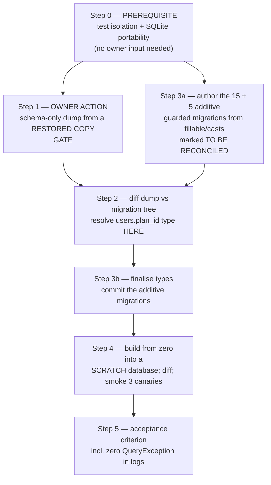
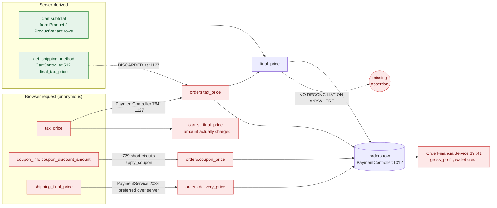

# Database Recovery & Monetary Integrity Plan

> **The owner's rule, restated first because everything below is subordinate to it:**
> **never convert monetary columns blindly.** No `ALTER` touches a money column until the live SQL
> type of that column has been read from the production schema, the pre-flight validation queries in
> §2.6 have all returned clean, a verified restorable backup exists, and the order write has already
> stopped trusting client-supplied amounts. Converting the type while the write path is still
> unreconciled does not fix anything — it stores the wrong number more precisely.

This document has two halves, both derived from the Phase 1A revalidation notes `R5-schema-recovery`
and `R6-money-integrity`, with every load-bearing citation re-opened independently for this file.

* **Half One (§1)** — schema recovery: the repository cannot reproduce its own database. 15 tables
  and 5 columns that live routed code reads and writes are created by no migration anywhere.
* **Half Two (§2)** — monetary integrity: 54 declared money columns, of which 2 have a defensible
  type; and a checkout that re-derives the subtotal server-side but persists a client-supplied tax.

Neither half has been implemented. Both are plans.

---

## 0. Status summary

| Ref | Finding | Status | Severity | Priority | Gated on owner? |
|---|---|---|---|---|---|
| SCHEMA-01 | 15 tables used by live code, created by no migration | VERIFIED | CRITICAL | P0 | Yes — schema dump |
| SCHEMA-02 | `orders.currency_code` / `currency_symbol` created by no migration | VERIFIED | CRITICAL | P0 | No |
| SCHEMA-03 | `customers.deleted_at` missing while `Customer` uses `SoftDeletes` | VERIFIED | CRITICAL | P0 | No |
| SCHEMA-04 | `users.deliverysyria_secret` created by no migration | VERIFIED | HIGH | P1 | No |
| SCHEMA-05 | "`stores` is missing custom-domain columns" | **REFUTED** | LOW | P3 | No |
| SCHEMA-06 | Migration health: duplicate basename, inverted `down()`, 3-arg `hasColumn`, divergent `pixel_fields` | VERIFIED | MEDIUM | P2 | No |
| SCHEMA-07 | 11 created-but-unused tables, of which 1 is genuinely orphaned | VERIFIED | LOW | P3 | No |
| SCHEMA-08 | `users.plan_id` column type depends on migration execution history | VERIFIED (new) | HIGH | P1 | Yes — needed for the diff |
| SCHEMA-09 | Two MySQL-only migrations break `migrate:fresh` on SQLite | VERIFIED | HIGH | P0 | No |
| MONEY-01 | 39 of 54 money columns are `float`/`double`; live SQL type UNKNOWN | PARTIAL / BLOCKED | HIGH | P1 | Yes — `information_schema` census |
| MONEY-02 | `carts.price` is `INTEGER` | VERIFIED | MEDIUM | P2 | No |
| MONEY-03 | Customer checkout persists a client-supplied `tax_price` into the order and the charge | VERIFIED | CRITICAL | P0 | No |
| MONEY-04 | Merchant-admin `final_price` never reconciled against the line-item sum | VERIFIED | MEDIUM | P2 | Product decision |
| MONEY-05 | `get_tax_data` takes money from the request; three `(int)` money casts | VERIFIED | MEDIUM | P2 | No |
| MONEY-06 | No DB transaction and no row locking on the customer order path | VERIFIED | HIGH | P0 | No |
| MONEY-07 | Paymera gateway amount has its decimal point stripped out | VERIFIED (new) | CRITICAL | P0 | Yes — gateway unit |
| MONEY-08 | Four money tables and five money columns declared nowhere | VERIFIED (new) | HIGH | P0 | Yes — `SHOW CREATE TABLE` |
| MONEY-09 | Wholesale price parsed with `/\d+/`, keeps only the leading digit run | VERIFIED (new) | MEDIUM | P2 | No |
| MONEY-10 | Changing store currency rewrites historical order amounts in place | VERIFIED (new) | MEDIUM | P2 | No |

**Three corrections this pass makes to the specialist notes**, recorded because a wrong citation
destroys the plan's credibility:

1. The float-equality example in `R6-money-integrity` attributes the failure to multiplication.
   Re-measured here on PHP 8.3.6: `$p = 1234.10; $q = 10; $p * $q == 12341.00` is **true** — a single
   IEEE-754 multiply is correctly rounded. The failing case is **repeated addition**: `1234.10`
   summed ten times gives `12341.00000000000181898940`, which is `!= 12341.00`. This *strengthens*
   the argument for an exact-decimal reconciler, because the reconciler **sums components**, which is
   exactly the failing operation. The test specification in §2.10 is corrected accordingly.
2. `products.stock_order_status` is at `database/migrations/2023_12_26_092822_create_products_table.php:30`,
   not `:34` (`:33` is `product_stock`, `:34` is `low_stock_threshold`).
3. `OrderController::store`'s `product_price` assignment is at `app/Http/Controllers/OrderController.php:148`,
   not `:147`. `final_price` at `:152` is exact.

---

# Half One — Schema recovery

## 1.1 Method, with the exact commands

The "15 missing tables" number was **re-derived from scratch** rather than inherited. Phase 0's own
provenance note at `docs/discovery/04-DATABASE-AND-MULTITENANCY.md:554` concedes that its 15 was a
union of two dossiers rather than an independent measurement; it now is one.

**Set CREATED** — every table any migration creates, in either tree:

```bash
grep -rhoP "Schema::create\(\s*'\K[a-zA-Z0-9_]+" \
  database/migrations packages/workdo/*/src/database/migrations | sort -u | wc -l
# -> 168   (89 of them in the root tree)
```

Three checks prove that set is complete rather than merely large:

```bash
# no third migration location
grep -rln "Schema::create" --include=*.php . | grep -v "^./vendor/" \
  | grep -v "^./database/migrations/" | grep -v "src/database/migrations"
# -> (no output)

# no double-quoted variants
grep -rhoP 'Schema::create\(\s*"\K[a-zA-Z0-9_]+' \
  database/migrations packages/workdo/*/src/database/migrations | wc -l
# -> 0

# no dynamic or multi-connection creates
grep -rn "Schema::create(\$\|Schema::connection" \
  database/migrations packages/workdo/*/src/database/migrations
# -> (no output)
```

**Set USED** — the union of two sources, giving 189 tables:

* **(a) every Eloquent model.** `app/` plus the 45 model directories under
  `packages/workdo/*/src/app/Models` and `packages/workdo/*/src/Entities`. Every
  `class X extends {Model,Authenticatable,Pivot,User,BaseModel}` contributes either its explicit
  `protected $table` or `snake(pluralStudly(ClassName))`. Script:
  `/tmp/claude-0/-home-user/aa95adaa-f623-5e34-b064-1324104547b8/scratchpad/phase1a/resolve2.php`,
  reporting `MODELS=186 TABLES=183 SKIPPED_NONMODEL=222`.
* **(b) every `DB::table('literal')`** across `app/` and `packages/` — 23 distinct names.

```bash
grep -rhoP "DB::table\(\s*'\K[a-zA-Z0-9_]+" app packages --include=*.php | sort -u   # 23
cat used_models.txt used_dbtable.txt | sort -u                                       # 189
comm -23 used_all.txt created.txt   # used but never created -> 32 candidates
comm -13 used_all.txt created.txt   # created but never used -> 11
```

**Known limits of the method, stated so they are not mistaken for completeness.** A
`DB::table($variable)` call or a table named only inside a raw SQL string is missed. `Role` and
`Permission` extend Laratrust base classes and were skipped by the scanner by design; they map to
`roles`/`permissions` via `config/laratrust.php:137,139` and both **are** created.

**BLOCKED, affecting method but not conclusions.** `vendor/` is unusable:
`find vendor -maxdepth 2 -type d -empty | wc -l` returns **237**, and
`ls vendor/laravel/framework/src` returns *No such file or directory*. The dependency install left
directory skeletons. Per this phase's rules no composer command was run. Consequence:
`Illuminate\Support\Str::pluralStudly()` could not be called, so the class-name-to-table convention
was reimplemented — and then **all 32 non-matching models were re-opened by hand**. The 15-table
conclusion rests on per-file reading, not on a reimplemented inflector.

Per-table confirmation, independent of any inflector:

```bash
for t in currency_rates store_wallets store_wallet_transactions store_withdrawals \
         store_order_financials delivery_earnings delivery_boy_devices \
         delivery_boy_notifications otp_integrations chatwoot_integrations \
         chatwoot_notification_templates audit_logs zid_stores zid_orders zid_events; do
  printf "%-34s %s\n" "$t" "$(grep -rl "Schema::create('$t'" database/ packages/ app/ | wc -l)"
done
# every line -> 0
```

Zero creators, in any syntax, including raw DDL.

## 1.2 Migration counts per tree

| Tree | Path | Files | Tables created |
|---|---|---|---|
| Root | `database/migrations/` | **105** | 89 |
| Addons | `packages/workdo/*/src/database/migrations/` (51 directories) | **102** | 79 |
| **Total** | | **207** | **168 distinct** |

Verified: `ls database/migrations/*.php | wc -l` → 105;
`find packages/workdo/*/src/database/migrations -name "*.php" | wc -l` → 102;
`ls packages/workdo/ | wc -l` → 69. Eighteen of the 69 modules ship no migrations directory at all.

**Execution model, which matters for ordering.** The root tree runs under plain `migrate`, in
filename order. Addon migrations are driven per-module by
`app/Console/Commands/PackageMigrate.php:55-60`, one `Artisan::call('migrate', ['--path' => ...])`
per package, iterating `File::directories(base_path('packages/workdo'))` at `:86-95`. So **addon
ordering is directory order, not timestamp order.** That would be dangerous with cross-package
foreign keys; there are none that matter —
`grep -rn "foreign(" packages/workdo/*/src/database/migrations/*.php | wc -l` returns **11**, of
which 8 target root tables (`customers`, `users`, `products`, `categories`, `orders`, `stores`) that
exist by then and 3 are within their own package with correct internal timestamp order.

## 1.3 SCHEMA-01 — 15 tables used by live code, created by no migration

**Status: VERIFIED. Severity: CRITICAL. Priority: P0.**

Not because production is down — it almost certainly is not — but because **the repository cannot
reproduce its own schema**, so there is no staging, no restore-from-source, and no environment in
which any other Phase 1 fix can be tested.

| # | Table | Proof of live use (re-opened in repo-A) | Money-bearing |
|---|---|---|---|
| 1 | `store_wallets` | `app/Models/StoreWallet.php:9` (`$table`), `$fillable:11-19` — `available_balance`, `pending_balance`, `total_income`, `total_withdrawn`, `withdrawal_pending_balance` | **YES — merchant balance of record** |
| 2 | `store_wallet_transactions` | `app/Models/StoreWalletTransaction.php:9` | **YES — the ledger** |
| 3 | `store_withdrawals` | `app/Models/StoreWithdrawal.php:9` | **YES — payouts** |
| 4 | `store_order_financials` | `app/Services/OrderFinancialService.php:28`, `:90-118` (an 18-column insert), `:228`, `:272`, `:290` | **YES — per-order P&L** |
| 5 | `delivery_earnings` | `app/Models/DeliveryEarning.php:9`, `$fillable:11-20`, `$casts:22-27` (`decimal:2` ×3) | **YES — courier commission** |
| 6 | `currency_rates` | `app/Models/CurrencyRate.php:9`, `$fillable:11-19`, `$casts:21-24` (`rate_per_usd` → `decimal:8`) | **YES — FX multiplier on every converted price** |
| 7 | `audit_logs` | `app/Models/AuditLog.php:9`, `$fillable:11`, `::record()` at `:28` | No (compliance) |
| 8 | `otp_integrations` | `app/Models/OtpIntegration.php:9` | No (auth) |
| 9 | `chatwoot_integrations` | `app/Models/ChatwootIntegration.php:9` | No |
| 10 | `chatwoot_notification_templates` | `app/Models/ChatwootNotificationTemplate.php:9` | No |
| 11 | `delivery_boy_devices` | `app/Models/DeliveryBoyDevice.php:12` | No (push tokens) |
| 12 | `delivery_boy_notifications` | `app/Models/DeliveryBoyNotification.php:12` | No |
| 13 | `zid_stores` | `app/Models/ZidStore.php:8` (no `$table`; resolves by convention); `app/Services/Zid.php:11`, `:25`; `app/Console/Commands/ZidProcessEvents.php:128` | No — but **holds credentials** |
| 14 | `zid_orders` | `app/Console/Commands/ZidProcessEvents.php:90`, `:94`, `:96`, `:107`, `:165` | Indirect (order mapping) |
| 15 | `zid_events` | `app/Models/ZidEvent.php:8`; `ZidProcessEvents.php:47`, `:57` | No |

**6 of 15 are money-bearing.**

**Reachability — all routed and reachable.**

| Cluster | Route | Who |
|---|---|---|
| Wallet / withdrawals / financials | `routes/web.php:164-167` (`GET /finance`, the **only** route inside `Route::middleware(['auth','permission:View Finance Dashboard'])`) and `:168-198` (add-balance, deduct-balance, withdrawal request, withdrawals list, approve/reject/pay, order-financial status) which are **outside** that group | Merchant admin + staff; see §1.3.1 |
| `currency_rates` | `routes/web.php:155-162` → `CurrencyRateController` — **no route middleware at all** | Unguarded platform surface |
| `otp_integrations` | `routes/web.php:212-220` | Admin |
| `chatwoot_*` | `routes/web.php:247-286` | Admin |
| `delivery_boy_devices` | `routes/api.php:328` `POST register-device`, middleware `['custom.auth','AdminApiLog']` | **The Flutter app** |
| `zid_*` | `routes/web.php:1146`, `:1154`, `:1159`, `:1162`; `routes/api.php:377`, `:382` | Several with no auth middleware |

**The failure mode is uneven, and the worst case is silent.** `app/Observers/OrderObserver.php` wraps
the financial write in a bare catch, verbatim at `:15-20`:

```php
15:        try {
17:            app(OrderFinancialService::class)->createForOrder($order);
18:        } catch (\Exception $e) {
19:            \Log::error('Order Observer - Created Error: ' . $e->getMessage());
20:        }
```

and the same shape at `:36-41` for `updated()`. `QueryException` descends from `\Exception`. So on a
deployment missing `store_wallets` / `store_order_financials`, **orders save successfully and all
financial tracking silently does nothing** — the rows go into `storage/logs`.

This also **refutes** a claim carried forward from the money workstream. `R6-money-integrity`'s
`NEW-UNDECLARED-SCHEMA` states "the test suite cannot create an order at all until this is fixed."
For the **observer path** that is wrong: the observer swallows the exception, so `Order::create()`
succeeds without the finance tables. `grep -rn "OrderFinancialService" --include=*.php app/` finds no
unwrapped caller on the order-creation path. Only **financial assertions** need the dump. That single
fact is what frees roughly ten increments of work from the owner gate.

### 1.3.1 Two authorization findings surfaced while proving reachability

Both belong to the security workstream; recorded here because they set how money-bearing these
tables are, and because they are the live code paths that read them.

**(a) Withdrawal state changes have no permission check.** Every other method in
`app/Http/Controllers/StoreFinanceController.php` self-guards —
`:19` (`Edit Finance Payment Status`), `:71` (`View Finance Dashboard`), `:315` (`Add Finance Balance`),
`:396` (`Deduct Finance Balance`), `:494` (`Request Finance Withdrawal`),
`:624` (`View Finance Withdrawal Requests`), each `if (!auth()->user() || !auth()->user()->isAbleTo(...))`.
These do **not**: `approveWithdrawal($id)` at `:644`, `rejectWithdrawal(...)` at `:719`,
`payWithdrawal($id)` at `:888`, `walletTransactionsApi` at `:1023`, and `deductBalanceApi` at `:1338`
(while its sibling `addBalanceApi` at `:1195` checks at `:1207` — a visible empty gap where the guard
belongs). Their routes sit at `routes/web.php:186`, `:189`, `:192`, `:196`, outside the permission
group that closes at `:167`.

Reachability, stated precisely because the worse hypothesis does **not** hold: `getCurrentStore()`
(`app/Helper/helper.php:357-381`) falls off the end returning `null` for an anonymous caller
(`:366` `if ($user)` with no `else`), so `StoreWithdrawal::where('store_id', null)` matches no row and
`firstOrFail` 404s. **Anonymous money movement is NOT demonstrated.** What *is* reachable: any
authenticated web-guard user whose `current_store` resolves can approve, reject and mark-paid that
store's withdrawals with no permission at all. Severity HIGH, priority P1.

**(b) An unauthenticated route returns decrypted integration credentials.**
`routes/web.php:1146` registers a closure route whose only protection is an `abort_unless` at `:1147`
comparing a query parameter against a short literal **committed to the repository**; `:1149-1152`
then `Crypt::decryptString()`s two `zid_stores` columns into a `text/plain` response body. No `auth`
middleware. Per the absolute no-secrets rule neither the literal nor the credential values are
reproduced here — the guard is at `routes/web.php:1147`, the disclosure at `:1149-1152`. Severity
CRITICAL, priority P0; the fix is to **delete the route** and rotate the Zid credentials, which must
be presumed disclosed. There is at least one more state-echoing debug closure immediately above it,
so the whole `routes/web.php:1100-1162` region needs sweeping (**citation corrected**: an earlier
draft of this document wrote `:1100-1165`; `routes/web.php` is **1162 lines long**, so that range ran
past end-of-file. The second, state-echoing closure ends at `:1138` and the file's last statement is
at `:1162` — both re-opened in this pass). Whether the host is internet-exposed is **BLOCKED** here
(§1.8, B-2) — this is a code-level certainty regardless.

### 1.3.2 Proposed fix (NOT APPLIED)

One additive catch-up migration **per table**, in `database/migrations/`, each guarded so it is a
no-op against production and creative on a fresh build. The idempotent-guard pattern already exists
in-repo at `database/migrations/0001_01_01_000002_create_jobs_table.php:14`, `:27`, `:43` and at
`packages/workdo/Marketing/src/database/migrations/2024_10_11_054127_create_pixel_fields_table.php:14`
— reuse it; invent nothing.

```php
// PROPOSED — NOT APPLIED
// database/migrations/2026_10_20_000001_create_store_wallets_table.php
public function up(): void
{
    if (Schema::hasTable('store_wallets')) {
        return;                                    // no-op against production
    }

    Schema::create('store_wallets', function (Blueprint $table) {
        $table->id();
        $table->unsignedBigInteger('store_id')->index();          // every query filters by it
        $table->string('currency_code', 3)->nullable();
        $table->decimal('available_balance', 18, 4)->default(0);  // NOT float — see §2
        $table->decimal('pending_balance', 18, 4)->default(0);
        $table->decimal('total_income', 18, 4)->default(0);
        $table->decimal('total_withdrawn', 18, 4)->default(0);
        $table->decimal('withdrawal_pending_balance', 18, 4)->default(0);
        $table->timestamps();
        // TO BE RECONCILED WITH THE PRODUCTION DUMP (§1.7 step 2) before merge
    });
}
```

Column lists come from each model's `$fillable` / `$casts` plus
`app/Services/OrderFinancialService.php:90-118`, and are then **reconciled against the production
dump**. Money columns `decimal(18,4)`; `currency_rates.rate_per_usd` `decimal(18,8)` to match the
model's own `decimal:8` cast at `app/Models/CurrencyRate.php:22`. Do **not** copy the `float` used
for all six order money columns at `database/migrations/2024_01_23_061635_create_orders_table.php:22-27`.

**Foreign-key order:** `store_wallets` → `store_wallet_transactions` → `store_withdrawals`, with
`store_order_financials` after `store_wallets` because it holds `wallet_id`
(`app/Services/OrderFinancialService.php:21-23` resolves the wallet, `:90-92` writes `wallet_id`).

**Blast radius.** Purely additive and guarded, therefore a no-op against production. Touches
`StoreFinanceController`, `OrderFinancialService`, `OrderObserver`,
`DeliveryBoyNotificationController`, `ZidProcessEvents`, `Zid`, `DeliverySyriaStatusController`,
`CurrencyRateController`, `OtpIntegrationController`, `ChatwootIntegrationController`, plus the
Flutter `register-device` endpoint and the merchant-dashboard APIs.

**What it breaks — and the compatibility note runs the *other* way.** Nothing breaks; it only adds.
The risk is that **features which currently fail silently will start working.** Once
`store_wallets` and `store_order_financials` exist, `OrderObserver.php:17` stops throwing and the
merchant wallet begins to be credited. Phase 0 reports a hardcoded `payment_status = 'Paid'` at
`app/Services/PaymentService.php:2280` (adjacent lane — **NOT re-verified in this pass**, so treat as
unconfirmed). If that holds, it must be fixed **before or with** this migration, or COD and
bank-transfer orders will credit merchant wallets against cash never collected. **Shipping the
schema fix alone could convert a silent no-op into real incorrect payouts.** This is the single most
important thing to say to the owner about SCHEMA-01.

**Regression test (specification, not a passing test).**
`tests/Feature/Schema/FromZeroParityTest.php::test_every_table_used_by_code_exists` — port
`resolve2.php` into a test asserting `Schema::hasTable()` for all 189 code-used tables against a
freshly migrated scratch database, with the 17 triaged false positives as an explicit **documented**
allow-list. Plus
`OrderFinancialWriteTest::test_order_creation_writes_store_order_financial_row_and_logs_no_queryexception`
— which must assert **the log is clean**, because the observer's catch block means a green smoke test
otherwise proves nothing.

## 1.4 Created but never used (11 tables, of which 1 is real)

```bash
comm -13 used_all.txt created.txt
# cache  cache_locks  failed_jobs  job_batches  jobs  password_reset_tokens
# permission_role  permission_user  permissions  roles  vcard_type
```

**10 of 11 are false positives and must not be dropped.**

| Table(s) | Why it is a false positive |
|---|---|
| `cache`, `cache_locks`, `jobs`, `job_batches`, `failed_jobs`, `password_reset_tokens` | Laravel framework infrastructure, accessed from `vendor/`, never by an app model |
| `roles`, `permissions`, `permission_role`, `permission_user` | Laratrust, mapped at `config/laratrust.php:137,139,148,150`; `app/Models/Role.php:7` and `app/Models/Permission.php:7` extend the Laratrust base models, which the scanner skipped by design |

**`vcard_type` is genuinely orphaned** — 4 references repo-wide, all in its own migration
(`packages/workdo/Marketing/src/database/migrations/2024_07_25_072214_create_vcard_type_table.php:14-15,29`)
plus the `stores.vcard_type_id` column. No model, no query, no controller. **Recommendation: leave
it.** Dropping a table is destructive and forward-only forbids it for zero benefit. Record as
known-dead. Status VERIFIED, severity LOW, priority P3.

**Also: do not create tables for the 15 phantom model names.** Fourteen classes `extend Model` but
have no table and are never queried — `Utility` (`app/Models/Utility.php:27`, a large static settings
helper), `ApiUtility`, `Duo2FAUtility`, `FrequentlyProductUtility`, `ProductReviewUtility`,
`WholesaleProductUtility`, `Coingate` (`app/Coingate/Coingate.php:9`, a payment-SDK wrapper),
`Senangpay` (`app/Models/Senangpay.php:9`), `CartQuantityControl`, `ContactsDetails`, `Duo2FA`,
`FrequentlyProduct`, `ProductBarCode`, `SendMsg` — plus `landingpage_pixels`
(`packages/workdo/LandingPage/src/Entities/Pixel.php:19`, a dead duplicate of the live `pixel_fields`
feature at `routes/web.php:497`). All declare `protected $fillable = []`; all are reached only via
static calls, e.g. `CartQuantityControl::checkoutValidation` (`app/Models/Cart.php:717`, `:781`) and
`ProductBarCode::saveData` (`app/Http/Controllers/ProductController.php:371`, `:649`).
`ContactsDetails` has zero references repo-wide. The risk is purely future-facing: the first
developer who writes `Utility::first()` gets *Base table or view not found* in production. Status
VERIFIED, severity LOW, priority P3; the fix is to drop `extends Model` per class in a later cleanup,
checking each for a `newFactory()` hook first, and to add
`ModelHasTableTest::test_every_eloquent_model_resolves_to_an_existing_table` with these 15 as a
documented allow-list — which converts the whole class of bug from a production 500 into a CI failure.

## 1.5 Missing columns

| Ref | Column | Status | Evidence | Severity / Priority |
|---|---|---|---|---|
| SCHEMA-02 | `orders.currency_code`, `orders.currency_symbol` | VERIFIED | `grep -rn "currency_code\|currency_symbol" database/migrations packages/workdo/*/src/database/migrations` → **0 hits** across all 207 migrations | CRITICAL / P0 |
| SCHEMA-03 | `customers.deleted_at` | VERIFIED | `grep -rln "softDeletes\|deleted_at"` over both trees → **0 files** | CRITICAL / P0 |
| SCHEMA-04 | `users.deliverysyria_secret` | VERIFIED | `grep -rn "deliverysyria" database/migrations packages/workdo/*/src/database/migrations` → **0 hits** | HIGH / P1 |
| MONEY-08 | `orders.created_by`, `products.cost_price` | VERIFIED | `grep -rn "created_by" database/migrations/*orders*` → 0; `grep -rn "cost_price"` over both trees → 0 | HIGH / P0 |
| SCHEMA-05 | `stores` custom-domain columns | **REFUTED** | See below | NOT_AN_ISSUE / P3 |

**SCHEMA-02 — `orders.currency_code` / `currency_symbol`.** Both are in `$fillable` at
`app/Models/Order.php:26-27`, and a model hook assigns **both on every insert** —
`app/Models/Order.php:63` `protected static function booted()`, `:65` `static::creating(...)`,
`:68-72` sets `currency_code` from `Utility::GetValueByName('defult_currancy', $storeId)` falling back
to `'USD'`, `:74-78` the same for `currency_symbol` falling back to `'$'`. Both attributes are empty
on a fresh insert, so **both branches always fire**. Also read at `:250-251`, written at `:366-367`.
Because the writer is a model hook rather than a controller, **no middleware can gate it**:
every order-creation path is affected — storefront checkout, merchant/POS creation, and the order
APIs the Flutter app calls. On a from-zero build every order insert dies with *unknown column
currency_code*, which also means the Flutter app's order-create endpoints return 500.

Proposed fix (NOT APPLIED): one additive `hasColumn`-guarded migration adding
`string('currency_code', 3)->nullable()` and `string('currency_symbol', 8)->nullable()`, backfilled
to the store default. **Do not touch the hook** — a per-order currency snapshot is correct behaviour
that simply has no column to land in.

**SCHEMA-03 — `customers.deleted_at`.** `grep -n "SoftDeletes" app/Models/Customer.php` gives
`16:use Illuminate\Database\Eloquent\SoftDeletes;` and
`20:    use Cachable, Notifiable, CanResetPassword,HasApiTokens,Billable,SoftDeletes;`. I tested
whether the problem is broader than one model, and **narrowed** it:

```bash
grep -rn "^\s*use .*SoftDeletes" app/Models packages/workdo/*/src/app/Models \
  packages/workdo/*/src/Entities | grep -v "use Illuminate"
# -> app/Models/Customer.php:20   (exactly one line)
```

`Customer` is the only affected model. The reach is maximal: `SoftDeletes` installs a global scope
appending `and customers.deleted_at is null` to **every** `Customer` query, so on a from-zero build
there is no working customer authentication at all (`Customer.php:22` `protected $guard = 'customers'`)
and every customer read fails — reachable anonymously at the storefront login form and by the Flutter
app's customer endpoints.

Proposed fix (NOT APPLIED): one additive guarded migration adding `$table->softDeletes()` to
`customers`. One line of schema. **Do NOT remove the trait to "fix" the mismatch** — that would
silently convert soft deletes into hard deletes and destroy data, the opposite of evolve-not-rebuild.

**SCHEMA-04 — `users.deliverysyria_secret`.** In `$fillable` at `app/Models/User.php:52`; **written**
at `app/Http/Controllers/SettingController.php:99` and `:118`
(`$u->deliverysyria_secret = $request->delivery_syria_token;`); **read** at six sites —
`app/Services/PaymentService.php:2662`,
`app/Http/Controllers/Api/DeliverySyriaOrderController.php:158`,
`app/Http/Controllers/DeliverySyriaController.php:17`, `:37`,
`app/Http/Controllers/AccountProfileController.php:180`, `:183`,
`app/Listeners/CompanyMenuListener.php:285`.

I specifically tested whether the missing column makes the webhook fail **open**. It does not — it
fails **closed**. `Api/DeliverySyriaOrderController.php:157-164` reads
`$storedSecret = trim((string) ($owner->deliverysyria_secret ?? ''))` and then rejects when
`$storedSecret === '' || !hash_equals($storedSecret, $secret)`. Eloquent returns `null` for an absent
column rather than throwing, so `$storedSecret` becomes `''`, the first clause trips, and the request
gets a 403. **The consequence is therefore a 100% dead Delivery Syria integration on a from-zero
build, not a bypass.** This is a deliberate narrowing and is why the severity is HIGH, not CRITICAL.
The *write* path is the one that hard-fails: `SettingController.php:99` `$u->save()` raises a
`QueryException` on the unknown column, reachable by an authenticated merchant saving shipping
settings.

Proposed fix (NOT APPLIED): one additive guarded migration adding a nullable
`string('deliverysyria_secret')` to `users`. Adding it to `User::$hidden` with an encrypted cast is
worth doing but is a **separate, behaviour-changing** decision — keep the schema migration pure.
Note `users` is the highest-fan-in table in the schema (14 foreign keys reference it), so sequence
this migration deliberately rather than merging it with SCHEMA-08's `plan_id` normalisation.

**SCHEMA-05 — REFUTED.** Custom domains are not stored on `stores` at all. They are rows in the
`settings` key/value table, resolved at `app/Providers/StoreRedirectServiceProvider.php:30-31`
(`DB::table('settings')->where('name','subdomain')` / `'domains'`) and gated by plan flags at `:34`
and `:63`. All three objects exist: `database/migrations/2023_12_11_100148_create_settings_table.php:14`
creates `settings`, and `database/migrations/2023_12_08_123752_create_plans_table.php:25-26` creates
`enable_domain` and `enable_subdomain`. `grep -rn "custom_domain|is_domain|store_domain|domain_status"`
over both migration trees returns nothing, and no code asks for a `stores` domain column.
`Store::$fillable` is 100% covered by `database/migrations/2023_12_14_090259_create_stores_table.php:14-26`
plus the four `duo_*` columns from
`packages/workdo/Duo2FA/src/database/migrations/2024_06_25_093610_add_duo_keys_in_stores_table.php`.
**Create nothing.** Adding a `stores` domain column would create a second source of truth for domain
configuration alongside `settings`, which the no-parallel-systems principle forbids. Carried here
only so the owner does not pay to fix a non-problem.

## 1.6 SCHEMA-06 / SCHEMA-08 / SCHEMA-09 — migration health

**All of this is reasoned from files. Nothing was executed.** No migration was run, `migrate` was
never invoked, and `vendor/` could not boot artisan in any case.

### Can `migrate` run clean from zero? Reasoned answer: YES on MySQL, NO on SQLite.

I hunted specifically for a from-zero failure and found **three** candidates, **all defused**:

| Candidate | Why it does not fail |
|---|---|
| `failed_jobs` created by two migrations | Both guarded: `database/migrations/0001_01_01_000002_create_jobs_table.php:43` and `database/migrations/2019_08_19_000000_create_failed_jobs_table.php:14` both `if(!Schema::hasTable('failed_jobs'))`. `0001_…` sorts first and creates it; `2019_…` no-ops. Residual LOW defect: both `down()` methods drop it, so rollback is asymmetric. |
| A foreign key to `plans` in the **first** migration | Guarded at `database/migrations/2014_10_12_000000_create_users_table.php:28`. No failure — but the guard has a side effect that is a finding in its own right: **SCHEMA-08**. |
| A foreign key to a non-existent singular `order` table | `database/migrations/2023_12_29_100550_create_user_coupons_table.php:25` — **commented out**. |

So Phase 0's counter-intuitive verdict survives: on MySQL, `migrate` from zero **succeeds**, and the
damage is purely at runtime against the schema the migrations produce. That verdict is a **file-level
argument, not an observation** — see §1.8, B-4.

### SCHEMA-09 — but `migrate:fresh` fails on SQLite, which is on the critical path

**Status: VERIFIED. Severity: HIGH. Priority: P0.** Two migrations issue MySQL-only SQL.

```php
// database/migrations/2024_06_05_094055_drop_role_name_unique_in_roles_table.php
16:            if (Schema::hasColumn('roles', 'name')) {
18:                $hasUnique = collect(DB::select("SHOW INDEX FROM roles WHERE Column_name = 'name'
                      AND Non_unique = 0 AND Key_name != 'PRIMARY'"))->isNotEmpty();
```

`Schema::hasColumn` succeeds on SQLite, so line `:18` **is** reached, and `SHOW INDEX` is MySQL-only
— a syntax error aborts `migrate:fresh`. The second:
`database/migrations/2024_05_29_102438_add_customers_tbale_forienkey_in_user_coupons_table.php:21`
and `:62` both query `information_schema.KEY_COLUMN_USAGE`, which does not exist in SQLite.

The scope of the problem is small — exactly these two files across 207 migrations. **This matters
because uncommenting the SQLite override in `phpunit.xml` alone yields a red suite, which will be
misread as "SQLite does not work here."** The two fixes must ship together.

```php
// PROPOSED — NOT APPLIED — the smaller, safer change: preserve MySQL behaviour byte for byte
if (DB::connection()->getDriverName() === 'mysql') {
    // ... existing body, unchanged ...
}
```

Laravel 11's `Schema::getIndexes('roles')` and `Schema::getForeignKeys('user_coupons')` are the
portable end state, but the driver guard is smaller and changes **no** resulting MySQL schema: the
guarded branch is the current code.

### SCHEMA-08 — `users.plan_id` has a column type that depends on execution history

**Status: VERIFIED (new). Severity: HIGH. Priority: P1.** This is the finding most worth the owner's
attention, because it defeats a naive "migrate ran, we're fine" check and will poison the
verification diff in §1.7 step 4 if not anticipated.

`database/migrations/2014_10_12_000000_create_users_table.php:28-34`, re-opened verbatim:

```php
28:            if (Schema::hasTable('plans')) {
29:                $table->unsignedBigInteger('plan_id')->nullable();
30:                $table->foreign('plan_id')->references('id')->on('plans')->onDelete('cascade');
31:            }
32:            else{
33:                $table->string('plan_id')->nullable();
34:            }
```

This is the **first** migration to run (`2014_…` sorts before everything) and `plans` is created far
later by `database/migrations/2023_12_08_123752_create_plans_table.php`. So on **any** from-zero
build the `else` branch always wins:

| Environment | `users.plan_id` |
|---|---|
| From-zero rebuild | `VARCHAR(255)`, no foreign key, no index |
| Production (inferred, **UNKNOWN**) | almost certainly `BIGINT UNSIGNED` + FK to `plans` |

`plan_id` is read on a login-path hot route at
`packages/workdo/Duo2FA/src/app/Models/Duo2FA.php:29` (`Plan::where('id', $user->plan_id)->first()`),
and `users` is the most-joined table in the schema. A `VARCHAR`→`BIGINT` join still executes in MySQL
but is unindexed on one side, silently loses the FK's `ON DELETE CASCADE`, and changes comparison
semantics.

I swept for the general anti-pattern and found only **two** migrations that condition column
*shape* on execution history. The other,
`packages/workdo/RewardClubPoint/src/database/migrations/2024_04_17_103908_create_reward_club_points_table.php`,
is **benign**: both branches declare `unsignedBigInteger` and only the foreign key differs. So this
is the single instance that causes type drift.

**Proposed fix (NOT APPLIED), and the reasoning is the important part: do NOT edit
`2014_10_12_000000_create_users_table.php`.** It has already run in every environment, so an edit
changes only what *new* environments build and would **widen** the production-versus-source gap this
whole exercise exists to close. Add one new additive migration, timestamped after
`create_plans_table`, that normalises in place:

```php
// PROPOSED — NOT APPLIED — runs last, inside a transaction, rehearsed on a restored copy first
if (Schema::hasColumn('users', 'plan_id')) {
    // branch on the type read from information_schema; no-op when already BIGINT UNSIGNED
    // ->change() is native in Laravel 11; do NOT add doctrine/dbal (correctly absent)
}
```

Decide `->change()` versus an explicit `DB::statement('ALTER TABLE …')` **only after** the dump shows
what production actually has. If production is already `BIGINT`+FK the migration is a guarded no-op.
If production is `VARCHAR` holding non-numeric values, the cast will **fail** — which is exactly why
step 2 diffs before it writes. Adding `ON DELETE CASCADE` is itself a real behaviour change (deleting
a plan would begin cascading to users), so verify no plan is ever hard-deleted, or omit the cascade.

### The four hygiene defects

| Defect | Evidence | Severity |
|---|---|---|
| **Duplicate migration basename** | `find … -name "*.php" \| xargs -n1 basename \| sort \| uniq -c \| awk '$1>1'` → `2 2024_08_30_102330_add_social_type_and_social_id_column_in_customers_table.php`, in `packages/workdo/SignInWithFacebook/` and `packages/workdo/SignInWithLinkedIn/`, **byte-identical**. Laravel keys the `migrations` table by basename, so whichever module migrates second is recorded as already-run and **silently skipped**. | MEDIUM / P2 |
| **3-argument `hasColumn`** | Both copies, `:14` (and again `:28`): `if (!Schema::hasColumn('customers','social_id','social_type'))`. `hasColumn()` takes `($table, $column)`; the third argument is **ignored**, so the guard only ever checks `social_id`. If `social_id` exists but `social_type` does not, `social_type` is never added. | MEDIUM / P2 |
| **Inverted `down()` guard** | Both copies, `:28-31`: `if (!Schema::hasColumn(...)) { dropColumn(...) }` — drops the columns only when they are **absent**. Rollback is a no-op. | MEDIUM / P2 |
| **`pixel_fields` created twice, divergent** | `grep -rhoP "Schema::create\(\s*'\K[a-zA-Z0-9_]+" … \| uniq -c \| awk '$1>1'` → `2 pixel_fields`. The root creator, `database/migrations/2023_12_18_101848_create_pixel_fields_table.php:14`, is **UNGUARDED** and makes `platform`/`pixel_id` NOT NULL with no `created_by`; `packages/workdo/Marketing/src/database/migrations/2024_10_11_054127_create_pixel_fields_table.php:14` **is** guarded and adds `store_id` + `created_by` as nullable. Root runs first, so from zero you get the root shape and Marketing no-ops. Benign today because `app/Http/Controllers/PixelFieldsController.php:62-63` writes only `platform` and `pixel_id`. | LOW / P2 |

**Why editing these already-run migrations IS acceptable**, unlike the historical migrations in
§1.7 step 3: these edits change **no resulting schema** — only guard correctness and rollback
behaviour. The important caveat: renaming a duplicate basename means the renamed file is **no longer
recorded as run**, so it **will execute** on the next `migrate` against existing environments. That
is safe only because its guard makes it idempotent — which is precisely why the 3-argument
`hasColumn` must be corrected in the **same** change, not after it. And fixing the inverted `down()`
makes rollback actually drop the columns, which is correct but newly destructive on rollback;
document it.

Regression tests (specifications): `MigrationHygieneTest::test_no_duplicate_migration_basenames`,
`::test_no_table_is_created_by_two_unguarded_migrations`, and
`::test_no_migration_conditions_column_type_on_hastable`. All three are **pure filesystem
assertions needing no database**, so they can be written and run before the production dump arrives.

## 1.7 The recovery plan — ordered, forward-only, non-destructive



### Step 0 (PREREQUISITE) — make the test suite incapable of reaching a real database

Not this document's area, but **nothing below is verifiable without it** and it is item #1 globally.
Re-confirmed independently in this pass: `phpunit.xml:25-26` are
`<!-- <env name="DB_CONNECTION" value="sqlite"/> -->` and
`<!-- <env name="DB_DATABASE" value=":memory:"/> -->` — both commented out, while every other `<env>`
in that block (`:24`, `:27`, `:28`) is live, so this is a **targeted** commenting-out.
`ls -la .env.testing` → *No such file or directory*. `grep -rln RefreshDatabase tests/ | wc -l` → **8**.
`.env:8` is `DB_CONNECTION=mysql` with `.env:9-13` all populated (values deliberately not read or
printed). `config/database.php:19` is `'default' => env('DB_CONNECTION', 'sqlite')`, so the SQLite
fallback is overridden by `.env`. **`php artisan test` from this checkout would run `migrate:fresh`
against the database named in the committed `.env`.**

Immediate mitigation: `export DB_CONNECTION=sqlite DB_DATABASE=:memory:` in the shell. The
mechanism relied on is that Laravel loads `.env` through `Dotenv::createImmutable()`, so a real
environment variable **wins** over `.env`, making MySQL unreachable regardless of its contents.

> **Evidential status of that mechanism — FRAMEWORK-DOCUMENTED, UNVERIFIED IN THIS ENVIRONMENT
> (BLOCKED).** Earlier text in this document asserted Dotenv immutability as an established,
> re-verified fact; it was not verified and that wording is **superseded here**. It could not be
> checked: `vendor/vlucas/phpdotenv/` is an **empty directory** (`find vendor/vlucas/phpdotenv -name
> '*.php'` → **0**) and `vendor/laravel/framework/src` is absent, so no loader source was read (see
> §1.7 step 4 and §1.8, B-5). The nuance that matters operationally is unchanged and is why this is
> only a mitigation: **`phpunit.xml`'s `force="true"` overrides a shell variable anyway**, so the
> exported-variable layer is a **good habit, not the primary control**. The primary control must be a
> guard that cannot depend on an unverifiable assumption.

Durable fix: uncomment `phpunit.xml:25-26` **with
`force="true"` on both** (without `force`, PHPUnit will not overwrite a variable already present in
the real environment), add a committed `.env.testing` pinning SQLite, and add the `setUp()` guard in
the currently empty `tests/TestCase.php`. Ship SCHEMA-09's two driver guards in the same window.

### Step 1 — obtain a schema-only production dump (OWNER ACTION; this is the gate)

```bash
# Run against a RESTORED COPY of a backup, with a READ-ONLY account. Never against the live host.
mysqldump --no-data --routines --triggers \
          --single-transaction --skip-lock-tables \
          -h <host> -u <readonly_user> -p <DATABASE> \
          > storesyria-schema-$(date +%F).sql
```

* `--no-data` is what makes this safe: **DDL only, zero customer rows.**
* `--single-transaction --skip-lock-tables` keeps it from locking a live site.
* Use a **read-only** MySQL account. Never the application's own credentials.

Also capture, as the cross-checks for B-3 and SCHEMA-08:

```sql
SHOW TABLES LIKE 'store_%';
SHOW TABLES LIKE 'zid_%';
SHOW COLUMNS FROM users    LIKE 'plan_id';
SHOW COLUMNS FROM users    LIKE 'deliverysyria%';
SHOW COLUMNS FROM orders   LIKE 'currency%';
SHOW COLUMNS FROM orders   LIKE 'created_by';
SHOW COLUMNS FROM customers LIKE 'deleted_at';
SHOW COLUMNS FROM products LIKE 'cost_price';
-- plus SHOW CREATE TABLE for each of the 15
```

> **WARNING — a schema-only dump is still sensitive.** Table and column names disclose the data
> model and the integration surface (`zid_stores.access_token`, `users.deliverysyria_secret`), and
> `--routines --triggers` can embed credentials in `DEFINER` clauses and procedure bodies. **Do not**
> paste it into a chat, an issue tracker or a public repo. Move it over a private channel, keep it
> out of git, grep it for `DEFINER=` and `IDENTIFIED BY` before sharing it even internally, and
> delete it when the plan is done.

### Step 2 — diff the dump against the migration tree

Build the from-migrations schema into a **scratch** database — never production, never
staging-with-data — dump it the same way, normalise both, and diff. Reconcile the 15 tables, the 5
columns, and specifically **`users.plan_id`'s type (SCHEMA-08)**.

Treat the production dump as the source of truth for **shape**, but explicitly **not** for
**quality**: keep the models' own `decimal:2` / `decimal:8` intent for money even if production
stored `float`, and record every such deliberate divergence in a signed-off list. **SCHEMA-08 must be
resolved inside this step, not deferred** — otherwise it appears in the step 4 diff as a type
mismatch and gets dismissed as noise.

### Step 3 — author NEW additive migrations; do NOT edit historical ones

One new file in `database/migrations/` per table or column, each guarded with `Schema::hasTable()` /
`Schema::hasColumn()` so it is a **no-op against production** and **creative on a fresh build**.

**Why editing a historical migration is wrong here, concretely.** Every migration already in
`database/migrations/` has a row in production's `migrations` table, and Laravel decides what to run
by **filename**, never by content. So a rewritten
`2024_01_23_061635_create_orders_table.php` is **never re-executed** against production. The edit
would change only what *new* environments build — widening the production-to-source gap this exercise
exists to close — while making the repository *look* correct. Worse, it silently rewrites the schema
history that the Flutter app and the 69 addons assume, with no migration event to audit. Editing
*is* acceptable for the §1.6 hygiene defects, because those change **no resulting schema**.

Ordering and content rules:

* Timestamp the new files **after** the latest existing migration so they run last.
* FK order: `store_wallets` → `store_wallet_transactions` → `store_withdrawals`;
  `store_order_financials` after `store_wallets`.
* Money columns `decimal(18,4)` (justified in §2.5); `currency_rates.rate_per_usd` `decimal(18,8)`.
* `store_id` index on all 15 — every query filters by it.
* Foreign keys to `stores` / `users` **only where production already has them**.
* `users.plan_id` normalisation gets its **own** migration, run last, written defensively, never
  batched with the purely additive ones.
* `ZidStore` and `ZidEvent` go on an explicit **DO-NOT-SCOPE** list with the reason in the trait
  docblock: their `store_id` is an **external Zid string identifier**, not a foreign key to
  `stores.id` (`app/Models/ZidEvent.php:44` types the parameter `string $storeId`;
  `app/Console/Commands/ZidProcessEvents.php:78` casts the external payload value to string). A
  tenancy scope matched by column name would compare a local integer against an external string and
  silently return zero rows, stopping the Zid sync with no error anywhere.

### Step 4 — verify by building from zero into a scratch database

```bash
# SCRATCH DATABASE ONLY — never production, never staging-with-data
php artisan migrate --database=scratch     # root tree: 105 + the new catch-up migrations
php artisan package:migrate                # all 69 addons, 102 migrations
mysqldump --no-data ... scratch > from-zero.sql
diff <(normalise storesyria-schema.sql) <(normalise from-zero.sql)
```

> **Step 4 CANNOT be run in the audit environment — it must run on an engineer machine or CI.**
> `composer install --no-scripts` was attempted in this pass and **aborted**: `vendor/laravel/framework/src`
> is absent, `vendor/composer/installed.json` was never written, and only roughly 120 of the 239 locked
> packages landed. The cause is this container's **egress policy, not a defect in the project** —
> `lahirulhr/laravel-payhere` 1.0.4 distributes an `api.github.com` zipball (proxy returns 403, and the
> VCS fallback could not authenticate), and `yoomoney/yookassa-sdk-php` 3.7.1 plus
> `yoomoney/yookassa-sdk-validator` 1.0.2 are hosted on `git.yoomoney.ru`, which is unreachable here.
> Consequence: `php artisan`, PHPUnit and any boot-dependent static analysis **cannot run here**, so the
> whole of §1.7 — and every test named anywhere in this document — is **SPECIFIED, NOT EXECUTED**:
> **BLOCKED**, never "passing". Step 4's build, diff and canaries must therefore be performed where a
> `composer install` completes: a runner that can reach both `api.github.com` and `git.yoomoney.ru`, or
> one backed by a caching Composer mirror. Dropping either SDK would also work — neither YooKassa
> (Russia) nor PayHere (Sri Lanka) is a plausible Syrian payment rail — but every such option edits
> `composer.json`, so all of them are **OWNER DECISIONS**, not ours. Composer must also **not run as
> root** in CI: as root it warns and auto-disables plugins.

Then run `FromZeroParityTest` against that scratch database, and smoke the **three canaries** for the
three CRITICAL findings:

1. a customer login (SCHEMA-03),
2. an order insert (SCHEMA-02),
3. an order whose observer writes a `store_order_financials` row **without** reaching
   `app/Observers/OrderObserver.php:19`'s `catch` (SCHEMA-01).

The third matters most: it is the only one that currently fails **silently**.

### Step 5 — acceptance criterion

> From a clean `git clone` at `41fe2f68` plus the new additive migrations, with an **empty** database
> and **no hand-run DDL**, `migrate` and `package:migrate` complete without error; the resulting
> schema diffs **clean** against the production schema dump modulo an explicitly reviewed and
> signed-off list of intentional divergences (money columns promoted `float`→`decimal`,
> `users.plan_id` normalised); `FromZeroParityTest` asserts all 189 code-used tables exist, with the
> 17 triaged false positives as a documented allow-list; and a customer login, an order insert and an
> order-financial write all succeed with **zero `QueryException` entries in `storage/logs`**.

The last clause is deliberate, not decoration: because `OrderObserver.php:15-20` swallows exceptions,
a green smoke test proves nothing unless the log is also asserted clean.

## 1.8 BLOCKED, and what can proceed now

| # | What is blocked | Why | What the OWNER must do |
|---|---|---|---|
| B-1 | **The authoritative production schema** — true column lists, types, nullability, defaults, indexes and FKs for the 15 tables and 5 columns | No database reachable; read-only mandate. The `mysql` client exists, there is no server and no credentials this phase may use | Step 1's schema-only dump. **This is the single blocker for the whole plan.** |
| B-2 | **Whether the deployed site is internet-exposed**, which sets the real severity of the Zid credential-disclosure route | Container egress policy blocks arbitrary hosts; `storesyria.com` does not resolve and `CONNECT` returns 403. **No claim is made about the live host.** | From outside your network, test whether `/zid/show-token` responds; check access logs for hits on that path; **rotate the Zid credentials regardless of the answer** |
| B-3 | **Whether production actually HAS the 15 tables and 5 columns** from hand-run DDL — i.e. whether this is "production cannot be rebuilt" or "production is silently broken" | Same as B-1. Phase 0 inferred "almost certainly present"; that is **inference, not fact**, and it was not re-derived here | `SHOW TABLES LIKE 'store_%'`; `SHOW COLUMNS FROM orders LIKE 'currency%'`; `SHOW COLUMNS FROM customers LIKE 'deleted_at'` |
| B-4 | **Executing `migrate` from zero** to prove the §1.6 verdict | Forbidden this phase; and `vendor/` cannot boot artisan anyway | Nothing yet — this becomes step 4 |
| B-5 | **Any analysis requiring the framework** | `vendor/` holds 237 empty package directories; `vendor/laravel/framework/src` is absent. **Superseding this row's earlier wording** ("Composer was not run, per the rules"): an install **was** attempted read-only in this pass and **aborted** on container egress — see §1.7 step 4 | Re-run `composer install` in a sandbox and confirm `vendor/laravel/framework/src/Illuminate/Support/Str.php` exists before Phase 1B |
| B-6 | **Confirming the `users.plan_id` one-way door** — `VARCHAR` or `BIGINT UNSIGNED`? | Needs B-1 | The dump answers it; until then the normalisation migration stays defensive, and it is resolved **inside** step 2 |

**None of the above is a pass.** In particular B-3 means the worst case — that production is missing
these objects and has been silently dropping financial rows into `storage/logs` via
`OrderObserver.php:19` — is **excluded by nothing that could be checked here**.

### What CAN be done before owner access arrives (roughly 70% of the work)

1. **Step 0** — test isolation plus SCHEMA-09's two driver guards. Blocks everything else.
2. **Author all 15 table migrations and all 5 column migrations** from `$fillable` / `$casts` and
   `app/Services/OrderFinancialService.php:90-118`, each guarded, every type marked
   `// TO BE RECONCILED WITH DUMP`.
3. **Write the three CI guards that need no database** —
   `test_no_duplicate_migration_basenames`, `test_no_table_is_created_by_two_unguarded_migrations`,
   and the file-scanning half of `test_every_eloquent_model_resolves_to_an_existing_table`.
4. **Delete the Zid debug route** (§1.3.1b) — needs no schema knowledge at all — and add the finance
   authorization guards (§1.3.1a).
5. **Repair the §1.6 hygiene defects.**
6. **Restore a usable `vendor/`** (B-5).

Only steps 1 → 2 → 4 → 5 of §1.7 are serialised behind the owner.

---

# Half Two — Monetary integrity

## 2.1 The counts

Measured over `database/migrations` (105 files) and the 52 trees matching
`packages/*/src/database/migrations`:

```bash
for t in decimal float double; do printf "core %-8s %s\n" "$t" \
  "$(grep -rno "\->$t(" database/migrations | wc -l)"; done
for t in decimal float double; do printf "pkg  %-8s %s\n" "$t" \
  "$(grep -rno "\->$t(" packages --include=*.php | grep '/database/migrations/' | wc -l)"; done
```

| Tree | `decimal(` | `float(` | `double(` | Total |
|---|---|---|---|---|
| `database/migrations` (core) | **0** | **20** | **3** | 23 |
| `packages/*/src/database/migrations` | **2** | **22** | **2** | 26 |
| **Both trees** | **2** | **42** | **5** | **49** |

Of those 49 floating-point declarations, **41 are money-bearing** and 8 are not (ratings, CSS
opacity, ticket counts). Only **2 of the 41** are already `decimal`, both in one addon —
`packages/workdo/ProductAffiliate/src/database/migrations/2024_09_18_033309_create_transaction_orders_table.php:17`
and `…/2024_09_18_033330_create_affiliate_transactions_table.php:20`, both `decimal(15,2)`.

Adding the money columns declared with a non-floating type — **4 on `integer`** and **11 on
`string`** — gives:

> **54 declared money-bearing columns, of which 2 (3.7%) have a defensible type.**
> Plus roughly 20 further money columns in four tables that have **no migration at all** (MONEY-08).

And `grep -rn "\->change()"` over both migration trees returns **0** — nothing in the repository has
ever corrected a money column's type.

### 2.1.1 The full money-column inventory

Package paths abbreviated: `pkg/<Module>/` = `packages/workdo/<Module>/src/database/migrations/`.

**(a) `float` with no precision argument — emits `float(53)` → `DOUBLE` under Laravel 11 (27 money columns)**

| table.column | Migration `file:line` | Written by |
|---|---|---|
| `orders.product_price` | `2024_01_23_061635_create_orders_table.php:22` | `PaymentController.php:1319`, `PaymentService.php:2244`, `OrderController.php:148`, `ApiController.php:3190`, `:7101` |
| `orders.coupon_price` | `…061635…:23` | `PaymentController.php:1320`, `PaymentService.php:2245`, `OrderController.php:151` (hardcoded `0`) |
| `orders.delivery_price` | `…061635…:24` | `PaymentController.php:1321`, `:1331` (**client**), `PaymentService.php:2246`, `OrderController.php:149` (**client**) |
| `orders.tax_price` | `…061635…:25` | `PaymentController.php:1322` (**client**), `PaymentService.php:2247` (**client**), `OrderController.php:150` (**client**) |
| `orders.final_price` | `…061635…:26` | `PaymentController.php:1325`, `:1327`, `:1330`, `PaymentService.php:2250`, `OrderController.php:152` (**client**), `StoreCurrencyConversionService.php:202` |
| `orders.return_price` | `…061635…:27` | `OrderController.php:476` |
| `products.price` | `2023_12_26_092822_create_products_table.php:31` | `ProductController`; read at `ApiController.php:260`, `:286`, `:320` … |
| `products.sale_price` | `…092822…:32` | `ProductController`; read at `Cart.php:844` |
| `order_coupon_details.coupon_discount_number` / `coupon_discount_amount` / `coupon_final_amount` | `2024_02_07_090758_create_order_coupon_details_table.php:24`, `:25`, `:26` | `PaymentController.php:1453`, `:1498`, `:2310`, `:2352`; `PaymentService.php:2359`, `:2404` |
| `order_tax_details.tax_discount_amount` / `tax_final_amount` | `2024_01_23_065814_create_order_tax_details_table.php:20`, `:21` | `PaymentService.php:2463` (**client**), `PaymentController.php:1550` |
| `plan_orders.price` | `2023_12_11_102124_create_plan_orders_table.php:24` | SaaS plan purchase |
| `plan_coupons.discount` | `2023_12_11_100854_create_plan_coupons_table.php:18` | Admin plan-coupon CRUD |
| `coupons.discount_amount` | `2023_12_29_092412_create_coupons_table.php:29` | `CouponController`; read by `ApiController::apply_coupon` |
| `flash_sales.discount_amount` | `2023_12_25_093243_create_flash_sales_table.php:23` | Flash-sale CRUD |
| `order_refunds.refund_amount` | `2024_02_07_071800_create_order_refunds_table.php:23` | `OrderRefundController` |
| `user_coupons.amount` | `2023_12_29_100550_create_user_coupons_table.php:18` | Coupon redemption |
| `partial_payments.deposit_amount` | `pkg/PartialPayments/2024_09_18_121232_…:21` | `PartialPaymentsController::ManageDeposit` |
| `auction_product_orders.price` / `tax_price` / `shipping_price` / `sub_total` | `pkg/AuctionProduct/2024_09_18_070205_…:21`–`:24` | Auction order |
| `auction_product_bids.bid_amount` | `pkg/AuctionProduct/2024_09_18_070113_…:18` | Bid submission |
| `wholesale_products.per_product_price` | `pkg/WholesaleProduct/2024_04_19_121859_…:19` | `WholesaleProduct::Wholesale_Product_price` |
| `cost_setting.price` | `pkg/Campaigns/2024_07_23_065400_…:18` | Campaign cost CRUD |

**(b) `float(p, s)` — emits single-precision `FLOAT(p)` under Laravel 11 (7 columns). The worst group, and the one Phase 0 did not flag.**

| table.column | Declared | Migration `file:line` |
|---|---|---|
| `orders.reward_points` | `float(8,2)` | `2024_01_23_061635_create_orders_table.php:41` |
| `card_payments.payment_amount` | `float(15,2)` | `pkg/Marketing/2024_01_09_061507_…:19` |
| `customers.total_club_point` | `float(15,2)` | `pkg/RewardClubPoint/2024_04_17_105551_…:17` |
| `reward_club_points.points` / `used_points` / `reward_price` | `float(15,2)` | `pkg/RewardClubPoint/2024_04_17_103908_…:30`, `:31`, `:32` |
| `auction_product_orders.reward_points` | `float(8,2)` | `pkg/AuctionProduct/2024_09_18_070205_…:35` |

**(c) `double` with precision (3 money columns)**

| table.column | Declared | Migration `file:line` |
|---|---|---|
| `product_variants.price` | `double(10,2)` | `2024_01_01_104858_create_product_variants_table.php:19` |
| `product_variants.variation_price` | `double(10,2)` | `…104858…:21` |
| `campaigns.total_cost` | `double` | `pkg/Campaigns/2024_07_23_065837_…:20` |

**(d) Money on `integer` (4 columns)**

| table.column | Migration `file:line` | Note |
|---|---|---|
| **`carts.price`** | `2024_01_18_103138_create_carts_table.php:20` | **MONEY-02** |
| `affiliate_transactions.commission` | `pkg/ProductAffiliate/2024_09_18_033330_…:21` | |
| `affiliate_settings.minimum_threshold_amount` | `pkg/ProductAffiliate/2024_09_18_033247_…:17` | |
| `customers.commission_amount` | `pkg/ProductAffiliate/2024_09_18_033433_…:20` | |

**(e) Money on `string` (11 columns) — no arithmetic validity at all**

`shipping_methods.cost` (`2023_12_19_061038_create_shipping_methods_table.php:18`),
`plans.price` (`2023_12_08_123752_…:17`), `plan_orders.discount_price` (`2023_12_11_102124_…:28`),
`order_refunds.product_refund_price` (`2024_02_07_071800_…:22`),
`add_on_managers.monthly_price` / `yearly_price` (`2024_03_21_103650_…:18`, `:19`),
`order_partial_payments.payment_amount` (`pkg/PartialPayments/2024_09_18_121302_…:21`),
`donations.amount` (`pkg/Donation/2024_09_13_050631_…:20`),
`customer_donations.amount` (`pkg/Donation/2024_09_13_050652_…:26`),
`lottery_customers.lottery_price` (`pkg/LotteryPrizes/2024_10_29_090142_…:20`),
`purchase_tickets.amount` (`pkg/LotteryPrizes/2024_10_24_063457_…:30`).

`shipping_methods.cost` deserves a specific note: it is a **`string`** read directly into arithmetic
at `app/Http/Controllers/CartController.php:436`
(`$shipping_final_price = $totalWeight * $shippingMethods->cost;`) and again at `:445`, `:449`, `:454`.
PHP's loose numeric coercion makes this work until a merchant types `"1,200"`, at which point it
evaluates as **1**. Convert with the rest.

**(f) Money columns with NO migration anywhere — types UNKNOWN (MONEY-08)**

| table.column | Referenced by |
|---|---|
| `store_wallets.available_balance` / `pending_balance` / `total_income` / `total_withdrawn` / `withdrawal_pending_balance` | `app/Models/StoreWallet.php:11-19`; `app/Services/OrderFinancialService.php:21-23`, `:90-92` |
| `store_order_financials.product_amount` / `discount_amount` / `tax_amount` / `shipping_amount` / `customer_total` / `product_cost` / `gross_profit` / `paid_amount` / `remaining_amount` | `app/Services/OrderFinancialService.php:90-118` |
| `store_wallet_transactions.*` | `app/Models/StoreWalletTransaction.php:9` |
| `currency_rates.rate_per_usd` | `app/Models/CurrencyRate.php:16`, cast `decimal:8` at `:22` |
| `orders.currency_code` / `currency_symbol` | `app/Models/Order.php:26-27`; `app/Http/Controllers/OrderController.php:161-162` |
| `orders.created_by` | `app/Http/Controllers/OrderController.php:159` |
| `products.cost_price` | `app/Services/OrderFinancialService.php`, `StoreCurrencyConversionService`, `Api/DashboardController`, `ProductController`, `StoreFinanceController` |

**(g) Non-money `float` — explicitly DO NOT convert to `decimal` (8 columns)**

`products.average_rating` (`2023_12_26_092822_…:48`, `double(8,2)`),
`badge_settings.opacity` (`pkg/ProductBadgeManagement/2024_05_15_061100_…:34`),
`image_badges.opacity` (`pkg/ProductBadgeManagement/2024_07_23_034056_…:26`, `:47`),
`order_reviews.rating` (`pkg/ReviewReminder/2024_05_08_034246_…:19`),
`lottery_settings.min_ticket` / `max_ticket_per_user` / `total_ticket` / `number_of_winner`
(`pkg/LotteryPrizes/2024_10_21_070929_…:17-20` — these are **counts** wrongly declared `float` and
should become `integer`, a separate lower-priority correctness item).
`lottery_settings.ticket_price` (`…070929…:27`) **is** money and belongs in group (a).

## 2.2 MONEY-01 — the mechanism, corrected; and why the real exposure is BLOCKED

**Status: PARTIAL (the columns are confirmed `float`) / BLOCKED (the live SQL type is unknown).
Severity: HIGH. Priority: P1 — unless the census resolves to `double(8,2)`, in which case it becomes
P0 immediately.**

Phase 0's **line numbers are all exact** — re-verified here:
`database/migrations/2024_01_23_061635_create_orders_table.php:22-27`, products at
`2023_12_26_092822_create_products_table.php:31-32`, variants at
`2024_01_01_104858_create_product_variants_table.php:19`, `:21`. But Phase 0's stated **mechanism**
is wrong, and the correction changes which columns deserve attention.

Under Laravel 11 (`composer.lock` pins `laravel/framework v11.47.0`, verified)
`Blueprint::float()` takes a single `$precision` argument defaulting to **53**, and the MySQL grammar
emits `float(53)`. MySQL treats `FLOAT(p)` with `25 <= p <= 53` as **`DOUBLE`**. So bare
`float('product_price')` is a double-precision column (~15–17 significant digits), **not** a 7-digit
one. Conversely `float('reward_points', 8, 2)` passes `8` as the precision — PHP silently ignores the
surplus third argument — giving `FLOAT(8)`, and `p < 25` **is** single precision.

> **The columns Phase 0 flagged are the safer ones. The columns it did not flag are the
> single-precision ones.** Group (b) of §2.1.1 is the real single-precision set.

**And the residual risk is genuinely unverifiable here.** Under **Laravel 10**,
`Blueprint::float($column, $total = 8, $places = 2)` routed through `typeDouble` and emitted
`double(8, 2)` — **maximum 999999.99**. If this schema was first migrated under Laravel 10 (plausible:
the orders migration is dated 2024-01-23, before Laravel 11's March 2024 release) and never rebuilt,
`orders.final_price` is a `double(8,2)` and — because `config/database.php:55` sets
`'strict' => false` on the `mysql` connection — **every order above 999,999.99 SYP has been silently
clamped, with only a warning.** The asymmetry is itself evidence of a hand-edit: the `mariadb` block
immediately below at `:75` has `'strict' => true`, and Laravel's shipped stub sets `true` for both.
Every "we would have noticed" argument about money overflow fails under that setting.

**BLOCKED, and this is not a pass.** Which of the three shapes is live could not be determined:
no database is reachable, and `vendor/laravel/framework/` is empty
(`find / -name MySqlGrammar.php -path '*Schema*'` returns nothing), so
`Illuminate\Database\Schema\Grammars\MySqlGrammar::typeFloat` could not be read to **prove** what
`$table->float()` emits. The Laravel 10 versus 11 analysis above is reasoning from the pinned version
and from framework history, **not from source read in this session** — a well-founded hypothesis, not
a finding. §2.6's census query is what settles it, and **the decisive cell is
`orders.final_price` / `COLUMN_TYPE`**:

| Value | Meaning | Consequence |
|---|---|---|
| `double` | The Laravel 11 shape | MONEY-01 stays **P1** |
| `float` | Single precision | MONEY-01 becomes **P0**; expect existing rounding errors at SYP scale |
| **`double(8,2)`** | **STOP AND DEPLOY NOTHING** | The ceiling is 999999.99 with `strict => false`, so orders above it have been silently clamped. Treat as a **live data-loss incident** and run the overflow census (PF-2) before any other work |

## 2.3 The worked SYP-scale example

These figures were **computed, not asserted** — IEEE-754 round-trip via `unpack('f', pack('f', $x))`,
re-run in this session on PHP 8.3.6. No application boot, no database.

**A. Single-precision (`FLOAT`, 24-bit significand) magnitude loss at SYP scale**

| Intended | Stored | Delta |
|---|---|---|
| 16 777 217 | 16 777 216 | **−1** |
| 100 000 001 | 100 000 000 | **−1** |
| 100 000 005 | 100 000 008 | **+3** |
| 13 000 000.50 | 13 000 000 | **−0.50** |

Above 2^24 = 16 777 216, a single-precision float cannot represent consecutive integers. At roughly
13 000 SYP to the US dollar, 16 777 216 SYP is about **1 290 USD** — an ordinary mid-sized order.
**So in SYP, single precision stops being able to count whole units at around a 1 300 USD order.**

**B. The same cart priced two ways disagrees with itself**

Twenty line items of 5 000 001 SYP, accumulated in a single-precision accumulator:

| Computation | Result |
|---|---|
| Exact sum | 100 000 020 |
| Running sum (float32) | 100 000 008 — **12 SYP short** |
| Re-priced as one line of qty 20 (float32) | 100 000 016 — **8 SYP from the running sum** |

Two code paths over one cart produce three different totals. There is no rounding rule that
reconciles them, because the loss is in the representation, not the arithmetic.

**C. Even `DOUBLE` cannot be compared for equality — and the failing operation is the one the reconciler performs**

| Expression | Result | Actual value |
|---|---|---|
| `$p = 1234.10; $q = 10; $p * $q == 12341.00` | **true** | `12341.00000000000000000000` |
| `1234.10` **summed ten times** `== 12341.00` | **false** | `12341.00000000000181898940` |
| `0.1 + 0.2 == 0.3` | **false** | `0.30000000000000004441` |
| `0.07` summed three times `== 0.21` | **false** | `0.21000000000000001998` |

This corrects the specialist note, which attributed the failure to multiplication. A single IEEE-754
multiply is correctly rounded and *does* compare equal. **It is repeated addition that drifts** — and
repeated addition is exactly what a reconciler does when it sums `product_price − coupon_price +
tax_price + delivery_price`. So the correction strengthens rather than weakens the case: the
reconciliation guard **must** use exact decimal comparison, never `==`.

**D. Explicit `(int)` truncation, as performed at `app/Models/Cart.php:200` and `app/Http/Controllers/Api/ApiController.php:188`**

`(int)2500.75 = 2500` (lost 0.75); `(int)999.99 = 999` (lost 0.99); `(int)0.5 = 0`.

## 2.4 MONEY-02 — `carts.price` is `INTEGER`

**Status: VERIFIED on the declaration, NARROWED on the consequence. Severity: MEDIUM. Priority: P2.**

`database/migrations/2024_01_18_103138_create_carts_table.php:19-20`:

```php
19:            $table->integer('qty')->default(0);
20:            $table->integer('price')->default(0);
```

Writers, all re-opened: `app/Http/Controllers/CartController.php:372` (`$cart->price = $final_price;`)
and `:364` (`$final_price += $cart->price;`); `app/Http/Controllers/Api/ApiController.php:1507`,
`:1499`, `:1652`, `:1657`, `:1667`; `app/Models/Cart.php:849`, whose `$price` comes from `:844`
(`$productss->sale_price ?? $productss->price`) or `:847`
(`$ProductVariant->variation_price ?? $ProductVariant->price`) — i.e. from a `float` or
`double(10,2)` column.

**Two corrections to the stated consequence.** First, PHP does not truncate here — **MySQL rounds**.
`$cart->price = 2500.75` is handed to PDO unchanged and MySQL converts it to the `INT` column by
rounding half away from zero, giving `2501`; with `'strict' => false` this is a warning, not an error.
So the per-write error is up to **±0.5 in both directions**, not a one-directional truncation. (The
genuine truncation sites are the explicit `(int)` casts in MONEY-05.) Second, the loss **compounds**:
`CartController.php:364` and `ApiController.php:1499` read the already-rounded value back and add to
it, so adding the same item *N* times accumulates *N* roundings.

**And the narrowing that matters:** does `carts.price` reach `orders.final_price`? **It does not.**
`ApiController::cart_list` (`:157`) recomputes every line from `Product` / `ProductVariant` rows —
`:260`, `:286`, `:320`, `:354`, `:379`, `:416`, `:441`, `:466`, `:489` all read
`$cart_product_data->price`, never `$cart->price` — and the checkout subtotal comes from that
recomputation. `carts.price` is a denormalised cache read by the cart badge and sidebar and by
abandoned-cart reporting. **So this corrupts displayed cart values and abandoned-cart analytics, not
the money charged.** Reachable by anyone who can add to a cart: anonymous via
`routes/customer.php:125`, and authenticated customer via `routes/api.php`.

Note: MySQL's exact rounding direction on this write is documented behaviour, **not verified in this
environment** (no server reachable); the `(int)` truncation in MONEY-05 **is** measured. Either way
the fraction is lost, so the finding holds; only the direction of the half-unit is unconfirmed, and
PF-4 settles it on real data.

Proposed fix (NOT APPLIED): one line in the same conversion migration —
`$table->decimal('price', 18, 4)->change();` on `carts`. **No controller change is required**, because
assigning a float into a `DECIMAL(18,4)` column simply stops losing the fraction. Add
`protected $casts = ['price' => 'decimal:4', 'qty' => 'integer'];` to `app/Models/Cart.php`, which
today has only `$fillable:18-20`.

## 2.5 The target type decision — `DECIMAL(18,4)`, not integer minor units

This is the decision the owner asked to be argued honestly, with the option that the less invasive
choice may be correct. **It is.** The measurements are not close.

### Four reasons for `DECIMAL`

**1. Minor units are not well-defined for this application.**
`database/migrations/2024_01_04_052630_create_currency_table.php:14-18` declares `currency` with
`name`, `code` and `symbol` and **no minor-unit exponent column** — verified by re-opening the file.
`database/seeders/DefaultSetting.php` seeds **124** currencies, including `['Yen','JPY','¥']` at
`:144` (0 minor digits), `['Omani','OMR','﷼']` at `:209`, `['Kuwaiti','KWD','ك']` at `:210` and
`['Bahraini','BHD','BD']` at `:211` (3 minor digits), alongside `['Pounds','SYP','£']` at `:190`. A
single integer column cannot represent "minor units" without a per-currency exponent that **does not
exist in the schema** — so minor units would require adding that column, backfilling it for 124
currencies, and consulting it at every read. That is a new subsystem, which the owner's
no-parallel-systems rule forbids.

**2. Minor units fail silently; `DECIMAL` fails loudly.** An `INT` column holding `125000` for 1 250.00
reads as `125000` at any site that was not migrated. Across **2 795** occurrences of the money column
names in roughly 400 PHP and Blade files (measured:
`grep -rn -E "final_price|product_price|sale_price|coupon_price|delivery_price|tax_price|return_price|variation_price" app packages resources themes --include=*.php --include=*.blade.php | wc -l` → 2795),
a single missed site produces a **100×** error with **no exception raised**. `DECIMAL` keeps the value
in major units, so the *meaning* at every one of those 2 795 sites is unchanged and a missed site is
simply correct.

**3. Minor units break the API contract; `DECIMAL` bends it.** The Flutter app parses the same JSON
keys — `repo-B lib/core/model/order_detail_model.dart:149`,
`lib/core/model/customer_orders_model.dart:522`, `:652`, `lib/core/model/product_model.dart:214-229`.
Minor units change the **numeric meaning** of `final_price`: a hard break requiring a synchronised app
release, violating "preserve API contracts". `DECIMAL` changes only the JSON **type** (number →
string), which two of those three files already tolerate and the third already declares as `String?`.

**4. The display layer is already string-safe.** `app/Helper/helper.php:1105`
`currency_format_with_sym` does `explode('.', $price)` at `:1124` and
`number_format($price, $format, $decimal_separator, $thousand_separator)` at `:1156`, both of which
accept numeric strings. So **Blade output needs no change.**

### The one real argument for minor units, and the cheaper answer

Integer arithmetic cannot drift, whereas `DECIMAL` read into a PHP float and then **summed** still
can (§2.3 C). That is answered without re-interpreting 2 795 sites: cast with Eloquent `decimal:4`,
and do the comparisons in the MONEY-03 reconciler with `brick/math` `BigDecimal`. Verified available
in-process without a new dependency or PHP extension: `brick/math 0.14.1` is resolved in
`composer.lock` and `vendor/brick/math` is present, while `php -m` shows **`bcmath` and `gmp` are NOT
loaded** (only `fileinfo`, `intl`, `pdo_mysql`, `pdo_sqlite` among the relevant extensions) — **so do
not reach for `bcadd`.** That gets exact arithmetic precisely where exactness matters, which is the
reconciliation guard.

### Precision and scale

| Decision | Value | Justification |
|---|---|---|
| Integer digits | **14** | The largest plausible SYP figure is a lifetime store aggregate (`store_wallets.total_income`): a store turning over 500 000 000 SYP/month for ten years reaches 6 × 10¹⁰ — eleven digits. 14 leaves three orders of magnitude of headroom against further devaluation. A single order needs far less: at ~13 000 SYP/USD a 10 000 USD wholesale order is ~1.3 × 10⁸, nine digits |
| Decimal places | **4, not 2** | Scale 2 is **insufficient for the seeded currency list** — KWD, BHD and OMR have three minor digits, and a 2-dp column silently rounds 1.234 KWD to 1.23. Scale 4 covers every seeded currency and leaves one guard digit for unit-price and tax-rate intermediates (`CartController.php:866` computes `$tax->tax_rate * $total_amount / 100`) |
| FX rate | **`DECIMAL(18,8)`** for `currency_rates.rate_per_usd` | Matches the existing `decimal:8` cast at `app/Models/CurrencyRate.php:22`. A rate of 13 000 SYP/USD inverted is 7.69 × 10⁻⁵, so 8 places is the minimum defensible scale |
| Storage | 9 bytes vs 8 for `DOUBLE` | Irrelevant at this scale |
| Quasi-money | Convert **with** the rest | `orders.reward_points`, `customers.total_club_point`, `reward_club_points.{points,used_points,reward_price}` are redeemable for money and are on **single-precision `FLOAT`** |
| Do NOT convert | The 8 non-money floats of §2.1.1 (g) | Ratings, CSS opacity; the four `lottery_settings` counters should become `integer`, not `decimal` |

**Flutter formatting impact, stated honestly.** The app's three money-parsing sites behave differently
and must all be made explicit **before** the migration ships:

| repo-B file:line | Today | After conversion |
|---|---|---|
| `lib/core/model/order_detail_model.dart:56`, `:149` | `String? finalPrice;` with an unchecked dynamic assignment `finalPrice = json['final_price'];` — receives a JSON **number** and relies on Dart's unsound dynamic | Receives a JSON **string**, which actually matches the declaration better |
| `lib/core/model/customer_orders_model.dart:522`, `:652` | `json['final_price']?.toString()` | Safe either way |
| `lib/core/model/product_model.dart:214-229` | `try { … } catch (_) { x = null }` around each price | **Safe but dangerous**: it swallows parse failure into `null`, so a regression appears as a **missing price, not an error** |

That list is **not exhaustive** — `flutter` and `dart` are absent from this container, so
`dart analyze` could not be run over repo-B (BLOCKED). It must run before the conversion ships.

> **Compatibility note for the release notes, and it must be announced rather than slipped in:**
> API money fields change from JSON **number** to JSON **string**. This is the one genuine
> API-contract change in the plan. Per the owner's one-source-of-truth rule it is a formatting change
> only — no business rule moves — but it needs the explicit Flutter coercions
> (`double.tryParse(v.toString())`) **shipped to the store first**. This is the only
> app-before-backend ordering dependency anywhere in Phase 1.

## 2.6 Pre-flight data validation — ALL of these must pass before any conversion

Run on a **restored backup**, never on production. Any unexpected result stops the conversion.

**PF-0 — the type census. This is the gate (§2.2 BLOCKED).**

```sql
SELECT TABLE_NAME, COLUMN_NAME, COLUMN_TYPE, NUMERIC_PRECISION, NUMERIC_SCALE,
       IS_NULLABLE, COLUMN_DEFAULT
FROM information_schema.COLUMNS
WHERE TABLE_SCHEMA = DATABASE()
  AND (DATA_TYPE IN ('float','double','decimal')
       OR COLUMN_NAME REGEXP '(price|amount|cost|total|balance|discount|commission|profit|refund|deposit|rate)')
ORDER BY TABLE_NAME, ORDINAL_POSITION;
```

Record `IS_NULLABLE` and `COLUMN_DEFAULT` for every column — §2.7 explains why that record is
load-bearing.

**PF-1 — values the current float columns already hold imprecisely.** The conversion itself is
widening, so this detects pre-existing representation loss:

```sql
SELECT id, final_price, CAST(final_price AS DECIMAL(18,4)) AS as_decimal
FROM orders
WHERE final_price IS NOT NULL
  AND ABS(final_price - CAST(final_price AS DECIMAL(18,4))) > 0.00005;
```

Repeat per column. A non-empty result is **not** a reason to stop — it is the evidence that the
conversion is needed — but **every row must be recorded**, because `CAST` fixes the *representation*
and cannot recover the *intended* value.

**PF-2 — overflow, against the new ceiling and (critically) against the current one.**

```sql
SELECT 'orders.final_price' AS col, COUNT(*) AS n, MAX(final_price) AS max_val
FROM orders WHERE final_price >= 99999999999999.9999
UNION ALL
SELECT 'orders.final_price_at_old_ceiling', COUNT(*), MAX(final_price)
FROM orders WHERE final_price >= 999999.99;
```

**The second row is the one that matters.** A large count there with `max_val` pinned at exactly
`999999.99` is the signature of silent clamping under `double(8,2)` + `strict => false`, and means
orders have already been corrupted. Repeat for `store_wallets.total_income` and
`store_order_financials.customer_total`.

**PF-3 — rows whose stored total already disagrees with the component sum.** This is what tells the
owner how much damage MONEY-03 has already done.

```sql
SELECT id, product_order_id, order_date,
       product_price, coupon_price, tax_price, delivery_price, final_price,
       ROUND(final_price - (product_price - coupon_price + tax_price + delivery_price), 4) AS drift
FROM orders
WHERE ABS(final_price - (product_price - coupon_price + tax_price + delivery_price)) > 0.01
ORDER BY ABS(final_price - (product_price - coupon_price + tax_price + delivery_price)) DESC
LIMIT 200;
```

Non-empty is **expected** given MONEY-03 and does not block the type conversion — but it must be
triaged before the reconciler is switched from warn to throw, or legitimate historical orders start
failing. Then:

```sql
SELECT id, tax_price, coupon_price, delivery_price FROM orders
WHERE tax_price < 0 OR coupon_price < 0 OR delivery_price < 0;
```

**Any row here is evidence of actual exploitation of MONEY-03 and should be handled as an incident,
not as data cleanup.**

**PF-4 — fractional values already lost in the integer columns.** Cannot be detected from `carts`
itself, because the fraction is gone. Detect the exposure instead:

```sql
SELECT COUNT(*) FROM products WHERE sale_price <> FLOOR(sale_price);
SELECT COUNT(*) FROM product_variants
WHERE price <> FLOOR(price) OR variation_price <> FLOOR(variation_price);
```

Non-zero means every cart line for those products has been losing up to 0.5 per write (MONEY-02).

**PF-5 — the undeclared tables (MONEY-08).**

```sql
SHOW CREATE TABLE store_wallets;
SHOW CREATE TABLE store_wallet_transactions;
SHOW CREATE TABLE store_order_financials;
SHOW CREATE TABLE currency_rates;
SHOW COLUMNS FROM orders   LIKE 'currency%';
SHOW COLUMNS FROM orders   LIKE 'created_by';
SHOW COLUMNS FROM products LIKE 'cost_price';
```

The declaring migration must match this output **exactly**, or it will silently diverge from
production. If a live column is already `DECIMAL`, declare it identically.

**PF-6 — row counts and lock-time estimate.**

```sql
SELECT TABLE_NAME, TABLE_ROWS, DATA_LENGTH
FROM information_schema.TABLES
WHERE TABLE_SCHEMA = DATABASE()
  AND TABLE_NAME IN ('orders','products','product_variants','carts',
                     'order_tax_details','order_coupon_details');
```

Decides whether the maintenance window is minutes or hours, and whether `pt-online-schema-change` is
warranted.

## 2.7 The forward migration shape

One file, forward-only. Properties it **must** have, each forced by something measured above:

| Property | Why |
|---|---|
| **Forward-only.** `down()` throws `RuntimeException('Irreversible: restore from backup')` | A `down()` that converts back to `float` would *lose* the precision the `up()` preserved and would silently destroy data if ever run — far worse than refusing |
| **Idempotent and introspective.** Guard each column with `Schema::hasColumn()` and read the current type from `information_schema` first, skipping columns already `DECIMAL(18,4)` | The four undeclared tables may already be `DECIMAL` on the live database while absent on a fresh one |
| **No `doctrine/dbal`.** Laravel 11 has native `change()` | `doctrine/dbal` is correctly absent from `composer.json`. Do not add it |
| **Re-declare every modifier on `change()`** | Laravel 11's `change()` **drops unspecified modifiers**. `$table->decimal('final_price', 18, 4)->nullable()->default(0)->change()` — omitting `nullable()` or `default(0)` silently changes those too. Every one of the 39 columns must restate the `->nullable()` / `->default(0)` recorded in §2.1.1 and in PF-0. **This is the single most likely way the migration causes an outage** |
| **One `ALTER` per table, not per column** | A single `Schema::table('orders', fn ($t) => …)` with all seven columns is one table rebuild instead of seven. On `orders` and `products` that is the difference between minutes and an hour of lock time |
| **Set `'strict' => true`** at `config/database.php:55` in the **same** release | Without it, the new `DECIMAL(18,4)` columns silently clamp on overflow exactly as the old ones did, and the conversion buys far less than it appears to |
| **Maintenance window.** `php artisan down` first | `DOUBLE` → `DECIMAL` is not an online change in MySQL 8: it rebuilds the table and holds a metadata lock |
| **Declare before converting** | The MONEY-08 tables must be declared (a separate, earlier migration is cleaner) before anything converts them |
| **Also in this window** | `products.product_stock` (`2023_12_26_092822_…:33`) and `product_variants.stock` to **unsigned** (MONEY-06), and `carts.price` to `DECIMAL(18,4)` (MONEY-02) |

```php
// PROPOSED — NOT APPLIED
// database/migrations/2026_10_20_000090_convert_money_columns_to_decimal.php
public function up(): void
{
    Schema::table('orders', function (Blueprint $table) {
        // every original modifier restated — see the table above
        $table->decimal('product_price',  18, 4)->nullable()->default(0)->change();
        $table->decimal('coupon_price',   18, 4)->nullable()->default(0)->change();
        $table->decimal('delivery_price', 18, 4)->nullable()->default(0)->change();
        $table->decimal('tax_price',      18, 4)->nullable()->default(0)->change();
        $table->decimal('final_price',    18, 4)->nullable()->default(0)->change();
        $table->decimal('return_price',   18, 4)->nullable()->default(0)->change();
        $table->decimal('reward_points',  18, 4)->default(0)->change();   // was single-precision
    });
    // … one Schema::table() per remaining table …
}

public function down(): void
{
    throw new \RuntimeException(
        'Irreversible: DECIMAL -> float loses precision. Restore from backup instead.'
    );
}
```

## 2.8 Backup and rollback

* **Full logical dump before anything**, with schema separated so it can be diffed:
  `mysqldump --single-transaction --routines --triggers --no-data` for schema and
  `--no-create-info` for data, stored off-host, with a recorded checksum. **Verify it restores into a
  scratch database** — an unverified backup is not a backup.
* **Snapshot counts and sums immediately before and after, into a file, not a terminal:**

  ```sql
  SELECT COUNT(*), SUM(final_price), SUM(product_price), SUM(tax_price),
         SUM(delivery_price), SUM(coupon_price) FROM orders;
  ```

  Repeat for `products`, `product_variants`, `store_wallets`, `store_order_financials`.
* **Rollback is restore-from-backup, not a `down()` migration.** `DECIMAL` → `float` loses precision
  and is therefore not a rollback at all. **Say so explicitly in the runbook**, so nobody reaches for
  `migrate:rollback` under pressure.
* **Rehearse on a restored copy and time it.** The rehearsal produces the real lock-time number that
  the maintenance-window decision depends on.
* **Rollback trigger:** any §2.9 verification failing, or any `SUM` differing by more than the PF-1
  drift already recorded.

## 2.9 Post-conversion verification

1. **Types are what was intended.** Re-run PF-0; assert **zero** rows with
   `DATA_TYPE IN ('float','double')` for any money column, and that every converted column reads
   `decimal(18,4)` with the `IS_NULLABLE` and `COLUMN_DEFAULT` recorded pre-flight. **This is what
   catches the `change()`-drops-modifiers trap.**
2. **Sums are preserved** within the PF-1 drift, per column, as an explicit numeric comparison
   against the pre-conversion file — not an eyeball.
3. **Row counts are identical**, per table.
4. **Reconciliation is now exact for new orders.** Re-run PF-3 restricted to
   `order_date >= '<cutover>'`; it must return **zero** rows. Pre-cutover rows may still drift.
5. **`strict` is on.** `SELECT @@SESSION.sql_mode;` must include `STRICT_TRANS_TABLES`.
6. **End-to-end smoke, in this order:** a COD guest checkout at SYP scale, asserting the persisted
   total equals the component sum exactly **as strings**; the same with a coupon; the same with a
   shipping method; a Paymera checkout in sandbox, asserting the gateway amount once the unit is
   confirmed; then **the Flutter app against the converted staging API** — cart, checkout, order list,
   order detail, invoice PDF — because that is where the number-to-string change surfaces and
   `repo-B lib/core/model/product_model.dart:214-229` will hide a failure as a **blank price** rather
   than an error.
7. **The regression tests from every finding below, green**, under the §1.7 step 0 SQLite isolation.

## 2.10 MONEY-03 — the resolved open question: does the final order write re-derive totals server-side?

**Status: VERIFIED. Severity: CRITICAL. Priority: P0.**

**The answer is "partly", and the precise defect is partial re-derivation with no reconciliation.**
The customer web checkout **does** re-derive the product subtotal and the coupon server-side from the
cart, and it **does** persist a **client-supplied `tax_price`** into `orders.tax_price` while also
adding it into `orders.final_price`. A second, independently written copy of the same logic
additionally **prefers a client-supplied shipping price**.

**The controller:line that settles it is `app/Http/Controllers/PaymentController.php:1322`**, inside
the order write that begins at **`:1312`**, reached from `routes/customer.php:150`.

### The full path, every hop re-opened

| Hop | `file:line` | What it does |
|---|---|---|
| Route | `routes/customer.php:150` | `Route::any('{storeSlug?}/process-order', [PaymentController::class, 'processOrder'])->name('payment.process')` — **`Route::any`, so even GET works**, and the group is anonymous |
| Entry | `app/Http/Controllers/PaymentController.php:316` | `processOrder(Request $request, $slug)` |
| Subtotal — **SERVER** | `:609` `getCartData(...)` | Guest → `Cart::cart_list_cookie` (`app/Models/Cart.php:194`); authenticated → `ApiController::cart_list` (`:157`). **Both derive line totals from `Product` / `ProductVariant` rows. The subtotal is NOT client-supplied.** |
| Coupon — **CLIENT** | `:718` `processCoupon(...)`, line **`:729`** | `$coupon_price = $request['coupon_info']['coupon_discount_amount'] ?? 0;` — short-circuits the server `apply_coupon` at `:742-746` |
| Shipping + tax — **CLIENT** | `:761` `processShipping(...)`, line **`:764`** | `$tax_price = $request->tax_price ?? 0;`. At `:767-772`, if the plan has no shipping method **or** `method_id` is absent, that client tax is returned unchanged |
| Assemble | `:787` `prepareFinalRequestData(...)`, `:789-791` | `'tax_price' => $tax_price` and `cartlist_final_price = subtotal + delivery + tax`; merged into the request at **`:830`** |
| Dispatch | `:835` `processPayment(...)` → `app/Services/PaymentService.php:86` | `case 'cod':139` / `case 'bank_transfer':141` → `getProductStatus` |
| **Order write** | **`app/Http/Controllers/PaymentController.php:897`** `getProductStatus`, row at **`:1312`** | `:899` `$requests_data = Session::get('request_data');` |

Inside `getProductStatus`, re-opened — the server value and the client value sit on **adjacent lines**:

```php
1047:            $final_price = $response->data->total_final_price;                                 // SERVER (guest)
1048:            $tax_price = !empty($requests_data['tax_price']) ? $requests_data['tax_price'] : ''; // CLIENT
1067:            $final_price = $cartlist['total_final_price'];                                      // SERVER (authenticated)
1068:            $tax_price = !empty($requests_data['tax_price']) ? $requests_data['tax_price'] : ''; // CLIENT
1126:                $delivery_price = $data['total_final_price'];                                   // SERVER
1127:                $tax_price = $requests_data['tax_price'] ?? 0;                                  // CLIENT, overriding…
```

**`:1127` is the sharpest line in the whole trace.** `get_shipping_method` **already returns a
server-derived tax** — `app/Http/Controllers/CartController.php:512` sets
`$return['final_tax_price'] = $response->data->total_tax_price ?? 0;` — and `:1127` **discards it and
substitutes the client's figure.** Then:

```php
1312:        $order = new Order();
1319:        $order->product_price = $final_price;      // server
1320:        $order->coupon_price  = $coupon_price;     // server (re-validated at :1077-1117)
1321:        $order->delivery_price = $delivery_price;  // server
1322:        $order->tax_price      = $tax_price;       // *** CLIENT ***
1323:        if (!auth('customers')->user()) {
1324:            if ($plan->shipping_method == "on") {
1325:                $order->final_price = $final_sub_total_price;
1326:            } else {
1327:                $order->final_price = $final_price + $tax_price - $coupon_price;  // CLIENT tax in the total
```

and at `:1330-1331`, on the PartialPayments branch,
`$order->final_price = $requests_data['cartlist_final_price'] ?? $total_sub_price;` and
`$order->delivery_price = $requests_data['shipping_price'] ?? $delivery_price;` — both client values.

**Nowhere between `:316` and `:1347` is `final_price` compared against the line-item sum.**

### The second, independent copy — and it is worse

`app/Services/PaymentService.php` carries a parallel implementation for the online-gateway branches:

```php
1976:        $tax_price = !empty($requests_data['tax_price']) ? $requests_data['tax_price'] : ($response['tax_price'] ?? 0);
2032:        if ($plan->shipping_method == 'on') {
2033:            if (isset($requests_data['shipping_final_price'])) {
2034:                $delivery_price = $requests_data['shipping_final_price'];   // CLIENT, PREFERRED over the server
2043:                    $tax_price = $requests_data['tax_price'] ?? ($content['final_tax_price'] ?? 0);
2237:        $order = new Order();
2247:        $order->tax_price = $tax_price;
2463:                    $OrderTaxDetail->tax_final_amount = $requests_data['tax_price'];  // the audit trail agrees with the forgery
```

`:2033-2034` prefers the client's shipping price over the server computation, and `:2463` writes the
client's tax into the `order_tax_details` child record — so even the audit trail corroborates the
forged figure. There are **five** order-insert sites in total:
`PaymentController.php:1312`, `PaymentController.php:2197`, `PaymentService.php:2237`,
`ApiController.php:3190`, `ApiController.php:7101`. A fix applied at one site will not hold.

### Scope corrections verified, so nothing false is reported

* **The mobile/API path is CLEAN for tax and coupon.** `ApiController::place_order` (`:2921`) always
  calls `apply_coupon` with only `coupon_code` and a server `sub_total` (`:2990-2994`), and derives
  tax server-side — `:3014` from `$data['final_tax_price']`, else `:3020-3024` summing `$tax->tax_price`
  from tax rows. There is **no `$request->tax_price` read on that path**. This matters twice: the
  Flutter app already consumes a correct server-side computation, so hardening the web path will not
  break it; and `ApiController::place_order` is the behavioural reference the web path should converge
  on.
* **The client's coupon value does NOT reduce the gateway charge.** `processCoupon:727-733` returns
  `cartlist_final_price` **unchanged** in the `coupon_info` branch, so only the saved order and the
  coupon child record are corrupted.
* **The client's tax DOES reach the gateway charge.** `prepareFinalRequestData:791` folds
  `$tax_price` into `cartlist_final_price`, and every gateway reads exactly that
  (`app/Services/PaymentService.php:210`, `:283`, `:338`, `:479`, `:570`, `:692`, `:766`, `:816`,
  `:867`, `:916`, `:1005`, `:1075`, `:1204` …). **A negative `tax_price` lowers the amount actually
  charged.**
* **Incidental, not a money bug:** `routes/customer.php:129` points at
  `OrderController::place_order`, which does not exist —
  `grep -rn "function place_order" app/ packages/` returns exactly one hit,
  `app/Http/Controllers/Api/ApiController.php:2921`. That storefront route would raise a
  method-not-found error. Flag for Phase 1B.

### Money-flow diagram



### Reachability and blast radius

`routes/customer.php:150`, **anonymous** — the storefront guest checkout. There is **no FormRequest**
and **no `numeric` or `min:0` rule on any money field**: the only validation on the path is
`validateBillingInfo` (`PaymentController.php:578`) and the payment-type allow-list (`:562`), both
re-opened. A guest can post `tax_price=-999999` and both reduce the real charge and corrupt the
ledger.

Blast radius: all 52 `case` arms of `PaymentService::process:86-193`; guest and authenticated
checkout; the five order-insert sites; the `order_tax_details` and `order_coupon_details` child
writes; and `app/Services/OrderFinancialService.php:17` `createForOrder`, which reads
`$order->tax_price` and `$order->final_price` and derives `gross_profit` (`:106`), `paid_amount`
(`:109`) and the wallet credit from them — **so today a forged tax propagates into the merchant's
wallet balance and the profit ledger.** The Flutter app is **not** in the blast radius; its own path
is already correct.

### Proposed fix (NOT APPLIED) — four Laravel-native pieces, no parallel system

**1. One new FormRequest**, `app/Http/Requests/ProcessOrderRequest.php`, on `processOrder`:

```php
// PROPOSED — NOT APPLIED
public function rules(): array
{
    return [
        // These fields have NO legitimate client origin. 'prohibited' is smaller and
        // stronger than numeric|min:0 — it rejects outright rather than bounding.
        'tax_price'                            => 'prohibited',
        'shipping_price'                       => 'prohibited',
        'shipping_final_price'                 => 'prohibited',
        'total_coupon_amount'                  => 'prohibited',
        'coupon_info.coupon_discount_amount'   => 'prohibited',
        'cartlist_final_price'                 => 'prohibited',
        // … existing billing rules unchanged …
    ];
}
```

**2. Three one-line substitutions**, each replacing a client read with the server value already
computed two lines away:

| `file:line` | From | To |
|---|---|---|
| `PaymentController.php:764` | `$tax_price = $request->tax_price ?? 0;` | `$tax_price = 0;` — the server value arrives from `:784` |
| `PaymentController.php:1127` | `$tax_price = $requests_data['tax_price'] ?? 0;` | `$tax_price = $data['final_tax_price'] ?? 0;` |
| `PaymentService.php:1976` | client-preferring ternary | `$tax_price = $response['tax_price'] ?? 0;` |
| `PaymentService.php:2033-2034` | client shipping preferred | **delete the branch**, falling through to the server computation at `:2036-2041` |

**3. Delete the client short-circuit** at `PaymentController.php:727-733`, so `processCoupon` always
reaches the server `apply_coupon` at `:736-746`.

**4. The keystone — one reconciliation guard.** A single new
`App\Services\OrderTotalReconciler::assertConsistent(array $components, $claimedTotal)`, called
immediately before each of the five `new Order()` sites, which recomputes
`product_price − coupon_price + tax_price + delivery_price` and compares it with the claimed
`final_price` using an **exact `brick/math` `BigDecimal`** comparison, throwing on mismatch. §2.3 C is
why the comparison must be exact decimal and not `==`: summing `1234.10` ten times does **not** equal
`12341.00` in float arithmetic. Put the single call in one tiny private helper shared by all five
writers — **do not build a second order pipeline.**

### What it breaks, deliberately — and the one place that needs care

* **Any storefront theme whose checkout JS posts `tax_price` starts returning 422** instead of
  silently having its value trusted. That is the point, but it is a visible change and must be
  staged: the active themes under `themes/` and `resources/` must be grepped for `tax_price`,
  `shipping_final_price`, `total_coupon_amount` and `cartlist_final_price`, and those fields removed
  from the form **in the same change window**. That enumeration was **not** performed here and must
  not be assumed empty — it is a named prerequisite, not an afterthought.
* **`prohibited` on `cartlist_final_price` must apply to the INBOUND request only.**
  `prepareFinalRequestData:830` *itself* merges `cartlist_final_price` into the request, and
  `getProductStatus` re-reads it from the session. A FormRequest validates **before** the controller
  body runs, so this is safe as written — but it is exactly the ordering a careless implementation
  gets wrong, and the regression test is what catches it.
* **Orders already in the database are not retroactively corrected.** Reconciliation must be
  **warn-only** for pre-cutover rows — a backfill report, not a repair — or legitimate historical
  orders start failing.
* **Compatibility note:** this intentionally rejects previously-accepted requests. Per the owner's
  rule that is a security fix, not a regression to apologise for, and it needs one line in the
  release notes.

### Regression tests (specifications, not passing tests)

`tests/Feature/Money/CheckoutTamperingTest.php`:

* `test_guest_cannot_supply_tax_price` — POST `route('payment.process', $slug)` as a guest with a
  one-item cart and `tax_price = -999999`; assert **422** and `Order::count() === 0`.
* `test_guest_cannot_supply_coupon_discount_amount` — post
  `coupon_info[coupon_discount_amount] = 999999` with a valid `coupon_code`; assert 422, and that
  with the field omitted the persisted `coupon_price` equals what `apply_coupon` computes.
* `test_persisted_total_equals_component_sum` — complete a clean COD checkout and assert
  `product_price − coupon_price + tax_price + delivery_price === final_price` exactly, **as strings**.
* `test_reconciler_rejects_inconsistent_total` — unit-test `OrderTotalReconciler` with components
  that **sum** (ten additions of `1234.10`) to a float64 value of `12341.00000000000181898940`
  against a claimed total of `12341.00`, and assert it throws. **This is the test that proves the
  guard uses exact decimal comparison rather than `==`** — and it uses the measured repeated-addition
  artefact, not the multiplication one, which does compare equal.

## 2.11 MONEY-04 — merchant-admin `final_price` is the client's figure, and is never reconciled

**Status: VERIFIED. Severity: MEDIUM. Priority: P2.**

`app/Http/Controllers/OrderController.php`, re-opened:

```php
 43: public function store(Request $request)
 55:        'final_price' => 'required|numeric|min:0',
 71:    DB::beginTransaction();
140:        $order = \App\Models\Order::create([
148:            'product_price'  => $totalProductPrice,     // SERVER, accumulated from the posted lines
149:            'delivery_price' => $request->delivery_price ?? 0,
150:            'tax_price'      => $request->tax_price ?? 0,
151:            'coupon_price'   => 0,                       // hardcoded
152:            'final_price'    => $request->final_price,   // CLIENT, never compared with :148
```

`$totalProductPrice` **is** accumulated server-side from the posted line items (`:109` and `:129` set
`'final_price' => $lineTotal` per line). The route is `routes/web.php:868`
`Route::resource('order', OrderController::class)`, **inside the authenticated web group** — merchant
admin or merchant staff, **not anonymous**. That is why the severity is MEDIUM: the actor is a
merchant creating an order in their own store and is entitled to set the price they charge. The defect
is that `final_price` can disagree with the line-item sum, so the merchant's own wallet, revenue
reports and `store_order_financials.gross_profit` silently stop reconciling — and merchant *staff* can
skim without the merchant seeing a mismatch.

Proposed fix (NOT APPLIED): reuse the MONEY-03 reconciler — one call between `:71`
(`DB::beginTransaction`) and `:140` (`Order::create`). **This is the only order write in the codebase
that is already transactional**, so it is the cheapest place to land the reconciler first and prove it
before touching the four non-transactional sites.

**What it breaks, and this is a product decision rather than a security one.** A merchant who intends
to discount an order by typing a `final_price` below the line-item sum will be rejected. **That is a
real workflow and blocking it outright would remove a feature merchants use.** The fix must therefore
allow a **declared** discount: accept the mismatch when it is recorded in `coupon_price` (currently
hardcoded `0` at `:151`), and reject only **undeclared** mismatches. Raise with the owner before
shipping a bare validation rule.

Tests: `MerchantOrderTotalTest::test_merchant_order_rejects_undeclared_total_mismatch` (two lines
totalling 5 000.00 with `final_price = 10.00` → validation error, `Order::count() === 0`) and
`::test_merchant_order_allows_declared_discount` (same lines, `final_price = 4500.00`,
`coupon_price = 500.00` → order IS created).

## 2.12 MONEY-05 — `get_tax_data`, and three `(int)` casts that destroy fractional money

**Status: VERIFIED, and worse than stated — there are two copies of the `get_tax_data` defect.
Severity: MEDIUM. Priority: P2.**

Route: `routes/customer.php:135`
`Route::post('{storeSlug?}/get-tax-data', [CartController::class, 'get_tax_data'])->name('get.tax.data');`
— storefront group, **anonymous**. Method opens at `app/Http/Controllers/CartController.php:775`:

```php
852:  $shipping = $request['shipping_final_price'] ? $request['shipping_final_price'] : ( … );
854:  if ($request['total_coupon_amount'] == '') {
855:      $total_amount = $sub_total + $shipping;
856:  } else {
857:      $total_amount = ($sub_total - $request['total_coupon_amount']) + $shipping;
866:  $amount = $tax->tax_rate * $total_amount / 100;
```

`$sub_total` is server-derived; `$shipping` and the coupon amount are the client's, and they drive the
tax base at `:866`. **A second, identical copy sits at `:907` and `:909`** in the same method's other
branch — a fix applied only at `:852` would leave it open. One more client-money read at `:560`.

**Reachability, stated precisely.** `get_tax_data` **returns** a computed tax to the browser and writes
nothing, so on its own it is an information-shaping endpoint — severity LOW. It becomes serious only
chained with MONEY-03: the attacker uses it to make the displayed figures self-consistent, then posts
the matching forged `tax_price` to `process-order`. **Fix MONEY-03 first and `get_tax_data` is
cosmetic.**

**The three `(int)` money casts are the part worth the owner's attention**, because they lose money
unconditionally on every call with no attacker involved:

| `file:line` | Statement | Reached from |
|---|---|---|
| `app/Models/Cart.php:198` | `$shipping_price_1 = $data['shipping_final_price'] ?? 0;` | Guest cart, `$data = $request->all()` |
| **`app/Models/Cart.php:200`** | **`$shipping_price = (int)$shipping_price_1;`** | Same — the actual damage |
| **`app/Http/Controllers/Api/ApiController.php:188`** | **`$shipping_price = (int)$request['shipping_final_price'] ?? 0;`** | `cart_list` — authenticated cart **and the Flutter app's cart endpoint** |
| `app/Http/Controllers/Api/ApiController.php:257-259` | `preg_match('/\d+/', $product_orignal_price, $matches); $product_orignal_price = (int)$matches[0];` | `cart_list`, WholesaleProduct active — see MONEY-09 |

Measured: `(int)2500.75 = 2500`, `(int)999.99 = 999` — unlike the MySQL `INT`-column case in MONEY-02
this really is truncation toward zero, losing up to 0.99 per call. `Cart.php:194`
`cart_list_cookie` is the **whole guest cart path** — sidebar, cart page, checkout display, and the
guest branch of `getCartData` (`PaymentController.php:611`).

Proposed fix (NOT APPLIED): add the same `prohibited` rules to a FormRequest on `get_tax_data`; derive
`$shipping` at `:852` **and `:907`** from `ShippingMethod::find($request->method_id)->cost` — the same
server lookup `cart_list_sidebar` already performs at `CartController.php:40-43`; delete the `(int)`
casts at `Cart.php:200` and `ApiController.php:188`, keeping the values as decimal strings.

What it breaks: cart and checkout displays will show fractional shipping and tax where they previously
showed rounded whole numbers — a visible, **correct** change, and release-note material. Any theme
template doing its own `number_format($x, 0)` will now hide a fraction rather than report it. The
Flutter app formats with `toStringAsFixed(2)`
(`repo-B lib/view/screen/order_screen/invoice.dart:444`), so it will display them correctly.

## 2.13 MONEY-06 — transaction and locking coverage on the order path

**Status: VERIFIED. Severity: HIGH. Priority: P0 — same change window as MONEY-03.**

The census was re-run rather than inherited:

```bash
grep -rn "DB::transaction\|DB::beginTransaction\|lockForUpdate\|sharedLock" \
  app/Http/Controllers/PaymentController.php app/Services/PaymentService.php \
  app/Http/Controllers/Api/ApiController.php app/Http/Controllers/OrderController.php
# app/Http/Controllers/Api/ApiController.php:101:  DB::transaction(function () use ($request, $user, $store) {
# app/Http/Controllers/OrderController.php:71:     DB::beginTransaction();
```

**Exactly two hits in four files. Zero in `PaymentController.php`. Zero in `PaymentService.php`.**
Neither hit is on the customer order path.

| Coverage | Where | Verdict |
|---|---|---|
| Customer checkout — stock decrement | `app/Services/PaymentService.php:2090-2092` (variant), `:2162-2164` (non-variant) | **NONE.** Plain unlocked read-modify-write: `$remain_stock = $Product->product_stock - $qtyy; $Product->product_stock = $remain_stock; $Product->save();`. No `lockForUpdate`, no `WHERE product_stock >= qty` guard, no floor at zero |
| Customer checkout — order insert | `app/Http/Controllers/PaymentController.php:1312` | **NONE** |
| Customer checkout — payment state | Plain field on the same model, plus `OrderFinancialService::createForOrder` | **NONE** at the outer level |
| Merchant admin order create | `app/Http/Controllers/OrderController.php:71` | `DB::beginTransaction()` — **correct** |
| Order financial write | `app/Services/OrderFinancialService.php:19` `DB::transaction`, `:22-23` `->lockForUpdate()->firstOrFail()`, `:28-35` idempotency guard | **CORRECT** |
| Paymera callback | `app/Http/Controllers/PaymentController.php:109-112` `Cache::lock`, `:87-93` `processed` flag | **CORRECT** |

**The correction owed to Phase 0:** saying "zero locking in the codebase" would be false. The owner's
own recent Syria-specific code — `OrderFinancialService` and `handlePaymeraCallback` — was written
with concurrency in mind. It is the **inherited WorkDo checkout** that was not. That distinction
matters, because the newer code is the pattern to extend rather than replace.

**No concurrency race is even required to break stock.** `products.product_stock` is a **signed**
`integer` (`database/migrations/2023_12_26_092822_create_products_table.php:33`), and `$qty` is taken
raw with no validator at `app/Http/Controllers/CartController.php:189` (`$qty = $request->qty ?? 0;`).
One request with an oversized `qty` drives stock negative.

Proposed fix (NOT APPLIED), Laravel-native, no new machinery:

* Wrap the body of each of the five order writers in `DB::transaction(function () { … })`.
* Replace the read-modify-write with a **single conditional atomic update**:
  `Product::where('id', $id)->where('product_stock', '>=', $qty)->decrement('product_stock', $qty)`,
  throwing when the affected-row count is 0. One statement, needs no lock, and fixes the oversell and
  the negative-stock bug together.
* Add `'qty' => 'required|integer|min:1'` to a FormRequest covering `CartController:180`.
* Make `products.product_stock` and `product_variants.stock` **unsigned** in the same forward-only
  migration as the money conversion, so the invariant is enforced by the database.

> **The specific trap the owner must be warned about.** The order writers send e-mail and SMS
> **inline** — `app/Http/Controllers/PaymentController.php:1266`, `:1273`, and the low-stock
> notifications in `app/Services/PaymentService.php` around `:2094` and `:2167`. Wrapping the body in
> a transaction **without moving those out** means a mail timeout **rolls back a paid order**, and a
> rollback after a successful send leaves the customer holding mail for an order that does not exist.
> The notifications **must** move to `DB::afterCommit` or queued listeners as part of this change.
> This is the single most likely way an otherwise-correct transaction fix makes things worse.

What it breaks: oversell stops being possible, so a merchant relying on accepting orders past zero
stock will see rejections. `products.stock_order_status` exists for exactly that intent
(`2023_12_26_092822_create_products_table.php:30`) and **must be honoured in the new conditional
update** rather than dropped, or this fix removes a feature.

Tests: `OrderConcurrencyTest::test_order_cannot_oversell_stock`,
`::test_failed_order_insert_rolls_back_stock`, and
`::test_notifications_are_not_sent_when_order_rolls_back` (`Mail::fake()` +
`Mail::assertNothingSent()`) — the last of which is what catches the trap above.

## 2.14 MONEY-07 — the Paymera gateway amount has its decimal point stripped out

**Status: VERIFIED (new). Severity: CRITICAL. Priority: P0. Gated on the gateway unit (BLOCKED).**

`app/Services/PaymentService.php:203-225`, re-opened:

```php
210:    $cartlist_final_price = $request['cartlist_final_price'];
211:    $raw_price = str_replace([' ', ',', '.'], '', str_replace($CURRENCY, '', $cartlist_final_price));
212:    $totalprice = (int) $raw_price;
223:                'amount'      => $totalprice,
```

`'.'` is in the strip list. `1250.50` becomes the string `125050`; `1250.5` becomes `12505`; an
integer `1250` stays `1250`.

> **So the multiplier applied to the real amount is 1, 10 or 100 depending purely on how many
> fractional digits PHP's float-to-string conversion happened to emit** — which is exactly the kind
> of non-determinism a `float` column produces.

The intent was presumably to strip thousands separators, but the same call removes the decimal
separator. And no single strip list can be correct: `app/Helper/helper.php:1128-1133` lets a store
configure `.` as the **thousands** separator and `,` as the decimal separator. The amount should never
be round-tripped through a formatted string at all. An identical copy exists at `:284` inside
`processPaymera00000:275`, which appears to be dead code.

Reachability: `routes/customer.php:150`, anonymous, whenever `payment_type = paymera` — the Syrian
gateway, i.e. the production payment path for this business. Entry
`PaymentService::process:86` `case 'paymera'` → `processPaymera:203`.

Proposed fix (NOT APPLIED): delete the string laundering at `:211-212`; take the amount from the
server-computed decimal (once MONEY-03 guarantees it is server-derived) and convert to the gateway's
unit **explicitly and once**, e.g.
`(int) BigDecimal::of($serverTotal)->multipliedBy(100)->toScale(0, RoundingMode::HALF_UP)` if Paymera
expects minor units, or pass major units if it does not.

> **BLOCKED, and this is the one fix in this document not specified end to end.** The gateway's
> expected unit is **UNKNOWN**. `egate-t.paymera.cc` (`:217`) was not and must not be contacted. The
> owner must confirm the unit against Paymera's integration document **before** this line is changed,
> because getting it wrong in the other direction is a **100× overcharge**.

What it breaks: charged amounts change. If merchants have been reconciling against the current
(wrong) figures, the correction will look like a price change. It needs a **dated cutover** and a
reconciliation of historical Paymera transactions, not a silent deploy.

Test: `tests/Unit/Money/PaymeraAmountTest.php` — table-driven over totals `1250`, `1250.5`, `1250.50`,
`1250.05`, `1234567.89` and `0.99`, in whatever unit the owner confirms. Today `1250.50` produces
`125050` while `1250` produces `1250` — a 100× divergence for two totals differing by 0.50.

### 2.14.1 Related and also BLOCKED — the Paymera callback accepts a capture it never checks

Related and also BLOCKED: `handlePaymeraCallback` (`app/Http/Controllers/PaymentController.php:74-170`,
routed at `routes/web.php:300` as `paymera.callback`) tests only
`if (($statusData['status'] ?? null) != 'A')` at `:101` and **never compares any captured amount
against any order total**; `:127` sets `payment_status = 'Paid'` and `:141` creates the order by
calling `getProductStatus()`. Credit where due, twice: it **does** guard against double-processing
(`Cache::lock` at `:109`, the `processed` flag at `:87`), and the status it trusts comes from a
**server-to-server poll** — `pollPaymentStatus()` at `:62-70` performs its own `GET` to the gateway's
`/api/payment-status/{id}` — not from the browser's query string, so the inbound request body is not
what is trusted. What is missing is therefore precise, and narrower than "unauthenticated callback":
**no comparison of the captured amount against the order total, and no verification that the inbound
notification is authentic**, on a path that writes `Paid` and creates an order. Fixing it requires
knowing Paymera's response field name for the captured amount — **UNKNOWN**, owner to supply.
Severity HIGH, priority P1.

> **Citation correction.** An earlier draft of this paragraph cited the method as `:74-172`, the
> status test at `:106` and the order creation at `:140`. Re-opened line by line for this pass: the
> method is `:74-170`, the status test is at `:101`, and the order is created at `:141`. The finding
> is unchanged; the line numbers were wrong and are corrected here.

> **THIS HIGH/P1 HAS NO HOME IN THE IMPLEMENTATION SEQUENCE, AND IT NEEDS A NUMBERED INCREMENT AND A
> GATE.** §4 below maps MONEY-07 to increment 19, but increment 19's "exact files to be touched"
> table (`04-INCREMENTAL-IMPLEMENTATION-PLAN.md:2452-2461`) lists `app/Services/PaymentService.php`
> only — `app/Http/Controllers/PaymentController.php` appears **nowhere** in it, and the callback is
> not among increment 19's covered items at `04:2449-2450`. **"BLOCKED" is a schedule state, not an
> exemption from the sequence:** a blocked HIGH/P1 still needs a numbered position and an owner gate,
> or it silently leaves Phase 1. **Required, and this document asks for it explicitly:**
> * **doc 04** adds `app/Http/Controllers/PaymentController.php:74-170` to the increment that already
>   owns the Paymera amount — increment 19 (`04:2444`) — or, if the authenticity and amount checks are
>   to ship **before** the type conversion, to increment 17, checkout integrity (`04:2200`), which is
>   already the server-authoritative-totals increment. Either way it must appear in that increment's
>   file table, not only in prose.
> * **doc 07** extends **GATE 14 / GATE G** (`07-OWNER-APPROVAL-GATES.md:631-670`, master-index row at
>   `07:112`) with a fourth decision item, or opens a sibling gate alongside it: **the owner must
>   supply Paymera's response field names** — the field carrying the captured amount, the field
>   carrying its currency, and whatever signature or HMAC header/body field Paymera signs its
>   notifications with, **if any**. That last clause matters: "Paymera does not sign" is itself a
>   valid gate answer, and it changes the fix to a poll-only design rather than leaving the item open
>   forever.

**What engineering can draft NOW, with no owner input at all** (specification only — **NOT APPLIED**):

* **The verification scaffold.** Move the trust decision out of the controller body into one seam —
  e.g. `verifyPaymeraCapture(array $gatewayResponse, Order $order)` — that either returns a verified
  capture or throws, with the controller calling it before `:127`'s `payment_status = 'Paid'`. This
  shrinks the blocked part to a single small method body instead of a refactor waiting on an email.
* **The amount-comparison logic itself**, written against the server-derived order total (available
  once §2.10/MONEY-03's server-side re-derivation lands) with a tolerance of **exactly zero**, and
  reading the gateway figure through **one named accessor** rather than an inline array key. The
  field name is then a one-line mapping, and the §2.14 unit conversion is applied **once**, in the
  same place, on the receive side as on the send side.
* **The idempotency key.** The callback currently locks on `paymera_lock_{orderId}` (`:109`) and
  stores its `processed` flag (`:87`) in the **cache**, which is not durable. A durable key — the
  gateway's own payment id persisted on the order behind a unique index — is fully derivable from
  code today and closes the "cache evicted ⇒ the same capture creates a second order" window. Note
  the column it needs is a schema change, so it belongs with increment 18/19's migrations, not ahead
  of them.
* **The test skeleton.** `tests/Feature/Payment/PaymeraCallbackTest.php`, with cases named and
  asserting behaviour that does **not** depend on the field name: captured-below-total is rejected,
  captured-equal-to-total is accepted, a replayed notification creates exactly **one** order, and an
  unverifiable notification never reaches `:127`. Fixtures carry the gateway field name as a
  **single constant**, so supplying it later is a one-line change. These tests are **SPECIFIED, NOT
  EXECUTED** — the suite cannot run in this environment (§1.7 step 4).

**What is genuinely blocked, and only this:** the literal field names in Paymera's response, whether
Paymera signs its notifications and with what algorithm, and whether the captured amount arrives in
major or minor units — the same unknown as §2.14's send-side unit, and resolved by the same document.
The gateway was **not** and **must not** be contacted; its host appears in this controller at
`app/Http/Controllers/PaymentController.php:67` and was never called from here.

## 2.15 MONEY-08 — four money tables and five money columns declared nowhere

**Status: VERIFIED (new). Severity: HIGH. Priority: P0 — it gates the conversion.**

Four empty greps, re-run in this pass:

```bash
for t in store_wallets store_order_financials currency_rates store_wallet_transactions; do
  grep -rln "$t" --include=*.php . | grep -i migration; done        # -> nothing for any
grep -rn "currency_code\|currency_symbol" database/migrations packages/workdo/*/src/database/migrations  # -> 0
grep -rn "cost_price"  database/migrations packages/workdo/*/src/database/migrations                     # -> 0
grep -rn "created_by"  database/migrations/*orders*                                                      # -> 0
```

The full object list is §2.1.1 (f). Two consequences, both of which change the plan:

1. **The conversion migration cannot convert what it cannot see.** These are the newest and most
   financially load-bearing columns in the system — a merchant's wallet balance and the per-order
   profit ledger — and their live types are unknown. They must be **declared** before they can be
   **converted**.
2. **`migrate:fresh` on a clean database yields a schema where financial assertions are impossible.**
   `OrderFinancialService::createForOrder` throws at `:22-23` (`firstOrFail` on a non-existent table)
   and `OrderController::store` throws at `:140`. **But see §1.3: the observer path swallows that
   exception**, so `Order::create()` still succeeds. The correct statement is that no **financial**
   regression test can run until this is fixed — not that no order can be created.

Proposed fix (NOT APPLIED): one forward-only migration per table, declaring them with the **correct**
types from the start — `DECIMAL(18,4)` for amounts, `DECIMAL(18,8)` for
`currency_rates.rate_per_usd` to match the existing `decimal:8` cast at `app/Models/CurrencyRate.php:22`
— each guarded by `Schema::hasTable()` / `Schema::hasColumn()` so it is a no-op on the live database
and creative on a fresh one. **Before writing it, run PF-5.** If a live column is already `DECIMAL`,
the declaration must match it exactly or the migration silently diverges from production.

Test: `tests/Feature/Schema/DeclaredSchemaTest.php::test_every_table_the_app_writes_has_a_migration`
— after `migrate:fresh`, assert `Schema::hasTable()` for `store_wallets`,
`store_wallet_transactions`, `store_order_financials` and `currency_rates`, plus
`Schema::hasColumn('orders','currency_code')`, `('orders','currency_symbol')`,
`('orders','created_by')` and `('products','cost_price')`. This test fails today and is the cheapest
possible guard against the class recurring.

## 2.16 MONEY-09 — a money value parsed with `/\d+/`

**Status: VERIFIED (new). Severity: MEDIUM. Priority: P2 — but it MUST ship in the same window as the
conversion.**

`app/Http/Controllers/Api/ApiController.php:257-259`:

```php
257:                            if (is_string($product_orignal_price)) {
258:                                preg_match('/\d+/', $product_orignal_price, $matches);
259:                                $product_orignal_price = (int)$matches[0];
```

`/\d+/` is unanchored and stops at the first non-digit, so `"1,234.56"` yields `$matches[0] = "1"` and
the price becomes **1**; `"1234.56"` yields `1234`. Reached inside `ApiController::cart_list:157` in
the WholesaleProduct branch, so it is on the Flutter app's cart endpoint as well as the authenticated
web cart.

**The branch only executes when the value IS a string — which is precisely what the `DECIMAL`
conversion starts producing.** So the conversion **activates** this latent bug, and wholesale prices
would collapse to 1. That dependency is why it is raised here and why it is not optional.

Proposed fix (NOT APPLIED): replace `:257-259` with a plain numeric cast of the whole string. Nothing
else. Test: `tests/Unit/Money/WholesalePriceParseTest.php` — a wholesale line whose stored value is
`'1234.5600'` must come back as `1234.56`, not `1234` and not `1`.

## 2.17 MONEY-10 — changing store currency rewrites historical order amounts

**Status: VERIFIED (new). Severity: MEDIUM. Priority: P2.**

`app/Services/StoreCurrencyConversionService.php:86-202`. `convertStoreCurrentValues` runs inside
`DB::transaction` at `:104` — correctly — and then **overwrites historical orders**:

```php
180:                                $itemTotal = round($convertedUnitPrice * $qty, 2);
195:                $order->product_price = round($newProductPrice, 2);
202:                $order->final_price   = round(max(0, $calculatedFinalPrice), 2);
```

So a merchant switching display currency silently restates every past order, destroying the amount
actually charged, with `round(…, 2)` compounding on each conversion. Meanwhile
`app/Services/OrderFinancialService.php` shows the **correct** pattern: it **snapshots**
`currency_code` and `currency_symbol` per order (`:76`) and writes them to `store_order_financials`
at `:95`. The two services disagree about whether an order's currency is historical fact or current
configuration. **One source of truth says it is historical fact.**

Proposed fix (NOT APPLIED): stop writing `orders.*` in `convertStoreCurrentValues` — remove `:195`
and `:202` and the derived `:180`. Convert at **read** time using the order's own snapshotted
`currency_code` and the `currency_rates` row. This **removes a write path** rather than adding
anything, which is why it is the minimal change and why it aligns with the one-source-of-truth rule.

What it breaks: a merchant switching currency will no longer see historical order figures restated
into the new currency — they will see the original amounts with their original currency code, which
is correct but will look like a regression to anyone who relied on the restatement. Ship the read-time
conversion in the same change so the displayed value still follows the merchant's current selection,
and put it in the release notes.

Test: `CurrencyConversionTest::test_changing_store_currency_does_not_alter_historical_orders` — record
`orders.final_price`, run `convertStoreCurrentValues`, assert the stored value is **byte-identical**
and that only the displayed value changed.

---

## 3. Three things not to say to the owner

1. **Do not call this "a float-to-decimal migration."** The column type is the **least** urgent of the
   three problems in this area. In order: (a) the order write trusts the client for tax, so a guest
   can change what they are charged, **today**; (b) there is no transaction or lock on the order path,
   so a paid order can exist without stock being decremented and vice versa; (c) the column type.
   Converting types while (a) stands just stores wrong numbers more precisely.
2. **Do not treat "not launched commercially" as "no data at risk."** `config/database.php:55`
   `'strict' => false` means any overflow that has already happened happened **silently**. PF-2 is a
   ten-second query and it is the difference between a planning exercise and an incident.
3. **Do not let anyone run `php artisan test` from this checkout until §1.7 step 0 lands.** It would
   run `migrate:fresh` against the database named in `.env`. That is item #1 and it is not negotiable.

## 4. Where this work sits in the implementation sequence

| Increment | Covers from this document |
|---|---|
| **1** — test isolation + bootable checkout | §1.7 step 0 (the precondition for everything below) |
| **2** — from-zero schema bootability | SCHEMA-09, SCHEMA-03, SCHEMA-02, SCHEMA-04, and `orders.created_by` from MONEY-08 — the five **code-derivable** columns only |
| **17** — checkout integrity | MONEY-03, MONEY-04, MONEY-05, MONEY-06 |
| **18** — GATED on the production dump | SCHEMA-01, SCHEMA-06, SCHEMA-08, the rest of MONEY-08 |
| **19** — GATED on the type census and the Paymera unit | MONEY-01, MONEY-02, MONEY-07, MONEY-09, MONEY-10 |

The partition between increments 2 and 18 is deliberate and is the single most useful scheduling fact
in this document: **the five column shapes in increment 2 are unambiguous from code** — `SoftDeletes`
implies exactly a nullable timestamp; `app/Models/Order.php:68-78` assigns string defaults `'USD'`
and `'$'`; `deliverysyria_secret` is compared with `hash_equals` against a trimmed string. The 15
tables, `users.plan_id` and `products.cost_price` are **not** derivable from `$fillable`, and guessing
them would create a silent divergence from production. So increment 2 proceeds now; increment 18 waits
for the dump.

---

**Nothing in this document has been implemented.** No application code, migration, config, route,
view or Flutter source was modified. No migration was executed. The test suite was not run. Every
proposed change above is marked NOT APPLIED and is a specification for review.
