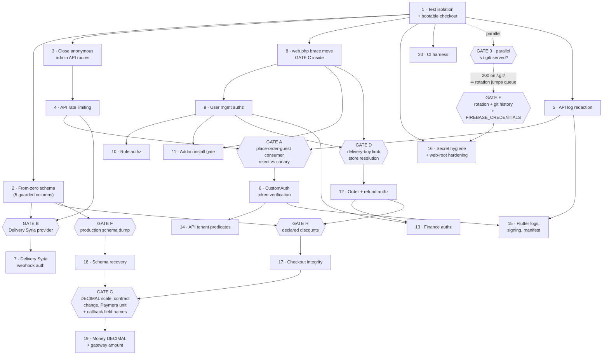

# Incremental Implementation Plan — Phase 1 Execution Order

**Audience.** The project owner, who approves the gates, and the engineers who will write the code.

**What this document is.** Twenty increments, in order, each one a reviewable commit set with a
testable definition of done. It is the execution plan for the revalidated finding set of Phase 1A.
It is derived from the eight area revalidations and the sequencing pass
(`/tmp/claude-0/-home-user/aa95adaa-f623-5e34-b064-1324104547b8/scratchpad/phase1a/R1`…`R9`), and it
builds on the Phase 0 baseline in `/home/user/syriastore98/docs/discovery/` — chiefly
`05-SECURITY-AND-QUALITY-AUDIT.md`, `04-DATABASE-AND-MULTITENANCY.md` and
`06-UI-UX-ASSESSMENT.md`, cited by filename and line where relied upon.

**Headline figure corrected, and this supersedes the earlier wording of this line.** This document
previously called that set "the 99 revalidated findings". **That figure is withdrawn as
unsupported:** it is not reconcilable from any table published in this phase. The only
document-verifiable count is the **43 rows** of doc 02's revalidation summary tables
(`02 §1.1-1.9`: 41 ID-bearing rows plus 2 cleared entries); docs 03-06 carry further per-area items
that were never numbered into a single register. The rule applied here and to every headline number
in this phase: **publish the arithmetic or quote the document-verifiable figure.** No aggregate
total is asserted below; what is asserted is the twenty increments and the items each one names.

**What this document is not.** It is not a record of work done. Not one line of application code has
been changed. Every code change below is presented as a **PROPOSED** instruction or diff.

---

## 1. Working agreement

These are the owner's rules, restated as the terms every increment is held to. An increment that
breaks one of these is rejected at review even if its tests pass.

| # | Rule | What it means in practice here |
|---|---|---|
| 1 | **Smallest surface** | Touch the fewest files that close the finding. Increment 6 is ~25 lines in ONE file and fixes 189 routes. Increment 3 is nine middleware tokens. If a fix needs twenty files, the design is wrong. |
| 2 | **No unrelated refactoring** | No alias renames, no formatting sweeps, no "while I'm here". Three cosmetic improvements the area notes suggested — renaming `custom.auth` to `attach.identity`, renaming `APILog`/`AdminApiLog`, and refactoring `DashboardController::logouto` — are **explicitly deferred** for exactly this reason. The first would touch all 189 route lines for zero security gain. |
| 3 | **Reviewable changes** | One increment, one reviewable diff, one review. Where two findings collide inside a single method they are **combined** into one increment (Increment 9) rather than sequenced into a merge conflict. Where they are independent they stay apart even if adjacent (Increments 9 and 10). |
| 4 | **Focused tests** | Each increment names the tests that must pass. Most are written to **FAIL against 41fe2f68** — that failure is the proof the finding is real, and the pass is the proof the fix landed. No coverage targets, no broad test-writing campaigns. |
| 5 | **No secrets** | No credential VALUE is printed, logged, committed or pasted into a ticket — variable name and `file:line` only. This holds in commit messages, in CI logs and in the redaction work of Increment 5. |
| 6 | **No production changes** | Nobody runs a migration, a rotation or a `curl` against the live host as part of writing code. Production actions are **owner actions**, listed under their gate, and always against a restored copy where a database is involved. |
| 7 | **Evolve, do not rebuild** | Laravel, Blade, the 69 WorkDo addon modules, the theme system, the Flutter app and the Syrian integrations (Paymera, Delivery Syria) are preserved. Improve in place. No parallel systems. No framework migration. Laravel-native mechanisms — Policies, Gates, FormRequests, route middleware, `RateLimiter`, DB transactions — in preference to bespoke machinery. |
| 8 | **One source of truth** | Laravel owns business rules, financial calculation, order state and tenant permissions. Flutter consumes them over authenticated APIs. No increment below moves a rule into the app; Increment 15 and the repo-B items in 19 and 20 only remove leaks, fix signing and correct parsing. |

### 1.1 Each increment stops for review

**Increments do not chain.** An increment ends at its definition of done, its diff is reviewed, and
only then is the next one started. This is deliberate and it is not negotiable:

- Increment 1 is risk-free by construction (`phpunit.xml`, `tests/bootstrap.php`,
  `tests/Support/TestDatabaseGuard.php`, `tests/TestCase.php` and `.env.testing` are loaded by no
  non-test path — not by `public/index.php`, not by `artisan`). It is therefore the
  right change on which to **prove the review-and-ship workflow itself** before anything can hurt.
- Several increments shift line numbers that later increments cite. Reviewing in between is what
  keeps the citations honest. See §6, the collision table.
- Four increments change behaviour that a client may depend on (3, 6, 8, 12). Each needs an
  observation window — logs, not assumptions — before the next lands on top of it.

---

## 2. Environment status — BLOCKED, and what that means for Increment 1

Stated plainly so nothing below is mistaken for a verified pass.

| Capability | Status | Evidence |
|---|---|---|
| Run the test suite | **BLOCKED** | `ls vendor/laravel/framework/src` -> No such file or directory; `find vendor -maxdepth 2 -type d -empty \| wc -l` -> 237; `ls vendor/bin/phpunit` -> absent. |
| Boot the application | **BLOCKED** | `ls -d storage` -> No such file or directory. `.gitignore:5` is `/storage/`, the whole tree. Laravel cannot write framework caches. |
| Reach any database | **BLOCKED** | No server reachable; no schema to point `mysql`/`sqlite3` at. |
| Compile or analyse the Flutter app | **BLOCKED** | `flutter` and `dart` are absent from this container. |
| Check the deployed host | **BLOCKED** | Arbitrary-host egress denied; storesyria.com does not resolve; CONNECT returns 403. |
| `bcmath` / `gmp` for exact decimal math | **ABSENT** | `php -m` shows `fileinfo`, `intl`, `pdo_sqlite`, `sqlite3` only. This confirms Increment 17 must use `brick/math` (already a resolved dependency), **not** `bcadd`. |

**Consequence for Increment 1.** It can be **written** here but its green run must be demonstrated on
the owner's machine or in CI. Report that as BLOCKED, never as a pass. The same applies to every
test named in this document: they are **specifications**, not results.

---

## 3. The ordering doctrine

The owner's ranking, applied literally, in this precedence:

1. **Does it need owner input we lack?** If yes it cannot be increment *N*; it sits behind a gate.
   Four things are genuinely unobtainable here: the production schema dump, credential-rotation
   authorization, Paymera's expected amount unit, and the Delivery Syria provider's webhook headers.
2. **Does it risk breaking the shipped Flutter app?** A CRITICAL fix that bricks the merchant console
   is not increment 2. Three classes exist: *proven safe* (3, 6, 14 — the app already sends the full
   Sanctum token and already sends only owned store ids), *mildly risky* (4 — HTTP 429 is unhandled
   in the app), and *genuinely breaking* (19 — the DECIMAL conversion changes JSON money fields from
   number to string; the one real API-contract change in the plan, and it is gated).
3. **Blast radius.** One file beats seven. Nine middleware tokens beat a brace that silently re-homes
   28 route declarations.
4. **Severity.** Used only to break ties *within* a risk class.

Two structural rules fall out of the findings themselves and override the ranking:

- **Authentication before authorization, always.** A Policy written against `auth()->user()` cannot
  defend against the attacker it is aimed at while that attacker is anonymous. So Increment 8 (the
  `routes/web.php` brace move) strictly precedes Increment 12 (`OrderPolicy`), and Increment 6
  (CustomAuth verification) strictly precedes Increment 14 (API tenant predicates).
- **Do not scope before you can see the rows.** The tenancy global-scope programme is **deliberately
  excluded** from Phase 1 — see §8 — and replaced by explicit per-call-site predicates in
  Increment 14. This is also what the owner's "global scopes used SELECTIVELY" instruction asks for.

---

## 4. The twenty increments at a glance

| # | Increment | Severity closed | Owner gate | Effort (eng-days) | Flutter impact |
|---|---|---|---|---|---|
| 1 | Test isolation + bootable checkout (**four layers, 0-3**) | CRITICAL | — (GATE 0 runs in parallel) | 0.75 | none |
| 2 | From-zero schema bootability (5 guarded columns) | CRITICAL | — | 1.5 | none |
| 3 | Close the anonymous admin API surface | CRITICAL | — | 0.5 | none (verified) |
| 4 | API rate limiting | HIGH | — | 0.5 | 429 unhandled → start generous |
| 5 | API request/response log redaction | HIGH | — | 1.0 | none |
| 6 | **CustomAuth token verification** | CRITICAL | **GATE A** | 1.5 | none (verified) |
| 7 | Delivery Syria webhook authentication | HIGH | **GATE B** | 1.0 | none |
| 8 | `routes/web.php` brace move (administrative half) | CRITICAL | **GATE C** (inside) | 1.5 | none expected |
| 9 | User management authorization **+ impersonation takeover** | CRITICAL | — (two confirmations) | 3.0 | none |
| 10 | Role authorization + remove the `users.type` rewrite | CRITICAL | — | 2.0 | none |
| 11 | Addon/module install gate (zip-upload RCE) | CRITICAL | — | 2.0 | none |
| 12 | Order and refund authorization | CRITICAL | **GATE D** | 3.0 | indirect — store resolution |
| 13 | Finance authorization | CRITICAL | — (confirmation) | 2.0 | wallet screens need permission |
| 14 | API tenant ownership predicates | CRITICAL | — | 3.5 | none (verified) |
| 15 | Flutter: credential logging, signing, manifest, Crashlytics | HIGH | — (procurement item) | 1.5 | **this is the Flutter increment** |
| 16 | Secret hygiene + web-root hardening | CRITICAL | **GATE E** | 1.0 code + owner time | base URL must be parameterised first |
| 17 | Checkout integrity (server-authoritative totals) | CRITICAL | **GATE H** (inside) | 4.0 | none for the tampering fix |
| 18 | **GATED** — Schema recovery (15 tables, `plan_id`) | CRITICAL | **GATE F** | 3.0 total, **split**: 0.75 draft from code + 2.25 reconcile against the dump | JSON type drift risk |
| 19 | **GATED** — Money DECIMAL conversion + gateway amount **+ callback verification** | HIGH/CRITICAL | **GATE G** | 4.5 | **app ships FIRST** |
| 20 | CI as the regression harness | MEDIUM | — | 1.5 | pure-Dart unit tests |

Total ≈ 39.25 engineer-days of implementation, excluding owner time on the gates and excluding the
observation windows between increments.

### 4.1 Which increments need NO owner input and can begin immediately once authorized

**Ungated — start as soon as Phase 1 is authorized, in this order:**
**1, 2, 3, 4, 5**, then after GATE A: **9, 10, 11, 13, 14, 15, 20**.

None of these needs production access, a schema dump, a credential decision or a third-party
confirmation. Each works against columns and tables that **already exist and are already migrated**:

| Increment | Why no owner input and no schema knowledge is required |
|---|---|
| 1 | `phpunit.xml`, `tests/TestCase.php`, `.env.testing`, `.gitignore`, `storage/**/.gitkeep`. No table touched. |
| 2 | Five column shapes that are **unambiguous from code** — see §5, Increment 2. All `hasColumn`-guarded, all no-ops against production. |
| 3 | Pure `routes/api.php` middleware-array edits plus one dead-route deletion. No table touched. |
| 4 | One line in `bootstrap/app.php` plus four route tokens. No table touched. |
| 5 | Two middleware `terminate()` bodies plus one `config/logging.php` value. No table touched. |
| 6 | Reads `personal_access_tokens`, which **is** fully migrated — `database/migrations/2019_12_14_000001_create_personal_access_tokens_table.php:15` `$table->id()`, `:18` `token`, `:19` `abilities`, `:21` `expires_at`. |
| 9, 10, 11, 12, 13 | Policies, FormRequests and route middleware over columns that all exist: `users.type`, `users.created_by`, `roles.store_id` (`2023_12_08_100022_laratrust_setup_tables.php:25`), `orders.store_id`. |
| 14 | `stores.created_by` exists (`2023_12_14_090259_create_stores_table.php:14-26`). |
| 15, 20 | repo-B and `.github/` only. |

**Gated — cannot start until the named gate is answered:**

| Increment | Gate | What the owner must supply |
|---|---|---|
| 6 | **GATE A** | Who consumes `POST /api/{slug}/place-order-guest`; and reject-mode vs one log-only canary release. |
| 7 | **GATE B** | Confirmation from Delivery Syria that their sender already transmits `X-Platform: deliverysyria` plus the per-store bearer secret. |
| 8 | **GATE C** | Whether guest order tracking / receipt-by-link is a real customer flow. |
| 12 | **GATE D** | The delivery-boy policy limb, and session-vs-token store resolution for API callers. |
| 16 | **GATE E** | Rotation authorization and order; git-history Option A vs B; whether `.env:52 FIREBASE_CREDENTIALS` is a path or inline JSON; confirmation every local `.env` is saved outside the repo. |
| 17 | **GATE H** | Whether merchant-declared discounts below the line-item sum are a legitimate workflow; plus the theme checkout-template enumeration. |
| 18 | **GATE F** | `SHOW CREATE TABLE` for 15 tables + `users.plan_id` + `products.cost_price` + `orders`, **from a restored copy**; a read-only NULL census; `SELECT DISTINCT type FROM users`. |
| 19 | **GATE G** | DECIMAL scale confirmation; acceptance of the JSON number→string contract change; **Paymera's expected amount unit**; and **Paymera's callback response field names** — the captured-amount field and the signature/HMAC field, plus the signing algorithm and how the shared secret is delivered — which the callback hardening in Increment 19 is BLOCKED on. |

**GATE 0** runs in parallel with Increment 1 and blocks no code work: the owner checks whether
`/.git/` is served over HTTP and what the document root is. If `GET /.git/HEAD` returns 200, every
secret in the `.env` inventory is already compromised — because `.env` is committed at `3c39c160`
(`git log --oneline -- .env`) and still tracked at HEAD (`git ls-files .env` -> `.env`), so
`git show 3c39c160:.env` recovers `APP_KEY` and the full DB credential set **even though** the
`<Files .env>` deny at `.htaccess:6-9` blocks `/.env`. The guard is bypassed by a path it does not
cover. In that case rotation (GATE E) jumps ahead of Increment 3. **This cannot be checked from this
container and nothing is asserted about the live host.**

---

## 5. Dependency graph

Ordering only. No dates. An arrow means "must land before".



---

## 6. Collision table — fixes touching the same file, route or middleware

This is the section that prevents merge pain. **Six files are contended; two are badly contended.**

### 6.1 `routes/api.php` — the most contended file

| Increment | What it changes | Effect on line numbers |
|---|---|---|
| **3** | Add `'custom.auth'` to the seven list routes (`:163-169`); add `->middleware(['custom.auth','AdminApiLog'])` to the order-note registrations (`:203-206`, `:208-211`); DELETE the zid debug route (`:381-384`) | **ADDS lines** below 203; deletion at end-of-file shifts nothing above it |
| **4** | `'throttle:auth'` on the admin-prefix `adminlogin` (`:134`), on the forgot-password/OTP routes (`:50-52`), `throttle:60,1` on `/delivery-syria/status` (`:376`) | token additions only |
| **7** | The `/delivery-syria/status` registration | token additions only |

**Sequence: 3 → 4 → 7. Never in parallel.**

**The mechanical hazard, stated precisely.** The order-note registrations are multi-line. Verified
verbatim:

```
203:       Route::post(
204:         '/orders/notes/create',
205:         [DashboardController::class, 'AddOrderNote']
206:     );
208:     Route::delete(
209:         '/orders/notes/delete',
210:         [DashboardController::class, 'DeleteOrderNote']
211:     );
```

Adding `->middleware([...])` here **adds lines**, so every citation below 211 shifts: `changestore`
(verified at `:305`), `view-used-coupon` (`:310`), `/delivery-syria/status` (`:376-379`),
`zid-statuses-test` (`:381-384`). **Increments 4, 7 and 14 must locate routes by URI and controller
method, never by the line number printed in Phase 0 or Phase 1A.**

### 6.2 `routes/web.php` — second most contended

| Increment | What it changes | Position relative to the brace move |
|---|---|---|
| **8** | Relocate the `});` verified at `:938` down past the administrative block; DELETE the duplicate `order-view/{id}` registration at `:956` (it duplicates `:946` — both are `[OrderController::class, 'order_view']` named `order.view`) | the move itself |
| **11** | Wrap the addon routes (`:785-788`) and `module.install` (`:909-913`) in a new `Route::middleware('can:manage-platform-addons')->group(...)` | **above** the move — unaffected |
| **13** | Extend the finance permission group (`:164-167`) over the mutators (`:168-198`); add `auth` to the zid orders route (`:978-980`) | `:164-198` above the move; `:978` below the web group's close at `:974` — both unaffected |
| **16** | DELETE the zid show-token closure (`:1146-1153`) and sweep the `:1100-1165` debug region | **below** `:974` — unaffected |

**Sequence: 8 first, then 11, 13, 16 in any order.**

**Why 8 must be first.** Increment 11 adds brace depth *inside* the auth group and invalidates any
cached depth analysis — and Increment 8's correctness is **proven by brace-depth tooling**. Two
independent tools established the boundary and must be **re-run after every touch of this file**:
`scratchpad/phase1a/depth.php` (PHP `token_get_all`, counts only real brace tokens) and
`scratchpad/phase1a/groupchain.py` (a string- and comment-aware character scanner). Their agreement
is what proved the finding; they are the regression check for the move itself.

Line arithmetic, verified: `:305` opens `Route::middleware(['web'])->group(`, `:326` opens
`Route::middleware(['auth','xss','setlocate','verified'])->group(`, `:938` closes the auth group,
`:974` closes the web group. Moving one `});` down past 28 lines shifts `:939-966` up by one and
leaves `:967+` net unchanged.

### 6.3 `app/Http/Controllers/UserController.php` — MUST COMBINE, NOT SEQUENCE

Two findings sit **six lines apart inside one method**:

- Finding `SEC-F4` replaces `:239` `$input = $request->all();` with `$request->validated()`.
- Finding `NEW-audit-oldvalues` replaces `:244-252`, where `$oldValues` is **used** at `:246` and
  **defined** at `:252` — six lines after its use, so PHP 8.3 passes `null`.

The second depends on the first: once `validated()` is in place the `$oldValues` snapshot must still
be taken **before** `fill()->save()`, and a naive reorder records the post-save values as the old
ones. **They cannot be separate increments.** Combined into Increment 9, along with the `SEC-F1`
ownership fix (`:296`, `:312`, `:329-333`), the name-into-integer-FK bug (`:147`) and the `=`-for-`==`
double typo (`:398`).

### 6.4 `app/Http/Controllers/Api/DashboardController.php` — nine findings, one pass

Nine methods between `:88` and `:3586` in one very large file:
`resolveOwnedStore` helper + the seven list methods (`:798` `CategoryList`, `:814` `ProductList`,
`:889` `VariantList`, `:907` `OrderList`, `:1022` `CouponList`, `:1038` `ShippingList`, `:1054`
`TaxList`) + `AddOrderNote` (`:103`) + `DeleteOrderNote` (`:164`) + `ChangeStore` (`:3550`) +
`ViewUsedCoupon` (`:3580`) + null guards at `:539`, `:649`, `:676`.

**Consolidated into Increment 14 by design.** Nine separate increments would collide repeatedly.
Two further findings touch this file and are **deferred to avoid a fifth pass**: the `logouto`
refactor to `findToken()` (`:595-643` — correct today) and `createToken` abilities (`:585`).

### 6.5 The remaining contended files

| File | Increments | Sequencing rule |
|---|---|---|
| `app/Http/Controllers/OrderController.php` | 12 (`order_payment_status:556`, `updateStatus:640`, `order_assign:675`, `destroy:626`), 17 (the reconciler in `store():43-166`) | **12 then 17.** Increment 17's change is *above* `:556` so it shifts everything below. Re-locate by method name. |
| `app/Http/Controllers/StoreController.php` | 9 (`storeResetPassword:638`, `storeResetPasswordUpdate:646-669`, **and the impersonation pair `LoginWithAdmin:716-723` / `ExitAdmin:725-730`**, both re-opened in this pass), 14 (`changeStore:626-636` + the `=`-for-`==` typo at `:627`) | **9 then 14.** Different methods; `:626-636`, `:638-669` and `:716-730` are disjoint, so the two increments never contend for the same hunk. The file also imports the facade at `:28` `use Lab404\Impersonate\Impersonate;` — Increment 9 touches the two methods, not the import. Re-locate by method name, never by line. |
| `app/Providers/AuthServiceProvider.php` | 9, 10, 11, 12, 13 all register into the `$policies` array verified **EMPTY** at `:15-17` | Each increment **appends one line at the end of the array**; the increments merge in strict numeric order. Trivial textually, but they *will* conflict on every rebase otherwise. |
| `app/Services/PaymentService.php` | 17 (client-tax `:1976`, client-shipping `:2033-2034`, stock `:2090-2092`/`:2162-2164`, order write `:2237`), 19 (Paymera amount `:211-212` and the dead copy at `:284`) | **17 then 19.** Different regions of one 2000+ line file. Re-locate by method name. |
| `database/migrations/` | 2 (three additive guarded columns + driver guards on two existing migrations), 18 (15 tables + `plan_id` + `cost_price` + hygiene), 19 (the DECIMAL conversion) | **2 → 18 → 19, strictly.** The dependency is substantive: Increment 18 must declare the new finance tables with **correct DECIMAL types from the start** so Increment 19 only converts the 39 pre-existing float columns and never has to convert a table it just created. |
| repo-B `lib/network/network.dart` | 15 only — four changes in one file (logger construction `:29-38`; delete the dead `headers` parameter at `:94` plus five call-site arguments; make `_getAuthHeaders` public for the four hand-rolled Bearer maps; add `case 429`) | One increment, four commits inside it. Deleting the dead `headers` parameter is **not tidying** — it is a landmine, because the obvious future "fix" is to start printing it, which re-creates the token-logging defect Increment 15 just removed. |

### 6.6 `bootstrap/app.php` — deliberately single-owner

Only **Increment 4** touches it (`$middleware->throttleApi('120,1');` inside the existing
`withMiddleware` closure). Verified: `:16-29` registers **12** middleware aliases — `setlocate`,
`themelanguage`, `APILog`, `AdminApiLog`, `xss`, `activeTheme`, `custom.auth` (`:23`),
`PlanModuleCheck`, `verified`, `guest`, `2fa`, `demo_mode` — and `appendToGroup('web', SetLocate)` at
`:31`, with CSRF exceptions from `:33`.

> **Correction to the upstream notes.** They say 13 aliases; the file has **12**. The number is not
> decorative: **`permission` is NOT among them**, which is exactly why Increment 13 carries a
> prerequisite to confirm Laratrust's own service provider registers that alias. If it does not,
> `routes/web.php:164` throws on every `/finance` request today.

Two suggested changes are deferred precisely to keep this file single-owner: renaming the
`custom.auth` alias, and renaming the two log middlewares. The CSRF exception list is **not** touched;
the `'delivery-syria/status'` entry in it is correct for a webhook.

### 6.7 Cross-repo ordering

**Exactly one forced app-before-backend dependency exists in the whole plan, and it is NOT the auth
fix.** The DECIMAL conversion (Increment 19) changes money fields from JSON number to JSON string, so
the explicit `double.tryParse` coercions in repo-B `lib/core/model/order_detail_model.dart:56,149`
and `lib/core/model/product_model.dart:214-229` must be **shipped to the store first**.

Everywhere else the backend ships first and alone.

A second cross-repo coupling: **parameterise repo-B's hardcoded base URL before any document-root
move in Increment 16.** Verified at `lib/utils/base_api.dart:3`
`static String baseUrl = "https://storesyria.com/api/admin";` with a commented ngrok alternate at
`:4` — that comment is itself the proof that environments are currently swapped by editing source.
There is a **second, independently hardcoded host** at `lib/utils/helper.dart:75`, so a one-line fix
is insufficient. If the document root moves and the effective base path changes, the shipped app
breaks with no hotfix short of a store release.

---

## 7. The increments

Each subsection carries the same twelve elements, in the same order, plus a **definition of done**.
Every proposed change is marked **PROPOSED — NOT APPLIED**.

---

### Increment 1 — Test isolation + bootable checkout

> **This is increment 1 and the ordering is not negotiable.** `php artisan test` from this checkout
> would run `migrate:fresh` against the real MySQL database named in the committed `.env`. That is a
> data-destruction hazard, and it blocks *every other Phase 1 activity*, because every regression
> test named in this document is unrunnable until it is fixed. It is also the rare P0 whose fix is
> **risk-free** — `phpunit.xml`, `tests/bootstrap.php`, `tests/Support/TestDatabaseGuard.php`,
> `tests/TestCase.php` and `.env.testing` are loaded by no non-test path — which makes it the correct
> change on which to prove the review-and-ship workflow before
> anything can hurt. Nothing may be scheduled ahead of it.

**Objective.** Make it impossible for the test suite to reach a real database, and make a fresh
clone bootable at all.

**Items covered.** `R6-00`, `TEST-ISO-04` / `R8-04`, `NEW-storage-absent` / `R8-05`.

**Exact files to be touched.**

**THE CANONICAL LAYER DEFINITION, and this table is it.** Increment 1 ships **FOUR** layers,
numbered 0-3. This table is the authoritative list of what that means in files, because this is the
document an engineer follows. **Supersession, stated explicitly:** an earlier revision of this table
listed six files, omitted `tests/bootstrap.php` and left `phpunit.xml:4`
`bootstrap="vendor/autoload.php"` untouched, while the definition of done below claimed "the four
guards are in place". That three-layer shape — also published at `00 §6` and `01 §6.3` in earlier
revisions — **is superseded by the four layers below.** Where any other document still describes
three layers or keeps `bootstrap="vendor/autoload.php"`, this table governs. **This document is the single governing source for what Increment 1 ships**: docs 00, 01 and 05 are written to match it, and each now says so explicitly. Doc 01 §6.5 holds the one copy of the shared guard body; doc 05 holds the tests. No `refreshDatabase()` override is shipped — see doc 05 §1.3 for the verified trait-shadowing proof that it would protect none of the 8 classes this increment protects.

| Layer | File | Change |
|---|---|---|
| **0 — PRIMARY** | `/home/user/syriastore98/tests/bootstrap.php` | **NEW.** Hard-fails the run (`exit(1)`) unless the resolved test database is sqlite / `:memory:`, read from the **environment**. Full body in `05 §1.4` — one source of truth, deliberately not duplicated here. |
| **0** | `/home/user/syriastore98/tests/Support/TestDatabaseGuard.php` | **NEW.** The pure shared assertion `assertSqliteInMemory(?string $connection, ?string $database)` that Layer 0 and Layer 3 both call and that the unit tests call directly with literals. Body in `01 §6.5`. It boots nothing, reads no config and opens no connection — which is what makes it testable with no database. Autoloads because `composer.json` `autoload-dev` maps `"Tests\\" => "tests/"` (re-opened). |
| **1** | `/home/user/syriastore98/phpunit.xml` | Uncomment `:25-26` **and add `force="true"` to both**, **AND re-point `:4` from `bootstrap="vendor/autoload.php"` to `bootstrap="tests/bootstrap.php"`** (both re-opened this pass). **The `bootstrap=` change is not cosmetic — it is what installs Layer 0**; without it Layer 0 is a file nothing loads. Nothing is lost by the substitution: `tests/bootstrap.php` requires `vendor/autoload.php` as its first statement. |
| **2** | `/home/user/syriastore98/.env.testing` | **NEW**, tracked. sqlite / `:memory:`, no secrets, and a **FIXED, deliberately fake `APP_KEY`** — see acceptance criterion 2. |
| **3** | `/home/user/syriastore98/tests/TestCase.php` | Add a `setUp()` guard **as defence in depth, explicitly NOT the primary control**, documented as such in its own docblock — see the ordering correction below. |
| — | `/home/user/syriastore98/.gitignore` | Narrow `:5` `/storage/` to contents + `.gitkeep` re-includes; fold in `.env`, `.env.*` with `!.env.example` / `!.env.testing`, `/error_log`, `composer.phar`, `/public/storage` |
| — | `/home/user/syriastore98/storage/**/.gitkeep` | 8 **NEW** placeholders, `git add -f` |
| — | `/home/user/syriastore98/tests/Unit/TestIsolationGuardTest.php` | **NEW.** Guard logic, exercised in isolation. |
| — | `/home/user/syriastore98/tests/Unit/TestIsolationWiringTest.php` | **NEW.** Asserts the wiring as file content — that `phpunit.xml` forces both overrides and points `bootstrap=` at `tests/bootstrap.php`. The logic and its three attaching lines fail in different ways and need different tests. |

The hazard, re-verified line-exact in this pass:

```
phpunit.xml:21    <env name="APP_ENV" value="testing"/>
phpunit.xml:24    <env name="CACHE_STORE" value="array"/>
phpunit.xml:25    <!-- <env name="DB_CONNECTION" value="sqlite"/> -->
phpunit.xml:26    <!-- <env name="DB_DATABASE" value=":memory:"/> -->
phpunit.xml:27    <env name="MAIL_MAILER" value="array"/>
```

Note that **every other `<env>` in the block is live** — `:21-24` and `:27-31`. This is a *targeted*
commenting-out, not a wholesale disable. `ls -la .env.testing` -> `No such file or directory`, so
there is no second line of defence. Eight test classes use `RefreshDatabase` —
`tests/Feature/Auth/{Authentication,EmailVerification,PasswordConfirmation,PasswordReset,PasswordUpdate,Registration}Test.php`,
`tests/Feature/ExampleTest.php`, `tests/Feature/ProfileTest.php`. `.env:8` is `DB_CONNECTION=mysql`
and `.env:9-13` `DB_HOST`/`DB_PORT`/`DB_DATABASE`/`DB_USERNAME`/`DB_PASSWORD` are all populated
(values deliberately not read or printed).

`tests/TestCase.php` is an **empty base class**, verified in full — 10 lines, body `//` at `:9`. The
guard therefore has a natural home with nothing to clobber.

#### The ordering correction — this supersedes the guard as previously published in this document

An earlier revision of this section put the entire check in `tests/TestCase.php::setUp()`, opened it
with `parent::setUp();`, asserted afterwards, and described that as the durable protection. **That is
wrong, and the claim is withdrawn.** `parent::setUp()` is where
`Illuminate\Foundation\Testing\TestCase::setUp()` runs `setUpTraits()`, and `setUpTraits()` is what
invokes `RefreshDatabase::refreshDatabase()` -> `migrate:fresh`. Assertions placed after it therefore
execute **after every table in the target schema has already been dropped**: the control runs after
the damage it exists to prevent.

**Evidential status, stated exactly: FRAMEWORK-DOCUMENTED BEHAVIOUR, UNVERIFIED IN THIS ENVIRONMENT
(BLOCKED).** `vendor/laravel/framework/src` is absent in this container (§2, §11), so this ordering
**could not be confirmed from vendor source here** and is not presented as if it were.

**The placement is corrected regardless, and the reason does not depend on the ordering being true:**
the corrected placement is safe under **either** ordering, while the old placement is safe under only
one of them. A safety control must never rest on an assumption that cannot be checked. That is the
whole argument, and it is why no one should wait for the vendor tree to be installed before moving
the guard.

**CORRECT PLACEMENT — Layer 0.** The primary check lives in `tests/bootstrap.php`, wired by
`bootstrap="tests/bootstrap.php"` in `phpunit.xml:4`, because that file runs **once, before PHPUnit
loads a single test class** — before the framework boots, before any trait hook, and therefore before
`migrate:fresh` is reachable at all. At that moment the Laravel application does not exist, so Layer 0
checks the **environment** (`DB_CONNECTION` / `DB_DATABASE` via `$_ENV` / `$_SERVER` / `getenv()`),
not `config()`. PHPUnit applies its `<env>` entries before the bootstrap file runs, so Layer 1's
`force="true"` values are already present when Layer 0 executes — Layer 0 asserts that Layer 1 did
its job.

**The in-class alternative, and the two placements that do NOT work.** Recorded explicitly so that
nobody "simplifies" the guard back into `setUp()`:

- **In-class alternative — override the trait entry point `refreshDatabase()`**: assert, then call the
  framework's implementation. It must be done **in each class that uses `RefreshDatabase`** (eight
  today), with trait aliasing, because a trait method used by the *concrete* class **overrides an
  inherited method of the same name** on the parent — so a `refreshDatabase()` declared on
  `Tests\TestCase` would simply never be called. The worked form is in `01 §6.3`. **Recorded as an
  option; NOT adopted**, because eight copies will become seven the ninth time someone adds a test.
- **`afterApplicationCreated()` does NOT work.** Those callbacks are run from inside
  `parent::setUp()`, in the same window as `setUpTraits()`, so they are not reliably earlier than the
  `migrate:fresh` they exist to prevent — while *looking* earlier, which makes them worse than an
  honest post-`parent::setUp()` assertion. **Stated so nobody proposes it as the simplification.**
- **Asserting *before* `parent::setUp()` does not work either**, because `config()` does not exist
  until the application has been created, and creating it is what `parent::setUp()` does. That is
  precisely the trap the three-layer version fell into.

**PROPOSED — NOT APPLIED.** `tests/TestCase.php` — Layer 3, **defence in depth, not the primary
control.** The bodies of `tests/bootstrap.php` and `tests/Support/TestDatabaseGuard.php` live in
`05 §1.4` and `01 §6.5` and are not duplicated here:

```php
abstract class TestCase extends BaseTestCase
{
    /**
     * DEFENCE IN DEPTH -- NOT the primary control. The primary control is
     * tests/bootstrap.php (Layer 0), which runs before any test class is loaded.
     *
     * TIMING, STATED SO NOBODY RELIES ON THIS METHOD FOR SAFETY: parent::setUp()
     * is where the framework runs setUpTraits(), and setUpTraits() is what invokes
     * RefreshDatabase::refreshDatabase() -> migrate:fresh. The assertions below
     * therefore run AFTER the trait hooks -- i.e. potentially after the tables have
     * already been dropped. config() is unavailable before parent::setUp(), so this
     * cannot be made earlier; that is why Layer 0 exists. Do NOT move these
     * assertions into afterApplicationCreated(): it runs in the same window.
     *
     * What this method DOES still buy: it catches a mis-pointed suite that got past
     * Layer 0 -- a hand-run phpunit with a different bootstrap, a cached config, a
     * service provider calling DB::setDefaultConnection() -- and it fails with a
     * message that explains the hazard.
     */
    protected function setUp(): void
    {
        parent::setUp();

        $connection = config('database.default');

        // The same implementation Layer 0 and the unit tests call. One source of truth.
        \Tests\Support\TestDatabaseGuard::assertSqliteInMemory(
            $connection,
            config("database.connections.{$connection}.database")
        );

        // Driver limb: config can be right while the RESOLVED connection is wrong.
        // It needs a live connection, so it is deliberately NOT unit-tested (see
        // the respecified tests below).
        $driver = \DB::connection()->getDriverName();

        if ($driver !== 'sqlite') {
            throw new \RuntimeException(
                "ABORTING TEST RUN: the resolved driver is '{$driver}', not 'sqlite'."
            );
        }
    }
}
```

**Why this position in the order.** Mandated, and correctly so. It must be **three findings in one
commit**, because shipping fewer is worse than shipping none: creating `storage/` is precisely what
**ARMS** the `migrate:fresh`-against-production trap. Today the hazard is masked in this container
by two accidents — `.env:9 DB_HOST` is a loopback address with nothing listening on 3306, and
`/storage/` is gitignored (`.gitignore:5`, verified: the whole tree) and absent, so the app cannot
bootstrap. **Both accidents are self-removing.** The loopback host makes it *worse* on the owner's
server, where loopback *is* the production database; and the first thing anyone does to make the app
run is create `storage/framework/{cache,sessions,views}` and `storage/logs` — at which moment the
trap is armed with no indication they armed it.

**Dependencies.** None.

**Acceptance criteria.**

1. `phpunit.xml` contains `<env name="DB_CONNECTION" value="sqlite" force="true"/>` and
   `<env name="DB_DATABASE" value=":memory:" force="true"/>`, both uncommented. **`force` is not
   optional:** without it PHPUnit does not overwrite a variable already present in the real
   environment, so a runner that exports `DB_CONNECTION=mysql` silently wins and the override is
   decorative. **And `phpunit.xml:4` reads `bootstrap="tests/bootstrap.php"`** — without that one
   attribute, criterion 3's file is never loaded and Layer 0 does not exist.
2. `.env.testing` is tracked, pins `DB_CONNECTION=sqlite` and `DB_DATABASE=:memory:`, uses
   `array`/`sync`/`log` drivers, `BCRYPT_ROUNDS=4`, and leaves **every integration variable blank**
   so no test can contact a third party. No secrets, safe to commit.
   **`APP_KEY` must be a FIXED, obviously-fake base64 value committed in the file — NOT blank, and
   NOT generated.** This is load-bearing, not tidiness. A blank `APP_KEY` makes Laravel throw
   *"No application encryption key has been specified"* for anything touching sessions, cookies or
   encryption — which is the **entire Breeze auth Feature suite that this increment exists to
   unblock**. The suite would then go red for a reason unrelated to the two MySQL-only migrations
   Increment 2 fixes, and that is **exactly the failure mode this plan warns about**: the team flips
   `phpunit.xml`, sees red, concludes "SQLite does not work here", and reverts the most important
   safety change in the programme. Two further reasons: `php artisan key:generate --env=testing`
   **writes into a tracked file**, dirtying every developer's tree and inviting an accidental commit
   of a generated key; and CI is required to receive **no** `APP_KEY` and to refuse to run with a
   `.env` present (`01 §8`), so CI would have no key either and would fail identically. The committed
   value is safe to commit **precisely because it protects nothing** — it is used only by the test
   suite, and `key:generate` must **never** be run against `.env.testing`. Say so in a comment in
   the file itself.
3. **`tests/bootstrap.php` aborts the run** — `exit(1)`, with a message naming `DB_CONNECTION` and
   `DB_DATABASE` and the required values — unless the environment resolves to sqlite / `:memory:`.
   **This, and not the test case, is the control that satisfies this increment's objective**, because
   it is the only layer that runs before the framework and before any trait hook. It is also the only
   layer that covers a test extending PHPUnit's base class **directly**, which Layer 3 cannot see at
   all — and the repository already contains one: `tests/Unit/ExampleTest.php:5`
   `use PHPUnit\Framework\TestCase;` and `:7` `class ExampleTest extends TestCase` (re-opened; the
   file is 16 lines). It is harmless today, and it is the template every new unit test will be copied
   from.
4. `tests/TestCase.php::setUp()` throws `RuntimeException('ABORTING TEST RUN: …')` unless the resolved
   connection is sqlite / `:memory:` **and** `DB::connection()->getDriverName() === 'sqlite'`. The
   driver limb earns its place because the config limbs read *configuration*, which can be right while
   the resolved connection is wrong (cached config, a `DB::setDefaultConnection()` in a provider, a
   connection alias). **This layer is DEFENCE IN DEPTH and must be documented as such in its own
   docblock** — the previously published claim that it "runs **before** `RefreshDatabase` can issue
   any DDL" is **false and is withdrawn** (see the ordering correction above). Every test extends
   `Tests\TestCase`, so this layer cannot be *forgotten* by a new file — but "cannot be forgotten" is
   not "runs first", and the increment's safety does not rest on it.
5. `storage/framework/{cache/data,sessions,testing,views}` and `storage/logs` exist via tracked
   `.gitkeep`; `.gitignore` ignores their **contents**, not the tree.
6. **Shell belt-and-braces, documented in the runbook:** `export DB_CONNECTION=sqlite` and
   `export DB_DATABASE=:memory:`. The mechanism usually quoted for this is that Laravel calls
   `Dotenv::createImmutable()`, which will not overwrite a variable already present in the process
   environment, so a real env var beats `.env`. **Relabelled honestly: FRAMEWORK-DOCUMENTED,
   UNVERIFIED IN THIS ENVIRONMENT (BLOCKED).** It was asserted in this document and in three others
   as established fact with no citation; it could not be checked here, because
   `vendor/vlucas/phpdotenv` exists but contains **no `.php` files** in this container
   (`find vendor/vlucas -name '*.php' | wc -l` -> 0). **The nuance that matters is unaffected:** with
   `force="true"` in Layer 1, `phpunit.xml` overrides the shell for test runs either way, so this is a
   **good habit rather than a control**, and it protects only non-PHPUnit paths — a hand-typed
   `artisan migrate`, `db:wipe` or `tinker`. Nothing in this increment's safety depends on the Dotenv
   claim being true.
7. No application code, migration, config, route, view or Flutter source is modified.

**Tests that must pass.**

**RESPECIFIED — this supersedes the two cases previously published here.** The earlier version set
`config(...)`, instantiated an anonymous `Tests\TestCase` subclass and **called `setUp()`** — which
boots the application, runs `setUpTraits()` and opens a live connection. That tests the guard by
triggering the very sequence the guard exists to prevent, it cannot run where no database is
reachable, and it asserts nothing about the layer that actually protects the suite. **The guard logic
is tested in isolation instead**, by calling the pure shared assertion with literals (body in
`01 §6.5`): no `config()`, no container, no `refreshApplication()`, **and no PDO handle** — the
live-connection check is deliberately left uncovered by unit tests, because covering it would
require the connection it is there to inspect.

- `tests/Unit/TestIsolationGuardTest.php::test_guard_rejects_non_sqlite_connection` —
  `TestDatabaseGuard::assertSqliteInMemory('mysql', 'anything')`; expect `RuntimeException` whose
  message contains `ABORTING TEST RUN` and `DROP EVERY TABLE`.
- `::test_guard_rejects_persistent_sqlite_file` —
  `assertSqliteInMemory('sqlite', '/tmp/x.sqlite')`; expect `RuntimeException` whose message contains
  `not ':memory:'`.
- `::test_guard_rejects_absent_configuration` — `assertSqliteInMemory(null, null)`; expect
  `RuntimeException`. An unset variable must **fail closed**, not fall through.
- `::test_guard_accepts_sqlite_in_memory` — `assertSqliteInMemory('sqlite', ':memory:')` returns
  normally. The positive case is not optional: without it the guard could be "passing" by always
  throwing. **This class may extend PHPUnit's base class directly** — it needs no Laravel, and it is
  the one place in this plan where doing so is correct rather than a bypass.
- `tests/Unit/TestIsolationWiringTest.php::test_phpunit_xml_forces_sqlite_and_uses_the_bootstrap_guard`
  — read `phpunit.xml` as **text** and assert all four: `bootstrap="tests/bootstrap.php"`; an
  `<env name="DB_CONNECTION" value="sqlite"` carrying `force="true"`; the same for `DB_DATABASE` /
  `:memory:`; and that neither override sits inside an XML comment. **It fails against `41fe2f68`**,
  which is the proof it is testing something. What can regress here is not the logic but the three
  lines that attach it, so it is tested as file content.
- `::test_the_shared_guard_is_still_wired_into_both_layers` — assert that `tests/bootstrap.php` and
  `tests/TestCase.php` both reference `assertSqliteInMemory`, so a refactor that deletes one of the
  two call sites turns red instead of going quiet.
- `tests/Feature/Repo/StorageSkeletonTest.php::test_storage_framework_directories_exist_and_are_writable`.
- `tests/Feature/Repo/SecretHygieneTest.php::test_gitignore_excludes_env_files` (the
  tracked-`.env` half lands in Increment 16).

**Where these are verified — NOT here, and this is the one line to read before scheduling the
increment.** None of the above was executed. The suite **cannot be run in the audit environment at
all**: `composer install --no-scripts` **aborted**, `vendor/laravel/framework/src` is absent and
`vendor/composer/installed.json` was never written (roughly 120 of 239 locked packages landed), so
`php artisan`, PHPUnit and every boot-dependent static analysis are **BLOCKED** (§2, §11). The root
cause is this container's egress policy, **not a defect in the project**: `lahirulhr/laravel-payhere`
v1.0.4 distributes as an `api.github.com` zipball that the proxy answers with 403, and its VCS
fallback fails for want of credentials; `yoomoney/yookassa-sdk-php` 3.7.1 and
`yoomoney/yookassa-sdk-validator` 1.0.2 are hosted on `git.yoomoney.ru`, which is unreachable here.
**So verification of Increment 1 happens on an engineer machine or in CI, and until it does the
increment is reported BLOCKED — never "passing".** Two consequences the owner should see: a CI runner
must reach **both** `api.github.com` and `git.yoomoney.ru` or the build fails identically, and it must
**not run as root**, because Composer refuses to load plugins for the root user. Fixing this
permanently touches `composer.json`, so it is an **OWNER DECISION, not ours** — allowlist both hosts,
put a caching Composer mirror/Satis in front, or drop the two SDKs, noting that YooKassa serves
Russia and PayHere serves Sri Lanka, so neither is a plausible Syrian payment rail.

**Rollback.** `git revert` the single commit. Nothing at runtime depends on any touched file.
Developers must re-create `storage/` by hand afterwards, which is the pre-change state.

**Flutter impact.** None. No repo-B file touched, no API surface, no wire format.

**WorkDo addon impact.** None. No `packages/workdo` file touched; package migrations are unaffected
because nothing runs yet.

**Effort.** 0.75 engineer-days to write — 0.5 as previously estimated for the six-file version, plus
0.25 for `tests/bootstrap.php`, `tests/Support/TestDatabaseGuard.php` and the two extra test classes
the four-layer definition adds.

**Owner approval.** **No. Proceed immediately.** GATE 0 runs in parallel and blocks nothing here.

**Definition of done.** **All FOUR layers (0-3) are in place as the table above defines them** —
including `tests/bootstrap.php`, `tests/Support/TestDatabaseGuard.php` and the
`bootstrap="tests/bootstrap.php"` re-point of `phpunit.xml:4`, **without which Layer 0 is a file
nothing loads**; the four `TestIsolationGuardTest` cases and both `TestIsolationWiringTest` cases
pass on a machine where the suite can run; `.env.testing` carries a fixed, obviously-fake `APP_KEY`
and `key:generate` was not run against it; a fresh clone of the branch boots far enough to execute
`php artisan test` and that command provably cannot reach MySQL. The layer count in this paragraph
and the layer count in the file table are the same number by construction — if a future revision
changes one, it changes both.
**Verification in this container is BLOCKED** (`vendor/bin/phpunit` absent, 237 empty vendor
directories, no `storage/`) and must be demonstrated on the owner's machine or in CI. Report it as
BLOCKED until it is.

---

### Increment 2 — From-zero schema bootability (code-derivable, additive, guarded)

**Objective.** Make `migrate:fresh` succeed on SQLite and make the suite able to seed a `Customer`
and create an `Order` — **without** the production dump. Every statement guarded so the whole set is
a no-op against production.

**Items covered.** `NEW-sqlite-migration-blocker`, `SEC-R5-03` (`customers.deleted_at`), `SEC-R5-02`
(`orders.currency_code` / `currency_symbol`), `NEW-UNDECLARED-SCHEMA` (the `orders.created_by` half
only), `SEC-R5-04` (`users.deliverysyria_secret`).

**Exact files to be touched.**

| File | Change |
|---|---|
| `database/migrations/2024_06_05_094055_drop_role_name_unique_in_roles_table.php` | `:14-26` — wrap the `SHOW INDEX` branch in `if (DB::connection()->getDriverName() === 'mysql')` |
| `database/migrations/2024_05_29_102438_add_customers_tbale_forienkey_in_user_coupons_table.php` | `:21` and `:62` — same driver guard around the `information_schema` queries |
| `database/migrations/<new>_add_soft_deletes_to_customers_table.php` | **NEW**, `hasColumn`-guarded |
| `database/migrations/<new>_add_currency_and_created_by_to_orders_table.php` | **NEW**, `hasColumn`-guarded |
| `database/migrations/<new>_add_deliverysyria_secret_to_users_table.php` | **NEW**, `hasColumn`-guarded |
| `tests/Feature/Schema/MigrationPortabilityTest.php` | **NEW** |

**Why this position in the order.** This is the increment that answers "make real progress while
waiting for production access". It proceeds now because these five column shapes are
**unambiguous from code**, unlike the 15 finance tables:

- `SoftDeletes` implies exactly a nullable timestamp. Verified: `app/Models/Customer.php:16`
  `use Illuminate\Database\Eloquent\SoftDeletes;` and `:20`
  `use Cachable, Notifiable, CanResetPassword,HasApiTokens,Billable,SoftDeletes;`. It is the **only**
  model in either tree using the trait, so the finding was correctly narrowed rather than inflated.
- The `Order` `creating` hook assigns string defaults. Verified in full at `app/Models/Order.php:63-80`:
  `:65 static::creating(...)`, `:68 if (empty($order->currency_code))`, `:69-71` defaulting to
  `'USD'`, `:74-77` defaulting to `'$'`. Both attributes are empty on a fresh insert, so both
  branches fire unconditionally into columns no migration creates.
- `deliverysyria_secret` is compared with `hash_equals` against a trimmed string, so it is a nullable
  string.

And the decisive fact that unblocks ~8 increments from the owner-gated schema recovery, verified here
rather than taken from either upstream claim: **`app/Observers/OrderObserver.php` swallows the
exception.** Re-read verbatim:

```
13    public function created(Order $order): void
15        try {
17            app(OrderFinancialService::class)->createForOrder($order);
18        } catch (\Exception $e) {
19            \Log::error('Order Observer - Created Error: ' . $e->getMessage());
20        }
```

`Illuminate\Database\QueryException` descends from `\Exception`, so a missing `store_wallets` is
swallowed, and `grep -rn "OrderFinancialService" --include=*.php app/` finds no unwrapped caller on
the order-creation path. **So `Order::create()` succeeds on a from-zero schema and only the financial
write silently no-ops.** The upstream claim that "the test suite CANNOT CREATE AN ORDER AT ALL" is
**REFUTED for the observer path**; only *financial assertions* need the dump.

`NEW-sqlite-migration-blocker` must be in **this** increment because uncommenting `phpunit.xml`
alone yields a red suite that will be misread as "SQLite does not work here".

**Dependencies.** Increment 1.

**Acceptance criteria.**

1. `php artisan migrate:fresh` exits 0 on the SQLite test connection.
2. A `Customer` can be created and can authenticate on the `customers` guard. Today the `SoftDeletes`
   global scope appends `and customers.deleted_at is null` against a non-existent column and **every**
   `Customer` query fails.
3. An `Order` can be created and the `creating` hook's `currency_code`/`currency_symbol` persist
   non-null.
4. `OrderController::store` can write `created_by`.
5. Every new statement is wrapped in `Schema::hasColumn`/`hasTable`, so re-running against a populated
   database is a no-op.
6. The two edited migrations produce **byte-identical MySQL schema** — the guarded branch is the
   existing code, so MySQL deployments are unaffected either way.
7. **The `SoftDeletes` trait is NOT removed** from `app/Models/Customer.php:20`. Removing it to
   "fix" the mismatch would silently convert soft deletes into hard deletes and destroy data.

**Tests that must pass.**

- `MigrationPortabilityTest::test_migrate_fresh_succeeds_on_sqlite`.
- `CustomerSoftDeleteTest::test_customer_login_succeeds_on_from_zero_schema`.
- `CustomerSoftDeleteTest::test_soft_deleted_customer_is_excluded_and_cannot_authenticate`.
- `OrderCurrencySnapshotTest::test_order_insert_persists_currency_code_and_symbol`.
- `MigrationHygieneTest::test_no_duplicate_migration_basenames` and
  `::test_no_table_is_created_by_two_unguarded_migrations` — **pure filesystem assertions, no
  database**, so they can be written and run before the dump arrives.

**Rollback.** Revert. The three new migrations are additive and nullable, so rolling them forward on
production and then reverting the code leaves harmless unused columns. The two driver guards revert
to the current MySQL-only code with no schema change either way.

**Flutter impact.** None. Additive nullable columns cannot change any JSON field's presence or type
for a client that reads named keys, and repo-B's models ignore unknown keys.

**WorkDo addon impact.** None directly. Note for the implementer: `packages/workdo` migrations run
per-module in **directory** order via `app/Console/Commands/PackageMigrate.php:58,88-94`, not
timestamp order — safe today because all 11 addon foreign keys resolve (8 to root tables that exist
by then, 3 within their own package with correct internal ordering).

**Effort.** 1.5 engineer-days.

**Owner approval.** **No** — but the owner should be **told, not asked**, that this is a deliberate
partial. Only the five code-derivable columns land here. The 15 finance/wallet tables,
`users.plan_id` and `products.cost_price` are held back to Increment 18 behind GATE F precisely
because their types are **not** derivable from `$fillable` and guessing them would create a silent
divergence from production.

**Definition of done.** `migrate:fresh` is green on SQLite; a Customer and an Order can be seeded in
a test; all five new statements are guarded; the two edited migrations are proven no-ops on MySQL by
inspection of the guarded branch.

---

### Increment 3 — Close the anonymous admin API surface (route middleware only)

**Objective.** Remove the **anonymous** path to seven cross-tenant admin read endpoints and two
order-note write endpoints, and delete the unauthenticated Zid debug endpoint. No `CustomAuth`
change, no controller change.

**Items covered.** `NEW-unauthenticated-admin-list-routes`, `R2-03`,
`NEW-unauthenticated-order-notes-write`, `R2-04` (route half), `NEW-zid-debug-endpoint`.

**Exact files to be touched.**

| File | Change |
|---|---|
| `routes/api.php` | `:163-169` — add `'custom.auth'` as the first element of each existing middleware array (7 single-token edits); `:203-206` and `:208-211` — add `->middleware(['custom.auth','AdminApiLog'])` (2 edits); **DELETE** `:381-384`, the `zid-statuses-test` route |
| `app/Http/Controllers/DeliverySyriaStatusController.php` | **DELETE** `:16-56` `zidStatuses` — it hardcodes store id `3191416` at `:18`, decrypts that merchant's credentials at `:32-33`, returns the upstream JSON at `:44-48` and leaks `$e->getMessage()` at `:50-55` |

The omission is proven by its own neighbours. Verified verbatim:

```
161: Route::post('currency', [...])->middleware(['custom.auth','AdminApiLog']);
162: Route::post('dashboard', [...])->middleware(['custom.auth','AdminApiLog']);
163: Route::get('categorylist', [...])->middleware(['AdminApiLog']);
…
169: Route::get('taxlist', [...])->middleware(['AdminApiLog']);
171: Route::post('addcategory', [...])->middleware(['custom.auth','AdminApiLog']);
```

Both immediate neighbours carry the gate; the seven in between do not. `AdminApiLog` enforces
nothing — verified in full, `app/Http/Middleware/AdminApiLog.php:19-22` is
`public function handle(Request $request, Closure $next) { return $next($request); }`. And the
order-note registrations carry **no `->middleware()` call at all**, not even logging, so those
anonymous writes are currently invisible.

**Why this position in the order.** Highest severity per unit of risk in the whole plan, and now
**proven Flutter-safe**. Critically, this is **independent of the `CustomAuth` defect**: these nine
routes carry no `custom.auth` at all, so fixing `CustomAuth` leaves them wide open. They must be
closed separately and can be closed first.

The pre-merge check that both upstream findings explicitly flagged as **unrun** has now been run.
`lib/utils/base_api.dart` declares 6 of the 7 (`categoryListUrl:15`, `productListUrl:17`,
`orderListUrl:24`, `couponListUrl:25`, `shippingListUrl:26`, `taxListUrl:27`); there is **no**
`variantlist` string anywhere in `lib/`, so it has zero Flutter callers. All six call sites go
through `NetworkHttps.getRequest` -> `_getAuthHeaders()`, verified at `lib/network/network.dart:54-64`:

```
54:   static Map<String, String> _getAuthHeaders() {
55:     final token = Prefs.getToken();
57:     final headers = Map<String, String>.from(baseHeaders);
59:     if (token.isNotEmpty) {
60:       headers[HttpHeaders.authorizationHeader] = 'Bearer $token';
61:     }
```

And the six repositories are referenced only from post-login controllers —
`grep -rn "Repository" lib/view/screen/onboarding_screen` and the auth/welcome screens returns
nothing. No onboarding or store-preview screen fetches these lists. The order-note endpoints have
zero Flutter callers and are absent from `base_api.dart`. The zid debug route is dead code
(`grep -rn "zid-statuses"` over repo-B `lib/` is empty).

**Dependencies.** Increment 1.

**Acceptance criteria.**

1. `GET /api/admin/{categorylist,productlist,variantlist,orderlist,couponlist,shippinglist,taxlist}`
   with **no** `Authorization` header returns **401**. Today: **200 with another merchant's data**.
2. `POST /api/admin/orders/notes/create` and `DELETE /api/admin/orders/notes/delete` with no header
   return 401 and write nothing.
3. The two order-note routes now also carry `AdminApiLog`, so anonymous-write **attempts** stop
   being invisible.
4. `GET /api/delivery-syria/zid-statuses-test` returns a **routing** 404. Today it returns 200 or a
   controller-generated 404, never a routing 404.
5. **Stated plainly to the owner, in the release note and the review:** this closes the **anonymous**
   path only. Until Increment 6 lands, `custom.auth` still accepts a forged `Bearer <small integer>`;
   until Increment 14 lands, any valid merchant token can still read any other merchant's rows.
   **This increment is one of three halves and must not be reported as closing the cross-tenant hole.**

**Tests that must pass.**

- `tests/Feature/Api/AdminListRouteAuthTest.php::test_admin_list_routes_require_authentication` —
  data provider over all 7 URIs, GET with no header, assert 401. **FAILS TODAY, returning 200 with
  data.**
- `tests/Feature/Api/OrderNoteAuthTest.php::test_add_order_note_rejects_anonymous` — assert 401
  **AND** `assertDatabaseCount('order_notes', 0)`. **FAILS TODAY: returns 200 and writes one row.**
- `::test_delete_order_note_rejects_anonymous`.
- `tests/Feature/Api/RouteInventoryTest.php::test_zid_statuses_test_route_no_longer_exists`.

**Rollback.** Revert the route-file commit; the nine middleware tokens and the deleted route restore
exactly. The controller deletion reverts with it.

**Flutter impact.** **None — verified, not assumed** (see above). If a token is somehow absent the app
degrades gracefully: `lib/network/network.dart:285-288` maps 401 to `FailureReason.unauthorized` and
calls `_handleUnauthorized()`, a path already live today because `CustomAuth.php:48` itself returns
401.

**WorkDo addon impact.** None. `grep -rn "custom.auth" packages/ | wc -l` -> **0**. No WorkDo route
file is touched and none references these endpoints.

**Effort.** 0.5 engineer-days.

**Owner approval.** No.

**Definition of done.** All four acceptance criteria hold; the two data-provider tests go from red to
green; the review explicitly records that this is half one of three and the cross-tenant hole remains
open until Increment 14.

---

### Increment 4 — API rate limiting

**Objective.** Activate the already-defined `RateLimiter` on the `api` group and close the
merchant-login throttle bypass, bounding the throughput of every remaining exploit.

**Items covered.** `SEC-R1-02`, `NEW-adminlogin-duplicate-route-throttle-bypass`,
`NEW-throttle-bypass`, `R2-07`.

**Exact files to be touched.**

| File | Change |
|---|---|
| `bootstrap/app.php` | **ONE** line inside the existing `withMiddleware` closure, after `:29`: `$middleware->throttleApi('120,1');` |
| `routes/api.php` | Add `'throttle:auth'` to the `adminlogin` registration inside the admin prefix group (currently `:134` — **re-locate by URI**, Increment 3 shifted neighbours); add `'throttle:auth'` to the forgot-password/OTP routes (`:50-52`); add `->middleware(['throttle:60,1'])` to `/delivery-syria/status` (`:376`) |
| `app/Providers/RouteServiceProvider.php` | `:31-33` — re-key `for('auth')` from `ip()` to `ip().'\|'.input('email')` and raise 3/min to ~10/min |

Both halves verified independently in this pass.
`grep -rn "throttleApi\|statefulApi\|appendToGroup('api'" bootstrap/ app/` -> **no output**, so the
limiter defined at `app/Providers/RouteServiceProvider.php:27-29` is **dead code**:

```
27:         RateLimiter::for('api', function (Request $request) {
28:             return Limit::perMinute(60)->by($request->user()?->id ?: $request->ip());
29:         });
31: RateLimiter::for('auth', function (Request $request) {
32:     return Limit::perMinute(3)->by($request->ip());
33: });
```

And the duplicate-with-bypass, verified verbatim:

```
47: Route::post('adminlogin', [DashboardController::class, 'login'])
48:     ->middleware(['AdminApiLog', 'throttle:auth']);
133: Route::prefix('admin')->as('admin.')->group(function(){
134:     Route::post('adminlogin', [DashboardController::class, 'login'])->middleware(['AdminApiLog']);
```

Same controller action, two live URIs: `POST /api/adminlogin` (throttled) and
`POST /api/admin/adminlogin` (**not** throttled). And repo-B `lib/utils/base_api.dart:3`
`baseUrl = "https://storesyria.com/api/admin"` plus `:5` `loginUrl = '/adminlogin'` proves **the
shipped app calls the unthrottled one**.

**Why this position in the order.** This is the amplifier control for Increments 3 and 6 — it is what
turns "forge a token" into "enumerate the entire user base in minutes" — so it should bound the
exploit before the forgery fix draws attention to the surface. HIGH not CRITICAL, so it sits after
Increment 3. The conclusion does **not** depend on the framework default: even if Laravel 11's
`api` group did include `throttle:api`, the limiter keys on `$request->user()?->id ?: $request->ip()`,
and under the `CustomAuth` defect the attacker **controls** `$request->user()`, so each forged id
yields a fresh bucket. Increment 6 is what makes that key trustworthy.

**Dependencies.** Increment 3.

**Acceptance criteria.**

1. `app('router')->getMiddlewareGroups()['api']` contains an entry matching `/^throttle:/`.
   **FAILS TODAY.**
2. Both `POST /api/adminlogin` and `POST /api/admin/adminlogin` return 429 on the 4th bad-credential
   attempt.
3. The starting limit is deliberately **generous — 120/min, not 60/min blind.** `APILog` and
   `AdminApiLog` already instrument the traffic; tune from logs.
4. Two different emails from one IP do not share a login bucket.
5. **DO NOT delete the duplicate `adminlogin` route in this increment.** `base_api.dart:5` proves the
   app calls `/api/admin/adminlogin`, so removing that URI would 404 the shipped app's login screen.
   Throttle it. Consider removal only after the app is pointed at the other URI.

**Tests that must pass.**

- `tests/Feature/Api/ApiThrottleTest.php::test_api_group_applies_throttle_middleware` — **FAILS TODAY.**
- `::test_exceeding_api_rate_limit_returns_429` — assert 429 with `X-RateLimit-Limit` and `Retry-After`.
- `tests/Feature/Api/LoginThrottleTest.php::test_both_adminlogin_routes_are_throttled` — data
  provider over both URIs, 4 bad attempts, assert the 4th is 429. **The
  `/api/admin/adminlogin` case FAILS TODAY.**
- `::test_auth_limiter_is_keyed_per_email_not_only_per_ip`.

**Rollback.** Revert. One line in `bootstrap/app.php` plus four route tokens. Instantly reversible if
429s appear in the field.

**Flutter impact.** **Real but bounded, and the reason for 120/min rather than 60/min.** Verified:
`grep -n "429" lib/network/network.dart` -> **no output**. The switch at `:272-311` has `case 400`,
`case 401` (`:285-288`), `case 404` and `case 500` but no `case 429`, so a 429 falls to the default
and surfaces as a generic error rather than "slow down". Screens that fan out several repositories on
load stay comfortably under 120/min. Adding `case 429` is scheduled in Increment 15 — a nice-to-have,
**not** a blocker and not a prerequisite.

**WorkDo addon impact.** The 10 WorkDo package `/api/v1/*` stub routes gain the group throttle. They
are broken already — `grep -n "sanctum\|'api'" config/auth.php` -> **no output**, so no `sanctum`
guard exists — so no behaviour changes.

**Effort.** 0.5 engineer-days.

**Owner approval.** **No**, but confirm the 120/min starting value. A number, not a gate.

**Definition of done.** The `api` group carries a throttle; both login URIs 429 on the fourth bad
attempt; the limiter is keyed per email; no route was deleted.

---

### Increment 5 — API request/response log redaction

**Objective.** Stop the `API_log` channel writing plaintext passwords, OTPs, SMTP and payment
credentials and every bearer token — **including freshly minted ones in login responses** — into a
15-day rolling log.

**Items covered.** `R2-06`.

**Exact files to be touched.**

| File | Change |
|---|---|
| `app/Http/Middleware/AdminApiLog.php` | `:30` — replace the stringified `Request` object with an explicit allow-list; `:33` — drop the response body, keep `getStatusCode()` only |
| `app/Http/Middleware/APILog.php` | Byte-identical change at the same lines |
| `config/logging.php` | `:137` `'level' => 'info'`; consider lowering `'days'` from 15 |

Verified in full. `app/Http/Middleware/AdminApiLog.php`:

```
19:     public function handle(Request $request, Closure $next)
21:         return $next($request);        // pure pass-through — enforces NOTHING
24:     public function terminate($request, $response)
28:         Log::channel('API_log')->info($request->url());
30:         Log::channel('API_log')->info($request);      // the Request OBJECT
33:         Log::channel('API_log')->info($response);     // the Response OBJECT
```

Destination verified at `config/logging.php:134-139`:
`'API_log' => ['driver' => 'daily', 'path' => storage_path('logs/api.log'), 'level' => 'debug', 'days' => 15]`.

**Why this position in the order.** **Zero functional risk** — `handle()` at `:19-22` is a pure
pass-through and is **not touched**, so no request handling changes at all. And it must precede
anything that increases logged traffic. Two hard ordering dependencies run through it:

1. If GATE A chooses the **log-only canary** for Increment 6, the canary's own lines become a second
   token-disclosure channel unless redaction lands first.
2. **Increment 15 enables Crashlytics**, which captures recent log output as breadcrumbs — so
   credentials must stop being logged on **both** sides before telemetry ships to a third party.

It is also the amplifier for the forgery: a bearer token recovered from this log is directly
replayable as a master key until Increment 6, and because the login **response** is logged at `:33`,
the token is in the log even for a client that never leaked it.

**Dependencies.** Increment 1.

**Acceptance criteria.**

1. The log records `$request->method()`, `$request->path()`, `$request->ip()`, `auth()->id()` and
   `$request->except(['password','password_confirmation','old_password','new_password','otp','token','authorization','card','cvv','secret','api_key'])`.
   Laravel ships `except()` for exactly this.
2. Login/register/forgot-password **response bodies** are never logged; only the status code.
3. The `Authorization` header is never logged. `auth()->id()` is used for correlation instead.
4. **Observability is preserved.** `$request->url()` at `:28` is already useful and stays; method,
   path and status are still recorded. Redaction must not silently kill the only instrumentation on
   this API.
5. `handle()` is unchanged, so no client can observe any difference.
6. **Deleting existing `storage/logs/api-*.log` is an OPERATIONAL step for the owner, not a code
   change, and must be in the runbook** — those files currently contain live credentials.

**Tests that must pass.**

- `tests/Feature/Middleware/ApiLogRedactionTest.php::test_login_password_is_not_written_to_the_api_log`
  — point the `API_log` channel at a temp file, `postJson` adminlogin with a known password, assert
  the log does **not** contain it. **FAILS TODAY.**
- `::test_bearer_token_is_not_written_to_the_api_log`.
- `::test_api_log_still_records_method_path_and_status`.

**Rollback.** Revert. Two `terminate()` bodies and one config value. No request handling involved.

**Flutter impact.** None observable. No wire change.

**WorkDo addon impact.** None. Both middlewares are aliased at `bootstrap/app.php:19-20` and used
only from `routes/api.php`.

**Effort.** 1 engineer-day.

**Owner approval.** No. The alias rename (`APILog` -> `ApiRequestLog`) is **DEFERRED**: cosmetic, and
it touches route lines for no security benefit.

**Definition of done.** The three redaction tests pass; the observability test proves method, path
and status survive; `handle()` is provably unchanged; the runbook entry for deleting the existing
logs is written and assigned to the owner.

---

### Increment 6 — CustomAuth token verification — THE API AUTHENTICATION FIX

**Objective.** Make the middleware on 189 route declarations actually authenticate: verify the token
secret with `hash_equals`, honour `expires_at`, and reject requests that present no credentials.
**One file, ~25 lines, no route edit, no config edit, no controller edit.**

**Items covered.** `SEC-R1-01`, `R2-01`, `R2-02`, `NEW-custom-auth-forgeable`,
`NEW-unauthenticated-500s` (makes the null-dereference paths unreachable).

**Exact files to be touched.** `app/Http/Middleware/CustomAuth.php`, `:21-55` only.

Re-read in full in this pass (56 lines). The defect, verbatim:

```
23:        $token = $request->header('Authorization');
24:        if ($token) {
26:            $token = substr($token, 7);              // no Bearer scheme check
28:            $token = explode('|', $token);           // NO limit argument
29:            $tokenId = $token[0] ?? null;
31:            if ($tokenId) {
32:                $tokenExists = \DB::table('personal_access_tokens')
33:                ->where('id', $tokenId)              // lookup by PRIMARY KEY
34:                ->first();
35:                if ($tokenExists) {
36:                    if ($tokenExists->tokenable_type == 'App\Models\Customer') {
38:                        auth('customers')->login($customer);
39:                    } elseif (... 'App\Models\User') {
41:                        auth()->login($user);
42:                    } elseif (... 'App\Models\DeliveryBoy') {
44:                        auth('deliveryboy')->login($user);
47:                } elseif ($tokenId && !$tokenExists) {
48:                    return $this->error([...], __('Unauthenticated.'), 401 );
54:        return $next($request);                      // OUTSIDE the if ($token) block
```

`$token[1]` — the 40-character secret — is parsed off at `:28` and **never referenced again**. The
sha256 `token` column is never read. `grep -c hash_equals app/Http/Middleware/CustomAuth.php` -> 0.
And `:54` sits outside the `if`, so a request with **no header at all** proceeds un-authenticated.
`grep -c "custom\.auth" routes/api.php` -> **189**.

**PROPOSED — NOT APPLIED.** Option B: keep the shell, delegate to Sanctum's own lookup.

```php
public function handle(Request $request, Closure $next): Response
{
    $bearer = $request->bearerToken();                       // 1. Laravel's scheme-correct parser
    if (! $bearer) {
        return $this->error(['message' => __('Unauthenticated.')], __('Unauthenticated.'), 401);
    }                                                        // 2. CLOSES the pass-through

    $accessToken = \Laravel\Sanctum\PersonalAccessToken::findToken($bearer);
    if (! $accessToken) {                                    // 3. splits on | limit 2, finds by id,
        return $this->error([...], 401);                     //    hash_equals(stored, sha256(given))
    }
    if ($accessToken->expires_at && $accessToken->expires_at->isPast()) {
        return $this->error([...], 401);                     // 4. honours expiry
    }

    $tokenable = $accessToken->tokenable;                    // 5. REUSE the existing branch verbatim
    if ($tokenable instanceof \App\Models\Customer)         { auth('customers')->login($tokenable); }
    elseif ($tokenable instanceof \App\Models\User)         { auth()->login($tokenable); }
    elseif ($tokenable instanceof \App\Models\DeliveryBoy)  { auth('deliveryboy')->login($tokenable); }
    else { return $this->error([...], 401); }

    $accessToken->forceFill(['last_used_at' => now()])->save();   // 6. audit trail

    return $next($request);
}
```

**Why this position in the order.** The single highest-value change in the programme and the gate on
every tenancy recommendation — tenancy cannot be reasoned about above a forgeable identity. It sits
at 6 rather than 2 for two reasons the owner's own ranking demands: it is the one backend change with
a genuinely **unknown external consumer** (GATE A), and it is strictly larger in blast radius than
Increments 3–5 (189 routes vs 9).

**Option A — swapping the alias for `auth:sanctum` — is DEAD, and both blockers were re-verified
here.** (i) `grep -n "sanctum\|'api'" config/auth.php` -> **no output**: the file defines only
`web` / `customers` / `deliveryboy`, all `driver => 'session'`, so `auth:sanctum` would throw
`Auth guard [sanctum] is not defined` -> **HTTP 500 on all 189 routes**. (ii) Even with the guard
added, Sanctum populates the `sanctum` guard while **228** sites call `auth('customers')` and **8**
call `auth('deliveryboy')` — a 236-call-site refactor masquerading as a config change.
`laravel/sanctum v4.0.5` is already pinned in `composer.lock:3877-3878`.

Reusing the existing `tokenable_type` branch verbatim is exactly what keeps those 236 call sites
working.

**Dependencies.** Increment 5 if the log-only canary is used (otherwise the canary's own log lines
become a second token-disclosure channel); otherwise Increment 3.

**Acceptance criteria.**

1. A request with **no** `Authorization` header to a `custom.auth` route returns **401** and leaves
   every guard a guest. Today it falls through to `$next($request)` at `:54` and the controller runs
   un-authenticated.
2. `Bearer <id>` with no secret, and `Bearer <id>|<wrong 40 chars>`, both return 401.
3. A real `$customer->createToken('auth_token')->plainTextToken` authenticates and
   `auth('customers')->id()` matches. **This is the Flutter-compatibility assertion:** it asserts the
   exact string the shipped app sends still works.
4. A `User`'s token cannot populate the `customers` guard (two tokenable types share one integer id
   space).
5. Malformed headers `'Bearer '`, `'Bearer |x'`, `'Bearer 0|x'`, `'Basic 1|x'`, `'Token  1|x'`,
   `'1|secret'` all return 401. **Today every one of these passes through un-authenticated.**
6. An expired token returns 401; `last_used_at` is updated on success.
7. The 401 envelope reuses the `ApiResponser` `$this->error([...], 401)` shape already at `:48`, so
   the JSON the app parses is unchanged.
8. Prefer `->setUser()` over `->login()` to avoid writing a session — **but DEFER that to a separate
   commit**, because `->login()` is current behaviour and this increment must change exactly one
   thing.
9. The alias name and all 189 route lines stay exactly as they are.

**Tests that must pass.**

- `tests/Feature/Api/CustomAuthMiddlewareTest.php::test_request_with_no_authorization_header_is_rejected`
  — the pass-through proof. **FAILS TODAY.**
- `::test_token_id_without_secret_is_rejected` — the forgery proof. **FAILS TODAY.**
- `::test_token_id_with_wrong_secret_is_rejected`.
- `::test_valid_plain_text_token_authenticates_correct_tokenable` — the Flutter-compatibility assertion.
- `::test_token_belonging_to_user_cannot_authenticate_as_customer`.
- `::test_expired_token_is_rejected`.
- `::test_malformed_headers_are_rejected` — data provider over all six.
- `::test_last_used_at_is_updated_on_successful_auth`.
- `tests/Feature/Api/CustomAuthGateTest.php::test_guest_route_still_allows_a_tokened_anonymous_customer`
  — `postJson {slug}/search-guest` **with** a valid token asserts 200, proving guest browse still works.

**Rollback.** Revert one file. Because already-issued tokens keep working either way, rollback is
**symmetric and instant** — there is no token state to migrate back.

**Flutter impact.** **NO app change needed. No forced update. No shim. No forced re-login. The
backend ships FIRST and ALONE.** The chain, verified end to end:

1. `lib/core/controller/auth/auth_controller.dart:171,179` stores `userData['token']` verbatim.
2. That value is `createToken('auth_token')->plainTextToken`
   (`app/Http/Controllers/Api/DashboardController.php:585`), i.e. Sanctum's standard
   `{id}|{40-char-plaintext}`.
3. `lib/network/network.dart:60` sends it as `'Bearer $token'` via `_getAuthHeaders()` (`:54-64`,
   used by all five verbs).
4. `PersonalAccessToken::findToken($bearer)` consumes **exactly** that format.
5. The `token` column already holds the sha256 of the secret the app is still holding — so
   **existing tokens continue to authenticate.**

**Dual-format acceptance is available and should be REFUSED.** Accepting a bare `{id}` "during a
transition" **is** the vulnerability. If the owner wants a soft landing, use a **log-only canary for
one release** instead: ship the full verification but log-and-pass rather than reject, distinguishing
"no header" (might break a client) from "wrong secret" (forgery — reject immediately even in canary
mode), then flip one boolean. Degradation if anything does break is graceful via
`network.dart:285-288` -> `_handleUnauthorized()`, a path already live today.

**Compatibility note for the release notes, verbatim:**

> API endpoints now reject requests that present no bearer token, or a token whose secret does not
> verify. Requests that previously succeeded un-authenticated will receive HTTP 401. This is an
> intentional security fix and matches the published API documentation, which already specifies an
> `Authorization: Bearer {id}|{secret}` header on every endpoint except customer register and
> customer login.

**WorkDo addon impact.** **ZERO.** `grep -rn "custom.auth" packages/ | wc -l` -> 0. `routes/web.php`,
`routes/customer.php` and `routes/auth.php` are untouched, so the Blade admin and storefront are
entirely out of scope. That API-only blast radius is precisely why a single-file fix is viable.

**Effort.** 1.5 engineer-days.

**Owner approval.** **YES — GATE A. STOP HERE.** Increments 1–5 should be executed and reviewed
before this conversation. Two decisions:

1. **Who consumes `POST /api/{slug}/place-order-guest`?** The vendor's own documentation at
   `packages/workdo/Api/src/documentation/theme.json` declares an
   `Authorization: Bearer {id}|{secret}` header on 77 of 79 documented endpoints **including all 11
   documented `*-guest` endpoints**; the only two token-free ones are customer register and customer
   login, which are exactly the two routes carrying no `custom.auth`
   (`routes/api.php:46` carries only `APILog`). So `*-guest` means "no customer *account* required",
   **not** "no token required", and closing the pass-through **aligns the server with its published
   contract**. The upstream question "decide per-route whether to drop `custom.auth` from the guest
   routes" is answered: **do not drop it.** But `place-order-guest` is the ONE guest route **absent**
   from that documentation, and `resources/views/AppSetting/mobile_content.blade.php:106` hands
   merchants an `/api/{slug}` base URL for a customer storefront app that is **not in this repo
   pair**. The owner must say whether that app exists, who built it, and whether it sends a token.
2. **Reject-mode now, or one log-only canary release?** **Recommendation: reject-mode directly**,
   given the owner's statement that the platform has not launched commercially.

**Definition of done.** All nine `CustomAuthMiddlewareTest` cases pass; the guest-route test proves
tokened guest browse still works; a manual smoke test from a real Flutter build authenticates with
its existing stored token without re-login; GATE A's two answers are recorded in the PR description.

---

### Increment 7 — Delivery Syria status webhook authentication

**Objective.** Give the status webhook the `X-Platform` check and per-store shared-secret
`hash_equals` that its own sibling controller **already implements correctly**, so an anonymous
caller can no longer flip a real merchant's order status on Zid using that merchant's decrypted
credentials.

**Items covered.** `NEW-delivery-syria-status`.

**Exact files to be touched.**

| File | Change |
|---|---|
| `app/Http/Controllers/DeliverySyriaStatusController.php` | `:57-67` — add the two guards copied from the sibling |
| `routes/api.php` | The `/delivery-syria/status` registration — **re-locate by URI**; the throttle was added in Increment 4 |

Verified: the route carries **no middleware at all** —

```
376: Route::post('/delivery-syria/status', [
377:     DeliverySyriaStatusController::class,
378:     'updateStatus'
379: ]);
```

**The fix is a copy, not a design.** `app/Http/Controllers/Api/DeliverySyriaOrderController.php:25-32`
already does the `X-Platform` check
(`if ($platform !== 'deliverysyria') { … 403 }`) and `:157-179` already does
`if ($storedSecret === '' || !hash_equals($storedSecret, $secret)) { … 403 }` against
`users.deliverysyria_secret`. The column and the comparison exist and are correct; this controller
simply never got them.

**Why this position in the order.** Isolated to one integration and one controller, so it can run in
parallel with the web-side work — **but it is the ONE fix in the API set with a real external
coordination cost**, so it must not ship silently and therefore cannot be bundled with anything.

**Dependencies.** Increments 2 and 4. Increment 2 matters substantively:
`users.deliverysyria_secret` is one of the five guarded columns added there. Without it Eloquent
returns null, `$storedSecret` becomes `''`, the first clause trips and the guard rejects **everyone**
— i.e. it fails **closed**. That narrowing is accepted: this is a dead integration on a from-zero
schema, not a bypass.

**Acceptance criteria.**

1. `POST /api/delivery-syria/status` with no `X-Platform` header and no secret returns **403** **AND**
   `Http::assertNothingSent()` — **no outbound Zid call is made**.
2. A request with the correct `X-Platform: deliverysyria` header and a matching per-store secret
   returns 200 and makes **exactly one** outbound call.
3. The route carries `throttle:60,1` so the secret cannot be brute-forced.
4. The CSRF exception in `bootstrap/app.php` for `'delivery-syria/status'` stays as-is — correct for
   a webhook.
5. Reuses `users.deliverysyria_secret`. **No** new secret store, no new table, no new machinery.

**Tests that must pass.**

- `tests/Feature/Api/DeliverySyriaStatusAuthTest.php::test_status_webhook_rejects_request_without_platform_header_and_secret`
  — assert 403 **AND** `Http::assertNothingSent()`. **FAILS TODAY.**
- `::test_status_webhook_accepts_valid_platform_and_secret` — assert 200 and exactly one
  `Http::assertSent`.

**Rollback.** Revert one controller method and one route token. **Rehearse it**, because reverting
re-opens an anonymous endpoint that uses a third party's credentials. Prefer fixing forward.

**Flutter impact.** None. Server-to-server webhook; no repo-B reference.

**WorkDo addon impact.** None. The brief names Delivery Syria as a must-preserve integration, and
this preserves it by making it authenticate rather than by changing its contract.

**Effort.** 1 engineer-day.

**Owner approval.** **YES — GATE B.** The live webhook stops working until the provider is
configured. The provider must send `X-Platform: deliverysyria` plus the per-store bearer secret —
which it very likely **already** does, because `routes/api.php:35` already demands exactly those
headers for the sibling orders endpoint and that integration works. **But that is INFERENCE and must
be confirmed with Delivery Syria before merge. Do not ship this silently.**

**Definition of done.** Both tests pass; a confirmation from the provider (email or ticket) is
attached to the PR; a rollback rehearsal is recorded.

---

### Increment 8 — `routes/web.php` route-group boundary: the brace move (administrative half)

**Objective.** Bring the **administrative** order and refund mutation endpoints inside the `auth`
group, closing anonymous arbitrary payment-status writes and anonymous refund approval, and delete
the duplicate `order-view` registration.

**Items covered.** `SEC-F2`, `NEW-order-payment-status` (authentication half),
`NEW-public-mutating-routes` (brace half).

**Exact files to be touched.** `routes/web.php` — relocate the `});` verified at `:938` to after the
administrative block; **DELETE** the duplicate `order-view/{id}` registration at `:956`.

Verified verbatim in this pass:

```
305: Route::middleware(['web'])->group(function () {
326:   Route::middleware(['auth', 'xss', 'setlocate', 'verified'])->group(function () {
938:   });                                   <-- the auth group CLOSES here
940:   Route::post('contacts/{slug?}', ...)->name('contacts.store');
941:   Route::get('change-language-store/{lang}', ...)->name('change.languagestore');
943:   Route::resource('newsletter', NewsletterController::class)->middleware('themelanguage');
944:   Route::get('shippinglabel/pdf/{id}', [OrderController::class, 'shippinglabel'])…
945:   Route::post('order-return', …)->name('order.return')…
946:   Route::get('order-view/{id}', [OrderController::class, 'order_view'])->name('order.view')…
947:   Route::get('orders/order_view/{id}', [OrderController::class, 'show'])->name('order.order_view')…
948:   Route::get('order-receipt/{id}', …)->name('order.receipt')…
949:   Route::post('order-status-change/{id}', …)->name('order.status.change')…
950:   Route::post('order-payment-status', [OrderController::class, 'order_payment_status'])…
951:   Route::resource('order-note', OrderNoteController::class);
953:   Route::post('update-order-status/{id}', [OrderController::class, 'updateStatus'])…
955:   Route::post('order-return-request', …)->name('order.return.request')…
956:   Route::get('order-view/{id}', …)->name('order.view')…      <-- DUPLICATE of :946
957:   Route::post('update-refund-status', [OrderRefundController::class, 'updateRefundStatus'])…
958:   Route::post('cancel-refund-status', …)->name('cancel.refund.status')…
959:   Route::post('refund-stock', …)->name('refund.stock')…
960:   Route::post('/update-final-price/{id}', …)->name('updateFinalPrice')…
961:   Route::post('/refund-amount/{id}', [OrderRefundController::class, 'RefundAmonut'])…
963:   Route::resource('refund-request', OrderRefundController::class)->middleware('themelanguage');
964:   Route::post('refund-settings', …)->name('refund.settings')…
966:   Route::post('product-page-setting', [AppSettingController::class, 'product_page_setting'])…
969:   Route::get('/pay/{pay}', [PayUPaymentController::class, 'pay'])->name('payu.pay');
972:   Route::post('/format-price', …)->name('format.price');
973:   require __DIR__ . '/customer.php';
974: });                                     <-- the web group closes here
```

So `:940-973` are in the `['web']` group only — **session middleware, no authentication**. The
`themelanguage` middleware adds none: `app/Http/Middleware/ThemeLanguage.php:22-38` only sets the
locale.

**Why this position in the order.** First increment on the web side, and it must precede **all** web
authorization work. Two findings state the dependency explicitly: moving the brace fixes
**authentication**, not authorization, and until it moves, every Policy written against
`auth()->user()` is being asked to defend against a **null** user. It is also the single most severe
trivially-exploitable issue in the set — anonymous arbitrary payment-status write on any order in any
store, two requests, no account, via `OrderController.php:556-564`
(`$order = Order::find($request->order_id); $order->payment_status = $request->payment_status; $order->save();`
— no auth, no permission, no tenant scope, no validation).

**SPLIT DELIBERATELY.** Move only the administrative half now — the newsletter resource (`:943`),
`shippinglabel` (`:944`), `order-status-change` (`:949`), `order-payment-status` (`:950`), the
`order-note` resource (`:951`), `update-order-status` (`:953`), the five refund mutators
(`:957-961`), the `refund-request` resource (`:963`), `refund-settings` (`:964`) and
`product-page-setting` (`:966`). **Leave the customer-reachable reads outside pending GATE C.**

**Dependencies.** Increment 1.

**Acceptance criteria.**

1. Every route whose controller is `OrderController`, `OrderRefundController`, `AppSettingController`,
   `NewsletterController` or `OrderNoteController` has `'auth'` in `$route->gatherMiddleware()`,
   asserted against an **explicit `PUBLIC_ROUTE_ALLOWLIST`** (`contacts.store`,
   `change.languagestore`, `payu.pay`, `format.price`) so a future route added outside the group
   **fails by default**.
2. The genuinely public routes stay outside: `:940`, `:941`, `:969`, `:972` and the
   `require customer.php` at `:973`.
3. The duplicate `order-view` registration at `:956` is deleted.
4. **Both depth tools are RE-RUN after the move and agree.** They are the regression check for the
   move itself, because this finding exists because a `});` moved.
5. Anonymous `POST order-payment-status` returns 401/302 **AND** the `orders` row is unchanged.
6. **DO NOT add a second middleware group or an `AdminRoutes` file** — that would be a parallel
   system.

**Tests that must pass.**

- `tests/Feature/Routing/UnauthenticatedRouteBoundaryTest.php::test_no_admin_route_is_reachable_without_auth`
  — iterate `Route::getRoutes()` and assert the middleware against the explicit allowlist.
  **This route-table test is worth more than any individual authz test:** it makes the whole class of
  regression impossible rather than merely caught.
- `::test_order_payment_status_requires_auth` — assert 401/302 **AND**
  `assertDatabaseHas('orders', ['id' => $id, 'payment_status' => $original])`.
- `PublicRouteExposureTest::unauthenticated_cannot_mutate_order_or_refund` — data provider over the
  mutating route names, asserting the target row is unchanged.

**Rollback.** Revert: move the brace back. Trivially reversible, which matters because this is the
fix most likely to surface a legitimate guest flow.

**Flutter impact.** None expected. `base_api.dart:3` proves the app talks only to `/api/admin` — a
different route file and a different group. **Stated as strong inference from the verified base URL,
not as exhaustive proof.** The pre-merge grep of repo-B for `order-payment-status` and
`update-refund-status` is cheap and must be run.

**WorkDo addon impact.** Must grep `themes/` (`greentic`, `stylique`, `techzonix`) for callers of
`order.status.change`, `update-refund-status` and `refund.amount` before merging.
`AutomaticOrderPrinting` is in the module list and is an obvious order-state consumer.

**Effort.** 1.5 engineer-days.

**Owner approval.** **YES — GATE C, inside this increment.** Is guest order tracking a real customer
flow? Specifically `order-view/{id}` (`:946`), `orders/order_view/{id}` (`:947`),
`order-receipt/{id}` (`:948`), `order-return` (`:945`) and `order-return-request` (`:955`).
**Evidence that it is NOT:** `order_view` is **already** closed to anonymous users by its own
`isAbleTo('Show Order')` at `OrderController:285` failing closed for a null user. If the owner says
guest receipt-by-link **is** real, those routes must be re-homed into `routes/customer.php` (which
already exists with its own group) behind Laravel's **`signed`** middleware — already used once in
`routes/web.php`, so the native mechanism is present — **not** left outside `auth`.

**Definition of done.** The route-table test passes against the explicit allowlist; both depth tools
re-run and agree on the new boundary; the duplicate is gone; the theme grep is recorded in the PR;
GATE C's answer is recorded and any genuine guest flow is re-homed, not abandoned outside `auth`.

---

### Increment 9 — User management authorization: mass assignment, cross-tenant edit, password takeover, impersonation takeover, audit trail

**Objective.** Stop any authenticated user editing any user in any tenant; close mass assignment of
`type` / `password` / `created_by` / `plan_id`; close the password-reset takeover of the platform
super admin; **close the impersonation takeover, which lets any authenticated account assume any
other account including the platform super admin**; and make the audit log record real previous
values.

**Items covered.** `SEC-F1`, `SEC-F4`, `SEC-F6` (**CONFIRMED / CRITICAL / P0 — see the `SEC-F6`
subsection below; this supersedes the REFUTED verdict recorded in §10**), `NEW-audit-oldvalues`, `NEW-users-not-scopeable`
(policy half).

**Exact files to be touched.**

| File | Change |
|---|---|
| `app/Http/Requests/UpdateUserRequest.php` | **NEW** |
| `app/Policies/UserPolicy.php` | **NEW** |
| `app/Providers/AuthServiceProvider.php` | Register the policy in the `$policies` array verified **EMPTY** at `:15-17` |
| `app/Http/Controllers/UserController.php` | `:212` authorize; `:238` scope the Role lookup; `:239` `all()` -> `validated()`; `:244-252` the audit snapshot; `:296`/`:312`/`:329` reset + updatePassword ownership; `:147` the name-into-FK bug; `:398` the `=`-for-`==` typo |
| `app/Http/Controllers/StoreController.php` | `:638` `storeResetPassword` and `:646-669` `storeResetPasswordUpdate` — `findOrFail` + `authorize` + `AuditLog::record`; **and `:716-723` `LoginWithAdmin` + `:725-730` `ExitAdmin` — an explicit `$this->authorize('impersonate', $user)` and an active-impersonation check (see the `SEC-F6` subsection)** |
| `app/Models/User.php` | **Override `canImpersonate()` and `canBeImpersonated()`**, which the `Lab404\Impersonate\Models\Impersonate` trait imported at `:14` and used at `:25` currently supplies with permissive defaults (see the `SEC-F6` subsection) |

**Why this position in the order.** First web authorization increment because it is CRITICAL, because
it is the credential boundary for **every** account including platform root (user id 1, hardcoded at
`RegisteredUserController:110`), and because its blast radius is one controller pair rather than the
whole order pipeline. It does not strictly *depend* on the brace move — these routes are already
inside the `auth` group, both depth tools confirming `Route::resource('roles',…)` and
`Route::resource('users',…)` at `routes/web.php:335-336` sit at chain `web(:305) -> auth,xss,setlocate,verified(:326)`
— but both touch the same file family and 8 lands first by the authentication-before-authorization rule.

**The hard collision that forces the combination** is set out in §6.3: `SEC-F4` and
`NEW-audit-oldvalues` are six lines apart **inside the same method** and the second depends on the
first. They cannot be separate increments.

#### `SEC-F6` — impersonation is a PLATFORM TAKEOVER, reachable by an anonymous visitor

**SUPERSESSION NOTICE, stated first because a silent reversal is itself a defect.** Phase 0 rated
this HIGH. The Phase 1A revalidation marked `SEC-F6` **REFUTED to latent-only**, and §10 of this
document still carried that verdict. **Both are wrong, and both are withdrawn here. The corrected
verdict is CONFIRMED / CRITICAL / P0.** The refutation rested on
`grep -rn impersonate routes/*.php` returning no output. That command really does return no output —
and the conclusion drawn from it is false, **because the routes are not named "impersonate"**:

```
routes/web.php:766   Route::get('store/{id}/login-with-admin', [StoreController::class, 'LoginWithAdmin'])->name('login.with.admin');
routes/web.php:767   Route::get('login-with-admin/exit', [StoreController::class, 'ExitAdmin'])->name('exit.admin');
```

The handler, re-opened verbatim at `app/Http/Controllers/StoreController.php:716-723`:

```php
public function LoginWithAdmin(Request $request, $id)
{
    $user = User::find(decrypt($id));
    if ($user && auth()->check()) {
        Impersonate::take($request->user(), $user);
        return redirect('dashboard');
    }
}
```

`Impersonate::take()` is at `:720`. **The only authorization present is `auth()->check()` — "is
ANYONE logged in", not "may YOU do this".** There is no ownership check, no permission check, no type
check and no Policy. `ExitAdmin` at `:725-730` has no check either; it calls
`Auth::user()->leaveImpersonation($request->user())` at `:727` unconditionally.

**The reachability chain, every link re-opened in this pass:**

1. **Public self-registration is open.** `routes/auth.php:18`
   `Route::post('register', [RegisteredUserController::class, 'store']);`, inside the
   `['guest','setlocate']` group opened at `:14`. No authentication.
2. **Registration grants administrator type.** `app/Http/Controllers/Auth/RegisteredUserController.php:104`
   is `'type' => 'admin',` inside the `User::create([` at `:100`, and again at `:184` inside the
   `User::create([` at `:180`.
3. **The `decrypt($id)` looks like a mitigation. It is not.** `APP_KEY` is **populated in the
   committed `.env`**, committed in `3c39c160` (`git log --oneline -- .env`, and the variable
   confirmed populated without reading or printing any value). With `APP_KEY` in hand an attacker
   **forges a valid encrypted payload for any user id**, so encryption of the parameter authorizes
   nothing whatsoever.
4. **Therefore:** anonymous visitor -> register -> forge an encrypted id ->
   `GET /store/{forged}/login-with-admin` -> a fully authenticated session as that user, **including
   the platform super admin.**

**SECOND-ORDER CONSEQUENCE, and it changes a gate.** This elevates the committed `APP_KEY` from a
hygiene item to **AN ACTIVE EXPLOITATION PRIMITIVE**, because the key is precisely what defeats the
`decrypt()` guard above. Any statement anywhere that treats `APP_KEY` rotation as merely hygienic is
corrected by this finding; see GATE E in §9.

**Why it lands in THIS increment rather than being excluded.** §10 previously wrote it out of Phase 1
as "a cheap pre-emptive ticket". That is no longer defensible for a CRITICAL/P0 with an anonymous
entry point. The fix is also genuinely small and it belongs exactly here: this increment already
opens `StoreController` and already creates `app/Policies/UserPolicy.php` and registers it. The fix is
**a two-method override on `app/Models/User.php` plus one `authorize()` call in a controller this
increment is editing anyway** — the smallest-surface rule points to Increment 9, not to a new
increment.

**PROPOSED — NOT APPLIED.** Three changes, in this order:

1. `app/Models/User.php` — override both trait methods explicitly:
   `canImpersonate()` returns true only for the platform administrator type, and
   `canBeImpersonated()` returns false for that same type so a lower account can never assume it.
   **Do NOT rely on the vendor trait's own defaults, and do not rely on its config file.**
   `vendor/lab404/laravel-impersonate` is one of the empty vendor directories here
   (`find vendor/lab404 -type f | wc -l` -> 0), so what the trait does by default is **UNVERIFIED IN
   THIS ENVIRONMENT (BLOCKED)** — Phase 0 reported those defaults as permissive and that report could
   not be re-checked. Either way the conclusion is the same: **a control whose behaviour cannot be
   verified is not a control**, so the overrides are written explicitly and the controller carries its
   own `authorize()` call independent of them.
2. `app/Http/Controllers/StoreController.php:716-723` — add an explicit
   `$this->authorize('impersonate', $user)` against the `UserPolicy` this increment is already
   creating, **before** `Impersonate::take()`, and replace `User::find(decrypt($id))` with a
   not-found-safe lookup so a bad id is a 404 rather than a silent fall-through returning no response.
   **The authorize() call is the control. The encryption is not, and must never again be described as
   one.** This is the same mistake criterion 6 below records for the password-reset route.
3. `app/Http/Controllers/StoreController.php:725-730` — `ExitAdmin` must verify that an impersonation
   session is actually active for the caller before calling `leaveImpersonation`, and return a 403 or
   a redirect rather than a 500 when it is not.

**The highest value per line is the FormRequest.** It closes `password`, `type`, `created_by`,
`plan_id`, `storage_limit` and `email_verified_at` in one move — **including the password-takeover
limb the Phase 0 audit missed**, which works because `app/Models/User.php:77-80` casts
`'password' => 'hashed'`, so `fill(['password' => 'x'])` stores a **working** password.

**Dependencies.** Increment 8.

**Acceptance criteria.**

1. A merchant editing their own staff cannot set `type='super admin'`, cannot set a password, cannot
   set `created_by`.
2. A merchant cannot edit a user in another tenant — 403, target unchanged.
3. A role id outside the merchant's own store is rejected, mirroring the scoping **already correct**
   in the sibling `edit()` at `:191` (`Role::where('created_by','=',auth()->user()->creatorId())->where('store_id', getCurrentStore())`)
   — which proves omission, not design.
4. **Keep `:241`'s `$input['type'] = $role->name` derivation.** Deriving `type` server-side from a
   **scoped** role is correct; the bug is the unscoped lookup at `:238`.
5. `storeResetPasswordUpdate` requires the `Reset Password` permission **AND** tenant ownership, with
   an explicit `type === 'super admin'` limb so a super admin resetting a merchant's password **keeps
   working**.
6. **DO NOT "fix" the reset by encrypting the route param.** Treating the `Crypt::decrypt` at
   `StoreController:640` as an authorization control is what produced the bug — and `:662` uses the
   **raw** param anyway, while `resources/views/store/reset.blade.php:1` posts the plain id.
   **The identical mistake is what makes `SEC-F6` exploitable at `:718` `User::find(decrypt($id))`:
   with `APP_KEY` committed, an encrypted parameter is a parameter, not a permission.** Both routes
   must end this increment with an `authorize()` call as their control.
6a. **`LoginWithAdmin` denies every caller except the platform administrator type**, by
   `$this->authorize('impersonate', $user)` evaluated **before** `Impersonate::take()` at `:720`.
   `auth()->check()` at `:719` is **removed as the authorization test** — it may stay as a
   precondition, but it must never again be the only gate. A caller who is not permitted gets 403 and
   **no session change at all**.
6b. **`canImpersonate()` / `canBeImpersonated()` are overridden on `app/Models/User.php`** rather
   than inherited from the trait at `:25`, and the platform administrator type **cannot be
   impersonated by anyone**. The two overrides and the controller `authorize()` are **both** required:
   either alone is one upstream default or one forgotten call site away from reopening the hole, and
   `vendor/lab404` could not be read here to confirm what the trait does by default (§11).
6c. **`ExitAdmin` (`:725-730`) refuses to run when no impersonation session is active for the
   caller**, instead of calling `leaveImpersonation` unconditionally at `:727`.
7. `AuditLog::record` receives non-null previous values equal to the **pre-save** state.
8. **DEFER to a separate commit:** removing `'type'` and `'created_by'` from `User::$fillable`.
   `RegisteredUserController:100` and `:180` both rely on `'type'` being fillable at creation, so
   removing it **WILL BREAK public registration** unless those two call sites become explicit
   assignments. Do items 1–3 first.
9. **The main implementation risk is a correctness risk, not a security one:** switching to
   `validated()` will **silently drop** any field the `users.edit` form posts that is not
   allow-listed. Read that Blade form field by field and add every legitimate input to `rules()`, or
   merchants will find edits silently not saving.

**Tests that must pass.**

- `tests/Feature/Authorization/UserMassAssignmentTest.php::test_type_is_not_mass_assignable`.
- `::test_password_is_not_mass_assignable` — assert `Hash::check('attacker', $staff->fresh()->password)`
  is **FALSE**. This is the limb Phase 0 missed.
- `::test_merchant_cannot_edit_user_in_another_tenant`.
- `::test_role_outside_store_is_rejected`.
- `::test_audit_log_records_previous_values`.
- `tests/Feature/Authorization/StoreResetPasswordTest.php::test_merchant_cannot_reset_another_tenants_password`
  — assert 403 **AND** `Hash::check('attacker', User::find(1)->password)` is **FALSE**. The
  password-unchanged assertion is **load-bearing**: a 403 alone would pass even if the write happened
  before the check.
- `::test_super_admin_can_reset_merchant_password`.
- `tests/Feature/Authorization/ImpersonationTest.php::test_ordinary_merchant_cannot_impersonate` —
  authenticate as a merchant, `GET` the `login.with.admin` route for another user, assert **403** and
  assert `auth()->id()` is **unchanged**. The identity assertion is load-bearing: a 403 alone would
  pass even if `Impersonate::take()` had already run.
- `::test_anonymous_caller_cannot_impersonate` — unauthenticated `GET` of the same route; assert the
  caller is **not** authenticated afterwards.
- `::test_forged_encrypted_id_is_denied` — encrypt a target user id with the application key and call
  the route as an ordinary merchant; assert 403 and an unchanged identity. **This is the test that
  proves the control is the `authorize()` call and NOT `decrypt()`**, and it is the test whose absence
  let `SEC-F6` be mis-scored as unreachable.
- `::test_platform_admin_can_still_impersonate_a_merchant` — the positive case, so the fix cannot be
  "passing" by denying everyone and breaking a real support workflow.
- `::test_exit_admin_without_active_impersonation_is_rejected`.

**Rollback.** Revert the commit. The FormRequest and Policy are new files; the controller edits are
localized to five methods (`UserController`'s three, plus `StoreController::storeResetPassword*` and
the impersonation pair). **The impersonation limb is rolled back on its own if needed:** the two
`User` model overrides and the `authorize()` call are additive and independently revertible, and
reverting them restores today's behaviour exactly — which is the vulnerable behaviour, so a revert of
that limb alone must be treated as re-opening a CRITICAL and re-ticketed the same day.

**Flutter impact.** None. These are web-group Blade/CSRF routes, absent from `routes/api.php` and from
`base_api.dart`.

**WorkDo addon impact.** None on permission **reads** — changing who **may** edit a user does not
change how `isAbleTo` or `@permission` resolve, so all 69 modules are unaffected.

**Effort.** 3.0 engineer-days — 2.5 for the user-management work, **plus 0.5 for the `SEC-F6`
impersonation limb** (two model overrides, one `authorize()` call, one `ExitAdmin` guard, five tests).

**Owner approval.** **No**, with two confirmations, neither of which blocks starting the work:

1. If any legitimate admin workflow sets a password via the user-**edit** form rather than the
   dedicated `UserController::updatePassword` (`:312`), that shortcut stops working. Users must then
   use the dedicated reset endpoint, which is the correct design and is already permission-gated.
2. **Who is allowed to use "login with admin" today?** The fix restricts it to the platform
   administrator type. If support staff below that type legitimately use it, they will need a
   permission instead, and the owner must say so — **but the route is NOT left open while that answer
   is awaited.** Restrict first, widen deliberately afterwards. This is a confirmation, not a gate.

**Definition of done.** All twelve cases listed above pass — the seven user-management cases **and
the five impersonation cases**, with `::test_forged_encrypted_id_is_denied` among them; the `users.edit` Blade
form has been read field by field and every legitimate input appears in `rules()`; the `$fillable`
change is recorded as a separate follow-up ticket, not done here; and `SEC-F6` is recorded as
**CONFIRMED and CLOSED BY CODE**, not as a deferred ticket.

---

### Increment 10 — Role authorization and removal of the `users.type` rewrite

**Objective.** Stop any merchant rewriting any role on the platform including the global
`super admin` role, and **delete** the line that mass-updates `users.type` platform-wide from a role
rename — the actual privilege-escalation primitive.

**Items covered.** `SEC-F3`, `R4-04` (the `RoleController` limbs only).

**Exact files to be touched.**

| File | Change |
|---|---|
| `app/Policies/RolePolicy.php` | **NEW** |
| `app/Providers/AuthServiceProvider.php` | Register |
| `app/Http/Controllers/RoleController.php` | `:156` authorize; **DELETE `:182-183`**; `:190-195` filter permissions against `config('superadminaccess')` server-side; `:216` `destroy` |
| `app/Models/Role.php` | `:9` — replace `public $guarded = []` with an explicit `$fillable` |

**Why this position in the order.** Separated from Increment 9 despite both being CRITICAL web authz,
because **deleting `RoleController.php:182-183` changes the semantics of `users.type`** — it stops
tracking role renames — and that deserves its own review and its own revert.

**The worst exploit needs no knowledge of the super-admin role id.** Every self-registered merchant
is attached to **one shared global `admin` role**: `RegisteredUserController:131` and `:208` both do
an unscoped `Role::where('name','admin')->first()`, and `PermissionTableSeeder:110-112`/`:128-130`
create exactly one such row. So an attacker edits **their own** role, submits `name='super admin'`,
and `:183` —
`$userIds = DB::table('role_user')->where('role_id', $role->id)->pluck('user_id'); User::whereIn('id',$userIds)->update(['type' => $input['name']]);`
— promotes **every merchant on the platform** in one request. Aimed the other way it renames every
genuine super admin's `type` away from `'super admin'`, so every type check fails for them:
**complete irreversible lockout of all platform administrators.**

There is no super-admin bypass to make this moot: `grep -rn "Gate::before\|Gate::define" app/` returns
no output and `config/laratrust.php` defines no superuser short-circuit.

**Dependencies.** Increment 9.

**Acceptance criteria.**

1. A merchant renaming their **own** role to `'super admin'` is rejected as a reserved name **AND**
   no `users.type` row changes.
2. A merchant cannot edit or destroy a role outside their own store; the victim role's **name AND
   `store_id`** are unchanged. `:185-186` currently *steals* the victim role into the attacker's store
   (`$input['store_id'] = getCurrentStore(); $role->fill($input)->save();`) and
   `app/Models/Role.php:9` `$guarded = []` lets the fill succeed.
3. `User::find(1)->type` is still `'super admin'` after the attempt — **the assertion that would have
   caught `:183`.**
4. `config('superadminaccess')` permissions (Create Plan, Manage Country, Manage currency, Manage
   Module) are filtered **server-side** for non-super-admins. Today they are enforced **only in
   Blade** at `resources/views/roles/create.blade.php:72,98` and `roles/edit.blade.php:92`, and
   `grep -rn superadminaccess app/ packages/` finds no hits outside those views.
5. **Verified safe to delete `:182-183`:** the `type` consumers — `StoreController:43`,
   `AddonController:21`/`:153`, `EmailIsVerified:46`, `User::creatorId():97` — all compare against the
   literal strings `'super admin'`/`'admin'`, never a custom role name. Laratrust already owns role
   membership via `role_user`.
6. **DEFER the per-store admin role** (the root cause). It is a `role_user` + `permission_role` data
   migration that silently strips every merchant's permissions if botched, and it needs the live
   database.

**Tests that must pass.**

- `tests/Feature/Authorization/RoleEscalationTest.php::test_role_rename_does_not_rewrite_user_type` —
  **the key test.**
- `::test_merchant_cannot_edit_role_outside_own_store`.
- `::test_super_admin_type_survives_role_update`.
- `::test_role_update_cannot_grant_superadminaccess_permission`.
- `CrossTenantBindingTest::merchant_a_cannot_edit_merchant_b_role` — assert
  `$roleB->fresh()->store_id` is **unchanged**. The `store_id`-theft assertion is the one that matters.

**Rollback.** Revert. Note the one-way consequence: `users.type` values **already corrupted** by
`:183` having run are **not repaired** by this fix. A one-off `SELECT DISTINCT type FROM users` audit
is needed, and that state is exactly what cannot be inspected from this container — it is folded into
GATE F's data requests.

**Flutter impact.** None. Web-group Blade routes.

**WorkDo addon impact.** Roles are consulted everywhere via Laratrust `@permission` and `isAbleTo`
across the admin views and all 69 `packages/workdo` modules — **but changing the POLICY on who may
edit a role does not change how permissions are READ**, so module behaviour is unaffected.

**Effort.** 2 engineer-days.

**Owner approval.** **No** for the policy and the `:182-183` deletion. **YES, deferred to
post-Phase-1,** for the per-store-role restructure.

**Definition of done.** All five tests pass; `:182-183` is gone; `Role::$guarded = []` is replaced by
an explicit `$fillable`; the `SELECT DISTINCT type FROM users` audit is recorded as an owner action
under GATE F.

---

### Increment 11 — Addon and module install gate (authenticated zip-upload RCE)

**Objective.** Restrict theme/module installation and theme deletion to platform operators and
validate the uploaded archive, closing an **anonymous-user-to-RCE path that takes two HTTP requests**.

**Items covered.** `SEC-F5`.

**Exact files to be touched.**

| File | Change |
|---|---|
| `routes/web.php` | Wrap the addon routes (`:785-788`) and `module.install` (`:909-913`) in `Route::middleware('can:manage-platform-addons')->group(...)` — **re-locate by route NAME**, Increment 8 moved a brace in this file |
| `app/Providers/AuthServiceProvider.php` | Define the Gate |
| `app/Http/Controllers/AddonController.php` | `:54` `ThemeInstall` authorize; `:65` `base_path`; `:46-52` `destroy`; `:133` `ThemeEnable` |
| `app/Http/Controllers/ModuleController.php` | `:211` `install` authorize; `:214-215`/`:251` sanitise the destination; `:218`/`:226` `base_path` |
| `app/Http/Requests/InstallAddonRequest.php` | **NEW** |

**The contrast the codebase itself provides is damning.** `AddonController`'s only two authz
constructs are `:21` and `:153`, both `if (auth()->user() && auth()->user()->type == 'super admin')`,
guarding `index()` and `AddonApps()` — i.e. **the methods that merely LIST themes are
super-admin-only, while the method that unpacks an attacker archive into the application is open to
every authenticated user.** In `ModuleController` every other method is gated (`:24`
`isAbleTo('Manage Module')`, `:127` `Module remove`, `:300` `Module Add`) while `install()` at `:211`
checks nothing — and a correct `Module Add` permission **already exists and is already used**.

**Why this position in the order.** After the brace move (it adds a nested group inside the `auth`
group and invalidates cached depth analysis — collision C3) and after the user/role policies, because
it needs a login so it is strictly harder to exploit than Increments 8–10's anonymous paths. But it is
CRITICAL and must not slip. **Route middleware is the right mechanism here rather than a Policy:**
these are platform-operator actions with no per-model subject.

**Dependencies.** Increments 8 and 9.

**Acceptance criteria.**

1. A self-registered `type=admin` merchant gets 403 on `module.install` and `addon.theme`, and **no
   directory appears** under `base_path('packages/workdo')` or `base_path('themes')`.
2. A merchant gets 403 on `addon.destroy` and the target theme directory **still exists**, closing
   `AddonController:46-50`'s unsanitised `File::deleteDirectory('themes/' . $id)`.
3. `$this->authorize(...)` is **ALSO** the first line of `AddonController:54` and
   `ModuleController:211`, so the control does not depend solely on route grouping — which is
   precisely what failed in the `SEC-F2` finding.
4. Non-zip and oversized uploads are rejected 422. `mimes:zip` needs the `fileinfo` extension —
   **verified present:** `php -m` lists `fileinfo`.
5. A client filename of `'../../public/x.zip'` is rejected and nothing is written outside
   `base_path('packages/workdo')`. `ModuleController:214-215` takes
   `getClientOriginalName()` and `str_replace('.zip','',…)` (not a suffix match) and `:251`
   interpolates it into `'packages/workdo/' . $fileName` with no `basename()`.
6. Extraction paths become `base_path('themes/')` and `base_path('packages/workdo/')`, **permanently
   removing the CWD ambiguity.** Measured: `public/themes` is **ABSENT** while `themes/` **EXISTS**,
   and `public/packages` is **ABSENT** while `packages/` **EXISTS** — so root-relative resolution is
   what the repo is shaped for and `base_path()` is the correct target.
7. Archive entries are iterated (`numFiles`/`getNameIndex`) and rejected if outside a single
   top-level directory or carrying a non-allow-listed extension.
8. **A super admin can still install a valid module** — the positive case.

**Tests that must pass.**

- `tests/Feature/Authorization/AddonInstallTest.php::test_merchant_cannot_install_module` — 403 **AND**
  `File::exists(base_path('packages/workdo/evil'))` is FALSE.
- `::test_merchant_cannot_install_theme`.
- `::test_merchant_cannot_delete_theme_directory`.
- `::test_non_zip_upload_is_rejected`.
- `::test_traversal_filename_is_rejected`.
- `::test_super_admin_can_install_valid_module`.

**Rollback.** Revert. The Gate and FormRequest are new; the controller edits are guard clauses plus
path constants.

**Flutter impact.** None.

**WorkDo addon impact.** **This is the increment with the largest NOMINAL WorkDo surface and the
smallest real one:** it changes who may **INSTALL** code, not how installed code is loaded.
`ModuleController:271-289` (the `AddOnManager` row, `module.json`) is untouched, and the 69 existing
modules, the theme system and `composer.json`'s `{"type":"path","url":"packages/workdo/*"}` path
repository all keep working.

**Effort.** 2 engineer-days.

**Owner approval.** **No**, with one confirmation: the accepted upload format(s), before `mimes:zip`
is pinned. No legitimate workflow is lost, because the addon/module management **screens** are already
super-admin-only — only the unguarded POST handlers were reachable more widely, which no UI ever
offered.

**Definition of done.** All six tests pass; both depth tools re-run on `routes/web.php` after the new
nested group and agree; extraction uses `base_path()`; the accepted-format confirmation is in the PR.

---

### Increment 12 — Order and refund authorization

**Objective.** Give order and refund mutation real permission checks and tenant scoping, and validate
`payment_status`, so an arbitrary attacker string can no longer be written into a status column on any
order in any store.

**Items covered.** `SEC-F7`, `NEW-order-payment-status` (authorization half),
`NEW-public-mutating-routes` (controller half).

**Exact files to be touched.**

| File | Change |
|---|---|
| `app/Policies/OrderPolicy.php` | **NEW** |
| `app/Policies/OrderRefundPolicy.php` | **NEW** |
| `app/Providers/AuthServiceProvider.php` | Register |
| `app/Http/Controllers/OrderController.php` | `order_payment_status:556-564`; `updateStatus:640-654`; `order_assign:675-690`; `destroy:626-638` — **re-locate by method name** |
| `app/Http/Controllers/OrderRefundController.php` | `updateRefundStatus:131-143`; `RefundAmonut:229-249`; `CancelRefundStatus`; `RefundStock`; `updateFinalPrice` |
| `app/Http/Requests/UpdateOrderPaymentStatusRequest.php` | **NEW** |

**Why this position in the order.** **Strictly after Increment 8** — the brace move is a stated
prerequisite: without it, `auth()->user()` is null for the very attacker these policies defend
against. It is the highest-traffic change in the plan (`OrderController` is 764 lines and order state
is consumed by the storefront themes, the admin screens, the delivery-boy flow, `OrderRefundController`,
`DeliveryEarning` and plausibly several WorkDo modules), which is why it sits this late despite
CRITICAL severity.

**The omission-not-design contrast is clear in both controllers.** `destroy()` **does** check
`isAbleTo('Delete Order')` at `:629` while its three siblings check nothing; and
`OrderRefundController::index()` at `:25-29` checks the permission **and** filters
`where('store_id', getCurrentStore())` while every mutator omits both. `order_assign` at `:677-680`
validates only `'order_id' => 'required|integer|exists:orders,id'` — **input validation, not
authorization**, the clearest instance of that confusion in the codebase.

**Dependencies.** Increments 8 and 9.

**Acceptance criteria.**

1. Anonymous cannot change `payment_status` or mark an order delivered; in both cases the `orders`
   row is asserted **unchanged**.
2. `payment_status` must be a known value via `Rule::in`. An arbitrary string in a status column is a
   data-integrity bug independent of the authz bug, and `OrderController::store` already validates it
   at `:55`, so the vocabulary exists.
3. `Order::find()` becomes `findOrFail()` at the three sites so a bad id is 404 not a 500 — `:642`
   currently returns null and `:643` dereferences it.
4. A merchant cannot assign or delete another store's order. Assert `deliveryboy_id` unchanged **AND**
   `assertDatabaseCount('delivery_earnings', $before)` unchanged, because `:686`
   (`DeliveryEarning::where('order_id',$order->id)->delete()`) destroys a financial record and needs
   its own assertion.
5. The cascading deletes at `:630-633` are wrapped in `DB::transaction()`.
6. **THE POSITIVE CASE IS MANDATORY:** a delivery boy must still be able to update their **own**
   assigned order. The policy needs an explicit `$order->deliveryboy_id === $actor->id` limb or the
   delivery flow breaks.
7. Per the owner's one-source-of-truth rule, **none** of this is duplicated in Flutter.

**Tests that must pass.**

- `tests/Feature/Authorization/OrderMutationTest.php::test_anonymous_cannot_change_payment_status` —
  assert 401/302 **AND** `assertDatabaseHas` the original `payment_status`.
- `::test_anonymous_cannot_mark_order_delivered`.
- `::test_payment_status_must_be_a_known_value`.
- `::test_merchant_cannot_assign_another_stores_order`.
- `::test_merchant_cannot_delete_another_stores_order`.
- `::test_delivery_boy_can_still_update_own_assigned_order` — **the positive case protecting the flow
  this fix most likely breaks.**
- `::test_anonymous_cannot_mark_refund_refunded`.

**Rollback.** Revert. Policies are new files; controller changes are `authorize()` calls plus
`findOrFail` plus a FormRequest.

**Flutter impact.** **Indirect but real, and the reason for GATE D.** `getCurrentStore()` is
**session-derived** — `app/Helper/helper.php:363` reads `auth()->user()` on the default `web` guard —
so for API/Flutter callers the policy must compare `$order->store_id` against the **token owner's**
store, not the session's. Get this wrong and **every Flutter order action starts failing.** Must be
checked against `routes/api.php` and repo-B before shipping.

**WorkDo addon impact.** Order state is read by the storefront themes and plausibly by
`AutomaticOrderPrinting` and other modules. **Reads are unaffected; only mutation is gated.**

**Effort.** 3 engineer-days.

**Owner approval.** **YES — GATE D.** Two decisions, both about **legitimate** flows a naive policy
would break: (1) confirm the delivery-boy limb; (2) confirm the store-resolution rule for API callers
(session `getCurrentStore()` vs token owner's store).

**Definition of done.** All seven tests pass, **including the delivery-boy positive case**; GATE D's
two answers are recorded in the PR; the `delivery_earnings` count assertion is present on the
assignment test.

---

### Increment 13 — Finance authorization

**Objective.** Bring every finance mutator inside the `auth` group with per-route `permission:`
middleware, and add the missing permission checks to the withdrawal state-change methods, so approving
and marking-paid a payout is no longer gated only by an accident of SQL NULL semantics.

**Items covered.** `NEW-finance-authorization`, `NEW-withdrawal-authz`, `SEC-R5-01` (reachability half
only; the migrations wait for GATE F).

**Exact files to be touched.**

| File | Change |
|---|---|
| `routes/web.php` | Extend the permission group at `:164-167` to wrap the mutators at `:168-198` |
| `routes/web.php` | Add `auth` to the zid orders route at `:978-980` |
| `app/Http/Controllers/StoreFinanceController.php` | `approveWithdrawal:644`; `rejectWithdrawal:719`; `payWithdrawal:888`; `walletTransactionsApi:1023`; `deductBalanceApi:1338`; `updateFinancialPaymentStatus` |
| `app/Policies/StoreWithdrawalPolicy.php` | **NEW**, preferred over inline checks |

Verified verbatim — **the group contains ONLY the GET**:

```
164: Route::middleware(['auth', 'permission:View Finance Dashboard'])->group(function () {
165:     Route::get('/finance', [StoreFinanceController::class, 'index'])
166:         ->name('finance.index');
167: });
168: Route::post('/finance/add-balance', …)->name('finance.add.balance');
171: Route::post('/finance/deduct-balance', …)->name('finance.deduct.balance');
175:     Route::post('/finance/withdrawal/request', …)->name('finance.withdrawal.request');
183: Route::get('/finance/withdrawals', …)->name('finance.withdrawals');
186: Route::post('/finance/withdrawals/{id}/approve', …)->name('finance.withdrawals.approve');
189: Route::post('/finance/withdrawals/{id}/reject', …)->name('finance.withdrawals.reject');
192: Route::post('/finance/withdrawals/{id}/pay', …)->name('finance.withdrawals.pay');
195: Route::post('/finance/order-financials/{id}/payment-status', …)->name('finance.order-financial.status');
```

> **`:195-198` `updateFinancialPaymentStatus` is ALSO outside the group and is named in no upstream
> finding.** It is added to this increment's scope here.

**Why this position in the order.** CRITICAL and money-bearing, but sequenced here because the honest
reachability is narrower than it first appears and because it has a hard prerequisite that could not
be verified in this environment.

**Reachability, stated precisely.** `getCurrentStore()` (`app/Helper/helper.php:357-381`) falls off the
end returning **NULL** for an anonymous caller (`:366 if ($user)` with no `else`), so
`StoreWithdrawal::where('store_id', null)` matches no row and `firstOrFail` 404s. **Anonymous money
movement is NOT demonstrated.** That is an accident of SQL NULL semantics, **not a control.** What
**IS** reachable today: any authenticated web-guard user whose `current_store` resolves can approve,
reject and mark-paid that store's withdrawals with **no permission whatsoever** — merchant staff
escalating past `View Finance Withdrawal Requests`. Combined with the store-switch hole (Increment 14)
it becomes any authenticated user against any store.

The code shows omission, not design: every other method self-guards at `:19`, `:71`, `:315`, `:396`,
`:494`, `:624`, and `addBalanceApi` checks at `:1207` while `deductBalanceApi` at `:1338` has a
**visible empty gap** where the `isAbleTo` belongs.

**Dependencies.** Increments 9 and 12.

**Acceptance criteria.**

1. Guest -> 401; authenticated user without the permission -> 403; merchant B holding the permission
   in their own store targeting store A's withdrawal id -> 404. **All three** assert
   `$withdrawalA->fresh()->status === 'pending'` and store A's wallet balances unchanged.
2. The permission names **already exist and are already used in the controller** (Add Finance Balance,
   Deduct Finance Balance, Request Finance Withdrawal, View Finance Withdrawal Requests). **Reuse
   them; invent none.**
3. The correct transaction and `lockForUpdate` at `:650-665` are **preserved**; only authorization is
   added.
4. **PREREQUISITE, which must be resolved first: confirm the Laratrust `permission` middleware alias
   actually RESOLVES.** It is **NOT** among the 12 aliases verified at `bootstrap/app.php:17-28` (see
   §6.6), so it must come from Laratrust's own service provider — which **could NOT be verified
   because `vendor/santigarcor/laratrust` is one of the 237 empty vendor directories. BLOCKED, not
   passed.** If it does not resolve, `routes/web.php:164` currently **throws on every `/finance`
   request** and the one existing `permission:` declaration is itself broken. Verify with
   `php artisan route:list --path=finance` once vendor is complete, **before** extending the group.

**Tests that must pass.**

- `tests/Feature/Authorization/FinanceAuthorizationTest.php::approve_withdrawal_requires_permission_and_ownership`
  — all three cases above.
- `::test_user_with_permission_can_approve` — the positive case.
- `::test_unauthenticated_request_is_redirected_not_silently_noop`.
- `::test_deduct_balance_api_requires_deduct_permission`.

**Rollback.** Revert. Route grouping plus guard clauses.

**Flutter impact.** Flutter wallet screens must present a real token **AND** a user holding the
relevant permission. Changing route middleware also alters redirect-vs-403 behaviour for AJAX callers,
which matters given Phase 0's note at `docs/discovery/06-UI-UX-ASSESSMENT.md:209` that 263 admin entry
points discard error responses and hang on a spinner.

**WorkDo addon impact.** None. `StoreFinanceController` is application code, not a module.

**Effort.** 2 engineer-days.

**Owner approval.** **YES — a confirmation rather than a design decision:** audit which real roles
hold `View Finance Withdrawal Requests` and the new approve ability **BEFORE shipping**, or merchants
may lose access to their own payout screen. A staff user who can currently approve without the
permission will start getting 403 — intentional, but it needs a compatibility note.

**Definition of done.** The Laratrust alias prerequisite is **resolved, not assumed**; all four tests
pass; `:195-198` is inside the group; the role audit is attached to the PR.

---

### Increment 14 — API tenant ownership predicates (consolidated, one pass)

**Objective.** Make the admin API require the **right** token, not merely a valid one: add ownership
predicates to the seven list methods, the order-note writes, the store switch and the coupon-usage
report, and add the missing null guards.

**Items covered.** `NEW-unauthenticated-admin-list-routes` (half 2), `R2-03` (half 2),
`NEW-unauthenticated-order-notes-write` (half 2), `R2-04` (half 2), `R2-05`,
`NEW-viewusedcoupon-unscoped`, `R4-03`, `NEW-unauthenticated-500s`,
`NEW-client-supplied-store-id` (the backend half, which is the entire fix).

**Exact files to be touched.**

| File | Change |
|---|---|
| `app/Http/Controllers/Api/DashboardController.php` | **ONE pass** — a private `resolveOwnedStore(Request)` helper; the seven list methods; `AddOrderNote:103`; `DeleteOrderNote:164`; `ChangeStore:3550` + the null-`$user` guard + tighten `:3539` to `required\|integer`; `ViewUsedCoupon:3580` scoped through the coupon; null guards at `:539`, `:649`, `:676`. **Re-locate by method name** — Increment 3 shifted this file's route neighbours |
| `app/Http/Controllers/StoreController.php` | `changeStore:626-636` — the ownership predicate **and** the `=`-for-`==` typo at `:627`, which makes the `is_active` guard dead code and the `else` at `:633` unreachable |

**Why this position in the order.** Deliberately consolidated into **one** increment because nine
findings touch nine methods between `:88` and `:3586` in a single very large file (§6.4), and nine
commits would collide repeatedly.

It comes **after Increment 6** because **a predicate above a forgeable identity is theatre**: with a
forged `Bearer <id>|x` the attacker **is** the merchant and the predicate passes.

**The canonical predicate already exists in this very file** at `:6604` and `:3607-3609` —
`Store::where('id',$request->store_id)->where('created_by',$user->id)->first()` — so this is
**extraction, not invention.**

**DO NOT introduce a global `store_id` scope here.** The brief forbids blanket scopes;
`Store::find()` is used legitimately elsewhere; and the `NEW-model-caching-risk` finding is
**BLOCKED/HIGH/P0** — 78 of 95 `app/Models` use the `Cachable` trait from
`genealabs/laravel-model-caching` with **no** config file (`ls config/laravel-model-caching.php` ->
absent) and a shared **file** cache store (`config/cache.php:18`, `CACHE_STORE=file`), and the key
derivation **cannot be verified** because `vendor/genealabs` is one of the 237 empty vendor
directories. If those keys do not include the scope's constraint, enabling a scope would **CREATE** a
cross-tenant read where none existed. **Fix the call sites.** See §8.

**Dependencies.** Increment 6.

**Acceptance criteria.**

1. Merchant A's token with `store_id` = merchant B's store returns **403** and an **empty payload**,
   for **all seven** list URIs — parameterised so none is fixed and the others forgotten.
2. A merchant cannot add or delete a note on another store's order; `order_notes` is asserted
   unchanged.
3. A merchant cannot switch `current_store` to a store they do not own — assert 403 **AND**
   `assertSame($originalStoreId, $merchant->fresh()->current_store)`, so the discriminator is
   **provably** unchanged.
4. A merchant **CAN** still switch between their own stores — this guards the Flutter store switcher.
5. `view-used-coupon` no longer returns another store's redemptions. `:3580` currently does
   `UserCoupon::where('coupon_id', $request->coupon_id)->get()` and **never uses `$store`**.
6. Anonymous requests return 401 not 500. Increment 6 makes the null-dereference paths unreachable;
   the guards at `:539`, `:649`, `:676` are defence in depth.
7. **USE 403, NOT 401, FOR TENANCY DENIAL. This is critical.** repo-B `network.dart:285-288` maps
   **any** 401 to `_handleUnauthorized()`, which calls `Prefs.clear()` and
   `Get.offAll(NormalLoginWidget)` — so returning 401 for an authorization failure would **log the
   merchant out on every tenancy denial.**
8. Preserve the super-admin escape hatch in the shape `DashboardController.php:4614-4622` and `:6605`
   already express it.
9. **ZERO Flutter files change.** The `NEW-client-supplied-store-id` fix is backend-only by design.

**Tests that must pass.**

- `tests/Feature/Api/AdminListEndpointAuthTest.php::test_orderlist_rejects_authenticated_caller_for_a_store_they_do_not_own`
  — 403 and `assertJsonMissing` the customer's name.
- `::test_orderlist_returns_own_store_orders` — positive.
- `tests/Feature/Api/ChangeStoreOwnershipTest.php::test_merchant_cannot_switch_to_a_store_they_do_not_own`.
- `::test_merchant_can_switch_between_own_stores`.
- `tests/Feature/Api/ViewUsedCouponScopingTest.php::test_view_used_coupon_does_not_leak_other_stores_redemptions`.
- `tests/Feature/Api/OrderNoteAuthTest.php::test_merchant_cannot_add_note_to_another_stores_order`.
- `TenantSwitchTest::user_cannot_switch_into_a_store_they_do_not_own` — the web `/change-store/{id}`.
- `tests/Feature/Api/AnonymousErrorShapeTest.php::test_anonymous_dashboard_returns_401_not_500`.

**Rollback.** Revert one commit over two controllers. The helper is additive; each call-site change is
a one-line lookup substitution.

**Flutter impact.** **NONE — and this is the cleanest security win in the set at zero compatibility
cost.** The app's store switcher can only ever offer stores the user already owns:
`lib/view/screen/home_screen/home_screen.dart:250` iterates `homeController.dashboardData?.store` and
`:263-271` posts that store's id; `dashboardData.store` comes from `/dashboard`, built at
`app/Http/Controllers/Api/DashboardController.php:663`
`$Allstore = Store::where('created_by', $user->id)->get();`. **The server already only OFFERS owned
stores; this makes it also ENFORCE what it offers.** For the list endpoints, the `store_id` the app
sends is `Prefs.getStoreID()`, set from the server-provided owned-store list, so it always satisfies
the new predicate. **No Flutter release required.**

**WorkDo addon impact.** None. No `packages/workdo` file touched.

**Effort.** 3.5 engineer-days.

**Owner approval.** **No**, with one check: `app/Models/User.php:158` defines a `stores()` relation.
Confirm whether legitimate multi-store access is ever granted by anything **other than** `created_by`
before shipping, or a too-narrow predicate locks users out of their own stores. `creatorId()`
(`User.php:95-105`) already covers the staff case.

**Definition of done.** All eight tests pass; tenancy denials return **403**, verified by a test that
asserts the app would not be logged out; the `resolveOwnedStore` helper is the single place the
predicate lives; the `stores()`-relation question is answered in the PR.

---

### Increment 15 — Flutter: delete credential logging, then release signing, manifest hygiene, Crashlytics

**Objective.** Stop writing the merchant's plaintext password and bearer token to the device log, make
release builds signable with a real key, and **only then** enable crash telemetry. Strictly ordered
steps inside one increment.

**Items covered.** `SEC-20a`/`R7-02`, `SEC-20b`/`R7-03`, `SEC-20c`/`R7-04`, `SEC-21`/`R7-01`,
`NEW-flutter-debug-signing`/`R8-10`, `R7-10`, `R7-07`, `NEW-auth-header-six-sites`.

**Exact files to be touched** (all repo-B, `/home/user/StoreSyria_app98`):

| File | Change |
|---|---|
| `lib/core/controller/auth/auth_controller.dart` | **DELETE** `:152` (logs `{"email":…,"password":…}`), `:164`, `:176`, `:105` |
| `lib/main.dart` | **DELETE** `:47` and the now-unused `:46` |
| `lib/utils/prefer.dart` | `:77` |
| `lib/network/network.dart` | `:29-38` logger construction with `ProductionFilter` + `kReleaseMode` level; **DELETE** the dead `headers` parameter at `:94` and its five call-site arguments; make `_getAuthHeaders` public and route the four hand-rolled Bearer maps through it; add `case 429` |
| `lib/core/services/firebase_messaging_service.dart` | `:303` |
| `lib/core/controller/profile_controller/profile_controller.dart` | `:140` |
| `lib/core/controller/home_controller/category_controller.dart` | `:275-276` |
| `android/app/build.gradle.kts` | `:37-43` — `signingConfigs.create("release")` + `key.properties` loading with a guarded debug fallback |
| `android/key.properties` | **NEW, UNTRACKED** — `.gitignore:51` already excludes it |
| `android/app/src/main/AndroidManifest.xml` | **DELETE** `:4`, `:5`, `:11`; add `android:allowBackup="false"` at `:13-17`; flip `:37` to `true` |

Verified verbatim in this pass. `lib/main.dart`:

```
46:   final token = Prefs.getToken();
47:   print("hi $token");
```

The bearer token printed **on every cold start**, before `runApp`, with a leading `"hi "` debugging
stub nobody removed. This site was **not** in the Phase 0 baseline, which cited only
`auth_controller.dart:152,164`.

`android/app/build.gradle.kts`:

```
37:     buildTypes {
38:         release {
39:             // TODO: Add your own signing config for the release build.
40:             // Signing with the debug keys for now, so `flutter run --release` works.
41:             signingConfig = signingConfigs.getByName("debug")
42:         }
43:     }
```

`android/app/src/main/AndroidManifest.xml`:

```
 3:     <uses-permission android:name="android.permission.INTERNET"/>
 4:     <uses-permission android:name="android.permission.WRITE_EXTERNAL_STORAGE"/>     <-- unjustified
 5:     <uses-permission android:name="android.permission.READ_EXTERNAL_STORAGE"/>      <-- unjustified
11:     <uses-permission android:name="android.permission.USE_FULL_SCREEN_INTENT"/>     <-- Play liability
13:     <application android:label="Store Syria" …                                      <-- no allowBackup
35:             <meta-data
36:                 android:name="firebase_crashlytics_collection_enabled"
37:                 android:value="false" />
```

**Why this position in the order.** First repo-B increment, placed after the backend security work
because **the value of stealing a device-stored token is set entirely by what the backend lets a token
holder do** — so Increments 3, 6 and 14 reduce this item's severity before it is touched.

**THE INTERNAL ORDER IS A HARD DEPENDENCY.** The log deletions **must** precede enabling Crashlytics,
because Crashlytics captures recent log output as breadcrumbs — so flipping `:37` to `true` while
`auth_controller.dart:152` logs plaintext passwords and `main.dart:47` logs bearer tokens would
**SHIP MERCHANT CREDENTIALS TO FIREBASE**, converting a local-access problem into a third-party
data-processing problem with a retention period. **This is the single most important ordering
dependency in the Flutter area.** Increment 5 is the server-side twin and should already have landed.

`NEW-auth-header-six-sites` is folded in because it is the **zero-wire-change enabler** for any future
app-side auth work, and because making `_getAuthHeaders` the single construction site is what makes the
auth-headers unit test possible. The Authorization header is currently built in **six** places: the
central helper at `network.dart:60` plus four hand-rolled bypasses
(`firebase_messaging_service.dart:303`, `auth_controller.dart:100`, `profile_controller.dart:140`,
`category_controller.dart:275-276`) — plus three more commented out in the payment-settings
controllers, so the bypass pattern is **habitual, not accidental**.

**Dependencies.** Increments 5 and 6.

**Acceptance criteria.**

1. No file under `lib/` contains `print(` or `log(` over an expression mentioning `password`, `token`,
   `Prefs.getToken()` or `response.body`.
2. The release build's signer certificate subject is **NOT** `CN=Android Debug, O=Android, C=US`.
3. The literal `'Bearer '` appears **exactly once** under `lib/`, in `lib/network/network.dart`.
4. The merged release manifest's `uses-permission` set equals an explicit allowlist — `INTERNET`,
   `ACCESS_NETWORK_STATE`, `POST_NOTIFICATIONS`, `VIBRATE`, `WAKE_LOCK`, `RECEIVE_BOOT_COMPLETED` —
   all justified by `firebase_messaging` and `flutter_local_notifications`.
5. `firebase_crashlytics_collection_enabled` is absent or `"true"`, **AND** the credential-logging
   guard test passes. **The two must be paired so they cannot regress independently.**
6. `case 429` added to the network switch, so a throttled user sees a useful message rather than the
   generic default (for Increment 4).
7. **EXPLICITLY SKIP minification.** The Phase 0 recommendation to add
   `isMinifyEnabled`/`isShrinkResources` is **downgraded**: Flutter compiles Dart to AOT machine code,
   so R8 touches only the thin Kotlin shim — the benefit is APK size, not security — and enabling R8
   without correct keep-rules is a known source of release-only crashes in Firebase and
   reflection-using plugins.
8. **EXPLICITLY SKIP certificate pinning.** Pinning without a forced-update mechanism bricks the fleet
   on certificate rotation, and this app has no forced-update mechanism. Instead add the source-level
   guard that **LOCKS IN today's good state**: verified, `grep -rn "badCertificateCallback\|HttpOverrides"`
   over `lib/` returns nothing and no cleartext endpoint exists. That good state is the single most
   likely thing in this area to be broken by a well-meaning developer debugging against a self-signed
   staging certificate.

**Tests that must pass.**

- `test_no_credential_logging_in_source` — source-level guard; **must include `Prefs.getToken()` in
  the forbidden-expression list** so `main.dart:47` cannot return.
- `test_authorization_header_built_only_in_network_layer`.
- `test_release_signing_is_not_debug` — CI: `apksigner verify --print-certs`.
- `test_manifest_permission_allowlist`.
- `test_crashlytics_collection_enabled_in_manifest`.
- `test_no_certificate_validation_override`.
- **DELETE `test/widget_test.dart` first.** It is the unmodified `flutter create` counter template
  (`:13` `'Counter increments smoke test'`, `:18` `expect(find.text('0'), …)`, `:22`
  `tester.tap(find.byIcon(Icons.add))`) and it cannot even reach its assertions: `pumpWidget`
  throws on a null `getStorage` because `GetStorage.init()` never runs in a test. A newly-added CI
  would go red on day one and train the team to ignore it.

**Rollback.** Revert **per concern**: the log deletions, the signing config and the manifest are three
independent reverts. Keep them as separate commits inside the increment.

**Flutter impact.** This **is** the Flutter increment. One irreversible consequence to communicate:
**once the release key changes, any debug-signed build already installed on a tester's device must be
UNINSTALLED** before the properly signed build will install — Android refuses an update whose
signature differs. Tell the testers. And `allowBackup="false"` means merchants no longer get app state
restored onto a new phone; they re-login. Both are release-note material.

**WorkDo addon impact.** None.

**Effort.** 1.5 engineer-days. **Verification in this container is BLOCKED:** `flutter` and `dart` are
**absent**, so nothing here can be compiled or run. The findings rest on reading the sources — which is
sufficient for the claims — but the fixes are **untested here**.

**Owner approval.** **YES — one procurement item that is P1 for lead time, not technical urgency, and
should be raised NOW because it takes weeks.** `syncfusion_flutter_charts ^34.1.32` (`pubspec.yaml:43`)
is used on the two most-visited merchant screens (`home_screen_widget.dart:20`,
`statistics_screen_widget.dart:5`) with **no licence key registered anywhere** —
`grep -rn "SyncfusionLicense\|registerLicense" lib/` returns nothing. Either **buy** a licence and
register it from `assets/.env` via the already-wired `flutter_dotenv` (`pubspec.yaml:70`, loaded at
`main.dart:38`), **or replace** the two chart usages with `fl_chart` (MIT). An owner decision, not a
code fix.

**Definition of done.** The six guard tests pass; `test/widget_test.dart` is deleted; a release
artifact verifies as **not** debug-signed; Crashlytics is enabled **only after** the credential-logging
guard is green; the tester-uninstall note is in the release notes; the Syncfusion decision is recorded.

---

### Increment 16 — Secret hygiene: untrack `.env`, move config literals to `env()`, delete the credential-disclosing debug route

**Objective.** Stop every clone shipping live credentials, remove hardcoded integration secrets from
`config/`, and delete the unauthenticated route that returns **decrypted Zid credentials** in a
plaintext response body.

**Items covered.** `SEC-ENV-01`/`R8-01`, `SEC-CFG-02`/`R8-02`, `SEC-HIST-03`/`R8-03`,
`NEW-zid-token-disclosure`, `NEW-webroot-junk`/`R8-08`, `NEW-docroot-git`/`R8-09` (the `.htaccess`
half), `NEW-firebase-client-config`/`R8-11`.

**Exact files to be touched.**

| File / action | Change |
|---|---|
| `git rm --cached .env`; `.gitignore` | The `.env` / `.env.*` entries were already drafted in Increment 1 |
| `config/services.php` | `zid.client_secret` (`:31`), `zid.hook_pass` (`:34`), `deliverysyria.api_key` (`:44`) -> `env()`, matching the `env()` pattern **this same file already uses** at `:18`, `:22-24`, `:51`, `:56-57`, `:101-103`, `:109-110`, `:115-116`, `:120-124` |
| `config/myfatoorah.php` | `:10` `api_key`, `:15` `test_mode` -> `env()` |
| `app/Http/Controllers/PaymentWallPaymentController.php` | `:119` `private_key` -> `config('services.paymentwall.private_key')` |
| `.env.example` | Add the new variable **NAMES** with empty values |
| `routes/web.php` | **DELETE** the zid show-token closure (`:1146-1153`) and sweep the `:1100-1165` region, which holds at least one more state-echoing debug closure ending at `:1138` |
| `.htaccess` | Move the protective directives **OUTSIDE** the `<IfModule>` wrappers |
| `git rm --cached error_log "_active', 1)" composer.phar` | Delete from disk; add to `.gitignore` |
| `rm public/storage && php artisan storage:link` | **Per host** — the target is host-specific, which is exactly why it should never have been committed |

**Why this position in the order.** **Deliberately NOT first, despite CRITICAL severity**, for one
reason: **the code half is trivial and the value is entirely in the owner-side rotation, which is a
gate.** Doing the code half early without rotation achieves nothing, because `.env` is reachable from
commit `3c39c160` forever — verified, `git log --oneline -- .env` -> `3c39c160 Initial commit 98`, the
only commit touching it — and adding `.env` to `.gitignore` neither removes it from history nor stops
it being staged: **`.gitignore` is consulted only for UNTRACKED paths**, so a tracked path keeps being
committed until `git rm --cached` runs. Verified still tracked: `git ls-files .env` -> `.env`.

**The severity narrowing matters and is honest.** Of the five config literals, `zid.client_secret` and
`zid.hook_pass` are **P0 to rotate** — `hook_pass` authenticates **INBOUND** calls, so possession lets
an attacker forge Zid webhook deliveries and inject order/catalogue events. `myfatoorah.api_key` is
MyFatoorah's **publicly documented demo token** with nothing to rotate — but the **structural** finding
there is HIGH/P1, because leaving a hardcoded slot **guarantees a live payment key gets committed on
launch day.** Fix the shape before there is something valuable in it. `deliverysyria.api_key` and the
Paymentwall `private_key` are MEDIUM pending owner confirmation they are stubs, HIGH if live.

The `.htaccess` hardening is included because the `<Files .env>` deny at `:6-9` is **nested inside
`<IfModule mod_rewrite.c>`** at `:1` and so **silently disappears** if that module is absent, and
because nothing anywhere denies `.git` — and `.env` being committed means a readable `/.git/` recovers
it via `git show 3c39c160:.env`, **bypassing the one guard that does exist.**

**Dependencies.** Increment 1 (and GATE E).

**Acceptance criteria.**

1. `git ls-files --error-unmatch .env` exits **non-zero**.
2. `.gitignore` matches `/^\.env$/m` and `.env.*` with `!.env.example` / `!.env.testing`.
3. The four config literals and the controller literal read through `env()`/`config()`;
   `.env.example` carries the **names**. (Verified complete: diffing the extracted `^[A-Z_]+=` name
   lists shows `.env.example` already carries the identical variable-name set, so it is a complete
   template.)
4. `GET` the zid show-token path returns 404; a CI guard greps route files for `Crypt::decryptString`
   reaching a response body.
5. `/.git/HEAD`, `/.env`, `/composer.lock` and `/error_log` return 403 or 404 **on STAGING**.
6. **NO secret VALUE is printed, logged or committed at any point.** Variables are named by
   `file:line` only.
7. **THE OPERATIONAL TRAP, which must be in the runbook:** because `.env` is currently **TRACKED**,
   the pull that lands this will **DELETE** each developer's and the server's local `.env` (git removes
   files dropped from the index). **Every `.env` must be saved OUTSIDE the repo before this ships.**
8. **DEPLOY ORDERING:** add the new env vars to the server `.env` **FIRST**, verify, **then** deploy the
   config change, **then** re-run `php artisan config:cache` — or the old cached literals keep being
   served from `bootstrap/cache/config.php`.
9. Specify **boot-time validation** of required integration config in an existing service provider,
   because `config('services.zid.client_secret')` returning **null** is a **silent** failure, not a
   loud one.

**Tests that must pass.**

- `tests/Feature/Repo/SecretHygieneTest.php::test_env_file_is_not_tracked_by_git`.
- `tests/Feature/Config/NoHardcodedSecretsTest.php::test_integration_config_is_sourced_from_environment`
  — assert on the config file **SOURCE** matching `/'client_secret'\s*=>\s*env\(/`, **not** on the
  runtime value: the runtime value is null in tests either way, so a value assertion would pass even if
  the literal came back.
- `tests/Feature/Repo/WebRootHygieneTest.php::test_no_junk_artifacts_tracked_at_web_root` — with an
  explicit root-level allowlist, so it catches the **next** accidental artifact.
- `tests/Feature/Security/DebugModeTest.php::test_app_debug_is_false_in_production_environment`.
- An **external scheduled smoke check against STAGING** issuing `GET /.git/HEAD`, `/.env`,
  `/composer.lock`, `/error_log` and asserting 403/404. **A PHPUnit test cannot verify web-server
  config.** Never point it at production credentials.

**Rollback.** The code half reverts cleanly. **ROTATION DOES NOT ROLL BACK** — once rotated, the old
credentials are dead and every consumer must hold the new ones. Rehearse the rotation order on staging.

**Flutter impact.** One interaction to respect: **if the document root moves to `public/` and that
changes the effective base path, repo-B `lib/utils/base_api.dart:3` HARDCODES the base URL and the
shipped app breaks with no hotfix short of a store release.** Parameterise the base URL **BEFORE** any
document-root move, not after. Recommended form:
`dotenv.get('API_BASE_URL', fallback: 'https://storesyria.com/api/admin')` using the already-wired
`flutter_dotenv` — plus the same for the **second** hardcoded host at `lib/utils/helper.dart:75`.
A one-line fix is insufficient because there are **two** hosts.

**WorkDo addon impact.** The `BackupRestore` module is **the mechanism by which every secret escapes
even after this increment**, because
`packages/workdo/BackupRestore/src/app/Http/Controllers/BackupRestoreController.php:93-95` zips
`base_path()` with only an extension-`'zip'` exclusion at `:106` — bundling `.env` **and the entire
`.git` directory** — at 0777 (`:124-125`). Its three fixes are **HIGH/P1** and should be a **FOLLOW-ON
increment immediately after this one**, not folded in (different module, different review):

1. The `mysqldump` argument-array fix — `:188` interpolates an unvalidated `database_name` **unquoted**
   into a `shell_exec` string, giving authenticated RCE, and puts the DB password in `argv`.
2. The missing `isAbleTo` in `store()` — `index()` (`:25-26`), `create()` (`:42`) and `destroy()`
   (`:256`) all guard; `store()`, the method that performs the privileged action, guards **nothing**.
3. The archive exclusion list and the 0777 permissions.

**Effort.** 1 engineer-day of code; the rotation is **owner time**.

**Owner approval.** **YES — GATE E. STOP.** Four decisions:

1. **AUTHORIZE THE ROTATION ORDER** for the 32 populated variables. **Rotating `APP_KEY` can
   PERMANENTLY DESTROY encrypted column data** and every historical `Crypt::` value; it is decided
   deliberately, not incidentally. Highest priority: `zid.hook_pass`, then `zid.client_secret`.
   **Prerequisite:** nobody runs `key:generate` until someone has grepped for `encrypted` casts and
   `Crypt::` usage across `app/`, `packages/` and `themes/`.
2. **GIT HISTORY: Option A or Option B?** **RECOMMEND A** — accept history, rely on **complete**
   rotation. Option B (`git filter-repo --invert-paths --path .env`) changes **every SHA from
   `3c39c160` forward**, which breaks every existing clone (a pull will not reconcile it), every open
   PR, the baseline SHAs of this entire Phase 1 programme, and **every `path:line` citation in all 13
   Phase 0 documents** — and it **STILL does not make the secret unknown**, because forks, existing
   clones, local reflogs and any server-side `.git` retain the blob. **A rewrite is not a substitute
   for rotation.** Revisit at the end of Phase 1, before any external contributor or public mirror
   exists, when invalidating clones costs nothing. **Nothing here is to be executed without explicit
   owner authorization.**
3. **Is `.env:52 FIREBASE_CREDENTIALS` a PATH or INLINE service-account JSON?** The owner can determine
   this in one look without telling anyone. **If inline, it is a CRITICAL secret with full Admin SDK
   authority** — send arbitrary push to every customer device, read/write Firestore, mint custom auth
   tokens — committed at `3c39c160`, and it moves to the **FRONT** of the rotation order. Note the
   committed `google-services.json` and `GoogleService-Info.plist` are **NOT secrets and must stay
   committed**; deleting them is the intuitive but wrong move that breaks both builds and protects
   nothing.
4. **Confirm every local `.env` is saved outside the repo** before the untracking commit lands.

**Definition of done.** `.env` is untracked and ignored; the five literals read from `env()`; the debug
route is gone and a CI guard prevents its class; the staging smoke check returns 403/404 on all four
paths; **rotation is complete and verified**, not merely authorized; the `BackupRestore` follow-on
increment is ticketed.

---

### Increment 17 — Checkout integrity: server-authoritative totals, a reconciler, transactions, atomic stock

**Objective.** Stop the storefront accepting a client-supplied tax, coupon and shipping price into the
persisted order **and into the amount actually charged**; reconcile every persisted total against its
components; and make stock decrement atomic and the order write transactional.

**Items covered.** `R6-03`, `R6-04`, `R6-05`, `R6-06`.

**Exact files to be touched.**

| File | Change |
|---|---|
| `app/Http/Requests/ProcessOrderRequest.php` | **NEW** |
| `app/Services/OrderTotalReconciler.php` | **NEW** |
| `app/Http/Controllers/PaymentController.php` | `:764` -> server tax; `:1127` -> `$data['final_tax_price']`; **DELETE** the client coupon short-circuit at `:727-733`; wrap the order write at `:1312` in a transaction |
| `app/Services/PaymentService.php` | `:1976` -> server tax; **DELETE** `:2033-2034` so it falls through to the server computation at `:2036-2041`; the stock decrements at `:2090-2092` and `:2162-2164`; the order write at `:2237` |
| `app/Http/Controllers/Api/ApiController.php` | `:3190` and `:7101` order writes; the `(int)` cast at `:188`; the `preg_match` at `:257-259` |
| `app/Models/Cart.php` | The `(int)` cast at `:200` |
| `app/Http/Controllers/CartController.php` | `get_tax_data:852` **AND the SECOND identical copy at `:907`/`:909`** that a fix applied only at `:852` would leave open; `:560`; the `qty` validation reaching `:189` |
| `app/Http/Controllers/OrderController.php` | `store:71-140` — the reconciler's first and cheapest landing site |

**Why this position in the order.** **The most financially severe item in the plan** — a guest can post
`tax_price=-999999` and **both reduce the amount actually charged and corrupt the ledger**, anonymously,
on `routes/customer.php:150` with `Route::any` so even a GET works — and yet it is sequenced late,
deliberately, for three reasons:

1. It is the **largest single change**: five order-insert sites, 52 payment-method arms
   (`PaymentService::process:86-193`), and a storefront theme dependency.
2. Its correctness depends on **exact-decimal comparison**, and the tooling was verified: `php -m`
   shows **no `bcmath` and no `gmp`**, so `brick/math` (0.14.1, already a resolved dependency,
   `vendor/brick` present) is the only option. `bcadd` is not available. This matters because
   `10 * 1234.10 == 12341.00` is **FALSE** in PHP.
3. `R6-03` and `R6-06` touch **the same five order-insert sites**, so splitting them doubles the
   regression surface. They ship in one window.

Start the reconciler at `OrderController::store` because `:71` `DB::beginTransaction()` is the **only**
order write in the codebase that is **already transactional**, making it the cheapest place to prove
the reconciler before touching the four non-transactional sites.

Use **`prohibited`** rather than `numeric|min:0` on the money fields: they have **no legitimate client
origin at all**, so rejecting them outright is both smaller and stronger.

Note the API/Flutter path is **already correct** — `ApiController::place_order:2921` always calls
`apply_coupon` with a server `sub_total` and derives tax server-side — and is the behavioural reference
the web path should converge on.

**Dependencies.** Increments 2 and 12.

**Acceptance criteria.**

1. A guest posting `tax_price = -999999` gets **422** and `Order::count() === 0`.
2. A guest posting `coupon_info[coupon_discount_amount] = 999999` gets 422; with the field omitted, the
   persisted `coupon_price` equals what `apply_coupon` computes.
3. For a clean COD checkout, `product_price - coupon_price + tax_price + delivery_price === final_price`
   **exactly**, compared as strings.
4. The reconciler **REJECTS** a claimed total of `12341.0000000000018` against components summing to
   `12341.00` — **proving exact-decimal comparison rather than `==`.**
5. Stock cannot oversell: a single conditional atomic update
   `Product::where('id',$id)->where('product_stock','>=',$qty)->decrement('product_stock',$qty)`,
   throwing when zero rows are affected. One statement, no lock needed, fixing oversell and negative
   stock together. `products.product_stock` is a **SIGNED** integer
   (`2023_12_26_092822_create_products_table.php:33`) and `$qty` is taken raw at
   `CartController:189`, so **no concurrency race is even required today**.
6. `products.stock_order_status` (`2023_12_26_092822:34`) is **HONOURED** in the new conditional
   update, or this fix silently removes the backorder feature.
7. **THE TRAP THAT MUST NOT BE MISSED:** the order writers send e-mail and SMS **INLINE**
   (`PaymentController.php:1266`, `:1273`; `PaymentService.php` around `:2094` and `:2167`). Wrapping
   the body in a transaction without moving those out means **a mail timeout ROLLS BACK A PAID ORDER**,
   and a rollback after a successful send leaves the customer holding mail for an order that does not
   exist. **The notifications MUST move to `DB::afterCommit` or queued listeners as part of this
   change.** This is the single most likely way an otherwise-correct transaction fix makes things worse.
8. **BOTH copies of the `get_tax_data` defect are fixed** (`:852` and `:907`/`:909`).
9. `prohibited` applies to the **INBOUND** request only: `prepareFinalRequestData:830` itself merges
   `cartlist_final_price` into the request and `getProductStatus` re-reads it from the session. A
   FormRequest validates **before** the controller body runs, so this is safe as written — but it is
   exactly the ordering a careless implementation gets wrong.
10. Reconciliation is **WARN-ONLY for pre-cutover rows** (a backfill report, not a repair), or
    legitimate historical orders start failing.

**Tests that must pass.**

- `tests/Feature/Money/CheckoutTamperingTest.php::test_guest_cannot_supply_tax_price`.
- `::test_guest_cannot_supply_coupon_discount_amount`.
- `::test_persisted_total_equals_component_sum`.
- `::test_reconciler_rejects_inconsistent_total` — **the exact-decimal proof.**
- `tests/Feature/Money/OrderConcurrencyTest.php::test_order_cannot_oversell_stock`.
- `::test_failed_order_insert_rolls_back_stock`.
- `::test_notifications_are_not_sent_when_order_rolls_back` — `Mail::fake()` +
  `Mail::assertNothingSent()`. **The test that catches the inline-notification trap.**
- `tests/Feature/Money/MerchantOrderTotalTest.php::test_merchant_order_rejects_undeclared_total_mismatch`
  and `::test_merchant_order_allows_declared_discount`.
- `tests/Feature/Money/GuestCartShippingPrecisionTest.php::test_get_tax_data_ignores_client_shipping_and_coupon`.

**Rollback.** Revert. **Keep the FormRequest, the reconciler, the tax/coupon/shipping substitutions,
and the transaction/stock work as SEPARATE COMMITS inside the increment**, so the transaction change
can be reverted without re-opening the tampering hole.

**Flutter impact.** **NONE for the tampering fix** — the app's own path is already correct and reads no
`$request->tax_price`. The `(int)`-cast removal at `ApiController:188` means the app starts receiving
**fractional** shipping where it previously received whole numbers; it formats with
`toStringAsFixed(2)` (`invoice.dart:444`) so it displays them correctly.

**WorkDo addon impact.** The `WholesaleProduct` module's pricing branch is touched
(`ApiController:257-259`). All 52 payment-method arms in `PaymentService::process:86-193` are in the
radius.

**Effort.** 4 engineer-days.

**Owner approval.** **YES — GATE H, inside this increment, plus one named prerequisite.**

**GATE H:** are merchant-declared discounts a legitimate workflow? A merchant who intends to discount
an order by typing a `final_price` below the line-item sum will be **rejected** unless the mismatch is
**DECLARED** in `coupon_price` (currently hardcoded `0` at `OrderController:150`). Blocking it outright
removes a feature merchants plausibly use; **this is a product decision, not a security change, and
must not be shipped as a bare validation rule.**

**PREREQUISITE:** the active theme checkout templates under `themes/` (`greentic`, `stylique`,
`techzonix`) and `resources/` **must** be grepped for `tax_price`, `shipping_final_price`,
`total_coupon_amount` and `cartlist_final_price`, and those fields removed from the form **in the SAME
change**. That enumeration was **not** performed and **must not be assumed empty.**

**Definition of done.** All ten tests pass, **including the `Mail::assertNothingSent()` rollback test**;
the theme enumeration is complete and its result recorded; GATE H's answer is implemented (declared
discounts either allowed via `coupon_price` or explicitly rejected with the owner's sign-off);
reconciliation is warn-only for pre-cutover rows.

---

### Increment 18 — **GATED** — Schema recovery: the 15 undeclared tables and the `plan_id` type drift

**Objective.** Commit catch-up migrations for the 15 tables that live routed code reads and writes but
no migration creates, reconciled against the production schema, so a clean-database build and the
finance test matrix become possible.

**Items covered.** `SEC-R5-01`, `NEW-missing-finance-migrations`, `NEW-UNDECLARED-SCHEMA`,
`NEW-plan-id-type-drift`, `NEW-zid-store-id-namespace` (the DO-NOT-SCOPE record),
`NEW-orphan-and-phantom-models` (the do-nothing record), `NEW-migration-hygiene`.

**Exact files to be touched.**

| File | Change |
|---|---|
| `database/migrations/` | One additive `hasTable`-guarded migration **PER TABLE**: `store_wallets`, `store_wallet_transactions`, `store_withdrawals`, `store_order_financials`, `delivery_earnings`, `currency_rates`, `audit_logs`, `otp_integrations`, `chatwoot_integrations`, `chatwoot_notification_templates`, `delivery_boy_devices`, `delivery_boy_notifications`, `zid_stores`, `zid_orders`, `zid_events`; plus a `products.cost_price` column; plus **ONE new** migration normalising `users.plan_id` |
| `database/migrations/2024_08_30_102330_…` | Rename **one** of the two byte-identical duplicate basenames in `SignInWithFacebook` and `SignInWithLinkedIn`; fix the 3-argument `hasColumn` at `:14` and the **INVERTED** `down()` guard at `:28-31` in **BOTH** copies |
| `database/migrations/2023_12_18_101848_create_pixel_fields_table.php` | `:14` — add the missing `hasTable` guard; it is the **unguarded** one of two creators with divergent schemas |

**Why this position in the order.** **The hard blocker, and it is owner-gated rather than late by
choice.** It cannot proceed because the column **TYPES are not derivable from the repository**:
`$fillable` omits indexes, types, nullability and foreign keys, and `store_wallets` holds decimal
balances whose precision must be exact. Hand-writing from `$fillable` would guarantee a **silent
divergence from production**.

The idempotent-guard pattern **already exists in-repo** at
`database/migrations/0001_01_01_000002_create_jobs_table.php:14,27,43` and
`packages/workdo/Marketing/src/database/migrations/2024_10_11_054127_create_pixel_fields_table.php:14`.
**Reuse it; invent nothing.**

**DO NOT edit `2014_10_12_000000_create_users_table.php` for `plan_id`.** It has already run
everywhere, so an edit would change only what **NEW** environments build and would **widen the very
production-vs-source gap this work exists to close**. Add a new migration after `create_plans_table`
instead. (The drift is real: `:28-34` declares `unsignedBigInteger` + FK inside
`if (Schema::hasTable('plans'))` and `string` in the `else`, and `2014_` sorts before
`create_plans_table`, so **every from-zero build takes the `else` branch**.)

Note that editing the already-run duplicate-basename and `pixel_fields` migrations **IS** acceptable,
unlike these, because those edits change **no resulting schema** — only guard correctness and rollback.

**Dependencies.** Increment 2, and GATE F.

**Acceptance criteria.**

1. Every statement is `hasTable`/`hasColumn` guarded so the whole set is a **no-op against
   production**.
2. Money columns `decimal(15,2)` or `(18,4)` per GATE G; `currency_rates.rate_per_usd` `decimal(18,8)`
   matching the model's own `decimal:8` cast at `CurrencyRate.php:22`. **DO NOT copy the `float` used
   for all six order money columns** at `2024_01_23_061635_create_orders_table.php:22-27` — verified:
   `$table->float('product_price')` through `$table->float('return_price')`.
3. `store_id` indexes on all 15 — every query filters by it. FK order:
   `store_wallets` -> `store_wallet_transactions` -> `store_withdrawals`, with `store_order_financials`
   after `store_wallets` (it holds `wallet_id`).
4. `users.plan_id` ends as `unsignedBigInteger` with the FK, applied **inside a transaction against a
   RESTORED COPY first**, and **never batched** with the purely additive migrations.
5. **DO NOT create tables for the 15 phantom names** (`Utility`, `ApiUtility`, `Duo2FA`, `SendMsg`,
   `CartQuantityControl`, `ContactsDetails` and the rest). They extend `Model` but have no table and
   are reached only through static calls. **DO NOT drop `vcard_type`** either; record it as known-dead.
6. **`ZidStore` and `ZidEvent` go on an explicit DO-NOT-SCOPE list**, with the reason documented in the
   trait docblock: their `store_id` is an **EXTERNAL Zid identifier typed as a string**
   (`ZidEvent.php:44` takes `string $storeId`; `ZidProcessEvents.php:78` casts to string), so
   column-name matching would compare a local integer against an external string and **silently return
   zero rows**, stopping the Zid sync with no error anywhere.
7. **THE REAL RISK RUNS THE OTHER WAY and must be stated to the owner: features that currently fail
   SILENTLY will START WORKING.** `OrderObserver.php:15-20` and `:36-41` swallow the `QueryException`,
   so today orders save and **all financial tracking no-ops**. Afterwards the wallet begins to be
   credited. **If Phase 0's report of a hardcoded `payment_status='Paid'` at
   `app/Services/PaymentService.php:2280` is correct — adjacent lane, NOT re-verified in this pass — it
   MUST be fixed before or with this migration, or COD and bank-transfer orders will credit merchant
   wallets against cash never collected.** Shipping the schema fix alone could convert a silent no-op
   into **real incorrect payouts.**

**Tests that must pass.**

- `tests/Feature/Schema/FromZeroParityTest.php::test_every_table_used_by_code_exists` — port
  `scratchpad/phase1a/resolve2.php` into a test asserting `Schema::hasTable()` for all 189 code-used
  tables against a freshly migrated scratch DB, with the 17 triaged false positives as an **explicit
  documented** allow-list.
- `OrderFinancialWriteTest::test_order_creation_writes_store_order_financial_row_and_logs_no_queryexception`
  — **asserting the LOG IS CLEAN**, because the observer's catch block means a green smoke test
  otherwise proves nothing.
- `UsersPlanIdTypeTest::test_plan_id_is_bigint_unsigned_and_foreign_key_exists_after_from_zero_migrate`.
- `MigrationHygieneTest::test_no_migration_conditions_column_type_on_hastable`.
- `ModelHasTableTest::test_every_eloquent_model_resolves_to_an_existing_table` — with the 15-name
  allow-list; converts the whole phantom-model class from a production 500 into a CI failure.

**Rollback.** Each migration is independently reversible, but the `plan_id` normalisation **must be
rehearsed on a restored copy and run in a transaction.** Adding `ON DELETE CASCADE` to `plan_id`
introduces a **real behaviour change** — deleting a plan would begin cascading to users — so verify no
plan is ever hard-deleted, or omit the cascade.

**Flutter impact.** None directly. **But the contract note is P0 for this increment:** any change here
that alters an API field's **JSON type** is an app-breaking change, because
`lib/core/model/product_model.dart:160-211` has 47 unguarded `as String?` casts **outside any
try/catch** and Dart's `as` **THROWS** rather than coercing — so one type drift fails the **ENTIRE
product list**, not one field. The author already patched exactly the five price fields with individual
try/catch at `:213-227`, which shows somebody was burned by this before. Add
`asStringOrNull`/`asIntOrNull` helpers beside the existing `formatPriceRaw` (`helper.dart:94-98`) for
the three highest-traffic models before this ships.

**WorkDo addon impact.** The catch-up migrations live in the **root** tree, not in modules. The
duplicate-basename rename affects the Facebook and LinkedIn social-login modules' `customers` columns;
the renamed file is **no longer recorded as run** so it **WILL execute** on the next `migrate` — safe
**only** because its guard makes it idempotent, which is precisely why the 3-argument `hasColumn` must
be corrected in the **SAME** change.

**Effort.** 3 engineer-days total, and **the split matters more than the total, because it shows
where the owner's own time goes**: roughly **0.75 engineer-days to draft the 15 catch-up migrations
and the `plan_id` normalisation from code** (`$fillable`, the model casts, the query sites — all of it
available today), and roughly **2.25 engineer-days to reconcile that draft against the production
dump** and rehearse it on a restored copy. Only the first 0.75 can begin before GATE F; **GATE F
therefore gates about three quarters of this increment**, and the previously published figure
("3 engineer-days after the dump arrives") hid that from the owner by charging the whole increment to
the post-dump window.

**Owner approval.** **YES — GATE F. THE HARD BLOCKER.** See §9.

**Definition of done.** All five tests pass against a scratch DB built from zero; every statement is
guarded and proven a no-op against a restored copy; the `plan_id` normalisation is rehearsed on a
restored copy before it is run anywhere else; the `payment_status='Paid'` question is **resolved, not
deferred**; the DO-NOT-SCOPE list exists with its reason documented.

---

### Increment 19 — **GATED** — Money column type conversion and gateway amount correctness

**Objective.** Convert the 39 float/double money columns to DECIMAL, fix the Paymera amount that
currently **strips the decimal point**, and stop currency changes rewriting historical orders.

**Items covered.** `R6-01`, `R6-02`, `NEW-PAYMERA-DECIMAL`, `NEW-WHOLESALE-REGEX`,
`NEW-CURRENCY-CONVERSION-REWRITES-HISTORY`, **and the `MONEY-07` callback limb — the unverified
Paymera callback (`03 §2.14`, `03:1765-1771`), HIGH / P1, BLOCKED on owner-supplied response field
names. It had no numbered home before this revision; it has one now, because a BLOCKED P1 still has
to sit somewhere in the sequence or it is not scheduled at all.**

**Exact files to be touched.**

| File | Change |
|---|---|
| `database/migrations/<new>_convert_money_columns_to_decimal.php` | **NEW**, forward-only, one `Schema::table` per table |
| `app/Models/Order.php` | Add the `$casts` block it currently **lacks entirely** |
| `app/Models/{Product,ProductVariant,OrderTaxDetail,OrderCouponDetail,Cart}.php` | `decimal` casts |
| `config/database.php` | `:55` `'strict' => true` |
| `app/Services/PaymentService.php` | `:211-212` — the `str_replace` that strips `'.'`; and the dead copy at `:284` |
| `app/Services/StoreCurrencyConversionService.php` | Remove the historical-order writes at `:180`, `:195`, `:202` |
| `app/Http/Controllers/PaymentController.php` | `handlePaymeraCallback` (`:74-170`) — add captured-amount verification against the order total and inbound signature verification **before** `:127` sets `payment_status = 'Paid'`. **BLOCKED on GATE G(4)**, see below |

**Why this position in the order.** Last of the backend work and gated, for two independent reasons:

1. It carries **THE ONE GENUINE API-CONTRACT CHANGE in the whole plan.** PDO returns DECIMAL as a PHP
   **string**, so money fields change from JSON number to JSON string. That must be **announced**, not
   slipped in.
2. **The Paymera amount unit is the one fix in this entire programme that cannot be specified end to
   end here.** `PaymentService:211` strips `'.'` from the amount, so `1250.50` is sent as **125050**
   while `1250` is sent as **1250** — a 100× divergence for two totals differing by 0.50. The gateway
   was not and must not be contacted, so **THE EXPECTED UNIT IS UNKNOWN**, and getting it wrong in the
   other direction is a **100× OVERCHARGE.**

It must follow Increment 18 so the new finance tables are declared with correct types from the start
and this migration only converts the 39 pre-existing columns.

**Phase 0's stated mechanism is CORRECTED here.** Under Laravel 11, a bare `float()` emits `float(53)`,
which MySQL maps to **DOUBLE** — so the six `orders` columns verified at
`2024_01_23_061635_create_orders_table.php:22-27` are double-precision, not single. The genuinely
single-precision set is the one nobody flagged: `orders.reward_points` (`:41`, where
`float('reward_points', 8, 2)` passes 8 as `$precision`), `card_payments.payment_amount`,
`customers.total_club_point`, `reward_club_points.points`/`used_points`/`reward_price`,
`auction_product_orders.reward_points`.

**Dependencies.** Increments 17 and 18, and GATE G.

**Acceptance criteria.**

1. An `Order` persisted with `final_price` `'16777217.0000'` and `product_price` `'100000001.0000'`
   round-trips **EXACTLY** as strings. **One test distinguishes all three candidate schema shapes:**
   single-precision returns 16777216 and 100000000; `double(8,2)` **clamps** the write to 999999.99.
2. **Laravel 11's `change()` DROPS unspecified modifiers**, so **every** column must restate its
   original `->nullable()` and `->default(0)` or those are silently changed too.
3. `down()` **throws `RuntimeException`** — a `down()` that converts back to float would itself destroy
   precision.
4. **Do NOT add `doctrine/dbal`** (correctly absent from `composer.json`); Laravel 11 has native
   `change()`.
5. **Scale 4, not 2:** the seeded currency list includes 3-decimal KWD/BHD/OMR, and 14 integer digits
   covers a ten-year SYP aggregate with headroom.
6. **Do NOT touch the 8 non-money floats** — `products.average_rating` (`:48`), the three
   `ProductBadgeManagement` opacity columns, `ReviewReminder` `order_reviews.rating`, the four
   `lottery_settings` ticket counts.
7. **`ApiController:257-259`'s `preg_match('/\d+/')` MUST ship in the SAME WINDOW.** It only executes
   when the value **IS a string**, which is exactly what this conversion starts producing — so the
   conversion **ACTIVATES** that latent bug and wholesale prices would collapse to `1`.
8. `carts.price` (`2024_01_18_103138:20`, declared **INTEGER**) is converted in the same migration.
   **Mechanism corrected:** MySQL **ROUNDS** rather than truncates, so the error is ±0.5 in **both**
   directions and it **COMPOUNDS** via read-back at `CartController:364` and `ApiController:1499` — and
   it does **NOT** reach `orders.final_price`, because `ApiController::cart_list:157` recomputes every
   line from `Product` rows. So this corrupts **displayed** cart values and abandoned-cart analytics,
   not the money charged.
9. Currency conversion **stops writing `orders.*`**; conversion moves to **READ time** using the
   order's own snapshotted `currency_code` (already written by `OrderFinancialService:95`), aligning
   with the owner's one-source-of-truth rule: **an order's charged amount is historical fact.**
10. **The Paymera callback verifies what it is being told. `MONEY-07` callback limb — HIGH / P1,
    status BLOCKED.** `handlePaymeraCallback` is the only routed copy
    (`routes/web.php:300` `Route::get('/store/paymera/callback/{orderId}', …)`; the two further copies
    at `PaymentController.php:173` `handlePaymeraCallback_backup` and `:254` `handlePaymeraCallback00`
    are unrouted and **must not be "fixed" in parallel**). Re-opened in this pass, the routed method
    spans `:74-170` (`03 §2.14` gives the range as `:74-172`; the method body closes at `:170`) and:
    - it tests **only** `if (($statusData['status'] ?? null) != 'A')` — at **`:101`**, not `:106` as
      `03 §2.14` cites; `:106` is the closing bracket of that branch's redirect array. **Citation
      corrected here**;
    - it **never compares any captured amount against any order total**;
    - it performs **no inbound signature verification** of the callback at all;
    - and it then sets `$requestData['payment_status'] = 'Paid'` at `:127` and creates the order via
      `getProductStatus()` at `:141-144`.
    Credit where due, and it is why this is P1 rather than P0: it **does** guard double-processing —
    the `processed` flag at `:87` and `Cache::lock` at `:109`.
    **THE DRAFTABLE / BLOCKED SPLIT, stated so this is not read as an excuse to skip it:**
    - **DRAFTABLE NOW, from code alone:** the control flow and the fail-closed posture. Verify
      **before** `:127`, not after; treat a missing or unparseable amount or signature as failure, not
      as success; compare against the order total with the same exact-decimal comparison Increment 17
      establishes, never `==`; on mismatch do **not** create the order, log and alert; and keep the
      existing `:87` / `:109` double-processing guards untouched.
    - **BLOCKED, owner-supplied, GATE G(4):** the **response field names** — which field carries the
      captured amount and which carries the signature/HMAC — plus the signing algorithm and how the
      shared secret is delivered. These exist only in Paymera's own integration document.
      `egate-t.paymera.cc` was not and **must not be** contacted. Until they arrive the verification
      cannot be written against real field names, and the item stays **BLOCKED — never presented as
      passing or as deferred.**

**Tests that must pass.**

- `tests/Feature/Money/OrderMoneyPrecisionTest.php::test_order_total_at_syp_scale_round_trips_exactly`.
- `tests/Feature/Money/CartPricePrecisionTest.php::test_cart_price_keeps_fractional_amount` and
  `::test_repeated_add_does_not_accumulate_rounding_error`.
- `tests/Unit/Money/PaymeraAmountTest.php` — table-driven over 1250, 1250.5, 1250.50, 1250.05,
  1234567.89 and 0.99, **in whatever unit the owner confirms**.
- `tests/Unit/Money/WholesalePriceParseTest.php`.
- `tests/Feature/Money/CurrencyConversionTest.php::test_changing_store_currency_does_not_alter_historical_orders`.
- `tests/Feature/Money/PaymeraCallbackTest.php::test_callback_with_mismatched_amount_does_not_mark_order_paid`
  and `::test_callback_without_a_valid_signature_is_rejected` — **SPECIFIED and BLOCKED**: both are
  written against the field names GATE G(4) supplies, so they are drafted with the field names as the
  single unknown and cannot be completed before the gate is answered.

**Rollback.** **Forward-only by design. There is NO safe rollback of a DECIMAL→float conversion**,
which is why `down()` throws. Rehearse on a restored copy. **The callback limb is a separate commit
and is independently revertible** — but reverting it restores a callback that marks orders `Paid`
without checking the amount or the signature, so that revert re-opens a HIGH/P1 and must be
re-ticketed the same day, not absorbed.

**Flutter impact.** **THE ONE PLACE A FLUTTER CHANGE MUST PRECEDE THE BACKEND.**
`lib/core/model/order_detail_model.dart:56` declares `String? finalPrice` and `:149` does an unchecked
`finalPrice = json['final_price']` — today it receives a JSON number and relies on Dart unsoundness;
after conversion it receives a string, which actually **matches the declaration better**.
`customer_orders_model.dart:522,652` use `?.toString()` and are safe.
`product_model.dart:214-229` wraps each price in try/catch that swallows failure into null, so a parse
regression there shows as a **MISSING PRICE** rather than an error. These must be made explicit
(`double.tryParse(v.toString())`) and **SHIPPED TO THE STORE BEFORE the migration lands.** That is a
repo-B change, out of Phase 1A scope, and it is the **only** forced app-before-backend ordering in the
plan.

**WorkDo addon impact.** `card_payments` (Marketing), `reward_club_points` (RewardClubPoint) and
`auction_product_orders` (AuctionProduct) are in the single-precision set and their migrations live in
`packages/workdo`. The `WholesaleProduct` pricing path is touched.

**Effort.** 4.5 engineer-days — 4 for the conversion and the amount unit, **plus 0.5 for the callback
limb**, of which the verification logic is draftable now and only the field names wait on GATE G(4).

**Owner approval.** **YES — GATE G.** See §9.

**Definition of done.** The precision test passes and its result identifies which schema shape
production actually had; the Paymera unit is **confirmed from Paymera's own document** and the
table-driven test asserts against it; **the callback verifies the captured amount and the inbound
signature against the field names GATE G(4) supplied, and both `PaymeraCallbackTest` cases pass —
or, if GATE G(4) is still unanswered, the callback limb ships as a separate commit and is reported
BLOCKED, with the increment's other items closed around it**; the repo-B coercions are **already live
in the store** before the migration runs; `down()` throws; a dated cutover and a historical-Paymera
reconciliation are scheduled.

---

### Increment 20 — CI as the regression harness

**Objective.** Make every fix above un-regressable, with a workflow that **never receives production
credentials**.

**Items covered.** `CI-05`/`R8-06`, `R7-14-tests`, `NEW-vendor-host-and-sdk-mismatch`, `R7-12`,
`R7-08`, `R7-13` (the key-parity test only).

**Exact files to be touched.**

| File | Change |
|---|---|
| `.github/workflows/ci.yml` | **NEW**. Verified: `.gitattributes:9` already contains `/.github export-ignore`, so the upstream skeleton **anticipated** a `.github/` that was never created. This restores an expected structure rather than inventing one. |
| repo-B `test/` | Delete `widget_test.dart`; add the pure-Dart unit tests |
| repo-B `pubspec.yaml` | `:22` sdk constraint `'>=3.9.0 <4.0.0'` to match `pubspec.lock:1533-1535`; drop `device_preview`, `flutter_quill`, `win32` |

**Why this position in the order.** Last, because its value is proportional to how much there is to
protect, and placing it earlier would mean rewriting it after every increment. **But two of its steps
should be LIFTED FORWARD into Increment 1 as standalone guards**, because they are the enforcement arms
of Increments 1 and 16 and **the repository FAILS BOTH TODAY**: the `.env must not be tracked` check
and the `phpunit.xml must force sqlite` check. **A CI that passes against today's tree would be
worthless.**

**Dependencies.** Increment 1.

**Acceptance criteria.**

1. **CI NEVER receives production credentials:** no `DB_PASSWORD`, no `APP_KEY`, no gateway keys, no
   deploy key. The sqlite-only design is what makes that possible, and a **"refuse to run if a `.env`
   file is present at all"** check is what enforces it — a `.env` in CI means someone handed CI real
   credentials and that should fail loudly. Three layers on the test job: job-level `env:`, an explicit
   shell assertion, and that `.env`-present refusal.
2. `composer validate --strict` — lock drift across 68 direct dependencies is a real silent failure.
3. **`composer install --no-scripts`.** `composer.json`'s `post-autoload-dump` runs
   `artisan package:discover`, which boots the app, and `post-create-project-cmd` contains
   `artisan migrate --graceful`, which must **NEVER** run in CI.
4. Create the `storage/` skeleton in the workflow (`/storage/` is gitignored).
5. `php -l` scoped to **changed** PHP files only, so pre-existing issues in untouched files do not
   block unrelated work.
6. `gitleaks` with `fetch-depth: 0`, and an allowlist that **DOCUMENTS WHY** each entry is allowed —
   the MyFatoorah public test token at `config/myfatoorah.php:10`, and the ~40 `eyJ…` false positives
   in SVG/CSS data under `packages/workdo/LandingPage/src/Resources/assets/**` which were verified
   **not** to be JWTs. **A scanner with an undocumented allowlist is worse than no scanner.**
7. Flutter side: delete `test/widget_test.dart` **FIRST**, then add pure-Dart tests needing no device,
   plugin, `GetStorage.init()` or Firebase: `auth_headers_test` (**the regression test for the entire
   backend auth migration**), `result_test`, `product_model_test`, `price_test`,
   `translations/parity_test`, `security_guard_test`.
8. **TWO of the designed Flutter tests are EXPECTED TO FAIL against today's code, and that is
   deliberate:** `test_product_model_survives_numeric_id_fields` and
   `test_every_tr_key_in_source_is_defined`. They are the executable proof of two findings and turn
   vague concerns into closeable checklists.
9. The translation key-parity test is **the highest-value test in repo-B**: a pure assertion over two
   `const` maps that finds **195 real defects on first run** (485 distinct `.tr` keys used in `lib/`
   versus a 418-key union of `ar.dart` and `en.dart`).
10. Fix the iOS bundle-id mismatch. **The committed Firebase client configs are NOT secrets and must
    STAY committed** — deleting them is the intuitive but wrong move that breaks both builds and
    protects nothing.
11. **DELIBERATELY EXCLUDED, with reasons:** Pint and PHPStan (thousands of findings across 69
    vendor-derived modules would train everyone to ignore CI — add later, scoped to the diff); coverage
    gates (meaningless with 9 test files); and a Flutter job that could not be validated here because
    `flutter` is absent.

**Tests that must pass.** The workflow **is** the regression harness. Its own correctness is proven by
**the current repository state FAILING two of its guards.** Plus
`test_pubspec_sdk_constraint_matches_lock`; `test_no_third_party_vendor_hosts_in_source`
(`lib/utils/images.dart:82-86` hardcodes five `apps.rajodiya.com` upstream-vendor URLs as defaults);
`test_no_dev_only_packages_in_release_dependencies`.

**Rollback.** Delete the workflow. No runtime impact.

**Flutter impact.** No runtime change. Developers lose the device-preview harness if `device_preview`
is removed — note it **cannot** simply be moved to `dev_dependencies` while `lib/main.dart` imports it,
so removal means removing the import and unwrapping `runApp`.

**WorkDo addon impact.** The gitleaks allowlist **must** cover the LandingPage asset false positives or
CI is permanently red.

**Effort.** 1.5 engineer-days.

**Owner approval.** No.

**Definition of done.** The workflow is green on a branch that contains all landed increments and
**red** on a branch that reverts Increment 1 or re-tracks `.env`; the gitleaks allowlist has a
documented reason per entry; the two expected-to-fail Flutter tests are present and their failures are
ticketed, not suppressed.

---

## 8. Deliberately excluded from Phase 1 — with reasons

Each of these is a real finding. Each is excluded on purpose, not forgotten.

| Excluded | Why |
|---|---|
| **The tenancy global-scope programme** (`R4-01`, `R4-02`, `NEW-settings-fail-open`, `NEW-null-store-id-generators`, `R4-05`, `NEW-model-caching-risk`, `R4-06`) | Replaced by explicit per-call-site predicates in Increment 14. **This is a STANDING CONSTRAINT, not a stop.** The blocking gate (G2 below) is unresolvable here: 78 of 95 `app/Models` use the `Cachable` trait with **no** config file and a shared **file** cache store (`config/cache.php:18`, `CACHE_STORE=file`), and the key derivation cannot be verified because `vendor/genealabs` is one of the 237 empty vendor directories. **If those keys omit the scope's constraint, enabling a scope would CREATE a cross-tenant read where none existed — the rollout would make things worse.** Additionally: 780 of 1,261 `store_id` filters pass a **foreign** store id and would become `store_id=A AND store_id=B` -> zero rows; and 39 join sites would raise ambiguous-column on an unqualified predicate. This is also exactly what the owner's "global scopes used SELECTIVELY" instruction asks for. |
| **`auth:sanctum` convergence** | Needs the 228 `auth('customers')` + 8 `auth('deliveryboy')` call sites consolidated first. Adding the guard definition alone is safe and additive but **buys nothing**; schedule it with the token-expiry work so `config/sanctum.php`'s default `expiration` does not appear by accident. |
| **Token expiry and abilities** | Two steps, one release apart, and step 2's safety rests on legacy `'*'` tokens satisfying `CheckAbilities`. **Critical caveat for whenever it lands: do NOT backfill or narrow abilities on existing rows** — if `'*'` is ever removed from already-issued tokens, every installed Flutter build breaks at once. Post-Phase-1. |
| **Per-store admin roles** | The **root cause** of the F1/F3/F4/F5 reachability chain, and correctly sequenced **last** despite that, because it is a `role_user` + `permission_role` data migration that **silently strips every merchant's permissions if botched**. Needs the live database. BLOCKED here. |
| **Making `EmailIsVerified` fail closed** | `app/Http/Middleware/EmailIsVerified.php:36` enforces nothing unless a setting is `"on"`. Flipping it would **immediately lock out every existing unverified account** — a real operational event needing an email campaign, not a deploy. Needs a row count the owner must supply. |
| **Alias renames** (`custom.auth` -> `attach.identity`; `APILog` -> `ApiRequestLog`) | Cosmetic, and the first touches all 189 route lines. Rejected under working-agreement rule 2. |
| **`DashboardController::logouto` refactor to `findToken()`** | It is **correct today** and would be a fifth pass over an already heavily-edited file. |
| **Flutter RTL / i18n** | A six-line diff in `lib/store_go.dart` with a **whole-app visual blast radius** — it flips the ambient text direction of every screen, changing the meaning of 31 directional layout calls and 9 explicit `TextDirection.ltr` pins — plus 195 missing translation keys. Lands after every P0/P1. **The key-parity test can be written now** and is in Increment 20. |
| **R8 minification** | Downgraded: Flutter AOT means R8 touches only the Kotlin shim, so the benefit is APK size, not security, and it is a known source of release-only crashes without correct keep-rules. |
| **Certificate pinning** | Correctly declined: pinning without a forced-update mechanism **bricks the fleet on certificate rotation**, and this app has no forced-update mechanism. Increment 15 instead adds a guard that **locks in the correct TLS state that already exists.** |
| **Secure token storage** (`flutter_secure_storage`) | Sequenced **after** the backend fixes, because the value of stealing a device-stored token is set entirely by what the backend lets a token holder do. And it carries a mandatory one-time migration: existing installs hold the token under the GetStorage key `TOKEN`, so skipping the migration **silently logs out every merchant on update.** |
| **`git filter-repo` history rewrite** | GATE E Option B. Recommended **deferred**, not rejected. See §9, GATE E. |

---

## 9. Gate register

| Gate | Position | What the owner decides or supplies | Consequence of getting it wrong |
|---|---|---|---|
| **GATE 0** | Parallel with Inc 1. **Blocks no code work.** | Is `/.git/` served over HTTP? Is the document root the app root or `public/`? Run `curl -i https://<host>/.git/HEAD`, `/.git/config`, `/.git/index`, `/.env`, `/composer.lock`, `/error_log`, and read the document root from the hosting panel. | **Any 200 on `/.git/` = treat as TOTAL COMPROMISE of every secret in the `.env` inventory**, because `git show 3c39c160:.env` recovers `APP_KEY` and the full DB credential set even though `.htaccess:6-9` blocks `/.env`. In that case rotation (GATE E) **jumps ahead of Increment 3.** |
| **GATE A** | Before Inc 6. **THE FIRST MATERIAL STOP.** | (1) Who consumes `POST /api/{slug}/place-order-guest`? (2) Reject-mode now, or one log-only canary release? | Getting (1) wrong breaks an unknown storefront client with no warning. Choosing dual-format acceptance would **keep the vulnerability open** — refuse it. |
| **GATE B** | Before Inc 7 | Confirmation from Delivery Syria that their sender already transmits `X-Platform: deliverysyria` plus the per-store bearer secret. | The live webhook stops working. **Do not ship this silently.** |
| **GATE C** | Inside Inc 8 | Is guest order tracking / receipt-by-link a real customer flow? | A genuine guest flow left outside `auth` keeps the hole open; a genuine guest flow moved inside `auth` breaks customers. The answer must re-home it into `routes/customer.php` behind `signed`, not abandon it. |
| **GATE D** | Before Inc 12 | (1) The delivery-boy policy limb. (2) Session-vs-token store resolution for API callers. | Getting (2) wrong makes **every Flutter order action fail.** |
| **GATE E** | Before Inc 16. **Priority raised by `SEC-F6`.** | (0) **`APP_KEY` rotation is no longer hygiene.** The `SEC-F6` chain (Increment 9) is exploitable *because* the committed `APP_KEY` lets an attacker forge the encrypted id that `StoreController:718` decrypts — the key is **an active exploitation primitive**, not a stale secret. Any description of this rotation as merely hygienic is corrected. (1) Authorize the rotation order — **rotating `APP_KEY` can PERMANENTLY DESTROY encrypted column data**, so grep for `encrypted` casts and `Crypt::` usage first. (2) Git history: Option A (accept history + complete rotation, **recommended**) or Option B (`filter-repo`). (3) Is `.env:52 FIREBASE_CREDENTIALS` a path or inline service-account JSON? (4) Confirm every local `.env` is saved outside the repo. | Option B changes **every SHA from `3c39c160` forward** — breaking every clone, every open PR, this programme's baseline SHAs, and **every `path:line` citation in all 13 Phase 0 documents** — and **still does not make the secret unknown**. A rewrite is not a substitute for rotation. If (3) is inline JSON it is a CRITICAL secret with full Admin SDK authority and moves to the front of the rotation order. Skipping (4) deletes everyone's `.env` on pull. |
| **GATE F** | Before Inc 18. **THE HARD BLOCKER.** | `SHOW CREATE TABLE` for the 15 undeclared tables + `users.plan_id` + `products.cost_price` + `orders`, **from a RESTORED COPY of a backup, never from the live host.** Plus a read-only NULL census (`SELECT COUNT(*) FROM <t> WHERE store_id IS NULL` across the 56 `store_id` tables) and `SELECT DISTINCT type FROM users`. | Types are **not derivable** from `$fillable`, which omits indexes, types, nullability and FKs; guessing creates a silent divergence from production. **And the owner must hear the warning before authorising:** this migration makes silently-failing financial tracking **start working**, so the hardcoded `payment_status='Paid'` question must be resolved first or merchant wallets get credited against cash never collected. **Even a schema-only dump is sensitive** — grep it for `DEFINER=` and `IDENTIFIED BY`, move it privately, keep it out of git, delete it after. |
| **GATE G** | Before Inc 19 | (1) Confirm `DECIMAL(18,4)` — scale 4, not 2, because the seeded currency list includes 3-decimal KWD/BHD/OMR. (2) **Accept the one genuine API-contract change:** money fields become JSON strings, requiring a release note and a **coordinated app release first**. (3) **Supply Paymera's expected amount unit from Paymera's own integration document.** (4) **Supply Paymera's CALLBACK response field names** — which field carries the captured amount, which carries the signature/HMAC, the signing algorithm, and how the shared secret is delivered. | On (3): `PaymentService:211` strips `'.'`, so `1250.50` is sent as `125050` while `1250` is sent as `1250`. **Getting the direction wrong undercharges by 100× or OVERCHARGES by 100×.** This is the one fix in the programme that is explicitly not specifiable without the owner. Also needs a dated cutover and a reconciliation of historical Paymera transactions. On (4): until it is answered, `handlePaymeraCallback` (`PaymentController.php:74-170`) continues to mark orders `Paid` at `:127` on a bare `status != 'A'` test at `:101`, with **no amount check and no signature check** — so a caller who can reach the callback URL can have an order created and marked paid. The verification structure is draftable now; **only the field names are blocked**, and the item stays BLOCKED, not deferred. |
| **GATE H** | Inside Inc 17 | Are merchant-declared discounts below the line-item sum a legitimate workflow? Plus the theme checkout-template enumeration (`themes/greentic`, `stylique`, `techzonix` and `resources/`) for `tax_price`, `shipping_final_price`, `total_coupon_amount`, `cartlist_final_price`. | Blocking undeclared mismatches outright **removes a feature merchants plausibly use** — a product decision, not a security change. Skipping the theme enumeration turns a security fix into a 422 on the live checkout form. |
| **GATE G2** | **STANDING — not a stop** | The model-cache isolation proof, before **any** global scope is ever enabled: tenant A warms `Product::all()`, tenant B runs the same query, assert B receives **only** B's rows — **run with `CACHE_STORE=file`, not `array`**, because the test default of `array` hides the production failure mode. | Until green, a scope rollout could **introduce** cross-tenant disclosure. **BLOCKED here** (`vendor/genealabs` empty). |

---

## 10. Corrections to upstream citations made in this pass

Recorded because a wrong citation destroys the plan's credibility, and because two of these are
load-bearing.

| Claim as received | Corrected finding | Why it matters |
|---|---|---|
| `bootstrap/app.php` registers **13** middleware aliases | It registers **12**, at `:17-28` | **Load-bearing.** `permission` is **not** among them, which is exactly why Increment 13 carries a prerequisite to confirm Laratrust's own provider registers that alias. If it does not, `routes/web.php:164` throws on every `/finance` request **today**. |
| `AdminApiLog::terminate` spans `:24-33` | It spans `:24-35` | Minor, but `:28` logs `$request->url()` — genuinely useful output that Increment 5's acceptance criteria must **preserve**, not redact away. |
| "The test suite CANNOT CREATE AN ORDER AT ALL" without the 15 finance tables | **REFUTED for the observer path.** `app/Observers/OrderObserver.php:15-20` wraps `createForOrder` in `catch (\Exception $e)`, `QueryException` descends from `\Exception`, and no unwrapped caller exists on the order-creation path | **Load-bearing.** It is what frees Increments 3–17 from GATE F. Only *financial assertions* need the dump. |
| Phase 0's float mechanism: the six `orders` money columns are single-precision (~7 significant digits) | Line numbers exact (`2024_01_23_061635:22-27`), **mechanism wrong**: under Laravel 11 a bare `float()` emits `float(53)` -> DOUBLE. The genuinely single-precision columns are the ones **nobody flagged**, starting with `orders.reward_points` at `:41` | Changes which columns are urgent and changes the diagnostic query at GATE G. |
| `carts.price` INTEGER causes "truncation on write", and it corrupts the charged total | MySQL **ROUNDS** (±0.5 both directions, compounding via read-back), and it does **NOT** reach `orders.final_price` because `ApiController::cart_list:157` recomputes every line from `Product` rows | Narrows the finding honestly: displayed cart values and abandoned-cart analytics, **not** money charged. |
| `SEC-F6` impersonation is a live CRITICAL authorization risk | **CONFIRMED / CRITICAL / P0. This row REVERSES the verdict this document previously published, and the reversal is the correction.** The earlier row read "REFUTED to latent-only", on the evidence that `grep -rn "impersonate" routes/*.php` returns no output. That command does return no output — **and the inference was wrong, because the routes are not named "impersonate"**: `routes/web.php:766` registers `store/{id}/login-with-admin` -> `StoreController::LoginWithAdmin` and `:767` registers `login-with-admin/exit` -> `ExitAdmin`. `StoreController:716-723` calls `Impersonate::take()` at `:720` behind nothing but `auth()->check()` at `:719`, and the reachability chain is complete and anonymous: open self-registration (`routes/auth.php:18`) grants `'type' => 'admin'` (`RegisteredUserController:104`, `:184`), and the committed `APP_KEY` lets the `decrypt($id)` at `:718` be satisfied with a forged payload. | **Load-bearing, in both directions.** The refutation was used to write the finding **out of Phase 1** entirely; it is now **in Increment 9**, where the Policy and the controller are already being touched. Two standing lessons: a negative grep proves only that one *string* is absent, and an encrypted route parameter is never an authorization control — least of all when the key is in the repository. The second-order consequence is in §9, GATE E(0). |
| `SEC-R5-05`: `stores` is missing custom-domain columns | **REFUTED.** Domains live in `settings` plus `plans.enable_domain`/`enable_subdomain`, and all three objects exist and are migrated | Carried only so the owner does not pay to fix a non-problem — and so nobody adds an unused column and a second source of truth for domain configuration. |

---

## 11. Evidence and BLOCKED register

**Nothing in this plan has been implemented.** No application code, migration, config, route, view or
Flutter source was modified in either repository. Both working trees were clean at the HEADs in the
front matter at the start of this pass and remain so apart from this `docs/development/` directory.

| What could not be verified | Status | What it affects, and who must resolve it |
|---|---|---|
| Any test run; any artisan command | **BLOCKED** | `vendor/laravel/framework/src` absent; 237 empty vendor directories; `vendor/bin/phpunit` absent; `storage/` absent. **Root cause, and it is this container's egress policy rather than a project defect:** `composer install --no-scripts` aborted — `vendor/composer/installed.json` was never written and roughly 120 of 239 locked packages landed — because `lahirulhr/laravel-payhere` v1.0.4 distributes as an `api.github.com` zipball the proxy answers 403 for (VCS fallback failing for want of credentials) and `yoomoney/yookassa-sdk-php` 3.7.1 / `yookassa-sdk-validator` 1.0.2 are hosted on the unreachable `git.yoomoney.ru`. CI must reach both hosts, and must not run as root (Composer disables plugins for root). Permanently resolving it touches `composer.json` and is an **owner decision** — allowlist, caching mirror/Satis, or drop the two SDKs (YooKassa serves Russia, PayHere serves Sri Lanka; neither is a plausible Syrian payment rail). **Every test named in this document is a SPECIFICATION, not a result**, and every "fails today" annotation is a reasoned prediction from re-read code, not an observed failure. Owner/CI must demonstrate Increment 1 green. |
| Whether the Laratrust `permission` middleware alias resolves | **BLOCKED / UNKNOWN** | `vendor/santigarcor/laratrust` is empty. Blocks Increment 13's prerequisite. Owner: `php artisan route:list --path=finance` once vendor is complete. |
| Whether `genealabs/laravel-model-caching` cache keys include global-scope constraints | **BLOCKED / UNKNOWN** | `vendor/genealabs` is empty. This is GATE G2 and the reason the whole scope programme is excluded. |
| Whether `Builder::applyScopes()` groups pre-existing `orWhere` clauses | **UNKNOWN** | Documented framework behaviour, but the pinned source could not be re-opened. 40 `orWhere` sites would be potential scope escapes. Relevant only to the excluded scope programme. |
| Whether `Illuminate\Foundation\Testing\TestCase::setUp()` is where `setUpTraits()` runs `RefreshDatabase::refreshDatabase()` -> `migrate:fresh` | **FRAMEWORK-DOCUMENTED / UNVERIFIED IN THIS ENVIRONMENT (BLOCKED)** | `vendor/laravel/framework/src` is absent, so the ordering could not be confirmed from vendor source here. **It changes nothing about the fix:** Increment 1 moves the primary guard to `tests/bootstrap.php`, which is correct under **either** ordering. It does invalidate the previously published claim that the `tests/TestCase.php` guard runs before any DDL — that claim is withdrawn. Owner/CI can settle the ordering in one run once `composer install` completes. |
| Whether Laravel's Dotenv loader is immutable (`Dotenv::createImmutable()`, so a real env var beats `.env`) | **FRAMEWORK-DOCUMENTED / UNVERIFIED IN THIS ENVIRONMENT (BLOCKED)** | Asserted as established fact in this document and three others with no citation. `vendor/vlucas/phpdotenv` exists but holds **no `.php` files** here. Affects only the shell-export habit in Increment 1 criterion 6, which `phpunit.xml`'s `force="true"` overrides for test runs anyway — so nothing in the plan's safety depends on it. |
| Whether the Flutter app compiles, and whether `flutter analyze` is clean | **BLOCKED** | `flutter` and `dart` are absent; no `.dart_tool/`. **Nothing in Increment 15 or 20 asserts the app builds.** Owner must run `flutter pub get && flutter analyze && flutter test` on Flutter ≥3.35.1 / Dart ≥3.9.0 (`pubspec.lock:1533-1535`) and treat the output as **new** findings. |
| Whether `print`/`log` output actually reaches the release device log | **INFERENCE** | Documented Dart/Flutter behaviour, not observed. Owner must build release and confirm on a physical device **before** declaring the logging findings fixed. |
| The live SQL types of every money column | **BLOCKED** | No database reachable; `vendor/laravel/framework` empty so the schema grammar could not be read; and four tables have no migration at all. **This is GATE F/G.** The decisive cell is `orders.final_price`'s `COLUMN_TYPE`: `double` -> the expected shape; `float` -> single precision, raise urgency; **`double(8,2)` -> STOP AND DEPLOY NOTHING**, because the ceiling is 999999.99 and `config/database.php:55` sets `'strict' => false`, so every order above that has been **silently clamped** — treat it as a live data-loss incident and run an overflow census first. |
| Whether the deployed site is internet-exposed; whether its database holds real rows; whether the committed credentials are live | **BLOCKED — and this is NOT a pass** | Arbitrary-host egress denied; storesyria.com does not resolve; CONNECT returns 403. **No claim is made anywhere in this document about the live host.** The owner's statement that Store Syria "is still under development and has not launched commercially" **reduces urgency but is explicitly not evidence** of any of these. The plan assumes the worst case throughout. GATE 0 and GATE F are where the owner closes this. |
| Whether `.env:52 FIREBASE_CREDENTIALS` is a path or inline service-account JSON | **UNKNOWN by design** | The value was not inspected, per the absolute no-secrets rule. This is the difference between LOW and CRITICAL. GATE E, decision 3. |
| Whether any WorkDo addon registers further unauthenticated API routes | **UNKNOWN** | `php artisan route:list` could not be run. The route counts are from a text parser over `routes/api.php` **only** and do not cover the 69 addon route files. **A real coverage gap**, and it should be assigned before Phase 1 closes. |
| Which `packages/workdo` modules are actually ENABLED | **UNKNOWN** | `bootstrap/cache/services.php` and `packages.php` are committed and dated 2025-10-11. A stale cached manifest changes which providers and package route files load. Affects only low-severity items here. |
| The theme checkout-template enumeration | **NOT PERFORMED** | Named as a GATE H prerequisite rather than assumed empty. |
| Flutter call sites for the order-note endpoints and the full `as String?` cast surface | **PARTIAL** | The seven list endpoints and the store switcher were verified; `dart analyze` over repo-B was not possible. Increment 18's Flutter contract note stands as a review obligation. |

---

**End of plan.** The next action is to authorize Increment 1 and, in parallel, run GATE 0.
