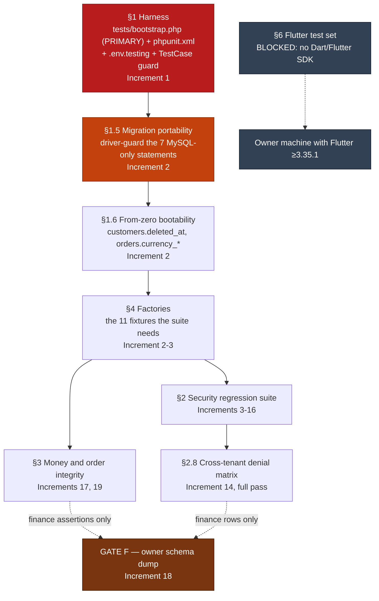

# Regression Test Plan

> **Read §0 before anything else.** It is not an introduction. It is a stop condition.

> **NOTHING IN THIS PLAN HAS BEEN IMPLEMENTED, AND NO TEST IN IT HAS BEEN EXECUTED.** Every file,
> diff and configuration change below is labelled **PROPOSED — NOT APPLIED**, and that label is
> literal: no application code, migration, config, route, view or Flutter source was modified in
> either repository. Execution is **BLOCKED in the audit environment** and cannot be unblocked here:
> `composer install --no-scripts` **aborted** because three locked packages are unreachable under
> this container's egress policy, so `vendor/laravel/framework/src` is absent,
> `vendor/composer/installed.json` was never written, and **`php artisan`, PHPUnit and every
> boot-dependent static check cannot run at all** (§0.2 cause 3, §0.3, §5 B1). Every test here is
> **SPECIFIED, NOT EXECUTED**. Wherever this document says *"FAILS TODAY"* it means a reasoned
> prediction from code that was re-read — **never an observed result, and never a pass.** Claims
> about framework internals that could not be checked against absent vendor source are labelled
> **FRAMEWORK-DOCUMENTED, UNVERIFIED IN THIS ENVIRONMENT (BLOCKED)** at each site.

---

## 0. The hard precondition

### 0.1 No test may run from this checkout until the isolation fix lands

`php artisan test` or `vendor/bin/phpunit`, executed from repo-A as it stands at `41fe2f68`, would
run `migrate:fresh` against the MySQL database named in the **committed** `.env`. `migrate:fresh`
drops every table in the target schema. This is a data-destruction hazard, it is item #1 of the
whole Phase 1 programme, and it is the reason this document opens with a prohibition rather than a
test list.

Four elements, each re-opened and re-read for this document:

| # | Element | Evidence (repo-A) | Verified state |
|---|---|---|---|
| 1 | The SQLite override is commented out | `phpunit.xml:25` `<!-- <env name="DB_CONNECTION" value="sqlite"/> -->` and `phpunit.xml:26` `<!-- <env name="DB_DATABASE" value=":memory:"/> -->` | VERIFIED. Every **other** `<env>` in that block is live — `phpunit.xml:21-24` and `:27-31`. This is a targeted commenting-out, not a wholesale disable. |
| 2 | No second line of defence | `.env.testing` → `ls: cannot access '.env.testing': No such file or directory` | VERIFIED ABSENT. `phpunit.xml:21` sets `APP_ENV=testing`, so Laravel would prefer `.env.testing`; with the file missing it falls back to `.env`. |
| 3 | Tests that drop tables | 7 test classes apply `RefreshDatabase` (see §0.2 for the correction) | VERIFIED. `RefreshDatabase` runs `migrate:fresh` on first use. |
| 4 | A populated real database target | `.env:8` `DB_CONNECTION=mysql`; `.env:9` `DB_HOST`, `:10` `DB_PORT`, `:11` `DB_DATABASE`, `:12` `DB_USERNAME`, `:13` `DB_PASSWORD` all populated | VERIFIED populated. **No value is printed anywhere in this document.** |

And the reason nothing stops it: `tests/TestCase.php:7-10` is an **empty** base class —

```php
abstract class TestCase extends BaseTestCase
{
    //
}
```

— no `CreatesApplication` trait, no existing `setUp()`, no guard of any kind. That is convenient
rather than merely bad: it is the natural, uncontested place to put the guard in §1.3, with zero
risk of clobbering existing behaviour.

**The chain, stated precisely.** `phpunit.xml:21` sets `APP_ENV=testing` → no `.env.testing` exists
→ Laravel loads `.env` → `DB_CONNECTION=mysql` with populated host/database/username/password →
the first `RefreshDatabase` test calls `migrate:fresh` → every table in that database is dropped and
recreated empty.

**Reachability, stated honestly both ways.** In *this* container the hazard is not currently
reachable: `.env:9` `DB_HOST` is a loopback address, nothing listens on 3306 here, and `storage/`
is absent (`.gitignore:5` is `/storage/`, and `ls -d storage` → No such file or directory) so
Laravel cannot write its framework caches and would fail during bootstrap. On the owner's server,
and on any developer machine with a local MySQL holding that database, it is **fully** reachable by
anyone who types `php artisan test` — a command every IDE offers as a one-click button. The
loopback host makes it *worse* on the server, not better: there, loopback **is** the production
database. And the `storage/` blocker is self-removing — the first thing anyone does to make the app
run is create `storage/framework/{cache,sessions,views}` and `storage/logs`, and the moment they do,
the trap is armed with no indication that they armed it.

> **Status: VERIFIED. Severity: CRITICAL. Priority: P0.**
> Covered by Increment 1 of the implementation sequence, which also covers
> `NEW-storage-absent / R8-05` because creating `storage/` is precisely what arms this trap.

### 0.2 Two corrections to the baseline, both narrowing

Phase 0 and the Phase 1A revalidation both state "8 test classes use `RefreshDatabase`". The
correct number of classes that **apply** the trait is **7**. The count of 8 comes from
`grep -rln RefreshDatabase tests/`, which matches a **commented-out import**:

```
tests/Feature/ExampleTest.php:5    // use Illuminate\Foundation\Testing\RefreshDatabase;
```

`tests/Feature/ExampleTest.php` does not apply the trait in its class body. The seven that do are
`tests/Feature/Auth/{Authentication,EmailVerification,PasswordConfirmation,PasswordReset,PasswordUpdate,Registration}Test.php`
and `tests/Feature/ProfileTest.php`, each with `use RefreshDatabase;` inside the class.

**This changes nothing about the hazard.** Seven classes calling `migrate:fresh` destroy a database
exactly as thoroughly as eight. It is recorded because a plan whose arithmetic cannot be reproduced
is not trusted, and because the eighth file is independently interesting:
`tests/Feature/ExampleTest.php:15` is `$response = $this->get('/')`, which **boots the whole
application against the live `.env` database**. That is a read rather than a drop, but it means even
the one "harmless" feature test opens a connection to production from a developer's laptop.

The second correction resolves an item the baseline left as UNKNOWN. R8 recorded that it had read
only the *names* of the `RefreshDatabase` classes and therefore could not say whether forcing SQLite
would break them. Resolved here:

```
$ grep -rn "DB::statement\|DB::raw\|JSON_EXTRACT\|information_schema\|SHOW INDEX\|whereRaw\|selectRaw" tests/
$ echo $?
1
```

**Zero** MySQL-specific raw SQL anywhere under `tests/`. All seven are stock Laravel Breeze tests
whose only database interaction is `User::factory()->create()`. So forcing SQLite will **not** fail
them on raw-SQL grounds.

They will nevertheless go red, for reasons that have nothing to do with SQLite being unsuitable, and
the distinction matters enormously: a team that sees a red suite after flipping `phpunit.xml` and
does not know why will conclude "SQLite does not work here" and revert the single most important
safety change in the programme. **There are exactly three causes. All three must be understood before
the flip, and two of them are not in the code at all.**

1. **The two MySQL-only migrations.** `migrate:fresh` aborts on seven statements across two files —
   §1.5. This one is real, it is a genuine blocker, and it is fixed in Increment 2 by driver guards.
2. **A blank `APP_KEY` in `.env.testing`** — a defect in the *plan*, now corrected in §1.2. The
   earlier draft of that file shipped `APP_KEY=` empty with an instruction to run
   `php artisan key:generate --env=testing`. A blank key makes Laravel throw *"No application
   encryption key has been specified"* for anything touching sessions, cookies or encryption — which
   is the **entire** Breeze auth Feature suite that Increment 1 exists to unblock. The suite would
   have gone red for a reason completely unrelated to cause 1, and SQLite would have taken the blame.
   `.env.testing` now commits a **fixed, obviously-fake** key, and `key:generate` must never be run
   against it.
3. **Dependencies may not install at all in a restricted-egress environment.** In this container
   `composer install --no-scripts` **aborted**: `vendor/laravel/framework/src` is absent,
   `vendor/composer/installed.json` was never written, and roughly **120 of the 239 locked packages**
   landed. The cause is this container's egress policy, **not a defect in the project**:
   `lahirulhr/laravel-payhere` v1.0.4 is distributed as an `api.github.com` zipball (the proxy returns
   403, and composer's VCS fallback failed with *"could not read Username for
   'https://github.com'"*), and `yoomoney/yookassa-sdk-php` 3.7.1 plus
   `yoomoney/yookassa-sdk-validator` 1.0.2 are hosted on `git.yoomoney.ru`, unreachable here (HTTP
   000, curl error 28, proxy CONNECT timeout). **A red — or absent — suite on a locked-down runner may
   therefore mean nothing was installed, not that SQLite failed.** A runner must reach both
   `api.github.com` **and** `git.yoomoney.ru`, or the build fails identically. The remedies all touch
   `composer.json` and are therefore **owner decisions, not ours**: allowlist both hosts; put a
   caching Composer mirror or Satis in front of them; or drop the two SDKs, noting that YooKassa
   serves Russia and PayHere serves Sri Lanka, so neither is a plausible Syrian payment rail. See
   §5 B1. Separately, composer emits *"Do not run Composer as root"* and auto-disables plugins, so
   **CI must not run as root.**

### 0.3 Nothing in this document has been executed

Stated plainly, because the rest of this document is written in the imperative and could otherwise
read as a report:

- **No test was run in this phase.** Not one.
- **No application code, migration, config, route, view or Flutter source was modified** in either
  repository. Both working trees were clean at `41fe2f68` / `d745ec08` when this was written.
- Every `test_*` name below is a **specification to be implemented**. Every annotation of the form
  *"FAILS TODAY"* is a **reasoned prediction** derived from code that was re-read, not an observed
  result.
- The suite could not have been run here even in a perfectly safe configuration, and it **cannot be
  made runnable here**. The runner is not installed and the dependency install **aborted**:

```
$ ls -la vendor/phpunit/phpunit
total 8
drwxr-xr-x 2 root root 4096 Oct 11 20:52 .
drwxr-xr-x 8 root root 4096 Oct 11 20:52 ..        # the directory exists and is EMPTY
$ ls vendor/bin
ls: cannot access 'vendor/bin': No such file or directory
$ find vendor -maxdepth 2 -type d -empty | wc -l
237
$ ls vendor/laravel/framework/src
ls: cannot access '...': No such file or directory
$ ls vendor/composer/installed.json
ls: cannot access '...': No such file or directory   # never written: the install did not complete
```

  `composer install --no-scripts` **ABORTED**, leaving roughly **120 of the 239 locked packages**
  installed. The cause is this container's **egress policy, not a defect in the project** — three
  packages cannot be fetched from here at all (`lahirulhr/laravel-payhere`,
  `yoomoney/yookassa-sdk-php`, `yoomoney/yookassa-sdk-validator`); §0.2 cause 3 and §5 B1 give the
  exact failures and the owner's options. The practical consequence for this document is total:
  **`php artisan`, PHPUnit and every boot-dependent static check are unavailable here.** Several
  framework-behaviour claims in §1 are consequently labelled **FRAMEWORK-DOCUMENTED, UNVERIFIED IN
  THIS ENVIRONMENT (BLOCKED)** rather than VERIFIED, and they are labelled that way deliberately
  rather than asserted.

So: **BLOCKED, not failed, and certainly not passed.** The harness in §1 is to be written here and
**verified on the owner's machine or in CI**, on a runner that can actually complete
`composer install`.

### 0.4 Execution order — which suite may run when



Read the diagram as a hard dependency chain, not a preference. Nothing to the right of a node may be
written *and verified* before that node is green. Specifications may of course be **written** in
parallel — that is what this document is.

---

## 1. The test-safety harness

Four layers, at four different moments in the lifecycle, because any single layer can be defeated by
a developer's local setup. **None of the following has been applied.**

**The canonical definition of Increment 1's harness.** `04-INCREMENTAL-IMPLEMENTATION-PLAN.md`
§Increment 1 is the **single governing source** for *what Increment 1 ships* — it is the table an
engineer follows, so it holds the file list. This document governs *how each layer is tested*. The
table below is reproduced from doc 04 and must match it exactly; where it ever diverges, **doc 04
wins**. (Earlier drafts of docs 00, 01, 04 and 05 each declared themselves canonical, which left a
real conflict with no tiebreak. This paragraph resolves it.)

| Layer | File | Role | When it runs |
|---|---|---|---|
| **Layer 0** | `tests/bootstrap.php` — **NEW FILE**, wired by `bootstrap="tests/bootstrap.php"` in `phpunit.xml` | **THE PRIMARY CONTROL.** Hard-fails unless the resolved test database is SQLite `:memory:` | once, before the framework, before any trait hook, before a single test class is loaded (§1.4) |
| Layer 1 | `phpunit.xml` — uncomment `:25-26` **and** add `force="true"` to both `<env>` entries | makes SQLite the resolved configuration, and makes it beat the ambient environment | at PHPUnit start-up, before the bootstrap file (§1.1) |
| Layer 2 | `.env.testing` — **NEW FILE**, tracked, SQLite/`:memory:`, no secrets, **fixed fake `APP_KEY`** | removes the `.env` fallback that is the entire hazard | at application boot (§1.2) |
| Layer 3 | `tests/TestCase.php` | **defence in depth only — explicitly NOT the primary control** | the `setUp()` assertion runs **after** trait hooks, so it protects test bodies, not the schema. A `refreshDatabase()` override is **deliberately NOT shipped** — it is shadowed by the trait in every class that uses `RefreshDatabase`, i.e. in exactly the 8 classes this increment protects. Reasoning in §1.3 |

Increment 1 also carries the `.gitignore` narrowing and the `storage/**/.gitkeep` placeholders. Those
are not harness layers, but they ship with it and must not be dropped from the file list.

**Why Layer 0, and not Layer 3, is the primary control — a correction stated rather than made
silently.** An earlier draft of §1.3 called the `tests/TestCase.php` guard "the durable protection"
and asserted that it runs before `RefreshDatabase` can issue any DDL. **That was wrong**, for the
reason set out in full in §1.3: the guard asserts after `parent::setUp()`, and `parent::setUp()` is
where `setUpTraits()` already ran `migrate:fresh`. The correct placement is Layer 0, and the reason to
prefer it is not only that it is earlier: **it is correct under either ordering**, so it does not rest
on an assumption this environment cannot verify. A safety control must never depend on an unverifiable
assumption.

**Reading order.** The subsections below are kept in their established numbering, so they run
§1.1 = Layer 1, §1.2 = Layer 2, §1.3 = Layer 3, §1.4 = **Layer 0**. That is deliberate — other
documents cite these section numbers — but it is not the order of importance. **Read §1.4 first if
you only read one.** The table above is the specification; the subsections are its detail.

### 1.1 Layer 1 — `phpunit.xml`: uncomment the overrides, and force them

PROPOSED DIFF — NOT APPLIED:

```diff
--- a/phpunit.xml
+++ b/phpunit.xml
@@ -1,8 +1,8 @@
 <?xml version="1.0" encoding="UTF-8"?>
 <phpunit xmlns:xsi="http://www.w3.org/2001/XMLSchema-instance"
          xsi:noNamespaceSchemaLocation="vendor/phpunit/phpunit/phpunit.xsd"
-         bootstrap="vendor/autoload.php"
+         bootstrap="tests/bootstrap.php"
          colors="true"
 >
@@ -20,10 +20,10 @@
     <php>
         <env name="APP_ENV" value="testing"/>
         <env name="APP_MAINTENANCE_DRIVER" value="file"/>
         <env name="BCRYPT_ROUNDS" value="4"/>
         <env name="CACHE_STORE" value="array"/>
-        <!-- <env name="DB_CONNECTION" value="sqlite"/> -->
-        <!-- <env name="DB_DATABASE" value=":memory:"/> -->
+        <env name="DB_CONNECTION" value="sqlite" force="true"/>
+        <env name="DB_DATABASE" value=":memory:" force="true"/>
         <env name="MAIL_MAILER" value="array"/>
         <env name="PULSE_ENABLED" value="false"/>
         <env name="QUEUE_CONNECTION" value="sync"/>
         <env name="SESSION_DRIVER" value="array"/>
         <env name="TELESCOPE_ENABLED" value="false"/>
     </php>
```

`force="true"` is the part that is easy to get wrong and is not optional. Without it, PHPUnit does
**not** overwrite a variable that already exists in the real process environment — so a developer or
a CI runner that happens to export `DB_CONNECTION=mysql` silently wins and the override does
nothing at all. With `force="true"`, `phpunit.xml` beats the ambient environment.

Viability confirmed, not assumed: `config/database.php:19` is
`'default' => env('DB_CONNECTION', 'sqlite')`, the `sqlite` connection block exists at
`config/database.php:34-39` with `'database' => env('DB_DATABASE', database_path('database.sqlite'))`
at `:37`, and `php -m` lists both `pdo_sqlite` and `sqlite3`. The **absence of the `sqlite3` CLI from
this container does not block anything** — the suite needs the PHP extension, not the binary.

### 1.2 Layer 2 — `.env.testing`, tracked, containing no secrets

NEW FILE, PROPOSED — NOT CREATED. `/home/user/syriastore98/.env.testing`:

```dotenv
# .env.testing — loaded automatically when APP_ENV=testing (phpunit.xml:21).
# Contains NO secrets and NO production hostnames. Safe to commit, and tracking it
# is what makes it reliable: an untracked safety file is not a safety file.
# Its single job: make it impossible for a test run to reach a real database.

APP_NAME="Store Syria (testing)"
APP_ENV=testing
# DELIBERATELY FAKE, FIXED, AND COMMITTED. Do NOT run `php artisan key:generate
# --env=testing` against this file, and do not leave this value blank. Rationale in
# full below the listing; in one line: a blank APP_KEY makes Laravel throw "No
# application encryption key has been specified" for anything touching sessions,
# cookies or encryption -- which is the entire Breeze auth Feature suite this harness
# exists to unblock -- and `key:generate` would write into a TRACKED file.
APP_KEY=base64:AAAAAAAAAAAAAAAAAAAAAAAAAAAAAAAAAAAAAAAAAAA=
APP_DEBUG=true
APP_URL=http://localhost

DB_CONNECTION=sqlite
DB_DATABASE=:memory:
DB_FOREIGN_KEYS=true

BROADCAST_CONNECTION=log
CACHE_DRIVER=array
CACHE_STORE=array
SESSION_DRIVER=array
QUEUE_CONNECTION=sync
MAIL_MAILER=array

BCRYPT_ROUNDS=4
TELESCOPE_ENABLED=false
PULSE_ENABLED=false

# Deliberately blank: NO test may contact a third party. If a test needs one of
# these, it needs a fake, not a value.
ZID_CLIENT_SECRET=
ZID_HOOK_PASS=
DELIVERYSYRIA_API_KEY=
MYFATOORAH_API_KEY=
MYFATOORAH_TEST_MODE=true
PAYMENTWALL_PRIVATE_KEY=
REVERB_APP_ID=
REVERB_APP_KEY=
REVERB_APP_SECRET=
FIREBASE_PROJECT_ID=
FIREBASE_CREDENTIALS=
DELIVERY_FIREBASE_PROJECT_ID=
DELIVERY_FIREBASE_CREDENTIALS=
WEBUZO_HOST=
WEBUZO_USERNAME=
WEBUZO_API_KEY=
```

`DB_FOREIGN_KEYS=true` is deliberate: SQLite enforces foreign keys only when asked, and
`config/database.php:38` already reads that variable. Several assertions in §2.8 depend on
cascade behaviour being real rather than ignored.

**`APP_KEY` is the other deliberate value, and it is a correction to the previously-proposed version
of this file**, which shipped `APP_KEY=` empty with the instruction
`php artisan key:generate --env=testing`. That version would have guaranteed a red suite, and the
earlier draft named none of the three reasons:

1. **A blank `APP_KEY` throws.** Laravel raises *"No application encryption key has been specified"*
   for any operation touching sessions, cookies or encryption — which is every one of the seven
   existing Breeze auth Feature tests, i.e. precisely the suite Increment 1 exists to unblock. The
   suite would go red for a reason unrelated to the two MySQL-only migrations in §1.5, and the team
   would blame SQLite and revert. That is the exact failure mode §0.2 warns about.
2. **`key:generate --env=testing` writes into a tracked file.** It dirties every developer's working
   tree on first run and invites an accidental commit of a generated key into a file that is supposed
   to contain nothing worth committing.
3. **CI has no key to generate from and must not be given one.** Doc 01's CI section requires that CI
   receive **no** `APP_KEY` and that the job **fail if a `.env` file is present at all** (§7.3). A CI
   runner therefore has no key either and fails identically.

So the key is **fixed, obviously fake, and committed on purpose**. It is all-zero bytes because that
makes its fakeness unmistakable at a glance, while still being a syntactically valid base64 32-byte
value — Laravel rejects anything else. **It is safe to commit precisely because it protects nothing:**
it encrypts only in-memory test data that is discarded when the run ends. This is the one and only
place in this programme where committing a key-shaped string is correct, and it is not an exception to
the secret-hygiene rule in §4.2 — it is the absence of a secret.

Treat `APP_KEY=` blank in `.env.testing` as a defect to be caught, not a convention. The
`SecretHygieneTest` row in Appendix A should assert both halves: that `.env` is **not** tracked, and
that `.env.testing` **is** tracked with a non-empty `APP_KEY`.

**Layer 2b — the shell override, and an honest statement of its limits.** Laravel's Dotenv loader is
documented to be immutable — it calls `Dotenv::createImmutable()`, which will **not** overwrite a
variable already present in the real process environment — so a real exported environment variable
beats anything in `.env`. **Evidential status: FRAMEWORK-DOCUMENTED BEHAVIOUR, UNVERIFIED IN THIS
ENVIRONMENT (BLOCKED).** It is asserted here from framework documentation, not from source:
`vendor/vlucas/phpdotenv` contains **no `.php` files** in this container and
`vendor/laravel/framework/src` is absent entirely (§0.2 cause 3, §5 B1), so it could not be checked.
Nothing in this plan depends on it, which is why it is recorded rather than gated:

```bash
# Paste into the shell before touching this checkout.
export DB_CONNECTION=sqlite
export DB_DATABASE=:memory:
```

The limit must be stated so nobody over-trusts it: **with `force="true"` in Layer 1, `phpunit.xml`
overrides the shell for phpunit runs** — which is also why the unverified immutability claim above
does not matter to the suite's safety. Layer 2b therefore protects only the paths that do *not* go
through `phpunit.xml` — a hand-typed `php artisan migrate`, `php artisan db:wipe`,
`php artisan tinker`, an IDE database tool. It is a good habit. **It is not the primary control.** The
primary control is **Layer 0** (§1.4); Layer 3 (§1.3) is defence in depth behind it.

### 1.3 Layer 3 — the defence-in-depth guard in `tests/TestCase.php`, and why it is not the control

> **SUPERSESSION NOTE.** An earlier draft of this section opened: *"This is the durable protection…
> it runs **before** `RefreshDatabase` can issue any DDL"*, and the proposed file carried the inline
> comment *"This runs before any test body and before any DDL."* **Both statements were false and are
> withdrawn.** They are recorded here rather than quietly deleted, because the whole of Increment 1
> was justified on them.

**Why they were false.** The guard as previously written opened with `parent::setUp();` and asserted
only afterwards. `Illuminate\Foundation\Testing\TestCase::setUp()` is where `setUpTraits()` runs,
and `setUpTraits()` is what invokes `RefreshDatabase::refreshDatabase()` → `migrate:fresh`. So **every
table in the target schema had already been dropped before the first assertion executed.** The
control this document called "the durable protection" did not protect against the thing it named.

**`afterApplicationCreated()` does not fix it.** Those callbacks are also dispatched from
`setUpTraits()`, so a guard registered there is late for exactly the same reason. This is stated
explicitly so that nobody "simplifies" the placement below back into either form. The two placements
that *are* safe are: the bootstrap file (Layer 0, §1.4 — preferred, and the primary control), and an
override of `refreshDatabase()` that asserts **before** calling `parent::refreshDatabase()` (used
below as the in-class option, subject to the PHP trait-shadowing caveat recorded under the listing).

**Honest evidential status of the ordering claim itself.** `vendor/laravel/framework/src` is
**absent** in this container — the dependency install aborted, see §0.2 cause 3 and §5 B1 — so the
`setUp()` → `setUpTraits()` → `refreshDatabase()` ordering **cannot be confirmed from vendor source
here**. Label it, and keep the label: **FRAMEWORK-DOCUMENTED BEHAVIOUR, UNVERIFIED IN THIS
ENVIRONMENT (BLOCKED).**

**And fix the placement regardless — this is the part that matters.** The placement below is correct
under **either** ordering: if the assertion is early, it blocks the DDL; if it is late, it still
blocks every test body, and Layer 0 has already blocked the DDL. The previous placement was correct
under only one of the two, and that one is the one this environment cannot check. **A safety control
must never depend on an assumption that cannot be verified** — which is the whole reason Layer 0 and
not this layer is the primary control.

**What this layer is still for.** It lives in the empty base class every Feature test extends, so it
cannot be forgotten by a new test file, and it sees one thing Layer 0 cannot: a configuration that
changes **after** bootstrap — a `DB::setDefaultConnection()` call inside a service provider, or a
cached `bootstrap/cache/config.php`. Layer 0 has already run and exited by then. The two layers check
different things at different times and neither replaces the other; the difference is that only one of
them is guaranteed to run before `migrate:fresh`.

PROPOSED FILE — NOT APPLIED. Replaces the body of `tests/TestCase.php:7-10`:

```php
<?php

namespace Tests;

use Illuminate\Foundation\Testing\TestCase as BaseTestCase;
use Illuminate\Support\Facades\DB;
use RuntimeException;

abstract class TestCase extends BaseTestCase
{
    /**
     * DEFENCE IN DEPTH ONLY. The primary control is tests/bootstrap.php (Layer 0),
     * which runs before the framework and before any trait hook. See
     * docs/development/phase-1/05-REGRESSION-TEST-PLAN.md §1.3 and §1.4.
     *
     * A refreshDatabase() override is deliberately NOT declared here. It would be
     * shadowed by the RefreshDatabase trait in every class that uses the trait --
     * which is exactly the 8 classes this increment exists to protect -- so it would
     * add a second code path that protects nothing in the real case. Proof below.
     *
     * Deliberately late, and documented as late. parent::setUp() runs
     * setUpTraits(), which is where RefreshDatabase has ALREADY run. This assertion
     * therefore protects test BODIES, not the schema. It is kept because it costs
     * nothing and because it also covers classes that do not use RefreshDatabase.
     *
     * Do NOT move it above parent::setUp() (config() does not exist yet) and do NOT
     * relocate it into afterApplicationCreated() (also dispatched from setUpTraits(),
     * so it is late for the same reason). If you want it early, that is Layer 0.
     */
    protected function setUp(): void
    {
        parent::setUp();

        // The SHARED assertion, also called by Layer 0 and by the unit tests.
        // Body in 01-SAFE-BASELINE.md 6.5. One implementation, three callers.
        TestDatabaseGuard::assertSqliteInMemory(
            config('database.default'),
            config('database.connections.' . config('database.default') . '.database')
        );
    }
}
```

The body of `TestDatabaseGuard::assertSqliteInMemory()` is specified once, in
`01-SAFE-BASELINE.md` §6.5, and is reproduced nowhere else. For reference, the checks it performs in
order are:

```php
// tests/Support/TestDatabaseGuard.php  -- see 01-SAFE-BASELINE.md 6.5 for the full body
    public static function assertSqliteInMemory(?string $connection, ?string $database): void
    {
        $connection = $connection ?? '';

        if ($connection !== 'sqlite') {
            throw new RuntimeException(
                "ABORTING TEST RUN: database.default is '{$connection}', not 'sqlite'. "
                . 'RefreshDatabase would run migrate:fresh and DROP EVERY TABLE in that '
                . 'database. Fix phpunit.xml (DB_CONNECTION / DB_DATABASE overrides, with '
                . 'force="true") or provide .env.testing. Never point the suite at MySQL.'
            );
        }

        $database = config("database.connections.{$connection}.database");

        if ($database !== ':memory:') {
            throw new RuntimeException(
                "ABORTING TEST RUN: sqlite database is '{$database}', not ':memory:'. "
                . 'Refusing to run migrate:fresh against a persistent database file.'
            );
        }

        // Reached ONLY when configuration already reads sqlite/:memory:, because the
        // two checks above throw first. This can therefore never itself open a
        // connection to a real database; it can only confirm that sqlite resolved.
        $driver = DB::connection()->getDriverName();

        if ($driver !== 'sqlite') {
            throw new RuntimeException(
                "ABORTING TEST RUN: the live PDO driver is '{$driver}', not 'sqlite'. "
                . 'Configuration and the actual resolved connection disagree.'
            );
        }
    }
}
```

**Why the third check earns its place and is not redundant.** The first two read **configuration**,
which can be correct while the resolved connection is wrong — a cached `bootstrap/cache/config.php`
(note that `bootstrap/cache/` is present and holds tracked `packages.php` and `services.php`), a
`DB::setDefaultConnection()` call inside a service provider, or a connection-name alias would all
defeat them. `getDriverName()` interrogates the **live PDO connection** and is the only assertion
here that configuration cannot fool.

**Why no `refreshDatabase()` override is shipped — the decisive proof.** In PHP, a method brought in
by a `use` statement inside a class **overrides a method inherited from that class's parent**.
Verified directly, in this container, with the language and not with the framework:

```
$ php -r 'class B{function m(){return "BASE";}} trait T{function m(){return "TRAIT";}}
          class C extends B{use T;} echo (new C)->m();'
TRAIT
```

So in `class AuthenticationTest extends Tests\TestCase { use RefreshDatabase; }` the **trait's**
`refreshDatabase()` wins and a base-class override would be **shadowed**. It would therefore protect
only classes that declare `refreshDatabase()` themselves (or resolve the collision with `insteadof`)
— and **all 8** `RefreshDatabase` classes in `tests/Feature/` use the trait plainly, so it would
protect **none of the classes this increment exists to protect**. It cannot be made universal from
the base class.

**Decision: the override is NOT shipped.** An earlier draft of this document kept it on the grounds
that it "costs nothing and is correct wherever it is reached". That is withdrawn: it is not free — it
adds a second code path, a second thing to keep ordered, and a test asserting its presence, in the
one increment whose entire value is being small enough to be obviously safe. Docs 01 and 04 omit it;
this document now agrees. This is also a third independent reason — alongside the `setUp()` ordering
and the unverifiable vendor source — why **Layer 0 is the primary control**.

**And why it is safe to have a live-connection check inside a safety guard.** The checks run in
order, and the first two `throw` — so the third is reached only when configuration *already* reads
`sqlite` / `:memory:`. It can never be the thing that opens a connection to a production database.
This also matters for the guard's own regression tests, which must be able to exercise the guard
**without** opening any PDO connection at all: §7.2 item 1 specifies them so that each in-class case
throws at a configuration check and never reaches this line, and so that Layer 0 is exercised in a
subprocess rather than in-process.

### 1.4 Layer 0 — `tests/bootstrap.php`: **THE PRIMARY CONTROL**

**This is the layer the whole of Increment 1 rests on, and it must be built and reviewed as such.**
It is the only guard in the harness that runs before the framework, before any trait hook and before
a single test class is loaded — which makes it the only guard whose correctness does not depend on
the framework ordering that §1.3 could not verify here. Layer 3 is defence in depth. **This is the
control.** It is also the layer most at risk of being dropped as "extra", because it is a new file
and a change to `bootstrap=`; doc 04's increment-1 file table must name both.

It closes two distinct gaps in Layer 3. **First**, Layer 3 protects every class that extends
`Tests\TestCase` and does **not** protect a test that extends PHPUnit's base class directly — and the
repository already contains one:

```
tests/Unit/ExampleTest.php:3   namespace Tests\Unit;
tests/Unit/ExampleTest.php:5   use PHPUnit\Framework\TestCase;
tests/Unit/ExampleTest.php:7   class ExampleTest extends TestCase
```

That file is harmless today (it asserts `assertTrue(true)`), but it is the template every new unit
test will be copied from, and any such class bypasses the Layer 3 guard entirely. A guard with a
documented bypass in the repository is a guard that will eventually be bypassed.

**Second — and this is the gap that actually decides which layer is primary** — Layer 3's `setUp()`
assertion runs **after** `setUpTraits()` has already issued `migrate:fresh` (§1.3). Even for classes
that *do* extend `Tests\TestCase`, the `setUp()` placement cannot be the schema's protection.

Layer 0 runs **once, before PHPUnit loads a single test class**, and checks the *environment* rather
than the resolved connection — because at bootstrap time the Laravel application does not exist yet
and `config()` is unavailable. The two layers therefore check different things at different times and
neither replaces the other; the asymmetry is that **only Layer 0 is guaranteed to run before any
DDL**, under any framework ordering.

PROPOSED NEW FILE — NOT CREATED. `/home/user/syriastore98/tests/bootstrap.php`, referenced by the
`bootstrap="tests/bootstrap.php"` change in §1.1:

```php
<?php

/**
 * PHPUnit bootstrap -- LAYER 0, THE PRIMARY TEST-ISOLATION CONTROL.
 * Runs once, before any test class is loaded and before the Laravel application
 * exists -- so this checks the ENVIRONMENT, not config(), and it is the only guard
 * guaranteed to run before RefreshDatabase can issue migrate:fresh.
 * Layer 3 (tests/TestCase.php) is DEFENCE IN DEPTH ONLY: its setUp() assertion runs
 * after setUpTraits(), and it cannot cover a test that extends
 * PHPUnit\Framework\TestCase directly -- tests/Unit/ExampleTest.php already does.
 * Do not remove this file, and do not change phpunit.xml's bootstrap= away from it.
 * See docs/development/phase-1/05-REGRESSION-TEST-PLAN.md §1.3 and §1.4.
 */

require __DIR__ . '/../vendor/autoload.php';

$connection = $_ENV['DB_CONNECTION'] ?? $_SERVER['DB_CONNECTION'] ?? getenv('DB_CONNECTION') ?: null;
$database   = $_ENV['DB_DATABASE']   ?? $_SERVER['DB_DATABASE']   ?? getenv('DB_DATABASE')   ?: null;

if ($connection !== 'sqlite' || $database !== ':memory:') {
    fwrite(STDERR, PHP_EOL . str_repeat('=', 78) . PHP_EOL);
    fwrite(STDERR, 'ABORTING TEST RUN BEFORE ANY TEST LOADED.' . PHP_EOL);
    fwrite(STDERR, sprintf(
        "DB_CONNECTION=%s  DB_DATABASE=%s  (required: sqlite / :memory:)" . PHP_EOL,
        var_export($connection, true),
        var_export($database, true)
    ));
    fwrite(STDERR, 'RefreshDatabase runs migrate:fresh, which DROPS EVERY TABLE in the' . PHP_EOL);
    fwrite(STDERR, 'target database. phpunit.xml:25-26 must set both overrides with' . PHP_EOL);
    fwrite(STDERR, 'force="true". See docs/development/phase-1/05-REGRESSION-TEST-PLAN.md.' . PHP_EOL);
    fwrite(STDERR, str_repeat('=', 78) . PHP_EOL . PHP_EOL);
    exit(1);
}
```

Reading order note for the implementer: PHPUnit applies its `<env>` entries before the bootstrap
file runs, so the `force="true"` values from §1.1 are already present in `$_ENV` when this executes.
That is exactly the coupling intended — Layer 0 asserts that Layer 1 did its job.

### 1.5 The portability blocker: SQLite cannot migrate this tree today

Flipping `phpunit.xml` alone yields a **red suite**, and it will be misread. Two migrations contain
MySQL-only SQL that executes under SQLite and errors, aborting `migrate:fresh`.

The revalidation set recorded two offending statements. Re-measuring across **both** migration trees
finds **seven**, in two files:

```
$ grep -n "information_schema\|foreign_key_checks\|SHOW INDEX\|MODIFY COLUMN\|SHOW COLUMNS\|SHOW TABLES" \
      database/migrations/*.php packages/workdo/*/src/database/migrations/*.php
```

| repo-A path | Line | Statement | SQLite outcome |
|---|---|---|---|
| `database/migrations/2024_05_29_102438_add_customers_tbale_forienkey_in_user_coupons_table.php` | `:15` | `\DB::statement('SET foreign_key_checks = 0;')` | SQLite has no `SET` statement → syntax error |
| same file | `:21` | `SELECT CONSTRAINT_NAME FROM information_schema.KEY_COLUMN_USAGE ... REFERENCED_TABLE_NAME = "users"` | no `information_schema` in SQLite → error |
| same file | `:44` | `SET foreign_key_checks = 1;` | error |
| same file | `:56` | `SET foreign_key_checks = 0;` | error |
| same file | `:62` | same `information_schema` query, `REFERENCED_TABLE_NAME = "customers"` | error |
| same file | `:85` | `SET foreign_key_checks = 1;` | error |
| `database/migrations/2024_06_05_094055_drop_role_name_unique_in_roles_table.php` | `:18` | `DB::select("SHOW INDEX FROM roles WHERE Column_name = 'name' AND Non_unique = 0 AND Key_name != 'PRIMARY'")` | `SHOW INDEX` is MySQL-only → error |

The `SHOW INDEX` case is worth spelling out because its guard looks protective and is not.
`2024_06_05_094055...php:16` is `if (Schema::hasColumn('roles', 'name'))` — which **succeeds** under
SQLite, so line `:18` *is* reached. The guard gates on the column existing, not on the driver.

**Status: VERIFIED. Severity: HIGH. Priority: P0** (it sits directly on the critical path of
Increment 1/2 and of every test in this document). This extends
`NEW-sqlite-migration-blocker [39]`: a fix applied only to `:21` and `:62` leaves five failures.

PROPOSED FIX — NOT APPLIED. Guard on the driver, preserving MySQL behaviour byte for byte:

```php
// database/migrations/2024_06_05_094055_drop_role_name_unique_in_roles_table.php
public function up(): void
{
    if (DB::connection()->getDriverName() !== 'mysql') {
        return;                      // MariaDB/MySQL-only maintenance; no-op elsewhere
    }

    Schema::table('roles', function (Blueprint $table) {
        if (Schema::hasColumn('roles', 'name')) {
            $hasUnique = collect(DB::select(
                "SHOW INDEX FROM roles WHERE Column_name = 'name' AND Non_unique = 0 AND Key_name != 'PRIMARY'"
            ))->isNotEmpty();

            if ($hasUnique) {
                $table->dropUnique('roles_name_unique');
            }
        }
    });
}
```

Wrap `2024_05_29_102438...php`'s `up()` and `down()` bodies in the same early-return. Laravel 11's
`Schema::getIndexes('roles')` and `Schema::getForeignKeys('user_coupons')` are the portable end state
and should be scheduled, but the driver guard is the smaller, safer change for Phase 1 and changes
no resulting MySQL schema — the guarded branch *is* the current code.

**Regression test**, `tests/Feature/Schema/MigrationPortabilityTest.php`:

| Test | Given / When / Then | Assertion |
|---|---|---|
| `test_migrate_fresh_succeeds_on_sqlite` | Given the SQLite in-memory test connection; When `migrate:fresh` runs; Then it completes | `$this->artisan('migrate:fresh')->assertExitCode(0)` — **FAILS TODAY** |
| `test_no_migration_contains_unguarded_mysql_only_sql` | Given both migration trees as text; When each file containing `SHOW INDEX`, `information_schema`, `foreign_key_checks`, `MODIFY COLUMN`, `SHOW COLUMNS` or `SHOW TABLES` is read; Then each also contains a `getDriverName()` guard | file-scanning assertion; needs **no database**, so it can be written and run before anything else in this plan |

The second test is the one that prevents recurrence, and it is the cheaper of the two.

### 1.6 From-zero bootability: three things the suite cannot do yet

Even with §1.1–§1.5 in place, the suite cannot seed the fixtures §2 and §3 require, because three
column sets that live code reads and writes are created by no migration. These are covered by
Increment 2 and are **not** gated on the owner's schema dump, because their shapes are unambiguous
from code.

| Blocker | Evidence | What it blocks in this plan |
|---|---|---|
| `customers.deleted_at` absent while `Customer` uses `SoftDeletes` | `app/Models/Customer.php:16` `use Illuminate\Database\Eloquent\SoftDeletes;` and `:20` `use Cachable, Notifiable, CanResetPassword,HasApiTokens,Billable,SoftDeletes;`; `grep -rl "softDeletes\|deleted_at"` over both migration trees → **0** | The trait installs a global scope appending `and customers.deleted_at is null` to **every** Customer query, so on a from-zero build there is no working customer authentication and no customer read. Blocks every customer fixture in §2.8 rows 6-7 and every storefront test in §3. |
| `orders.currency_code` / `orders.currency_symbol` absent, yet written on every insert | `app/Models/Order.php:26-27` ($fillable), `:63` `protected static function booted()`, `:65` `static::creating(...)`, `:68-69` and `:74-76` assign both unconditionally when empty; `grep -rn "'currency_code'"` over both migration trees → **no output** | Every `Order::create()` on a from-zero schema dies with an unknown-column error. Blocks **every** order test in §2 and §3. |
| `users.deliverysyria_secret` absent | `app/Models/User.php:52` ($fillable), written at `app/Http/Controllers/SettingController.php:99` and `:118`; `grep -rn deliverysyria` over both migration trees → **0** | Blocks §2.6's webhook tests. Note this integration fails **closed**, not open: `app/Http/Controllers/Api/DeliverySyriaOrderController.php:157-164` reads `$storedSecret = trim((string) ($owner->deliverysyria_secret ?? ''))` and rejects on `$storedSecret === ''`, so a missing column means a 403 for everyone — a dead integration, not a bypass. |

One correction worth carrying into the test plan, because it removes a dependency the item set
asserted: `NEW-UNDECLARED-SCHEMA [62]` states that the suite "**CANNOT CREATE AN ORDER AT ALL**"
until the 15 undeclared finance tables are declared. That is **REFUTED** for the observer path.
`app/Observers/OrderObserver.php:13-21` is:

```php
public function created(Order $order): void
{
    try {
        app(OrderFinancialService::class)->createForOrder($order);
    } catch (\Exception $e) {
        \Log::error('Order Observer - Created Error: ' . $e->getMessage());
    }
}
```

`QueryException` descends from `\Exception`, so a missing `store_wallets` is swallowed at `:19` and
the order insert itself succeeds. `updated()` at `:26-42` has the identical shape with its catch at
`:39-41`. **Consequence for this plan:** order-creation tests can run from Increment 2; only
*financial assertions* wait for GATE F. **And the far more important consequence:** any order test
that merely asserts "the order was created" proves nothing about the financial path, because the
failure is logged rather than raised. Every test in this plan that touches the financial path
therefore asserts the **log is clean** as well as the row existing — see §3.6.

---

## 2. The security regression suite

Organised by the finding each test protects. Every entry gives Given/When/Then and the concrete
assertion, because a status-code assertion alone is repeatedly insufficient in this codebase: a
403 would pass even if the write had already happened before the check ran. **The paired
state assertion is load-bearing and is never optional.**

All tests use SQLite in-memory per §1 and are **BLOCKED from execution** in this environment.

### 2.1 API authentication bypass — `custom.auth`

Protects `SEC-R1-01 [1]`, `R2-01 [8]`, `R2-02 [9]`, `NEW-custom-auth-forgeable [32]`.
Lands with Increment 6.

The middleware, re-read in full for this document, `app/Http/Middleware/CustomAuth.php:21-55`:

```php
21    public function handle(Request $request, Closure $next): Response
23        $token = $request->header('Authorization');
24        if ($token) {
26            $token = substr($token, 7);          // no Bearer-scheme check
28            $token = explode('|', $token);       // no limit argument
29            $tokenId = $token[0] ?? null;
31            if ($tokenId) {
32                $tokenExists = \DB::table('personal_access_tokens')
33                ->where('id', $tokenId)          // lookup by PRIMARY KEY
34                ->first();
35                if ($tokenExists) { ... auth(...)->login(...) ... }
47                } elseif ($tokenId && !$tokenExists) {
48                    return $this->error([...], __('Unauthenticated.'), 401 );
54        return $next($request);                  // NO header -> falls through UNAUTHENTICATED
```

`$token[1]` — the 40-character secret — is parsed off at `:28` and never referenced again. The
sha256 `token` column (`database/migrations/2019_12_14_000001_create_personal_access_tokens_table.php:18`)
is never compared. The correct implementation exists 540 lines away in the same codebase:
`app/Http/Controllers/Api/DashboardController.php:599` checks the Bearer scheme, `:608` uses
`explode('|', $plainTextToken, 2)`, `:613` requires both halves, and `:627` is
`!hash_equals($token->token, hash('sha256', $tokenValue))`. The fix is to make the middleware do
what `logouto` already does.

**Suite: `tests/Feature/Api/CustomAuthMiddlewareTest.php`**

| Test | Given / When / Then | Assertion | Today |
|---|---|---|---|
| `test_request_with_no_authorization_header_is_rejected` | Given a `custom.auth` route (`POST /api/admin/dashboard`); When it is called with **no** Authorization header; Then the request is refused | `assertStatus(401)` **and** `$this->assertTrue(auth('customers')->guest())` **and** `$this->assertTrue(auth()->guest())` | **FAILS** — `:24` is false, control jumps to `:54`, the controller body runs anonymously |
| `test_token_id_without_secret_is_rejected` | Given a real token minted for customer A; When `Authorization: Bearer {$id}` is sent with no `\|secret`; Then refused | `assertStatus(401)` and `auth('customers')->guest()` | **FAILS** — the forgery proof |
| `test_token_id_with_wrong_secret_is_rejected` | Given a real token for customer A; When `Bearer {$id}|` . `str_repeat('a', 40)` is sent; Then refused | `assertStatus(401)` | **FAILS** |
| `test_valid_plain_text_token_authenticates_correct_tokenable` | Given `$customer->createToken('auth_token')->plainTextToken`; When sent verbatim as `Bearer <that>`; Then accepted as that customer | `assertStatus(200)` and `$this->assertSame($customer->id, auth('customers')->id())` | passes today **and must keep passing** — this is the **Flutter-compatibility assertion**: it asserts the exact string repo-B sends (`lib/network/network.dart:60`) still authenticates |
| `test_token_belonging_to_user_cannot_authenticate_as_customer` | Given a `User` token and a `Customer` token sharing one integer id space; When the User token is sent to a customer-guard route; Then the customers guard stays empty | `$this->assertTrue(auth('customers')->guest())` | vertical-separation proof |
| `test_expired_token_is_rejected` | Given a token with `expires_at` in the past; When sent; Then refused | `assertStatus(401)` | **FAILS** — `expires_at` is never read |
| `test_malformed_headers_are_rejected` | Data provider: `['Bearer ', 'Bearer \|x', 'Bearer 0\|x', 'Basic 1\|x', 'Token  1\|x', '1\|secret']` | `assertStatus(401)` for **every** case | **FAILS for every case** — each yields a falsy `$tokenId` at `:31` and falls through to `:54` |
| `test_last_used_at_is_updated_on_successful_auth` | Given a valid token with `last_used_at` null; When a request succeeds; Then the column is written | `assertNotNull($token->fresh()->last_used_at)` | **FAILS** |

**Paired positive test, in `tests/Feature/Api/CustomAuthGateTest.php`:**
`test_guest_route_still_allows_a_tokened_anonymous_customer` — `POST /api/{slug}/search-guest` **with**
a valid token asserts 200. This is the regression net for the one real risk of the fix: twelve routes
named `*-guest` (`routes/api.php:61,64,66,73,77,80,83,85,105,112,118,120`) carry `custom.auth` and
"work" for anonymous callers today only because the middleware leaks. GATE A resolves whether any of
them must stay anonymous; until then, test that a **tokened** guest call still succeeds.

### 2.2 Unauthenticated admin API routes

Protects `NEW-unauthenticated-admin-list-routes [3]`, `R2-03 [10]`,
`NEW-unauthenticated-order-notes-write [4]`, `R2-04 [11]`, `NEW-zid-debug-endpoint [16]`.
Lands with Increment 3.

Re-read for this document — `routes/api.php:163-169`, inside the group opened at `:133`
(`Route::prefix('admin')->as('admin.')->group(...)`, which declares **no** middleware):

```
163    Route::get('categorylist', [DashboardController::class, 'CategoryList'])->middleware(['AdminApiLog']);
164    Route::get('productlist',  [DashboardController::class, 'ProductList'])->middleware(['AdminApiLog']);
165    Route::get('variantlist',  [DashboardController::class, 'VariantList'])->middleware(['AdminApiLog']);
166    Route::get('orderlist',    [DashboardController::class, 'OrderList'])->middleware(['AdminApiLog']);
167    Route::get('couponlist',   [DashboardController::class, 'CouponList'])->middleware(['AdminApiLog']);
168    Route::get('shippinglist', [DashboardController::class, 'ShippingList'])->middleware(['AdminApiLog']);
169    Route::get('taxlist',      [DashboardController::class, 'TaxList'])->middleware(['AdminApiLog']);
```

Their immediate neighbours at `:161-162` (`currency`, `dashboard`) and `:171-172`
(`addcategory`, `updatecategory`) **all** carry `custom.auth`. The omission is an oversight, not a
design choice, and it is **independent of §2.1**: these routes do not rely on the broken middleware,
they have no authenticating middleware at all.

**Suite: `tests/Feature/Api/AdminListRouteAuthTest.php`**

| Test | Given / When / Then | Assertion | Today |
|---|---|---|---|
| `test_admin_list_routes_require_authentication` | Data provider over the 7 URIs `/api/admin/{categorylist,productlist,variantlist,orderlist,couponlist,shippinglist,taxlist}`; When each is GET-ed with **no** header and `?store_id=` a seeded store; Then refused | `assertStatus(401)` for each | **FAILS** — returns 200 with another merchant's data |
| `test_orderlist_does_not_leak_customer_pii_to_anonymous` | Given store B with one order placed by customer B; When `/api/admin/orderlist?store_id=<B>` is called anonymously; Then no PII in the body | `assertStatus(401)` **and** `assertJsonMissing(['user_name' => $customerB->first_name.' '.$customerB->last_name])`. The PII is real: `app/Models/Order.php:49-57` appends `user_name` (at `:56`) and the model declares no `$hidden` | **FAILS** |
| `test_merchant_cannot_list_another_stores_orders` | Given merchant A authenticated with a **valid** token; When `?store_id=` merchant B's store; Then refused with nothing leaked | `assertStatus(403)` **and** `assertJsonMissing` of B's order id. **Use 403, never 401** — see §2.9 | **FAILS, and still fails after the Increment-3 route edit.** This is the Increment-14 assertion and the proof that adding `custom.auth` is only half the fix |

**Suite: `tests/Feature/Api/OrderNoteAuthTest.php`** — `routes/api.php:203-206` and `:208-211` carry
**no** `->middleware()` call at all, not even logging.

| Test | Given / When / Then | Assertion | Today |
|---|---|---|---|
| `test_add_order_note_rejects_anonymous` | Given a seeded store and order; When `POST /api/admin/orders/notes/create` with a valid body and no header; Then refused and nothing written | `assertStatus(401)` **and** `assertDatabaseCount('order_notes', 0)` | **FAILS** — returns 200 and writes one row |
| `test_order_note_to_customer_cannot_be_injected_anonymously` | When the same POST carries `note_type=to_customer` and a 5000-character body; Then refused | `assertStatus(401)` and `assertDatabaseCount('order_notes', 0)`. `note_type` is validated `in:private_note,to_customer` at `app/Http/Controllers/Api/DashboardController.php:94`, so the customer-visible variant is reachable — stored content injection wearing the merchant's identity | **FAILS** |
| `test_delete_order_note_rejects_anonymous` | Given one existing note; When `DELETE /api/admin/orders/notes/delete` anonymously; Then refused and the row survives | `assertStatus(401)` **and** `assertDatabaseHas('order_notes', ['id' => $note->id])` | **FAILS** |
| `test_merchant_cannot_add_note_to_another_stores_order` | Merchant A's valid token, merchant B's `order_id` | `assertStatus(403)` and `assertDatabaseCount('order_notes', 0)` | Increment-14 assertion |

**Suite: `tests/Feature/Api/RouteInventoryTest.php`**

| Test | Assertion |
|---|---|
| `test_zid_statuses_test_route_no_longer_exists` | `$this->getJson('/api/delivery-syria/zid-statuses-test')->assertStatus(404)` **and** `$this->assertFalse(collect(Route::getRoutes())->contains(fn ($r) => str_contains($r->uri(), 'zid-statuses')))`. The second half matters: today the controller itself can return a 404 body (`app/Http/Controllers/DeliverySyriaStatusController.php:24-29`), so asserting the status alone cannot distinguish "route deleted" from "route present and erroring" |
| `test_no_api_route_is_registered_without_authenticating_middleware` | Iterate `Route::getRoutes()` filtered to the `api` group; assert each carries `custom.auth`, `auth:sanctum` or appears in an explicit `PUBLIC_API_ROUTE_ALLOWLIST` constant naming the webhook and login routes. **This route-table test is worth more than any individual endpoint test** — it makes the whole class of regression impossible rather than merely caught |

### 2.3 Web route-group boundary

Protects `SEC-F2 [20]`, `NEW-order-payment-status [26]`, `NEW-public-mutating-routes [34]`.
Lands with Increment 8.

The boundary was established by two independent tools (`scratchpad/phase1a/depth.php`, a PHP
`token_get_all` brace counter, and `scratchpad/phase1a/groupchain.py`, a string-and-comment-aware
character scanner) which agree exactly: `routes/web.php:937` is at depth 2 with open braces
`[305, 326]`; `:940`, `:950`, `:953`, `:961` are at depth **1** with `[305]` only; `:974` is depth 0.
`:326` opens `Route::middleware(['auth','xss','setlocate','verified'])->group(...)` and `:938` closes
it — so lines `940-973` are inside `web` and **outside `auth`**.

**Suite: `tests/Feature/Routing/UnauthenticatedRouteBoundaryTest.php`**

| Test | Given / When / Then | Assertion |
|---|---|---|
| `test_no_admin_route_is_reachable_without_auth` | Given the registered route table; When every route whose controller is `OrderController`, `OrderRefundController`, `AppSettingController`, `NewsletterController` or `OrderNoteController` is examined; Then each carries `auth` | `$this->assertContains('auth', $route->gatherMiddleware())`, asserted against an **explicit** `PUBLIC_ROUTE_ALLOWLIST` constant (`contacts.store`, `change.languagestore`, `payu.pay`, `format.price`) so a future route added outside the group **fails by default** |
| `test_order_payment_status_requires_auth` | Given an order with `payment_status = 'Pending'`; When `POST route('order.payment.status')` with `order_id` and `payment_status=Paid`, unauthenticated; Then refused and unchanged | `assertStatus(401)` or a 302 to login, **and** `assertDatabaseHas('orders', ['id' => $order->id, 'payment_status' => 'Pending'])` |
| `test_order_view_is_not_registered_twice` | Given the route table; Then `order-view/{id}` appears once | asserts the duplicate at `routes/web.php:956` (duplicating `:946`) is gone |
| `test_brace_depth_tooling_agrees_after_the_move` | Given `routes/web.php` as text; When both depth tools run; Then every route whose handler is administrative reports depth ≥ 2 with `326` among its open braces | a file-scanning assertion, **no database**. F2 happened because a `});` moved; this is the regression check for the move itself and should run in CI on every change to `routes/web.php` |

**`tests/Feature/Routing/PublicRouteExposureTest.php` :: `unauthenticated_cannot_mutate_order_or_refund`** —
a data provider over the 14 mutating route names in the window, each asserting 401/403 **and** that
the target row is byte-identical afterwards. The refund half targets
`app/Http/Controllers/OrderRefundController.php:131-143` (`updateRefundStatus` → `update(['refund_status' => 'Accept'])`)
and `:229-249` (`RefundAmonut` → `update(['refund_status' => 'Refunded', 'refund_amount' => $amount])`
with `$amount` from the request, plus `:235-236` zeroing `delivery_price`).

### 2.4 Password-reset authorization

Protects `SEC-F1 [19]`. Lands with Increment 9.

`app/Http/Controllers/StoreController.php:646-669` has no permission check, no ownership predicate
and no type check — `grep -n "middleware|authorize|->can(|Gate::|abort(" app/Http/Controllers/StoreController.php`
returns **no output** for the entire controller. The GET form decrypts at `:640`
(`$eId = \Crypt::decrypt($id)`) but the POST updater at `:662` uses the **raw** parameter
(`$user = User::find($id);`) and `:664` force-fills the hash. `resources/views/store/reset.blade.php:1`
posts `$user->id` in plain form, so the id is sequentially enumerable, and user id 1 is platform root
(`app/Http/Controllers/Auth/RegisteredUserController.php:110` hardcodes `'created_by' => 1`).

**Suite: `tests/Feature/Authorization/StoreResetPasswordTest.php`**

| Test | Given / When / Then | Assertion |
|---|---|---|
| `test_merchant_cannot_reset_another_tenants_password` | Given super admin (id 1) and a self-registered `type='admin'` merchant; When the merchant POSTs `route('stores.reset.password.update', 1)` with `password=attacker`; Then refused and the password is unchanged | `assertStatus(403)` **and** `$this->assertFalse(Hash::check('attacker', User::find(1)->password))`. **The password-unchanged assertion is the load-bearing one** — a 403 alone would pass even if the write had already happened |
| `test_super_admin_can_reset_merchant_password` | the positive case | `assertRedirect()` and `assertTrue(Hash::check(...))` — guards the one legitimate flow the `type === 'super admin'` limb of the policy must preserve |
| `test_reset_password_is_recorded_in_audit_log` | Given a permitted reset; Then an audit row exists | `assertDatabaseHas('audit_logs', ['action' => 'user_password_reset'])` — mirrors the guarded twin at `app/Http/Controllers/UserController.php:333`. **GATE F dependency:** `audit_logs` has no migration, so this test waits for Increment 18 |
| `test_encrypted_route_param_is_not_treated_as_authorization` | When a merchant POSTs with a **validly encrypted** id belonging to another tenant; Then still refused | `assertStatus(403)`. This test exists specifically to stop the wrong fix: treating the `Crypt` at `:640` as an authorization control is what produced the bug |

### 2.5 Role escalation and mass assignment

Protects `SEC-F3 [21]`, `SEC-F4 [22]`, `NEW-audit-oldvalues [27]`, `R4-04 [33]`.
Lands with Increments 9 and 10.

**Suite: `tests/Feature/Authorization/RoleEscalationTest.php`**

| Test | Given / When / Then | Assertion |
|---|---|---|
| `test_role_rename_does_not_rewrite_user_type` | Given a merchant attached to the single global `admin` role; When they rename **their own** role to `super admin`; Then rejected as a reserved name and no `users.type` changes | `assertStatus(403)` or a validation error, **and** `assertDatabaseMissing('users', ['id' => $merchant->id, 'type' => 'super admin'])`. **The key test.** `app/Http/Controllers/RoleController.php:182-183` is `DB::table('role_user')->where('role_id', $role->id)->pluck('user_id')` then `User::whereIn('id', $userIds)->update(['type' => $input['name']])` — platform-wide, unfiltered, attacker-supplied string |
| `test_merchant_cannot_edit_role_outside_own_store` | When `PUT route('roles.update', $superAdminRole->id)`; Then refused and the victim role is untouched | `assertStatus(403)` **and** `assertDatabaseHas('roles', ['id' => $superAdminRole->id, 'name' => 'super admin'])` **and** `$this->assertSame($originalStoreId, $superAdminRole->fresh()->store_id)`. **The `store_id` assertion is the one that matters**: `:185-186` sets `$input['store_id'] = getCurrentStore()` then `$role->fill($input)->save()`, and `app/Models/Role.php:9` is `public $guarded = []`, so the victim role is *captured into the attacker's tenant* |
| `test_super_admin_type_survives_role_update` | After any such attempt | `$this->assertSame('super admin', User::find(1)->fresh()->type)` — the assertion that would have caught `:183` |
| `test_role_update_cannot_grant_superadminaccess_permission` | When a merchant posts a `config('superadminaccess')` permission (`Create Plan`, `Manage Country`, `Manage currency`, `Manage Module`); Then not attached | `assertDatabaseMissing('permission_role', [...])`. Today those are enforced **only** in Blade (`resources/views/roles/create.blade.php:72,98`, `edit.blade.php:92`) |

**Suite: `tests/Feature/Authorization/UserMassAssignmentTest.php`**

| Test | Given / When / Then | Assertion |
|---|---|---|
| `test_type_is_not_mass_assignable` | Given a merchant editing **their own** staff user; When the payload includes `type=super admin`; Then dropped | `assertDatabaseMissing('users', ['id' => $staff->id, 'type' => 'super admin'])` |
| `test_password_is_not_mass_assignable` | When the payload includes `password=attacker`; Then not applied | `$this->assertFalse(Hash::check('attacker', $staff->fresh()->password))`. **This is the limb Phase 0 missed**: `app/Http/Controllers/UserController.php:239` is `$request->all()`, `:244` is a bare `fill()->save()`, `password` is fillable at `app/Models/User.php:35`, and `:77-80` casts `'password' => 'hashed'` — so the fill stores a **working** password |
| `test_created_by_and_plan_id_are_not_mass_assignable` | payload includes `created_by` and `plan_id` | both unchanged. `created_by` re-parents a user into the attacker's tenant |
| `test_merchant_cannot_edit_user_in_another_tenant` | `PUT route('users.update', $bStaff->id)` | `assertStatus(403)` **and** `assertDatabaseHas('users', ['id' => $bStaff->id, 'name' => $originalName])` |
| `test_role_outside_store_is_rejected` | Given `role` = the global super-admin role id; Then rejected | `$staff->fresh()->type` unchanged **and** `$this->assertFalse($staff->fresh()->hasRole('super admin'))`. The sibling `edit()` at `UserController.php:191` already scopes this exact lookup by `creatorId()` and `getCurrentStore()`; `:238` does not — omission, not design |
| `test_audit_log_records_previous_values` | Given staff named `Before`; When renamed to `After`; Then the audit row carries both | old-values payload non-null **and** `=== ['name' => 'Before', ...]`, new-values `=== ['name' => 'After', ...]`. Today `$oldValues` is **used** at `:246` and **defined** at `:252` — six lines later — so PHP 8.3 passes null. A naive reorder is not enough: `:252` reads `$user` *after* `:244` saved, so it would record the new values as the old |
| `test_every_legitimate_users_edit_field_still_saves` | Given the full field set that `resources/views/users/edit` posts; When submitted by an authorized merchant; Then every one persists | field-by-field `assertDatabaseHas`. **This is the test that protects the fix's main *correctness* risk** rather than its security: switching `:239` from `all()` to `validated()` will silently drop any field not allow-listed, and merchants will find edits quietly not saving |

### 2.6 Module/theme install authorization, and the webhook

Protects `SEC-F5 [23]`, `NEW-delivery-syria-status [15]`. Increments 11 and 7.

The in-codebase contrast is the evidence: `grep -n "isAbleTo|authorize|super admin|abort|Permission denied" app/Http/Controllers/AddonController.php`
returns **exactly two** hits, `:21` and `:153`, both `auth()->user()->type == 'super admin'`, guarding
`index()` and `AddonApps()`. The method that merely **lists** themes is super-admin-only; the method
that unpacks an attacker archive into the application — `ThemeInstall` at `:54-65`, with
`$zip->open($request->file)` at `:59` and `$zip->extractTo('themes/')` at `:65` — checks nothing.
`ModuleController::install` at `:211-263` is the same, and sharper: `:24`, `:127` and `:300` are all
permission-gated and a correct `Module Add` permission already exists.

**Suite: `tests/Feature/Authorization/AddonInstallTest.php`**

| Test | Given / When / Then | Assertion |
|---|---|---|
| `test_merchant_cannot_install_module` | Given a self-registered `type='admin'` merchant; When `POST route('module.install')` with `UploadedFile::fake()->create('evil.zip', 10)`; Then refused and nothing extracted | `assertStatus(403)` **and** `$this->assertFalse(File::exists(base_path('packages/workdo/evil')))`. The filesystem assertion is the real one — a 403 after extraction is not a fix |
| `test_merchant_cannot_install_theme` | same shape against `route('addon.theme')` | 403 **and** no new directory under `base_path('themes')` |
| `test_merchant_cannot_delete_theme_directory` | When `DELETE route('addon.destroy', 'stylique')`; Then refused and the directory survives | `assertStatus(403)` **and** `assertTrue(File::isDirectory(base_path('themes/stylique')))`. Covers `AddonController.php:46-52`, whose `:50` is `File::deleteDirectory('themes/' . $id)` with an unsanitised `$id` and no authz |
| `test_non_zip_upload_is_rejected` | super admin uploads `evil.php` | `assertStatus(422)`. `mimes:zip` needs `fileinfo`, verified present via `php -m` |
| `test_traversal_filename_is_rejected` | super admin uploads a file whose **client** name is `../../public/x.zip` | 422 **and** nothing written outside `base_path('packages/workdo')`. `ModuleController.php:214-215` takes `getClientOriginalName()` and `str_replace('.zip','',$fileName)` (not a suffix match), then `:251` interpolates it into `'packages/workdo/' . $fileName` with no `basename()` |
| `test_super_admin_can_install_valid_module` | the positive case | 200 and the module registers — guards the one workflow that must survive |

**Suite: `tests/Feature/Api/DeliverySyriaStatusAuthTest.php`**

| Test | Given / When / Then | Assertion |
|---|---|---|
| `test_status_webhook_rejects_request_without_platform_header_and_secret` | Given `Http::fake()`; When `POST /api/delivery-syria/status` with `{"product_order_id":"ZID-1","status":1}` and no `X-Platform` and no secret; Then refused and **no outbound call** | `assertStatus(403)` **and** `Http::assertNothingSent()`. The second assertion is essential: the defect is not only the write, it is that `app/Http/Controllers/DeliverySyriaStatusController.php:148-149` decrypts the merchant's Zid credentials and `:154-167` POSTs to a third party as that merchant |
| `test_status_webhook_accepts_valid_platform_and_secret` | correct `X-Platform: deliverysyria` plus a matching per-store secret | 200 **and** exactly one `Http::assertSent`. The pattern being copied is already correct in the sibling: `Api/DeliverySyriaOrderController.php:25-32` (platform check) and `:157-179` (`hash_equals` against `users.deliverysyria_secret`) |

### 2.7 Rate limiting

Protects `SEC-R1-02 [2]`, `NEW-adminlogin-duplicate-route-throttle-bypass [5]`,
`NEW-throttle-bypass [14]`. Increment 4.

**Suite: `tests/Feature/Api/ApiThrottleTest.php` and `tests/Feature/Api/LoginThrottleTest.php`**

| Test | Given / When / Then | Assertion | Today |
|---|---|---|---|
| `test_api_group_applies_throttle_middleware` | Given the resolved router; Then the `api` group contains a throttle entry | `$this->assertTrue(collect(app('router')->getMiddlewareGroups()['api'])->contains(fn ($m) => str_starts_with((string) $m, 'throttle:')))` | **FAILS** — `grep -rn "throttleApi\|statefulApi\|appendToGroup('api'" bootstrap/ app/` returns no output, so `RateLimiter::for('api')` at `app/Providers/RouteServiceProvider.php:27-29` is dead code |
| `test_exceeding_api_rate_limit_returns_429` | Given a valid token; When N+1 requests hit one `custom.auth` route; Then the last is throttled | `assertStatus(429)` **and** `assertHeader('X-RateLimit-Limit')` **and** `assertHeader('Retry-After')` | **FAILS** |
| `test_both_adminlogin_routes_are_throttled` | Data provider over `/api/adminlogin` **and** `/api/admin/adminlogin`; When 4 bad-credential POSTs; Then the 4th is throttled | `assertStatus(429)` for **both** URIs | the `/api/admin/adminlogin` case **FAILS** — `routes/api.php:47-48` carries `throttle:auth` and the duplicate registration of the same action inside the `admin` prefix group does not, and repo-B `lib/utils/base_api.dart:3` + `:5` prove the shipped app calls the **unthrottled** one |
| `test_auth_limiter_is_keyed_per_email_not_only_per_ip` | Two different emails from one IP | the second email's first attempt is not pre-throttled by the first's failures. `RouteServiceProvider.php:31-33` keys on `ip()` alone, so one user's failures lock out a colleague behind the same NAT |
| `test_forgot_password_otp_is_throttled` | repeated POSTs to the OTP verify route | 429. Without it the OTP is brute-forceable |

A note the implementer must not skip: the conclusion does **not** depend on Laravel's default `api`
group contents. Even if the default did include `throttle:api`, the limiter at
`RouteServiceProvider.php:28` keys on `$request->user()?->id ?: $request->ip()` — and under §2.1 the
attacker **controls** `$request->user()`, so each forged token id yields a fresh bucket. §2.1 is what
makes that key trustworthy; test them together.

### 2.8 The cross-tenant denial matrix

This is the matrix the owner asked for. It is the single most valuable artefact in this document,
because it is the only thing that converts "we added policies" into a provable property.

**Fixture** (built by the factories of §4): `storeA` owned by `adminA` with staff `staffA`; `storeB`
owned by `adminB`; `customerA`, `customerB`; `deliveryBoyA`; `superAdmin`; plus one anonymous client.
**Every row is run for all seven principals against store B's resources.**

**Expected outcomes, and why they differ:** **404** for reads (never confirm existence), **403** for
writes where the route is reachable, **401** for guests. `superAdmin` must also be denied **unless**
inside an explicit `withoutStoreScope()` / impersonation block.

**Every row additionally asserts the target row is unchanged in the database. The status code alone
is not proof.** This is not boilerplate caution: several of the findings in this programme write
before they check.

| # | Domain | Attempt (as principal, against store B) | Must assert | Gate |
|---|---|---|---|---|
| 1 | products | `GET`, `PUT`, `DELETE /products/{productB}` | 404; `$productB` still exists; its `product_images` rows and its files on disk still exist (`ProductController.php:1675-1681` unlinks files) | Inc 14 |
| 2 | products | `GET /products` index and the DataTable endpoint | response contains **0** of B's product ids | Inc 14 |
| 3 | products | `POST /products` with `store_id=B` in the payload | row created with `store_id = A` — the client cannot choose its own tenant | Inc 14 |
| 4 | orders | `GET /orders/order_view/{orderB}`, `POST /update-order-status/{orderB}`, `DELETE /orders/{orderB}` | 404/403; `$orderB->delivered_status` unchanged; `order_tax_details`, `order_coupon_details`, `order_billing_details` all intact (`OrderController.php:630-632` cascades, untransacted) | Inc 12 |
| 5 | orders | **as guest**: the 14 mutating routes of `routes/web.php:940-973` | 401/403 and every target row unchanged — **the F2 gate** | Inc 8 |
| 6 | customers | `GET /customer/{customerB}`, `DELETE /customer/{customerB}` | 404/403; `customerB` still present. `CustomerController.php:75-80` `destroy()` has **no** `isAbleTo` and **no** store check, while `index()` at `:84` and `show()` at `:97` both check | Inc 14 |
| 7 | customers | `GET /customer-timeline/{customerB}`, `/customer-filter-data` | no B rows anywhere in the payload | Inc 14 |
| 8 | finances | `POST /finance/withdrawals/{withdrawalB}/approve`, `/reject`, `payWithdrawal` | 403/404; `$withdrawalB->fresh()->status === 'pending'`; store B's `StoreWallet` balances byte-identical — **the finance gate** | Inc 13 + **GATE F** |
| 9 | finances | `POST /finance/add-balance` and `/deduct-balance` targeting B | 403; B's wallet unchanged | Inc 13 + **GATE F** |
| 10 | finances | `GET /finance`, `/finance/withdrawals` | 0 of B's transactions; `/finance` as guest → 401 | Inc 13 |
| 11 | staff | `GET`/`PUT`/`DELETE /users/{staffB}`, `POST /user-unable`, `/users/enable-login/{staffB}` | 403; `staffB->is_enable_login` **and** `->type` unchanged | Inc 9 |
| 12 | staff | `PUT /roles/{roleB}` | 403; **`$roleB->fresh()->store_id` unchanged** and no `users.type` outside A changed — **the F3 gate** | Inc 10 |
| 13 | staff | `PUT /roles/{roleA}` granting a `config('superadminaccess')` permission | 403, permission not attached | Inc 10 |
| 14 | settings | `GET /settings`; `POST` a setting with `store_id=B` | 403; B's `settings` rows unchanged | Phase 2 |
| 15 | settings | **unauthenticated** `Utility::GetValueByName('title_text')` | returns the **default** from `app/Models/Utility.php:35-60`, never B's value. `Utility.php:191-193` drops the `store_id` predicate entirely when the tenant is unknown — a fail-**open** read | Phase 2 |
| 16 | tenancy | `GET /change-store/{storeB}` and `POST /api/changestore {store_id: B}` | 403/404 **and** `$adminA->fresh()->current_store === $storeA->id` — the discriminator **provably** unchanged | Inc 14 |
| 17 | tenancy | `Authorization: Bearer <id of a store-B token>\|wrongsecret` on any `custom.auth` route | 401 **and** `assertGuest()` on all three guards | Inc 6 |
| 18 | storefront | `GET /{slugA}/product/{productB-slug}` | 404, and none of B's data in A's storefront | Phase 2 |
| 19 | jobs | dispatch a tenant-touching job with **no** tenant context | throws in `testing` — never silently reads across all tenants | Phase 2 |
| 20 | integrity | all 56 `store_id` tables, after the full suite | `SELECT COUNT(*) WHERE store_id IS NULL` → **0** | Inc 18 |

Rows 1-4, 6, 11-14 and 18 are the regression net for tenant isolation. Rows 5, 8-10, 16-17 are the
gates on the P0 fixes. Rows 15, 19-20 are the fail-closed gates. **No row can be executed until §1
and §1.5 land**, and rows 8-9 and 20 additionally wait for GATE F.

Positive counterparts are mandatory and must be written in the same commit, or the matrix will be
satisfied by a system that denies everything:

| Test | Assertion |
|---|---|
| `test_merchant_can_switch_between_own_stores` | two stores with `created_by = $adminA->id`; 200 and `current_store` updated — guards the Flutter store switcher (`home_screen.dart:250`, `:263-271`) |
| `test_merchant_sees_own_orders_products_customers` | each index returns exactly A's rows |
| `test_delivery_boy_can_still_update_own_assigned_order` | **GATE D**: the policy needs an explicit `$order->deliveryboy_id === $actor->id` limb or the delivery flow breaks |
| `test_super_admin_can_read_another_store_inside_an_explicit_block` | the escape hatch in the shape `DashboardController.php:4614-4622` already expresses |
| `test_staff_member_can_read_own_stores_data` | `creatorId()` (`app/Models/User.php:95-105`) resolves staff to their owning admin; a too-narrow predicate locks users out of their own store |

### 2.9 A contract rule every tenancy test must encode: 403, never 401

Stated here once because it affects every assertion above and is trivially easy to get wrong.

repo-B `lib/network/network.dart:285-288` maps **any** 401 to `FailureReason.unauthorized` and calls
`_handleUnauthorized()` at `:333-341`, which clears `Prefs` and routes to `NormalLoginWidget`.
Returning 401 for an **authorization** failure would therefore log the merchant out of the Flutter
app on every tenancy denial. Authentication failures are 401; tenancy and permission failures are
403 (or 404 for reads, to avoid confirming existence). The tests must assert the exact code, not
`assertUnauthorized()`-style helpers that blur them.

### 2.10 Impersonation — CONFIRMED, CRITICAL, P0 (supersedes the earlier REFUTED/LOW verdict)

> **SUPERSESSION NOTE — READ THIS BEFORE THE TESTS.** Phase 0 rated `SEC-F6 [24]` **HIGH**. The
> Phase 1A revalidation marked it **REFUTED**. An earlier draft of this section went further and
> "deliberately downgraded" it to **LOW / P3**, concluding that *"nobody can impersonate anybody
> today"*. **All three verdicts are withdrawn. The finding is CONFIRMED, CRITICAL, P0, and it is a
> full platform takeover reachable by an anonymous visitor.**
>
> All three rested on one command: `grep -rn "impersonate" routes/*.php` returning no output. That
> command does return no output — it was reproduced for this correction. The inference drawn from it
> was false for one reason: **the routes are not named "impersonate".** A grep is evidence about a
> string, never about a capability.

**What is actually registered.** Re-opened at `/home/user/syriastore98/routes/web.php`:

```
routes/web.php:766   Route::get('store/{id}/login-with-admin', [StoreController::class, 'LoginWithAdmin'])->name('login.with.admin');
routes/web.php:767   Route::get('login-with-admin/exit',       [StoreController::class, 'ExitAdmin'])->name('exit.admin');
```

The handler, verbatim from `app/Http/Controllers/StoreController.php:716-723`:

```php
public function LoginWithAdmin(Request $request, $id)
{
    $user = User::find(decrypt($id));
    if ($user && auth()->check()) {
        Impersonate::take($request->user(), $user);
        return redirect('dashboard');
    }
}
```

`Impersonate::take()` is at `:720`. **The only authorization is `auth()->check()`**, which asks "is
*anyone* logged in", not "may *you* do this". There is no ownership predicate, no permission check,
no `type` check and no Policy. `ExitAdmin` at `:725-730` has none either — `:727` is
`Auth::user()->leaveImpersonation($request->user());`.

Two subsidiary claims in the earlier draft are also withdrawn. The `use` statements are **not**
unused: `app/Models/User.php:14` imports the trait and `app/Models/User.php:25` **applies** it
(`use HasApiTokens, HasFactory, Notifiable,HasRolesAndPermissions, Impersonate,Billable;`), while
`app/Http/Controllers/StoreController.php:28` imports the facade that `:720` calls. The capability is
live, wired and routed.

**The attack chain. Every link re-opened for this correction.**

| # | Link | Evidence (repo-A) |
|---|---|---|
| 1 | Public self-registration is open, with no authentication | `routes/auth.php:18` `Route::post('register', [RegisteredUserController::class, 'store']);`, inside the guest group opened at `routes/auth.php:14` (`Route::middleware(['guest', 'setlocate'])->group(...)`) |
| 2 | Registration grants administrator type | `app/Http/Controllers/Auth/RegisteredUserController.php:104` `'type' => 'admin',` — and again at `:184` |
| 3 | `decrypt($id)` looks like a mitigation and is not | `APP_KEY` is **populated in the committed `.env`**, committed in `3c39c160 Initial commit 98` (`git log --oneline -- .env`). **No value is printed anywhere in this document.** Holding `APP_KEY`, an attacker forges a valid encrypted payload for **any** user id |
| 4 | Result | anonymous visitor → register → forge encrypted id → `GET /store/{forged}/login-with-admin` → a fully authenticated session as that user, **including the platform super admin** |

**Second-order consequence, and it must travel with every mention of `APP_KEY` in this programme.**
The committed `APP_KEY` is no longer a hygiene item to be rotated "during hardening". It is an
**active exploitation primitive** — it is precisely what defeats the `decrypt()` at
`StoreController.php:718`. Any statement anywhere in this plan that treats `APP_KEY` rotation as
merely hygienic is **wrong and must be corrected.** (This is unrelated to §1.2's committed
`.env.testing` key, which is deliberately fake and protects nothing.)

> **Status: VERIFIED (code-level — read, not exploited; nothing was executed). Severity: CRITICAL.
> Priority: P0.**
> **Numbered home: Increment 9**, the increment that already opens
> `app/Http/Controllers/StoreController.php` for the §2.4 password-reset authorization fix. Writing
> impersonation out of Phase 1 is no longer defensible. The change is small and sits inside work
> already scheduled: two trait-method overrides on `app/Models/User.php`
> (`canImpersonate()` / `canBeImpersonated()`) plus one `$this->authorize('impersonate', $user)` in a
> controller that is being edited for authorization anyway.

**Suite: `tests/Feature/Authorization/ImpersonationTest.php`** — the denial tests are the point of
the suite. Every row below is **FAILS TODAY**, in the sense of Appendix B: a reasoned prediction from
code that was re-read, never an observed result.

| Test | Given / When / Then | Assertion |
|---|---|---|
| `test_ordinary_merchant_cannot_impersonate_another_user` | Given a self-registered `type='admin'` merchant A and an unrelated user V; When A sends `GET route('login.with.admin', Crypt::encrypt($V->id))`; Then refused and no impersonation begins | `assertStatus(403)` **and** `$this->assertSame($merchantA->id, auth()->id())`. **The identity assertion is the load-bearing one** — a 403 alone would pass even if the session had already been swapped before the response was built |
| `test_merchant_cannot_impersonate_the_super_admin` | the same, with V = the platform super admin | `assertStatus(403)` **and** the acting identity unchanged. This is the platform-takeover case and it is the single most important assertion in §2 |
| `test_anonymous_visitor_cannot_impersonate` | Given no session; When the same request is sent; Then refused | `assertStatus(401)` or a 302 to login, **and** `$this->assertGuest()` on all guards. Note what happens today: `auth()->check()` is false, so `LoginWithAdmin` falls through its `if` and **returns nothing** — a blank 200, not a denial. The test must therefore assert the status code, not merely the absence of a session |
| `test_forged_encrypted_id_is_not_treated_as_authorization` | Given an id encrypted with the application's own key — which is exactly what an attacker holding the committed `APP_KEY` can produce; When a merchant replays it; Then still refused | `assertStatus(403)`. **This test exists specifically to stop the wrong fix.** Treating `Crypt` as an authorization control *is* the bug; a fix that only re-keys or re-hardens the encryption leaves the hole open. It is the direct analogue of §2.4's `test_encrypted_route_param_is_not_treated_as_authorization` |
| `test_super_admin_can_impersonate_a_merchant` | the one legitimate flow | `assertRedirect('dashboard')` and the acting identity becomes the merchant — present so that "fix it by deleting the feature" cannot pass review unnoticed |
| `test_exit_impersonation_restores_the_original_identity` | Given an active impersonation; When `GET route('exit.admin')`; Then the original super-admin identity is restored | `$this->assertSame($superAdmin->id, auth()->id())`. `ExitAdmin` has no check of its own (`StoreController.php:725-730`), so this is both a correctness and an authorization test |

**One note on assertion mechanics, kept honest.** These tests assert on `auth()->id()` and
`assertGuest()` rather than on the impersonation package's own manager or session key.
`vendor/lab404/laravel-impersonate` exists as a directory with **zero `.php` files** in this container
(§0.2 cause 3), so the package's public API could not be read and is **UNVERIFIED IN THIS
ENVIRONMENT (BLOCKED)**. `auth()->id()` is unambiguous and framework-level. If the implementer wants
an additional `isImpersonating()`-style assertion, add it after reading the installed package, not
from this document.

**Suite: `tests/Unit/Models/UserImpersonationTest.php`** — the model-level half, unchanged in
substance but no longer the whole story. The trait's `canImpersonate()` and `canBeImpersonated()` both
default to **true** and the application has overridden **neither**, which is why the controller's
missing check is immediately exploitable rather than merely untidy.

| Test | Assertion |
|---|---|
| `test_merchant_cannot_impersonate` | `$this->assertFalse($merchant->canImpersonate())` — **FAILS TODAY**: no override exists, so the trait default of `true` stands |
| `test_super_admin_can_impersonate` | `assertTrue` |
| `test_super_admin_cannot_be_impersonated` | `$this->assertFalse($superAdmin->canBeImpersonated())` — the second limb matters as much as the first: it stops an impersonation chain being used to reach a super-admin session |

#### 2.10.1 The CI guard, rewritten — the previous version passed against a wide-open hole

The earlier draft specified one guard inside the §2.3 route-table suite:
`test_no_impersonation_route_exists_without_a_can_middleware`, asserting that no registered route's
**URI** contains `impersonate` unless it carries a `can:` middleware. **That guard passes today, with
the takeover fully exposed**, because the two real URIs are `store/{id}/login-with-admin` and
`login-with-admin/exit` and neither contains the string. A guard that is green against the very
defect it was written for is worse than no guard: it manufactures confidence. It is withdrawn and
replaced by two assertions that key on the **mechanism** and on the **actual route names**.

| Test | Given / When / Then | Assertion |
|---|---|---|
| `test_every_impersonation_call_site_is_authorized` | Given every `.php` file under `app/` as text; When a file contains `Impersonate::`, `canImpersonate` or `canBeImpersonated`; Then that same file also contains an `authorize(`, `Gate::`, `->can(` or `abort_unless(` call — with `app/Models/User.php` the one allow-listed exception, since the overrides themselves live there | file-scanning assertion over `app/`. **No database, no route table, no application boot**, so it can be written and run before anything else in this plan. Today `app/Http/Controllers/StoreController.php` matches the first clause at `:720` and `:727` and matches none of the second — so it **FAILS TODAY**, which is the proof that the guard is real |
| `test_the_two_impersonation_routes_carry_an_authorization_middleware` | Given the registered route table; When the routes **named** `login.with.admin` and `exit.admin` are looked up by name; Then each carries `auth` **and** an authorization middleware (`can:` or an equivalent) | `$this->assertContains('auth', $route->gatherMiddleware())` for each, driven from an explicit `IMPERSONATION_ROUTE_NAMES` constant so that **renaming** a route cannot silently drop it out of the guard. A *newly added* impersonation entry point is caught by the file-scanning test above rather than here, which is the division of labour that the withdrawn URI-matching guard got wrong |

Both guards belong in the §2.3 route-table suite and both should be **lifted forward into Increment
1** alongside the two CI steps in §7.3: they need no fixtures, they need no database, they fail today,
and they are the only thing standing between this finding and a silent reintroduction after it is
fixed.

### 2.11 Logging redaction

Protects `R2-06 [13]`. Increment 5.

**Suite: `tests/Feature/Middleware/ApiLogRedactionTest.php`**

| Test | Given / When / Then | Assertion |
|---|---|---|
| `test_login_password_is_not_written_to_the_api_log` | Given the `API_log` channel pointed at a temp file; When `POST /api/admin/adminlogin` with `password = 'sup3rsecret'`; Then the sentinel is absent | `$this->assertStringNotContainsString('sup3rsecret', file_get_contents($tmp))` — **FAILS TODAY**. `app/Http/Middleware/AdminApiLog.php:30` passes the `Illuminate\Http\Request` **object** to a string-typed logger |
| `test_bearer_token_is_not_written_to_the_api_log` | a known token string | absent from the log. `:33` logs the **response**, and `DashboardController.php:585-586` puts a freshly minted `plainTextToken` in the login response body — so the token is in the log even for a client that never leaked it |
| `test_api_log_still_records_method_path_and_status` | after redaction | method, path and status code **present**. Without this, redaction silently kills the only instrumentation on this API and nobody notices |

Use a **sentinel** value invented by the test, never a real credential. §4.2 is absolute about this.

---

## 3. Monetary and order-integrity tests

These protect `R6-00 [65]`, `R6-01 [55]`, `R6-02 [56]`, `R6-03 [57]`, `R6-04 [58]`, `R6-05 [59]`,
`R6-06 [60]`, `NEW-PAYMERA-DECIMAL [61]`, `NEW-WHOLESALE-REGEX [63]`,
`NEW-CURRENCY-CONVERSION-REWRITES-HISTORY [64]`. Increments 17 and 19.

### 3.1 Server-authoritative totals — checkout tampering

The path, re-verified: `routes/customer.php:150` is
`Route::any('{storeSlug?}/process-order', [PaymentController::class, 'processOrder'])->name('payment.process')`
— **`Route::any`, anonymous**, so even a GET works. Downstream,
`app/Http/Controllers/PaymentController.php:764` takes `$tax_price = $request->tax_price ?? 0`,
`:1127` discards an already-server-derived tax for the client's figure, `:1322` persists it and
`:1327` folds it into `final_price`. A second independent copy lives in
`app/Services/PaymentService.php:1976` and `:2033-2034`.

**Suite: `tests/Feature/Money/CheckoutTamperingTest.php`**

| Test | Given / When / Then | Assertion | Today |
|---|---|---|---|
| `test_guest_cannot_supply_tax_price` | Given a one-item guest cart; When `POST route('payment.process', $slug)` with `tax_price = -999999`; Then rejected and no order | `assertStatus(422)` **and** `$this->assertSame(0, Order::count())` | **FAILS** — the order is written and the gateway amount is reduced, because `prepareFinalRequestData:791` folds the client tax into `cartlist_final_price`, which every gateway reads |
| `test_guest_cannot_supply_coupon_discount_amount` | `coupon_info[coupon_discount_amount] = 999999` with a valid `coupon_code` | 422; **and** with the field omitted, the persisted `coupon_price` equals what `apply_coupon` computes | **FAILS** |
| `test_guest_cannot_supply_shipping_price` | `shipping_final_price = 0` with a costed shipping method | 422; and with it omitted, `delivery_price` equals the `ShippingMethod` cost | **FAILS** — `PaymentService.php:2033-2034` **prefers** the client value over the server computation at `:2036-2041` |
| `test_persisted_total_equals_component_sum` | a clean COD guest checkout | `product_price - coupon_price + tax_price + delivery_price === final_price`, **compared as strings**, exactly | the keystone acceptance test |

### 3.2 The reconciler must use exact decimal comparison

**`tests/Unit/Money/OrderTotalReconcilerTest.php :: test_reconciler_rejects_inconsistent_total`** —
Given components summing to `12341.00`; When a claimed total of `12341.0000000000018` is presented;
Then it throws. This single test proves the guard uses exact-decimal arithmetic rather than `==`,
and the specific artefact is not invented: `10 * 1234.10 == 12341.00` is **false** in PHP float64.

**A dependency the implementer must resolve first, and it is currently BLOCKED.** `php -m` lists
neither `bcmath` nor `gmp`, so `bcadd` is unavailable. `brick/math` is the intended vehicle — and
`vendor/brick/math` exists as a directory containing **zero** `.php` files
(`find vendor/brick -name '*.php' | wc -l` → `0`), part of the 237 empty vendor directories. So the
exact-decimal comparison cannot be written *and verified* here. Confirm `vendor/brick/math` is
populated after `composer install` completes, or install `ext-bcmath` on the target platform, and
record the choice in `composer.json`'s `config.platform` so the drift becomes an install failure
rather than a runtime surprise.

Companion: `test_reconciler_accepts_a_declared_discount` — **GATE H**. A merchant who discounts an
order by typing a `final_price` below the line-item sum must still succeed when the gap is declared
in `coupon_price` (hardcoded `0` at `app/Http/Controllers/OrderController.php:150`). Blocking that
outright removes a feature merchants plausibly use; this is a product decision, and the test encodes
whichever answer the owner gives.

### 3.3 Merchant-admin order totals

`tests/Feature/Money/MerchantOrderTotalTest.php` — `OrderController.php:43` `store()` validates
`'final_price' => 'required|numeric|min:0'` at `:55` and then persists `$request->final_price` at
`:152` without ever comparing it to the `$totalProductPrice` it accumulated server-side at `:147`.

| Test | Given / When / Then | Assertion |
|---|---|---|
| `test_merchant_order_rejects_undeclared_total_mismatch` | two lines totalling `5000.00` with `final_price = 10.00` | validation error **and** `Order::count() === 0` |
| `test_merchant_order_allows_declared_discount` | the same lines with `final_price = 4500.00` **and** `coupon_price = 500.00` | the order **is** created (GATE H) |

This is also the cheapest place to land the reconciler first: `:71` `DB::beginTransaction()` makes
this the **only** order write in the codebase that is already transactional.

### 3.4 Tax, discount and shipping derivation

`tests/Feature/Money/GuestCartShippingPrecisionTest.php`

| Test | Given / When / Then | Assertion |
|---|---|---|
| `test_get_tax_data_ignores_client_shipping_and_coupon` | When `POST route('get.tax.data', $slug)` (`routes/customer.php:135`, anonymous) carries `shipping_final_price = 999999` and `total_coupon_amount = 999999`; Then the returned tax is computed from the server's own `ShippingMethod` cost and coupon | exact equality against the server-derived figure. **Both copies must be covered**: `CartController.php:852`/`:854`/`:857` and the second identical branch at `:907`/`:909` that a fix applied only at `:852` would leave open |
| `test_guest_cart_keeps_fractional_shipping` | Given a `ShippingMethod` with `cost = 12.75`; When the guest cart is requested; Then the fraction survives | `=== '12.7500'`, not `12`. `app/Models/Cart.php:198-200` takes `shipping_final_price` and then casts `(int)` on the very next line; `(int)2500.75 = 2500`, measured |
| `test_cart_price_keeps_fractional_amount` | product `sale_price = 2500.75`, `qty = 1` | `Cart::first()->price === '2500.7500'`. Today `database/migrations/2024_01_18_103138_create_carts_table.php:20` is `$table->integer('price')->default(0);` and MySQL **rounds** to `2501` |
| `test_repeated_add_does_not_accumulate_rounding_error` | the same item added 4 times | `'10003.0000'`, not `10004`. The error compounds because `CartController.php:364` and `Api/ApiController.php:1499` read the already-rounded value back and add to it |
| `test_wholesale_price_parse_keeps_the_whole_number` | a wholesale line whose stored value is `'1234.5600'` | `1234.56`, not `1234` and **not `1`**. `Api/ApiController.php:257-259` uses an unanchored `preg_match('/\d+/')`, so `"1,234.56"` yields `"1"`. It only fires when the value **is a string** — which is exactly what the Increment-19 DECIMAL conversion starts producing, so it **activates** this latent bug and must ship in the same window |

### 3.5 Payment-state transitions and gateway amounts

`tests/Unit/Money/PaymeraAmountTest.php` — table-driven over totals `1250`, `1250.5`, `1250.50`,
`1250.05`, `1234567.89`, `0.99`, asserting the amount handed to the gateway in whatever unit the
owner confirms. Today `app/Services/PaymentService.php:211` strips `'.'` from the amount, so
`1250.50` becomes `125050` while `1250` stays `1250` — a **100x divergence for two totals differing
by 0.50**.

**GATE G, and a hard stop on this test's expected values.** The gateway's expected unit is
**UNKNOWN** and must come from Paymera's own integration document; `egate-t.paymera.cc`
(`PaymentService.php:217`) must not be contacted from here. Write the test's cases now, leave the
expected column unfilled until the owner supplies the unit, and do not guess: wrong in one direction
undercharges 100x, wrong in the other **overcharges** 100x.

`tests/Feature/Money/PaymentStatusTransitionTest.php`

| Test | Assertion |
|---|---|
| `test_payment_status_must_be_a_known_value` | an authorized merchant posting `payment_status = 'lolwut'` gets 422 and the column is unchanged. `OrderController::store` already validates `'payment_status' => 'required|in:Paid,Unpaid'` at `:54`, so the vocabulary exists and `order_payment_status` simply does not use it |
| `test_paymera_callback_is_idempotent` | the same callback delivered twice credits the wallet **once**. `PaymentController::handlePaymeraCallback:74` has a `Cache::lock` at `:109-112` and a processed flag at `:87-93` — correct code that must stay correct |
| `test_paymera_callback_rejects_a_mismatched_captured_amount` | a callback whose captured amount differs from the order total is refused. **GATE G dependency**: the response field name carrying the captured amount is UNKNOWN; today `:106` tests only `(($statusData['status'] ?? null) != 'A')` and compares no amount at all |

### 3.6 Stock decrement under concurrency, and transaction rollback

The census, re-run rather than trusted:
`grep -rn "DB::transaction\|DB::beginTransaction\|lockForUpdate\|sharedLock"` over
`PaymentController.php`, `PaymentService.php`, `Api/ApiController.php` and `OrderController.php`
returns **exactly two** hits — `Api/ApiController.php:101` (an unrelated method) and
`OrderController.php:71`. **Zero** in `PaymentController.php`, **zero** in `PaymentService.php`.

The correction the baseline owes, which matters for the tests: the owner's **newer** Syria-specific
code *is* correct. `app/Services/OrderFinancialService.php:19` is
`DB::transaction(function () use ($order) {`, `:21-23` does
`StoreWallet::where('store_id', $order->store_id)->lockForUpdate()->firstOrFail()`, and `:28-35` is
an idempotency guard. So the tests below extend a pattern that already exists rather than
introducing one.

`tests/Feature/Money/OrderConcurrencyTest.php`

| Test | Given / When / Then | Assertion | Today |
|---|---|---|---|
| `test_order_cannot_oversell_stock` | Given a product with `product_stock = 1`; When a COD checkout requests `qty = 5`; Then rejected | rejection **and** `Order::count() === 0` **and** `product_stock` still `1`. No concurrency race is needed: `products.product_stock` is a **signed** integer (`2023_12_26_092822_create_products_table.php:33`) and `$qty` is taken raw at `CartController.php:189`, so one oversized request drives stock negative | **FAILS** |
| `test_failed_order_insert_rolls_back_stock` | Given a forced failure on the `Order` insert (e.g. an over-long `product_order_id`); Then stock is untouched | `product_stock` unchanged; today it is already decremented by `PaymentService.php:2162-2164` before the insert | **FAILS** |
| `test_notifications_are_not_sent_when_order_rolls_back` | `Mail::fake()`; force the rollback | `Mail::assertNothingSent()`. **This is the test that catches the trap most likely to make an otherwise-correct transaction fix worse**: the order writers send mail and SMS **inline** (`PaymentController.php:1266`, `:1273`; `PaymentService.php` around `:2094` and `:2167`), so wrapping the body in a transaction without moving those to `DB::afterCommit` means a mail timeout rolls back a **paid** order | n/a (the fix creates this risk) |
| `test_backorder_is_still_possible_when_stock_order_status_allows_it` | a product with `stock_order_status` permitting orders past zero | the order **succeeds**. `products.stock_order_status` exists (`2023_12_26_092822...:34`), so the backorder case has a home and must be honoured by the new conditional update, or this fix silently removes a feature |

Proposed atomic decrement, for the test to assert against —
`Product::where('id', $id)->where('product_stock', '>=', $qty)->decrement('product_stock', $qty)`,
throwing when the affected-row count is 0. One statement, no lock needed, and it fixes the oversell
and the negative-stock bug together.

### 3.7 Column types and precision

`tests/Feature/Money/OrderMoneyPrecisionTest.php :: test_order_total_at_syp_scale_round_trips_exactly` —
persist an Order with `final_price = '16777217.0000'` and `product_price = '100000001.0000'`, reload
from the database, and assert both come back **as those exact strings**. One test distinguishes all
three candidate schema shapes: single-precision returns `16777216` and `100000000`; `double(8,2)`
clamps the write to `999999.99`; `decimal(18,4)` round-trips.

`tests/Feature/Money/CurrencyConversionTest.php :: test_changing_store_currency_does_not_alter_historical_orders` —
record `orders.final_price`, run `StoreCurrencyConversionService::convertStoreCurrentValues`, assert
the stored value is byte-identical and only the **displayed** value changed. Today `:180`, `:195` and
`:202` overwrite historical orders in place, while the sibling `OrderFinancialService.php:70-85`
**snapshots** the currency — the two services disagree about whether an order's currency is
historical fact or current configuration.

### 3.8 The financial-write test that cannot be fooled

`tests/Feature/Money/OrderFinancialWriteTest.php :: test_order_creation_writes_store_order_financial_row_and_logs_no_queryexception`

Given a fresh schema; When an order is created; Then a `store_order_financials` row exists **and
`storage/logs` contains zero `QueryException` entries**.

The log assertion is not belt-and-braces, it is the entire point. Because
`app/Observers/OrderObserver.php:18-20` swallows the exception into `\Log::error`, a green smoke test
that only asserts "the order was created" proves **nothing** about the financial path. Point the log
channel at a temp file in the test and assert it is clean. **GATE F dependency**: `store_order_financials`
has no migration, so this test waits for Increment 18.

---

## 4. Test data strategy

### 4.1 The factory situation, measured

| Measurement | Command | Result |
|---|---|---|
| Factory classes in the entire non-vendor tree | `grep -rln "extends Factory" --include=*.php . \| grep -v vendor` | **1** — `database/factories/UserFactory.php` |
| Factory directories | `find . -path ./vendor -prune -o -type d -name factories -print` | 2: `database/factories/` (one file) and `packages/workdo/LandingPage/src/database/factories/` (contains only a zero-byte `.gitkeep`) |
| Models in `app/Models` using `HasFactory` | `grep -rl "HasFactory" app/Models/ \| wc -l` | **76** |
| Models declaring a `newFactory()` override | `grep -rn "function newFactory" --include=*.php app/ packages/` | **18**, every one returning a factory class that **does not exist** |

So: the codebase has **essentially no factories**. `database/factories/UserFactory.php` is the stock
Laravel Breeze file (read in full, 44 lines) defining `name`, `email`, `email_verified_at`,
`password` and `remember_token` at `:26-32` plus an `unverified()` state at `:38-43`. It is the only
factory, and it is the reason the seven `RefreshDatabase` tests work at all — every one of them calls
`User::factory()->create()`.

Two consequences the implementer must plan for:

1. **`UserFactory` is insufficient for this plan even for `User`.** It sets no `type`, no
   `current_store`, no `created_by` — the three columns on which every authorization and tenancy
   assertion in §2 depends. It needs states, not replacement.
2. **The 18 `newFactory()` overrides are latent fatals.** For example `app/Models/Senangpay.php:16-19`
   returns `\Workdo\SenangPay\Database\factories\SenangpayFactory::new()`, and no such class exists
   anywhere in the tree. Any test that calls `Senangpay::factory()` raises a class-not-found error.
   **Do not add factories to these models by writing the missing classes**; the correct action is to
   avoid `::factory()` on them and, as separate later cleanup, delete the broken overrides. Several of
   those classes also extend `Model` while having no table at all
   (`NEW-orphan-and-phantom-models [54]`), so a factory for them would be meaningless.

### 4.2 The absolute rule: no real credential and no real personal data in any fixture

This is not a style preference. It is a hard rule with three specific consequences:

- **No value from `.env` may appear in a fixture, a test, a seeder, a snapshot or a CI variable.**
  Not the APP_KEY, not a DB password, not a gateway key. `.env.testing` (§1.2) leaves every
  integration variable **blank** precisely so that a test which needs a credential is forced to use a
  fake rather than reach for a real one.
- **No real customer, merchant or delivery-personnel data.** Every fixture value is generated by
  `fake()` or is an obviously synthetic literal. Emails use a reserved domain (`@example.test`), never
  a real one. Phone numbers are synthetic.
- **Sentinels, not secrets, in the redaction tests.** §2.11 asserts that `'sup3rsecret'` does not
  appear in a log. That string is invented by the test. A redaction test that used a real credential
  would, on failure, write that credential into CI output — turning the test into the leak it exists
  to prevent.

Corollary for the schema work: when GATE F delivers the production schema dump, it is **DDL only**
(`mysqldump --no-data`). It must not be committed to git, must not be pasted into an issue tracker or
a chat, and must be deleted when Increment 18 closes. Even a schema-only dump discloses the
integration surface (column names such as `zid_stores.access_token`, `users.deliverysyria_secret`),
and `--routines --triggers` can embed credentials in `DEFINER` clauses — grep it for `DEFINER=` and
`IDENTIFIED BY` before sharing it even internally.

### 4.3 The factories that must be built, in dependency order

Eleven factories plus states. All go in `database/factories/`. **To be written; none exists.**

| # | Factory | Required states | Why this one, and the columns that matter |
|---|---|---|---|
| 1 | `UserFactory` (**extend**, do not replace) | `superAdmin()` (`type='super admin'`, id 1), `merchantAdmin()` (`type='admin'`, `created_by=self`), `staffOf(User $owner)` (`created_by=$owner->id`, `current_store` set), `withCurrentStore(Store $s)`, `unverified()` (exists) | Every §2 principal. `type` and `created_by` are the authorization primitives (`User::creatorId()` at `app/Models/User.php:95-105`); `current_store` is the tenant discriminator `getCurrentStore()` reads at `app/Helper/helper.php:368-370` |
| 2 | `StoreFactory` | `ownedBy(User $u)` (`created_by`), `inactive()` (`is_active=0`) | rows 1-18 of §2.8. `is_active` matters because `StoreController.php:627` uses `=` instead of `==`, making its guard dead code — a test must be able to construct the state that guard was meant to block |
| 3 | `RoleFactory` | `globalAdmin()` (the single unscoped `admin` row the seeder creates), `forStore(Store $s)`, `systemSuperAdmin()` | §2.5 and §2.8 rows 12-13. `roles` is tenant-owned (`2023_12_08_100022_laratrust_setup_tables.php:25` declares `store_id`) |
| 4 | `PermissionFactory` + a role/permission attach helper | — | §2.5's `superadminaccess` assertions and §2.8 row 13 |
| 5 | `CustomerFactory` | `softDeleted()`, `withToken()` | §2.8 rows 6-7, all storefront tests. **Blocked until `customers.deleted_at` exists (§1.6)** — the `SoftDeletes` global scope makes every Customer query fail otherwise |
| 6 | `ProductFactory` | `forStore(Store $s)`, `withStock(int $n)`, `withSalePrice(string $p)`, `backorderable()` | §3.6, §2.8 rows 1-3 |
| 7 | `ProductVariantFactory` | `forProduct(Product $p)` | §3.7. Variant prices are `double(10,2)` (`2024_01_01_104858...:19`) |
| 8 | `OrderFactory` | `forStore(Store $s)`, `forCustomer(Customer $c)`, `paid()`, `pending()`, `assignedTo(DeliveryBoy $d)`, `withComponents(...)` | **the most used factory in the plan.** `withComponents()` must set `product_price`, `coupon_price`, `tax_price`, `delivery_price` and a **consistent** `final_price`, so §3.1's reconciler tests start from a valid row |
| 9 | `DeliveryBoyFactory` | `forStore(Store $s)` | §2.8's seventh principal and GATE D's positive test |
| 10 | `ShippingMethodFactory` + `TaxFactory` + `CouponFactory` | `withCost(string $c)`, `withRate(string $r)`, `percentage()`, `fixed()` | §3.1 and §3.4 — these are what make "the server's own figure" a concrete expected value rather than a tautology |
| 11 | **GATE F** — `StoreWalletFactory`, `StoreWalletTransactionFactory`, `StoreWithdrawalFactory` | `pending()`, `approved()`, `paid()` | §2.8 rows 8-9, §3.8. **Cannot be written before Increment 18**: these three tables have no migration anywhere (`grep -rn "Schema::create('store_wallet"` over both trees → no output), and writing a factory against a `$fillable` list guesses types, nullability and precision for **decimal balances** |

**A shared fixture builder, not copy-paste.** One `tests/Fixtures/TenantScenario.php` helper
assembling the full §2.8 cast in a single call — `TenantScenario::make()` returning
`storeA/adminA/staffA/storeB/adminB/customerA/customerB/deliveryBoyA/superAdmin`. Twenty matrix rows
× seven principals is 140 cases; if each builds its own cast, the matrix becomes unmaintainable
within a week and will be deleted. The helper is not a convenience, it is what makes the matrix
survive.

### 4.4 Seeders

Do **not** run `database/seeders/DatabaseSeeder.php` in tests. `PermissionTableSeeder.php:110-112`
and `:128-130` create the single global `admin` role, and `app/Models/Utility.php:3050-3060` grants it
`Edit Role`, `Edit User`, `Reset Password` and `Delete Order` — which is exactly the state under
test. Seeding it implicitly would make several §2.5 assertions pass or fail for reasons the test does
not state. Construct that state **explicitly** via `RoleFactory::globalAdmin()` and an explicit
permission attach, so each test's preconditions are visible in the test.

---

## 5. What cannot be tested in this environment

**BLOCKED, not failed, and never a pass.** Each row names what the owner must do instead.

| # | What could not be checked | Why (verified) | What must happen instead |
|---|---|---|---|
| B1 | **Whether any test in this document passes, fails, or even runs** | The runner is not installed and **cannot be installed here**: `composer install --no-scripts` **ABORTED**; `vendor/composer/installed.json` was never written; only roughly **120 of the 239 locked packages** landed; `vendor/phpunit/phpunit` is an **empty directory**; `vendor/bin` does not exist; `vendor/laravel/framework/src` does not exist. The cause is this container's **egress policy, not a project defect**: `lahirulhr/laravel-payhere` v1.0.4 is an `api.github.com` zipball (proxy 403; VCS fallback failed with *"could not read Username for 'https://github.com'"*), and `yoomoney/yookassa-sdk-php` 3.7.1 / `yoomoney/yookassa-sdk-validator` 1.0.2 are hosted on `git.yoomoney.ru` (HTTP 000, curl error 28, proxy CONNECT timeout). So `php artisan`, PHPUnit and any boot-dependent static analysis **cannot run here at all**. | Install on a runner that reaches **both** `api.github.com` and `git.yoomoney.ru` and that does **not** run as root (composer auto-disables plugins and warns otherwise). If that is not acceptable, the owner chooses: allowlist both hosts; front them with a caching Composer mirror or Satis; or drop the two SDKs — YooKassa serves Russia and PayHere serves Sri Lanka, so neither is a plausible Syrian payment rail. **All three options edit `composer.json`, so all three are OWNER DECISIONS.** Then run the §1 harness first and §1.5's `test_migrate_fresh_succeeds_on_sqlite` second. Treat the output as new findings, not as confirmation of this document. |
| B2 | Whether forcing SQLite breaks the 7 existing `RefreshDatabase` tests | Partially resolved here: **zero** MySQL-specific raw SQL under `tests/` (§0.2), so they will not fail on that ground. Whether they pass once the §1.5 guards land is unobserved. | Run them immediately after Increment 2. If any fail, fix or mark **those specific tests**; **never** re-point the suite at MySQL. |
| B3 | Any assertion against a real MySQL schema | No MySQL server, and `mysql` and `mysqldump` are both **ABSENT** (`command -v` → not found). | GATE F. The owner supplies `SHOW CREATE TABLE` output from a **restored copy of a backup**, never from the live host. §3.7's type assertions and §2.8 rows 8-9 and 20 depend on it. |
| B4 | Ad-hoc inspection of a `.sqlite` file | The `sqlite3` **CLI** is ABSENT. | **Does not block anything.** The suite needs the PHP extensions, and `php -m` confirms both `pdo_sqlite` and `sqlite3` are present. Recorded so nobody treats the missing CLI as a blocker. |
| B5 | Exact-decimal money comparison (§3.2) | `php -m` lists neither `bcmath` nor `gmp`; `vendor/brick/math` exists as a directory with **zero** `.php` files. | Confirm `brick/math` after `composer install`, or add `ext-bcmath`. Pin the choice in `composer.json`'s `config.platform` — the file currently declares **no** `ext-*` requires and no platform block, so staging/CI drift is a runtime surprise rather than an install failure. |
| B6 | Every Flutter test in §6 | `flutter` and `dart` are both **ABSENT**; repo-B has no `.dart_tool/` and no pub cache; no build was attempted. | Owner runs `flutter pub get && flutter analyze && flutter test` on a machine with Flutter ≥ 3.35.1 / Dart ≥ 3.9.0 (`pubspec.lock:1533-1535`). |
| B7 | Whether logging actually reaches a release device log | Needs a release build on a physical device. The unconditional **call sites** are verified (`lib/main.dart:47`, `lib/core/controller/auth/auth_controller.dart:152`); that they reach the platform log in release is documented behaviour, stated as **inference**. | Build release, run `adb logcat \| grep -i "hi \|password"` on a test device, and confirm empirically **before** declaring R7-02/R7-03 fixed. |
| B8 | Anything at all about the deployed host | Arbitrary egress is blocked: `curl https://storesyria.com` → `curl: (56) CONNECT tunnel failed, response 403`; `getent hosts storesyria.com` → no resolution. **No claim is made about the live site anywhere in this document.** | The owner's external runbook: GATE 0 (`GET /.git/HEAD`, `/.env`, `/composer.lock`, `/error_log`, and the document root from the hosting panel). An external smoke check belongs in a scheduled job against **staging**, never with production credentials — a PHPUnit test cannot verify web-server configuration. |
| B9 | Whether the deployed database holds real rows | No database reachable; row counts unknowable here. The owner's "not launched commercially" statement **reduces urgency** and is explicitly **not** evidence that the deployment is data-free. | Owner runs COUNT-only queries, never a dump. §3's pre-flight queries (PF-1 … PF-6) run on a **restored backup**, never production. |
| B10 | Whether a real end-to-end checkout behaves as specified | No database, no gateway, no sandbox credentials, and egress to `egate-t.paymera.cc` is blocked. | Post-conversion smoke sequence on staging: COD guest checkout at SYP scale → the same with a coupon → the same with a shipping method → Paymera sandbox (GATE G) → the Flutter app against the converted staging API. |

---

## 6. The Flutter test set — BLOCKED for execution

Repo-B `/home/user/StoreSyria_app98`, HEAD `d745ec08`. **Designed, not run.** No Flutter SDK and no
Dart SDK exist in this container; no claim is made about whether any of these pass.

### 6.1 Step zero: delete the existing test

`test/` contains exactly one file. `test/widget_test.dart` (28 lines) is the unmodified
`flutter create` counter template: `:13` `testWidgets('Counter increments smoke test', ...)`, `:15`
`pumpWidget(StoreGoApp())`, `:18` `expect(find.text('0'), findsOneWidget)`, `:22`
`tester.tap(find.byIcon(Icons.add))`, `:27` `expect(find.text('1'), findsOneWidget)`.

The app has no counter and no `+` icon, so it fails on its assertions — but it fails **earlier**:
`StoreGoApp` (`lib/store_go.dart:14`) builds a `GetBuilder<ThemeController>` whose controller reads
`Prefs` → `getStorage` (`lib/main.dart:18`), which is `null` until `GetStorage.init()` runs in
`main()` — never called in a test. So `pumpWidget` throws on a null `getStorage`.

Effective coverage is **zero**, and the one test present is **worse than nothing**: it makes any
newly-added CI red on day one and trains the team to ignore it. Deleting it is the first commit of
the Flutter test work, not an afterthought.

### 6.2 Design principles

1. **Pure-Dart unit tests only, at first.** They need only `flutter_test` (`pubspec.yaml:82-83`) —
   no device, no plugin, no `GetStorage.init()`, no Firebase. They are the only tests that will run
   reliably for this app in its current state.
2. **No widget, golden or integration tests until a harness exists** (`test/helpers/pump_app.dart`,
   priming `GetStorage` and stubbing Firebase). Attempting widget tests first is how a team concludes
   "Flutter tests don't work here" and abandons testing. None of them would have caught a single
   finding in this programme.

### 6.3 The set, in priority order

| # | File | Tests | Why |
|---|---|---|---|
| 1 | `test/network/auth_headers_test.dart` | `test_auth_header_is_bearer_prefixed_with_single_space` (token `"abc123"` → `Authorization: "Bearer abc123"` exactly); `test_auth_header_omitted_when_token_empty` (key **absent**, not blank — asserts `network.dart:59-61`); `test_auth_headers_include_json_content_type_and_accept` (the three base headers from `:44-48` survive the `Map.from` copy at `:57`); `test_base_headers_not_mutated_by_auth_headers` (`baseHeaders` at `:44` is a **static mutable map**; the copy at `:57` is what prevents cross-contamination) | **Highest value in repo-B.** This is the regression test for the entire backend auth migration (§2.1): it fails the build if anyone changes the app's wire format. Requires making `_getAuthHeaders` public — which `NEW-auth-header-six-sites [80]` does anyway, so the refactor that removes the four bypasses is also what makes the contract testable |
| 2 | `test/network/result_test.dart` | `test_fold_calls_on_success_with_data`; `test_fold_calls_on_failure_with_reason_message_and_validation_errors`; `test_fold_on_failure_receives_null_validation_errors_when_absent` | `fold` at `lib/network/result.dart:15-25` uses an `if (this is Success<T>)`/`else` cast rather than an exhaustive switch, so a third `Result` subclass would be silently mis-folded as a `Failure` and throw at `:22`. The test documents that constraint |
| 3 | `test/model/product_model_test.dart` | `test_product_model_survives_numeric_id_fields` (`theme_id`, `variant_id`, `attribute_id` as **ints** → no throw, read back as strings) — **EXPECTED TO FAIL against today's code, by design**; `test_product_model_survives_missing_fields`; `test_product_model_survives_null_nested_lists` (asserts the `is List` guards at `:231-238`); `test_product_model_skips_non_map_entries_in_nested_lists` (the `v is Map` guard at `:234`); `test_product_model_survives_string_is_active` (`is_active: "1"`, as PDO often returns — asserts the `as int?` at `:160`) | **Highest bug-finding yield.** `lib/core/model/product_model.dart` has 47 unguarded `as String?` casts plus 7 `as int?` and 2 `as bool?` at `:160-211`, outside any try/catch, and Dart's `as` **throws** rather than coercing — so one backend type change fails the **entire** product list, not one field. The author already wrapped exactly the five price fields in individual try/catch at `:213-227`, which shows somebody was burned by this before. Same shape for `order_model.dart` and `order_detail_model.dart` |
| 4 | `test/utils/price_test.dart` | `test_parse_price_safe_handles_plain_decimal`; `..._handles_null_and_empty`; `..._strips_currency_symbols`; `..._handles_thousands_separators`; `..._returns_zero_on_garbage`; `test_format_price_raw_passes_through_backend_string` | Money, so correctness is not optional. The thousands-separator test must assert the **current, wrong** value with a comment naming it a defect: `helper.dart:81` strips every non-`[0-9.]` character, so `"1,50"` becomes `150.0` — a **100x error**. And `?? 0.0` at `:92` makes unparseable money silently **free**. Pinning the defect makes its fix a deliberate reviewed change rather than an accident |
| 5 | `test/translations/parity_test.dart` | `test_ar_and_en_define_the_same_keys`; `test_every_tr_key_in_source_is_defined`; `test_no_empty_translation_values` | **The single highest-value test in repo-B per line written.** A pure assertion over two const maps, no widget pump. The arithmetic is independently verifiable from source: 485 distinct literal `.tr` keys used in `lib/`, 412 defined in `ar.dart`, 414 in `en.dart`, union 418 → **195 used but defined in neither**, 128 defined but unused, 847 `.tr` call sites, 8 keys drifting between catalogues. **Expected to fail with 195 names** — which turns "localisation needs work" into a closeable checklist |
| 6 | `test/guards/security_guard_test.dart` | `test_no_credential_logging_in_source` (no `print(`/`log(` over an expression mentioning `password`, `token`, `Prefs.getToken()` or `response.body` — **`Prefs.getToken()` must be in the list explicitly**, or `main.dart:47` can return); `test_no_certificate_validation_override` (`badCertificateCallback` and `HttpOverrides` absent from `lib/`); `test_bearer_header_built_in_one_place_only` (the literal `'Bearer '` appears exactly **once** under `lib/`); `test_release_signing_is_not_debug` (`signingConfigs.getByName("debug")` absent from the `release` block of `android/app/build.gradle.kts`); `test_no_third_party_vendor_hosts_in_source` (`rajodiya.com` absent — `lib/utils/images.dart:82-86` hardcodes five upstream-vendor URLs) | File-reading tests, not Flutter tests. They run anywhere Dart runs, in milliseconds, and they are the cheapest durable protection this repo can get. `test_no_certificate_validation_override` is the most important of them: it locks in a **good** state that exists today and is the single most likely thing in this programme to be broken by a well-meaning developer debugging against a self-signed staging certificate |

### 6.4 CI-level Flutter checks that are not Dart tests

| Check | Mechanism |
|---|---|
| `test_release_signing_is_not_debug` (behavioural) | `apksigner verify --print-certs` on the release artifact; assert the signer subject is **not** `CN=Android Debug, O=Android, C=US`. A source grep catches the config; only this catches the artifact |
| `test_manifest_permission_allowlist` | assert the **merged release** manifest's `uses-permission` set equals an explicit allowlist (`INTERNET`, `ACCESS_NETWORK_STATE`, `POST_NOTIFICATIONS`, `VIBRATE`, `WAKE_LOCK`, `RECEIVE_BOOT_COMPLETED`), so a plugin upgrade cannot silently merge a new permission into the shipped app |
| `test_crashlytics_collection_enabled_in_manifest` | `firebase_crashlytics_collection_enabled` absent or `"true"` at `android/app/src/main/AndroidManifest.xml:37`. **Must be paired with `test_no_credential_logging_in_source` in the same CI job so the two cannot regress independently** — Crashlytics captures recent log output as breadcrumbs, so enabling collection while `auth_controller.dart:152` logs plaintext passwords would ship merchant credentials to Firebase |
| `test_ios_bundle_id_matches_firebase_plist` | compare `PRODUCT_BUNDLE_IDENTIFIER` in `ios/Runner.xcodeproj/project.pbxproj` against `BUNDLE_ID` in `GoogleService-Info.plist` |
| `test_pubspec_sdk_constraint_matches_lock` | `pubspec.yaml:21-22` declares `sdk: '>=3.1.3 <4.0.0'` while `pubspec.lock:1533-1535` requires `dart ">=3.9.0 <4.0.0"` / `flutter ">=3.35.1"` |
| `test_no_dev_only_packages_in_release_dependencies` | `device_preview` and `flutter_quill` absent from the `dependencies:` block. `device_preview` is at `pubspec.yaml:72`, inside `dependencies:` (which runs `:30-79`; `dev_dependencies:` begins at `:81`), so it is compiled into the release binary — though `lib/main.dart:57` passes `enabled: false`, a compile-time constant, so it is a **size** issue and not a security finding |

**Two of these tests are expected to fail against today's code, and that is deliberate:**
`test_product_model_survives_numeric_id_fields` and `test_every_tr_key_in_source_is_defined`. They
are the executable proof of `NEW-unguarded-casts [82]` and `R7-13 [78]`. A test suite whose first run
is entirely green on a codebase with these findings would be a suite that tests nothing.

---

## 7. Coverage targets, and the first suite to build

### 7.1 Honest targets

A line-coverage percentage is the wrong target for this programme and would be actively harmful. The
reasons are specific, not philosophical:

- repo-A contains **69 WorkDo addon modules** under `packages/workdo/` that this project did not write
  and must not rewrite. A global coverage target would demand tests for vendor-derived code the owner
  is contractually and architecturally committed to leaving alone.
- repo-A's current suite is **9 test files**, of which 2 are `ExampleTest` stubs. repo-B's is **1**
  file that cannot run. A percentage target from that baseline produces either a meaningless number or
  a mass of assertion-free tests written to move it.
- **Every finding in this programme is an authorization, tenancy or arithmetic defect.** None would
  have been caught by line coverage. Several would have been caught by a single route-table assertion.

The targets are therefore stated as **properties proved**, not lines executed:

| Target | Definition | Measured by | When |
|---|---|---|---|
| **T1 — Isolation is unbypassable** | The suite cannot be pointed at a non-SQLite database by any route: not by `phpunit.xml`, not by the shell, not by a test class that bypasses `Tests\TestCase`, **and not by a framework ordering in which trait hooks precede the in-class guard** | §1's four layers green with **Layer 0 as the primary control**, plus `TestIsolationGuardTest` (§7.2 item 1) and the CI step that **fails** if `phpunit.xml` lacks `<env name="DB_CONNECTION" value="sqlite"`, still contains a commented-out override, or does not set `bootstrap="tests/bootstrap.php"` | Increment 1 |
| **T2 — Every P0 finding has one failing-today test** | Each of the 25 P0 items in the revalidated set has at least one named test that fails on `41fe2f68` and passes after its increment | a checklist in the increment's PR description, one row per item id | per increment |
| **T3 — Route-table properties hold** | No API route without authenticating middleware; no administrative web route outside `auth`; **no `Impersonate::` call site in `app/` without an authorization call, and both named impersonation routes (`login.with.admin`, `exit.admin`) carrying `auth` plus an authorization middleware** — keyed on the mechanism and the route **names**, never on the word "impersonate" in a URI, which matches neither real route (§2.10.1); each asserted against an **explicit allowlist** so new routes fail by default | §2.2, §2.3, §2.10.1 route-table tests | Increments 3, 8; the two §2.10.1 guards lifted forward into Increment 1 |
| **T4 — The denial matrix is complete and green** | All 20 rows × 7 principals, each asserting the status code **and** the unchanged row | §2.8, with rows 8-9 and 20 gated on GATE F | Increment 14; finance rows Increment 18 |
| **T5 — Money reconciles exactly** | For every order created after the cutover, `product_price - coupon_price + tax_price + delivery_price === final_price` as strings | §3.1's `test_persisted_total_equals_component_sum`, plus pre-flight query PF-3 restricted to post-cutover rows returning **zero** | Increments 17, 19 |
| **T6 — The financial path is proven, not merely silent** | Order creation writes `store_order_financials` **and** logs zero `QueryException` | §3.8 | Increment 18 |
| **T7 — repo-B's contract is pinned** | The bearer header format and the `Result` fold are unit-tested; no credential logging; no TLS override; `'Bearer '` appears once | §6.3 items 1, 2, 6 | with Increment 15 |

Deliberately **excluded** from Phase 1, with reasons, so nobody adds them and poisons the signal:
Pint and PHPStan (thousands of findings across 69 vendor-derived modules would train everyone to
ignore CI — add later, scoped to the diff); coverage gates of any kind; mutation testing; widget,
golden and integration tests in repo-B; and any CI job that holds a production credential.

### 7.2 The first suite to build, in order

1. **`tests/Unit/TestIsolationGuardTest.php`** — the guard-of-the-guard, **respecified**. An earlier
   draft of this item said: *set `config(['database.default' => 'mysql'])`, instantiate an anonymous
   subclass of `Tests\TestCase`, call `setUp()`, assert a `RuntimeException`*. **That specification is
   withdrawn.** Calling `setUp()` is exactly the thing §1.3 establishes must not be relied on:
   `parent::setUp()` runs `setUpTraits()`, so a test that drives `setUp()` to prove the guard works
   would — on a misconfigured machine, which is the only machine where this test matters — run
   `migrate:fresh` against the very database it is meant to be protecting. **A test for a
   data-destruction guard must not be capable of destroying data.** The guard is therefore exercised
   in **isolation**, never by driving the test lifecycle, and **without opening a PDO connection**.
   Six cases, in build order:

   - `test_bootstrap_guard_rejects_non_sqlite_connection` — run `tests/bootstrap.php` in a **separate
     PHP subprocess** (`proc_open`, or `Symfony\Component\Process` which ships with the framework)
     with `DB_CONNECTION=mysql` and `DB_DATABASE=anything` in the child's environment and **nothing
     else**; assert exit code `1` and that STDERR contains `ABORTING TEST RUN BEFORE ANY TEST LOADED`.
     A subprocess is the whole point: Layer 0 ends in `exit(1)`, which cannot be asserted in-process,
     and a child process cannot reach any database because it never gets as far as booting Laravel.
   - `test_bootstrap_guard_rejects_persistent_sqlite_file` — the same, with `DB_CONNECTION=sqlite`
     and `DB_DATABASE=/tmp/x.sqlite`; assert exit `1`.
   - `test_bootstrap_guard_accepts_sqlite_memory` — the same, with `sqlite` / `:memory:`; assert
     exit `0` and empty STDERR. Without this third case the guard could be unconditionally fatal and
     the first two would still pass.
   - `test_guard_rejects_a_non_sqlite_connection` — call the shared assertion
     `Tests\Support\TestDatabaseGuard::assertSqliteInMemory('mysql', 'anything')` **directly, with
     literals**. Assert a `RuntimeException` whose message contains `ABORTING TEST RUN`. No
     `config()`, no container, no `refreshApplication()`, no `setUp()`, and **no PDO handle** — which
     is what makes a test for a data-destruction guard safe to run anywhere.
   - `test_guard_rejects_a_persistent_sqlite_file` — the same, with
     `assertSqliteInMemory('sqlite', '/tmp/x.sqlite')`; assert it throws.
   - `test_guard_accepts_sqlite_in_memory` — `assertSqliteInMemory('sqlite', ':memory:')`; assert it
     does **not** throw. Without this positive case the guard could be unconditionally fatal and the
     negative cases would still pass.
2. **`tests/Unit/TestIsolationWiringTest.php`** — the wiring, as a **separate file** to match doc 04's
   increment-1 file table. The guard logic and the three lines that attach it fail in different ways
   and deserve different tests.

   - `test_the_shared_guard_is_still_wired_into_both_layers` — a **file-scanning** assertion that
     `tests/bootstrap.php` and `tests/TestCase.php` both reference `assertSqliteInMemory`. This is
     the regression check that a future refactor does not quietly detach a layer from the guard. It
     is deliberately textual, because the `setUp()` → `setUpTraits()` → `refreshDatabase()` ordering
     is **UNVERIFIED IN THIS ENVIRONMENT** (§1.3): the test pins what is actually checkable — the
     source — rather than pretending to observe framework behaviour.
   - `test_phpunit_xml_wires_layer_0` — the last and bluntest case: `phpunit.xml` as text must carry
     `bootstrap="tests/bootstrap.php"` and both `<env>` overrides with `force="true"`, and must
     contain **no** commented-out `DB_CONNECTION` or `DB_DATABASE` line. A `tests/bootstrap.php` that
     exists but is not wired is not a control, and a `bootstrap=` reverted in a merge is the single
     most likely way this harness silently dies. **FAILS TODAY** at `phpunit.xml:25-26` and on the
     `bootstrap=` attribute. (Six cases with this one; it is listed last because it is the cheapest.)

   Every case needs **no database, no migrations and no fixtures**; four of the six need no Laravel
   application at all. They protect the one change that makes every other test safe. **Build these
   first, because they are the only tests that are safe to build first.**
2. **`tests/Feature/Schema/MigrationPortabilityTest.php`** — `test_migrate_fresh_succeeds_on_sqlite`,
   plus the file-scanning `test_no_migration_contains_unguarded_mysql_only_sql`, which needs no
   database at all and can be written today.
3. **`tests/Feature/Routing/UnauthenticatedRouteBoundaryTest.php`** and
   **`tests/Feature/Api/RouteInventoryTest.php`** — the two route-table tests. These are the best
   value in the entire plan: they are fast, they need almost no fixtures, they each cover a whole
   class of finding rather than one instance, and `test_no_admin_route_is_reachable_without_auth`
   makes the F2 regression (a `});` in the wrong place) structurally impossible rather than merely
   detectable.
4. **`tests/Feature/Api/CustomAuthMiddlewareTest.php`** — eight cases, seven of which fail today. The
   highest-severity finding in the programme, and the test file whose
   `test_valid_plain_text_token_authenticates_correct_tokenable` case is also the Flutter
   compatibility proof.
5. **`database/factories/` + `tests/Fixtures/TenantScenario.php`** — factories 1-4 and 6-10 from
   §4.3. Without the shared scenario builder the denial matrix is unmaintainable; build the helper
   before the matrix, not after.
6. **`tests/Feature/Money/CheckoutTamperingTest.php`** — the four tampering cases. Highest financial
   severity, anonymous reachability, and the one suite whose absence means the reconciler could ship
   with `==` and nobody would know.

Items 1-3 need **no factories and almost no fixtures**. Item 1 in its entirety and item 2's second
case need **no database**, and the two §2.10.1 impersonation guards — which also belong in Increment
1 — need none either. That is the order to build in: the cheapest tests in this plan are also the ones that
protect the most, and they are the only ones that can be written before the harness they protect
is in place.

### 7.3 CI enforcement, and the proof that the workflow is real

The CI workflow (`CI-05 / R8-06 [89]`, Increment 20) is the regression harness for everything above.
`.github/` does not exist — confirmed — though `.gitattributes:9` already carries
`/.github export-ignore`, so the upstream Laravel skeleton expected one.

Two of its steps should be **lifted forward into Increment 1** as standalone guards, because they are
the enforcement arms of Increments 1 and 16 and **the repository fails both of them today**:

- `.env must not be tracked` — `git ls-files --error-unmatch .env` must exit non-zero. It currently
  exits **zero** (`.env` is tracked at HEAD, and `.gitignore`'s five lines do not mention it).
- `phpunit.xml must force sqlite` — the job fails if the file lacks
  `<env name="DB_CONNECTION" value="sqlite"`, still contains a commented-out override, or does not
  set `bootstrap="tests/bootstrap.php"` (Layer 0 is the primary control; a `bootstrap=` that points
  anywhere else silently removes it). It currently **fails**, at `phpunit.xml:25-26` and on the
  `bootstrap=` attribute.
- `every impersonation call site must be authorized` — the two §2.10.1 guards, lifted forward from
  §2.3. They need no database and no fixtures, and they **fail today**, which is what makes them
  worth running. Do **not** substitute the withdrawn URI-matching version: it passes against the
  live hole.

That is the workflow's own correctness proof: **a CI that passed against today's tree would be
worthless.** Three further constraints, each with a reason:

- **CI never receives production credentials.** No `DB_PASSWORD`, no real `APP_KEY`, no gateway key,
  no deploy key. The SQLite-only design is what makes that possible, and a step that **fails if a
  `.env` file is present at all** is what enforces it — a `.env` in CI means somebody handed CI real
  credentials, and that should fail loudly rather than work quietly. The corollary is §1.2: because
  CI gets no key and may not generate one into a tracked file, the **fixed fake** `APP_KEY` committed
  in `.env.testing` is not a convenience, it is the thing that makes a credential-free CI able to run
  the suite at all.
- **CI must not run as root**, and must reach both `api.github.com` and `git.yoomoney.ru`. Composer
  emits *"Do not run Composer as root"* and auto-disables plugins when it is; and the two SDKs named
  in §0.2 cause 3 cannot be fetched without those two hosts, so a restricted runner fails the install
  rather than the tests. The remedies are **owner decisions** — they all touch `composer.json`.
- **`composer install --no-scripts`.** `composer.json`'s `post-autoload-dump` runs
  `artisan package:discover`, which boots the application, and `post-create-project-cmd` contains
  `artisan migrate --graceful`, which must **never** run in CI.
- **Create the `storage/` skeleton in the workflow**, because `.gitignore:5` is `/storage/` and the
  directory is absent from the checkout — a fresh clone cannot boot Laravel until Increment 1's
  `.gitkeep` placeholders land.

Expect gitleaks to **fail on its first run** and flag items already known: the MyFatoorah public test
token at `config/myfatoorah.php:10`, and roughly 40 `eyJ...` false positives in SVG and CSS asset data
under `packages/workdo/LandingPage/src/Resources/assets/**` which are **not** JWTs. Triage them with
an allowlist that **documents why each entry is allowed**. A scanner with an undocumented allowlist is
worse than no scanner.

---

## Appendix A — Test-to-finding traceability

Every suite in this document, the finding ids it protects, the increment it lands with, and whether
it is expected to fail on `41fe2f68`. **No row has been executed.**

| Suite | Protects | Increment | Fails today |
|---|---|---|---|
| `tests/Unit/TestIsolationGuardTest.php` | `R6-00 [65]`, `TEST-ISO-04 [88]` — five cases, respecified in §7.2 so the guard is exercised in isolation, never by driving `setUp()` and never opening a PDO connection | 1 | n/a (new guard) |
| `tests/Feature/Repo/StorageSkeletonTest.php` | `NEW-storage-absent [91]` | 1 | YES |
| `tests/Feature/Repo/SecretHygieneTest.php` | `SEC-ENV-01 [85]` | 1 / 16 | YES |
| `tests/Feature/Schema/MigrationPortabilityTest.php` | `NEW-sqlite-migration-blocker [39]` | 2 | YES |
| `tests/Feature/Schema/MigrationHygieneTest.php` | `NEW-migration-hygiene [53]`, `NEW-plan-id-type-drift [50]` | 2 / 18 | YES |
| `CustomerSoftDeleteTest` | `SEC-R5-03 [47]` | 2 | YES |
| `OrderCurrencySnapshotTest` | `SEC-R5-02 [46]` | 2 | YES |
| `tests/Feature/Api/AdminListRouteAuthTest.php` | `[3]`, `R2-03 [10]`, `NEW-client-supplied-store-id [81]` | 3 / 14 | YES |
| `tests/Feature/Api/OrderNoteAuthTest.php` | `[4]`, `R2-04 [11]` | 3 / 14 | YES |
| `tests/Feature/Api/RouteInventoryTest.php` | `NEW-zid-debug-endpoint [16]` | 3 | YES |
| `tests/Feature/Api/ApiThrottleTest.php` | `SEC-R1-02 [2]` | 4 | YES |
| `tests/Feature/Api/LoginThrottleTest.php` | `[5]`, `NEW-throttle-bypass [14]` | 4 | YES |
| `tests/Feature/Middleware/ApiLogRedactionTest.php` | `R2-06 [13]` | 5 | YES |
| `tests/Feature/Api/CustomAuthMiddlewareTest.php` | `SEC-R1-01 [1]`, `R2-01 [8]`, `R2-02 [9]`, `[32]` | 6 | YES (7 of 8 cases) |
| `tests/Feature/Api/CustomAuthGateTest.php` | `[1]` guest-route compatibility | 6 | positive case |
| `tests/Feature/Api/DeliverySyriaStatusAuthTest.php` | `NEW-delivery-syria-status [15]` | 7 | YES |
| `tests/Feature/Routing/UnauthenticatedRouteBoundaryTest.php` | `SEC-F2 [20]`, `[26]`, `[34]` | 8 | YES |
| `tests/Feature/Routing/PublicRouteExposureTest.php` | `[34]` | 8 | YES |
| `tests/Feature/Authorization/StoreResetPasswordTest.php` | `SEC-F1 [19]` | 9 | YES |
| `tests/Feature/Authorization/UserMassAssignmentTest.php` | `SEC-F4 [22]`, `NEW-audit-oldvalues [27]` | 9 | YES |
| `tests/Feature/Authorization/RoleEscalationTest.php` | `SEC-F3 [21]`, `R4-04 [33]` | 10 | YES |
| `tests/Feature/Authorization/AddonInstallTest.php` | `SEC-F5 [23]` | 11 | YES |
| `tests/Unit/Models/UserImpersonationTest.php` | `SEC-F6 [24]` — **CONFIRMED / CRITICAL / P0**, superseding REFUTED (§2.10) | **9** (moved from 11, to the increment already opening `StoreController`) | YES (no overrides exist) |
| `tests/Feature/Authorization/ImpersonationTest.php` | `SEC-F6 [24]` — the route-level half: platform takeover via `login.with.admin` | **9** | YES (all six cases) |
| the two §2.10.1 impersonation CI guards (in the §2.3 route-table suite) | `SEC-F6 [24]` regression lock; replaces a withdrawn guard that **passed** against the live hole | **1** (lifted forward) | YES |
| `tests/Feature/Authorization/OrderMutationTest.php` | `SEC-F7 [25]`, `[26]` | 12 | YES |
| `tests/Feature/Authorization/FinanceAuthorizationTest.php` | `[35]`, `NEW-withdrawal-authz [51]` | 13 + GATE F | YES |
| `tests/Feature/Api/ChangeStoreOwnershipTest.php` | `R2-05 [12]`, `R4-03 [31]` | 14 | YES |
| `tests/Feature/Api/ViewUsedCouponScopingTest.php` | `[17]` | 14 | YES |
| `tests/Feature/Tenancy/CrossTenantDenialMatrixTest.php` | `R4-01 [29]` … `R4-05 [42]` | 14 / 18 | YES |
| repo-B `test/network/auth_headers_test.dart` | `[80]`, `R7-API` | 15 | BLOCKED |
| repo-B `test/guards/security_guard_test.dart` | `[66]`-`[69]`, `[74]`, `[97]` | 15 | BLOCKED |
| repo-B `test/model/product_model_test.dart` | `NEW-unguarded-casts [82]` | 15 / 19 | **BLOCKED; designed to fail** |
| repo-B `test/translations/parity_test.dart` | `R7-13 [78]` | 20 | **BLOCKED; designed to fail (195 keys)** |
| `tests/Feature/Money/CheckoutTamperingTest.php` | `R6-03 [57]` | 17 | YES |
| `tests/Unit/Money/OrderTotalReconcilerTest.php` | `R6-03 [57]`, `R6-04 [58]` | 17 + GATE H | n/a (new class) |
| `tests/Feature/Money/MerchantOrderTotalTest.php` | `R6-04 [58]` | 17 + GATE H | YES |
| `tests/Feature/Money/GuestCartShippingPrecisionTest.php` | `R6-02 [56]`, `R6-05 [59]`, `[63]` | 17 / 19 | YES |
| `tests/Feature/Money/OrderConcurrencyTest.php` | `R6-06 [60]` | 17 | YES |
| `tests/Feature/Money/OrderMoneyPrecisionTest.php` | `R6-01 [55]` | 19 + GATE G | YES |
| `tests/Unit/Money/PaymeraAmountTest.php` | `NEW-PAYMERA-DECIMAL [61]` | 19 + GATE G | YES (expected values pending) |
| `tests/Feature/Money/CurrencyConversionTest.php` | `[64]` | 19 | YES |
| `tests/Feature/Schema/FromZeroParityTest.php` | `SEC-R5-01 [45]`, `[38]`, `[62]` | 18 + GATE F | YES |
| `tests/Feature/Money/OrderFinancialWriteTest.php` | `[45]`, `[62]` | 18 + GATE F | YES |
| `tests/Feature/Config/NoHardcodedSecretsTest.php` | `SEC-CFG-02 [86]` | 16 | YES |
| `tests/Feature/Security/DebugModeTest.php` | `NEW-docroot-git [92]` | 16 | UNKNOWN |
| `tests/Feature/Repo/WebRootHygieneTest.php` | `NEW-webroot-junk [96]` | 16 | YES |
| `tests/Feature/BackupRestore/*` | `[90]`, `[93]`, `[94]`, `[95]` | post-16 | YES |

---

## Appendix B — Vocabulary used in this document

**Status:** VERIFIED (re-opened and re-read in this phase) · PARTIAL · MISSING · UNKNOWN (not
determinable from available evidence) · BLOCKED (the environment prevented the check; **never a
pass**).
**Severity:** CRITICAL · HIGH · MEDIUM · LOW.
**Priority:** P0 · P1 · P2 · P3.

"**FAILS TODAY**" means: a reasoned prediction, derived from code re-read in this phase, that the
named test would fail against repo-A `41fe2f68` / repo-B `d745ec08`. **It is not an observed test
result. No test in this document has been executed.**
