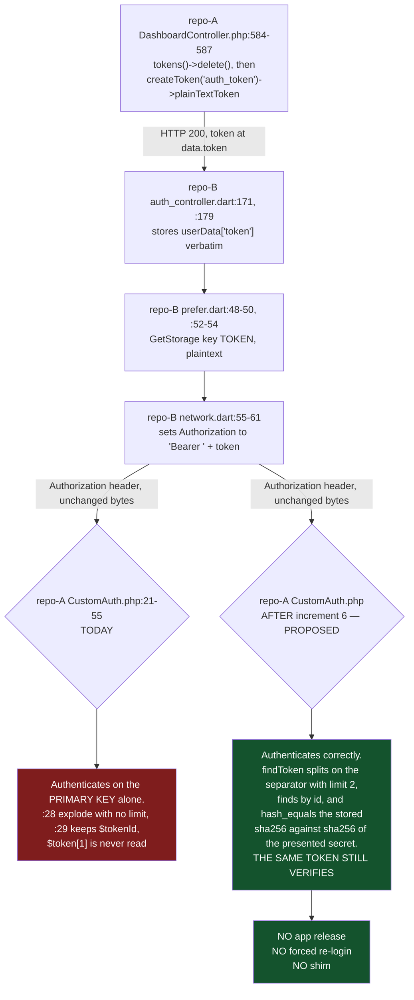

# 06 — Compatibility and Rollback

> **The owner's central concern, answered in one paragraph.** Phase 1 does not rebuild anything. Of the
> twenty planned increments, fourteen touch only route middleware arrays, middleware bodies, Policies,
> FormRequests and test scaffolding; four add database columns and tables that no migration currently
> creates; one converts money column types; one is Flutter-only. **Not one line under
> `packages/workdo/` is edited**, which is why all 69 addon modules, their 670 Blade views and their
> 105,502 lines survive untouched and the upstream CodeCanyon upgrade path stays open. One narrow
> two-file carve-out is *requested* in §2.3 and is **not granted**: it needs an owner approval of its own
> and, without it, the no-edit rule stands with no exceptions at all. **The shipped
> Flutter app needs no release for any backend security fix except one** — the DECIMAL money conversion
> in increment 19 — because the app already sends exactly the bearer-token format the fixed server will
> verify, and because the one data change that alters a JSON field's type is deliberately sequenced last
> and behind a gate. The genuine risks are concentrated in five places, all named below with the specific
> thing to watch: the `routes/web.php` brace move (which can swallow the entire storefront if moved one
> line too far), the DECIMAL conversion (which is not reversible), the Delivery Syria webhook (which
> needs the provider's cooperation), the `validated()` switch in `UserController` (which silently drops
> un-allow-listed form fields), and credential rotation (which can permanently destroy encrypted data if
> `APP_KEY` is rotated without an inventory).

## 0. How to read this document

**Vocabularies, used exactly.** Status `VERIFIED` / `PARTIAL` / `MISSING` / `UNKNOWN` / `BLOCKED`.
Severity `CRITICAL` / `HIGH` / `MEDIUM` / `LOW`. Priority `P0` / `P1` / `P2` / `P3`.

**What "compatibility" means here.** Two different things, and conflating them is how plans like this go
wrong:

| | Meaning | How this document treats it |
|---|---|---|
| **Preservation** | A capability that exists today and must still exist tomorrow — a merchant's data, an addon's screen, an API field the app parses, a Syrian payment flow. | Section 1, 2, 3. Each has a stated invariant, the mechanism that preserves it, and the specific thing to watch. |
| **Intentional rejection** | Behaviour that works today *only because a control is missing*. Anonymous payment-status writes. Forged bearer tokens. Cross-tenant reads. | Section 4. These are the fix, not a regression. They still need a compatibility note, a migration instruction and a regression test — which is what Section 4 supplies. |

**Increment numbers** refer to the twenty-increment sequence in the Phase 1A implementation-order
document. **Gate letters** (`GATE 0`, `GATE A`…`GATE H`) refer to the owner-decision stops in that same
sequence. **Item numbers** in square brackets (`[12]`, `[57]`) refer to the 99 revalidated Phase 1A
findings.

**Proposed changes are marked `PROPOSED — NOT APPLIED`.** Every code block in this document that shows a
change is a specification for an engineer to apply later, not a record of something done.

---

## 1. The compatibility contract — what must not break

### 1.0 The contract at a glance

Twelve protected assets. Each row states the invariant, the Phase 1 increments that come near it, and
the single most important thing to watch.

| # | Protected asset | Invariant | Increments that touch it | Residual risk | The one thing to watch |
|---|---|---|---|---|---|
| 1 | **Mobile API contract** (merchant app) | `Authorization: Bearer {id}\|{secret}`, `data.token` in the login response, `store_id` accepted as a parameter, 401 means *only* "session dead" | 3, 4, 6, 7, 14, 19 | LOW for 3/6/14; MEDIUM for 4; HIGH for 19 | Tenancy denials must return **403, not 401** — a 401 wipes the merchant's local storage and logs them out (`repo-B lib/network/network.dart:285-288`, `:333-341`) |
| 2 | **Storefront / customer API contract** | The 12 `*-guest` routes keep working for callers that send a token | 6 | UNKNOWN — one undocumented route | `routes/api.php:105 place-order-guest` is the only guest route absent from the vendor documentation. **GATE A.** |
| 3 | **Database relationships** | All 73 live foreign keys and every Eloquent relation resolve unchanged | 2, 18, 19 | LOW for 2; MEDIUM for 18 | `users.plan_id` normalisation in increment 18 adds an FK to the highest-fan-in table (16 FK declarations target `users`) |
| 4 | **Merchant data** | No row is deleted, no column is dropped, no value is rewritten | 18, 19 | HIGH for 19 | The DECIMAL conversion rebuilds the largest tables and **is not reversible**; see §5.4 |
| 5 | **Store configuration** | Per-store `settings` rows, theme selection, currency, payment-method config all keep resolving | none directly | LOW | Increment 14's ownership predicates must preserve the super-admin cross-store path (`DashboardController.php:4614-4622`) |
| 6 | **Routes and route names** | Every `route('name')` helper in 1,232 Blade files keeps resolving | 3, 8, 11, 13, 16 | MEDIUM | Increment 8 moves a brace; `routes/web.php:973` is `require customer.php` and sits **inside** the window — see C-NEW-3 |
| 7 | **Business workflows** | Merchant creates an order; customer checks out; delivery boy delivers; merchant withdraws | 12, 13, 17 | MEDIUM | The delivery-boy limb of `OrderPolicy` (**GATE D**) and merchant-declared discounts (**GATE H**) |
| 8 | **69 WorkDo addon modules** | Every module loads, routes, renders and migrates exactly as today | none — the no-edit rule is absolute. One narrow carve-out is **requested, not granted** (§2.3) | LOW | 478 `getCurrentStore()` call sites and 162 `isAbleTo(` call sites inside `packages/` — see §2 |
| 9 | **Theme system** | Three themes, Blade view-path swap, per-store `theme_id` | none | LOW | Theme resolution lives entirely in `routes/customer.php:49`, a different file and group from the one increment 8 edits |
| 10 | **Flutter merchant app** | No forced update, no forced re-login, no store release required | 15 (repo-B only), plus the API-facing increments | LOW except increment 19 | `product_model.dart` has 47 `as String?` + 29 `as int?` unguarded casts; a JSON type drift crashes the whole product list |
| 11 | **Paymera** | The Syrian card gateway keeps taking payments | 19 | HIGH | The gateway amount unit is **UNKNOWN** to this analysis; getting it wrong is a 100× error in either direction. **GATE G.** |
| 12 | **Delivery Syria / Zid** | The logistics webhook keeps updating order status | 7 | HIGH | There are **three** status-mutation entry points, two of them on the same URI — see C-NEW-1 |

### 1.1 API contracts

**Status: VERIFIED. There is no machine-readable API contract in either repository.** Measured:

```
$ find . -not -path "./vendor/*" -not -path "./node_modules/*" \
    \( -iname "*openapi*" -o -iname "*swagger*" -o -iname "*postman*" \)
(no output)

$ grep -ni "swagger\|scribe\|openapi\|l5-swagger" composer.json
(no output, exit 1)

$ grep -rn "v1\|v2\|'version'" routes/api.php
(no output)
```

So: no OpenAPI document, no Swagger/Scribe generator, no Postman collection, and **no API versioning of
any kind** in `routes/api.php`. The only versioned paths in the whole route tree are the ten dead
`/api/v1/*` stub routes inside WorkDo packages (`grep -rln "auth:sanctum" packages/` → 10 files), which
resolve a `sanctum` guard that `config/auth.php:38-51` does not define.

**What exists instead**, and it matters more than Phase 0 recorded: two committed vendor documentation
JSON files.

| File | Size | Documents | Declares `Authorization` header |
|---|---|---|---|
| `packages/workdo/Api/src/documentation/admin.json` | 114,348 bytes | 66 merchant-admin endpoints | **64 of 66** |
| `packages/workdo/Api/src/documentation/theme.json` | 425,911 bytes | 79 storefront endpoints | **77 of 79** |

I enumerated `admin.json` programmatically. The only two endpoints that do **not** declare an
`Authorization` header are `authentication/login` and `deliveryBoy/deliveryBoy-login` — which map exactly
to the two token-issuing routes, `routes/api.php:47` (`adminlogin`) and `routes/api.php:315`
(`delivery-login`). Every other documented admin endpoint declares the header.

**This is the single most useful compatibility fact in Section 1**, because it covers the seven endpoints
increment 3 closes. All seven are documented, and all seven declare the header:

| Documented endpoint | Method | `Authorization` declared | Live route |
|---|---|---|---|
| `/products/category-list` | GET | yes | `routes/api.php:163` |
| `/products/product-list` | GET | yes | `routes/api.php:164` |
| `/products/variant-list` | GET | yes | `routes/api.php:165` |
| `/orders/order-list` | GET | yes | `routes/api.php:166` |
| `/coupons/coupon-list` | GET | yes | `routes/api.php:167` |
| `/shipping/shipping-list` | GET | yes | `routes/api.php:168` |
| `/products/tax-list` | GET | yes | `routes/api.php:169` |

**Consequence.** Adding `custom.auth` to `routes/api.php:163-169` does not break the published contract —
**it enforces it.** The route table is the thing that drifted from the documentation, not the other way
round. The same argument holds for the storefront: all 11 documented `*-guest` endpoints declare the
header, so `*-guest` means "no customer *account* required", not "no token required".

**What to watch.** `grep` of `admin.json` for `orders/notes` returns **zero** — the two order-note write
endpoints at `routes/api.php:203-211` are documented nowhere, and repo-B contains no caller for them
either. They have no known consumer, which is why increment 3 can close them with the lowest risk in the
set. And `place-order-guest` is absent from `theme.json`, which is why **GATE A** exists.

### 1.2 Database relationships

**Status: VERIFIED.** Measured across both migration trees (105 root + 102 package = 207 migrations):

```
$ grep -rn -- "->foreign(" database/migrations/ packages/workdo/*/src/database/migrations/ | grep -v ": *//" | wc -l
73
```

73 live foreign-key declarations; one more is commented out (`database/migrations/2023_12_29_100550_create_user_coupons_table.php:25`,
which targets a non-existent singular `order` table — correctly disabled). By target table:

| FK target | Declarations |
|---|---|
| `users` | 16 |
| `customers` | 8 |
| `stores` | 6 |
| `products` | 5 |
| `orders` | 4 |

**How Phase 1 preserves them.** Increments 2 and 18 are **additive and guarded**: every statement is
wrapped in `Schema::hasTable()` or `Schema::hasColumn()`, so each is a no-op against a database that
already has the object. No increment drops a column, drops a table, or changes a relation's cardinality.

**What to watch — two things.**

1. **`users.plan_id` (increment 18, item [50]).** `database/migrations/2014_10_12_000000_create_users_table.php:28-34`
   makes the column's *type* depend on execution history: `unsignedBigInteger` + FK when `plans` already
   exists, `string` otherwise. `2014_` sorts first and `plans` is created by
   `2023_12_08_123752_create_plans_table.php`, so a from-zero build always takes the `else` branch and
   gets `VARCHAR` with no FK, while production almost certainly has `BIGINT` + FK. The normalisation
   migration adds an FK to the table that 16 other FKs already target. Run it inside a transaction,
   against a restored copy first, and **never batched with the additive migrations**. Adding
   `ON DELETE CASCADE` would be a genuine behaviour change — deleting a plan would begin cascading to
   users — so confirm no plan is ever hard-deleted, or omit the cascade.
2. **`ZidStore` / `ZidEvent` are not tenant-scopeable.** `app/Models/ZidEvent.php:44` declares
   `scopeForStoreAndEvent($query, string $storeId, ...)` — a **string** — and
   `app/Console/Commands/ZidProcessEvents.php:78` casts the external payload value with `(string)`.
   `zid_stores.store_id` and `zid_events.store_id` are *external Zid* identifiers, not foreign keys to
   `stores.id`. Any tenancy work that matches on column name would compare a local integer against an
   external string and silently return zero rows, stopping the per-minute Zid sync
   (`routes/console.php:9`) with no error anywhere. They go on an explicit **DO-NOT-SCOPE** list.

### 1.3 Merchant data and store configuration

**Invariant: no merchant row is deleted, no merchant value is rewritten, no store's configuration
changes meaning.** Phase 1 contains exactly three changes that write to existing rows, and all three are
gated:

| Change | Increment | Writes to | Gate |
|---|---|---|---|
| `users.plan_id` type normalisation | 18 | `users` | GATE F |
| Money column type conversion | 19 | 39 columns across `orders`, `products`, `product_variants`, `carts`, and the WorkDo money tables | GATE G |
| `store_id` NULL backfill (deferred out of Phase 1) | — | 56 tables carrying `store_id` | not scheduled |

Everything else in Phase 1 either adds a column, adds a row to no table at all, or changes code paths.

**Store configuration is preserved by not being touched.** Per-store settings live in the key/value
`settings` table (`database/migrations/2023_12_11_100148_create_settings_table.php:14`); custom domains
and subdomains are resolved from that same table by
`app/Providers/StoreRedirectServiceProvider.php:30-31`, gated on `plans.enable_domain` /
`plans.enable_subdomain` (`database/migrations/2023_12_08_123752_create_plans_table.php:25-26`). Phase 1A
confirmed there is **no** `stores` custom-domain column and recommends creating none — adding one would
be a second source of truth for domain configuration, which the owner's no-parallel-systems principle
forbids.

**What to watch.** `app/Models/Utility.php:181-211` (`GetValueByName`) **drops its `store_id` predicate
entirely** when the tenant resolves to null (`:190-193`, with the comment "Apply the store_id condition
only if it is not empty"), and `:213-247` (`GetValByName`) builds a `rememberForever` cache key at `:220`
that omits the setting name and collapses to a single shared bucket when the tenant is null. Fixing
either without the other, or without a tenant resolver in place, makes the storefront render framework
defaults instead of the merchant's branding. **These two must ship together with a resolver, and that
whole programme is deliberately out of Phase 1** (see §2.2 rule 7 and the standing gate in the
implementation-order document).

### 1.4 Routes and route names

**Invariant: every `route('name')` call in 1,232 Blade files keeps resolving.** Measured Blade inventory:

```
$ find resources/views -name "*.blade.php" | wc -l   →  518
$ find themes          -name "*.blade.php" | wc -l   →   44
$ find packages        -name "*.blade.php" | wc -l   →  670
                                             total   → 1232
```

A missing route **name** is a 500 at render time, not a 404 — which makes route-name stability the most
fragile part of the route work. Phase 1's route edits are therefore constrained to three shapes, in
increasing order of risk:

| Shape | Increments | Route names affected | Risk |
|---|---|---|---|
| Add a token to an existing `middleware([...])` array | 3, 4, 7 | none | Minimal |
| Wrap existing registrations in a new `->group()` | 11, 13 | none | Low — brace depth changes, names do not |
| Relocate a group's closing `});` | 8 | none, but 28 registrations change middleware | **The highest-risk route edit in Phase 1** |
| Delete a registration | 3 (zid debug), 8 (duplicate `order-view`), 16 (zid show-token) | `order.view` is declared **twice** (`:946` and `:956`) — deleting `:956` keeps the name | Low, *because* the name survives |

**Two route deletions are safe and verified.** `routes/api.php:381-384`
(`/delivery-syria/zid-statuses-test`) is a closure-free debug route with no caller: `grep -rn
"zid-statuses" repo-B/lib/` is empty and it is absent from `lib/utils/base_api.dart`. The duplicate
`order-view` at `routes/web.php:956` is byte-equivalent to `:946` — I re-read both; they register the
same URI, the same controller method and the same name `order.view` — so after deleting `:956` the name
still resolves.

**What to watch: C-NEW-3, below. It is the most dangerous line in the route work.**

### 1.5 Business workflows

Four workflows carry the business. Each has one Phase 1 increment that could break it and one explicit
positive-case test that must exist before that increment ships.

| Workflow | Breaks if… | Increment | Mandatory positive-case test |
|---|---|---|---|
| **Merchant creates an order** (`routes/web.php:868` → `OrderController::store:43`) | the reconciler rejects a merchant-declared discount | 17 | `test_merchant_order_allows_declared_discount` — two lines totalling 5000.00, `final_price` 4500.00, `coupon_price` 500.00 → order IS created. **GATE H** |
| **Customer checks out** (`routes/customer.php:150` → `PaymentController::processOrder:316`) | a `prohibited` rule rejects a field the first-party checkout actually posts | 17 | `test_guest_cod_checkout_succeeds_unchanged` — a clean guest COD checkout with no money fields in the payload → 200 and one order row. See C-NEW-2 |
| **Delivery boy delivers** (`routes/web.php:953` → `OrderController::updateStatus:640`) | `OrderPolicy` compares only `$order->store_id === getCurrentStore()` | 12 | `test_delivery_boy_can_still_update_own_assigned_order`. **GATE D** |
| **Merchant withdraws** (`routes/web.php:186/:189/:192` → `StoreFinanceController::{approve,reject,pay}Withdrawal`) | the role that merchants actually hold does not include the new permission | 13 | `test_user_with_permission_can_approve` — plus an audit of which live roles hold `View Finance Withdrawal Requests` **before** the deploy |

The finance methods are worth one extra sentence because the honest reachability is narrower than it
looks: `app/Helper/helper.php:366` is `if ($user) {` with **no else**, so `getCurrentStore()` falls off
the end and returns null for an anonymous caller, and `StoreWithdrawal::where('store_id', null)` matches
no row. Anonymous money movement is **not** demonstrated. That is an accident of SQL NULL semantics, not
a control — which is exactly why increment 13 must not be skipped — but it also means increment 13 is
not racing a live anonymous exploit.

### 1.6 Integration: Paymera

**Status: VERIFIED at the code level; the gateway's expected amount unit is UNKNOWN.**

| Fact | Evidence |
|---|---|
| Dispatch | `app/Services/PaymentService.php:91-92` — `case 'paymera': return $this->processPaymera(...)` |
| Amount construction | `app/Services/PaymentService.php:210-212`, `:223` |
| Callback | `routes/web.php:300` → `PaymentController::handlePaymeraCallback` |
| Trigger | `routes/web.php:380` → `PaymentController::handlePaymeraTrigger` |
| Concurrency | the callback **is** correctly guarded — `Cache::lock` and a processed flag |

**How Phase 1 preserves it.** Increments 1–18 do not touch the Paymera branch at all. Increment 19
changes `:211-212`, and it is behind **GATE G** precisely because the correct value cannot be derived
from this repository. The decimal separator is stripped out of the amount by the same `str_replace` that
strips thousands separators, so `1250.50` becomes `125050` while `1250` stays `1250` — a 100× divergence
between two totals that differ by half a unit. **The direction of the fix depends on whether Paymera
expects major or minor units, and that is a document the owner holds, not a fact in the code.** No
attempt was made to contact the gateway host referenced at `:217`.

**What to watch.** Charged amounts will change when this is fixed. If merchants have been reconciling
their books against the current figures, the correction will look like a price change. It needs a dated
cutover and a reconciliation of historical Paymera transactions — not a silent deploy.

### 1.7 Integration: Delivery Syria and Zid

**Status: PARTIAL — the guard pattern exists and is correct in one controller, absent in a second, and
there is a third entry point nobody has counted.** This is the integration most at risk in Phase 1, and
the risk is larger than the item set records.

There are **three** server-side entry points that mutate a Zid order's status:

| # | Registration | Handler | Guard | Status |
|---|---|---|---|---|
| A | `routes/api.php:35-38` — `POST /api/delivery-syria/orders/update-status` | `Api\DeliverySyriaOrderController::updateStatus` | `X-Platform` check at `:25-32`; `hash_equals($storedSecret, $secret)` at `:157-179` | **Correct.** The reference implementation |
| B | `routes/api.php:376-379` — `POST /api/delivery-syria/status` | `DeliverySyriaStatusController::updateStatus` | none | Increment 7 copies A's guard here |
| C | `routes/web.php:1026-1138` — `Route::match(['GET','POST'], '/api/delivery-syria/orders/update-status', closure)` | an inline closure | none | **Not named in any Phase 1A item** |

Entry point C is **C-NEW-1** and is described in §1.9. It is the same URI and the same POST method as
entry point A.

**How Phase 1 preserves the integration.** Increment 7's fix is a *copy*, not a design: the column
`users.deliverysyria_secret` already exists in `User::$fillable` (`app/Models/User.php:52`), the
comparison is already written correctly at `DeliverySyriaOrderController.php:157-179`, and the CSRF
exemption is already in place (`bootstrap/app.php:62`). Nothing new is introduced.

**What to watch — and this is GATE B.** Entry point B currently accepts anonymous calls, so the provider
may be sending nothing. After the fix it will require `X-Platform: deliverysyria` plus a per-store bearer
secret. Entry point A *already* demands exactly those headers and that integration works, which is
strong evidence the provider already sends them — **but that is inference, not fact, and the webhook
stops working the moment the guard lands if it is wrong.** Confirm with Delivery Syria before merge. Do
not ship this one silently.

One further dependency: increment 7 depends on increment 2, because `users.deliverysyria_secret` is one
of the five guarded columns increment 2 adds. Without the column, Eloquent returns null, `$storedSecret`
becomes `''`, and the first clause of `:161-164` rejects **everyone**. The integration fails **closed**,
not open — a dead webhook, not a bypass. That is the correct failure direction, but it means the column
must exist before the guard is enabled or the fix looks like it broke the integration.

### 1.8 The theme system

**Status: VERIFIED — and structurally insulated from every Phase 1 route change.**

| Fact | Evidence |
|---|---|
| Three themes on disk | `themes/greentic`, `themes/stylique`, `themes/techzonix` |
| Theme selection is per store | `database/migrations/2023_12_14_090259_create_stores_table.php:18` — `$table->string('theme_id');` |
| Switching is a Blade **view-path swap** | `app/Http/Middleware/ActiveTheme.php:33` — `Theme::set($themeName)`, from `qirolab/laravel-themer ^2.3` (`composer.json:57`) |
| Resolution is by store slug | `ActiveTheme.php:21` — `Store::where('slug', request()->segment(1))->where('is_active', 1)->first()` |
| It is wired **only** in the storefront group | `routes/customer.php:5` imports it; `routes/customer.php:49` — `Route::middleware([ActiveTheme::class, 'themelanguage'])->group(...)` |
| Themes contain **zero** references to the guest API endpoints | `grep -rln` for all 12 guest endpoint strings across `themes/` and `resources/` → **0 files** |

**How Phase 1 preserves it.** No increment touches `themes/`, `ActiveTheme.php`, or `routes/customer.php`
except increment 17, which changes controller bodies the storefront calls, not the theme layer. Theme
resolution happens in a group declared in a *different file* from the one increment 8 edits.

**What to watch.** Two items, both narrow:

- Increment 11 changes the addon/module install path to `base_path('themes/')` instead of the relative
  `'themes/'` (`AddonController.php:65`). Measured in this checkout: `public/themes` is **absent** while
  `themes/` **exists**, and `public/packages` is absent while `packages/` exists — so root-relative
  resolution is what the repository is shaped for and `base_path()` is the correct target. Still, if a
  deployment happens to run with `public/` as the PHP working directory and serves themes from
  `public/themes/`, this moves where uploads land. Verify on staging.
- Increment 17's `prohibited` FormRequest rules could in principle 422 a theme checkout form. **I
  enumerated this rather than assuming it** — see C-NEW-2. Result: the three themes contain **zero**
  references to any of the four field names.

### 1.9 Three NEW compatibility constraints found while writing this document

These were derived in this session, not inherited. Each is a compatibility hazard for a specific
increment.

---

#### C-NEW-1 — Two registrations of `POST /api/delivery-syria/orders/update-status`, one guarded and one not
**Status: VERIFIED (code) / BLOCKED (which one Laravel serves). Severity: HIGH. Priority: P1.**

`routes/api.php:35-38` registers `POST /delivery-syria/orders/update-status`. That file is registered
with `->prefix('api')` (`app/Providers/RouteServiceProvider.php:36-38`), so the live URI is
`/api/delivery-syria/orders/update-status`, and its handler
`Api\DeliverySyriaOrderController::updateStatus` performs both guards correctly:

```
 25        $platform = trim((string) $request->header('X-Platform'));
 27        if ($platform !== 'deliverysyria') {
 28            return response()->json(['success' => false, 'message' => 'Invalid platform.'], 403);
...
157        $storedSecret = trim((string) ($owner->deliverysyria_secret ?? ''));
161        if ($storedSecret === '' || !hash_equals($storedSecret, $secret)) {
175            return response()->json(['success' => false, 'message' => 'Invalid credentials.'], 403);
```

`routes/web.php:1026` registers **the same method and the same literal URI** as an inline closure, with
no middleware of any kind — I confirmed it sits at brace depth 0, i.e. outside even the `web` group:

```
$ php scratchpad/phase1a/depth.php routes/web.php 1026
line 1026: BRACE DEPTH=0  open-brace lines=[]
```

```
1026  Route::match(['GET', 'POST'], '/api/delivery-syria/orders/update-status', function (...) {
1039      $order = DB::table('zid_orders')->where('zid_order_id', $zidOrderId)->first();
1070      $zidStore = DB::table('zid_stores')->where('store_id', $order->store_id)->first();
1083      $authorization = Crypt::decryptString($zidStore->authorization);
1087      $accessToken   = Crypt::decryptString($zidStore->access_token);
1090      $zidResponse = Http::withHeaders([...])->post('https://api.zid.sa/v1/managers/store/orders/'...)
1133          'authorization_loaded' => !empty($authorization),
1134          'access_token_loaded'  => !empty($accessToken),
```

It decrypts the merchant's Zid credentials, calls Zid as that merchant, and echoes integration state
back to the caller — functionally the same operation as the guarded handler, with none of the guards.

**Why this is a compatibility problem, not just a security one.** In Laravel's route collection, two
routes sharing a method and URI do not both survive — the later registration replaces the earlier one in
the method/URI index. Registration happens **twice** in this application: `bootstrap/app.php:8-14`
(`withRouting(web:, api:, ...)`) and again at `app/Providers/RouteServiceProvider.php:35-42`, which
registers `api` at `:36-38` and then `web` at `:40-41`. **Which of the two handlers actually serves the
URI is UNKNOWN**, and I will not guess: `php artisan route:list` is forbidden this phase and is blocked
anyway by the empty `vendor/`, and `vendor/laravel/framework/src` is absent so the framework's
registration order could not be read.

Both outcomes are bad for a different reason:

| If the served handler is… | Then… |
|---|---|
| the closure (`web.php:1026`) | the correct guard at `DeliverySyriaOrderController.php:25-32,:157-179` is **dead code** and the integration is anonymously mutable today |
| the controller (`api.php:35-38`) | the closure is unreachable dead code — but it will become reachable the moment anyone changes registration order, and it is still a live credential-decryption path in source |

**PROPOSED — NOT APPLIED.** Fold into increment 7, which already owns this integration:
1. Run `php artisan route:list --path=delivery-syria` on the owner's machine (or in CI once `vendor/` is
   populated) and record which handler serves the URI. This is the only authoritative answer.
2. **Delete `routes/web.php:1026-1138`.** It duplicates a guarded controller, it carries no middleware,
   and it decrypts merchant credentials in a route-file closure. There is no caller in repo-B
   (`lib/utils/base_api.dart:5-132` lists no such endpoint).
3. Only then apply increment 7's guard to `routes/api.php:376` (`/delivery-syria/status`).

**Rollback note.** Reverting step 2 restores an unauthenticated credential-using endpoint. Prefer fixing
forward; see §5.2 "code" row.

**Regression test.** `tests/Feature/Api/DeliverySyriaRouteInventoryTest.php::test_only_one_handler_serves_the_status_update_uri`
— resolve the route from `Route::getRoutes()` and assert its action is
`Api\DeliverySyriaOrderController@updateStatus`, not a `Closure`. This converts an ambiguity that needs a
running app into a one-line CI assertion.

---

#### C-NEW-2 — The storefront checkout posts a client-supplied `sub_total`, and one payment branch charges it
**Status: VERIFIED. Severity: HIGH. Priority: P0 within increment 17.**

Increment 17 proposes a `ProcessOrderRequest` FormRequest with `prohibited` rules on `tax_price`,
`shipping_price`, `shipping_final_price`, `total_coupon_amount`,
`coupon_info.coupon_discount_amount` and `cartlist_final_price`. Item [57] named, as an explicit
unmeasured prerequisite, that the storefront templates must be enumerated for those field names before
the rules ship. **I ran that enumeration. Two results, and the second is the one that matters.**

**Result 1 — none of the four prohibited field names is posted by any first-party template.**

| Field name | References in `themes/` | References in `resources/views` | What they are |
|---|---|---|---|
| `tax_price` | 0 | 10 | All **display** reads — `currency_format_with_sym($order['tax_price'] ...)`, `$response->data->tax_price`. One AJAX-response read at `resources/views/front_end/pages/refund_order.blade.php:336` |
| `shipping_final_price` | 0 | 1 | A **CSS class name** on a display `<span>` — `resources/views/front_end/pages/checkout-cart-list.blade.php:77` |
| `total_coupon_amount` | 0 | 0 | — |
| `cartlist_final_price` | 0 | 4 | Server-side Blade reads of the controller's own array in four gateway redirect views (`razorpay`, `paystack`, `paymentwall`, `khalti`) |

Corroborated two further ways: `grep -rl` for all four names across `public/js`, `themes/*/assets`,
`themes/*/resources` and `resources/js` returns **nothing**, and
`grep -rn "name=[\"'](tax_price|shipping_final_price|total_coupon_amount|cartlist_final_price)"` across
`themes/`, `resources/views` and `public/` returns **nothing**. The checkout form submits via
`$('#formdata').serializeArray()` (`resources/views/front_end/common/checkout/checkout_js.blade.php:26`,
`:47`), so only fields physically inside the form are posted. **The four `prohibited` rules will not 422
any first-party storefront checkout.** GATE H's named prerequisite is answered for the first-party code;
a merchant's own custom theme is still UNKNOWN.

**Result 2 — the checkout form posts a different money field, `sub_total`, and one of the 52 payment
branches charges it.**

The checkout form's hidden inputs, read in full:

```
resources/views/front_end/common/checkout/checkout_form.blade.php:591   Form::hidden('coupon_code', ...)
resources/views/front_end/common/checkout/checkout_form.blade.php:592   Form::hidden('sub_total', null, ['id' => 'sub_total_checkout_page'])
resources/views/front_end/common/checkout/checkout_form.blade.php:672   <input type="hidden" ... id="payment_type"
resources/views/front_end/common/checkout/checkout_form.blade.php:674   <input type="hidden" class="method_id" id="method_id" name="method_id"
resources/views/front_end/pages/checkout.blade.php:248                  Form::hidden('coupon_code', ...)
resources/views/front_end/pages/checkout.blade.php:249                  Form::hidden('sub_total', null, ['id' => 'sub_total_checkout_page'])
```

And `app/Services/PaymentService.php` reads that client value as the gateway amount in exactly one place:

```
 149            case 'PayHere':
 150                return $this->processPayHere($request, $slug, $cartList);
...
2995    private function processPayHere($request, $slug, $response)
...
3005        $cartlist_final_price = $request->sub_total;
3006        $totalprice = str_replace(' ', '', str_replace(',', '', str_replace($currency, '', $cartlist_final_price)));
...
3026                    number_format($cartlist_final_price, 2, '.', '') .
```

`grep -n "request->sub_total\|request\['sub_total'\]"` over the whole of `PaymentService.php` returns
**one** hit, `:3005`. So this is the only branch of the 52 (`switch ($paymentMethod)` at `:88-193`,
52 `case` arms counted) that takes its charge amount straight from a client-posted field.

**The compatibility constraint this creates for increment 17, stated plainly:**

- **If the implementer adds `sub_total` to the `prohibited` list, the first-party storefront checkout
  breaks with HTTP 422 on every payment method**, because `checkout_form.blade.php:592` always posts it.
- **If the implementer does not, the PayHere branch keeps charging a client-controlled amount**, and
  increment 17's four substitutions (`PaymentController.php:764`, `:1127`,
  `PaymentService.php:1976`, `:2033-2034`) do not cover it.

Neither is acceptable. **PROPOSED — NOT APPLIED:** rule `sub_total` as `nullable|numeric|min:0` rather
than `prohibited` (it is a legitimate form field), and separately replace
`PaymentService.php:3005` with the server-derived total that `getCartData` (`PaymentController.php:609`)
already computes two call frames up — the same substitution shape increment 17 applies at the other four
sites. Add PayHere to increment 17's file list.

**Regression tests.**
`tests/Feature/Money/CheckoutTamperingTest.php::test_guest_cod_checkout_with_sub_total_field_still_succeeds`
(the compatibility assertion — a clean checkout posting `sub_total` as the form does returns 200 and
creates one order) and
`::test_payhere_gateway_amount_ignores_client_sub_total` (post `sub_total=1` with a 5000.00 cart; assert
the constructed gateway amount is 5000.00).

---

#### C-NEW-3 — `require customer.php` sits inside the window increment 8 moves a brace across
**Status: VERIFIED. Severity: CRITICAL if mishandled. Priority: P0 within increment 8.**

Increment 8 relocates the `});` currently at `routes/web.php:938` downwards so the administrative order
and refund mutators fall inside the `auth` group. I re-ran both independent depth tools to establish the
exact boundary rather than trusting the item set:

```
$ php scratchpad/phase1a/depth.php routes/web.php 305 326 937 938 940 950 961 966 969 972 973 974
line  305: BRACE DEPTH=0  open-brace lines=[]
line  326: BRACE DEPTH=1  open-brace lines=[305]
line  937: BRACE DEPTH=2  open-brace lines=[305,326]
line  938: BRACE DEPTH=1  open-brace lines=[305]
line  940: BRACE DEPTH=1  open-brace lines=[305]
line  950: BRACE DEPTH=1  open-brace lines=[305]
line  961: BRACE DEPTH=1  open-brace lines=[305]
line  966: BRACE DEPTH=1  open-brace lines=[305]
line  969: BRACE DEPTH=1  open-brace lines=[305]
line  972: BRACE DEPTH=1  open-brace lines=[305]
line  973: BRACE DEPTH=1  open-brace lines=[305]
line  974: BRACE DEPTH=0  open-brace lines=[]
```

And the contents of the window, read line by line:

| Line | Registration | Classification |
|---|---|---|
| 940 | `contacts/{slug?}` → `ContactController::store` | **Genuinely public — must stay out** |
| 941 | `change-language-store/{lang}` | **Genuinely public — must stay out** |
| 943 | `Route::resource('newsletter', ...)` | Administrative — move in |
| 944 | `shippinglabel/pdf/{id}` | Administrative — move in |
| 945 | `order-return` | **GATE C** — possibly customer-initiated |
| 946 | `order-view/{id}` → `order_view` | **GATE C** — already fails closed via `OrderController:285` |
| 947 | `orders/order_view/{id}` → `show` | **GATE C** |
| 948 | `order-receipt/{id}` | **GATE C** — guest receipt-by-link? |
| 949 | `order-status-change/{id}` | Administrative — move in |
| 950 | `order-payment-status` | Administrative — move in (the most severe item in the set) |
| 951 | `Route::resource('order-note', ...)` | Administrative — move in |
| 953 | `update-order-status/{id}` | Administrative — move in |
| 955 | `order-return-request` | **GATE C** |
| 956 | `order-view/{id}` (duplicate of 946) | **Delete** |
| 957–961 | `update-refund-status`, `cancel-refund-status`, `refund-stock`, `update-final-price/{id}`, `refund-amount/{id}` | Administrative — move in |
| 963 | `Route::resource('refund-request', ...)` | **GATE C** — `show` may be customer-facing |
| 964 | `refund-settings` | Administrative — move in |
| 966 | `product-page-setting` | Administrative — move in |
| 969 | `/pay/{pay}` → `payu.pay` | **Genuinely public — must stay out** |
| 972 | `/format-price` | **Genuinely public — must stay out** |
| **973** | **`require __DIR__ . '/customer.php';`** | **THE ENTIRE CUSTOMER STOREFRONT — must stay out** |

**The hazard.** `routes/web.php:973` is `require __DIR__ . '/customer.php';` at brace depth 1 — inside
the `web` group, outside the `auth` group. `routes/customer.php` is the whole storefront: the product
pages, the cart (`:127-135`), the checkout (`:150` `process-order`), the order-complete page (`:144`),
the wishlist (`:146-148`), and the theme-resolving group at `:49`. **If the relocated `});` is placed
after line 973 instead of before it, every storefront page on every merchant's store starts redirecting
to the admin login.** That is a total, instantly visible outage of the customer-facing product, produced
by moving one brace one line too far.

**PROPOSED — NOT APPLIED. The guardrail, as an acceptance criterion for increment 8:**

```
After the move, re-run BOTH depth tools and assert:

  routes/web.php  'require customer.php'   →  BRACE DEPTH = 1   (web group only)
  routes/web.php  contacts.store           →  BRACE DEPTH = 1
  routes/web.php  change.languagestore     →  BRACE DEPTH = 1
  routes/web.php  payu.pay                 →  BRACE DEPTH = 1
  routes/web.php  format.price             →  BRACE DEPTH = 1
  routes/web.php  order.payment.status     →  BRACE DEPTH = 2   (inside auth)
  routes/web.php  update-refund-status     →  BRACE DEPTH = 2
```

The two tools agreeing is what established the boundary in the first place; they are the regression check
for the move itself. The route-table test
`tests/Feature/Routing/UnauthenticatedRouteBoundaryTest.php::test_no_admin_route_is_reachable_without_auth`
should assert against an explicit `PUBLIC_ROUTE_ALLOWLIST` containing exactly `contacts.store`,
`change.languagestore`, `payu.pay`, `format.price` **plus every route name declared in
`routes/customer.php`** — otherwise the test itself will demand that the storefront be authenticated.

### 1.10 Build reproducibility — the lockfile cannot be installed behind restricted egress

This is **not** one of the twelve protected assets in §1.0, and it is not a runtime compatibility
constraint like C-NEW-1 … C-NEW-3. It is a **supply-chain constraint on the project's ability to rebuild
itself**, and it is the reason every test in this plan is SPECIFIED and not EXECUTED.

**Status: VERIFIED for the lockfile facts / BLOCKED for the install.** `composer install --no-scripts`
aborted in this container. `vendor/composer/installed.json` was never written, `vendor/laravel/framework/src`
and `vendor/bin` are absent, and `vendor/` holds nothing but empty package directories (the count is in
the frontmatter). Consequently **`php artisan`, PHPUnit and any boot-dependent static analysis cannot run
here** — which is why §6.4 records the suite as BLOCKED and why no claim anywhere in this plan may be
reported as "passing".

**The root cause is this container's egress policy, not a defect in the project.** But the same lockfile
will stop a clean build in any environment with a restricted outbound allowlist — which includes most CI
runners and most hardened build hosts — so it is a project risk, not merely a container annoyance.

**Which hosts the lockfile actually requires.** Measured in this session over all 239 locked packages
(200 `packages` + 39 `packages-dev`):

| Host | Locked packages that need it | How, and the evidence |
|---|---|---|
| `api.github.com` | **235 of 239** | Every one of those packages takes its `dist` zipball from this host. The entire install depends on it |
| `git.yoomoney.ru` | **2** | `yoomoney/yookassa-sdk-php` `3.7.1` (`composer.lock:14024`, dist URL `:14033`) and `yoomoney/yookassa-sdk-validator` `1.0.2` (`:14082`, dist URL `:14091`). A vendor-operated host with no CDN; **unreachable from this container** (HTTP `000`, curl error 28 — proxy `CONNECT` timeout) |
| `dev.azure.com` | **2** | `myfatoorah/laravel-package` `2.2.4` (`composer.lock:6370`, source URL `:6374`) and `myfatoorah/library` `2.2.8` (`:6429`, source URL `:6433`) carry **no `dist` entry at all**, so composer must `git clone` the source. This pair is an addition to the three packages named in the install report below, and it was found by reading the lockfile rather than by running composer |

**The three packages that actually aborted the install — and one warning from the same run**, as reported by the attempted
`composer install --no-scripts`. Recorded for the runbook; composer was **not** re-run to produce this
document:

- `lahirulhr/laravel-payhere` `v1.0.4` (`composer.lock:3298`, dist URL `:3307`) — the `api.github.com`
  zipball returned **403** through the proxy, after which composer's VCS fallback failed with
  `could not read Username for 'https://github.com'`: it degraded from an anonymous archive fetch to an
  authenticated git clone — `composer.json:128` sets `"preferred-install": "dist"`, so the zipball is the
  intended path and the clone is only the fallback. Whether that 403 is per-repository policy or rate
  limiting is **UNKNOWN**: a blanket block on `api.github.com` would have stopped 235 packages, not one.
- `yoomoney/yookassa-sdk-php` `3.7.1` and `yoomoney/yookassa-sdk-validator` `1.0.2` — `git.yoomoney.ru`
  unreachable, as above. Note that the validator is **transitive**: `yookassa-sdk-php` requires it at
  `composer.lock:14042`, so it cannot be reasoned about from `composer.json` alone.
- The same run also warned **"Do not run Composer as root"** and auto-disabled plugins as a result, which
  matters because `composer.json:130-133` relies on two allowed plugins (`pestphp/pest-plugin`,
  `php-http/discovery`).

**Why this belongs in a compatibility document — three consequences.**

1. **Nothing in this plan may ever be reported as "passing."** The suite cannot run here; the status is
   BLOCKED (§6.4 row 4). Nothing has been implemented.
2. **CI cannot be relied upon until this is resolved.** The CI harness increment (increment 20) fails at
   `composer install` on any runner that cannot reach `api.github.com`, `git.yoomoney.ru` **and**
   `dev.azure.com`. That must be settled before increment 20's result means anything: a red run caused by
   egress is indistinguishable, to a tired engineer, from a red run caused by the code — and that
   confusion is exactly the trap docs 01 and 05 describe for the SQLite switch, where a red suite gets
   "fixed" by reverting the most important safety change in the plan.
3. **CI must not run as root**, or composer disables the very plugins the install declares.

**OWNER DECISIONS. All three options touch `composer.json`, so none of them is engineering's to take.**

| Option | What it requires | What it leaves unsolved |
|---|---|---|
| **A. Allowlist the hosts** on every build network | A network change, not a code change: `api.github.com`, `git.yoomoney.ru`, `dev.azure.com` | Leaves the build dependent on third-party hosts in other jurisdictions. `git.yoomoney.ru` and `dev.azure.com` serve this project's dependencies with no CDN and no availability commitment to the owner |
| **B. Mirror the dependencies** — a caching Composer proxy, or a private Satis/Toran repository | One-time infrastructure, plus a `repositories` entry alongside the existing path repository at `composer.json:137-145` | Nothing material. This is the durable answer, and it is the only option that also removes the single-host dependency on `api.github.com` |
| **C. Drop the two payment SDKs** | **Much more than removing `composer.json:30` and `:72`.** `app/Services/PaymentService.php:46` and `app/Http/Controllers/PayHerePaymnetController.php:12` both declare `use Lahirulhr\PayHere\PayHere;`; `app/Http/Controllers/YookassaController.php:27` declares `use YooKassa\Client;`; and four routes bind those controllers (`routes/web.php:486-487` for YooKassa, `:509-510` for PayHere) | Removing the packages without removing those references is a fatal error at class load. It is a functional removal of two gateway integrations from a commercial WorkDo derivative, it edits `app/` and `routes/`, and it is **out of scope for Phase 1** |

**A fact about the two gateways, offered as context and not as a recommendation:** YooKassa is a Russian
payment service and PayHere is a Sri Lankan one. Neither is a plausible payment rail for a Syrian
storefront, and neither appears in the Paymera-centred payment path analysed in §1.6. That makes option C
attractive on scope grounds — but it is still an `app/`-and-`routes/` change, so it belongs to a later
phase, behind its own owner decision. **Option B is the only one that is both sufficient and
Phase-1-safe.**

**What must not break, whichever option is chosen.** `composer.lock` stays the one source of truth for
dependency versions. Do not resolve this by deleting the lockfile, by running `composer update`, or by
committing a populated `vendor/`: the first two silently move 239 packages at once, and the third makes
the upstream CodeCanyon upgrade path unmaintainable. The lockfile is carrying more weight than it looks —
`composer.json:49` pins `myfatoorah/laravel-package` at `"*"` under `"minimum-stability": "dev"`
(`composer.json:135`), so for that package the lockfile is the **only** thing holding a version at all.

---

## 2. WorkDo addon compatibility

### 2.1 The coupling, quantified

Every number below was re-measured in this session. This is what "evolve, do not rebuild" costs if
ignored.

| Measure | Value | Command |
|---|---|---|
| Addon modules | **69** | `ls -d packages/workdo/*/ \| wc -l` |
| Modules shipping Blade views | **69 of 69** | `ls -d packages/workdo/*/src/{R,r}esources/views \| wc -l` → 1 + 68 |
| Addon Blade files | **670** | `find packages -name "*.blade.php" \| wc -l` |
| Addon Blade lines | **105,502** | `find packages -name '*.blade.php' -exec cat {} + \| wc -l` |
| Blade files overall | **1,232** (518 app + 44 theme + 670 addon) | three `find` runs |
| Addon route files | **136** (68 × `web.php`, 68 × `api.php`) | `ls packages/workdo/*/src/routes/*.php \| wc -l` |
| `data-ajax-popup` trigger sites in Blade | **263**, of which **116** are inside `packages/workdo/` | `grep -rno "data-ajax-popup" --include=*.blade.php resources/views themes packages \| wc -l` |
| `getCurrentStore()` call sites inside `packages/` | **478** | `grep -rno "getCurrentStore()" packages/ \| wc -l` |
| `getCurrentStore()` call sites overall | **1,329** | `grep -rno` over `app/ packages/ resources/ themes/ routes/ database/` |
| `where('store_id'` sites in `app/` + `packages/` | **1,265** | `grep -rnoE "where\(\s*'store_id'"` |
| `isAbleTo(` call sites inside `packages/` | **162** | `grep -rno "isAbleTo(" --include=*.php --include=*.blade.php packages/` |
| `@permission` Blade directives inside `packages/` | **87** | `grep -rno "@permission" --include=*.blade.php packages/` |
| `custom.auth` uses inside `packages/` | **0** | `grep -rn "custom\.auth" packages/ \| wc -l` |
| `auth:sanctum` uses inside `packages/` | **10 files** | `grep -rln "auth:sanctum" packages/` |
| `'auth'` middleware tokens in addon route files | **55** | `grep -rno "'auth'" packages/workdo/*/src/routes/*.php` |
| `PlanModuleCheck` tokens in addon route files | **59** | same shape |
| `'xss'` / `'verified'` / `'setlocate'` in addon route files | **0 / 0 / 0** | same shape |

The 263 figure deserves precision, because it is the number the owner will hear quoted. It is 263
`data-ajax-popup` **trigger sites** in Blade, each of which fetches a URL and injects the response
directly as HTML:

```
public/js/custom.js:35  $(document).on('click', 'a[data-ajax-popup="true"], ...', function () {
public/js/custom.js:47      $('#commanModel .modal-body').html(data);
public/js/custom.js:65      error: function (data) {
public/js/custom.js:66          data = data.responseJSON;      // assigned into a dead local
public/js/custom.js:67      }
```

So those 263 endpoints return **rendered Blade fragments, not JSON** — and the error branch at `:65-67`
discards the response into a dead local, which is why backend failures are invisible from the admin UI.
The handler is additionally registered **twice**, at `:35` and again at `:311`, so each trigger fires two
requests.

### 2.2 The seven rules this coupling imposes on Phase 1

Each rule is a direct consequence of a number above, not a style preference.

**Rule 1 — Do not change an admin endpoint's response *shape*.** 263 trigger sites expect HTML and
discard errors. An endpoint that starts returning JSON, or a redirect, renders as a blank modal with no
message. Phase 1 complies: every web-side increment (8–13) adds authorization and validation, and
returns either the existing response or a 403/422 that Laravel renders through the existing exception
handler. No controller's success-path response body is changed.

**Rule 2 — Do not change how permissions are *read*.** 162 `isAbleTo(` call sites and 87 `@permission`
directives inside `packages/` resolve through Laratrust's `roles` / `permissions` / `permission_role` /
`permission_user` tables. Increments 9–13 change **who may do what**; they do not change the tables, the
trait, or the directive. That is why a CRITICAL role-authorization fix has a LOW addon blast radius. The
one change that *would* break this is the per-store admin role restructure (items [21] fix 3, [28] fix 1)
— a `role_user` + `permission_role` data migration that silently strips every merchant's permissions if
botched. It is **deliberately deferred out of Phase 1**.

**Rule 3 — Do not add a global tenancy scope in Phase 1.** 478 `getCurrentStore()` call sites inside
`packages/` and 1,265 `where('store_id'` filters overall mean a scope keyed on the same value is either
redundant or catastrophic depending on the call site. Item [43] is `BLOCKED/HIGH/P0` for an independent
reason: 78 of 95 `app/Models` use the `Cachable` trait from `genealabs/laravel-model-caching`, there is
no `config/laravel-model-caching.php`, and `CACHE_STORE=file` means one shared bucket per host — so if
the cache key omits the scope constraint, enabling a scope would **create** a cross-tenant read where
none existed. That cannot be verified here because `vendor/genealabs` is one of the 237 empty package
directories. Phase 1 therefore uses explicit per-call-site ownership predicates (increment 14) and
leaves scopes to a later phase behind a cache-isolation gate.

**Rule 4 — Addon routes are self-registered and must stay that way.** Each module loads its own routes,
views, migrations and translations from its own provider:

```
packages/workdo/BoostSales/src/app/Providers/BoostSalesServiceProvider.php
  18        $this->app->register(RouteServiceProvider::class);
  25        $this->loadRoutesFrom(__DIR__ . '/../../routes/web.php');
  26        $this->loadViewsFrom(__DIR__ . '/../../resources/views', 'boost-sales');
  27        $this->loadMigrationsFrom(__DIR__ . '/../../database/migrations');
  41/44     $this->loadTranslationsFrom(...)
```

Views are registered under a **namespace** (`boost-sales::`), so no addon view can be shadowed by a
change in `resources/views`. Routes are loaded by the module, not by `routes/web.php` — which is why
increment 8's brace move, the single riskiest route edit in Phase 1, has **zero** addon blast radius.

**Rule 5 — Addon route middleware is `['auth','web','PlanModuleCheck:X']`, never `'verified'` or
`'xss'`.** Measured: 55 `'auth'`, 59 `PlanModuleCheck`, 106 `'web'`, and **zero** `'xss'`, `'verified'`
or `'setlocate'`. So addon screens do not depend on the `routes/web.php:326` group's composition at all,
and increments that change that group cannot change addon authentication.

**Rule 6 — The API authentication fix cannot touch an addon.** `grep -rn "custom.auth" packages/` returns
**0**. All 189 `custom.auth` declarations are in `routes/api.php` and nowhere else. Increment 6 rewrites
one middleware class used by exactly one route file. The ten addon route files that declare
`auth:sanctum` resolve a guard `config/auth.php:38-51` does not define, so they are broken already and
nothing changes for them.

**Rule 7 — Do not "fix" `Utility::GetValueByName` alone.** 192 `Setting::` query sites and the whole theme
layer read through it. `app/Models/Utility.php:190-193` drops the `store_id` predicate when the tenant is
null; making it fail closed without a tenant resolver in place makes every storefront render framework
defaults instead of the merchant's branding. The two changes are release-coupled and both sit outside
Phase 1.

### 2.3 `packages/workdo/*` is not to be edited in Phase 1 — and why

**The rule, as the owner stated it, is absolute.** No Phase 1 increment edits application code, a view, a
route file, a controller, a model or a service under `packages/workdo/`. The rule was given **with no
exceptions**, and nothing below weakens it.

> **SUPERSESSION NOTE — an earlier draft of this document contradicted itself, and the earlier reading is
> withdrawn.** §1.0 row 8 and this subsection previously stated that no increment edits
> `packages/workdo/*` "**except** the two migration-hygiene fixes in increment 18", while the subsection
> heading simultaneously declared the rule unconditional. Worse, the carve-out was written as a settled
> fact rather than as something the owner had agreed to. That was a breach of an absolute owner rule,
> self-granted by engineering. It is withdrawn. What follows is a **REQUEST**, it is **NOT APPROVED**, and
> until it is approved the no-edit rule applies without exception. **Engineering does not get to grant
> itself an exception to an absolute rule — not even for a change that is correct, narrow and
> schema-neutral.** The merit of a change is an argument for asking; it is not a substitute for asking.

#### 2.3.1 The request: one two-file migration-hygiene carve-out, pending a new owner gate

**Status: PROPOSED — NOT APPLIED, and NOT AUTHORIZED.** It needs an owner approval of its own, as a **new
gate in `07-OWNER-APPROVAL-GATES.md`**. Doc 07 §1.2–§1.18 currently define GATE 1 … GATE 17, so the next
free number there at the time of writing is **GATE 18**; the carve-out must be routed through that gate
and signed before any engineer touches either file. Until then, the pass condition for the release check
in §2.5 step 1 and §6.2 step 2 is **empty, with no exceptions**.

| | The request |
|---|---|
| **Files** | `packages/workdo/SignInWithFacebook/src/database/migrations/2024_08_30_102330_add_social_type_and_social_id_column_in_customers_table.php` and the **byte-identical** copy under `SignInWithLinkedIn` — re-confirmed in this session, both `md5 = f7d40c312d5dba302e071c8a3b1946e2`. Because the two files are identical, **both carry both defects**. The gate must therefore state explicitly whether the owner is approving one file or two; an approval for "the migration fix" is ambiguous and must not be read as covering both |
| **Change** | Rename one of the two duplicate basenames; correct the three-argument `Schema::hasColumn('customers','social_id','social_type')` at `:14`; correct the inverted `down()` guard at `:28` |
| **Schema effect** | **None.** The resulting MySQL schema is identical either way. Only guard correctness and rollback behaviour change |
| **Blast radius** | Two migration files in two addon modules. No view, route, controller, model or service, and no change to what either module does at runtime |
| **Cost of refusing** | A latent bug stays latent. Priced in §2.3.3, and the honest answer is LOW |
| **Who decides** | The owner, at the new gate. Not engineering, and not this document |

**The second migration-hygiene fix often listed beside it is not a carve-out at all and needs no gate.**
The unguarded root creator is `Schema::create('pixel_fields', …)` at
`database/migrations/2023_12_18_101848_create_pixel_fields_table.php:14`. The guarded copy is
`packages/workdo/Marketing/.../2024_10_11_054127_create_pixel_fields_table.php`, whose
`if (!Schema::hasTable('pixel_fields'))` sits at `:15` — both re-read in this session. (An earlier draft
cited the guard at `:14`; `:14` is the opening brace of `up()`. Corrected.) The fix — adding the
`hasTable` guard — is applied to the **root** file, so nothing under `packages/workdo/` is touched and no
gate is needed. Presenting it in the same table as the other item is part of what made the old wording
read as two granted exceptions instead of one unapproved request.

#### 2.3.2 What the latent bug actually is

Both defects were re-read from the file in this session:

```
packages/workdo/SignInWithFacebook/src/database/migrations/2024_08_30_102330_...php
  12    public function up(): void
  14        if (!Schema::hasColumn('customers','social_id','social_type')) {     ← 3rd arg ignored
  15            Schema::table('customers', function (Blueprint $table) {
  16                $table->string('social_id')->nullable()->after('created_by');
  17                $table->string('social_type')->nullable()->after('social_id');
  26    public function down(): void
  28        if (!Schema::hasColumn('customers','social_id','social_type')) {     ← INVERTED
  30                $table->dropColumn('social_id');
  31                $table->dropColumn('social_type');
```

1. **A three-argument `Schema::hasColumn` that PHP silently truncates.** The method's signature is a
   table and a column (plus an optional connection), so the third positional string is absorbed and
   ignored: the guard tests **`social_id` only** and never `social_type`. In a tree where `social_id`
   exists but `social_type` does not, `up()` is skipped entirely and `social_type` stays permanently
   missing. Labelled FRAMEWORK-DOCUMENTED BEHAVIOUR, UNVERIFIED IN THIS ENVIRONMENT (BLOCKED):
   `vendor/laravel/framework/src` is absent here (§1.10), so the signature could not be read from vendor
   source in this container. The source-level defect — three arguments where the call site clearly intends
   to check two columns — is VERIFIED from the file either way.
2. **An inverted `down()` guard.** `down()` drops the two columns only when `hasColumn` reports them
   **absent** — a guaranteed no-op. The migration cannot be rolled back, and `migrate:rollback` reports
   success while changing nothing. §5.3 already records this pair among the migrations whose declared
   `down()` is a no-op in practice.

The `up()` guard is also what makes the proposed rename safe: renaming the basename makes the migration
run again on the next `migrate`, which is harmless **only** because `up()` is idempotent for the one
column it does check.

#### 2.3.3 The alternative the owner must be offered: leave both files untouched

Refusing the request is a real option, and it should be priced rather than discouraged, because the
practical risk of **not** fixing it is **LOW**:

- **The MySQL schema is identical either way.** No merchant's data, no addon screen, no API field and no
  Flutter parse is affected by refusing. None of the twelve protected assets in §1.0 moves.
- **The duplicate basename is already inert.** Two identical migrations with the same basename mean the
  second is skipped once the first has recorded that basename in the `migrations` table. That is today's
  behaviour, and it is schema-neutral.
- **The `hasColumn` truncation only misfires in a half-migrated tree** — `social_id` present,
  `social_type` absent. Whether any such tree exists is UNKNOWN and BLOCKED on **GATE F**'s production
  schema dump (doc 07's GATE 7) — exactly as it would be if the fix were applied.
- **The broken `down()` only matters to a rollback of these two addon migrations**, which no Phase 1
  increment performs. §5.3's rule already stands: `migrate:rollback` is not a verified rollback mechanism
  for this application, and the pre-deploy backup — not `down()` — is the rollback.

**So refusal is defensible, not negligent.** If the owner refuses: increment 18 drops both edits, the two
files stay byte-identical and untouched, the defects are recorded as accepted latent risk, and the
release check in §2.5 step 1 and §6.2 step 2 tightens to **empty, no exceptions** — which makes it a
strictly stronger gate and removes the one hole an engineer could widen. Refusal is also the cheaper
outcome for the upgrade path: a corrected local copy is exactly the kind of divergence that makes the
vendor's next release look like a conflict.

**What refusal does not change.** The defects should still be written down in the project's own notes —
outside `packages/workdo/` — so that a future upstream release that fixes them is recognised as an
upstream fix rather than mistaken for a local edit.

#### 2.3.4 Why the no-edit rule exists in the first place — and what it does not license

**Three independent reasons, in the order the owner should weigh them.**

1. **It preserves the upstream upgrade path.** `composer.json:137-145` declares
   `{"type":"path","url":"packages/workdo/*","options":{"symlink":true}}` — the 69 modules are
   path-repository packages, each with its own `composer.json` and `module.json` (e.g.
   `packages/workdo/BoostSales/module.json` carries `name`, `alias`, `priority`, `version`,
   `monthly_price`, `package_name`). They are a **commercial CodeCanyon addon contract the owner does not
   control**. A local edit to a module is overwritten by the vendor's next release, or it blocks the
   upgrade entirely. Every local edit is a permanent tax on every future update.
2. **The blast radius is unknowable from inside one module.** 105,502 lines of Blade across 670 files,
   with 263 AJAX trigger sites whose error handling is a dead local — a change in a module shows up as a
   blank modal on a screen nobody thought to test.
3. **Nothing in Phase 1 needs it.** This is the decisive reason. Every CRITICAL and HIGH finding in the
   99-item set lives in `app/`, `routes/`, `config/`, `bootstrap/`, `database/migrations/` or repo-B.
   Rule 6 above is the clearest case: the most-used middleware in the application is declared 189 times
   in one file and zero times in any module.

**What this does *not* license.** The modules are not verified-safe; they are out of scope. R2 recorded
explicitly that whether any addon registers a further unauthenticated API route is **UNKNOWN**, because
the 211/189/22 route counts come from a text parser over `routes/api.php` only and do not include the 136
addon route files. That is a real coverage gap. It should be assigned as its own work package — and it
can be answered without editing anything, by running `php artisan route:list` once `vendor/` is populated
and diffing the result against the `routes/api.php` parse.

### 2.4 How an addon actually loads — and the silent catch

This is the mechanism an engineer needs to know before claiming an addon "still works". It is not
Composer discovery, and it is not a config file.

```
app/Providers/PackageServiceProvider.php
  16        $staticAddons = ['LandingPage'];
  17        $this->loadAddons($staticAddons);
  20        $this->app->booted(function () {
  21            $this->loadDynamicAddons();
  25    private function loadDynamicAddons(): void
  27        try {
  28            if (! Schema::hasTable('add_on_managers')) {
  29                return;
  32            $dbAddons = AddOnManager::pluck('module')->toArray();
  38            $this->loadAddons($dbAddons);
  39        } catch (\Exception $e) {
  40            // Handle silently
  41        }
  55    protected function loadAddons(array $addons): void
  57        $loader = require base_path('vendor/autoload.php');
  60            $packageDir = base_path("packages/workdo/{$addon}");
  67            $composerConfig = json_decode(file_get_contents($composerFile), true);
  72                    $loader->addPsr4($namespace, "{$packageDir}/{$path}");
  79                    $this->app->register($provider);
```

Four consequences that bear directly on verification:

1. **Which addons load is decided by rows in the `add_on_managers` table** (`:32`), not by the filesystem
   and not by `composer.json`. `bootstrap/cache/packages.php` contains **41** service-provider entries
   and **zero** `Workdo` providers (`grep -c "Workdo" bootstrap/cache/packages.php` → 0), confirming that
   module providers are registered here at runtime rather than by package discovery.
2. **Loading is deferred to `booted()`** (`:20-22`), so an addon's provider registers *after* the
   application has booted.
3. **Every failure is swallowed** (`:39-41`, `// Handle silently`). A broken addon does not raise — it
   simply does not load, and its routes and views cease to exist. Combined with the dead-local error
   handler at `public/js/custom.js:66`, an addon that stops loading can present as nothing more
   informative than a menu item that does nothing.
4. **A second `module_is_active()` check gates features at request time**
   (`app/Helper/helper.php:1247-1267`), resolving through `Module::has()` / `Module::find()` on the
   app-local `App\Facades\ModuleFacade` (bound at `app/Providers/AppServiceProvider.php:19`) and, for
   storefront requests, through `getStore($slug)` and a cached `User` lookup. So "the provider loaded"
   and "the feature is active for this store" are two different questions.

### 2.5 How to verify an addon still loads after a change

A procedure an engineer can run, in the order that catches the most with the least. **BLOCKED in this
container** — steps 2 onward need `vendor/`, `storage/` and a database, none of which exist here, so this
is specified and not demonstrated.

| # | Check | Command / action | Pass condition |
|---|---|---|---|
| 1 | Nothing under `packages/workdo/` changed | `git diff --name-only <base>..HEAD -- packages/workdo/` | **Empty.** Any output is a failure — unless the §2.3 carve-out gate has been signed, in which case the only permitted paths are the increment-18 migration files §2.3.1 names, and nothing else |
| 2 | All expected providers registered | `php artisan about` → Registered Providers, or a tinker one-liner listing `app()->getLoadedProviders()` filtered to `Workdo\\` | Count equals the row count of `add_on_managers` (+1 for `LandingPage`) |
| 3 | No silently-swallowed load failure | `grep -i "workdo\|addon" storage/logs/laravel.log` for the window of the request | No new entries; and note `PackageServiceProvider.php:40` logs **nothing**, so add a temporary `Log::error($e)` there while verifying |
| 4 | Addon routes present | `php artisan route:list --name=<module-name-prefix>` | Same route-name set as before the change — capture a baseline **before** the change |
| 5 | Addon views resolvable | `php artisan tinker` → `view()->exists('boost-sales::...')` for one view per module | `true` |
| 6 | Addon migrations recognised | `php artisan migrate:status` | No `Pending` rows that were `Ran` before |
| 7 | Permission reads unchanged | `SELECT COUNT(*) FROM permission_role; SELECT COUNT(*) FROM role_user;` before and after | Identical |
| 8 | One live screen per high-traffic module | Open the module's admin screen, trigger one `data-ajax-popup` modal, confirm the fragment renders | Modal body is populated, not blank |

**Step 4 is the one that actually catches regressions, and it requires a baseline.** Capture
`php artisan route:list --json > route-baseline.json` on the pre-change commit, and diff after. That
single artifact turns "did we break an addon?" from a guess into a diff — and it is the same artifact
that answers R2's open coverage question about unauthenticated addon API routes.

---

## 3. Laravel ↔ Flutter compatibility

### 3.1 The contract as it actually exists today

Every row was read out of both repositories in this session. This is the whole contract — there is no
other document, no schema, and no test that asserts any of it.

| Property | Value | Client evidence (repo-B) | Server evidence (repo-A) |
|---|---|---|---|
| Base URL | `https://storesyria.com/api/admin`, hardcoded, with a commented ngrok alternate on the next line | `lib/utils/base_api.dart:3`, `:4` | `routes/api.php:133` `Route::prefix('admin')->as('admin.')->group(` |
| Header name | `Authorization` — via `HttpHeaders.authorizationHeader` centrally, and the literal `"Authorization"` at four bypass sites | `lib/network/network.dart:60`; `firebase_messaging_service.dart:303`; `auth_controller.dart:100`; `profile_controller.dart:140`; `category_controller.dart:275-276` | `app/Http/Middleware/CustomAuth.php:23` |
| Header value | `'Bearer $token'` — single space, no quoting | `lib/network/network.dart:60` | `CustomAuth.php:26` `substr($token, 7)` |
| Omission rule | Header **omitted entirely** when the token is empty, never sent blank | `lib/network/network.dart:59-61` — `if (token.isNotEmpty)` | `CustomAuth.php:24` `if ($token)` |
| Token format | Sanctum's standard `{id}\|{40-char-secret}` | `auth_controller.dart:171`, `:179` store `userData['token']` verbatim | `app/Http/Controllers/Api/DashboardController.php:585` — `$user->createToken('auth_token')->plainTextToken` |
| Token storage | GetStorage key `TOKEN`, plaintext | `lib/utils/prefer.dart:8`, `:48-50` | — |
| Token issuance endpoint | `POST {baseUrl}/adminlogin`; token read from `response.data.token` | `auth_controller.dart:149-171`; `base_api.dart:5` | `routes/api.php:134` (inside the `admin` prefix) |
| Login success predicate | `statusCode == 200` **and** (`status == 1` **or** `success == true`) | `auth_controller.dart:162`, `:166` | — |
| Other login fields consumed | `data.id`, `data.current_store`, `data.email`, `data.name` | `auth_controller.dart:170-174` | `DashboardController.php:586-587` and the surrounding array |
| Always-sent headers | `Content-Type: application/json; charset=utf-8`, `Cache-Control: no-cache`, `Accept: application/json` | `lib/network/network.dart:44-48` | — |
| Tenant scoping | `store_id` sent **by the client**, as `?store_id=` / `&store_id=` or a form field | `base_api.dart:10-11`; `prefer.dart:64-66`; **27 files, 83 occurrences** of `Prefs.getStoreID()` (17 of those files are under `lib/config/repository/`) | `DashboardController.php:800`, `:816`, `:889`, `:918`, `:1022`, `:1038`, `:1054` — all `Store::find($request->store_id)` |
| Methods used | GET, POST, PUT, DELETE, multipart POST | `network.dart:347`, `:465`, `:587`, `:890`, `:709` | — |
| Success codes accepted | `200` for GET/POST/PUT/multipart; `200` **or** `204` for DELETE | `network.dart:376`, `:919-920` | — |
| 401 behaviour | **Clears all local storage and force-navigates to login** | `network.dart:285-288` → `_handleUnauthorized()` at `:333-341`: `await Prefs.clear(); Get.offAll(() => NormalLoginWidget())` | `CustomAuth.php:48` already returns 401 today |
| 429 behaviour | **No case.** Falls to `default:` and surfaces as a generic error | `network.dart:272-320` — `case 400/401/404/500`, then `default:` at `:317` | `RouteServiceProvider.php:27-33` defines two limiters |
| Refresh / rotation | **None.** No refresh token, no re-auth, no expiry handling anywhere in `lib/` | `grep -rn refresh lib/` → no auth-refresh logic | `DashboardController.php:584` deletes all prior tokens on each login, so there is exactly one live token per user |
| Forced-update mechanism | **None.** `firebase_remote_config` is a dependency (`pubspec.yaml:60`) but no version gate exists in `lib/` | — | — |

Re-measured here, where my numbers differ from the specialist note, mine are the ones to use:
`Prefs.getStoreID()` appears in **27 files / 83 occurrences** (R7 reported 28 files, almost certainly
counting the `base_api.dart` constants); `lib/core/model/product_model.dart` carries **47** `as String?`,
**29** `as int?` and **3** `as bool?` unguarded casts (R7 reported 7 `as int?`, which undercounts the
file as a whole).

### 3.2 There is no machine-readable contract and no versioning

**Status: VERIFIED.** See §1.1 for the four zero-result searches. To restate the consequence plainly for
this section: **nothing in either repository can detect a contract break before a merchant does.** There
is no OpenAPI document to diff, no Postman collection to run, no `/v2` to move to, and no test on either
side that asserts a single field name. The 66 admin endpoints the app depends on are defended by exactly
one thing today: nobody has changed them.

That is the gap the contract tests in §3.9 close, and it is why they are the highest-value cheap work in
this whole plan.

### 3.3 The vendor documentation JSON — what it proves and what it does not

`packages/workdo/Api/src/documentation/admin.json` (66 endpoints) and `theme.json` (79 endpoints) are
committed and are the only written statement of the API's intent.

**What they prove.** That the published contract has *always* required a bearer token on every endpoint
except the two that issue one (64/66 and 77/79 declare `Authorization`), including all seven endpoints
increment 3 closes and all 11 documented `*-guest` endpoints. So the authentication fixes **restore** the
documented contract rather than changing it. This is the strongest single argument available to the owner
that increments 3 and 6 are not a breaking change.

**What they do not prove.** They are the upstream vendor's documentation, not a generated artifact, and
they are not kept in sync by anything. `grep` for `orders/notes` in `admin.json` returns **0** — the two
order-note write endpoints exist in the route table and in no documentation. `place-order-guest` exists
at `routes/api.php:105` and in no documentation. **Absence from the documentation means "unknown", not
"unused"** — which is exactly why `place-order-guest` is a gate and not an assumption.

### 3.4 What the backend must continue to accept

Seven invariants. Violating any of them breaks the installed app with no server-side remedy.

| # | Invariant | Why | Which increment must respect it |
|---|---|---|---|
| 1 | `Authorization: Bearer {id}\|{secret}` on the standard header | It is already Sanctum's default format, which is the reason no app release is needed | 6 |
| 2 | `POST /api/admin/adminlogin` keeps returning the token at `data.token`, alongside `data.id`, `data.current_store`, `data.email`, `data.name`, with HTTP 200 and `status == 1` or `success == true` | Renaming, nesting or moving the token, or returning 201, breaks login outright | 4, 6 |
| 3 | **401 is used for authentication failure and nothing else. Authorization failures return 403.** | `network.dart:285-288` → `:333-341` treats *any* 401 as "session dead", wipes all local storage and force-navigates to login. A 401 on a tenancy denial logs the merchant out of a working session | **14** (tenant predicates), 12, 13 |
| 4 | `store_id` keeps being **accepted** — ignored or validated, but never rejected as an unexpected parameter | 27 files, 83 call sites send it | 14 |
| 5 | DELETE keeps returning 200 or 204 | Any other 2xx is treated as a failure at `network.dart:919-920` | 3, 14 |
| 6 | **Response field JSON types do not drift** | `product_model.dart:158-211` performs 79 unguarded casts; Dart's `as` throws rather than coercing, and the throw propagates out of `fromJson` so the **entire product list** fails to parse | **18, 19** |
| 7 | Error bodies keep a readable message at `data.message`, `message` or `error`, with validation errors under `errors` | That precedence chain at `network.dart:238-261` produces every error string a merchant sees | 12, 13, 17 |

Invariant 6 deserves one concrete example, because it shows the failure is not hypothetical:

```
repo-B lib/core/model/product_model.dart
 158    averageRating = json['average_rating'] as int?;
 160    isActive      = json['is_active']      as int?;
 169    name          = json['name']           as String?;
 175    themeId       = json['theme_id']       as String?;
 178    attributeId   = json['attribute_id']   as String?;
```

`products.average_rating` is declared `$table->double('average_rating', 8, 2)` in repo-A
(`database/migrations/2023_12_26_092822_create_products_table.php:48`) — I re-opened the line, and it is
`double`, not `float` — while `:158` casts it to `int?`. Dart's `as int?` on a JSON number with a
fractional part throws.
Contrast `:213-227`, where the author wrapped **exactly the five price fields** in individual try/catch
blocks:

```
 213    try { price     = formatPriceRaw(json['price']);      } catch (_) { price     = null; }
 217    try { salePrice = formatPriceRaw(json['sale_price']); } catch (_) { salePrice = null; }
 221    try { costPrice = formatPriceRaw(json['cost_price']); } catch (_) { costPrice = null; }
 225    try { finalPrice= formatPriceRaw(json['final_price']);} catch (_) { finalPrice= null; }
```

Somebody was already burned by type drift on prices and patched those five fields rather than the pattern.
The try/catch is the *worse* failure mode, not the better one: it swallows the failure into `null`, so a
contract break on a money field appears to the merchant as a **blank price**, not an error.

### 3.5 What may change freely

- **Adding authentication to currently-unauthenticated endpoints**, where the app's requests already
  carry the header. **Verified, not assumed, for the seven endpoints in increment 3:** six of the seven
  are declared in `lib/utils/base_api.dart` (`categoryListUrl:15`, `productListUrl:17`,
  `orderListUrl:24`, `couponListUrl:25`, `shippingListUrl:26`, `taxListUrl:27`), `variantlist` has no
  Flutter caller at all, and all six call sites route through `NetworkHttps.getRequest` →
  `_getAuthHeaders()`. Their repositories are referenced only from post-login controllers;
  `grep -rn "Repository" lib/view/screen/onboarding_screen` and the auth/welcome screens returns nothing.
- **Server-side `store_id` validation or outright ignoring it** — invisible to an honest client, because
  an honest client only ever sends the `current_store` the server itself issued at login.
- **Adding response fields** — the app reads named keys and ignores unknowns.
- **Rate limiting**, with the caveat in §3.4 note on 429: start generous. Increment 4's `120,1` is chosen
  for exactly this reason.
- **Tightening validation** via FormRequests — the app already surfaces `errors` at `network.dart:255-261`.

### 3.6 What would brick the shipped app

Stated as hard prohibitions, because the app has **no forced-update mechanism**, **no CI**, and a release
build that is currently unsignable (`repo-B android/app/build.gradle.kts:41` signs release with the debug
keystore). Shipping an app update is a multi-week project in itself, not a lever available to the backend
team.

- Renaming the header, or requiring a custom header or a non-`Bearer` scheme.
- Moving or renaming the token in the login response.
- Requiring a CSRF token, a signed request, a client secret or an API-version header on `/api/admin/*`.
- Short token expiry **without** a refresh endpoint — there is no refresh path, so every expiry is a
  forced re-login. (This is why item [7]'s token-expiry work is deferred, and why its step 1 must precede
  step 2 by a release.)
- Returning 401 for an authorization failure.
- Changing a response field's JSON type.
- Deleting the duplicate `adminlogin` registration at `routes/api.php:134`. `base_api.dart:3` + `:5`
  resolve to `/api/admin/adminlogin`, i.e. **the shipped app calls the duplicate, not the original**.
  Increment 4 therefore *throttles* `:134` and explicitly does not remove it.

### 3.7 The authentication fix: who ships first, and why no app release is needed

**The backend ships first, alone, and no app release is required.** This is the central compatibility
claim of the plan, so here is the whole chain, each link cited on the side it lives on.



The decisive point: the app has been sending the secret half on every request all along — the server is
simply discarding it at `CustomAuth.php:28-29`. `PersonalAccessToken::findToken()` consumes exactly the
format the app already emits, and the stored `token` column already holds the SHA-256 of the secret the
app still has. **Existing tokens continue to authenticate.** `laravel/sanctum v4.0.5` is already pinned
in `composer.lock`, so no dependency changes either.

**On dual-format acceptance: refuse it.** Accepting a bare `{id}` "for one release" *is* the
vulnerability. A transition window that keeps it open is a window in which the platform stays trivially
forgeable, and dual-accept authentication paths are where bypasses live.

**The de-risking instrument that is actually appropriate — a log-only canary, optional, one release.**
Ship the full verification but, for one release, when a request would newly 401, record it and let it
through, distinguishing the two causes:

| Cause | Canary behaviour | Reason |
|---|---|---|
| No `Authorization` header at all | log and pass | This is the pass-through at `CustomAuth.php:54`, and it is the only case that might break an unknown client |
| Header present, secret does not verify | **reject immediately, even in canary mode** | This is forgery. There is no client that legitimately sends a wrong secret |
| Header present, token expired | reject | Same |

Then flip one boolean. **If the canary is used, increment 5 (API log redaction) must have landed first**,
or the canary's own log lines become a second token-disclosure channel — `AdminApiLog.php:30` and `:33`
currently stringify the whole request and response into a 15-day rolling log.

**Recommendation: ship reject-mode directly and skip the canary**, given the owner's statement that the
platform has not launched commercially. Offer the canary only if **GATE A** turns up an unknown
storefront client — and note the concrete reason that gate exists:
`resources/views/AppSetting/mobile_content.blade.php:106` renders
`<input type="text" value="{{ url('/api/' . $slug) }}" id="AppInput">`, i.e. the admin UI hands merchants
an `/api/{slug}` base URL for a **customer-facing storefront app that is not in this repository pair**.

**Ordering, summarised:**

| Direction | Increments | Why |
|---|---|---|
| Backend first, app unchanged | 3, 4, 6, 7, 13, 14 | The app already sends what the fixed server verifies; §3.5 |
| App-side only, no backend dependency | 15 | repo-B log deletions, release signing, manifest |
| App-side nice-to-have, follows backend | 15 (`case 429`) | Increment 4 can ship without it; the merchant just sees a generic message instead of "slow down" |
| **App first, then backend** | **19** | The only one. See §3.8 |

### 3.8 The one forced app-before-backend ordering

Increment 19 converts 39 money columns to `DECIMAL`. PDO returns `DECIMAL` as a PHP **string**, so every
money field in every API response changes from a JSON **number** to a JSON **string**. That is the single
genuine API-contract change in the whole plan.

What it hits on the app side:

| Site | Code | Direction of risk |
|---|---|---|
| `lib/core/model/order_detail_model.dart:56`, `:149` | `String? finalPrice;` … `finalPrice = json['final_price'];` — an unchecked implicit downcast from `dynamic` | Risk **decreases**: a string matches the declaration better than a number does |
| `lib/core/model/customer_orders_model.dart:522`, `:652` | `json['final_price']?.toString()` | Safe either way |
| `lib/core/model/product_model.dart:213-227` | `try { price = formatPriceRaw(...) } catch (_) { price = null; }` | **Silent**: a parse regression appears as a missing price, not an error |
| `lib/utils/helper.dart:78-93` (`parsePriceSafe`) | strips every character outside `[0-9.]` at `:81`, then `?? 0.0` at `:92` | A comma-decimal value becomes a 100× error, silently; unparseable money becomes free |

**PROPOSED — NOT APPLIED, and it must reach the stores before the migration runs:** make the coercions
explicit (`double.tryParse(v.toString())`) in the three highest-traffic models, add the
`asStringOrNull` / `asIntOrNull` / `asBoolOrNull` helpers beside the existing `formatPriceRaw` at
`lib/utils/helper.dart:94-98`, and sed the 79 unguarded casts in `product_model.dart`,
`order_model.dart` and `order_detail_model.dart`. That is a repo-B change, outside Phase 1A's scope, and
it is a **release**, which means weeks — so it must be started when **GATE G** is opened, not when
increment 19 is scheduled.

**And it cannot ship at all until `repo-B android/app/build.gradle.kts:41` is fixed**, because release
builds are currently signed with the debug keystore and Play rejects them. That makes increment 15 a
hard prerequisite of increment 19's app-side half — a dependency that is easy to miss because the two
increments look unrelated.

### 3.9 Contract tests — the proposal

The cheapest high-value work in the plan. Three tiers, each independently useful, none requiring a
device, an emulator or a running server.

**Tier 1 — repo-A asserts the contract it must honour.** PHPUnit feature tests, runnable under
increment 1's SQLite isolation.

| Test | Asserts | Fails today? |
|---|---|---|
| `test_login_response_shape_is_stable` | HTTP 200; `status == 1` or `success == true`; `data.token` present and matching `/^\d+\|[A-Za-z0-9]{40}$/`; `data.id`, `data.current_store`, `data.email`, `data.name` all present | No — it locks in current behaviour, which is the point |
| `test_valid_plain_text_token_authenticates_correct_tokenable` | the exact string the app sends still authenticates, and `auth('customers')->id()` matches | No — this is the increment-6 compatibility assertion |
| `test_tenancy_denial_returns_403_not_401` | merchant A requesting merchant B's `store_id` gets **403** | Yes, after increment 14 is written — and it is the test that protects invariant 3 |
| `test_delete_endpoints_return_200_or_204` | parameterised over the app's DELETE endpoints | No |
| `test_money_fields_are_strings` | after increment 19 only: `is_string($json['data']['final_price'])` | Yes, before the conversion — which is how it documents the cutover |
| `test_store_id_parameter_is_accepted_not_rejected` | a request carrying `store_id` is never 422'd for that parameter | No |

**Tier 2 — repo-B asserts what it sends.** Pure-Dart tests, no widget pump, no plugins, no
`GetStorage.init()`, no Firebase. `flutter_test` is already present at `pubspec.yaml:82-83`.

| Test | Asserts |
|---|---|
| `test_auth_header_is_bearer_with_single_space` | `authHeaders()` emits `Authorization: Bearer <token>` and the three base headers survive the `Map.from` copy at `network.dart:57` |
| `test_auth_header_is_omitted_when_token_empty` | locks in `network.dart:59-61` |
| `test_base_headers_are_not_mutated` | `baseHeaders` is a **static mutable map** at `network.dart:44`; assert `_getAuthHeaders()` does not contaminate it |
| `test_authorization_header_built_only_in_network_layer` | the literal `'Bearer '` appears **exactly once** under `lib/` — the guard for the six-site problem |
| `test_product_model_survives_numeric_id_fields` | feed `fromJson` a payload with `theme_id`, `variant_id`, `attribute_id` as **ints**; no throw. **Expected to fail against today's code** — that failure is the proof of invariant 6 |
| `test_product_model_survives_missing_and_null_fields` | `{}` and null nested lists → no throw |
| `test_parse_price_safe_handles_thousands_separators` | documents the current 100× comma bug as a defect, so fixing it is a reviewed change |

**Tier 3 — the one test that would have prevented every contract break in this document.** A single
golden-fixture pair, checked into both repositories:

```
PROPOSED — NOT APPLIED

repo-A  tests/Fixtures/contract/adminlogin.200.json
        tests/Fixtures/contract/orderlist.200.json
        tests/Fixtures/contract/productlist.200.json
        tests/Fixtures/contract/orderdetail.200.json

repo-A  tests/Feature/Api/ContractFixtureTest.php
          For each fixture: hit the endpoint with a real token, and assert the response's
          KEY SET and the JSON TYPE of every leaf match the fixture. Values are not compared.
          A deliberate contract change is a reviewed edit to the fixture.

repo-B  test/contract/fixture_parse_test.dart
          Parse the SAME four fixture files through the real fromJson of the real models.
          No network, no device. A backend key or type change fails this test in CI.
```

Four files and two test files. It converts "the app broke after a backend deploy" from a support ticket
into a red build, and it is the only mechanism proposed anywhere in this plan that detects invariant-6
drift **before** a merchant does. It should be built during increment 1, not at the end — it costs under
a day and every increment after it is safer for its existence.

**BLOCKED:** none of these could be executed here. Tier 1 needs `vendor/` and `storage/`; Tier 2 and
Tier 3's repo-B half need a Dart SDK, and `flutter` and `dart` are both absent from this container. Every
test above is a **specification**, and `test_product_model_survives_numeric_id_fields` is designed to
fail on first run.

---

## 4. Intentional breaking changes

### 4.0 How to frame these

**Rejecting unauthorized access is the fix, not a regression.** Every row in §4.1 describes behaviour
that works today *only because a control is missing*. The owner's own architectural principles say this
explicitly: security fixes may intentionally reject previously-unauthorized behaviour, and that is not a
breaking change to apologise for — **but it must be called out with a compatibility note.** Section 4
is that call-out.

Three things each row must therefore supply, and does:

1. **Who notices.** If the answer is "an attacker", there is nothing to coordinate. If the answer is "a
   merchant", "the Flutter app", "a theme" or "a third party", there is.
2. **A migration instruction.** What the affected party must do differently.
3. **A regression test that fails today.** A security fix with no failing test is a claim, not a change.

And one distinction that matters more than any other in this table: **four of the twenty rows are not
security rejections at all.** They are correctness or architectural changes with genuine functional risk,
and they are marked `FUNCTIONAL RISK` rather than `INTENTIONAL`. Those four are the ones that need the
owner's judgement, not just his authorisation.

### 4.1 The table

| # | Inc. | Change | What stops working | Who notices | Kind | Compatibility handling | Migration instruction | Impact | Regression test (fails on 41fe2f68) |
|---|---|---|---|---|---|---|---|---|---|
| B1 | 3 | `custom.auth` added to `routes/api.php:163-169` | Anonymous `GET /api/admin/{category,product,variant,order,coupon,shipping,tax}list?store_id=N` | Only an attacker. **Verified Flutter-safe**: 6 of 7 are called via `_getAuthHeaders()` from post-login controllers; `variantlist` has no Flutter caller | INTENTIONAL | None needed. The published contract (`admin.json`) already declares `Authorization` on all seven | None for first-party clients. Any third-party integration must send a bearer token | LOW. Closes an unauthenticated cross-tenant dump of orders (with customer names), products with `cost_price`, coupons, shipping, tax | `AdminListRouteAuthTest::test_admin_list_routes_require_authentication` — 7-URI data provider, no header, assert 401. Returns **200 with data** today |
| B2 | 3 | Middleware added to `routes/api.php:203-211` | Anonymous `POST /api/admin/orders/notes/create` and `DELETE .../delete` | Nobody known. **No Flutter caller** (`grep` of repo-B returns nothing; absent from `base_api.dart`) and **no documentation entry** (`grep orders/notes admin.json` → 0) | INTENTIONAL | These also gain `AdminApiLog`, so the calls start being logged — desirable, affects no client | None | LOW risk, HIGH value. Closes an anonymous write of up to 5,000 attacker-controlled characters into a note flagged `to_customer` | `OrderNoteAuthTest::test_add_order_note_rejects_anonymous` — assert 401 **and** `assertDatabaseCount('order_notes', 0)`. Returns 200 and writes a row today |
| B3 | 3 | `routes/api.php:381-384` and `DeliverySyriaStatusController.php:16-56` deleted | `GET /api/delivery-syria/zid-statuses-test` | Nobody. Dead debug code with a hardcoded store id at `:18` | INTENTIONAL | None | None | LOW | `RouteInventoryTest::test_zid_statuses_test_route_no_longer_exists` — assert a **routing** 404 |
| B4 | 4 | `throttleApi('120,1')` on the `api` group; `throttle:auth` on `routes/api.php:134` and the OTP routes | More than 120 API requests/minute per principal; more than ~10 login attempts/minute per IP+email | A merchant on a slow connection retrying, or an office behind one NAT | INTENTIONAL | **The app has no `case 429`** (`network.dart:272-320`), so a throttled user sees a generic error. Mitigated by starting at 120/min rather than 60, and by re-keying `for('auth')` from IP-only to `ip\|email` | Add `case 429` in increment 15 (nice-to-have, not a blocker) | MEDIUM. This is the control that bounds every other exploit's throughput | `ApiThrottleTest::test_api_group_applies_throttle_middleware` — assert the `api` group contains `/^throttle:/`. **Fails today**; `grep -rn "throttleApi" bootstrap/ app/` → no output |
| B5 | 5 | `AdminApiLog`/`APILog` `terminate()` bodies replaced with an allow-list | The verbose request/response dump in `storage/logs/api-*.log` | Any internal tooling or log parser reading the old format | INTENTIONAL | `handle()` at `:19-22` is **untouched**, so no client can observe any difference. Observability is preserved: method, path, ip, `auth()->id()` and `$request->except([...])` are still recorded | Update any log parser. **Operational step for the owner, not a code change: the existing `storage/logs/api-*.log` files contain live credentials and must be deleted** | LOW functional, HIGH value | `ApiLogRedactionTest::test_login_password_is_not_written_to_the_api_log`, plus `::test_api_log_still_records_method_path_and_status` so redaction does not silently kill instrumentation |
| B6 | 6 | `CustomAuth` verifies the token secret, honours `expires_at`, and rejects requests with no credentials | (a) forged `Bearer <id>` requests; (b) **requests with no `Authorization` header at all**, which today fall through to the controller | (a) only an attacker. (b) is the one to watch: the 12 `*-guest` routes at `routes/api.php:61,64,66,73,77,80,83,85,105,112,118,120` carry `custom.auth` and "work" anonymously only because the middleware leaks | INTENTIONAL | **Resolved by the vendor's own documentation**: all 11 documented `*-guest` endpoints declare `Authorization`, so keep the gate and require the token. The 401 envelope reuses the existing `$this->error([...], 401)` shape at `CustomAuth.php:48`, so the JSON the app parses is unchanged. Existing issued tokens keep working | None for the Flutter app, verified end to end in §3.7. Any third-party storefront client must send `Bearer {id}\|{secret}` | **HIGH value, LOW app risk.** 189 route declarations | `CustomAuthMiddlewareTest::test_request_with_no_authorization_header_is_rejected` (the pass-through proof) and `::test_token_id_without_secret_is_rejected` (the forgery proof). Both fail today. Paired with `::test_valid_plain_text_token_authenticates_correct_tokenable`, the Flutter-compatibility assertion |
| B7 | 7 | `X-Platform` + `hash_equals` guard on `POST /api/delivery-syria/status` | The Delivery Syria status webhook, **until the provider is configured** | **A third party.** The only external coordination in Phase 1 | INTENTIONAL, but **DO NOT SHIP SILENTLY** | The guard is copied verbatim from `Api/DeliverySyriaOrderController.php:25-32` and `:157-179`, which the sibling endpoint at `routes/api.php:35` already enforces — strong evidence the provider already sends both. **Inference, not fact** | The provider must send `X-Platform: deliverysyria` and the per-store bearer secret from `users.deliverysyria_secret`. **GATE B** | HIGH. A dead webhook is a visible outage | `DeliverySyriaStatusAuthTest::test_status_webhook_rejects_request_without_platform_header_and_secret` — assert 403 **and** `Http::assertNothingSent()`, so no outbound Zid call is made |
| B8 | 7 | `routes/web.php:1026-1138` deleted (C-NEW-1) | A second, unguarded `/api/delivery-syria/orders/update-status` handler | Unknown — **BLOCKED**, because which handler Laravel currently serves could not be determined | INTENTIONAL | Run `php artisan route:list --path=delivery-syria` **first**. If the closure is the served handler, deleting it activates the guarded controller and the provider must already be sending the headers — i.e. this becomes part of GATE B | None if the controller is already served | HIGH if the closure is served, LOW otherwise | `DeliverySyriaRouteInventoryTest::test_only_one_handler_serves_the_status_update_uri` — assert the resolved action is the controller, not a `Closure` |
| B9 | 8 | The `});` at `routes/web.php:938` relocated; duplicate `order-view` at `:956` deleted | Anonymous `POST order-payment-status`, `update-order-status/{id}`, `order-status-change/{id}`, the five refund mutators, `newsletter` resource, `order-note` resource, `refund-settings`, `product-page-setting` | Only an attacker for the mutators. **GATE C** for the reads: `order-view/{id}`, `orders/order_view/{id}`, `order-receipt/{id}`, `order-return`, `order-return-request`, `refund-request` resource | INTENTIONAL for the mutators; **UNKNOWN for the reads** | Evidence the customer path does **not** depend on `order_view`: it is already closed to anonymous users by its own `isAbleTo('Show Order')` at `OrderController:285` failing closed for a null user. The route name `order.view` survives the `:956` deletion because `:946` declares it too | If GATE C says guest receipt-by-link is real, those routes move into `routes/customer.php` behind Laravel's `signed` middleware — already used once in `routes/web.php`, so the native mechanism is present | **The highest-risk route edit in Phase 1.** See C-NEW-3: the brace must land **before** `:973` | `UnauthenticatedRouteBoundaryTest::test_no_admin_route_is_reachable_without_auth` — iterate `Route::getRoutes()`, assert `auth` in `gatherMiddleware()` for the five controllers, against an explicit allowlist that **includes every `routes/customer.php` route name** |
| B10 | 9 | `UserPolicy` + `UpdateUserRequest`; `$request->all()` → `$request->validated()` | Editing a user outside your own tenant; setting `type`, `password`, `created_by`, `plan_id`, `storage_limit`, `email_verified_at` through the user-edit form | A merchant, if any legitimate workflow used the edit form to set a password | INTENTIONAL **plus FUNCTIONAL RISK** | **CORRECTION to the Phase 1A item set, verified here.** The item set states that all four views offering this action already wrap it in `@permission('Reset Password')`, so the server-side check would be an invisible alignment. **It does not.** I read all four: only `resources/views/users/index.blade.php:57-64` has the wrapper. `users/action.blade.php:16` and `store/action.blade.php:41` contain **no** `@permission` directive at all, and the only one in `store/index.blade.php` is `@permission('Create User')` at `:198-206`, which does not cover the trigger at `:103`. So **three of the four call sites currently offer the button to users who do not hold the permission**, and the server-side check removes a button those users can see today — a visible UI change for merchant staff, not an invisible one. Note also that all four link to the **GET form** route (`route('stores.reset.password', \Crypt::encrypt($user->id))`), while only `resources/views/store/reset.blade.php:1` posts to the updater, and it posts the **plain** id — so the policy must be added to **both** `storeResetPassword` and `storeResetPasswordUpdate`. The super-admin limb (`type === 'super admin'`) must be explicit or a super admin loses the ability to reset a merchant's password | **Read the `users.edit` Blade form field by field and add every legitimate input to `rules()`.** `validated()` silently drops anything not allow-listed — merchants would find edits quietly not saving. This is a correctness risk, not a security one, and it is the main implementation hazard of increment 9 | HIGH value. Closes platform-root password takeover and cross-tenant user edit | `UserMassAssignmentTest::test_password_is_not_mass_assignable` — assert `Hash::check('attacker', $staff->fresh()->password)` is **false**. And `StoreResetPasswordTest::test_merchant_cannot_reset_another_tenants_password` — assert 403 **and** the password is unchanged; a 403 alone would pass even if the write happened first |
| B11 | 10 | `RolePolicy`; **`RoleController.php:182-183` deleted** | Editing a role outside your own store; a role rename propagating into `users.type` platform-wide | Only an attacker for the first. For the second: nobody, **verified** — the `users.type` consumers (`StoreController:43`, `AddonController:21`/`:153`, `EmailIsVerified:46`, `User::creatorId():97`) all compare against the literal strings `'super admin'`/`'admin'`, never a custom role name | INTENTIONAL | `Role::$guarded = []` at `app/Models/Role.php:9` is replaced with an explicit `$fillable`, which is what currently lets `:185-186` capture a victim role into the attacker's store | **A one-off `SELECT DISTINCT type FROM users` audit is required.** If `:183` has already run, some `users.type` values are already corrupted relative to the `'admin'`/`'super admin'` vocabulary, and this fix does not repair them. That state cannot be inspected from this container — **BLOCKED**, part of GATE F | HIGH value. Closes a one-request platform-wide privilege escalation **and** its inverse, an irreversible lockout of every platform administrator | `RoleEscalationTest::test_role_rename_does_not_rewrite_user_type` and `::test_super_admin_type_survives_role_update` — the assertion that would have caught `:183` |
| B12 | 11 | `can:manage-platform-addons` gate on the addon/module install and theme-delete routes; `InstallAddonRequest` with `mimes:zip` | A non-super-admin installing a theme or module, or deleting a theme directory; non-zip and oversized uploads | Nobody. The addon/module management **screens** are already super-admin-only (`AddonController:21`, `:153`) — only the unguarded POST handlers were reachable more widely, which no UI ever offered | INTENTIONAL | `fileinfo` is loaded (`php -m`), so `mimes:zip` works. Extraction paths become `base_path('themes/')` and `base_path('packages/workdo/')`, removing the CWD ambiguity permanently | **Confirm the accepted archive format(s) with the owner before pinning `mimes:zip`** | HIGH value. Closes an anonymous-registration-to-RCE path reachable in two HTTP requests | `AddonInstallTest::test_merchant_cannot_install_module` — assert 403 **and** `File::exists(base_path('packages/workdo/evil'))` is false. Plus `::test_super_admin_can_install_valid_module`, the positive case |
| B13 | 12 | `OrderPolicy` + `OrderRefundPolicy`; `payment_status` validated with `Rule::in` | Anonymous payment-status and delivered-status writes; cross-tenant order assign and delete; arbitrary strings in `payment_status` | Only an attacker — **unless the policy is written naively**, in which case a delivery boy or every Flutter order action breaks | INTENTIONAL **plus FUNCTIONAL RISK** | The vocabulary already exists in the codebase: `OrderController.php:52` validates `'payment_status' => 'required\|in:Paid,Unpaid'` on the merchant-admin create path. Reuse it; invent none. `Order::find()` → `findOrFail()` turns a 500 into a 404 at `:558`, `:642`, `:682` | **GATE D, two parts.** (1) `OrderPolicy` needs an explicit `$order->deliveryboy_id === $actor->id` limb or the delivery flow breaks. (2) `getCurrentStore()` is **session**-derived (`app/Helper/helper.php:363` reads `auth()->user()` on the default `web` guard), so for API/Flutter callers the policy must compare against the **token owner's** store, not the session's | **The highest-traffic change in Phase 1.** `OrderController` is 764 lines and order state is read by the storefront themes, the admin screens, the delivery-boy flow, `OrderRefundController`, `DeliveryEarning` and plausibly several WorkDo modules | `OrderMutationTest::test_anonymous_cannot_change_payment_status` — assert 401/302 **and** `assertDatabaseHas('orders', ['payment_status' => $original])`. Plus `::test_merchant_cannot_assign_another_stores_order` asserting `assertDatabaseCount('delivery_earnings', $before)` — `OrderController:686` destroys a financial record and needs its own assertion. Plus `::test_delivery_boy_can_still_update_own_assigned_order` |
| B14 | 13 | Finance mutators brought inside the `auth` + `permission:` group; `isAbleTo` added to `approveWithdrawal`, `rejectWithdrawal`, `payWithdrawal`, `deductBalanceApi`, `updateFinancialPaymentStatus` | Approving, rejecting or marking-paid a withdrawal without holding the permission; unauthenticated requests become a login redirect instead of a silent no-op | **A merchant's staff**, if they currently approve payouts without holding `View Finance Withdrawal Requests` | INTENTIONAL | The permission names already exist and are already used in the same controller at `:19`, `:71`, `:315`, `:396`, `:494`, `:624`. The correct `DB::transaction` + `lockForUpdate` at `:650-665` is **preserved**; only authorization is added | **Audit which live roles hold the relevant permissions BEFORE the deploy**, or merchants lose access to their own payout screen. **And confirm the Laratrust `permission` middleware alias actually resolves** — it is not in `bootstrap/app.php:16-29`'s 13-alias map, so it must come from Laratrust's own provider, which could not be read because `vendor/santigarcor/laratrust` is empty. **BLOCKED.** If it does not resolve, `routes/web.php:164` throws on every `/finance` request today | HIGH value, money-bearing. Also changes redirect-vs-403 behaviour for AJAX callers, which matters given the 263 modal sites that discard errors | `FinanceAuthorizationTest::approve_withdrawal_requires_permission_and_ownership` — three cases (guest → 401; authenticated without permission → 403; merchant B targeting store A's withdrawal → 404), **all three** asserting the withdrawal status and both wallet balances are unchanged. Plus `::test_user_with_permission_can_approve` |
| B15 | 14 | Ownership predicates on the seven list methods, the two order-note writes, `ChangeStore` and `ViewUsedCoupon`; `=` → `==` typo fixed at `StoreController.php:627` | Reading or writing another merchant's data with a valid token; switching `current_store` to a store you do not own | Only an attacker. **Zero Flutter impact, verified**: `home_screen.dart:250` iterates `homeController.dashboardData?.store` and `:263-271` posts that store's id, and `dashboardData.store` comes from `/dashboard`, built at `DashboardController.php:663` as `Store::where('created_by', $user->id)->get()`. The server already only **offers** owned stores; this makes it **enforce** what it offers | INTENTIONAL | **Use 403, not 401.** Invariant 3 in §3.4: a 401 wipes the merchant's local storage and logs them out. The canonical predicate already exists in the same file at `DashboardController.php:3607-3609` and `:6604` — this is extraction, not invention. Preserve the super-admin escape hatch in the shape of `:4614-4622` | **Confirm whether legitimate multi-store access is ever granted by anything other than `created_by`** — `app/Models/User.php:158` defines a `stores()` relation. A too-narrow predicate locks users out of their own stores. `creatorId()` (`User.php:95-105`) already covers the staff case | HIGH value, **zero compatibility cost** — the cleanest security win in the plan | `AdminListEndpointAuthTest::test_orderlist_rejects_authenticated_caller_for_a_store_they_do_not_own` — 403 and `assertJsonMissing` the customer's name. Plus `ChangeStoreOwnershipTest::test_merchant_cannot_switch_to_a_store_they_do_not_own` asserting `assertSame($originalStoreId, $merchant->fresh()->current_store)` — the discriminator **provably** unchanged. Plus `::test_merchant_can_switch_between_own_stores`, which guards the Flutter store switcher |
| B16 | 15 | Release signed with a real keystore; `allowBackup="false"`; two storage permissions and `USE_FULL_SCREEN_INTENT` removed | Installing the new build over an existing **debug-signed** build; restoring app state onto a new phone | **Every tester with a current build on their device** | INTENTIONAL (signing) / INTENTIONAL (backup) | Android refuses an update whose signature differs — this is not configurable | **Testers must uninstall the existing build before installing the signed one. Tell them before the build goes out.** Merchants will re-login after replacing a phone. Verify the `image_picker` and `file_picker` flows by hand on a real device after removing the storage permissions — the one item here that warrants hands-on verification rather than reasoning | MEDIUM operational, HIGH value. **This is the hard gate on any store submission** | CI: `apksigner verify --print-certs` on the release artifact must **not** report `CN=Android Debug, O=Android, C=US`; plus a grep gate failing the build if `signingConfigs.getByName("debug")` appears inside a `release {` block |
| B17 | 15 | `firebase_crashlytics_collection_enabled` flipped to `true` | Nothing | Nobody, functionally | **FUNCTIONAL RISK — a sequencing trap** | **This must land strictly after the credential-log deletions in the same increment.** Crashlytics captures recent log output as breadcrumbs; enabling collection while `auth_controller.dart:152` logs plaintext passwords and `main.dart:47` logs bearer tokens would ship merchant credentials to Firebase, converting a local-access problem into a third-party data-processing problem with a retention period | Confirm the app's privacy disclosure covers crash telemetry, especially given it handles customer PII | MEDIUM. The ordering is the whole finding | Pair `test_crashlytics_collection_enabled_in_manifest` with `test_no_credential_logging_in_source` **in the same CI job**, so the two cannot regress independently |
| B18 | 16 | `git rm --cached .env`; config literals moved to `env()`; `.htaccess` protective directives moved outside `<IfModule>` | Fetching `/.env`, `/.git/*`, `/composer.lock`, `/error_log` over HTTP; a deploy that relies on `.env` arriving via `git pull` | **Every developer and the server**, in a way that is easy to get wrong | INTENTIONAL (the HTTP denials) / **FUNCTIONAL RISK** (the untracking and the rotation) | **The operational trap: because `.env` is currently TRACKED (`git ls-files .env` → `.env`), the pull that lands this will DELETE each developer's and the server's local `.env`.** Git removes files dropped from the index | **(1)** Save every `.env` outside the repository **before** the untracking commit. **(2)** Add the new env variable names to the server `.env` **first**, verify, then deploy the config change, then re-run `php artisan config:cache` — or the old cached literals keep being served from `bootstrap/cache/config.php`. **(3)** Validate the `.htaccess` deny list on **staging** first: the root `.htaccess:30-31` and `:36` carve out `/packages/workdo/` and nine asset prefixes, and a too-broad rule 404s real URLs | HIGH value. **Rotation does not roll back** — see §5.2 | `SecretHygieneTest::test_env_file_is_not_tracked_by_git`; `NoHardcodedSecretsTest::test_integration_config_is_sourced_from_environment` (asserting on the config file **source**, because the runtime value is null in tests either way); plus an **external** scheduled check against staging asserting `/.git/HEAD`, `/.env`, `/composer.lock`, `/error_log` return 403 or 404 — a PHPUnit test cannot verify web-server configuration |
| B19 | 17 | `ProcessOrderRequest` with `prohibited` money rules; `OrderTotalReconciler`; atomic conditional stock decrement; `DB::transaction` on the five order writes | Posting `tax_price`, `shipping_final_price`, `total_coupon_amount`, `cartlist_final_price` or a client coupon discount to checkout; ordering more than the available stock | **Verified: no first-party template posts any of the four fields** (C-NEW-2, Result 1). A merchant relying on accepting orders past zero stock notices the second | INTENTIONAL **plus FUNCTIONAL RISK** | `products.stock_order_status` already exists (`database/migrations/2023_12_26_092822_create_products_table.php:30` — a nullable string; the variant equivalent is `2024_01_01_104858_create_product_variants_table.php:23`) so the backorder case has a home — **it must be honoured in the new conditional update, or this fix silently removes a feature.** Reconciliation must be **warn-only for pre-cutover rows** (a backfill report, not a repair), or legitimate historical orders start failing. `prohibited` applies to the **inbound** request only — `prepareFinalRequestData:830` itself merges `cartlist_final_price` into the request and `getProductStatus` re-reads it from the session; a FormRequest validates before the controller body runs, so this is safe as written, and it is exactly the ordering a careless implementation gets wrong | **C-NEW-2, Result 2: rule `sub_total` as `nullable\|numeric\|min:0`, NOT `prohibited`** — `checkout_form.blade.php:592` always posts it. And fix `PaymentService.php:3005` (`processPayHere`) in the same change, or that branch keeps charging the client's figure. **The inline email/SMS sends at `PaymentController.php:1266`, `:1273` and `PaymentService.php` ~`:2094`/~`:2167` must move to `DB::afterCommit` or queued listeners**, or a mail timeout rolls back a paid order. **GATE H** for merchant-declared discounts | **CRITICAL value.** 52 payment-method arms, guest and authenticated checkout, five order-insert sites | `CheckoutTamperingTest::test_guest_cannot_supply_tax_price` — 422 and `Order::count() === 0`. `::test_persisted_total_equals_component_sum` compared as **strings**. `::test_reconciler_rejects_inconsistent_total` with a claimed total of `12341.0000000000018` against components summing to `12341.00` — the proof the guard uses exact-decimal comparison, since `10 * 1234.10 == 12341.00` is **false** in PHP. `OrderConcurrencyTest::test_notifications_are_not_sent_when_order_rolls_back` with `Mail::fake()` — the test that catches the inline-notification trap. Plus the two C-NEW-2 compatibility tests |
| B20 | 19 | 39 money columns converted to `DECIMAL(18,4)`; `config/database.php:55` `'strict' => true`; Paymera amount construction corrected; `StoreCurrencyConversionService` stops rewriting historical orders | **API money fields change from JSON number to JSON string.** Charged Paymera amounts change. Merchants no longer see historical order figures restated when they change currency | **The Flutter app, every API consumer, and every merchant** | **FUNCTIONAL RISK — the one genuine API-contract change in the plan** | `strict => true` must land in the **same** release, or the new columns clamp silently exactly as the old ones did. `change()` **drops unspecified modifiers** in Laravel 11 — every column must restate its original `->nullable()` and `->default(0)`, and that is the single most likely way this migration causes an outage. `ApiController.php:257-259`'s `preg_match('/\d+/')` must ship in the **same window**: it only executes when the value **is** a string, which is exactly what this conversion starts producing, so the conversion **activates** that latent bug and wholesale prices would collapse to 1 | **The repo-B coercion work must reach the app stores BEFORE the migration runs** (§3.8) — and that requires B16 first, because release builds are currently unsignable. Announce the JSON type change in the release notes. Supply Paymera's expected amount unit. Schedule a dated cutover and a reconciliation of historical Paymera transactions. **GATE G** | **HIGHEST risk in the plan, and not reversible.** See §5.4 | `OrderMoneyPrecisionTest::test_order_total_at_syp_scale_round_trips_exactly` — persist `final_price = '16777217.0000'` and `product_price = '100000001.0000'`, reload, assert both read back **as strings**, exactly. **One test distinguishes all three candidate schema shapes**: single-precision returns 16777216 and 100000000; `double(8,2)` clamps the write to 999999.99. Plus `PaymeraAmountTest` table-driven over 1250, 1250.5, 1250.50, 1250.05, 1234567.89, 0.99 |

### 4.2 Release-note text

These paragraphs are written to be published, not paraphrased. One per change-set that an external party
can observe.

> **API authentication (increments 3 and 6).**
> API endpoints now reject requests that present no bearer token, or a token whose secret does not
> verify. Requests that previously succeeded un-authenticated will receive HTTP 401. This is an
> intentional security fix and it matches the published API documentation, which already specifies an
> `Authorization: Bearer {id}|{secret}` header on every endpoint except customer register, customer
> login, merchant login and delivery-boy login. Tokens already issued continue to work; no re-login is
> required and no app update is needed.

> **Rate limiting (increment 4).**
> API requests are now limited per authenticated principal, and repeated failed logins are limited per
> IP address and e-mail. Clients exceeding a limit receive HTTP 429 with `Retry-After`. Limits are set
> well above normal merchant usage and will be tuned from logs.

> **Tenant isolation (increment 14).**
> Requests that name a `store_id` the authenticated user does not own now receive HTTP 403 and an empty
> payload, and switching the active store to a store you do not own is rejected. This is an intentional
> security fix. It is invisible to the Store Syria merchant app, which only ever sends a store the
> server itself issued at login.

> **Order and refund permissions (increments 8, 12 and 13).**
> Changing an order's payment or delivery status, assigning or deleting an order, and approving,
> rejecting or paying a withdrawal now require authentication and the corresponding permission.
> Previously some of these actions were reachable without signing in. `payment_status` is now validated
> against a fixed list of values.

> **Delivery Syria webhook (increment 7).**
> The order-status webhook now requires the `X-Platform: deliverysyria` header and the per-store shared
> secret, exactly as the orders webhook already does. Delivery Syria must be configured accordingly
> before this release is deployed.

> **Money precision (increment 19).**
> Monetary values are now stored as fixed-point decimals. **In API responses, money fields are returned
> as JSON strings rather than JSON numbers.** Integrators parsing these fields must accept a string.
> Paymera transaction amounts are corrected; please reconcile historical Paymera transactions against
> the cutover date. Changing a store's display currency no longer restates the amounts on historical
> orders — an order now permanently records the amount actually charged, in the currency it was charged
> in.

> **Store Syria merchant app (increment 15).**
> This release is signed with the production key. **If you have a test build installed, uninstall it
> before installing this one** — Android will not install an update whose signature differs. App data is
> no longer included in device backups, so you will sign in again after moving to a new phone.

### 4.3 The three that need someone outside the engineering team

Everything else in §4.1 can be scheduled by the team. These three cannot.

| Change | Who must act | What they must supply | What happens if they do not |
|---|---|---|---|
| B7/B8 — Delivery Syria webhook | **Delivery Syria**, the logistics provider | Confirmation that their sender transmits `X-Platform: deliverysyria` and the per-store bearer secret | The webhook returns 403 on every delivery and order statuses stop updating. A visible outage |
| B20 — Paymera amount | **Paymera**, via their integration document | Whether the `amount` field expects major or minor units | Getting it wrong undercharges by 100× in one direction and **overcharges by 100× in the other**. This is the one fix in the plan that must not be guessed |
| B16/B20 — app store release | **The owner** | A release keystore generated outside the repository, and Play App Signing enrolment | The repo-B coercion work for B20 cannot be shipped, so B20 cannot be deployed at all |

---

## 5. Rollback

### 5.1 The five change classes

Rollback is not one procedure. Phase 1 contains five classes of change, and they differ by two orders of
magnitude in how reversible they are. Every increment is assigned to exactly one class.

| Class | Increments | Reversible? | Mechanism | Time to revert |
|---|---|---|---|---|
| **A — Code** (controllers, middleware, policies, FormRequests, route files, tests) | 1, 3, 4, 5, 6, 7, 8, 9, 10, 11, 12, 13, 14, 17, 20 | **Yes, fully** | `git revert` the commit; redeploy | Minutes |
| **B — Config and repository metadata** (`config/*.php`, `.gitignore`, `.htaccess`, `.env` tracking, credential rotation) | 16 | **Code yes, rotation NO** | `git revert` for the files; rotation is one-way | Minutes for code; the rotation does not revert |
| **C — Additive, guarded migration** (new nullable columns, new tables, all `hasTable`/`hasColumn`-guarded) | 2, 18 (the additive part) | **Effectively yes** | Revert the code; leave the columns in place | Minutes |
| **D — Destructive or type-changing migration** (`users.plan_id` normalisation; the 39-column `DECIMAL` conversion) | 18 (`plan_id`), 19 | **NO** | Restore from backup | Hours, and only if a verified backup exists |
| **E — Flutter release** | 15, and the repo-B half of 19 | **NO** | Not available — see §5.5 | Not available |

### 5.2 Per-class procedure and limits

**Class A — Code.** The ordinary case, and it covers fifteen of the twenty increments.

```
PROPOSED PROCEDURE — NOT APPLIED

1.  git revert --no-edit <commit>          # one increment = one revert
2.  Redeploy
3.  php artisan config:clear && php artisan route:clear && php artisan view:clear
4.  Confirm: curl the endpoint the increment changed; expect pre-change behaviour
```

Limits, and they are real:

- **Step 3 is not optional.** `bootstrap/cache/packages.php` and `bootstrap/cache/services.php` are
  **tracked in git** and dated `Oct 11 09:18` in this checkout. A stale cached manifest changes which
  providers and package route files load, so a code rollback that leaves a cached config or route file in
  place can produce a state that matches neither the old nor the new commit.
- **Increment 7 and C-NEW-1 should be fixed forward, not reverted.** Reverting re-opens an endpoint that
  decrypts merchant credentials and calls a third party with no authentication. Rehearse the revert so it
  is available, but prefer a forward fix under pressure.
- **Increment 9's `validated()` switch has an asymmetric failure.** If a legitimate form field was
  omitted from `rules()`, merchants silently fail to save edits — and the symptom (an edit that appears to
  work and does not persist) looks nothing like the cause. Keep it as its own commit so it can be
  reverted without losing the `UserPolicy`.
- **Increment 17 must be several commits, not one.** Split it as: (1) the FormRequest, (2) the
  reconciler, (3) the four tax/coupon/shipping substitutions, (4) the transactions and atomic stock. The
  transaction change can then be reverted without re-opening the tampering hole — which is the whole
  point of splitting it.
- **Increment 8 reverts by moving the brace back**, and that is genuinely trivial. Re-run both depth
  tools afterwards to confirm the pre-change boundary is restored.

**Class B — Config and repository metadata.** The files revert; the credential rotation does not.

```
PROPOSED PROCEDURE — NOT APPLIED

Files:     git revert <commit>; redeploy; php artisan config:cache
Rotation:  NOT REVERSIBLE. Once a credential is rotated the old value is dead and
           every consumer must hold the new one.
```

Limits:

- **Rotating `APP_KEY` can permanently destroy data.** Every value written by a `Crypt::` call or an
  `encrypted` cast becomes unreadable. **Do not run `php artisan key:generate` until someone has grepped
  for `encrypted` casts and `Crypt::` usage across `app/`, `packages/` and `themes/` and enumerated which
  columns are affected.** This is a prerequisite, not a caveat. It is part of **GATE E**.
- The `.env` untracking has the operational trap described in B18: the pull deletes local `.env` files.
  Reverting the commit does **not** restore them, because git had already dropped them from the index.
  Saving them outside the repository first is the only protection.
- `.htaccess` changes affect every HTTP request. Keep them in a commit of their own and validate on
  staging, because the failure mode is 404s on legitimate asset URLs under `/packages/workdo/` and the
  nine prefixes carved out at the root `.htaccess:36`.

**Class C — Additive, guarded migration.** Safe because of the guards, and worth stating precisely why.

Every statement in increments 2 and 18's additive half is wrapped in `Schema::hasColumn()` or
`Schema::hasTable()`. The consequence for rollback is that **reverting the code and leaving the schema
alone is a correct and complete rollback**: the new columns are nullable, nothing reads them once the
code is gone, and re-applying the migration later is a no-op. The in-repository precedent for the guard
pattern is `database/migrations/0001_01_01_000002_create_jobs_table.php:14`, `:27`, `:43`.

```
PROPOSED PROCEDURE — NOT APPLIED

1.  git revert <code commit>
2.  DO NOT run migrate:rollback. Leave the added columns in place.
3.  Redeploy; clear caches
```

**Do not reach for `migrate:rollback` here.** It is unnecessary (the columns are inert), and §5.3 shows
why it is not as safe as it looks.

**Class D — Destructive or type-changing migration.** Covered in §5.4.

**Class E — Flutter release.** Covered in §5.5.

### 5.3 The migration-reversibility audit

R8 recorded migration reversibility as `UNKNOWN, not audited`. I audited it. Every `down()` in both
migration trees was read programmatically.

| Measure | Result |
|---|---|
| Migrations total | **207** (105 root + 102 package) |
| `down()` containing at least one `Schema::` or `DB::statement` operation | **206** |
| `down()` with an empty body | **1** |

The single exception:

```
packages/workdo/Marketing/src/database/migrations/2024_07_25_105502_update_stores_table.php

    public function down(): void
    {
        //
    }
```

That migration is **not reversible**, and it alters `stores` — including the `vcard_type_id` column.

**But "declares a `down()`" is necessary, not sufficient, and this is the important part of the audit.**
At least two of the 206 are guaranteed no-ops in practice, because their guard is inverted:

```
packages/workdo/SignInWithFacebook/src/database/migrations/2024_08_30_102330_...php:26-35
packages/workdo/SignInWithLinkedIn/src/database/migrations/2024_08_30_102330_...php:26-35   (byte-identical)

  28        if (!Schema::hasColumn('customers','social_id','social_type')) {
  30                $table->dropColumn('social_id');
  31                $table->dropColumn('social_type');
```

`down()` drops the columns only when they are **absent**. Running it does nothing.

**The rule this produces, and it should go in the deploy runbook:**

> `php artisan migrate:rollback` is **not** a verified rollback mechanism for this application. Before a
> migration-bearing deploy, read the `down()` of every migration in the batch and confirm it reverses the
> `up()`. Treat "the migration has a `down()`" as unproven until read. Take a database backup
> immediately before every migration-bearing deploy and record the commit SHA it corresponds to — that
> backup, not `down()`, is the rollback.

**BLOCKED:** no `down()` could be executed here. The audit is a source-level measurement of 207 files, not
an observation of 207 successful rollbacks.

### 5.4 The monetary conversion is not reversible, and what that means

**Status: VERIFIED by construction. This is the single most important paragraph in Section 5.**

A `DECIMAL(18,4)` → `float`/`double` conversion **loses the precision the forward migration preserved**.
So a `down()` that converts back is not a rollback — it is a second, silent data-destruction event
dressed as a recovery. The correct `down()` therefore refuses:

```
PROPOSED — NOT APPLIED

public function down(): void
{
    throw new \RuntimeException(
        'Irreversible: money columns cannot be converted back to float without losing precision. '
      . 'Restore from the pre-conversion backup recorded in the deploy log.'
    );
}
```

**What this implies for sequencing — six consequences, all of them load-bearing.**

1. **Increment 19 is last for a reason, and it is not severity.** It is last because it is the only
   increment whose failure cannot be undone by a deploy. Every increment that *can* be reverted ships and
   is proven first.
2. **The rollback is restore-from-backup, and the backup must be verified.** A `mysqldump
   --single-transaction --routines --triggers` with the schema separated so it can be diffed, stored
   off-host, with a recorded checksum, **and restored into a scratch database to prove it restores.** An
   unverified backup is a hypothesis. **Right now this project has no restore path at all** — the
   BackupRestore module has no restore function (`show()`/`edit()` commented out at
   `BackupRestoreController.php:222-225`, `:232-235`; `update()` empty at `:243-246`; `grep -i restore`
   finds no restore code), so its stated RPO and RTO are both unbounded. **That must be fixed before
   increment 19, not after.**
3. **Snapshot sums and counts to a file, before and after.** `SELECT COUNT(*), SUM(final_price),
   SUM(product_price), SUM(tax_price), SUM(delivery_price), SUM(coupon_price) FROM orders;` and the
   equivalent for `products`, `product_variants`, `store_wallets`, `store_order_financials`. Compare them
   **numerically against the file**, not by eye. The rollback trigger is any sum differing by more than
   the drift recorded in pre-flight.
4. **Rehearse on a restored copy and time it.** `DOUBLE` → `DECIMAL` is not an online operation in MySQL
   8; it rebuilds the table and holds a metadata lock. The rehearsal produces the real number for the
   maintenance-window decision. One `ALTER` per table, not per column — on `orders` and `products` that
   is the difference between minutes and an hour.
5. **The app-side coercion must already be in the stores.** §3.8. Once the conversion is applied, rolling
   the *backend* back does not roll the installed app back.
6. **Increment 18 must land first and must declare the new finance tables with the correct types from the
   start**, so increment 19 only converts the 39 pre-existing columns and never has to convert a table it
   just created.

**The `users.plan_id` normalisation (increment 18) is in the same class for a narrower reason.** If
production holds `VARCHAR` values that are not numeric, the cast fails; if it already holds `BIGINT` + FK,
the guarded migration is a no-op. Which one is true is **BLOCKED** until GATE F supplies the schema dump.
Run it in a transaction, against a restored copy first, and never batched with the additive migrations.

### 5.5 Flutter release rollback is not available

**Status: VERIFIED.** There is no mechanism to roll back a shipped app build, and there will not be one
in Phase 1.

| Missing mechanism | Evidence |
|---|---|
| No forced-update gate | `firebase_remote_config` is a dependency (`pubspec.yaml:60`) but no version-gate logic exists in `lib/` |
| No CI | `.github/` does not exist (`ls -la .github` → No such file or directory), while `.gitattributes:9` already contains `/.github export-ignore` — the skeleton anticipated a `.github/` that was never created |
| No staged rollout | No CI, no Play track automation |
| Release builds currently unsignable | `android/app/build.gradle.kts:41` — `signingConfig = signingConfigs.getByName("debug")` |
| No tests to catch a regression pre-release | `test/` contains one file, the unmodified `flutter create` counter template, which throws on a null `getStorage` before reaching its assertions |

**What to do instead.** Three things, in order:

1. **Make increment 15's deletions the only app change for one release.** They are deletions of
   side-effect-free statements in four files; there is nothing to roll back because there is nothing new.
2. **Build the minimum-supported-version gate before it is needed.** An additive response header or
   login-response field on the backend, plus a client gate using the already-present
   `firebase_remote_config`. ~20 lines, no new dependency, and it buys the ability to *ever* force an
   update — which the project currently does not have. **Do this before launch, not during the first
   incident.**
3. **Treat the repo-B half of increment 19 as a one-way door.** Once the coercion release is out, the
   backend conversion must follow; and once the backend conversion is applied, the pre-coercion app build
   is incompatible with it. There is no sequence that makes this reversible, which is the strongest
   argument for getting GATE G's three answers right the first time.

### 5.6 Rollback decision table

Who decides, on what signal, and how fast.

| Signal | Likely increment | Decision | Action |
|---|---|---|---|
| 401s spike on `/api/*` and merchants report being logged out | 6 or 14 | Revert immediately | Class A revert. If it is increment 14, the cause is almost certainly a 401 where a 403 belongs — invariant 3 |
| 429s appear in the API log | 4 | Raise the limit, do not revert | One line in `bootstrap/app.php`; the limiter is already defined at `RouteServiceProvider.php:27-29` |
| The Delivery Syria webhook returns 403 on every call | 7 | Coordinate, do not revert | Confirm the provider's headers. Reverting re-opens an anonymous credential-using endpoint |
| Storefront pages redirect to the admin login | **8** | **Revert immediately** | C-NEW-3: the brace landed after `routes/web.php:973` and swallowed `customer.php`. Move it back; re-run both depth tools |
| Merchants report edits silently not saving | 9 | Revert the `validated()` commit only | The `rules()` allow-list is missing a form field. Keep `UserPolicy` |
| A delivery boy cannot mark an order delivered | 12 | Revert the policy commit | The `deliveryboy_id` limb is missing. GATE D |
| Merchants cannot open their payout screen | 13 | Revert the route-group commit | The live roles do not hold the new permission. Audit, then re-apply |
| An addon menu item does nothing | any | Investigate before reverting | `PackageServiceProvider.php:39-41` swallows load failures silently. Run §2.5 step 3 with a temporary `Log::error($e)` |
| A checkout returns 422 | 17 | Revert the FormRequest commit only | Most likely `sub_total` was ruled `prohibited`. C-NEW-2 |
| A money sum differs from the pre-conversion snapshot by more than the recorded drift | **19** | **Restore from backup** | Not a revert. §5.4 |
| Paymera amounts are wrong after the cutover | **19** | **Stop the gateway, then restore** | A 100× error in either direction. This is why GATE G exists |

### 5.7 Feature-flag the two changes where "revert the flag" beats "revert the release"

**PROPOSED — NOT APPLIED.** Two Phase 1 changes are worth a flag, and only two. A flag everywhere is a
second configuration system; a flag in the right two places is a 2am lifeline.

| Change | Flag | Default | Why it earns a flag |
|---|---|---|---|
| Increment 6's rejection of credential-less requests | `config('auth.custom_auth_reject_missing_token')` | `true` | It is the §3.7 canary switch. One boolean turns log-and-pass into reject without a deploy, and GATE A may ask for exactly that |
| Increment 17's reconciler | `config('money.reconciler_mode')` → `off` \| `warn` \| `throw` | `warn` | Pre-cutover orders will fail reconciliation legitimately (§4.1 B19). `warn` lets the reconciler report drift for a release before it starts rejecting, which is the only safe way to introduce it |

Both read a config value, not a database row, so they are set in `.env` and take effect on
`config:cache` — no new table, no new mechanism, no parallel system.

---

## 6. Verification checklist

An engineer should be able to work from this without re-reading the rest of the document. **BLOCKED in
this container:** every step marked `[needs env]` requires `vendor/`, `storage/` or a database, none of
which exist here, and every step marked `[needs SDK]` requires Flutter or Dart, both absent. Nothing
below has been executed.

### 6.1 Before any change

| # | Step | Command | Expected |
|---|---|---|---|
| 1 | Confirm the baseline | `git -C /home/user/syriastore98 log --oneline -1` | `41fe2f68` for the first increment; the previous increment's commit thereafter |
| 2 | Confirm both trees are clean | `git status --short` in both repos | Only `docs/` untracked |
| 3 | **Capture the route-table baseline** `[needs env]` | `php artisan route:list --json > /tmp/route-baseline-$(git rev-parse --short HEAD).json` | A file. **This is the single most valuable pre-change artifact in the plan** — it is what makes "did we break an addon or a route name?" a diff instead of a guess, and it is what answers R2's open question about unauthenticated addon API routes |
| 4 | Capture the brace-depth baseline (route increments only) | `php scratchpad/phase1a/depth.php routes/web.php 305 326 938 940 950 961 966 969 972 973 974` and the same via `groupchain.py` | Both tools agree; record the output |
| 5 | Capture the addon provider baseline `[needs env]` | `php artisan about` → Registered Providers; and `SELECT module FROM add_on_managers ORDER BY module;` | Record both. §2.4 explains why the DB rows are authoritative |
| 6 | Capture the permission-table baseline `[needs env]` | `SELECT COUNT(*) FROM permission_role; SELECT COUNT(*) FROM role_user; SELECT DISTINCT type FROM users;` | Record. The third query also sizes the damage from `RoleController.php:183` |
| 7 | Confirm test isolation is live (every increment after 1) | `grep -n 'DB_CONNECTION' phpunit.xml` | `<env name="DB_CONNECTION" value="sqlite" force="true"/>`, **uncommented**. Today it is `<!-- ... -->` at `:25` |
| 8 | Confirm the suite cannot reach MySQL `[needs env]` | `php artisan test --filter=TestIsolationGuardTest` | Green, and the guard throws when pointed at MySQL |
| 9 | Take a database backup (migration-bearing deploys only) `[needs env]` | `mysqldump --single-transaction --routines --triggers` schema and data separately, off-host, checksum recorded | **And restore it into a scratch database to prove it restores.** §5.4 |
| 10 | Run the pre-flight data queries (increment 19 only) `[needs env]` | The six pre-flight queries from the money-integrity work package, on a **restored copy** | Any negative `tax_price`, `coupon_price` or `delivery_price` row is **evidence of actual exploitation** and is an incident, not a migration input |
| 11 | Confirm the gate is open | Read the gate's entry in the implementation-order document | The owner has answered, in writing, every question the gate asks |

### 6.2 After the change — by class

**Every class.**

| # | Step | Expected |
|---|---|---|
| 1 | `git diff --name-only <base>..HEAD` | Only the files the increment's file list names |
| 2 | `git diff --name-only <base>..HEAD -- packages/workdo/` | **Empty.** Non-empty is a failure unless the §2.3 carve-out gate has been signed, in which case only the increment-18 migration files §2.3.1 names are permitted |
| 3 | `php -l` on every changed PHP file | No syntax errors |
| 4 | `php artisan route:list --json` diffed against the §6.1 step-3 baseline `[needs env]` | Only the intended middleware changes. **No route name added or removed** that the increment did not name |
| 5 | `php artisan config:clear && route:clear && view:clear` `[needs env]` | Required, not optional — `bootstrap/cache/*.php` are tracked (§5.2) |
| 6 | `php artisan test` `[needs env]` | Green, including the increment's new failing-today tests, which now pass |

**Class A, route-boundary increments (3, 4, 7, 8, 11, 13, 16).**

| # | Step | Expected |
|---|---|---|
| 7 | Re-run **both** depth tools | Agreement, and `require customer.php` at **BRACE DEPTH = 1**. C-NEW-3 |
| 8 | `UnauthenticatedRouteBoundaryTest` | Green, against an allowlist that includes every `routes/customer.php` route name |
| 9 | Open the storefront of one store, anonymously | Product list, cart and checkout all render. **This is the C-NEW-3 smoke test and it takes thirty seconds** |
| 10 | `php artisan route:list --path=delivery-syria` (increment 7) | Exactly one handler per URI, and it is a controller, not a `Closure` |

**Class A, authorization increments (9, 10, 11, 12, 13, 14).**

| # | Step | Expected |
|---|---|---|
| 7 | The increment's negative tests | 403 (not 401) for authorization failures, **and** the target row asserted unchanged |
| 8 | The increment's **positive** tests | Green. The four workflow tests in §1.5 are not optional |
| 9 | Permission-table counts vs the §6.1 step-6 baseline | Identical |
| 10 | Open one addon admin screen and trigger one `data-ajax-popup` modal | The modal body is populated, not blank |

**Class C, additive migration (2, 18 additive half).**

| # | Step | Expected |
|---|---|---|
| 7 | `php artisan migrate --pretend` `[needs env]` | Every statement guarded; against a populated database the output is empty or a no-op |
| 8 | `php artisan migrate:fresh` on the SQLite test connection `[needs env]` | Exit 0. Today this fails on the two MySQL-only migrations |
| 9 | `php artisan migrate:status` | No row that was `Ran` is now `Pending` |
| 10 | Seed a Customer and create an Order in a test `[needs env]` | Both succeed. Today the `SoftDeletes` scope and the `currency_code` creating hook block them on a from-zero schema |
| 11 | `OrderFinancialWriteTest` — assert the log is **clean** | `app/Observers/OrderObserver.php:15-20` swallows `QueryException` into a log, so a green smoke test otherwise proves nothing |

**Class D, type-changing migration (18 `plan_id`, 19).**

| # | Step | Expected |
|---|---|---|
| 7 | Re-run the `information_schema` type query | Zero money columns with `DATA_TYPE IN ('float','double')`; every converted column reads `decimal(18,4)` with the **`IS_NULLABLE` and `COLUMN_DEFAULT` recorded pre-flight** — this is what catches the `change()`-drops-modifiers trap |
| 8 | Compare sums against the pre-conversion file | Within the recorded drift, per column, as an explicit numeric comparison |
| 9 | Compare row counts, per table | Identical |
| 10 | `SELECT @@SESSION.sql_mode;` | Includes `STRICT_TRANS_TABLES` |
| 11 | Re-run the total-reconciliation query restricted to `order_date >= '<cutover>'` | **Zero** rows. Pre-cutover rows may still drift |
| 12 | End-to-end smoke, in this order | COD guest checkout at SYP scale (persisted total equals the component sum **exactly, as strings**); the same with a coupon; the same with a shipping method; a Paymera sandbox checkout asserting the gateway amount |
| 13 | **The Flutter app against the converted staging API** `[needs SDK]` | Cart, checkout, order list, order detail, invoice PDF. **This is where the number-to-string change surfaces, and `product_model.dart:213-227` will hide a failure as a blank price rather than an error** — so look at the prices, do not just check for crashes |

**Class E, Flutter (15).**

| # | Step | Expected |
|---|---|---|
| 7 | `flutter pub get && flutter analyze && flutter test` `[needs SDK]` | Treat the output as **new findings**, not as confirmation. Nothing in Phase 1A asserts the app builds |
| 8 | `grep -rn "print(\|log(" lib/` filtered to expressions mentioning `password`, `token`, `Prefs.getToken()`, `response.body` | **Zero hits** |
| 9 | The literal `'Bearer '` under `lib/` | **Exactly one** occurrence, in `lib/network/network.dart` |
| 10 | `apksigner verify --print-certs` on the release artifact `[needs SDK]` | Subject is **not** `CN=Android Debug, O=Android, C=US` |
| 11 | Merged release manifest `uses-permission` set | Equals the explicit allowlist: `INTERNET`, `ACCESS_NETWORK_STATE`, `POST_NOTIFICATIONS`, `VIBRATE`, `WAKE_LOCK`, `RECEIVE_BOOT_COMPLETED` |
| 12 | `adb logcat` on a **release** build on a physical device, during a login `[needs SDK]` | No e-mail, no password, no bearer token. This is the only step that verifies the behaviour rather than the source |
| 13 | `image_picker` and `file_picker` flows, by hand, on a real device `[needs SDK]` | Both still work after the storage permissions are removed |

### 6.3 The addon smoke list

Not all 69 modules need a click-through. These eight cover the coupling surfaces that Phase 1 comes near,
and they are the minimum after any authorization or route increment.

| Module | Why it is on the list |
|---|---|
| `LandingPage` | The only statically-loaded addon (`PackageServiceProvider.php:16-17`); if it breaks, loading itself is broken |
| `BackupRestore` | Owns increments B18's sibling findings; its route group is `['auth','web','PlanModuleCheck:BackupRestore']` |
| `Marketing` | Holds the duplicate `pixel_fields` creator and the one non-reversible `down()` |
| `SignInWithFacebook` + `SignInWithLinkedIn` | The byte-identical duplicate migration basename; verify **both** after the rename |
| `WholesaleProduct` | Its pricing branch is edited by increment 17/19 (`ApiController.php:257-259`) |
| `Duo2FA` | Reads `users.plan_id` on the login path (`Duo2FA.php:29`) — the increment-18 normalisation target |
| `AutomaticOrderPrinting` | An obvious order-state consumer; increment 12 changes order mutation |

For each: load its admin screen, trigger one `data-ajax-popup` modal, and confirm the fragment renders.
`[needs env]`

### 6.4 What could not be verified here

Stated as BLOCKED, never as a pass.

| # | Could not verify | Why | Who must verify, and how |
|---|---|---|---|
| 1 | Which handler serves `POST /api/delivery-syria/orders/update-status` (C-NEW-1) | `php artisan route:list` is forbidden this phase and blocked by the empty `vendor/`; `vendor/laravel/framework/src` is absent so the framework's registration order could not be read | Owner/CI: `php artisan route:list --path=delivery-syria` |
| 2 | Whether the Laratrust `permission` middleware alias resolves | `vendor/santigarcor/laratrust` is one of the 237 empty package directories; the alias is **not** in `bootstrap/app.php:16-29` | Owner/CI: `php artisan route:list --path=finance`. If it does not resolve, `routes/web.php:164` throws on every `/finance` request **today** |
| 3 | Whether the model-cache keys include a scope constraint | `vendor/genealabs` is empty; 78 of 95 `app/Models` use `Cachable` with `CACHE_STORE=file` | Owner/CI, before any tenancy-scope work: tenant A warms `Product::all()`, tenant B runs the same query, assert B receives only B's rows — **with `CACHE_STORE=file`**, because the test default of `array` hides the production failure mode |
| 4 | Whether the test suite passes under SQLite isolation | `vendor/bin/phpunit` is absent; `storage/` does not exist so Laravel cannot bootstrap | Owner/CI: `php artisan test` after increments 1 and 2 |
| 5 | Whether the Flutter app compiles, analyses clean, or logs credentials in release | `flutter` and `dart` are absent; no `.dart_tool/`, no pub cache | Owner: on a machine with Flutter ≥ 3.35.1 / Dart ≥ 3.9.0 (`pubspec.lock:1534-1535`) |
| 6 | The live SQL types of every money column | No database is reachable; four money tables have no migration at all | Owner, **GATE F/G**: the `information_schema` type query on a restored copy. The decisive cell is `orders.final_price` |
| 7 | Paymera's expected amount unit | `egate-t.paymera.cc` is referenced at `PaymentService.php:217`; no attempt was made to reach it | Owner, **GATE G**: Paymera's integration document |
| 8 | Whether Delivery Syria's sender transmits `X-Platform` and the per-store secret | Third-party behaviour | Owner, **GATE B**: ask the provider |
| 9 | Anything about the deployed site | Arbitrary-host egress is denied by container policy; `storesyria.com` does not resolve | Owner, **GATE 0**: is `/.git/` served, and is the document root the app root or `public/`? If `/.git/HEAD` returns 200, every secret in the inventory is already compromised and rotation jumps ahead of increment 3 |
| 10 | Whether the deployed database holds real merchant or customer rows | No database reachable | Owner: `COUNT(*)` only, never a dump. **The owner's statement that Store Syria has not launched commercially reduces urgency; it is explicitly not evidence that the deployment is unreachable, data-free or credential-free, and this document plans for the worst case throughout** |
| 11 | Whether any merchant's **custom** theme posts the prohibited money fields | Only the three first-party themes exist in this checkout, and all three contain zero references (C-NEW-2) | Owner: confirm no merchant is running a bespoke checkout template |
| 12 | Whether the 8 `RefreshDatabase` test bodies contain MySQL-specific SQL | Their file names and `RefreshDatabase` usage were read; the bodies were not | Owner/CI: observe which fail under SQLite after increment 1. **Fix or mark those specific tests; never re-point the suite at MySQL** |

---

## Appendix A — Compatibility assertions that should become permanent CI gates

Eight checks. Each one, had it existed, would have prevented a specific finding in this document from
reaching production. All eight are cheap, and none needs a device or a live server.

| Gate | Asserts | Prevents |
|---|---|---|
| `test_env_file_is_not_tracked_by_git` | `git ls-files --error-unmatch .env` exits non-zero | B18 regressing. **The repository fails this today** |
| `phpunit.xml must force sqlite` | `phpunit.xml` contains `<env name="DB_CONNECTION" value="sqlite"` and no commented-out override | Increment 1 regressing. **The repository fails this today** |
| `test_no_admin_route_is_reachable_without_auth` | every route on the five order/refund/settings controllers carries `auth`, against an explicit allowlist including all `routes/customer.php` names | B9, and C-NEW-3 in the other direction |
| `test_only_one_handler_serves_the_status_update_uri` | the resolved action is a controller, not a `Closure` | C-NEW-1 |
| `test_authorization_header_built_only_in_network_layer` | the literal `'Bearer '` appears exactly once under `lib/` | A partially-applied app-side auth change bricking four write endpoints |
| `test_no_credential_logging_in_source` | no `print(`/`log(` over `password`, `token`, `Prefs.getToken()`, `response.body` | B17's sequencing trap |
| `ContractFixtureTest` + `fixture_parse_test.dart` | response key sets and leaf JSON types match the checked-in fixtures, parsed by the real Dart models | Invariant 6 — the whole class of silent app breakage |
| `test_every_model_table_has_a_migration` | every `app/Models` `getTable()` appears in a `Schema::create`, with the 15 phantom-model names as a documented allowlist | The 15 undeclared tables recurring |

## Appendix B — Documents this one depends on

| Document | What this one takes from it |
|---|---|
| `docs/discovery/06-UI-UX-ASSESSMENT.md` §4.3, §12 (the metrics table at `:819-820`), §15 | The 69/670/105,502 addon-Blade figures, the 263 AJAX-modal figure and the 1,232 Blade-file total — all three re-measured here and confirmed exactly |
| `docs/discovery/05-SECURITY-AND-QUALITY-AUDIT.md` | The baseline for every security finding whose compatibility is handled in §4 |
| `docs/discovery/04-DATABASE-AND-MULTITENANCY.md` | The tenancy and schema baseline behind §1.2 and §1.3 |
| `docs/discovery/11-RELEASE-READINESS.md` | The release posture that §5.5 refines for the app track |
| Phase 1A implementation-order document (increments 1–20, GATE 0–H) | Increment numbering, file lists and gate definitions, referenced throughout |

---

**End of document.** Nothing described here has been implemented. The only files written in this work
package are documents under `docs/development/phase-1/`; no application code, migration, config, route,
view or Flutter source was modified in either repository, and the test suite was not run.
