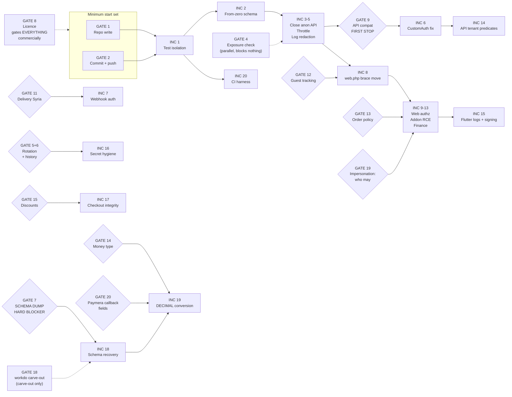

# 07 — Owner Approval Gates, Open Inputs and the Minimum Start Set

## How to read this document

Phase 1A produced a 20-increment implementation sequence. This document is the other half of it: the
set of decisions and accesses that only the owner can supply, and without which specific increments
cannot be started — or worse, could be started and would then do damage.

Three things are worth knowing before the table.

**First, the sequence was deliberately built so that most of it does not wait.** Increments 1 through
17 — which include every P0 authentication and authorization fix — need **no production access and no
database knowledge**. Only the schema recovery (increment 18) and the money-column conversion
(increment 19) are genuinely gated on production data. That was an explicit design goal, and one
Phase 1A finding is what made it achievable: `app/Observers/OrderObserver.php:13-21` wraps the
financial write in `catch (\Exception $e) { \Log::error(...) }`, and `QueryException` descends from
`\Exception`, so a missing `store_wallets` table does **not** block `Order::create()`. Re-read and
confirmed here. Order creation needs only five nullable, `hasColumn`-guarded columns that are
unambiguous from code, not the owner-gated dump.

**Second, the gate list is not a wish list.** Each entry below exists because an engineer stopped at
it rather than guessing. Where a guess would have been cheap and wrong — the Paymera amount unit, the
production column types, whether an unseen storefront app consumes the guest endpoints — the gate is
the honest output.

**Third, the smallest useful approval is very small.** Part 3 isolates it: increment 1 needs exactly
two authorizations and touches no application code. It should not wait behind anything else in this
document.

Vocabularies used exactly as defined: status **VERIFIED / PARTIAL / MISSING / UNKNOWN / BLOCKED**;
severity **CRITICAL / HIGH / MEDIUM / LOW**; priority **P0 / P1 / P2 / P3**.



---

# Part 1 — Gates

## 1.1 Master index

**Urgency key.** **BLOCKING NOW** = Phase 1 cannot start without it. **BEFORE INC n** = work proceeds
up to increment *n* and then stops. **PARALLEL** = owner-side work that blocks no code. **BEFORE
PILOT** = must be settled before a real merchant or real money touches the system.

| # | Gate | Blocks | R9 letter | Phase 0 ref | Who must supply it | Urgency |
|---|---|---|---|---|---|---|
| **1** | Authorization to modify the repositories at all in Phase 1 | Everything | — | D-13 | Owner | **BLOCKING NOW** |
| **2** | Authorization to commit and push; branch/PR workflow; an explicit end to editing on the server | Everything | — | D-13 | Owner | **BLOCKING NOW** |
| **3** | Production posture and containment: is the platform live with real merchants, and freeze / mitigate / continue? | Sequencing of 3-14 | — | D-00, D-14 | Owner | **BLOCKING NOW** |
| **4** | Exposure verification: is the host internet-reachable, is `/.git/` served, does the database hold real rows? | Nothing — but re-prioritises 16 | GATE 0 | M-01, M-02, M-03 | Owner / host | **PARALLEL** |
| **5** | Credential rotation: authorization, ordering, and an outage window | INC 16 | GATE E.1 | D-11 | Owner (one named person) | **BEFORE INC 16** |
| **6** | Git-history purge: accept history + rotate, or rewrite | INC 16 | GATE E.2 | D-11 | Owner | **BEFORE INC 16** |
| **7** | Production schema-only dump + read-only census — **the hardest blocker** | INC 18, 19 | GATE F | M-05 | Owner / DBA | **BEFORE INC 18** |
| **8** | WorkDo / Envato licence and SaaS resale rights | Everything, commercially | — | D-01 | Owner | **BLOCKING NOW** |
| **9** | API authentication compatibility strategy, and who consumes `place-order-guest` | INC 6 | GATE A | D-06, D-07 | Owner | **BEFORE INC 6** |
| **10** | Is a customer-facing shopper app in scope? (none exists today) | Scope of 6, 14; API lock-down plan | GATE A.1 | D-07 | Owner | **BEFORE INC 6** |
| **11** | Delivery Syria webhook: does the provider already send the platform header and per-store secret? | INC 7 | GATE B | D-16, M-09 | Owner + Delivery Syria | **BEFORE INC 7** |
| **12** | Is guest order tracking / receipt-by-link a real customer flow? | Scope of INC 8 | GATE C | — | Owner | **INSIDE INC 8** |
| **13** | Order policy semantics: the delivery-boy limb, and session-vs-token store resolution | INC 12 | GATE D | — | Owner + engineering | **BEFORE INC 12** |
| **14** | Monetary target type: DECIMAL vs integer minor units; the JSON contract change; Paymera's amount unit | INC 19 | GATE G | D-04, M-09 | Owner + Paymera | **BEFORE INC 19** |
| **15** | Are merchant-declared discounts below the line-item sum a legitimate workflow? | INC 17 | GATE H | — | Owner | **INSIDE INC 17** |
| **16** | Tenant-model classification sign-off: which models are tenant-owned vs platform-global | Any future scope work; informs 14 | STANDING | D-03 | Engineering proposes, owner confirms | **BEFORE PILOT** |
| **17** | Syncfusion commercial licence for the Flutter charts | Nothing technically; blocks app release | — | Dossier 14 | Owner | **BEFORE PILOT** (raise now — procurement lead time) |
| **18** | **NEW.** Authorization to edit `packages/workdo/*` for the increment-18 migration-hygiene carve-out — **a waiver of an absolute owner rule** | The carve-out only; the rest of INC 18 proceeds either way | — | — | Owner | **BEFORE INC 18** |
| **19** | **NEW.** Impersonation closure (`SEC-F6`, now **CONFIRMED / CRITICAL / P0**): who may legitimately impersonate, and whether platform support staff depend on `login-with-admin` today | The **policy predicate** of INC 9 — not the decision to fix it | — | `SEC-F6` | Owner | **BEFORE INC 9** |
| **20** | **NEW.** Paymera **callback** response field names and signature scheme — cited in doc 04 as **GATE G(4)** | The `MONEY-07` callback limb inside INC 19 | GATE G(4) | M-09 | Owner + Paymera | **BEFORE INC 19** |

---

## 1.2 GATE 1 — Authorization to modify the repositories at all in Phase 1

| Field | Content |
|---|---|
| **What it is** | Phase 0 and Phase 1A were both strictly read-only. Nothing in the 20-increment plan can be executed without write access to the two checkouts. |
| **Blocks** | Everything. There is no increment that does not write a file. |
| **Decision required** | A yes, plus the scope of it: both repositories, or repo-A only? |
| **Who** | Owner. |
| **Status of the premise** | **VERIFIED.** Both trees are clean at the baseline HEADs: repo-A `41fe2f68` on `claude/pensive-cerf-h6rizn` with only the untracked `docs/development/` this phase wrote; repo-B `d745ec08`, `git status --short` empty. So application code is byte-identical to what Phase 0 audited, and the revalidation above is about correctness of the findings, not drift. |

**Options.**

- **(a) Full write access to both repositories.** The plan assumes this. Repo-B is needed for increment
  15 (delete the credential logging at `repo-B lib/core/controller/auth/auth_controller.dart:152` and
  `repo-B lib/main.dart:47`, and the release signing at
  `repo-B android/app/build.gradle.kts:41` — re-read here:
  `signingConfig = signingConfigs.getByName("debug")`) and for the one forced app-before-backend
  change in increment 19.
- **(b) Repo-A only.** Workable for increments 1-14 and 16-20. It leaves the merchant's plaintext
  password being written to the device log on every login attempt, and leaves release builds
  unsignable — so no beta can be distributed. Not recommended, but it does not stop the server-side
  P0 work.
- **(c) Read-only continues.** Then Phase 1 does not happen.

**Recommendation: (a).** And the narrow sub-question worth answering in the same breath: the plan
writes only into `docs/development/phase-1/` until a gate opens, so (a) costs nothing to grant early.

**Cost of delay.** Total. Every hour of delay is an hour in which `app/Http/Middleware/CustomAuth.php`
remains the only gate on 189 route declarations (`grep -c "custom\.auth" routes/api.php` = 189,
re-run here) and never compares the token secret.

---

## 1.3 GATE 2 — Authorization to commit and push, the workflow, and an end to editing on the server

| Field | Content |
|---|---|
| **What it is** | Separate from Gate 1 on purpose. Write access to a working tree is not the same as authority to commit to a branch and push it, and the current practice makes the distinction matter. |
| **Blocks** | Everything, operationally. Increment 1 is reviewable only as a commit. |
| **Decision required** | (i) May we commit and push to `claude/pensive-cerf-h6rizn`, or to a new branch per increment? (ii) Who reviews and merges? (iii) Is server-side editing of the deployed code going to stop? |
| **Who** | Owner. |

**Why (iii) is part of the gate and not a nicety.** Commit `f33e8525` is titled *"Update: Controllers,
DataTables and Helper adjustments ON SERVER"*. A server-side edit can silently diverge from git, and
once Phase 1 starts committing fixes, a divergent server means a fix can be reviewed, merged and then
overwritten by a deploy that carries older code. It also means a `.git` directory probably exists in
the document root — which is Gate 4's most severe check. That inference is from a commit message, not
a fact; it is flagged as such.

**Options.**

- **(a) Branch-per-increment + PR review + a minimal CI gate.** Increment 20 builds exactly that CI:
  `composer validate --strict`, `php -l` on changed files only, a `.env must not be tracked` guard, a
  `phpunit.xml must force sqlite` guard, and a secret scan. Note `.gitattributes:9` already contains
  `/.github export-ignore` — the upstream skeleton anticipated a `.github/` that was never created, so
  increment 20 restores an expected structure rather than inventing one.
- **(b) Push to a fork; the owner merges.** Slower, keeps control, acceptable.
- **(c) Owner applies patches by hand.** Highest-fidelity control, and the slowest; also the easiest
  way to lose the `force="true"` attribute or a `hasColumn` guard in transcription.

**Recommendation: (a).** Two of increment 20's CI guards should be **lifted forward into increment 1**
as standalone checks, because the repository **fails both today** and a CI that passes against the
current tree would be worthless: `.env` is tracked (`git ls-files .env` → `.env`, exit 0) and
`phpunit.xml:25-26` are both commented out (re-read: `<!-- <env name="DB_CONNECTION" value="sqlite"/> -->`
and `<!-- <env name="DB_DATABASE" value=":memory:"/> -->`).

**Cost of delay.** Same as Gate 1.

---

## 1.4 GATE 3 — Production posture and containment

| Field | Content |
|---|---|
| **What it is** | The owner has stated Store Syria *"is still under development and has not launched commercially with real merchants and customers."* That statement is treated throughout Phase 1A as **reducing urgency**, and explicitly **not** as evidence that the deployment is unreachable, data-free or credential-free — because the owner asked for those to be verified separately and we are BLOCKED from verifying them. |
| **Blocks** | The ordering of increments 3-14. It does not block increments 1-2. |
| **Decision required** | (i) Does a live deployment exist, and does it hold real merchant or customer rows? (ii) If yes: freeze, mitigate-then-fix, or continue unmitigated? |
| **Who** | Owner. |

**What is at stake in the answer.** If the deployment is live and internet-reachable, then on the code
as committed at `41fe2f68`:

- seven admin list endpoints are anonymously readable across every tenant — `routes/api.php:163-169`,
  re-read here, each carrying only `->middleware(['AdminApiLog'])` while their immediate neighbours at
  `:161-162` and `:171-173` all carry `custom.auth`;
- two order-note **write** endpoints carry no middleware at all — `routes/api.php:203-211`, re-read,
  with no `->middleware()` call on either registration;
- an anonymous caller can set `payment_status` to an arbitrary string on any order in any store, via
  `routes/web.php:950` → `app/Http/Controllers/OrderController.php:556-564`.

**Options.**

- **(a) Freeze / maintenance mode until the increment 3-14 block lands.** Safest. Costs whatever
  revenue and goodwill exist today — which, per the owner's statement, may be none, in which case this
  is nearly free.
- **(b) Keep running with emergency mitigations first.** The cheapest real mitigations, in order: move
  the document root to `public/` (one field in the hosting panel, no code change); deny the seven
  endpoints at the web-server layer; rotate credentials. Then the real fixes.
- **(c) Continue unmitigated.** Not defensible now that the defects are documented.

**Recommendation: (b) if real merchants exist; (a) if they do not.** Either way, Gate 4's checks run
first because they take minutes and they decide which of (a) and (b) applies.

**Cost of delay.** If the platform is live, every day of delay is a day of anonymous cross-tenant read
and write exposure. If it is not live, the cost of delay is only schedule.

---

## 1.5 GATE 4 — Exposure verification (PARALLEL; blocks no code)

| Field | Content |
|---|---|
| **What it is** | The one gate that is pure information gathering, costs minutes, and changes the severity of more findings than anything else in the plan. It runs **alongside increment 1** and blocks nothing. |
| **Blocks** | Nothing. It re-prioritises increment 16 (secret hygiene) and may promote it ahead of increment 3. |
| **Access required** | Five `curl` calls from a machine **outside** the hosting account, one hosting-panel lookup, and one read-only `SELECT COUNT(*)`. |
| **Who** | Owner, or the host. |
| **Status** | **BLOCKED here, and BLOCKED is not a pass.** Re-verified in this container: `curl -s -o /dev/null -w "%{http_code}" https://storesyria.com` → `000`, and `getent hosts storesyria.com` → no resolution. No attempt was made to reach the deployed site and **nothing is asserted about it.** |

**The checks, in priority order.** Run them from outside the hosting network — from the server itself,
loopback would hide the very exposure being tested. All are read-only.

| # | Check | What a `200` means |
|---|---|---|
| 1 | `curl -I https://<host>/.git/HEAD` and `/.git/config` and `/.git/index` | **The severe one.** A readable `.git` lets anyone reconstruct the entire repository including every historical commit. `.env` is committed at `3c39c160` (`git log --oneline -- .env` → `3c39c160 Initial commit 98`, re-run here and it is the only commit touching `.env`), so `git show 3c39c160:.env` yields `APP_KEY`, the full database credential set and the Reverb and Firebase values — **even if check 2 returns 403**, because the only `.env` guard covers the path `/.env` and not `/.git/`. There is no `.git` rule anywhere in either `.htaccess`. Treat a 200 here as total compromise of every variable in the inventory. |
| 2 | `curl -I https://<host>/.env` | Full credential compromise. Treat as an active incident and start rotation immediately. A 403 means the guard works **today** — note it is nested inside `<IfModule mod_rewrite.c>` at `.htaccess:1`, so it silently disappears if that module is unloaded. |
| 3 | Hosting panel → **Document Root** for the domain | If it is the application root rather than `public/`, then `.env`, `.git/`, `config/`, `app/` and `vendor/` are all inside the served tree. **This single answer changes the severity of more findings than any other check.** Corroborating evidence that it is the app root: a tracked root `.htaccess`, a tracked root `index.php`, and `.htaccess:36` mapping nine asset prefixes *into* `public/`. |
| 4 | `curl -I https://<host>/composer.lock` and `/error_log` | A 200 confirms the app-root document root and hands over an exact dependency inventory. Reconnaissance, not credentials. |
| 5 | `GET https://<host>/api/admin/orderlist?store_id=1` **from mobile data, not the office network** | If it returns order data, treat it as a **live data breach** — the owner's "not launched commercially" statement covers merchants, not host exposure. |
| 6 | `SELECT COUNT(*)` on `customers`, `orders`, `order_billing_details`, `personal_access_tokens` | **Counts only, never a dump.** If `personal_access_tokens` has rows, the token-id forgery is live-exploitable against those exact ids. If `customers`/`orders` are empty, every cross-tenant finding drops in urgency — but not in severity. |
| 7 | Web-server access logs for `GET /api/admin/orderlist`, `GET /api/admin/productlist`, `POST /api/admin/orders/notes/create` | Those three need no token at all, so a hit is evidence of **access**, not merely scanning. |

**Recommendation.** Run checks 1, 3 and 6 today. They are the three that reorder the plan.

**Cost of delay.** Low in schedule terms, high in information terms: until check 1 is answered, the
rotation in Gate 5 is being planned without knowing whether it is routine hygiene or incident
response.

---

## 1.6 GATE 5 — Credential rotation: authorization, ordering, and an outage window

| Field | Content |
|---|---|
| **What it is** | `.env` is committed at `3c39c160` **and still tracked at HEAD**, and `.gitignore` does not mention it (verified: lines 1-5 are `/public/uploads/`, `/storage/app/public/`, `/vendor/`, `/storage/logs/*.log`, `/storage/` — no `.env` entry). Four integration credential literals sit in `config/`. Rotation is the only step that actually stops the bleeding; the code half is trivial. **SUPERSESSION — `APP_KEY` is no longer merely hygienic.** Earlier drafts of this gate treated `APP_KEY` (`.env:3`, populated, committed in `3c39c160 Initial commit 98` — re-confirmed with `git log --oneline -- .env` and a populated-value check that printed **no value and no length**) as the lowest-urgency rotation, because it only protects data at rest. **That is corrected here: it is an ACTIVE EXPLOITATION PRIMITIVE.** It is what defeats the `decrypt($id)` at `app/Http/Controllers/StoreController.php:718`, the only thing resembling a control on the impersonation route at `routes/web.php:766` — link 3 of the platform-takeover chain in **§1.20 GATE 19**. Two consequences: (1) the rotation's **urgency** rises — it is a live link in a CRITICAL / P0 chain, not merely data at rest; (2) **rotation is NOT the fix and must not be sold as one** — the encrypted-column prerequisite below still binds, so `APP_KEY` stays **ordered last**, which is acceptable only because the hole is closed by the **authorization** change in increment 9, which needs no key, no rotation and no outage window. Rotating narrows one attack *path* (forging an encrypted id); it does not close the hole, because any caller holding an authenticated session of their own still satisfies the sole check, `auth()->check()` at `:719`. **Sequence the authorization fix and the rotation independently of each other; neither waits for the other.** |
| **Blocks** | Increment 16. |
| **Decision required** | (i) Authorization to rotate. (ii) **One named person with rotation authority.** (iii) A maintenance window for the database-credential step. (iv) Three determinations only the owner can make — below. |
| **Who** | Owner. |

**The inventory, named without values.** Per the absolute no-disclosure rule, no value or length is
recorded anywhere. Populated and verified by an `awk` pass that printed only names:
`APP_KEY` (`.env:3`), `DB_HOST`/`DB_PORT`/`DB_DATABASE`/`DB_USERNAME`/`DB_PASSWORD` (`.env:9-13`),
`REVERB_APP_ID`/`REVERB_APP_KEY`/`REVERB_APP_SECRET` (`.env:36-38`), `FIREBASE_PROJECT_ID` and
`FIREBASE_CREDENTIALS` (`.env:51-52`). Hardcoded in config: `zid.client_secret`
(`config/services.php:31`), `zid.hook_pass` (`:34`), `deliverysyria.api_key` (`:44`),
`myfatoorah.api_key` (`config/myfatoorah.php:10`), plus a fifth literal in a controller at
`app/Http/Controllers/PaymentWallPaymentController.php:119`. Two different counting methods give
different populated/empty splits for `.env` (R8 recorded 32 populated / 8 empty treating the literal
`null` at `.env:22` and `:28-30` as empty; a plain non-empty-string count gives 38/3). The split does
not matter: every database, `APP_KEY`, Reverb and Firebase variable is populated.

**Three determinations only the owner can make, before the order is fixed.**

1. **Is `FIREBASE_CREDENTIALS` (`.env:52`) a filesystem path, or inline service-account JSON?** We did
   not inspect the value. If it is inline JSON it is a **CRITICAL** secret with full Admin SDK
   authority — arbitrary push to every customer device, read/write of Firestore, minting custom auth
   tokens — committed at `3c39c160`, and it moves to the **front** of the rotation order, above the
   database. The owner can settle this in one look without telling us what it says.
2. **Are `deliverysyria.api_key` (`config/services.php:44`) and the Paymentwall literal
   (`PaymentWallPaymentController.php:119`) live credentials or stubs?** Both are placeholder-shaped,
   which is an inference from *shape*, not a confirmation.
3. **Where are the existing BackupRestore archives?** `storage/uploads/Files_Backup` and
   `.../Database_Backup`. Each one contains a **pre-rotation `.env` and a full `.git` copy** —
   `packages/workdo/BackupRestore/src/app/Http/Controllers/BackupRestoreController.php:93-95` zips
   `base_path()` with only an extension-`zip` exclusion, written `0777`. **Rotation is not complete
   until those archives are securely deleted**, because an old archive re-exposes everything just
   rotated.

**Ordering, which is the actual deliverable.** Step 0: take a verified, **test-restored** database
backup first — the BackupRestore module has no restore function at all, so this must be done by hand.
Then: (1) the no-coordination rotations — Zid client secret, Zid hook password, the Reverb triple
(which requires a frontend asset rebuild because the key compiles into JS), Redis; (2) the database
credentials, **grant-first**: create a new MySQL user with an identical grant set, update the server
`.env`, `php artisan config:clear`, restart PHP-FPM and every queue worker, verify, *then* drop the old
user — downtime limited to the restart, and a rollback remains available; (3) `APP_KEY` **last**.

**The one warning that must not be lost.** `php artisan key:generate` makes **every value encrypted
with the old key permanently unreadable** — any `encrypted` cast column, any `Crypt::encryptString()`
payload, any encrypted queue payload in flight. The enumeration of which columns in this schema are
encrypted is **UNKNOWN** and is a hard prerequisite. Do not run `key:generate` until someone has
grepped for `'encrypted'` casts and `Crypt::` usage across `app/`, `packages/` and `themes/` and
planned a re-encryption path for whatever is found.

**Recommendation.** Answer determination 1 within 24 hours. Name one person. Rotate `zid.hook_pass`
first among the third-party secrets — it authenticates **inbound** calls, so possession lets an
attacker forge Zid webhook deliveries.

**Cost of delay.** If Gate 4 check 1 returns 200, every populated credential must be presumed known to
third parties and the delay is measured in exposure, not schedule.

---

## 1.7 GATE 6 — The git-history purge decision

| Field | Content |
|---|---|
| **What it is** | `.env` is reachable from commit `3c39c160` forever unless history is rewritten. Adding `.env` to `.gitignore` neither removes it from history **nor stops it being committed** — `.gitignore` is consulted only for *untracked* paths, so a tracked path keeps being staged until `git rm --cached` runs. |
| **Blocks** | Increment 16's scope. |
| **Decision required** | Accept history and rely on complete rotation, or rewrite. |
| **Who** | Owner. **Nothing here is to be executed without explicit written authorization.** |

**Options.**

- **(a) Accept the history; rely on COMPLETE rotation.** Costs nothing operationally. The old secrets
  stay readable forever, so security rests entirely on the rotation being complete — including
  `APP_KEY`, or every historical cookie and `Crypt::` payload stays decryptable.
- **(b) `git filter-repo --invert-paths --path .env`** (preferred over BFG). Consequences, stated
  plainly: every commit SHA from `3c39c160` forward changes, so **every existing clone becomes
  permanently divergent and must be re-cloned** (a pull will not reconcile it); **every open PR breaks**
  because its base and head commits cease to exist; the Phase 1A baseline SHAs and every `path:line`
  citation in the 13 Phase 0 documents in `docs/discovery/` point at commits that no longer exist; any
  CI cache, deploy marker or SHA-keyed tag is invalidated; and the force-push must be coordinated or
  someone pushes the old history straight back. **And it still does not make the secret unknown** —
  forks, existing clones, local reflogs and any server-side `.git` retain the blob.

**Recommendation: (a) for now, revisit at the end of Phase 1.** A rewrite is not a substitute for
rotation, and it buys reduced casual discovery at the cost of invalidating the entire evidence base
that Phase 1 is being built on. Revisit before any external contributor or public mirror exists, when
invalidating clones costs nothing.

**Cost of delay.** None, provided Gate 5 proceeds. Deferring (b) is cheap; deferring rotation is not.

---

## 1.8 GATE 7 — Production schema-only dump and read-only census — **THE HARDEST BLOCKER**

| Field | Content |
|---|---|
| **What it is** | Fifteen tables that live, routed code reads and writes are created by **no migration anywhere** in either repository. Six of them are money-bearing. Their column types, nullability, defaults, indexes and foreign keys are not derivable from the code, so the recovery migrations cannot be written. |
| **Blocks** | Increments 18 and 19 — schema recovery and the money-column conversion — and every assertion about wallet balances or `store_order_financials`. It gates all structural work downstream of those. |
| **Access required** | A **schema-only** `mysqldump`, taken from a **restored copy of a backup**, never from the live host, plus three read-only census queries. |
| **Who** | Owner, or whoever administers the production database. |
| **Status** | **BLOCKED.** No database is reachable from this container, and the Phase 1A mandate forbids any command that boots the app against a database. |

**Verified here, independently.** For each of the seven highest-value names,
`grep -rl "Schema::create('<t>'" database/migrations packages/workdo/*/src/database/migrations` returns
**zero** creators: `store_wallets`, `store_wallet_transactions`, `store_withdrawals`,
`store_order_financials`, `currency_rates`, `audit_logs`, `zid_stores`. The full set is fifteen, also
including `delivery_earnings`, `otp_integrations`, `chatwoot_integrations`,
`chatwoot_notification_templates`, `delivery_boy_devices`, `delivery_boy_notifications`, `zid_orders`
and `zid_events`.

**Why `$fillable` is not a substitute.** It omits indexes, types, nullability and foreign keys, and
`store_wallets` holds decimal balances whose precision must be exact. Hand-writing from `$fillable`
would guarantee a silent divergence from production — which is the opposite of what this work exists
to close.

**Exactly what is needed.**

```
mysqldump --no-data --routines --triggers \
          --single-transaction --skip-lock-tables \
          -h <host> -u <readonly_user> -p <DATABASE> > storesyria-schema-$(date +%F).sql
```

`--no-data` is what makes it safe: **DDL only, zero customer rows.** Use a read-only MySQL account,
never the application's own credentials. Plus, as the cross-checks:

- `SHOW CREATE TABLE` for each of the fifteen;
- `SHOW COLUMNS FROM users LIKE 'plan_id'` — this one is a reproducibility trap. Re-read here,
  `database/migrations/2014_10_12_000000_create_users_table.php:28-34` is
  `if (Schema::hasTable('plans')) { $table->unsignedBigInteger('plan_id')->nullable(); $table->foreign(...) } else { $table->string('plan_id')->nullable(); }`. That migration sorts **first**, and `plans` is
  created far later, so a from-zero build always takes the `else` branch and produces **VARCHAR with no
  foreign key**, while production almost certainly has **BIGINT UNSIGNED with an FK**. If this is not
  anticipated it will be dismissed as noise in the verification diff;
- `SHOW COLUMNS FROM orders LIKE 'currency%'`, `SHOW COLUMNS FROM customers LIKE 'deleted_at'`,
  `SHOW COLUMNS FROM users LIKE 'deliverysyria%'`, `SHOW COLUMNS FROM products LIKE 'cost_price'`;
- the money-type census: `SELECT TABLE_NAME, COLUMN_NAME, COLUMN_TYPE, NUMERIC_PRECISION, NUMERIC_SCALE
  FROM information_schema.COLUMNS WHERE TABLE_SCHEMA = DATABASE() AND DATA_TYPE IN
  ('float','double','decimal')`. **The decisive cell is `orders.final_price`.** If it reads
  `double(8,2)`, **stop and deploy nothing**: the ceiling is 999999.99 and `config/database.php:55` sets
  `'strict' => false`, so every order above that has been silently clamped, and that is a live
  data-loss incident to be handled before any conversion;
- a NULL census, `SELECT COUNT(*) FROM <t> WHERE store_id IS NULL` across the 56 `store_id` tables;
- `SELECT DISTINCT type FROM users` and `SELECT id,name,store_id FROM roles` — to size whether
  `app/Http/Controllers/RoleController.php:182-183` has already run in anger. Any `type` outside
  `{'super admin','admin','customer'}`, or more than one global `admin` role, is evidence of prior
  exploitation.

**Handling warning.** Even a schema-only dump is sensitive. Column names disclose the integration
surface (`zid_stores.access_token`, `users.deliverysyria_secret`), and `--routines --triggers` can embed
credentials in `DEFINER` clauses. Grep it for `DEFINER=` and `IDENTIFIED BY` before sharing it even
internally; move it over a private channel; keep it out of git; delete it when the plan is done. **Do
not paste it into a chat or an issue tracker.**

**One warning the owner must hear before authorising increment 18.** This migration makes features that
currently fail **silently** start working. Because `OrderObserver.php:15-20` swallows the
`QueryException`, orders save today and all financial tracking no-ops. Afterwards the merchant wallet
begins to be credited. Phase 0 reports a hardcoded `payment_status = 'Paid'` at
`app/Services/PaymentService.php:2280` (an adjacent lane, **not re-verified in Phase 1A**); if that is
correct it must be fixed before or with the schema migration, or COD and bank-transfer orders will
credit merchant wallets against cash never collected. **Shipping the schema fix alone could convert a
silent no-op into real incorrect payouts.**

**Options.**

- **(a) Schema-only dump from a restored backup copy.** Recommended. Safe, complete, one hour of DBA
  time.
- **(b) Read-only database credentials for an engineer.** Faster to iterate, but it puts production
  access in the remediation loop, which is a larger decision than the dump.
- **(c) Proceed without it** — write the fifteen migrations from `$fillable`. **Rejected.** It produces
  a schema that diverges from production in types and constraints, and the divergence would be silent.

**Recommendation: (a).** And note the schedule consequence honestly: this gate costs about an hour of
DBA time and unblocks roughly 7 engineer-days of work that cannot start any other way.

**Cost of delay.** Increments 18 and 19 simply do not start. Increments 1-17 proceed regardless — that
is the single most useful property of the sequence.

---

## 1.9 GATE 8 — WorkDo / Envato licence and SaaS resale rights

| Field | Content |
|---|---|
| **What it is** | `config/verification.php:4-5` records `'system' => 'EcommerceGo SaaS'` and `'system_version' => '8.8.2'` — re-read here. Nothing else in either tree records provenance: a grep for `envato` or `codecanyon` across `composer.json`, `config/` and `app/` returns zero files, and there is no `LICENSE` file at the repository root. `composer.json` carries Laravel's own MIT licence, which is not the product's. |
| **Blocks** | Everything, commercially rather than technically. |
| **Decision required** | Which licence tier was purchased, and does it permit multi-tenant SaaS where end users pay? In writing. |
| **Who** | Owner, from the CodeCanyon purchase record. |

**Options.** (a) Confirm an Extended-class entitlement and proceed — cheapest, but it must be in
writing. (b) Buy up to the correct tier now — small cost, removes the risk permanently. (c)
Re-platform onto an open-source base — removes licence risk but discards the working feature set and
restarts Phase 0, and directly contradicts the owner's evolve-do-not-rebuild principle.

**Recommendation: (a) or (b), decided in writing before any Phase 1 work order is signed.** This is
the only item in the whole programme that engineering cannot fix. If resale is not permitted, every
hour spent remediating the WorkDo core is spent on an asset that may not be operable.

**Cost of delay.** Unquantifiable and asymmetric: the work is not wasted if the answer is yes, and
entirely wasted if the answer turns out to be no after the fact. Also note the original 8.8.2 package
is, after the licence, the single most useful artefact the owner can supply — it is the only way to
tell which of the 69 addon modules (`ls -d packages/workdo/*/ | wc -l` = 69, re-run here) are pristine
and therefore upgradeable.

---

## 1.10 GATE 9 — API authentication compatibility strategy — **THE FIRST MATERIAL STOP**

| Field | Content |
|---|---|
| **What it is** | Increment 6 fixes `app/Http/Middleware/CustomAuth.php` so that the middleware on 189 route declarations actually authenticates. Two decisions must be made before it ships. |
| **Blocks** | Increment 6, and therefore increment 14. Increments 1-5 should be executed and reviewed **before** this conversation. |
| **Decision required** | (i) Who consumes `POST /api/{slug}/place-order-guest`? (ii) Reject-mode immediately, or one log-only canary release? |
| **Who** | Owner. |

**The good news first, because it reframes the decision.** **No app release is required and no app
change is needed.** Verified end to end: the app stores `userData['token']` verbatim
(`repo-B lib/core/controller/auth/auth_controller.dart:171,179`); that value is
`createToken('auth_token')->plainTextToken` from
`app/Http/Controllers/Api/DashboardController.php:585`, i.e. Sanctum's standard `{id}|{40-char}`
format; the app sends it as `Bearer $token` on every authenticated call
(`repo-B lib/network/network.dart:60`, via `_getAuthHeaders()` at `:55-65`);
`PersonalAccessToken::findToken()` consumes exactly that format and the `token` column already holds
the sha256 of the secret the app is still holding. **Already-issued tokens keep working.** No forced
re-login, no shim, no store release. The backend ships first and alone.

**Decision (i): the `place-order-guest` consumer.** Strong evidence that closing the pass-through
*aligns* the server with its own published contract:
`packages/workdo/Api/src/documentation/theme.json` documents 79 endpoints, 77 of which declare an
`Authorization: Bearer {id}|{secret}` header — **including all 11 documented `*-guest` endpoints**. The
only two token-free ones are customer register and customer login, which are exactly the two routes
that carry no `custom.auth`. The documented contract and the route table agree, so `*-guest` means "no
customer *account* required", not "no token required". That answers the question item [1] left open:
**do not drop `custom.auth` from the guest routes.**

The residual risk is one route. `routes/api.php:105` is
`Route::post('{slug}/place-order-guest', [ApiController::class, 'place_order'])->middleware(['custom.auth','APILog']);`
— re-read here — and it is the **one** guest route absent from the documentation. Separately,
`resources/views/AppSetting/mobile_content.blade.php:106` renders
`<input type="text" value="{{ url('/api/' . $slug) }}" id="AppInput"` — the admin UI hands merchants an
`/api/{slug}` base URL for a **customer-facing storefront app that is not in this repo pair**. The
owner must say whether that app exists, who built it, and whether it sends a token.

**Decision (ii): reject-mode or canary.**

- **(a) Reject-mode directly.** Recommended, given the pre-launch status.
- **(b) One log-only canary release.** Ship the full verification but log-and-pass for one release,
  distinguishing *no header* (might break a client) from *wrong secret* (forgery — reject immediately
  even in canary mode), then flip one boolean. **If the canary is used, increment 5 must have landed
  first**, or the canary's own log lines become a second token-disclosure channel.
- **(c) Dual-format acceptance** — accept a bare `{id}` "during a transition". **Must be refused.** That
  IS the vulnerability; a transition window that keeps it open is a window in which the platform is
  still trivially forgeable.

**Recommendation: (a), with (b) available if the answer to (i) reveals an unknown storefront client.**

**The compatibility note for the release notes, verbatim.** *"API endpoints now reject requests that
present no bearer token, or a token whose secret does not verify. Requests that previously succeeded
un-authenticated will receive HTTP 401. This is an intentional security fix and matches the published
API documentation, which already specifies an `Authorization: Bearer {id}|{secret}` header on every
endpoint except customer register and customer login."*

**Cost of delay.** High. `grep -n "sanctum" config/auth.php` returns nothing (exit 1, re-run here), so
`config/auth.php` defines only three session guards and the alternative "just use `auth:sanctum`" fix
is not available — this one-file fix is the whole remedy, and until it lands, `Bearer <small integer>`
authenticates as the owner of that token row on 189 routes.

---

## 1.11 GATE 10 — Is a customer-facing shopper app in scope?

| Field | Content |
|---|---|
| **What it is** | No customer app exists in either repository — repo-B is the **merchant** console. Yet repo-A's API carries 81 `{slug}/…` routes shaped for exactly such a client, and the admin UI hands merchants the base URL for one (`resources/views/AppSetting/mobile_content.blade.php:106`). |
| **Blocks** | The scope of increments 6 and 14, and the API lock-down plan. Overlaps Gate 9(i). |
| **Decision required** | (a) no customer app, (b) build one later, or (c) **one already exists and was not provided**. |
| **Who** | Owner. |

**Recommendation: (a) for twelve months.** Fix the storefront — three Blade themes exist — and
revisit. Verified supporting fact: a `grep -rln` for all 12 guest endpoint strings across the whole
non-vendor tree returns exactly two files, `routes/api.php` and the WorkDo API documentation JSON. The
three themes (`themes/greentic`, `themes/stylique`, `themes/techzonix`) contain **zero** references, so
the Blade storefront does not consume these routes and cannot be broken by closing the gate.

**Tell us immediately if (c) is true.** It changes the API lock-down plan, because closing the
unauthenticated endpoints would break an app nobody in this programme has ever seen. This is the single
highest-value five-word answer in the document.

**Cost of delay.** Low if the answer is (a) or (b); potentially an outage if it is (c) and the answer
arrives after increment 6 ships.

---

## 1.12 GATE 11 — Delivery Syria webhook confirmation

| Field | Content |
|---|---|
| **What it is** | `POST /api/delivery-syria/status` has **no authentication of any kind** and causes an outbound authenticated call to Zid using the merchant's decrypted credentials. Re-read: `routes/api.php:376-379` registers it with no `->middleware()`. Its sibling, `app/Http/Controllers/Api/DeliverySyriaOrderController.php:25-32` and `:157-179`, already does the platform-header check and a `hash_equals` against the per-store secret — correctly. The fix is a copy, not a design. |
| **Blocks** | Increment 7. This is the **only** gate in the plan with an external coordination cost. |
| **Decision required** | Written confirmation from Delivery Syria that their sender already transmits `X-Platform: deliverysyria` and the per-store bearer secret. |
| **Who** | Owner, plus Delivery Syria. |

**Why it is a gate and not an assumption.** The live webhook stops working the moment the guard lands
if the provider does not send those headers. Evidence it probably already does: `routes/api.php:35`
already demands exactly those headers for the sibling orders endpoint, and that integration works. But
that is **inference**, and it must be confirmed with the provider before merge. **Do not ship this
silently.**

**Options.** (a) Confirm first, then ship — recommended. (b) Ship with a dated cutover announced to the
provider. (c) Ship a temporary accept-either mode — rejected for the same reason dual-format token
acceptance is rejected.

**Cost of delay.** Moderate: the endpoint remains anonymously callable, and it moves a real merchant's
order status on an external platform. Also note `routes/api.php:381-384`, the
`zid-statuses-test` debug endpoint, has no such dependency — it is dead code with zero callers in
repo-B and is deleted in increment 3 with no coordination needed.

---

## 1.13 GATE 12 — Is guest order tracking / receipt-by-link a real customer flow?

| Field | Content |
|---|---|
| **What it is** | Increment 8 relocates the `});` at `routes/web.php:938` so that the order and refund mutation endpoints currently sitting outside the `auth` group come inside it. Re-read: `:938` is `});`, and `:940-941` are `contacts.store` and `change.languagestore`, which are genuinely public and must stay outside. |
| **Blocks** | The **scope** of increment 8, not its start. The administrative half moves immediately. |
| **Decision required** | Are `order-view/{id}`, `orders/order_view/{id}`, `order-receipt/{id}`, `order-return` and `order-return-request` reachable by a guest customer by design? |
| **Who** | Owner. |

**Evidence that it is not.** `order_view` is **already** closed to anonymous users by its own
`isAbleTo('Show Order')` check at `app/Http/Controllers/OrderController.php:285`, which fails closed for
a null user. If the customer path depended on it, it would already be broken.

**Options.** (a) Not a real flow — move all of it inside `auth`. (b) It is real — then those routes
must be **re-homed into `routes/customer.php`** (which already exists with its own group) behind
Laravel's `signed` middleware, which is already used once in `routes/web.php`, so the native mechanism
is present. (c) Leave them outside `auth` — rejected; that is the defect.

**Recommendation: (a), with (b) if the owner says receipt-by-link is a shipped feature.** Until
answered, move only the administrative half.

**Cost of delay.** Low. The most severe item in the window — anonymous arbitrary `payment_status`
writes via `routes/web.php:950` → `OrderController.php:556-564` — is unambiguously administrative and
moves in the first pass regardless.

---

## 1.14 GATE 13 — Order policy semantics: the delivery-boy limb and store resolution

| Field | Content |
|---|---|
| **What it is** | Increment 12 adds an `OrderPolicy`. Two legitimate flows would be broken by the naive version of it, and both need an owner/engineering decision rather than a guess. |
| **Blocks** | Increment 12. |
| **Decision required** | (i) Must a delivery boy be able to mark **their own assigned** order delivered? (ii) For API callers, is the tenant the session's store or the **token owner's** store? |
| **Who** | Owner for (i); engineering proposes and owner confirms (ii). |

**Why (ii) is subtle and dangerous.** `getCurrentStore()` is session-derived —
`app/Helper/helper.php:363` reads `auth()->user()` on the default web guard, and the function falls off
the end returning **null** for an anonymous caller. So a policy written as
`$order->store_id === getCurrentStore()` is correct for the Blade admin and **wrong for every Flutter
caller**, where it would compare against a null or wrong store and fail every order action in the
merchant app.

**Recommendation.** (i) Yes — the policy needs an explicit `$order->deliveryboy_id === $actor->id`
limb alongside the store check, or the delivery flow breaks. (ii) Resolve the tenant from the
**authenticated principal**, not the session, for API paths. Both must be checked against
`routes/api.php` and repo-B before shipping.

**Cost of delay.** Low in schedule, high in rework: getting (ii) wrong is the most likely way increment
12 bricks the merchant app, and it would not be caught by any test written against the Blade path.

---

## 1.15 GATE 14 — Monetary target type, the JSON contract change, and Paymera's amount unit

| Field | Content |
|---|---|
| **What it is** | Three decisions bundled because they ship together in increment 19. Verified here: `database/migrations/2024_01_23_061635_create_orders_table.php:22-27` declares all six order money columns as `$table->float(...)->nullable()->default(0)`. |
| **Blocks** | Increment 19. |
| **Decision required** | (i) DECIMAL(18,4), or integer minor units? (ii) Acceptance of the one genuine API-contract change in the plan. (iii) **Paymera's expected amount unit**, from Paymera's own integration document. (iv) **Paymera's CALLBACK response field names and signature scheme** — held as its own gate, **GATE 20** (§1.21), and cited in doc 04 as **GATE G(4)**. Ask Paymera for (iii) and (iv) in the **same** message; they are one request to one provider. |
| **Who** | Owner for (i) and (ii); Paymera, via the owner, for (iii). |

**Decision (i): DECIMAL(18,4) vs integer minor units.**

| Option | For | Against | Verdict |
|---|---|---|---|
| **DECIMAL(18,4)** | Values stay in **major units**, so the semantic meaning at all 2,795 measured occurrences of the money column names across repo-A PHP and Blade is unchanged. The only behavioural delta is that PDO returns a string instead of a float. Scale 4 covers the 3-decimal KWD/BHD/OMR in the seeded 124-currency list; 14 integer digits covers a ten-year SYP aggregate with headroom. | PDO string returns change `===` and `is_float()` behaviour at comparison sites. | **RECOMMENDED** |
| **Integer minor units** | Exact by construction; no decimal arithmetic in the database. | Requires rewriting the meaning of every one of those 2,795 occurrences; the currency table has **no minor-unit exponent column**, and the seeded list includes 0-decimal JPY and 3-decimal KWD, so the exponent cannot be inferred. A half-converted codebase in this shape is a 100x error generator. | **Rejected** |

**Decision (ii): the contract change.** PDO returns DECIMAL as a PHP string, so API money fields change
from **JSON number to JSON string**. This is the **only** genuine API-contract change in the whole
plan and it needs a release note, not a silent deploy. It also creates the **one** forced
app-before-backend ordering anywhere in the programme: `repo-B lib/core/model/order_detail_model.dart:56`
declares `String? finalPrice;` and `:149` does `finalPrice = json['final_price'];` — an unchecked
dynamic assignment (both re-read here) — and those coercions must be made explicit with
`double.tryParse(v.toString())` and **shipped to the store before** the migration lands.

**Decision (iii): the Paymera unit.** `app/Services/PaymentService.php:211` is, re-read verbatim:
`$raw_price = str_replace([' ', ',', '.'], '', str_replace($CURRENCY, '', $cartlist_final_price));`
followed by `$totalprice = (int) $raw_price;` at `:212`. The decimal separator is in the strip list, so
`1250.50` is sent to the gateway as `125050` while `1250` is sent as `1250` — a **100x divergence for
two totals that differ by 0.50**. We did not and must not contact the gateway, so **the expected unit
is UNKNOWN to us.** This is the one fix in the entire programme that cannot be specified end to end
without an owner input, because getting it wrong in one direction undercharges by 100x and in the other
**overcharges by 100x**.

**Also required with (iii).** A dated cutover and a reconciliation of historical Paymera transactions.
Charged amounts will change, and merchants may have been reconciling their books against the current
wrong figures.

**On (iv).** The callback half is a separate security item with its own severity (HIGH / P1) and its own
increment-19 file (`app/Http/Controllers/PaymentController.php`), so it is written up in full at
**§1.21 GATE 20** rather than buried inside this gate's money-type discussion. It is listed here only so
that the owner's single letter to Paymera asks for everything at once.

**Cost of delay.** Increment 19 does not start. Note it already sits behind Gate 7, so this gate rarely
becomes the binding constraint — but (iii) should be requested from Paymera on day one, because
provider correspondence takes longer than engineering.

---

## 1.16 GATE 15 — Are merchant-declared discounts a legitimate workflow?

| Field | Content |
|---|---|
| **What it is** | Increment 17 adds an `OrderTotalReconciler` that rejects a persisted total which does not equal the sum of its components. `app/Http/Controllers/OrderController.php:152` takes `final_price` straight from the request while `:150` hardcodes `'coupon_price' => 0`. |
| **Blocks** | Increment 17's validation rule, not the increment. |
| **Decision required** | May a merchant discount an order by typing a `final_price` below the line-item sum? |
| **Who** | Owner. This is a **product** decision, not a security change. |

**Why it is a gate.** A merchant creating an order in their own store is entitled to set the price they
charge. Blocking the mismatch outright would remove a feature merchants plausibly use. The right shape
is to **accept a declared discount** — recorded in `coupon_price` — and reject only **undeclared**
mismatches. Shipping a bare validation rule here would be a silent feature removal dressed as a
security fix.

**Named prerequisite the owner must have someone complete.** Grep the active themes
(`themes/greentic`, `themes/stylique`, `themes/techzonix`) and `resources/` checkout templates for
`tax_price`, `shipping_final_price`, `total_coupon_amount` and `cartlist_final_price`, and remove those
fields from the form in the **same** change. Phase 1A did not enumerate them, and that enumeration
**must not be assumed empty** — the `prohibited` validation rules will return 422 for any form that
still posts them.

**Cost of delay.** Moderate, and it is the increment that closes the most financially severe defect in
the plan: an anonymous guest can currently post a negative `tax_price` to
`routes/customer.php:150` and both reduce the amount actually charged and corrupt the ledger.

---

## 1.17 GATE 16 — Tenant-model classification sign-off

| Field | Content |
|---|---|
| **What it is** | Engineering proposes which models are tenant-owned and which are platform-global; the owner confirms. A wrong call here **silently breaks working features** — which is precisely why it is a gate and not an engineering decision. |
| **Blocks** | Any future global-scope work. It does **not** block increment 14, which uses explicit per-call-site predicates instead. |
| **Decision required** | Confirmation of the tenant classification, and in particular the five genuinely ambiguous cases below. |
| **Who** | Engineering proposes; owner confirms. |

**Standing constraint, stated first.** The entire tenancy global-scope programme is **deliberately
excluded from Phase 1** and replaced by the explicit predicates of increment 14. It cannot be
reconsidered until one test is green, because of a verified hazard: `grep -rln "Cachable" app/Models/`
returns **78** of **95** models (re-run here), there is no `config/laravel-model-caching.php`, and the
cache store is a shared **file** store. Whether those cache keys include a global scope's constraint
**cannot be verified** — `vendor/genealabs` contains zero `.php` files in this container. **If the keys
omit the scope, enabling a global scope would CREATE a cross-tenant read where none existed.** The
proof obligation is one test: tenant A warms `Product::all()`, tenant B runs the same query, assert B
receives only B's rows — run with the **file** store, not the test default of `array`, because `array`
hides the production failure mode.

**The ambiguous cases requiring an owner answer.**

| Model / table | Why ambiguous | Engineering recommendation |
|---|---|---|
| **`Store`** (`stores`) | It **is** the tenant root; ownership is `stores.created_by`. | Do **not** scope. Give it a `StorePolicy` with `view`/`update`/`switchTo`. The highest-value policy in the system. |
| **`User`** (`users`) | No `store_id`. Membership is `current_store` + `created_by`, and `current_store` is the **mutable** store-switch pointer written with no ownership check. | Do **not** scope — that would be scoping on attacker-controlled state. Add a `UserPolicy` keyed on `creatorId()` (`app/Models/User.php:95-105`). |
| **`CurrencyRate`** (`currency_rates`) | `$fillable` declares `store_id` (`app/Models/CurrencyRate.php:11-18`) but there is **no migration**, and `routes/web.php:154-162` exposes `currency-rates.index` and `currency-rates.update` with **no middleware of any kind**. | **Owner must decide: are FX rates per-store or platform-wide?** If platform-wide, the column is vestigial and those two routes are an unprotected platform-admin surface. Recommendation: **platform-global, admin-only.** Do not scope until decided. |
| **`ZidStore` / `ZidEvent`** | `store_id` is an **external Zid string identifier**, not a foreign key to `stores.id` — `app/Models/ZidEvent.php:44` types the parameter as `string`. | **NEVER scope.** Column-name matching would compare a local integer against an external string and silently return zero rows, stopping the Zid sync with **no error anywhere**. Put them on an explicit DO-NOT-SCOPE list with the reason in the trait docblock. |
| **The order detail children** (`order_billing_details`, `order_coupon_details`, `order_tax_details`), **`MenuItem`** | Tenant-owned **indirectly**, via `order_id` / `menu_id`. No `store_id` column. | Reach them through the parent's scope and an `OrderPolicy`. Adding `store_id` is a schema change — defer past Phase 1. |
| **The four finance/audit models** (`StoreWallet`, `StoreWithdrawal`, `StoreWalletTransaction`, `AuditLog`) | Classified tenant-owned at **MEDIUM/LOW confidence from `$fillable` alone**, because they have no migration. | **Do not scope any of them in Phase 1.** Re-check against real schemas once Gate 7 delivers the dump. |

**Honest statement of uncertainty, carried forward deliberately.** The per-model `store_id` coverage
percentages in the specialist notes come from a **coarse grep heuristic** that over-credits and
under-credits. They are evidence of filtering *density*, not of correctness, and no decision should
rest on them.

**Cost of delay.** None for Phase 1. It is a **BEFORE PILOT** item because a pilot with real merchants
on a shared database should not run on explicit per-call-site predicates alone indefinitely.

---

## 1.18 GATE 17 — Syncfusion commercial licence for the Flutter charts

| Field | Content |
|---|---|
| **What it is** | `repo-B pubspec.yaml:43` declares `syncfusion_flutter_charts: ^34.1.32`. A grep for `SyncfusionLicense` or `registerLicense` across `repo-B lib/` returns **zero** matches (re-run here). The charts are used on the two most-visited merchant screens. |
| **Blocks** | Nothing technically. It blocks a clean app release. |
| **Decision required** | Buy a licence, or replace the two chart usages. |
| **Who** | Owner. |
| **Urgency** | **P1 purely for procurement lead time — weeks, not technical urgency. Raise it today.** |

**Options.** (a) **Buy a licence** and register it once in `repo-B lib/main.dart` before `runApp`,
reading the key from the already-wired `flutter_dotenv` asset — and at that point uncomment the
`.gitignore` entries for it, because a licence key **is** a real secret, unlike the single
`IS_DEMO_MODE` flag that asset currently holds. (b) **Replace** the two usages with `fl_chart` (MIT) or
a `CustomPainter` — confined to two view files, bounded work, and the cheaper answer if the charts are
simple. It changes chart appearance on the merchant dashboard: a visible but cosmetic change worth
flagging rather than shipping silently.

**Recommendation.** Decide now, implement later. Unregistered, the widgets render a licence overlay and
the use itself may be unlicensed — the Community Licence is bounded by revenue and headcount
thresholds a commercial SaaS exceeds.

**Cost of delay.** Procurement lead time lands on the critical path for the first app release if this
is left to the end.

---

## 1.19 GATE 18 — Authorization to edit `packages/workdo/*` for the increment-18 migration-hygiene carve-out

**Why this gate exists: engineering had granted itself an exception to an absolute rule, and that is
withdrawn.** The owner's rule — *`packages/workdo/*` is not edited in Phase 1* — was stated **with no
exceptions**. Doc 06 nevertheless carried a carve-out and presented it as settled rather than as a
request: its compatibility-surface table (row 8, the 69 WorkDo modules) read "none edit
`packages/workdo/*` **except** the two migration-hygiene fixes in increment 18", while the section that
follows (`06 §2.3`) is titled "`packages/workdo/*` is not to be edited in Phase 1 — and why". A document
cannot both hold an absolute rule and quietly carve two files out of it. **The carve-out is NOT APPROVED,
it has NOT been applied, and until this gate is signed the no-edit rule stands without exception.** That
a change is correct, narrow and schema-neutral is an argument for *asking*; it is not a substitute for
asking. **Engineering does not get to waive an absolute owner rule on the owner's behalf.**

| Field | Content |
|---|---|
| **What it is** | Permission to edit one addon migration file under `packages/workdo/` — or two; see decision (ii) — inside increment 18 and nowhere else in Phase 1. |
| **Blocks** | **The carve-out only.** Increment 18's substance (the catch-up migrations and the `users.plan_id` normalisation) does not depend on it, and a refusal delays nothing. |
| **Decision required** | (i) May `packages/workdo/*` be edited for this one purpose? (ii) **One file, or both?** An approval for "the migration fix" is ambiguous and must not be read as covering two modules. |
| **Who** | **The owner. Not engineering, and not doc 06.** |
| **Status of the premise** | **VERIFIED** — both files re-opened line by line while writing this gate. Whether the latent bug has *already* misfired on production is **UNKNOWN / BLOCKED** on GATE 7. |

**What is being requested, exactly.** Two defects, in one file and its byte-identical twin, both
re-read for this gate:

| Defect | Location | What is wrong |
|---|---|---|
| A three-argument `Schema::hasColumn` | `:14` — `if (!Schema::hasColumn('customers','social_id','social_type')) {` | The method takes a table and **one** column (plus an optional connection), so the third positional string is absorbed and ignored and the guard tests **`social_id` only**. In a tree where `social_id` exists but `social_type` does not, `up()` is skipped entirely and `social_type` stays permanently missing. |
| An inverted `down()` guard | `:28` — the byte-identical condition | `down()` drops the two columns only when `hasColumn` reports them **absent** — a guaranteed no-op. The migration cannot be rolled back, and `migrate:rollback` reports success while changing nothing. |

The file is
`packages/workdo/SignInWithFacebook/src/database/migrations/2024_08_30_102330_add_social_type_and_social_id_column_in_customers_table.php`,
and a **byte-identical** copy sits under `SignInWithLinkedIn` at the same basename — re-confirmed here,
both `md5 = f7d40c312d5dba302e071c8a3b1946e2`. **Because the two files are identical, both carry both
defects**, and that is the whole of decision (ii). The proposed change: rename one of the two duplicate
basenames, correct the `hasColumn` call at `:14`, correct the `down()` guard at `:28`.

**The signature claim is labelled honestly.** FRAMEWORK-DOCUMENTED BEHAVIOUR, UNVERIFIED IN THIS
ENVIRONMENT (**BLOCKED**): `vendor/laravel/framework/src` is ABSENT in this container (**E-1**, **E-7**),
so `Schema::hasColumn`'s signature could not be read from vendor source here. What is **VERIFIED**
regardless is the source-level defect — a call site passing three column-shaped arguments while plainly
intending to check two columns is wrong under any signature.

**Why engineering believes it is safe. The owner should weigh these, not inherit them.**

- **The resulting MySQL schema is identical either way.** Only guard correctness and rollback behaviour
  change. No merchant row, no addon screen, no API field and no Flutter parse is affected, and none of
  doc 06's twelve protected compatibility assets moves.
- **The blast radius is two migration files in two addon modules.** No view, route, controller, model or
  service; no change to what either module does at runtime.
- **The duplicate basename is already inert** — the second of two identical basenames is skipped once the
  first is recorded in the `migrations` table — so today's behaviour is schema-neutral too. And the
  `up()` guard is what makes the rename safe: the migration is idempotent for the one column it checks.

**What the owner is being asked to waive.** An absolute rule they stated with no exceptions, whose
reasons (`06 §2.3.4`) are all still true: it preserves the upstream upgrade path for the 69 symlinked
path-repository modules, it keeps the 69-module compatibility surface untouched, and it keeps "did we
change an addon?" answerable with a single `git diff --stat packages/`. **The precedent is the real cost,
not the diff.** Once one file is carved out, the next request is easier to make and harder to refuse.

**The alternative, priced rather than discouraged: leave both files untouched.** The practical impact of
refusing is **LOW**. The truncated guard only misfires in a half-migrated tree (`social_id` present,
`social_type` absent); whether any such tree exists is **UNKNOWN / BLOCKED** on GATE 7 — and it would be
equally blocked if the fix *were* applied. The broken `down()` only matters to a rollback of these two
addon migrations, which no Phase 1 increment performs, and `migrate:rollback` is not a verified rollback
mechanism for this application in any case (`06 §5.3`); the tested pre-deploy backup is the rollback.
**Refusing this gate costs the owner almost nothing, and is a perfectly defensible answer.**

**Recommendation.** **Approve, narrowly, and for BOTH files** — confined to increment 18 and landed as a
separately reviewable commit, because fixing one of two identical files leaves the defect live in the
other while making the next reader believe it was handled. If the owner would rather keep the rule
intact, **refuse: we carry the bug as a documented known defect and nothing else in the plan changes.**
Either answer is correct. What was not correct was proceeding without asking.

**Cost of delay.** **None to the schedule.** Increment 18 proceeds without it; the item simply stays on
the known-defect list. This is the one gate in this document that can be left unanswered indefinitely at
no cost — which is also why it must not be allowed to acquire a silent default.

**Not part of this gate.** The second "migration-hygiene fix" usually listed beside it is not a carve-out
at all: `database/migrations/2023_12_18_101848_create_pixel_fields_table.php:14` is in the **root** tree,
and adding its `if (!Schema::hasTable('pixel_fields'))` guard touches nothing under `packages/workdo/`.
It needs no waiver. Presenting the two in one table is part of what made the old wording read as two
granted exceptions instead of one unapproved request.

---

## 1.20 GATE 19 — Impersonation closure: who may impersonate, and what breaks for platform support

> **SUPERSESSION NOTE, and it is the reason this gate exists.** `SEC-F6` (impersonation) was rated
> **HIGH** by Phase 0 and then marked **REFUTED** by the Phase 1A revalidation note. **BOTH VERDICTS ARE
> WRONG AND ARE SUPERSEDED. The published verdict is now CONFIRMED / CRITICAL / P0.** The refutation
> rested on `grep -rn impersonate routes/*.php` returning no output. That command really does return no
> output — **and the inference drawn from it was false, because the routes are not named "impersonate"**.
> The finding had been written **out of Phase 1** on the strength of that negative grep; it is now in
> **increment 9**, and it needs this gate. Full treatment: `02 §0.1` and `02 §2.10`; implementation:
> `04` Increment 9 and its `SEC-F6` subsection. Two standing lessons, recorded because the failure mode
> is general: **a negative grep proves only that one *string* is absent**, and **an encrypted route
> parameter is never an authorization control** — least of all when the key is in the repository.

| Field | Content |
|---|---|
| **What it is** | Increment 9 closes an unauthenticated-to-platform-root takeover. Closing it necessarily removes an ability that someone may be using today, and the correct replacement predicate is an owner fact, not an engineering guess. |
| **Blocks** | **The policy predicate of increment 9 — NOT the decision to fix.** The fix ships regardless; this gate decides who keeps the ability afterwards. |
| **Decision required** | (i) **Who may legitimately impersonate another account?** (ii) **Does anyone rely on `login-with-admin` today** — platform support staff, the owner personally, a contractor? (iii) Is an auditable record of every impersonation required? |
| **Who** | Owner. |
| **Status of the premise** | **VERIFIED.** Every link below was re-opened while writing this gate. |

**The hole, verified line by line.** `routes/web.php:766` registers
`store/{id}/login-with-admin` → `StoreController::LoginWithAdmin` (route name `login.with.admin`) and
`:767` registers `login-with-admin/exit` → `ExitAdmin`. `StoreController.php:716-723` is, verbatim:

```php
716    public function LoginWithAdmin(Request $request, $id)
717    {
718        $user = User::find(decrypt($id));
719        if ($user && auth()->check()) {
720            Impersonate::take($request->user(), $user);
721            return redirect('dashboard');
722        }
723    }
```

`Impersonate::take()` is at `:720`. **The only authorization present is `auth()->check()` at `:719` —
"is ANYONE logged in", not "may YOU do this".** There is no ownership check, no permission check, no
account-type check and no Policy. `ExitAdmin` (`:725-730`) calls
`Auth::user()->leaveImpersonation($request->user())` at `:727` with no check either.

**The reachability chain, every link verified:**

1. **Self-registration is open.** `routes/auth.php:18` is `Route::post('register', [RegisteredUserController::class, 'store']);`, inside the `['guest','setlocate']` group opened at `routes/auth.php:14`. No authentication.
2. **Registration grants the administrator type.** `app/Http/Controllers/Auth/RegisteredUserController.php:104` is `'type' => 'admin',`, and again at `:184`.
3. **The encryption of the id is not a mitigation.** `decrypt($id)` at `:718` looks like one, but `APP_KEY` (`.env:3`) is **populated and committed** in `3c39c160 Initial commit 98` — re-confirmed with `git log --oneline -- .env` and a populated-value check that printed **no value and no length**. With the key, a valid encrypted payload is forgeable for **any** user id.
4. **Therefore:** anonymous visitor → register → forge an encrypted id → `GET /store/{forged}/login-with-admin` → a full authenticated session as that user, **including the platform super admin**.

**The one piece of evidence that makes the owner's question the right question.** The *user interface*
entry point is already restricted: `StoreController.php:43` gates the stores list on
`auth()->user()->type == 'super admin'`. So the **intended** audience for this feature is the platform
super admin alone — the button simply is not rendered for anyone else. **The route at `:766` carries none
of that restriction**, which makes the UI gate cosmetic. That tells us what the feature was *for*; it
does not tell us who has been *using* it, which is decision (ii).

**Why the predicate cannot be guessed, and this is the whole gate.** The obvious predicate — "allow
account type `admin`" — is **catastrophically wrong here**, because `'admin'` is exactly what public
self-registration hands out at `RegisteredUserController:104`. `User::creatorId()` at
`app/Models/User.php:97` likewise treats `'admin'` and `'super admin'` as equivalent self-creators, so
the codebase's own habits do not distinguish them either. The safe predicate is therefore
`'super admin'` **only** — and if the owner's support staff hold ordinary `'admin'` accounts, the safe
predicate **removes their ability to assist a merchant on the next deploy**. That is an operational
consequence the owner must confirm, not absorb by surprise.

**Options.**

- **(a) Platform super admin only, no replacement path.** Most restrictive, smallest code, and the right
  answer **if** nobody outside the owner's own account uses it. Support staff then assist merchants
  without impersonation.
- **(b) Super admin plus a named, auditable permission** granted to specific support accounts, with
  every impersonation written to the audit log that increment 9 is already repairing. More work, and the
  honest answer if support genuinely depends on this.
- **(c) Delete the feature.** Defensible, and the route pair plus two methods is small — but it is a
  functional removal, so it needs the owner's word, not ours.
- **(d) Leave it open — REJECTED, and recorded as rejected.** This is the one finding in the plan where
  an anonymous visitor reaches the platform super admin's **own session** in three requests.

**The fix itself, so the owner can see the gate is narrow.** Two method overrides on
`app/Models/User.php` — `canImpersonate()` and `canBeImpersonated()`, which the
`Lab404\Impersonate\Models\Impersonate` trait imported at `:14` and used at `:25` currently supplies with
permissive defaults — plus one `$this->authorize('impersonate', $user)` in a controller increment 9 is
already touching for authorization, plus an active-impersonation check in `ExitAdmin`. **It is not a
rebuild; it is a Laravel-native Policy call in a file already in the diff.** Only the *predicate inside
the Policy* is gated.

**Recommendation.** **(a) unless the owner tells us otherwise**, and ask decision (ii) first because it
is the one that can surprise people. Also answer (iii) **yes**: impersonation is the single most
sensitive action on the platform, and increment 9 is already rewriting the audit path, so recording it
costs almost nothing now and cannot be retrofitted cheaply later.

**If this gate is not answered, the fix still ships.** Increment 9 will land the most restrictive
predicate — super admin only — because leaving a CRITICAL / P0 takeover open while waiting for an email
is not an option. **The gate exists so the correct predicate ships the first time, not to delay the
fix.** If the answer arrives late and is (b), support access is restored by a follow-up change rather
than by reopening the hole.

**Cost of delay.** **The highest in this document, and it is not a schedule cost.** For as long as the
route stands as written, any person on the internet can register an account and assume the platform
super admin's session. GATE 4's exposure check is what tells the owner whether that is reachable from
outside the hosting network today; until it is answered, the safe assumption is that it is. See also the
**SUPERSESSION** paragraph in **§1.6 GATE 5**'s "What it is" row: this finding is what turns the committed
`APP_KEY` from a hygiene item into an active exploitation primitive, and it is why `APP_KEY` rotation and
this authorization fix must be sequenced independently of each other.

---

## 1.21 GATE 20 — Paymera **callback**: response field names and signature scheme (doc 04's **GATE G(4)**)

> **SUPERSESSION NOTE.** This item (`MONEY-07`, the callback limb — `03 §2.14.1`) previously had **no
> numbered increment and no owner gate**: it was recorded as BLOCKED and then left out of the sequence
> entirely. **"BLOCKED" is a schedule state, not an exemption from the sequence.** A blocked HIGH / P1
> still needs a numbered home and a gate, or it silently leaves Phase 1. It now has both: doc 04 places
> it in **increment 19** and lists `app/Http/Controllers/PaymentController.php` in that increment's file
> table, and this is its gate. It is numbered separately from GATE 14 because it is a security item with
> its own severity and its own file, but **it is one request to one provider** — doc 04 cites it as
> **GATE G(4)**, and the owner should ask Paymera for it in the same message as GATE 14(iii).

| Field | Content |
|---|---|
| **What it is** | The Paymera callback marks an order **Paid** and creates it, without ever comparing a captured amount to the order total and without verifying that the notification is authentic. Writing either check requires Paymera's field names, which only Paymera can supply. |
| **Blocks** | The `MONEY-07` callback limb inside increment 19. Not the rest of increment 19, and not the DECIMAL conversion. |
| **Decision required** | From **Paymera's own integration document**: (i) which response field carries the **captured amount**, (ii) which carries its **currency**, (iii) which header or body field carries a **signature/HMAC**, with the algorithm, and (iv) how the shared signing secret is delivered. |
| **Who** | Owner, forwarding Paymera's document. **We did not and must not contact the gateway.** |
| **Status** | **BLOCKED.** Severity **HIGH**, priority **P1**. |

**What is actually missing — stated narrowly, because the honest gap is narrower than
"unauthenticated callback".** `handlePaymeraCallback` (`app/Http/Controllers/PaymentController.php:74-170`,
routed at `routes/web.php:300` as `paymera.callback`) tests only
`if (($statusData['status'] ?? null) != 'A')` at `:101`; `:127` sets
`$requestData['payment_status'] = 'Paid';` and `:141` creates the order by calling `getProductStatus()`
(defined at `:897`). A `grep -ni "signature\|hmac\|hash_hmac"` over that controller returns **no
matches** — re-run here.

**Credit where it is due, twice, because it changes what must be asked for.** The handler **does** guard
against double-processing (`Cache::lock` at `:109`, the `processed` flag at `:87`), and the status it
trusts comes from a **server-to-server poll** — `pollPaymentStatus()` at `:62-70` performs its own
outbound `GET` to the gateway's payment-status endpoint — **not** from the browser's query string, so the
inbound request body is not what is trusted. What is missing is therefore precise: **no comparison of
the captured amount against the order total, and no verification that the inbound notification is
authentic.**

**Why "Paymera does not sign" is a valid answer and must be offered as one.** If the gateway signs
nothing, the correct design is **poll-only**: treat the inbound notification purely as a trigger that
carries no trusted data, re-poll, and verify the amount from the poll response. Without that option
stated, this item stays open forever waiting for a signature scheme that may not exist. **Either answer
closes the gate.**

**What engineering drafts now, with no owner input at all** (specification only — **PROPOSED, NOT
APPLIED**): the verification seam (one method that either returns a verified capture or throws, called
before `:127`), the amount comparison itself against the server-derived order total with a tolerance of
**exactly zero**, and the gateway figure read through **one named accessor** so the field name is a
one-line mapping when it arrives. The unit conversion of GATE 14(iii) is applied **once**, in that same
place, on the receive side as on the send side. **The blocked part is reduced to a small method body and
a field-name mapping — not a refactor waiting on an email.**

**One durable-idempotency note, derivable today.** The `processed` flag at `:87` and the lock at `:109`
both live in the **cache**, which is not durable, so an eviction reopens a "same capture creates a second
order" window. The fix is the gateway's own payment id persisted on the order behind a unique index —
fully specifiable now, but it needs a **column**, so it belongs with increment 18/19's migrations and not
ahead of them.

**Recommendation.** Request (i)-(iv) from Paymera **on day one**, in the same message as GATE 14(iii) —
provider correspondence is slower than engineering, and this gate and GATE 14 share one correspondent.
Accept "we do not sign" and build poll-only if that is the answer.

**Cost of delay.** The callback keeps marking orders `Paid` on a bare status string, with no amount check
and no authenticity check, on a path that creates an order. Increment 19's other work is already behind
GATE 7, so this rarely becomes the binding schedule constraint — **but the exposure is live in the
meantime, and it is a money path.** Note also that this item must **not** be deferred out of Phase 1 on
the grounds that it is BLOCKED; that is exactly how it lost its place in the sequence the first time.

---

## 1.22 Confirmations that do **not** stop work

These are owner confirmations the sequencing marked as "proceed, with one check". None is a gate; each
should be answered inside the increment that needs it.

| # | Confirmation | Needed by | Why it matters |
|---|---|---|---|
| C-1 | The starting API rate limit — the plan proposes a deliberately generous **120/min**, not 60/min blind | INC 4 | `repo-B lib/network/network.dart` has `case 400/401/404/500` and **no `case 429`** (verified), so a throttled user sees a generic error. Start generous, tune from the `APILog` data that already exists. |
| C-2 | Which real roles hold `View Finance Withdrawal Requests` and the new approve ability | INC 13 | Get this wrong and merchants lose access to their own payout screen. Needs a `SELECT` the owner can run; it is part of Gate 7's census. |
| C-3 | The accepted addon archive format(s), before `mimes:zip` is pinned | INC 11 | An operator relying on an unusual archive type would be blocked. `fileinfo` is present in this container, so `mimes:zip` is viable. |
| C-4 | Whether legitimate multi-store access is ever granted by anything other than `stores.created_by` | INC 14 | `app/Models/User.php:158` defines a `stores()` relation. A too-narrow predicate would lock users out of their own stores. `creatorId()` already covers the staff case. |
| C-5 | Whether any server-side cron or external automation calls `POST /backuprestore` | BackupRestore follow-on | `store()` has **no permission check** while its three siblings do — verified: `isAbleTo` appears at `:26`, `:42` and `:256` of `BackupRestoreController.php` and nowhere in `store()`, which begins at `:54`. Adding the check returns 403 to any unprivileged caller. No call site exists in repo-B. |
| C-6 | A field-by-field read of the `users.edit` Blade form | INC 9 | Switching `$request->all()` to `$request->validated()` will **silently drop** any posted field not in the allow-list. This is a correctness risk, not a security one, and it is the main implementation hazard in increment 9. |

---

# Part 2 — Information we still lack, and who can supply it

Everything here is a gap in **information**, not a defect. It is recorded so that no estimate is
mistaken for a certainty and no BLOCKED check is mistaken for a pass.

## 2.1 Environment blocks re-confirmed in Phase 1A

These were BLOCKED in Phase 0 and are still BLOCKED now. Each was re-tested in this container rather
than assumed.

| ID | Blocked item | Re-verified how | Resolved by | Cost |
|---|---|---|---|---|
| **E-1** | **Nothing is executable.** No framework or package source could be read, no artisan command run, no test executed. | `vendor/autoload.php` exists but `vendor/laravel/framework/src` and `vendor/bin/phpunit` are ABSENT; `find vendor -maxdepth 2 -type d -empty \| wc -l` = **237**. `vendor/santigarcor` and `vendor/genealabs` hold **zero** `.php` files. The Phase 1A background `composer install --no-scripts` **ABORTED** rather than merely not finishing — root cause and consequences in **E-7**; per the phase rules we did not run composer ourselves. Re-checked here: `vendor/composer/installed.json` is **ABSENT**, and `find vendor -maxdepth 2 -mindepth 2 -type d ! -empty \| wc -l` = **0**, i.e. **every** `vendor/<vendor>/<package>` directory is empty. | `composer install` in a throwaway copy on the owner's machine — **but see E-7: it needs network reach that this container does not have, and a CI runner may not either** | 1 hour |
| **E-2** | **Laravel cannot bootstrap** from a fresh clone. | `.gitignore:5` is `/storage/` (the whole tree) and `ls -d storage` → *No such file or directory*. | Increment 1 fixes it — and note that creating `storage/` is precisely what **arms** the test-isolation trap, which is why both land in one commit | included in INC 1 |
| **E-3** | **No database.** The production schema can be neither confirmed nor denied. | `mysql` and `sqlite3` clients exist; there is no schema to point them at. `phpunit.xml:25-26` both commented out, `.env.testing` absent, 8 `RefreshDatabase` classes. | **GATE 7** | 1 hour of DBA time |
| **E-4** | **No Flutter or Dart SDK.** Whether repo-B **compiles at all** is UNKNOWN. | `flutter` and `dart` absent; no `.dart_tool/`, no pub cache. No build was attempted. | `flutter pub get && flutter analyze && flutter test` on Flutter ≥3.35.1 / Dart ≥3.9.0 (`repo-B pubspec.lock:1533-1535`, re-read) — and **treat the output as NEW findings**, not as confirmation of this plan | 1 hour |
| **E-5** | **No HTTP access to the deployed host.** | `curl` → `000`; `getent hosts storesyria.com` → no resolution. | **GATE 4** | 5 minutes |
| **E-6** | **No visual, rendering or device verification.** | No browser, no device, no emulator. | One browser session per locale; one physical device per platform | 1 day |
| **E-7** | **NEW. The dependency install cannot complete from Packagist alone — and this is an OWNER DECISION, not an engineering task, because every option touches `composer.json`.** Three locked packages are not Packagist-hosted; until the hosts are reachable or the packages are dropped, **no CI pipeline and no from-zero schema verification can run at all**, here or on a runner. | `composer.lock` declares **239** locked packages (200 + 39 dev, counted from the lock). Three of them resolve off-Packagist: `lahirulhr/laravel-payhere` **v1.0.4** (`composer.json:30`; lock `:3298`, dist an **api.github.com** zipball at `:3307`, VCS source `github.com` at `:3302`) and `yoomoney/yookassa-sdk-php` **3.7.1** / `yoomoney/yookassa-sdk-validator` **1.0.2** (`composer.json:72`; lock `:14024`/`:14082`, both source and dist on **git.yoomoney.ru** at `:14028`/`:14033` and `:14086`/`:14091`). The aborted install's recorded failures match exactly: the api.github.com zipball returned **403** through the container proxy and the VCS fallback failed for want of GitHub credentials; `git.yoomoney.ru` was unreachable. **The root cause is this container's egress policy, NOT a defect in the project.** | **Owner, choosing one of three** — (a) allowlist **both** `api.github.com` and `git.yoomoney.ru` on the CI runner and on developer machines; (b) front Composer with a caching mirror / Satis that holds all 239; or (c) **drop the two payment SDKs** — noting that **YooKassa serves Russia and PayHere serves Sri Lanka, so neither is a plausible Syrian payment rail**. All three edit `composer.json` or the build environment, so all three are the owner's call. | (a) minutes of infrastructure work; (b) half a day to stand up; (c) half a day plus a check for call sites |

## 2.2 Area-specific unknowns carried out of Phase 1A

| Area | Unresolved item | Status | Resolved by |
|---|---|---|---|
| API auth | Whether an unseen **customer storefront app** calls `place-order-guest` or any `{slug}/…` route without a token | UNKNOWN | **GATE 10** — owner, one sentence |
| API auth | Whether the Laravel 11 default `api` middleware group is throttle-free *by source*. The conclusion does not depend on it: `grep -rn "throttleApi\|statefulApi\|appendToGroup('api'" bootstrap/ app/` returns **no output** (re-run here), so nothing authenticating or throttling is appended either way | BLOCKED (E-1) | `composer install`, then cite the upstream line |
| API routes | Whether any of the **69 WorkDo addon modules** registers further unauthenticated API routes. The 211-registration count is from a text parser over `routes/api.php` **only** | PARTIAL — a real coverage gap | `php artisan route:list` after E-1 |
| Web authz | Whether the live `permission_role` table actually grants the global `admin` role Edit Role / Edit User / Reset Password / Delete Order. If a deployment seeded differently, the reachability narrows from "anyone who registers" to "any merchant whose role holds it" — still CRITICAL, smaller population | UNKNOWN | GATE 7's census |
| Web authz | Whether the Laratrust **`permission` middleware alias** resolves at all. It is **not** in `bootstrap/app.php`'s alias map — verified: 13 aliases at `:16-29`, `custom.auth` at `:23`, and `grep -n "'permission'" bootstrap/app.php` exits 1. If Laratrust does not self-register it, `routes/web.php:164` currently **throws on every `/finance` request** | UNKNOWN | `php artisan route:list --path=finance` after E-1. Must be settled **before** increment 13 extends that group |
| Web authz | The PHP **CWD** of the deployed app, which decides whether the addon zip extraction lands in autoloaded module code or inside the web root. Measured in-repo: `public/themes` ABSENT, `themes/` EXISTS, `public/packages` ABSENT, `packages/` EXISTS. **Both resolutions are RCE**, so the conclusion holds either way and the owner need not resolve it before fixing | UNKNOWN | Hosting panel / `php artisan about` on the server |
| Tenancy | Whether `genealabs/laravel-model-caching` includes global-scope constraints in its cache key — **the single biggest risk to any future scope work** | BLOCKED (E-1) | E-1, then the Gate 16 isolation test with the **file** store |
| Tenancy | Whether `routes/web.php` and `routes/api.php` are **registered twice** — `bootstrap/app.php` via `withRouting(...)` and `app/Providers/RouteServiceProvider.php:35-42` again inside `$this->routes(...)`. Not a security issue, but it makes route-middleware reasoning unreliable | UNVERIFIED (LOW) | `php artisan route:list` after E-1 |
| Schema | The authoritative column types, nullability, indexes and FKs of the 15 undeclared tables; whether production actually **has** them from hand-run DDL, or is silently broken | BLOCKED | **GATE 7** |
| Money | The live SQL types of every money column, and specifically whether `orders.final_price` is `double`, `float` or `double(8,2)` | BLOCKED | **GATE 7** |
| Money | **Paymera's expected amount unit** | BLOCKED by policy — we must not contact the gateway | **GATE 14(iii)** — Paymera's integration document |
| Money | Which storefront theme checkout templates post `tax_price` / `shipping_final_price` / `total_coupon_amount` | **Not blocked — unmeasured.** Named rather than assumed empty | Engineering, inside INC 17 |
| Money | ~44 of ~52 payment-gateway callbacks were never read line-by-line. Their verification status is **UNKNOWN, not absent** | PARTIAL | A scoped gateway-by-gateway review, **after** the owner prunes the gateway list |
| Flutter | Whether `print`/`log` output actually reaches the **release** device log (the premise for the severity of the credential-logging findings). The unconditional calls are VERIFIED; reaching logcat is documented behaviour, stated as inference | UNKNOWN | `flutter build apk --release`, then `adb logcat` while logging in. **The highest-value empirical check on the mobile side** |
| Flutter | Whether the Firebase API keys are **restricted** in the console — the actual control, which is outside both repositories | UNKNOWN | Firebase Console → Project Settings → API keys |
| Flutter | iOS: the bundle identifier value, release signing, and pod resolution. `ios/Podfile` and `Podfile.lock` are **ABSENT**. iOS is considerably further from shippable than Android | BLOCKED | A Mac with Xcode |
| Ops | Which database columns are encrypted with `APP_KEY`. **A hard prerequisite to rotating it** | UNKNOWN | A grep for `'encrypted'` casts and `Crypt::` across `app/`, `packages/`, `themes/` — engineering, before GATE 5 step 7 |
| Ops | The production MySQL version. Nothing in the repository pins it — `composer.json` declares no `config.platform` and no `ext-*` | UNKNOWN | `SELECT VERSION()` — one line, and staging parity cannot be specified without it |
| Ops | Whether the 8 `RefreshDatabase` test bodies contain MySQL-specific SQL. We read the file names and the trait usage, **not the bodies** | UNKNOWN | Check when increment 1 is applied; they are stock Laravel Breeze tests, so unlikely |
| Build / CI | **Whether CI egress may reach `api.github.com` and `git.yoomoney.ru`, or whether the two non-Packagist payment SDKs may be dropped.** Until this is settled, `composer install` cannot complete, so **`php artisan`, PHPUnit, `route:list` and every from-zero schema check remain unrunnable — on a CI runner exactly as here.** Every option edits `composer.json` or the build environment | UNKNOWN — **an OWNER DECISION**, see **E-7** | Owner: allowlist both hosts, or mirror/Satis, or drop the two SDKs (**YooKassa serves Russia, PayHere serves Sri Lanka**) |
| Build / CI | Whether the CI runner executes Composer **as root**. FRAMEWORK/TOOL-DOCUMENTED BEHAVIOUR, UNVERIFIED IN THIS ENVIRONMENT (**BLOCKED**): Composer warns against running as root and **auto-disables plugins** when it does, which silently changes what is installed — so a root runner can produce a different `vendor/` from a developer's and the difference will not announce itself | UNKNOWN | A one-line change to the CI job: do not run Composer as root |
| Addons | **Which of the 69 WorkDo modules are actually ENABLED.** The filesystem answers "installed", not "enabled": enablement is decided by rows in `add_on_managers` (`database/migrations/2024_03_21_103650_create_add_on_managers_table.php:14`, with `module` at `:16` and `is_enable` **defaulting to 0** at `:21`), plus per-user `user_active_modules` (`2024_03_19_054231_…:14`), `users.active_module`, `plans.modules` and `roles.modules`. The two committed cache files **cannot** answer it either: `git ls-files bootstrap/cache` lists `packages.php` and `services.php` — both tracked, so both may be **stale relative to the deployed tree** — and `packages.php` holds **41** Composer-package provider entries and **not one WorkDo module provider** — counted here: `grep -c Workdo` returns **0** for both `bootstrap/cache/packages.php` and `bootstrap/cache/services.php`, so neither file is the module registry at all | UNKNOWN | **GATE 7's census** — `SELECT module, is_enable FROM add_on_managers ORDER BY module;`, plus `php artisan about` once **E-7** is resolved. `06 §2.4` already establishes that the DB rows, not the filesystem, are authoritative |
| Licence | Which Envato tier was purchased; the original EcommerceGo SaaS **8.8.2** package | BLOCKED by design | **GATE 8** — the owner's CodeCanyon downloads |

## 2.3 The five cheapest checks that resolve the most

If nothing else from this document is actioned, action these.

| # | Check | Resolves | Cost |
|---|---|---|---|
| 1 | `curl -I https://<host>/.git/HEAD` from outside the hosting network | GATE 4, and the HIGH-vs-CRITICAL rating of the entire exposure class | 5 min |
| 2 | Read the **Document Root** field in the hosting panel | More finding severities than any other single answer | 2 min |
| 3 | `SELECT COUNT(*)` on `customers`, `orders`, `personal_access_tokens` | GATE 3, and the urgency triage of every cross-tenant finding | 1 min |
| 4 | `mysqldump --no-data` from a restored backup copy | **GATE 7** — the single largest blocker in the plan | 1 hour |
| 5 | Produce the CodeCanyon purchase record and the original 8.8.2 package | **GATE 8**, and "which addons are pristine" | 1 hour |

---

# Part 3 — The minimum approval set to start increment 1

**This is the part that should not wait.** Increment 1 is the rare P0 whose fix is risk-free, and it
is the precondition for every test in the plan.

## 3.1 What increment 1 does

Make it impossible for `php artisan test` to reach a real database, and make a fresh clone bootable at
all. Three findings in one commit, because shipping fewer is worse than shipping none.

**The hazard, re-verified line by line in this phase.** `phpunit.xml:25-26` are
`<!-- <env name="DB_CONNECTION" value="sqlite"/> -->` and
`<!-- <env name="DB_DATABASE" value=":memory:"/> -->` — both commented out, while **every other**
`<env>` in that block at `:21-24` and `:27-31` is live, so this is a targeted commenting-out, not a
wholesale disable. `.env.testing` is **ABSENT**. Eight test classes use `RefreshDatabase`
(`tests/Feature/Auth/{Authentication,EmailVerification,PasswordConfirmation,PasswordReset,PasswordUpdate,Registration}Test.php`,
`tests/Feature/ExampleTest.php`, `tests/Feature/ProfileTest.php`). The committed `.env` carries
populated `DB_HOST`/`DB_DATABASE`/`DB_USERNAME`/`DB_PASSWORD` at `:9-13`. Therefore `php artisan test`
from this checkout would run `migrate:fresh` **against that database**.

## 3.2 Why it is near-zero risk — and why it cannot hurt anyone's `.env`

| Property | Evidence |
|---|---|
| **No application code is touched** | The only files written are `phpunit.xml`, a new tracked `.env.testing`, `tests/TestCase.php`, `.gitignore`, eight `storage/**/.gitkeep` placeholders, and one new test file. No migration, config, route, view or Flutter source. |
| **Nothing outside the test path loads them** | `phpunit.xml`, `tests/TestCase.php` and `.env.testing` are read by no non-test path — not by `public/index.php`, not by `artisan` in any ordinary invocation. |
| **`tests/TestCase.php` is an empty base class** | Re-read in full: 10 lines, body is a single `//` comment at `:9`. The `setUp()` guard has a natural home with **nothing to clobber**. |
| **It will NOT delete anyone's `.env`** | Increment 1 only **adds** `.gitignore` entries. `.gitignore` is consulted only for *untracked* paths, so `.env` stays tracked and nothing is removed from the index. The hazard where a pull deletes each developer's and the server's local `.env` belongs to **increment 16's `git rm --cached .env`**, behind Gate 5 — not here. |
| **The `storage/` placeholders are safe to add now** | Verified: `storage/` does not currently exist in this checkout, so there is no risk of sweeping real logs or uploads into the commit. Apply on a clean checkout and review `git status` before committing. |

## 3.3 The minimum approval set

> **Increment 1 requires exactly two approvals: GATE 1 and GATE 2.**
>
> Nothing else in this document gates it. Not the schema dump. Not the rotation. Not the licence. Not
> the exposure check — **GATE 4 runs in parallel and blocks nothing.**

| Gate | What is needed for increment 1 specifically |
|---|---|
| **GATE 1** | Permission to write to repo-A. Repo-B is not touched by increment 1. |
| **GATE 2** | Permission to commit to a branch and open it for review. |

**What increment 1 will NOT do, so the approval can be given narrowly.** It will not untrack `.env`; it
will not rotate anything; it will not touch any migration, route, controller, view or Flutter file; it
will not run the test suite against anything other than in-memory SQLite; and its green run is
**BLOCKED in this environment** and must be demonstrated on the owner's machine or in CI (E-1, and see
**E-7**: a CI runner needs network reach this container does not have before it can demonstrate
anything). That BLOCKED status will be reported as BLOCKED, never as a pass.

### 3.3.1 Reconciliation with doc 00 — and which document was right

**Doc 00 previously said the opposite, and this document's reading is the correct one.** An earlier
revision of the executive plan stated that increments 1 through 5 *"proceed now, with no input from you
at all"*. **That was wrong, and wrong in the owner's favour** — it offered work that could not legitimately
start. This document's master index has always marked **GATE 1** (`07:99`, authorization to modify the
repositories) and **GATE 2** (`07:100`, authorization to commit and push) as **BLOCKING NOW**, each
blocking **"Everything"**, and that is the correct reading: **nothing proceeds at all until both are
granted.** Doc 00 §5 now carries the same correction and cites these two rows. The true claim is the
narrower one, and it is still a good one: **increments 1-5 need exactly those two authorizations and no
data, no decision and no investigation.**

**Why calling GATE 1 + GATE 2 the "minimum" is honest even though two other gates are also BLOCKING
NOW.** Nothing here waives **GATE 3** (production posture, `07:101`) or **GATE 8** (licence, `07:106`).
They are outside the minimum *start* set for a different reason each: **GATE 3** changes the
**sequencing** of increments 3-14 and touches nothing in increment 1, which writes only test-path files;
**GATE 8** is a **commercial** gate, not a technical one — it governs whether the platform may be resold
at all, so it blocks the programme's *value*, not its first commit. **GATE 4** runs in parallel and
blocks nothing. In one sentence: **sign 1 and 2 and increment 1 starts; answer 3 and 8 before the work
is worth having.**

**What those two authorizations buy, exactly, and where the owner is next needed.** GATE 1 + GATE 2 carry
increments **1, 2, 3, 5 and 20** outright, and increment **4** with the starting rate-limit figure
(**C-1**, §1.22) answered *inside* the increment rather than ahead of it — C-1 is a confirmation, not a
gate. That is about **5.5 engineer-days**, per §3.4. The **first** item after that which genuinely needs
the owner again is **GATE 9**, before increment 6. **So the next decision point is roughly 5.5
engineer-days away, not immediate**, and the owner can answer the rest of this document while increment
1 is already being built.

**Cost of delay, stated per authorization, because they are not interchangeable.**

| | What each day of delay costs |
|---|---|
| **GATE 1** | **Everything stops** — every increment in the plan writes a file. The specific standing cost is that `php artisan test` from this checkout still resolves to the populated `DB_*` block at `.env:9-13`, so any developer or CI runner who runs the suite runs `migrate:fresh` **against that database**. That hazard is live for exactly as long as this gate is, and increment 1 is the thing that removes it. |
| **GATE 2** | Work could be done but not landed, reviewed or shipped — and in the meantime the practice this gate is meant to end (**editing the deployed code directly on the server**) continues. That is what makes every baseline in this plan drift out of date, and it is why GATE 2 is not merely administrative: without it, the `41fe2f68` / `d745ec08` evidence base this document rests on silently expires. |

## 3.4 What else unlocks with each additional approval

| Approve this | And this becomes available |
|---|---|
| GATE 1 + GATE 2 | **INC 1** (test isolation + bootable checkout), **INC 2** (from-zero schema bootability), **INC 20** (CI harness) — about 3.5 engineer-days |
| …+ nothing further | **INC 3** (close the anonymous admin API surface — the most severe CRITICAL in the plan per unit of risk, and **verified Flutter-safe**), **INC 4** (rate limiting), **INC 5** (log redaction) — about 2 further engineer-days |
| …+ **GATE 9** | **INC 6** (the CustomAuth fix) and then **INC 14** (API tenant predicates) — about 5 further engineer-days |
| …+ **GATE 12, GATE 13** | **INC 8-13** (the whole web authorization block, including the addon-upload RCE and finance authorization) — about 13 further engineer-days |
| …+ **GATE 11** | **INC 7** (Delivery Syria webhook authentication) |
| …+ **GATE 5, GATE 6** | **INC 16** (secret hygiene and rotation) |
| …+ **GATE 15** | **INC 17** (checkout integrity — server-authoritative totals, transactions, atomic stock) |
| …+ **GATE 7** | **INC 18** (schema recovery) — the hard blocker |
| …+ **GATE 14** | **INC 19** (money-column conversion) — last, and gated on GATE 7 as well |

---

# Sign here to start

**The smallest set of approvals that unblocks real work.** Everything below is a yes/no or a
one-sentence answer. Nothing below requires production access.

### Needed to start today

> **THE MINIMUM SET IS EXACTLY TWO SIGNATURES — approval 1 and approval 2 below, and nothing else.**
> Nothing in this document gates increment 1 except those two. And **nothing in the 20-increment plan —
> not one file in either repository — can be written until both are given**, because every increment
> writes a file. If an earlier summary suggested that increments 1 through 5 proceed with no input at
> all, **that was wrong**; see §3.3.1.

| | Approval | Answer |
|---|---|---|
| **1** | **We may modify the repositories in Phase 1.** Both repositories, or repo-A only? | ☐ Both  ☐ repo-A only |
| **2** | **We may commit to a branch and open it for review**, and editing the deployed code on the server stops. Who merges? | ☐ Yes — reviewer: ____________ |

**Those two alone start increments 1, 2 and 20** — the test-isolation guard, from-zero schema
bootability, and the CI harness that makes every later fix un-regressable: about **3.5 engineer-days**
with **no application code touched**. **They then carry increments 3, 5 and — with the rate-limit figure
answered inside it — 4, for about 5.5 engineer-days in total, with no further input from the owner.** The
next time the owner is genuinely needed is **GATE 9**, before increment 6.

**What each day of delay costs:** for **GATE 1**, everything stops, and `php artisan test` from this
checkout keeps resolving to the populated `DB_*` block at `.env:9-13` — so anyone who runs the suite
runs `migrate:fresh` against the real database, which is the hazard increment 1 exists to remove. For
**GATE 2**, work can be done but not landed, while editing the deployed code on the server continues and
the baseline this whole plan is measured against silently expires.

### Needed this week, in this order

| | Approval or answer | Answer |
|---|---|---|
| **3** | **GATE 4** — run three checks and tell us the results: `curl -I https://<host>/.git/HEAD`; the hosting panel's **Document Root** value; `SELECT COUNT(*)` on `customers`, `orders`, `personal_access_tokens`. *(5 minutes. Blocks no code. Re-orders the plan.)* | ☐ Done — results attached |
| **4** | **GATE 3** — is the platform live with real merchants, and do we freeze, mitigate-then-fix, or continue? | ☐ Freeze  ☐ Mitigate first  ☐ Continue |
| **5** | **GATE 8** — the Envato licence tier, in writing, plus the original EcommerceGo SaaS 8.8.2 package. | ☐ Attached |
| **6** | **GATE 10** — does a customer-facing shopper app exist anywhere? *(If yes, tell us immediately — it changes the API lock-down plan.)* | ☐ No  ☐ Yes — repo: ____________ |
| **7** | **GATE 9** — who consumes `POST /api/{slug}/place-order-guest`, and do we ship reject-mode directly or one log-only canary release? | ☐ Reject-mode  ☐ Canary |
| **8** | **GATE 5** — name **one person** with credential-rotation authority, and tell us whether `.env:52 FIREBASE_CREDENTIALS` holds a **file path** or **inline JSON**. *(Do not send us the value.)* | Person: ____________  ☐ Path  ☐ Inline JSON |
| **9** | **GATE 6** — accept the git history and rely on complete rotation (**recommended**), or authorise a rewrite? | ☐ Accept history  ☐ Rewrite |
| **10** | **GATE 7** — authorise a **schema-only** `mysqldump --no-data` from a **restored copy of a backup**, plus the read-only census queries. *(One hour of DBA time. Unblocks ~7 engineer-days that cannot start any other way.)* | ☐ Authorised |

### Needed before the work reaches it

| | Approval or answer | Needed before |
|---|---|---|
| **11** | **GATE 11** — written confirmation from Delivery Syria that their webhook sends the platform header and per-store secret. | INC 7 |
| **12** | **GATE 12** — is guest order tracking / receipt-by-link a shipped customer feature? | INC 8 |
| **13** | **GATE 13** — must a delivery boy mark their own assigned order delivered? (Expected: yes.) | INC 12 |
| **14** | **GATE 15** — may a merchant discount an order below the line-item sum? | INC 17 |
| **15** | **GATE 14** — confirm DECIMAL(18,4); accept that API money fields become JSON **strings**; and supply **Paymera's expected amount unit** from their integration document. *(Request this from Paymera on day one — provider correspondence is slower than engineering.)* | INC 19 |
| **16** | **GATE 17** — buy the Syncfusion licence, or approve replacing the two charts with an MIT library. *(Weeks of procurement lead time. Decide now, implement later.)* | First app release |
| **17** | **GATE 16** — confirm the tenant-model classification, and in particular: **are FX rates per-store or platform-wide?** | Before a pilot |
| **18** | **GATE 19** — **who may impersonate another account**, and **does anyone rely on `login-with-admin` today** (platform support staff, a contractor, you)? *(The CRITICAL / P0 fix ships regardless; this decides who keeps the ability and whether support loses a workflow. Answer the second half first.)* | INC 9 |
| **19** | **GATE 20** — forward **Paymera's callback response field names and signature scheme** — captured-amount field, currency field, signature/HMAC field and algorithm, and how the secret is delivered. *("Paymera does not sign" is a complete and valid answer. Ask in the same message as approval 15.)* | INC 19 |
| **20** | **GATE 18** — may we edit **two migration files under `packages/workdo/`** in increment 18, waiving your no-edit rule for those files only — or do we leave the latent bug documented and untouched? *(Refusing costs almost nothing. One file or both?)* | INC 18 |

---

**Closing note, stated plainly.** Nothing in this programme has been implemented. No application code,
migration, config, route, view or Flutter source was modified in either repository; both trees were
verified clean at `41fe2f68` and `d745ec08`. The test suite was not run — and per the hazard above, it
**must not** be run from this checkout until increment 1 lands. Every check the environment prevented
is recorded as **BLOCKED** with the exact failure, and none of them is presented as a pass. The single
most useful thing the owner can do in the next hour is answer approvals 1 and 2, and run the three
checks in approval 3.
