# Phase 01 — Task Ledger  ·  Foundation & Stability

> ### ⚠ DO NOT REGENERATE THIS FILE. The banner that used to stand here was wrong, and following it destroys evidence.
>
> It read *"GENERATED FILE — do not hand-edit … regenerate with `render-ledger.py`"*. **This file has
> diverged from its generator and the divergence is the valuable part.** `render-ledger.py` emits only
> the JSON's own fields and always renders acceptance criteria as unchecked `- [ ]`, so it cannot
> reproduce the dated evidence paragraphs, the corrections, the removal-check tables or the ticked
> criteria that sessions have recorded here.
>
> **MEASURED, 2026-10-20:** regenerating produces **216,709 bytes** against this file's **277,079** —
> **60,370 bytes and 126 lines destroyed**, including every `[x]` and every round-2 review record.
>
> So: **hand-edit this file, and keep [`phase-01-tasks.json`](phase-01-tasks.json) in step by hand
> too.** The JSON remains the machine-readable index — `id`, `status`, `risk`, `scope`, `depends_on`,
> `owner_decision` — and `render-ledger.py` is still useful for `validate()`, which checks the
> dependency graph: run it against a THROWAWAY path, never against this one. Reconciling the two
> properly (teaching the renderer the richer record, or retiring it) is its own task and is not done.
>
> GitHub Issues carry the same records and must agree with this ledger.

| | |
|---|---|
| Phase | **01 — Foundation & Stability** (milestone #1) |
| Branch | `claude/store-syria-p01a-ci-foundation` |
| Pull request | #3 — **stays Draft**; no merge to `main`, no deployment |
| Baseline head at planning time | `a430d7f5` (`main` at `1eebc721`) |
| Tasks | 70 — 21 DONE, 18 READY, 8 BACKLOG, 21 BLOCKED, 0 IN_PROGRESS, 2 IN_REVIEW |
| Requiring an owner decision | 26 |

**Status values** are exactly the six the owner authorised: `BACKLOG` `READY` `IN_PROGRESS` `BLOCKED` `IN_REVIEW` `DONE`.
A task is **not** `DONE` because code was committed — `DONE` requires its acceptance criteria verified, with the evidence recorded in its row.

## How a future session picks up this phase

1. Read this file and `phase-01-tasks.json`.
2. `gh issue list --milestone "Phase 01 — Foundation & Stability" --state open` for live state.
3. Take the first task whose status is `READY` and whose dependencies are all `DONE`.
4. Follow the execution loop in [`13-PHASE-01-EXECUTION-PROTOCOL.md`](13-PHASE-01-EXECUTION-PROTOCOL.md).
5. Never start a `BLOCKED` task: its `blocked_on` names what must happen first, and owner silence is not approval.

## Dependency graph

```mermaid
graph TD
  P1_ORD_02 --> P1_ORD_01
  P1_INV_02 --> P1_ORD_04
  P1_INV_01 --> P1_INV_03
  P1_INV_02 --> P1_INV_05
  P1_PLT_02 --> P1_PLT_03
  P1_PAY_04 --> P1_MIG_01
  P1_MIG_03 --> P1_MIG_01
  P1_PLT_01 --> P1_MIG_02
  P1_INV_01 --> P1_INV_07
  P1_INV_07 --> P1_INV_08
  P1_INV_08 --> P1_INV_09
  P1_INV_08 --> P1_INV_11
  P1_INV_08 --> P1_INV_12
  P1_INV_04 --> P1_INV_13
  P1_INV_02 --> P1_INV_14
  P1_INV_14 --> P1_INV_16
  P1_INV_02 --> P1_INV_16
  P1_INV_14 --> P1_ORD_06
  P1_INV_14 --> P1_INV_17
  P1_INV_14 --> P1_INV_18
  P1_INV_17 --> P1_INV_18
  P1_INV_18 --> P1_INV_20
  P1_INV_20 --> P1_INV_21
  P1_INV_21 --> P1_SEC_07
  P1_INV_21 --> P1_INV_22
  P1_INV_02 --> P1_INV_15
  P1_INV_04 --> P1_OWN_07
  P1_R_01
  P1_R_02
  P1_R_03
  P1_R_04
  P1_R_05
  P1_R_06
  P1_SEC_01
  P1_SEC_02
  P1_SEC_03
  P1_SEC_04
  P1_SEC_05
  P1_ORD_03
  P1_ORD_05
  P1_PAY_01
  P1_PAY_02
  P1_PAY_03
  P1_INV_06
  P1_PLT_04
  P1_PLT_05
  P1_MIG_04
  P1_OWN_01
  P1_OWN_02
  P1_OWN_03
  P1_OWN_04
  P1_OWN_05
  P1_OWN_06
  P1_INV_10
  P1_INV_19
  P1_SEC_06
```

Most Phase 01 work is genuinely independent; the real couplings are few, and they are stated here rather than left implicit in the diagram:

| dependency | why |
|---|---|
| `P1-INV-03` ← `P1-INV-01` | both change `ProductController`; serialised so two agents never edit the same working file |
| `P1-INV-05` ← `P1-INV-02` | reservation semantics need the return path settled first |
| `P1-ORD-01` ← `P1-ORD-02` | the coupon fix must land on one server-authoritative total, not four |
| `P1-PLT-03` ← `P1-PLT-02` | tightening tenant scope before the NULL-store writers are fixed empties the storefront |
| `P1-MIG-01` ← `P1-PAY-04`, `P1-MIG-03` | releasing the money tables while COD settles at order time, or with no cost input, makes the ledger actively wrong |
| `P1-MIG-02` ← `P1-PLT-01` | the defect is invisible on SQLite; it needs the MySQL harness to be provable |

## Execution order

The directive's priority order, applied: (1) critical reachable security, (2) cross-tenant financial and stock integrity, (3) order and payment correctness, (4) migration prerequisites, (5) shared architecture, (6) observability and acceptance.

1. `P1-INV-03` — PosController::store writes product_stock to an absolute value from the POS session *(inventory, BACKLOG, risk high)*
2. `P1-INV-05` — Concurrency and overselling: reservation semantics across the nine writers *(inventory, BACKLOG, risk medium)*
3. `P1-INV-06` — Two vendored module cart writers can still plant an unvalidated cart row *(inventory, BLOCKED, risk medium)*
4. `P1-INV-09` — Stored media paths are expanded as glob patterns and unlinked with no uploads-root containment *(inventory, BACKLOG, risk medium)*
5. `P1-INV-10` — The catalogue cluster: two endpoints that cannot work, an unscoped option lookup, and the missing permission limbs *(inventory, READY, risk low)*
6. `P1-INV-11` — Unvalidated parent_id leaks every store's category names, and admits a tree cycle that fatals *(inventory, READY, risk medium)*
7. `P1-INV-12` — Deleting a category deletes every product in it by FK cascade, below the application *(inventory, READY, risk high)*
8. `P1-INV-13` — The Woo/Shopify import family: three more unscoped mapping resolves, one still carrying a store-transfer primitive *(inventory, READY, risk high)*
9. `P1-INV-15` — Order::product_return robustness: POS orders 500, no transaction, tax_price zeroed, and a double-credit across the two return endpoints *(inventory, READY, risk medium)*
10. `P1-INV-16` — AuctionProductOrder::product_return restocks an unscoped Product, has no replay guard, and its non-variant path is a silent no-op *(inventory, READY, risk high)*
11. `P1-INV-20` — four more LotteryPrizes defects: an anonymous ticket writer into any store, an unscoped refund delete, a cross-tenant email-template resolve, and a 500 on every successful draw *(inventory, BLOCKED, risk high)*
12. `P1-INV-21` — The lottery ticket amount is a client-posted hidden input, so the recorded price is forgeable while the charge is not; and a ticket can be written without paying *(inventory, BLOCKED, risk high)*
13. `P1-INV-22` — LotteryPrizes: most payment arms are unreachable from its own form, two authorization gates lock out the platform operator, and one is commented out *(inventory, BLOCKED, risk medium)*
14. `P1-PAY-04` — COD settles at order time, which blocks releasing GATE F *(payments, BLOCKED, risk high)*
15. `P1-MIG-03` — Undeclared columns that block GATE F: products.cost_price and two delivery_boys columns *(migrations, BLOCKED, risk high)*
16. `P1-MIG-01` — GATE F: release the six money-bearing tables *(migrations, BLOCKED, risk high)*
17. `P1-MIG-02` — customers.password_otp is INTEGER while the web reset writes a 60-char bcrypt hash *(migrations, BLOCKED, risk high)*
18. `P1-MIG-04` — SCHEMA-01: nine more tables live code uses with no migration *(migrations, BLOCKED, risk medium)*
19. `P1-ORD-02` — Order-total architecture: one server-authoritative total, asserted *(orders, BACKLOG, risk high)*
20. `P1-ORD-01` — total_final_price ignores the coupon; apply_coupon refuses every non-fixed-product coupon *(orders, BACKLOG, risk high)*
21. `P1-ORD-03` — user_delete hard-deletes orders while soft-deleting the account *(orders, BLOCKED, risk high)*
22. `P1-ORD-05` — The order read family: a forgeable encrypted id reaches any store's order, and two handlers lock out the operator *(orders, READY, risk high)*
23. `P1-ORD-06` — auction-order-status-change reads the HOST orders table with an auction id and POSTs the result, PII included, to a merchant-configured URL *(orders, READY, risk high)*
24. `P1-OWN-01` — BackupRestore containment: owner confirms DISABLED — verify route exposure and module-loading behaviour *(security, BLOCKED, risk high)*
25. `P1-OWN-02` — Secret rotation: APP_KEY and four tracked config secrets *(security, BLOCKED, risk high)*
26. `P1-OWN-03` — The compromised API log on the running server *(security, BLOCKED, risk high)*
27. `P1-OWN-04` — Token lifetime and abilities for clients already on merchants' phones *(security, BLOCKED, risk high)*
28. `P1-OWN-05` — Anonymous order-document access (customerpayment) and tooling decisions *(platform, BLOCKED, risk medium)*
29. `P1-OWN-06` — Branch protection and required checks on main *(platform, BLOCKED, risk medium)*
30. `P1-OWN-07` — Reconcile data residue from the pre-fix WooCommerce transfer primitive (read-only investigation) *(owner, READY, risk high)*
31. `P1-PAY-01` — The seven remaining explode()-before-empty() crash sites *(payments, READY, risk medium)*
32. `P1-PAY-02` — Idempotency on gateway returns and order writers *(payments, BACKLOG, risk high)*
33. `P1-PAY-03` — Gateway callback authenticity: no return proves a payment moved *(payments, BLOCKED, risk high)*
34. `P1-PLT-02` — Two order writers persist a NULL store_id *(platform, READY, risk high)*
35. `P1-PLT-03` — Tenant-scope adoption: forStoreContext/allowCrossTenant have zero call sites *(platform, BACKLOG, risk high)*
36. `P1-PLT-04` — Module loading swallows every exception with no log line *(platform, BLOCKED, risk medium)*
37. `P1-PLT-05` — Observability: unverified-payment and refusal logging reaches somewhere an operator looks *(platform, BACKLOG, risk medium)*
38. `P1-SEC-01` — Session hygiene: logout symmetry, session regeneration, same_site, CSRF exemption, MFA ordering *(security, READY, risk high)*
39. `P1-SEC-03` — Verify and classify the four unverified order-adjacent surfaces *(security, READY, risk medium)*
40. `P1-SEC-04` — Route-census gate: module routes classified public vs administrative *(security, READY, risk medium)*
41. `P1-SEC-05` — Secret-scanner coverage and the three artefacts that should not be tracked *(platform, READY, risk medium)*
42. `P1-SEC-06` — Authenticated SSRF: four import handlers fetch a merchant-controlled URL and serve the response *(security, READY, risk high)*
43. `P1-SEC-07` — PLATFORM-WIDE: six modules resolve email templates with no created_by, and a console command reaches the same code with no request and no tenant *(security, BLOCKED, risk high)*
44. `P1-ORD-09` — The /order/{Crypt::encrypt(id)} details link is the only credential on the order page, and it is forgeable with the leaked APP_KEY *(orders, BLOCKED, risk high)*
45. `P1-ORD-10` — downloadable_prodcut lets any signed-in shopper make any store email its own customer an attacker-chosen link *(orders, READY, risk medium)*
46. `P1-ORD-11` — A storefront refund REQUEST rewrites the order's totals at request time, before any merchant decision, and is not atomic *(orders, BLOCKED, risk medium)*
47. `P1-SEC-09` — ReportController has no authorization on its 27 live order and revenue report handlers *(security, READY, risk medium)*
48. `P1-SEC-10` — The DeliverySyria order-status endpoint is an unauthenticated, unthrottled, platform-wide order-existence oracle *(security, READY, risk medium)*
49. `P1-SEC-11` — Utility::Setting() falls back to created_by=1 with no store predicate, getCurrentStore() hardcodes 1 for the operator, and a guard compares users.type strictly *(security, READY, risk medium)*

---

## Security & Identity

### `P1-R-02` — Tenant isolation and API authorization (the customer_id-from-request family)

| field | value |
|---|---|
| Status | **DONE** |
| Risk | high |
| Workstream | Security & Identity |
| GitHub issue | #10 |
| Owner decision required | no |
| Depends on | — |
| Scope | `app/Http/Controllers/Api/ApiController.php`, `app/Http/Middleware/`, `app/Policies/` |
| Queue references | S3, S12, S13, S14, S16, S19 |
| Database / migration | None. |
| Compatibility impact | 403 used as the refusal code throughout; the Flutter app force-logs-out on 401, so 401 was avoided. |

**Existing implementation status.** Delivered as P01-SEC-11/S19 (26 handlers), P01-SEC-2/S3 (order documents), S12(a)(b), S13, S14, S16.

**Acceptance criteria.**
- [ ] No storefront handler derives its subject from request input
- [ ] One shared predicate (ApiController::resolveStoreCustomer) carries the decision
- [ ] No new 401 on any path a shipped client calls

**Required tests.**
- tests/Feature/Security/* (the S19 and SEC-2 suites)
- tests/Feature/Tenancy/* 400 passing

**Evidence.** PR #3 §3; S19, S12, S13, S14, S16 in the security queue

### `P1-R-03` — Password recovery and the credential boundary

| field | value |
|---|---|
| Status | **DONE** |
| Risk | high |
| Workstream | Security & Identity |
| GitHub issue | #11 |
| Owner decision required | no |
| Depends on | — |
| Scope | `app/Http/Controllers/Customer/Auth/`, `app/Http/Controllers/Auth/`, `bootstrap/app.php` |
| Queue references | S15-A, S13, S4 |
| Database / migration | P01-SEC-13 migration PREPARED and NOT applied — see P1-MIG-02. |
| Compatibility impact | No client contract change. |

**Existing implementation status.** Delivered as P01-SEC-10/S15-A and the eleven follow-ups; two OTP POSTs gained throttle:auth.

**Acceptance criteria.**
- [ ] Anonymous admin-reset takeover closed
- [ ] Both OTP endpoints rate-limited
- [ ] API log redaction in place for both loggers

**Required tests.**
- tests/Feature/Security/CustomerPasswordResetAdversarialTest.php
- CredentialBoundaryTest.php

**Evidence.** PR #3 §4; S15-A, S13 in the security queue

### `P1-SEC-01` — Session hygiene: logout symmetry, session regeneration, same_site, CSRF exemption, MFA ordering

| field | value |
|---|---|
| Status | **DONE** for items A, B, D, E. The owner's condition was "close only when the required tests and adversarial review pass": the adversarial review returned on 2026-10-20 with the two code changes SOUND and nine findings all in tests and prose, all closed (see the round-2 entry below), and the required tests now EXECUTE both changed lines by direct invocation with removal checks that bite. Item C is **DEFERRED BY THE OWNER**, recorded as `D-01` in `15-DEFERRED-OWNER-DECISIONS.md`, and its acceptance criterion is deliberately NOT ticked -- a deferred decision is not an incomplete task |
| Risk | high |
| Workstream | Security & Identity |
| GitHub issue | #15 |
| Owner decision required | **yes, for item C only** -- `same_site = lax` breaks nine CSRF-exempt gateway callbacks, six of them before a paid plan activates |
| Depends on | — |
| Scope | `app/Http/Controllers/Customer/Auth/CustomerLoginController.php`, `config/session.php`, `bootstrap/app.php`, `database/migrations/_sec13_pending/README.md`, `tests/Feature/Security/SessionHygieneTest.php`, `docs/security/P01-SESSION-HYGIENE.md` |
| Queue references | S5 |
| Database / migration | None. |
| Compatibility impact | Storefront session behaviour. No API contract change. Logout/login flows must keep working in Arabic and English. |

**Existing implementation status.** NOT STARTED. The session half of S5 is independent of the token half and needs no owner decision.

**Acceptance criteria.** TWO OF THE FIVE WERE MIS-FILED and are marked as corrected rather than met.
- [x] **CORRECTED, not met** -- "Customer logout invalidates ... symmetric with the web guard". `invalidate()` here DESTROYS a merchant's admin session: `config/session.php:130` derives ONE static cookie name and `:146` sets the path to `/`, so one cookie holds `login_web_*` and `login_customers_*` at once, and the route has no auth middleware so a guest POST reaches it. Shipped as a GATED `regenerate(true)`. Symmetry is the wrong goal when two guards share a cookie
- [x] **ALREADY SATISFIED** -- `SessionGuard::login()` -> `updateSession()` -> `migrate(true)`, free from the framework. Pinned so nobody adds a redundant second migrate. The real gap was one method away and is closed: `verifyPasswordOtp()` rotated nothing at a boundary whose three flags are a standing authorisation to change the password
- [ ] **DEFERRED BY THE OWNER, NOT INCOMPLETE** -- `SESSION_SAME_SITE` explicit default. Owner decision of 2026-10-20: *"Do not switch globally to Lax yet. Keep the current value until the gateway POST callback and session-dependency matrix has been tested and a compatible payment-state strategy approved."* Recorded as **`D-01` in `15-DEFERRED-OWNER-DECISIONS.md`**, with the nine affected callbacks and the two things that must be true before it can be taken. `lax` is correct for this cookie and breaks money: six of those nine take money before activating a plan and one writes a paid storefront order. The misleading stock comment IS corrected and the value IS pinned by a test; the value itself is deliberately unchanged. **Do not tick this box as part of P1-SEC-01** -- a deferred decision is not an incomplete task
- [x] **CORRECTED, and the real defect was worse** -- the criterion's "not satisfied by a prefixed or localised path" was ALREADY TRUE (`Str::is` honours only `*`). The defect was `POST /login` ITSELF being exempt, i.e. LOGIN CSRF on the merchant and operator login. One deleted line
- [x] **RETIRED WITH THE MEASUREMENT** -- MFA already dispatches after `authenticate()` and `regenerate()`

**Required tests.**
- Negative: a session id captured before login is not valid after it
- Negative: a prefixed/localised login path is not CSRF-exempt
- Positive: an ordinary customer login and logout still work in both locales

**Evidence.** S5 rows 1-6; CustomerLoginController.php:751 has no invalidate/regenerate (verified)

**2026-10-20 -- DELIVERED, AND TWO OF THE FIVE CRITERIA WERE MIS-FILED.** Evidence: tests/Feature/Security/SessionHygieneTest.php, 12 tests / 53 assertions; write-up docs/security/P01-SESSION-HYGIENE.md. Each criterion was driven BEFORE anything changed, then adversarially attacked by a second agent. ITEM D IS THE ONE THAT MATTERED AND IT WAS FILED AS THE WRONG DEFECT: bootstrap/app.php's CSRF except list carried the bare entry `'/login'`, and `/login` is the MERCHANT AND OPERATOR login, so that is LOGIN CSRF -- an attacker can log a victim into the ATTACKER'S account and then observe or capture whatever the victim does there. The leading slash did not make it dead: `inExceptArray()` does `trim($except, '/')` first. MEASURED BOTH WAYS by two independent agents on a patched tree -- with the entry present, `POST /login` with NO TOKEN SUCCEEDS; with it deleted, the full real flow still works (GET /login, scrape the 40-char `_token`, POST -> 302 /dashboard, GET /dashboard -> 200 rendering the user's name). `resources/views/auth/login.blade.php:38` already emits `@csrf`, so THE TOKEN WAS ALWAYS BEING SENT AND ALWAYS BEING IGNORED; nothing depended on the exemption, seven candidate regressions were driven and all refuted, and the fix is ONE DELETED LINE. The criterion's own question -- "not satisfied by a prefixed or localised path" -- was ALREADY TRUE, because `Str::is` honours only `*`; that half is pinned anyway with the pattern seeded AS IT USED TO BE, so nobody "fixes" it by adding a leading wildcard, which would exempt every storefront and localised login. ITEM A: `invalidate()` WOULD HAVE BEEN THE REGRESSION, NOT THE FIX. What was wrong is real -- `SessionGuard::logout()` removes `login_customers_*` and nothing else, and measured on `DatabaseSessionHandler` (the production driver per config/session.php:21 and .env.example:29) the OLD `sessions` ROW SURVIVED still carrying `request_data = {"email":...,"address":...}`, the whole checkout POST body, with the CSRF token unrotated. It is NOT an authentication bypass; the login key really is removed. But `config/session.php:130` derives ONE STATIC COOKIE NAME from APP_NAME with no per-store override and `:146` sets the path to `/`, so a single cookie holds `login_web_*` and `login_customers_*` at once -- MEASURED: `invalidate()` there DESTROYS the merchant's ADMIN session, and the route carries no auth middleware (gathered `["web", ActiveTheme, "themelanguage"]`) so a guest -- or a merchant holding only a `web` session -- POSTs to it directly and wipes the key. CORRECTED ON REVIEW: an earlier wording of this row said a merchant previewing their storefront "is exactly the person this logout button is rendered to". IT IS NOT -- the form at front_end/common/account-tab.blade.php:75 sits inside an `@if` at `:73` requiring `auth('customers')->user()`, so a merchant not also signed in as a customer of that store never sees it. THE ROUTE IS THE REACHABLE SURFACE, NOT THE BUTTON, and the danger is unchanged. SYMMETRY WITH THE WEB GUARD IS THE WRONG GOAL WHEN THE TWO GUARDS SHARE A COOKIE. Shipped as a GATED `regenerate(true)` -- gated because a GUEST cart row is keyed to `session()->getId()` (Cart.php:154) and rotating a guest's id orphans their basket (measured: one row became two), while a logged-in shopper has nothing to lose since their row carries `cookie_session_id = NULL`. The gate tests the SESSION KEY, not `guard('customers')->check()`, which does a provider lookup and is subject to SessionGuard's `$loggedOut` memoisation -- that memoisation made a check()-gated probe report "never rotates" when it in fact always rotated. TWO CORRECTIONS TO MY OWN BRIEF, both measured: the storefront cart is DB + COOKIE, NEVER SESSION (a `carts` row keyed by customer_id or cookie_session_id), so `invalidate()` would not have dropped a cart; and `LANGUAGE` has ZERO session write sites -- it is a cookie -- so Arabic RTL / English LTR is unaffected either way. ITEM B WAS ALREADY SATISFIED and the real gap is one method away: `SessionGuard::login()` -> `updateSession()` -> `migrate(true)` is free from the framework, pinned so nobody adds a redundant second migrate, while `verifyPasswordOtp()` rotated NOTHING at a boundary whose three flags (`password_otp_verified`, `..._customer_id`, `..._store_id`) are ON THEIR OWN a standing authorisation to change that customer's password -- the reset handler reads nothing else, not even `password_otp`. `regenerate(true)` now runs immediately before they are written. SEQUENCING IS THE PART THAT MATTERS: the takeover is held shut TODAY ONLY BY A BROKEN COLUMN -- `customers.password_otp` is INTEGER while the web reset writes a 60-char bcrypt hash, and the prepared-and-unapplied migration in `database/migrations/_sec13_pending/` WIDENS IT, so applying SEC-13 without this rotation ARMS the takeover. Recorded in that directory's README and pinned by a test that reads it. ITEM C IS AN OWNER DECISION AND `lax` BREAKS MONEY: the stock Laravel comment claiming a 'lax' default was FALSE of this application and is removed, but a top-level cross-site POST does not carry a Lax cookie and NINE CSRF-exempt routes are POSTed to by third-party gateways and then read their state out of the session. Driven with no session cookie: seven answered `302 -> /login` with AuthenticationException (IyziPay callback, aamarpay success, plan-get-phonepe-status, plan-easebuzz-payment-notify, plan-get-Powertranz-status, plan/sslcommerz/status, store/paymera/trigger), SIX OF WHICH TAKE MONEY BEFORE ACTIVATING A PLAN; and `{storeSlug?}/get-payment-easebuzz` answered the checkout refusal WITH NO ORDER, because P01-COMMERCE-SEC-01 deliberately made the session the SOLE source of checkout state. All nine are listed with file:line in the write-up. The value is unchanged and pinned, with the reason next to it in config/session.php rather than in a file the application never reads. ITEM E IS RETIRED WITH THE MEASUREMENT: GoogleAuthentication and Duo2FA both dispatch at AuthenticatedSessionController:120-125, after `authenticate()` (:76) and `session()->regenerate()` (:77), measured by comparing the session id at the Login event with the id the response carries. A SEPARATE LIVE FINDING IS QUEUED, NOT FOLDED IN: `:68-74` discloses account existence and state BEFORE `authenticate()`. THREE OF MY OWN TESTS WERE VACUOUS AND THE REMOVAL CHECK PROVED IT -- the first version of item A drove the real route and asserted the session id changed, it PASSED, and it ALSO PASSED WITH THE ROTATION DELETED ENTIRELY. phpunit.xml runs the ARRAY session driver, which persists nothing between requests, so `StartSession` mints a NEW ID ON EVERY REQUEST whatever the handler does -- measured guest and shopper alike with a prior request to establish the cookie, both changed. AN HTTP-DRIVEN SESSION-ID ASSERTION IN THIS SUITE IS VACUOUS BY CONSTRUCTION, the same engine-hiding class as SQLite masking a MySQL defect one layer up; the three tests were DELETED rather than relaxed, and item A is now asserted at the source plus a direct test of the primitives the fix relies on (that `logout()` does NOT rotate, else the fix is redundant, and that `regenerate(true)` rotates AND PRESERVES the data, else it is `invalidate()` by another name). TWO FURTHER SELF-INFLICTED TRAPS, recorded because they are the recurring kind: I read the CSRF except list off the middleware's INSTANCE property `$except`, which is always `[]` -- the configured list is the STATIC `$neverVerify`, merged by `getExcludedPaths()` -- so three assertions passed vacuously and `assertNotContains('/login', [])` is trivially true; and an `assertStringNotContainsString("guard('customers')->check()")` went RED AGAINST CORRECT CODE because the fix's own docblock explains why the gate does not use `check()`, so `methodSource()` now strips comments, since an assertion a comment can trip is worse than none. ALSO FOUND, QUEUED NOT FIXED: there is no `deliveryboy` SESSION logout, and `app/Helper/helper.php:436` and `HomeController.php:383` both force `auth()->logout()` with no invalidate or regenerate. CORRECTED ON REVIEW: an earlier wording said there is "NO `deliveryboy` LOGOUT AT ALL", which is FALSE -- routes/api.php:342 routes `POST api/admin/logOut` to Api\DashboardController::logout() (:4726-4744), which REVOKES the driver's Sanctum tokens, and that is the only boundary the driver clients use. What is absent is anything clearing the `deliveryboy` SESSION guard key written by CustomAuth, which is latent because the api group carries no StartSession. REMOVAL CHECKS, ALL 7 BITE: R-A1 the logout rotation entirely; R-A2 the gate (rotate unconditionally); R-A3 reading the session key AFTER logout, i.e. the one ordering that makes the fix INERT; R-A4 `invalidate()` instead of `regenerate(true)`; R-B1 the OTP-verify rotation; R-D1 re-adding the `/login` exemption; R-C1 flipping `same_site` to `lax`. GATES: Unit 286 passed; Feature 3045 passed / 2 declared failures / 17 declared skips with the known-outcome gate OK; Contract 26 passed; packages/workdo/ unmodified.

**2026-10-20 -- ADVERSARIAL REVIEW ROUND 2. THE CODE SURVIVED; THE TESTS DID NOT.**

*Verdict on the two code changes: SOUND. No authorization, tenancy, session or availability hole in either.* Every attack hypothesis was refuted with a citation. `POST /login` is confirmed the merchant login (`routes/auth.php:23`) and nothing posts to it without a token. `Store::migrate()` never touches `$this->attributes`, so `login_web_*` survives `regenerate(true)` on any driver -- the gated rotation cannot take a merchant's admin session with it. `CustomAuth` uses `login()` but cannot reach `customer-logout`, which carries no `custom.auth`. And the OTP rotation gives an attacker ZERO extra guesses: `throttle:auth` is cache-keyed rather than session-keyed, the in-handler counter is `forget()`-ed immediately before the rotation on the SUCCESS path only, so neither bound is reset by it.

**NINE FINDINGS, ALL IN TESTS AND PROSE, ALL NOW CLOSED.**

1. **THE TOP FINDING, AND IT WAS RIGHT: NEITHER CHANGED LINE WAS EXECUTED BY ANY TEST.** The source assertions read the file; the primitives test drives Laravel rather than this application; and the only HTTP test posts to an UNKNOWN STORE, so it takes `logout()`'s early return and would have passed with the whole fix deleted. My array-driver measurement was right but I drew too wide a conclusion from it: it bars *HTTP* session-id assertions, not DIRECT INVOCATION, which runs in one process against one `Store` instance and is fully deterministic. FOUR DIRECT-INVOCATION TESTS ADDED, each with its own removal check: a shopper logout rotates the id AND the token AND keeps the data (R1 -- deleting the rotation fails it); a GUEST logout does NOT rotate (R2 -- removing the gate fails it); the unknown-store branch touches no session; and the OTP verify rotates before the flags are written (R3 -- deleting the rotation fails it), gated behind an ORACLE that asserts `password_otp_verified` was actually written, without which every assertion in it is satisfied by an early return. That OTP success path is reachable in this suite ONLY because SQLite's type affinity stores the unconvertible bcrypt string as TEXT in the INTEGER column -- engine-hiding in the direction that HELPS, said out loud in the test.
2. `test_the_otp_verify_boundary_rotates_the_session` sliced the source by hand, bypassing `methodSource()`'s comment stripping -- AND the needle `"\n    public function "` was wrong for this file, because SIX methods are declared at COLUMN 0, so the window ran four methods past the end of `verifyPasswordOtp` all the way to `showLoginForm`. Every `assertStringNotContainsString` in it was weaker than it read and every ordering assertion was answerable by another method's code. `methodSource()` now ends on a regex matching any visibility at any indentation, and `test_premise_the_method_window_stops_at_the_method` pins it (R4 bites).
3. **docs/security/P01-SESSION-HYGIENE.md said there is "no `deliveryboy` logout at all". FALSE.** `routes/api.php:342` routes `POST api/admin/logOut` to `Api\DashboardController::logout()` (`:4726-4744`), which revokes the driver's Sanctum tokens -- the only boundary the driver clients use. The true claim is "no `deliveryboy` SESSION logout". Corrected in the doc and in this ledger.
4. Four stale citations in `database/migrations/_sec13_pending/README.md`: the bcrypt write is `:174` not `:154`; the `empty()` guard is `:410-417` not `:391`; the `Hash::check()` it keeps off a 500 is `:463` not `:413`; and the throttles are `routes/customer.php:126` (send) and `:136` (verify), not `:118-131` -- which pointed at the GET form route.
5. The same drift inside `CustomerLoginController` itself: the attempt-limit comment cited `routes/customer.php:128-131` (the GET route) for the POST at `:133-136`, and `:319-322` for a session binding written at `:339-342`.
6. `test_mfa_is_dispatched_after_authentication_and_regeneration` SILENTLY SKIPPED HALF ITSELF: the needle `'2fa-verify'` appears nowhere in the file and the loop `continue`d on `false`, so the GoogleAuthentication dispatch was unasserted and could have moved above the regeneration unnoticed. The real routes are `2fa.dashboard` (`:121`) and `duo2fa.form` (`:124`), and both are now asserted PRESENT before being asserted ordered (R6 bites).
7. `isExemptUnder()`'s docblock claimed the seeded list was what the predicate saw. It is not: `getExcludedPaths()` is `array_merge($this->except, static::$neverVerify)`, so seeding is a UNION with the live configuration. It now clears the static for the duration and restores it in a `finally`, with the merge pinned and a leak assertion added (R5 bites).
8. Two prose over-reaches of mine, both corrected above and in the three places that carried them: the logout BUTTON is not rendered to a merchant previewing their storefront (the `@if` at `account-tab.blade.php:73` requires `auth('customers')->user()`) -- THE ROUTE is the surface; and `regenerate(true)` MIGRATES `request_data` rather than deleting it, so this fix buys ADDRESSABILITY and a dead token, NOT data minimisation, and must not be read as the latter.
9. One undisclosed side effect, now disclosed in the item-A table rather than found later: rotating `_token` invalidates the CSRF token in every page the shared cookie's owner has ALREADY rendered, so an admin form left open in another tab answers 419 and needs a reload. Accepted cost -- `invalidate()` does the same and destroys the session as well.

**And one lesson taken structurally rather than by fixing the instance:** four of the six line numbers I wrote into `methodSource()`'s own docblock had drifted by the time the NEXT edit to that controller landed. That docblock now cites METHOD NAMES, with the premise test as the authority. Citation rot was three of these nine findings.

**GATES AT THIS TREE.** Unit 286 passed / 1661 assertions. Contract 26 passed / 83 assertions. `SessionHygieneTest` 17 passed / 81 assertions (was 12/53). Six removal checks run, all six bite, both touched files restored byte-identically and verified by `diff -q`. `guard-no-workdo-changes.sh` against `origin/main`: OK, nothing under `packages/`.

### `P1-TST-01` — Composer's negative class cache made five module-guard POSITIVE controls order-dependent

| field | value |
|---|---|
| Status | **DONE** |
| Risk | medium — a test-process artefact with no production behaviour behind it, but it made `/tenant-check` red and it can hide a real defect in the other direction |
| Workstream | Platform & CI |
| GitHub issue | #72 — opened and closed with the record, because it was found and fixed in one session |
| Owner decision required | no |
| Depends on | — |
| Scope | `tests/Support/ComposerClassLoaderGuard.php` (new), `tests/TestCase.php`, `tests/Unit/ComposerClassLoaderGuardTest.php` (new) |
| Queue references | — |
| Database / migration | None. |
| Compatibility impact | **None.** Test support only. No application file, no vendored file, no production code path. |

**Acceptance criteria.**
- [x] `php artisan test tests/Feature/Tenancy tests/Feature/Security` has no failures
- [x] The root cause is measured, not inferred, and written down where the next reader will find it
- [x] Nothing is weakened to achieve it — in particular the `ResidualTenancyExposureTest` ratchet still bites

**2026-10-20 — FOUND WHILE MEASURING, NOT WHILE LOOKING.** `php artisan test tests/Feature/Tenancy tests/Feature/Security` — the `/tenant-check` selection — reported **5 failures** that neither the individual files nor `--testsuite=Feature` reported. MY FIRST EXPLANATION WAS WRONG AND IS RECORDED AS SUCH: I had run that selection concurrently with the full Feature suite and assumed they had collided on the shared `storage/` tree. **It reproduced identically on a quiet tree**, so it is a real, deterministic order dependency.

All five were **POSITIVE controls** — "a merchant can *verb* their **own** row" — on the guards P1-INV-17 shipped, and all five failed on **HTTP 500, not 403**, so no guard was ever involved: `Error: Class "Workdo\AuctionProduct\app\Models\AuctionProductSetting" not found` at `packages/workdo/AuctionProduct/src/app/Http/Controllers/AuctionProductSettingController.php:142`.

**ROOT CAUSE, MEASURED.** Composer's `ClassLoader` keeps a **private `$missingClasses` negative cache** (`vendor/composer/ClassLoader.php:93`), consults it FIRST in `findFile()` (`:448`) and writes a miss into it (`:471`). It belongs to the loader **singleton**, so it survives every Laravel application teardown — the same process scope as the `addPsr4()` pollution `ResidualTenancyExposureTest` already documents, in the OPPOSITE direction. `Workdo\` is **absent from `composer.json`'s psr-4 block**: a module's namespace exists only once `PackageServiceProvider::loadAddons()` has run `addPsr4()`. So anything that asks `class_exists()` for a module model BEFORE that call records it as permanently absent, and **no later `addPsr4()` can undo it**, because `findFile()` never reaches the prefix map for a class already in the cache. `BulkDeleteAuthorizationTest` enables the BulkDelete module, whose model map `class_exists()`-checks every addon model it knows of while only BulkDelete's own prefix is registered. PROBED AT THE POINT OF FAILURE: **184 cached misses, 23 of them `Workdo\`** — exactly the 23 addon model classes `ResidualTenancyExposureTest` counts. **Clearing only those 23 and changing nothing else took the same request from 500 to 302, exception: none.**

**IT IS A TEST-PROCESS ARTEFACT, AND THAT IS PART OF THE FINDING RATHER THAN AN EXCUSE.** Production boots once and registers every active module's prefix inside `PackageServiceProvider`, before application code can ask about a module class, so production's negative cache caches truths. A test process boots the application dozens of times against ONE ClassLoader, which is the only way the order inverts. THE FAILURE DIRECTION HERE WAS THE HARMLESS ONE: an order-dependent POSITIVE control reads as "the fix locks the owner out", a false alarm. **The same mechanism could just as easily make a module route 500 under a NEGATIVE control and have it pass for the wrong reason** — which is the direction this project keeps being bitten in, and the reason this is written up rather than quietly patched.

**THE FIX IS IN TEST SUPPORT, NOT IN APPLICATION CODE AND NOT IN `packages/`.** `Tests\Support\ComposerClassLoaderGuard::forgetWorkdoMisses()` drops every `Workdo\` entry and returns the count; `tests/TestCase::setUp()` calls it — one line, with the derivation in the class's own docblock. Scoped to `Workdo\` deliberately: those are the only classes whose resolvability changes mid-process, and the other 161 entries are genuinely absent.

**IT WEAKENS NOTHING, asserted rather than assumed.** Clearing a cached "no" lets `class_exists()` ask the filesystem again, which still answers FALSE for a prefix nobody registered — so the *"resolves although no provider for its module was registered in this process"* ratchet in `ResidualTenancyExposureTest` keeps biting exactly as before, and that file's own `assertCount(23, ...)` is unchanged and still passes.

**TESTS:** `tests/Unit/ComposerClassLoaderGuardTest.php` — 5 tests / 10 assertions, two of them premise tests (a ClassLoader really is registered; `Workdo\` is still not a static psr-4 prefix — if it ever becomes one this guard can go).

**REMOVAL CHECKS, AND ONE OVER-CLAIM OF MINE CORRECTED BY MEASUREMENT.** R-L1, delete the `setUp()` call: **4 of the 5 return** in the two-file pairing, and the wiring ratchet fails. R-L2, move the call ABOVE `parent::setUp()`: the ordering assertion fails **and the behaviour does not**. R-L2 IS THE CORRECTION — my first version of that test REQUIRED the call to follow `parent::setUp()`, reasoning that the application boot is what primes the cache. Measured both ways: with the call moved above it the pairing is equally green (49 passed). What it clears is what the PREVIOUS test left; this test's own boot re-primes nothing, because `RefreshDatabase` has rolled the `add_on_managers` rows back. **The assertion was DELETED rather than re-justified** — an assertion whose stated reason does not hold is worse than no assertion. THE RESIDUAL IS STATED INSTEAD, because no position fixes it: a test that primes the cache for a module class INSIDE its own body before calling `loadAddons()` must call `forgetWorkdoMisses()` itself.

**NOT REWRITTEN: the earlier entries' "Security + Tenancy ... 0 failures" lines.** Those were taken at their own trees, before `ModuleResourceOwnershipTest` existed, and are left as their author measured them. What is now true is recorded here.

**GATES AT THE FIXED TREE.** `/tenant-check` selection **1,784 passed / 10 skipped / 0 failures** (was 1,779 passed / **5 failed**). Unit **291 passed / 1,671 assertions**. Contract **26 passed / 83 assertions**.

### `P1-SEC-02` — A merchant with Create Role can grant the six finance permissions they do not hold

| field | value |
|---|---|
| Status | **DONE** |
| Risk | high |
| Workstream | Security & Identity |
| GitHub issue | #16 |
| Owner decision required | no |
| Depends on | — |
| Scope | `app/Policies/RolePolicy.php`, `resources/views/roles/create.blade.php`, `resources/views/roles/edit.blade.php`, `tests/Feature/Security/FinancePermissionGrantTest.php` |
| Queue references | S15-B |
| Database / migration | None. |
| Compatibility impact | Merchant role management UI keeps working; only the permitted set narrows. |

**Existing implementation status.** NOT STARTED. S15-B row 8. The denylist has 13 names and omits the money-moving finance permissions.

**Acceptance criteria.**
- [ ] A merchant cannot grant a permission they do not themselves hold
- [ ] The platform operator is unaffected
- [ ] The denylist is not the only control (positive authorization, not a name blocklist)

**Required tests.**
- Negative: merchant with Create Role cannot mint a role carrying each of the six finance permissions
- Positive: a merchant can still create an ordinary role within their own grants

**Evidence.** RolePolicy::grantPermission changed from a DENYLIST of 13 platform-operator names to POSITIVE AUTHORIZATION bounded by the tenant owner's own grant; the denylist is kept as defence in depth, consulted BEFORE the positive limb so a platform name stays refused even for a tenant that somehow held one. MEASURED AGAINST THE APPLICATION'S OWN SEEDER: Utility::addNewData seeds 200 permission rows, grants 181 to the merchant role and 29 to the operator role. Nineteen are outside a merchant's grant and the denylist covered only twelve; the seven it missed are the six money-moving finance permissions (whose rows exist and which NO SEEDED ROLE HOLDS -- Utility.php:2866-2876 records that as a deliberate owner privilege decision) plus Manage Email Template, which is operator-only and which a name-list fix would have missed again. REPRODUCED BY EXECUTION FIRST: three negatives fail and both positive controls pass against unfixed code. TESTS: tests/Feature/Security/FinancePermissionGrantTest.php -- 10 tests / 51 assertions, one case per finance permission, both call sites (store and update), both views, and three STAFF cases. SIX REMOVAL CHECKS, ALL BITE: RS1 denylist-only fails the negatives; RS2 denylist kept but the positive limb dropped STILL fails them (the measurement behind the third acceptance criterion -- the denylist is demonstrably not the control); RS3 dropping the operator exemption fails the operator control, having granted nothing; RS4 switching to ACTOR-bounding fails 'staff can grant what their merchant holds'; RS5 reverting to the denylist fails 'staff cannot grant what their merchant lacks'; RS6 removing the null-owner limb fails the orphan-staff case. GATES AT THE DELIVERED TREE: full Feature gate 2856 testcases, 2 declared failures, 17 declared skips, 0 errors, nothing undeclared, exit 0. Security + Tenancy 1571 passed / 10 skipped / 0 failures. Four CI guards exit 0. A PERFORMANCE REGRESSION I INTRODUCED AND THEN REMOVED, measured both ways: routing the role editor's per-permission check through the Gate cost 601 GateEvaluated events and 1,742 DB queries for one GET /roles/create on a 200-permission table, against 1 and 14 before the task -- 124x the queries on an AJAX modal merchants open routinely, and invisible to the suite because SecurityTestCase disables the Laratrust cache and the fixtures hold nine permissions. Fixed to 1 call / 18 queries / 0.069s by computing the grantable set once in the controller via RolePolicy::grantableNames() and testing membership in Blade. Both paths end in the same private per-name rule, so rules cannot drift; both now use EXACT membership rather than isAbleTo(), so MATCHING SEMANTICS cannot drift either -- which also closes a latent hazard the review raised, that Laratrust's Str::is treats the REQUESTED name as the pattern, so a permissions.name containing '*' would have cleared the ceiling. CORRECTIONS RECORDED: (1) THE OWNER-BOUNDING BRANCH HAD NEVER EXECUTED -- every principal was type admin or super admin, so tenantOwner()'s real path and the fail-closed limb were dead code and the central design decision had zero protection; three staff cases added. (2) The orphan-staff removal check was VACUOUS and PASSED with the control deleted: it read `if ($role !== null) { assertSame([], ...) }`, and removing the null limb makes a fatal -> 500 -> no role -> assertion skipped. It now asserts the response is not a 500 first, which separates 'fail closed' from 'crash'. (3) Two negatives lacked a per-case positive premise, so a fix refusing ALL grants would have satisfied them. (4) The role EDIT view was asserted by nothing. (5) isPlatformAdmin() was an exact === where CLAUDE.md and two other call sites normalise; it fails closed, but THIS TASK CHANGED WHAT THAT COSTS (a 'Super Admin' row went from granting 187 of 200 names to granting NOTHING, losing the operator the role editor), so it is now strtolower(trim(...)). (6) An analysis script of mine scraped quoted strings out of COMMENT PROSE and reported two permissions that do not exist; re-run comment-stripped. THREE PRE-EXISTING TESTS had fixtures encoding the denylist rule (RoleEscalationTest asserting an 'ordinary' permission stays grantable while granting the merchant nothing). Their fixtures now grant what production grants; NO ASSERTION WAS CHANGED, ADDED OR REMOVED -- verified by diff, the only removed line being $merchant -> $merchant->fresh(). DOCUMENTED, NOT CHANGED: tenantOwner() resolves to the OPERATOR for any user the operator created, so that principal's ceiling is the operator's grant minus the denylist -- strictly narrower than before, deliberately not special-cased. The coupling to RESERVED_NAMES is stated where it matters: staff at parity inherit Create Role + Edit User, the S13-b kit, contained only because a tenant role named 'admin' is refused. The duplicate $module_list block in create.blade.php is PRE-EXISTING, verified by diff against HEAD~2. RESIDUAL, recorded for the owner rather than chosen silently: staff can compose a role up to parity with their own merchant. Inside one tenant, strictly narrower than what this closes; actor-bounding would close it and would break merchant-to-staff delegation of role composition.

### `P1-SEC-03` — Verify and classify the order-adjacent surfaces recorded as S14 (six rows, not four)

| field | value |
|---|---|
| Status | **DONE** |
| Risk | medium |
| Workstream | Security & Identity |
| GitHub issue | #17 |
| Owner decision required | no |
| Depends on | — |
| Scope | `app/Http/Controllers/OrderController.php`, `routes/customer.php` |
| Queue references | S14 |
| Database / migration | None. |
| Compatibility impact | Unknown until verified — that is the point of the task. |

**Existing implementation status.** TRIAGED 2026-10-20, in two workflow rounds -- see Evidence for the verdict on each row. The ledger said 'four unverified order-adjacent surfaces' and S14 recorded six; the criterion says 'each row', so all six were in scope. Two were already closed, four were reproduced, and the triage found five more surfaces nobody had listed, three of them as severe as anything on the list.

**Acceptance criteria.**
- [x] Each of the six rows is either reproduced with a measurement or refuted in writing
- [x] Anything reproduced gets a severity and either a fix in this task or its own task

**Required tests.**
- One driven probe per row; a written refutation per row that does not reproduce -- the probes were deleted after measurement, so every fix task lands its reproduction as a permanent RED test instead

**Evidence.** DONE 2026-10-20. TWO WORKFLOW ROUNDS: 31 agents, about half of them hostile reviewers. Every verdict that reached its skeptics was upheld (round 1: four verdicts, 3 of 3 lenses each; round 2: refund-request and order-track, 2 of 2 each).

THE ROW COUNT. The ledger said four; the S14 section lists SIX. The four were bullets 1-4 (the access findings); bullets 5 and 6 had already been characterised as a correctness defect and a false denial. A critic inferred the triager 'silently skipped' two rows. That is not what happened: both agents finished their work and then returned JSON that FAILED TO PARSE, so the harness discarded it. Round 2 lost three more verdicts the same way, and for those only the first 2,048 bytes of each payload survive in the transcript.

VERDICTS (citations verified at head 5f5f96b6; method names are the stable reference):
| # | row | verdict | severity | disposition |
|---|---|---|---|---|
| 1 | GET /order/export (OrderController::fileExport) | ALREADY CLOSED by 0a23723b | none (+ a new low residual) | residual -> P1-SEC-11 (#78) |
| 2 | GET order-complete?data[order_id]=N | REPRODUCED | HIGH | fixed by P1-ORD-08 (#80); forgeable link -> P1-ORD-09 (#73) BLOCKED |
| 3 | POST downloadable_prodcut | REPRODUCED; row's wording overstated (phishing, not exfiltration) | medium | P1-ORD-10 (#74) READY |
| 4 | DeliverySyria order-existence oracle | REPRODUCED (recovered, see below) | medium | P1-SEC-10 (#77) READY |
| 5 | Utility::Setting() wrong store's settings | REPRODUCED; 'correctness, not access' OVERTURNED (recovered) | medium | P1-SEC-11 (#78) READY |
| 6 | OrderDocumentAccessGuard false denial | ALREADY CLOSED by 0a23723b | none | residual strict users.type compare -> P1-SEC-11 |
Not on the original list: order_refund_request REPRODUCED HIGH -> P1-ORD-07 (#79); order_track REPRODUCED HIGH -> P1-ORD-08 (#80); ReportController zero authorization REPRODUCED medium -> P1-SEC-09 (#76); customerorder REFUTED (already guarded); change_refund_cart unrouted -> P1-ORD-11 (#75).

HOW CONFIDENT, ROW BY ROW. Rows 1, 2, 3, 6 and the two HIGH additions were driven by an agent that returned a parseable verdict and then survived hostile review, and the two HIGH additions were then re-driven from scratch by this task's own RED tests. Rows 4 and 5 and ReportController are the weaker three: their end-to-end reproductions come from the first 2,048 bytes of a rejected payload, and they never reached their skeptics. What was independently verified by reading, at the delivered head: the oracle's ordering (the empty-token short-circuit returns 403 at :41-68, BEFORE the order lookup at :121-125, which 404s BEFORE the credential check at :183-186); the `created_by = 1` fallback at Utility.php:153; and ReportController's zero hits for isAbleTo, authorize(, $this->middleware(, __construct, Gate::, abort( and ->can( across 29 public methods and 3,136 lines. What was NOT re-executed: the label that printed another store's address, the 404/403 pair, and the staff member's 200. Each is therefore the FIRST RED TEST of its fix task (P1-SEC-11, P1-SEC-10, P1-SEC-09) rather than taken on trust.

WHAT THE TRIAGE GOT WRONG ABOUT ITSELF, recorded because this project's rule is to turn its method on its author: (1) round 1's critic called customerorder an unguarded consumer of the forgeable ciphertext -- REFUTED by execution, OrderDocumentAccessGuard::TARGETS already refuses it; (2) both the round-1 and round-2 recommendations for order-complete were WRONG (store-scoping is cosmetic because the slug is public; deleting the request-id branch breaks WhatsApp checkout) -- see P1-ORD-08; (3) round 2's critic escalated the Utility::Setting finding to a shopper-visible disclosure -- REFUTED by measurement (a real dual session gets 403, and the shopper-reachable document never calls Setting()); (4) the recovered summary of the DeliverySyria sibling made it sound like a second platform-wide order oracle -- it queries zid_orders, and the 'echoed id' is the caller's own input; (5) round 1's export probe nearly mis-filed an APP_DEBUG query log as a cross-tenant disclosure, and a Cachable Setting stale read would have filed downloadable_prodcut REFUTED -- both caught by the agents and disclosed.

PROCESS LESSONS: (a) Agents returning long strings through a JSON schema failed to parse in 5 of 11 triage runs across the two rounds -- the cause was strings containing quotes and PHP namespace backslashes. The review workflow that followed writes its findings to FILES and returns a 400-character summary. (b) Probes deleted after measurement leave the measurement only in a transcript, which is how three were lost. Every fix task now lands its reproduction as a permanent RED test before the fix. (c) A critic reading the controller alone refuted nothing and was wrong once; execution found the route-level guard it missed.

### `P1-SEC-04` — Route-census gate: module routes classified public vs administrative

| field | value |
|---|---|
| Status | **READY** |
| Risk | medium |
| Workstream | Security & Identity |
| GitHub issue | #18 |
| Owner decision required | no |
| Depends on | — |
| Scope | `.github/scripts/`, `routes/`, `packages/workdo/*/src/routes/` |
| Queue references | S11 |
| Database / migration | Needs modules enabled to enumerate: see the add_on_managers premise pattern in CLAUDE.md. |
| Compatibility impact | CI only. No application behaviour. |

**Existing implementation status.** NOT STARTED. S11 asks for a gate, not more document rows: ['web']-only groups are a pattern across the module tree.

**Acceptance criteria.**
- [ ] A script enumerates the resolved route table with modules enabled
- [ ] Every route is classified public-storefront or administrative
- [ ] An administrative route with no auth middleware fails the gate
- [ ] The gate has a non-vacuity floor (a minimum route count)

**Required tests.**
- The gate fails on a deliberately ungated administrative route (removal check)
- The gate passes on the current tree

**Evidence.** S11; packages/workdo/AutomaticOrderPrinting/src/routes/web.php:24-28

### `P1-OWN-01` — BackupRestore containment: owner confirms DISABLED — verify route exposure and module-loading behaviour

| field | value |
|---|---|
| Status | **BLOCKED** |
| Risk | high |
| Workstream | Security & Identity |
| GitHub issue | #42 |
| Owner decision required | no |
| Blocked on | Three read-only server observations only the owner can make: whether an add_on_managers row for BackupRestore exists at all (NOT whether is_enable is 0 -- per the measured finding the flag does not gate the loader), what artefacts sit in storage/uploads/{Files,Database}_Backup, and whether .htaccess already denies those paths. The engineering half is COMPLETE; see docs/security/P1-OWN-01-BACKUPRESTORE-CONTAINMENT.md section 5 for the exact three checks, none of which enables the module or reads a backup. |
| Depends on | — |
| Scope | `tests/Support/Security/bin/verify-backuprestore-module-gating.php`, `tests/Feature/Security/BackupRestoreModuleGatingTest.php`, `docs/security/P1-OWN-01-BACKUPRESTORE-CONTAINMENT.md` |
| Queue references | S1 |
| Database / migration | None (containment is host-side only). |
| Compatibility impact | If active, this is an incident, not a backlog row. |

**Existing implementation status.** OWNER CONFIRMED 2026-10-19: the BackupRestore module is DISABLED on the Store Syria server. The IMMEDIATE ACTIVATION RISK IS THEREFORE MITIGATED -- the unauthenticated route to the whole database and .env is not reachable while the module is not loaded. The row is NOT closed: the owner's confirmation is about the server's current state, not about what the code does, and two things remain verifiable here without touching the server or enabling anything -- whether a disabled module really registers no routes, and what the loader does with a module whose state changes. Previously BLOCKED on exactly the question the owner has now answered.

**Acceptance criteria.**
- [ ] A regression test asserts the BackupRestore routes are NOT registered when the module is not enabled
- [ ] The route-registration path is read and documented: what `add_on_managers.is_enable` actually gates, and what module_is_active() answers for each of its three disagreeing sources
- [ ] The exposure that WOULD exist if the module were enabled is written up with its exact routes and middleware, so the owner can decide before ever enabling it
- [ ] The host-side containment steps are specified and ready to apply (deny storage/ and *_Backup in the document root, artefacts out of the web root, no chmod 0777, DB password off the command line) -- specified, NOT applied to any server
- [ ] No module file is edited (packages/workdo/ is vendored) and the module is not enabled

**Required tests.**
- Negative: with no add_on_managers row, the BackupRestore routes resolve to nothing (404), asserted against the real route table
- Premise test: the same assertion would FAIL if the module were loaded -- so the test is not vacuous (see CLAUDE.md on module loading in tests)

**Evidence.** ENGINEERING HALF COMPLETE. The owner's 2026-10-19 confirmation that the module is DISABLED was taken as the server's state, and the code was then asked what each meaning of 'disabled' actually protects -- the answers differ and only one is safe. MEASURED, three application boots in three subprocesses against throwaway sqlite files (tests/Support/Security/bin/verify-backuprestore-module-gating.php, 6 checks, 0 failures): with NO add_on_managers row the module registers NO route; WITH A ROW AT is_enable = 0 ALL EIGHT backuprestore ROUTES ARE REGISTERED, BYTE-IDENTICAL TO is_enable = 1. PackageServiceProvider.php:47 does AddOnManager::pluck('module') with no is_enable predicate, so a row's EXISTENCE loads the module -- the flag gates nothing at the loader. So 'disabled' is protective only if it means NO ROW. THE THREE DISAGREEING SOURCES, documented as the task required: (1) row existence gates the loader and hence the route table; (2) is_enable gates App\Classes\Module::isEnabled() only (Module.php:138-144); (3) module_is_active() gates PlanModuleCheck for non-operators and is PRINCIPAL-DEPENDENT on top of (2) -- false with no principal (helper.php:1338), true UNCONDITIONALLY for a super admin (:1328-1330), else ActivatedModule(). A STANDALONE SCRIPT RATHER THAN A TEST, deliberately: no WorkDo module loads in any test run, so an in-process 'the routes are absent' assertion cannot fail -- CredentialBoundaryTest:504-511 records that exact vacuous assertion having guarded the queue's highest-severity row. The in-suite file holds only what IS measurable in-process: four ratchets on the code shape (4 tests, 11 assertions), each written to STRIP COMMENT LINES before matching, because P1-INV-08 proved a source-grep ratchet can be satisfied by a docblock quoting what it scans for. THREE REMOVAL CHECKS: adding the is_enable filter to the loader fails it; removing PlanModuleCheck's super-admin short-circuit fails it; and a comment quoting the needle does NOT satisfy it (comment-proofing measured, not assumed). S1'S TITLE IS IMPRECISE AND IT CHANGES WHERE THE FIX GOES. S1 reads 'unauthenticated route to the whole database and .env'. The ROUTE is not unauthenticated -- all eight carry auth, plus the controller's own isAbleTo. What is unauthenticated is the ARTEFACT: a generated backup sits at 0777 inside the document root and .htaccess serves any real file unrewritten, so containment is a HOST change and does not touch packages/workdo/. DISABLING THE MODULE DOES NOT REMOVE AN ARTEFACT ALREADY GENERATED -- the one exposure that persists today. Also recorded for the owner's decision, not fixed (vendored): shell injection via $request->database_name interpolated into shell_exec, a failed dump reported as success, the DB password on the command line, no restore at all, and api/backuprestore carrying auth:api when no api guard exists. NOT DONE because three read-only SERVER observations remain, listed in section 5 of the write-up, none of which enables the module or reads a backup. The module was not enabled anywhere outside throwaway sqlite files; packages/ is untouched and guard-no-workdo-changes.sh exits 0.

### `P1-OWN-02` — Secret rotation: APP_KEY and four tracked config secrets

| field | value |
|---|---|
| Status | **BLOCKED** |
| Risk | high |
| Workstream | Security & Identity |
| GitHub issue | #43 |
| Owner decision required | **yes** |
| Blocked on | Owner operation: rotation needs live credentials. Out of this session's authority. |
| Depends on | — |
| Scope | `config/services.php`, `config/myfatoorah.php`, `config/jwt.php` |
| Queue references | S2 |
| Database / migration | Re-encryption pass if APP_KEY rotates. |
| Compatibility impact | Rotating APP_KEY without re-encrypting breaks every encrypted column. |

**Existing implementation status.** OPEN. APP_KEY is in git history and unrotated, so Crypt::encrypt() is an encoding, not a control.

**Acceptance criteria.**
- [ ] Rotation executed per docs/security/SECRET-ROTATION-CHECKLIST.md
- [ ] The Zid secret is provisioned in the environment BEFORE it is moved out of config
- [ ] An APP_KEY rotation is preceded by an inventory of every encrypted-cast column

**Required tests.**
- A test that no tracked config file holds a literal secret

**Evidence.** S2; docs/security/SECRET-ROTATION-CHECKLIST.md

### `P1-OWN-03` — The compromised API log on the running server

| field | value |
|---|---|
| Status | **BLOCKED** |
| Risk | high |
| Workstream | Security & Identity |
| GitHub issue | #44 |
| Owner decision required | **yes** |
| Blocked on | Owner only: requires access to the running server. Past malicious use cannot be determined from the repository. |
| Depends on | — |
| Scope | `storage/logs/` |
| Queue references | S4 |
| Database / migration | None. |
| Compatibility impact | Rotation of anything found there is customer-visible. |

**Existing implementation status.** REDACTION LANDED; the existing material is untouched.

**Acceptance criteria.**
- [ ] Up to 15 days of plaintext passwords, OTPs and bearer tokens are treated as compromised
- [ ] A retention decision is recorded for API request/response bodies

**Required tests.**
- None — this is an operations task, not a code task.

**Evidence.** S4 item 1

### `P1-OWN-04` — Token lifetime and abilities for clients already on merchants' phones

| field | value |
|---|---|
| Status | **BLOCKED** |
| Risk | high |
| Workstream | Security & Identity |
| GitHub issue | #45 |
| Owner decision required | **yes** |
| Blocked on | Owner decision plus a client release window. |
| Depends on | — |
| Scope | `config/`, `app/Http/Middleware/CustomAuth.php` |
| Queue references | S4, S5 |
| Database / migration | None. |
| Compatibility impact | BREAKS CLIENTS ALREADY INSTALLED unless staged. The Flutter app force-logs-out on any 401. |

**Existing implementation status.** OPEN. Sanctum tokens never expire, all carry ['*'], CheckAbilities is imported and never used, and there is no refresh path for any client.

**Acceptance criteria.**
- [ ] A decision on expiry and abilities, with a compatibility window for shipped binaries
- [ ] Api\AuthController::login is routed, or its absence is recorded as intended

**Required tests.**
- Negative: an expired token is refused with 403, not 401 (401 force-logs-out the Flutter app)

**Evidence.** S4 item 2; docs/security/P01-TOKEN-EXPIRY-PROPOSAL.md

### `P1-SEC-07` — PLATFORM-WIDE: six modules resolve email templates with no created_by, and a console command reaches the same code with no request and no tenant

| field | value |
|---|---|
| Status | **BLOCKED** |
| Risk | high |
| Workstream | Security & Identity |
| GitHub issue | #69 |
| Owner decision required | **yes** |
| Blocked on | No host mechanism is known that covers all six modules AND the console/queue context. The scope argues for one upstream report covering the family rather than six host-side patches. |
| Depends on | `P1-INV-21` |
| Scope | `packages/workdo/ (UPSTREAM -- not editable here)` |
| Queue references |  |
| Database / migration | None. |
| Compatibility impact | No request or response contract changes are proposed here. |

**Existing implementation status.** Six modules carry the identical `EmailTemplate::where('name','LIKE',$t)->first()` with no created_by: LotteryPrizes:715, PartialPayments:307, ProductCatelog:296, ProductEnquiry:276, ReviewReminder:214, SpinToWinReward:415 (line numbers read with grep -n; the investigation's own citations were off by 1-3). EmailTemplate is a HOST model keyed on created_by with no store_id, so whichever tenant's row comes first serves every tenant, and :722 then takes the STORE SLUG from the template's owner. :722 is also a null-property 500 whenever no store carries that created_by. THREE THINGS KILL A HOST SCOPE: (1) LotteryPrizes/src/app/Console/Lottery.php has signature 'lottery:order' and calls sendOwnerEmailTemplate at :80 with no request and no tenant, so request-scoped mechanisms are absent; (2) the investigated predicate created_by IN (creatorId(), super admins) has a DEMONSTRATED LOCKOUT -- LotteryPrizesController:197 and this project's own LotteryMailTemplatePrerequisite write the ACTING user's id, UserController:154 sets a staff user's type to the role name, and User::creatorId() then returns the EMPLOYER's id, so the predicate rejects a staff member's own template after the Paid order is already written; (3) the leaked content is in App\Models\EmailTemplateLang, which carries no scope at all. THREE DEAD JOBS reopen it silently: SendLotteryWinEmail, SendOrderCreatedEmail, SendLotteryFailEmail each call the resolve and each has ZERO dispatch sites, verified by grepping app/, packages/workdo/ and routes/ excluding the job's own file.

**Acceptance criteria.**
- [ ] The template resolve is tenant-correct in all six modules, or one host mechanism covers all six INCLUDING the console/queue context
- [ ] Any predicate includes auth()->id() as well as creatorId(), with the operator limb FIRST
- [ ] A test drives a STAFF principal (type = role name, created_by = the merchant), not only admin-type users -- an admin-only fixture is structurally unable to see the lockout, because admin is the one type where creatorId() === id
- [ ] A test drives the CONSOLE path, where no request exists
- [ ] :722's null-property dereference is guarded
- [ ] EmailTemplateLang is assessed -- it holds the body and carries no scope
- [ ] No packages/workdo/ edits; if no host mechanism covers all six plus the console, a version-pinned upstream report is prepared for owner review first

**Required tests.**
- Per the acceptance criteria on the issue.

**Evidence.** Found by the P1-INV-21 host-side feasibility investigation; every claim re-verified by reading the cited files with grep -n before filing.

**2026-10-20 -- INVESTIGATED BY EXECUTION; THE FILED PREMISE DOES NOT HOLD.** Evidence: tests/Feature/Security/EmailTemplateOwnerResolutionTest.php, 10 tests / 46 assertions; write-up docs/security/P01-EMAIL-TEMPLATE-TENANCY-PROPOSAL.md. `email_templates` IS A PLATFORM-GLOBAL CATALOGUE BY DESIGN, not a per-tenant table: `Utility::defaultEmail()` seeds it with `firstOrCreate(['name' => $name], ...)`, whose match key is `name` ALONE. Driven as three different users in one run -- 6 rows after the first call, 6 after the second, 6 after the third, every one `created_by = <the super admin>`. The table has NO `store_id` column; `created_by` is vestigial. Every `email_template_langs` row hangs off those same six ids, so there is ONE BODY PER TEMPLATE PLATFORM-WIDE -- which retires the acceptance criterion about EmailTemplateLang: there is no per-tenant content to leak and resolving by name is CORRECT. Per-tenant state is `user_email_templates`, seeded for every user x every template at `is_active = 0` by `userDefaultData()`, and a MERCHANT CAN ACTIVATE: Settings -> Email Notification (SettingController:1681-1688) lists the SUPER ADMIN's rows, not `Auth::id()`'s, and `updateEmailNotificationStatus` admits type in ['super admin','admin'] -- measured, a merchant POSTing that form set all 6 of their rows to 1. So SettingController:1686's `whereNot('created_by', Auth::user()->id)`, which the earlier census flagged as a deliberate cross-tenant read and treated as a blocker for any scope, is simply the no-super-admin fallback. THE FIX THIS TASK IMPLIED WOULD HAVE CAUSED A PLATFORM-WIDE MAIL OUTAGE AND IS NOT APPLIED: adding `->where('created_by', $owner->id)` to the host resolve at Utility.php:2341 makes `$template` NULL FOR EVERY MERCHANT, and that function is the order-confirmation path with 54 call sites across PaymentService, Api\ApiController (the Flutter app's order creation) and every payment controller. I HAD THIS WRONG THREE TIMES, each version internally consistent and each corrected only by measurement: (1) a cross-tenant content leak; (2) a null UserEmailTemplate -> ErrorException; (3) a silent outage for every tenant but the lowest-id owner. All three assumed the catalogue was per-tenant. THE REAL DEFECT IS THE NEXT LINE, and the ledger already had half of it: `$slug = Store::where('created_by', $template->created_by)->select('slug')->first()->slug`, unconditional and BEFORE the is_active check, at PartialPayments:313, ProductCatelog:303, SpinToWinReward:421, ReviewReminder:221, ProductEnquiry:282, LotteryPrizes:722. `$template->created_by` is ALWAYS the platform admin. EXECUTED against the real vendored function with a real merchant and a real activated template: with no platform-admin store (the normal case) -> `ErrorException: Attempt to read property "slug" on null` at LotteryPrizesController:722, and since ErrorException extends Exception every caller's catch swallows it, so every module mail (lottery win/fail/reminder, product enquiry, spin-to-win, review reminder, product catalogue, partial-payment reminder) silently never sends for any tenant; with a platform-admin store present -> the slug resolves to THAT store, putting the operator's storefront in every tenant's customer email links. `$store` is already a parameter of all six, so it is a one-token upstream fix. BLAST RADIUS BOUNDED BY ASSERTION: the host's own `Utility::sendEmailTemplate` has NO slug line, so the checkout path is NOT affected. NO SHARED HOST-SIDE SOLUTION EXISTS, and the reasons are now measured rather than argued: a global scope on a GLOBAL catalogue filters every tenant to nothing (that is the outage above); the defect is inside `Store::where(...)` in un-editable code, where the only host levers are a Store scope (far beyond mail) or a `created_by` accessor on EmailTemplate (which would silently change what 51 other read sites see); and HALF THE TWELVE CALL SITES HAVE NO AMBIENT TENANT -- PartialPayments/Console/Payment.php:80, LotteryPrizes/Console/Lottery.php:80 and the three LotteryPrizes jobs have the owner as a LOOP VARIABLE in a process with no resolved tenant, where `null_tenant => 'open'` makes an ambient scope fail-open (today's behaviour) or carry over the previous iteration's (worse). ONE HOST-SIDE GAP IS REAL AND SMALL: Utility.php:2350 reads `$is_actives->is_active` with no null guard, so a user with no seeded row -- a merchant who has never loaded their dashboard, since that is what seeds them -- makes the host path throw. Executed and pinned. RECOMMENDATION: re-scope this task (as filed it will cause someone to apply the outage change); one upstream WorkDo report for all six slug lines, owner approval to send; null-guard :2350; and RECORD AS A CONSTRAINT that the platform admin must not own a store -- its absence is what makes this a silent outage rather than a wrong-slug leak today, which is accidental containment and should be written down. SETTLED: do NOT add a global scope to EmailTemplate, and do not add a created_by accessor to it.

**2026-10-20 (second pass) -- THE CORRECTION ABOVE WAS ITSELF TOO BROAD, AND THIS IS THE FOURTH REVISION OF THIS ANALYSIS.** `email_templates` has TWO WRITERS WITH TWO MATCH KEYS, and they behave oppositely under the same unscoped resolve. The entry above measured only the first. (1) THE SIX HOST NAMES come from `Utility::defaultEmail()`, whose `firstOrCreate(['name' => $name], ...)` matches on NAME ALONE -- one row platform-wide, owned by the operator, resolve CORRECT, and that is why the owner predicate would stop all order-confirmation mail across 54 call sites. That half stands. (2) EVERY MODULE NAME IS SEEDED PER TENANT: all seven module writers are `EmailTemplate::where('name', $eTemp)->where('created_by', Auth::user()->id)->count()` then `create([... 'created_by' => Auth::user()->id])` -- LotteryPrizesController:191, PartialPaymentsController:145, ProductEnquiryController:413, ReviewReminderController:51, SpinToWinRewardController:177, PreOrderController:386 -- so 'Lottery Win', 'Pre Order Created', 'Product Enquiry', 'Lucky Winner', 'Review Reminder', 'Payment Reminder' and 'Product Catelog' get ONE ROW PER TENANT, and THOSE ARE EXACTLY THE NAMES THE SIX MODULE COPIES RESOLVE. So #69's filed premise HOLDS for them. MEASURED: two tenants each create and activate their own 'Lottery Win'; email_templates holds id=7 created_by=2 and id=9 created_by=3; the unscoped resolve returns id=7 for BOTH; tenant A's activation row for it is 1 and tenant B's is 0. Tenant B's lottery mail is therefore SILENTLY SKIPPED AND UNFIXABLE FROM THE UI, because the row that would have to be flipped belongs to tenant A's template and every module settings screen lists only `where('created_by', Auth::user()->id)`. The OUTAGE is unconditional; the LEAK is conditional, needing `(A's template, B)` to be is_active = 1, which no screen can produce but a seed or a manual row can. CONSEQUENCE FOR THE FIX: the one-line owner predicate is CORRECT for the module copies -- the owner is already a parameter of all seven and already used on the next line -- and CATASTROPHIC for the host's. Both halves go in the upstream report. TWO FURTHER CORRECTIONS. A SEVENTH COPY of the resolve at packages/workdo/PreOrder/src/app/Models/PreOrderHistory.php:95, reached from host code in PaymentController and from PreOrder/src/app/Console/PreOrder.php:114 -- it shares the resolve defect and NOT the slug defect (it is the sendEmailTemplate shape and carries no Store::where('created_by', ...) line), asserted so the slug finding stays at six sites. And I WAS WRONG THAT NO HOST MECHANISM EXISTS: four of the eight sites -- ProductCatelogController:130, ProductEnquiryController:120, SpinToWinRewardController:322 and :640 -- call `$this->sendOwnerEmailTemplate(...)` from inside a ROUTED ACTION, and Laravel resolves a route's controller through the container (Illuminate\Routing\Route::getController()), so binding each vendored controller to a host subclass WOULD intercept them. Four of eight, request paths only, each override must match its parent's staticness (ProductCatelogController:294 is `public function`; ProductEnquiryController:273 and SpinToWinRewardController:412 are `public static`, both invoked via `$this->`), and it means maintaining subclasses of three vendored controllers indefinitely -- recorded as AVAILABLE, not recommended. The static calls from listeners, jobs and console commands cannot be intercepted at all: PHP resolves them through the autoloader and constructs no instance. Separately, every copy constructs the HOST'S OWN App\Mail\CommonEmailTemplate($template, $settings, $store), where $template->parent_id still identifies the owning EmailTemplate and $store is in hand -- that seam reaches all eight, but only after the wrong template has been chosen and the activation check answered against it, so it is detection rather than prevention. Both partial mechanisms are written up so the containment choice is the owner's rather than implied by silence. EVIDENCE: 13 tests / 66 assertions. The host-copy correction came from an independent investigation of the same question which reached it separately and found the seventh site; the module population was measured here.

### `P1-SEC-08` — the two reserved-role-name gates disagreed about case; not an escalation, and the test engine over-stated it

| field | value |
|---|---|
| Status | **DONE** |
| Risk | medium (asymmetry in a security invariant; no escalation) |
| Workstream | Security & Identity |
| GitHub issue | #71 |
| Owner decision required | no |
| Blocked on | — |
| Depends on | `P1-SEC-02` (S13-b, which closed the LIST) |
| Scope | `app/Policies/RolePolicy.php`, `app/Http/Controllers/RoleController.php`, `tests/Feature/Security/PrivilegeEscalationTest.php`, `tests/Support/Security/bin/verify-reserved-role-name-collation-on-mysql.php`, `tests/Support/Security/bin/run-mysql-verifications.sh` |
| Database / migration | None. |
| Compatibility impact | A role name that is a case variant of a reserved literal is now refused at create and at rename. No legitimate name is affected; both legitimate paths are asserted by controls. |

**Existing implementation status.** Found while reviewing P1-INV-22 item 5. `RoleController::store():124` and `::update():254` validated with `Rule::notIn(RolePolicy::RESERVED_NAMES)`, which compares CASE-SENSITIVELY against eight hand-written spellings. Measured against the real constant: `'super admin'`, `'admin'`, `'Admin'`, `'ADMIN'` refused; `'Super admin'`, `'sUper admin'`, `'SUPER Admin'`, `'Super ADMIN'`, `'aDmin'` ALLOWED. The list's own docblock records that omitting `'admin'` WAS a live escalation (S13-b), so the shape was established in this codebase and the variants had to be driven rather than argued about.

**Acceptance criteria.**
- [x] The chain driven end to end before any change, and its break point established by execution rather than reasoning
- [x] One predicate shared by every consumer of `RESERVED_NAMES`, rather than a fourth hand-written comparison
- [x] Both the create and the RENAME validator covered, with removal checks isolating them independently
- [x] Engine-sensitive behaviour measured on real MySQL, not inferred from SQLite
- [x] Legitimate role names still creatable and renamable, asserted by controls
- [x] No `packages/workdo/` edits

**Required tests.** `tests/Feature/Security/PrivilegeEscalationTest.php` (4 new cases in the existing suite for this invariant, rather than a parallel file) plus `tests/Support/Security/bin/verify-reserved-role-name-collation-on-mysql.php`.

**Evidence.** IT IS NOT AN ESCALATION, and the chain breaks TWICE OVER. (1) ENGINE-INDEPENDENTLY at `UserController:147` and `:302`, the gate in front of the only two tenant-reachable writers of `users.type` (`:154`, `:305`): it is `in_array(strtolower(trim((string) $role->name)), RESERVED_NAMES, true)` and LOWERCASES THE NEEDLE, so every variant collapses onto one of the three lowercase entries and is refused -- the validator was never the last line of defence. Driven: a staff member holding `Create Role` + `Edit User` can create the role and assigning it is refused, `users.type` never written. (2) AND ON PRODUCTION MySQL BEFORE THAT: `roles.name` carries a UNIQUE index, a unique index is enforced IN ITS OWN COLLATION, and `utf8mb4_0900_ai_ci` is case-insensitive, so `'Super admin'` is a duplicate-key violation against the platform's own `'super admin'` -- measured on MySQL 8.0.46, `Duplicate entry 'Super admin' for key 'roles_name_unique'`. THE METHODOLOGICAL FINDING, WHICH IS THE PART WORTH KEEPING: SQLite's unique index is BINARY, so THE TEST SUITE ACCEPTS A ROW PRODUCTION REFUSES -- the engine hiding the truth in the SAFE direction, which is the more dangerous way round, because an investigation run only on the test engine OVER-STATES what an attacker can do. Three independent agents, probing on SQLite, each concluded that `Role::where('name','LIKE','super admin')->first()` at `app/Models/Utility.php:3117` -- which decides who receives the operator permission set on every login -- was "the real defect" because two rows could match it. On MySQL EXACTLY ONE ROW CAN EVER MATCH, so that line is unambiguous in production and the ambiguity is a test-environment artefact; their headline recommendation was refuted by a measurement they could not make, and `app/Models/Utility.php` is deliberately NOT touched. This is the fourth distinct engine-hiding finding in this project (after P01-SEC-13's type affinity, the `'5abc'` id coercion, and the lottery-code `_ci` collation) and the FIRST where the hiding ran in the direction that makes an attacker look stronger than they are. THE FIX, worth making because a defence that only looks like one is worse than none -- the next reader of `:124` would reasonably assume the spelling list is what stops the name existing: `RolePolicy::isReservedName()` / `::reservedNameRule()`, ONE predicate, byte-for-byte the comparison `UserController` already makes, so a third consumer cannot hand-write a fourth version (the drift `ComparesRowOwnership` exists to prevent, applied to this invariant); both `RoleController` validators call it. THE RENAME SITE IS THE MORE INTERESTING OF THE TWO -- a role created under a safe name can be RENAMED, which a create-time-only check cannot see; the primitive that once made that devastating is already dead, and `RoleController:270-280` records the deleted `User::whereIn(...)->update(['type' => ...])` propagation. The five mixed-case `RESERVED_NAMES` entries are now redundancy rather than coverage and are KEPT rather than deleted: removing entries from a reserved-name list is the kind of change that looks safe and is not, and they cost nothing. A FIXTURE BUG MY OWN CONTROLS CAUGHT, and it is the recurring one: `'permissions' => 'required'` REJECTS AN EMPTY ARRAY, so `['permissions' => []]` never reaches the creating code and every "the role was not created" assertion passes for the wrong reason. The first draft of these tests did exactly that; the legitimate-name controls failed and exposed it. Recorded in the suite that `test_staff_cannot_self_promote_to_tenant_owner_by_naming_a_role_admin` carries the same `['permissions' => []]`, so ITS STEP-1 ASSERTION IS WEAKER THAN IT READS -- its step 2, which smuggles the role in directly, is the half that bites. REMOVAL CHECKS, ALL 5 BITE: R1 both validators back to `notIn` 2 fail; R2 only the CREATE validator reverted 1 fail; R3 only the RENAME validator reverted 1 fail (so the two sites isolate independently, which is the point); R4 the `strtolower` in the predicate 3 fail; R5 the non-scalar guard 1 fail. GATES: Unit 286 passed; Feature 3033 passed / 2 declared failures / 17 declared skips with the known-outcome gate OK; Contract 26 passed; the MySQL script all checks passed on 8.0.46; packages/workdo/ unmodified.

### `P1-SEC-06` — Authenticated SSRF: four import handlers fetch a merchant-controlled URL and serve the response

| field | value |
|---|---|
| Status | **READY** |
| Risk | high |
| Workstream | Security & Identity |
| GitHub issue | #55 |
| Owner decision required | no |
| Depends on | — |
| Scope | `app/Http/Controllers/WoocomProductController.php`, `app/Http/Controllers/WoocomCategoryController.php`, `app/Http/Controllers/WoocomCustomerController.php`, `app/Models/Utility.php` |
| Queue references | S39 |
| Database / migration | None. |
| Compatibility impact | Merchants importing from a public Woo store are unaffected. A merchant whose Woo store is on a PRIVATE network would be, and that needs an explicit decision rather than silently breaking -- a self-hosted Woo on a LAN is a plausible setup. |

**Existing implementation status.** LIVE AND ENTIRELY PRE-EXISTING -- P1-INV-04 neither introduced nor widened it and deliberately did not expand to cover it. Found by that review while tracing what the handler calls. The import handlers take an image URL from the remote payload and fetch it twice: Http::head($file_url) (WoocomProductController:353 in edit, :167 in show) and file_get_contents() inside Utility::upload_woo_file (Utility.php:2168). The URL comes from $jsonData['images'][0]->src -- the response of the CALLER'S OWN WooCommerce store, whose base URL the caller sets in their own settings -- so a merchant controls both requests completely. The bytes are written to uploads/{store}/ and served as the product cover image, making this an EXFILTRATING SSRF rather than a blind one. file:// is incidentally blocked (Http::head throws and is caught at :355-358) but http://169.254.169.254/ and any internal HTTP service are not. Four sites: WoocomProductController :353/:365 and :167/:248, WoocomCategoryController :138/:229, WoocomCustomerController :137/:227.

**Acceptance criteria.**
- [ ] A caller-supplied URL has its host resolved and private, loopback, link-local and metadata ranges refused
- [ ] The refusal happens before any byte is written to disk
- [ ] Redirects are not followed to a denied host -- a public host redirecting to 169.254.169.254 is refused
- [ ] Scheme allowlist (http/https), not a file:// denylist
- [ ] One shared helper used by all four sites rather than four copies
- [ ] A legitimate public image URL still imports

**Required tests.**
- Negative per range: a src naming each denied range is refused and NO file appears in uploads/{store}/
- Negative: a public host that 302s to a denied host is refused -- the check must survive the redirect
- Negative: a non-http scheme is refused
- Positive control: a public URL still imports and the cover image is set
- Removal check on the host check and on the redirect check, separately

**Evidence.** 

### `P1-SEC-09` — ReportController has no authorization on its 27 live order and revenue report handlers

| field | value |
|---|---|
| Status | **READY** |
| Risk | medium |
| Workstream | Security & Identity |
| GitHub issue | #76 |
| Owner decision required | no |
| Depends on | — |
| Scope | `app/Http/Controllers/ReportController.php`, `routes/web.php`, `tests/Feature/Security/` |
| Queue references | S14 |
| Database / migration | None. |
| Compatibility impact | Adds refusals where there were none. A tenant OWNER with no role, or a STAFF role lacking the report permission, is newly refused: there is no owner bypass in isAbleTo(), and the ledger has stated this compatibility cost for the same class before (P1-ORD-04). The platform operator must be admitted via the operator-first shape (OrderController::fileExport) or the fix locks them out. Web Blade/AJAX routes; the sidebar already hides these entries, so the UI is unchanged for anyone who could previously reach them legitimately. |

**Existing implementation status.** Found by P1-SEC-03 (#17) round 2. The agent that triaged it returned its verdict as JSON that failed to parse, so the harness kept only the first 2,048 bytes of the payload; the findings below are recovered from that opening and the full measurement transcript is LOST. It is therefore re-established as the first RED test of this task rather than taken on trust.

RECOVERED FINDING (medium, within-tenant vertical privilege escalation): 33 routes reach ReportController (a 34th grep match is LaraBug's unrelated class), declared at routes/web.php:451-453 and :974-1000 (30, including Route::resource('reports') = 7); only 27 are live handlers. The file is 3,136 lines with 29 public methods and ZERO authorization of any kind: isAbleTo=0, authorize(=0, $this->middleware(=0, __construct=0, Gate::=0, abort(=0, FormRequest=0, can(=0. The parent Controller only `use AuthorizesRequests, ValidatesRequests`, supplying $this->authorize() and never calling it. Gathered middleware for the representative routes: [web, auth, xss, setlocate, verified] -- authentication only. MEASURED: a staff member with type=staff, current_store=storeA, role_user=0, permission_user=0 (so isAbleTo('Manage Order') and isAbleTo('Manage Tax') are false) received HTTP 200 and a byte-identical body to the tenant owner on /order-reports-chart and every other drivable report route. The gating permissions exist (the critic names 'Manage Reports', 'Manage Order Reports', 'Manage Stock Reports') but are enforced ONLY in the sidebar menu. NO cross-tenant exposure: getCurrentStore() scopes the data throughout.

A misreading to avoid: P1-SEC-03 round 1's export probe saw 'a principal holding no report permission reached an export handler and got a 200' and DISCARDED it because it had tested for cross-tenant leakage and found none. Cross-tenant leakage was the wrong test; this is within-tenant. Its four 500s on the same routes are unseeded-session ARTEFACTS (Trying to access array offset on null raised inside the handler), not refusals -- nobody should read them as a control.

Handlers the round-2 critic flagged as order/money-bearing: ReportController.php :403, :408, :835, :851, :865, :870, :1717, :2166, :2174, :2621, :2709, :2737 -- NOT individually re-verified; the counts above (0 hits for each authorization pattern, 29 public methods, 3,136 lines) WERE, at head 5f5f96b6. Verify each line when the task starts; they drift.

**Acceptance criteria.**
- [ ] Every order/revenue report handler refuses a principal who lacks the matching seeded permission
- [ ] The gate is operator-first, using the shape already proven at OrderController::fileExport
- [ ] The platform operator and a tenant owner holding the permission are unaffected
- [ ] A single mechanism covers the controller, not 27 hand-written copies that can drift
- [ ] No new 401 on any path a shipped client calls

**Required tests.**
- Negative per representative route: a permissionless staff member is refused and receives none of the report body
- Positive: the same staff member, once granted the permission, receives the report
- Positive: the platform operator, with no current_store, is admitted
- Pin config(['app.debug' => false]) before reading any body -- an APP_DEBUG query log was nearly mis-filed as a disclosure in round 1
- Removal check on the gate

**Evidence.** None yet. Recovered triage headline above; the transcript is lost.

### `P1-SEC-10` — The DeliverySyria order-status endpoint is an unauthenticated, unthrottled, platform-wide order-existence oracle

| field | value |
|---|---|
| Status | **READY** |
| Risk | medium |
| Workstream | Security & Identity |
| GitHub issue | #77 |
| Owner decision required | no |
| Depends on | — |
| Scope | `app/Http/Controllers/Api/DeliverySyriaOrderController.php`, `app/Http/Controllers/DeliverySyriaStatusController.php`, `tests/Feature/Security/DeliverySyriaWebhookTest.php` |
| Queue references | S14 |
| Database / migration | None. |
| Compatibility impact | Both outcomes already REFUSE, so unifying them changes no successful request. This project has settled the same question twice in favour of uniform denial bodies ('an unknown row denies with the same body as a foreign row, so the guard is not an existence oracle'), so there is precedent to copy. Check the DeliverySyria integration's own expectations of the 404 vs 403 split before collapsing them; the endpoint is not under routes/api.php's `admin` prefix, so the Flutter admin app does not call it. |

**Existing implementation status.** Found by P1-SEC-03 (#17) round 2. The agent that triaged it returned its verdict as JSON that failed to parse, so the harness kept only the first 2,048 bytes of the payload; the findings below are recovered from that opening and the full measurement transcript is LOST. It is therefore re-established as the first RED test of this task rather than taken on trust.

RECOVERED FINDING (medium): `POST api/delivery-syria/orders/update-status` (routes/api.php:35-38, OUTSIDE the `admin` prefix; no duplicate declaration). Gathered middleware is [api] ONLY -- no throttle, no auth. `DeliverySyriaOrderController::updateStatus`: the order lookup is at :121-125 (the `where('product_order_id', ...)` at :123) and returns 404 'Order not found.' at :127-130 (message :129), while the credential comparison (hash_equals against users.deliverysyria_secret) is not reached until :183-186, returning 403 'Invalid credentials.' at :197-200 (message :199). So with the X-Platform header and ANY non-empty bearer token an anonymous caller distinguishes 404 (no such product_order_id on the platform) from 403 (it exists, in some tenant). MEASURED: 'ORACLE exists -> 403 Invalid credentials; ORACLE absent -> 404 Order not found; XTENANT exists -> 403, absent -> 404 (a VALID store-B secret gets the same oracle on store-A ids, since Order is unscoped); NOTOKEN exists -> 403, absent -> 403 (IDENTICAL: the empty-token short-circuit at :41-68 returns before the lookup)'. The SIBLING `DeliverySyriaStatusController` (app/Http/Controllers/, NOT under Api/ -- the first citation had that wrong; route routes/api.php:394-397, WITH throttle:60,1 where the primary route has none) has the same ORDERING -- lookup, then 404 'Zid order not found.' (:104-115), then the credential check (:138) and 403 (:150-153) -- but it queries `zid_orders` (the Zid integration, `ZID-` prefix stripped), NOT the host `orders` table, so what it can reveal is the existence of a Zid order. Its 404 body echoes `zid_order_id`: that is the caller's OWN input handed back, not a leak, so it is not part of the finding (an earlier summary of this row made it sound like one -- verified against the code and corrected).

SEVERITY IS BOUNDED, and should not be inflated: it leaks only EXISTENCE of a product_order_id -- no PII, no money, no write -- and needs the X-Platform header. It is high-reach because product_order_id is a bare timestamp ('0' . date('YmdHis') for a guest), so one store-day is 86,400 guesses with no rate limit.

NOTE: tests/Feature/Security/DeliverySyriaWebhookTest.php READS AS THOUGH it covers this and does not drive the existing-vs-nonexistent pair; the round-2 critic flagged it. Verify before adding.

**Acceptance criteria.**
- [ ] A wrong token answers identically for an existing and a non-existent product_order_id (same status, same body, same headers)
- [ ] The credential comparison precedes the order lookup, or both outcomes are made byte-identical
- [ ] The sibling controller (zid_orders) gains the same uniformity: the credential check precedes the lookup, or both outcomes are byte-identical
- [ ] The primary route gains a throttle consistent with its sibling

**Required tests.**
- Negative: existing-id and unknown-id with a wrong non-empty token are indistinguishable
- Positive: a valid token still updates a real order's status
- The same pair for the sibling controller
- Removal check on the reordering and on the throttle

**Evidence.** None yet. Recovered triage measurement above (first 2,048 of 6,559 bytes).

### `P1-SEC-11` — Utility::Setting() falls back to created_by=1 with no store predicate, getCurrentStore() hardcodes 1 for the operator, and a guard compares users.type strictly

| field | value |
|---|---|
| Status | **READY** |
| Risk | medium |
| Workstream | Security & Identity |
| GitHub issue | #78 |
| Owner decision required | no |
| Depends on | — |
| Scope | `app/Models/Utility.php`, `app/Helper/helper.php`, `app/Http/Middleware/OrderDocumentAccessGuard.php`, `app/Http/Controllers/OrderController.php` |
| Queue references | S14 |
| Database / migration | None. |
| Compatibility impact | WIDE BLAST RADIUS and the reason this wants its own task: Utility::Setting() and getCurrentStore() are read by almost every handler, and this project has twice shipped a change to a helper this central as a storefront outage (config/tenancy.php:60-63 records both). Needs both-direction (RTL/LTR) checks on every order document, and the operator definition has to be settled ONCE across the nine normalised and many case-sensitive sites rather than patched here. |

**Existing implementation status.** Found by P1-SEC-03 (#17) round 2. The agent that triaged it returned its verdict as JSON that failed to parse, so the harness kept only the first 2,048 bytes of the payload; the findings below are recovered from that opening and the full measurement transcript is LOST. It is therefore re-established as the first RED test of this task rather than taken on trust.

RECOVERED FINDING (medium) -- S14's classification 'a correctness defect, not an access one' is OVERTURNED, but by a different mechanism than the round-2 critic proposed, and the critic's own escalation is REFUTED. MEASURED: a shipping label for merchant A's own store-A order printed store B's address, city, state, zip and country at HTTP 200, twice. The mechanism is the fallback at app/Models/Utility.php:153 -- `created_by = 1` with NO store predicate -- reached from OrderController::shippinglabel() (:600, which calls Utility::Setting() with no argument at :605; the view is resources/views/order/shippinglabel.blade.php:189-206). Source: Utility.php:32 Setting(), :139 Auth::check, :141 getCurrentStore(), :144-146 conditions, :149 primary select, :153 fallback. S14's cited :167 has rotted; the branch is :139-157. Route: GET /shippinglabel/pdf/{id} (routes/web.php:1178), inside the ['auth','xss','setlocate','verified'] group.

REFUTED, with the measurement: (a) the critic's claim that the false-denial closure lets a shopper's own order document render a foreign merchant's identity -- a REAL dual session (withSession on both the login_web_* and login_customers_* keys) gets 403 on the label route; (b) a pure merchant cross-store request is refused 403 by the guard; (c) the shopper-reachable storefront order document never calls Utility::Setting() at all.

SHARED ROOT, from round 1's residual and the round-2 critic: `getCurrentStore()` (app/Helper/helper.php:387-410) returns a hardcoded 1 for type 'super admin' with no current_store -- `if ($user->type == 'super admin') { return 1; }` at :403-404. Consequences: OrderController::fileExport's companion `if (empty(getCurrentStore()))` guard is unreachable for the operator, so the operator gets a 500 -- and in production a wrong-store export; the report controllers scope to store 1; and the document settings above. It also compares `type` without normalising, so a mis-cased value gets a possible null and a 500 where a lowercase one silently gets store 1 -- two failure modes from one line.

AND a third, from round 1's critic: app/Http/Middleware/OrderDocumentAccessGuard.php:395 compares `$user->type === self::PLATFORM_ADMIN` (constant at :155) and OrderPolicy::isPlatformAdmin (:25) does the same, where OrderController::fileExport normalises with strtolower(trim(...)). The two gates disagree about who the operator is; round 1's A/B printed the resulting DENY and filed it as a reassuring control. No capitalised 'super admin' was found written anywhere in app/, database/ or tests/, so it is not claimed to bite today -- only the production users table decides.

**Acceptance criteria.**
- [ ] A document or label for an order prints the settings of THAT ORDER'S store, not the viewer's current store and not a created_by=1 fallback
- [ ] getCurrentStore() no longer hardcodes 1 for the operator without a current store, or every caller is shown to be safe with it
- [ ] The operator is defined once: normalised comparison, one helper, applied at fileExport, OrderDocumentAccessGuard and OrderPolicy::isPlatformAdmin
- [ ] Checked in Arabic RTL and English LTR on every order document

**Required tests.**
- Negative: store A's merchant renders store A's order and the label contains store A's address and NONE of store B's
- Positive: the operator, with and without a current_store, can render and export
- Negative/positive for 'Super Admin' and ' super admin' at the guard so the gates cannot drift again
- Utility::Setting() is memoised and admin_details is cached: Cache::forget between fixture and request or the second read is the first one's answer
- Removal check on each change

**Evidence.** None yet. Recovered triage measurement above (first 2,048 of 7,716 bytes).

---

## Inventory & Stock

### `P1-INV-01` — ProductController::update lets a merchant rewrite and restock any store's product

| field | value |
|---|---|
| Status | **DONE** |
| Risk | high |
| Workstream | Inventory & Stock |
| GitHub issue | #27 |
| Owner decision required | no |
| Depends on | — |
| Scope | `app/Http/Controllers/ProductController.php` |
| Queue references | S37, S37-1 |
| Database / migration | None. But the MySQL caveat means the test needs the tests/Support/Security/bin pattern. |
| Compatibility impact | Merchant product management must keep working; the refusal must not be a 401. |

**Existing implementation status.** CONFIRMED BY EXECUTION in this session: a store-A merchant renamed store B's product and set its stock 50 -> 7.

**Acceptance criteria.**
- [ ] The bound Product must belong to the caller's store on update, store and destroy
- [ ] isAbleTo('Edit Products') is no longer the only check
- [ ] A merchant's own product edit is unaffected

**Required tests.**
- Negative: cross-store PUT is refused and changes nothing
- Positive: own-store update still works
- MySQL: verified on a real MySQL, because SQLite MASKS this through a NOT NULL column the handler writes as NULL

**Evidence.** f522feaf. REPRODUCED BY EXECUTION first: a store-A merchant with Edit Products sent PUT /product/{store B id} and renamed the victim and set product_stock 50->7. Guard copied from destroy()'s shape into update(), edit() and show(). Tests: tests/Feature/Security/MerchantProductOwnershipTest.php, 5 tests / 11 assertions. THREE REMOVAL CHECKS, ALL BITE, each failing exactly its own case. MYSQL: tests/Support/Security/bin/verify-product-ownership-on-mysql.php, 15 checks / 0 failures on 8.0.46 -- establishes that SQLite REFUSES the NULL that update() writes into three NOT NULL columns (masking the defect) while MySQL with strict=>false COERCES it and the write lands, so production was more exposed than the test database. Also measured: update()'s operator exemption is unreachable (Laratrust refuses the operator) and show()/edit()'s is live. Feature/Security + Feature/Tenancy 1,540 passed / 10 skipped / 0 failures; Unit 278; Contract 26; five CI guards exit 0. Adversarial review: two corrections applied (vacuous read-route assertions; an incomplete docblock), three LIVE sites raised as P1-INV-07. FULL FEATURE SUITE on this head: 2,825 testcases -- 2,806 passed, 18,233 assertions, 2 declared failures, 17 declared skips, 0 errors; known-outcome gate EXIT 0 with 17/17 skip reasons parsed ("the observed outcome set matches the manifest exactly"). All acceptance criteria verified.

### `P1-INV-02` — OrderController::order_return restocks and marks returned on any store's order

| field | value |
|---|---|
| Status | **DONE** |
| Risk | high |
| Workstream | Inventory & Stock |
| GitHub issue | #28 |
| Owner decision required | no |
| Depends on | — |
| Scope | `app/Http/Controllers/OrderController.php`, `app/Models/Order.php`, `tests/Feature/Security/OrderReturnOwnershipTest.php` |
| Queue references | S37, S37-2 |
| Database / migration | None. |
| Compatibility impact | Merchant returns keep working. |

**Existing implementation status.** CONFIRMED BY EXECUTION: moved store B's variant stock 50 -> 59 and marked B's order returned, then 500'd after the writes landed.

**Acceptance criteria.**
- [ ] order_return refuses an order the caller's store does not own
- [ ] Order::product_return's unscoped Product/ProductVariant lookups are paired to the order
- [ ] The route carries a permission check, not just the auth group

**Required tests.**
- Negative: cross-store return is refused, no stock moves, the victim's order is unchanged
- Positive: an own-store return still restocks correctly

**Evidence.** OrderController::order_return sat in the `auth` group and nothing else -- three request fields into Order::product_return, which resolves Order::find() on a model absent from scoped_models. Its own sibling eighteen lines below has carried authorize('updateStatus', $order) since GATE C; the two ends of one workflow had diverged. REPRODUCED BY EXECUTION -- four distinct failures against unfixed code: cross-store return (another store's variant restocked), foreign variant through the caller's OWN order, a merchant without 'Manage Order' succeeding, and a 500 on an absent id. Two passed pre-fix: the positive control (own return restocks 50 -> 59, so the destructive path really runs) and the anonymous refusal. THE FIX: resolve, null-guard, authorize('updateStatus') -- reused rather than inventing a permission name because OrderPolicy::allow checks isPlatformAdmin BEFORE isAbleTo, then requires the seeded 'Manage Order', then sameStore, which is all three acceptance criteria in one call. The restock is paired to the ORDER'S store, not the caller's, because the method is static and reachable where getCurrentStore() resolves to nothing and because the operator legitimately returns orders outside their current_store. The variant is anchored via products.store_id (populated by every product writer) rather than product_variants.store_id, which is nullable and which one writer leaves unset. A NULL-store order now REFUSES rather than logging and continuing, because the operator bypasses sameStore and logging-and-continuing let the money half proceed while the inventory half did nothing -- a half-applied return is worse than a refused one. A LIVE PRE-EXISTING PRIMITIVE CLOSED: there was NO REPLAY GUARD, so each repeat call credited the stock again and subtracted return_price from final_price again -- unbounded inflation, reachable by a CUSTOMER on their own delivered order via routes/api.php:110 -> ApiController::product_return -> resolveViewableOrder. No cash leaves (OrderObserver returns early unless payment_status changed), so integrity and reporting rather than payout. AND THE SHADOWING BUG FIXED: at :658 the loop variable $product -- the order LINE -- was reassigned to Product::find(), after which $product['qty'] resolved a nonexistent ATTRIBUTE, so the NON-VARIANT branch added null and restocked NOTHING. That is why the original cross-tenant reproduction moved a VARIANT's stock. TESTS: tests/Feature/Security/OrderReturnOwnershipTest.php -- 10 tests / 22 assertions, all assertions through raw DB::table queries. SIX REMOVAL CHECKS: drop authorize() -> 2 fail; drop the variant store predicate -> ONLY the foreign-variant case fails, isolating it from the order ownership check; key the restock on getCurrentStore() instead of the order's store -> the OPERATOR case fails; restore the $product shadowing -> the non-variant restock case fails; drop the replay guard -> stock 59 -> 68; and the null guards RECORDED AS SUBSUMED rather than claimed, because authorize() refuses an absent id before the model is reached -- the model-level guard stays for the static and vendored callers. GATES AT THE DELIVERED TREE: Feature 2871 testcases, 2 declared failures, 17 declared skips, 0 errors, exit 0. Security + Tenancy + COMMERCE (which carries the return-stock ratchets) 2018 passed / 17 skipped / 0 failures. CORRECTIONS RECORDED: (1) NOTHING PINNED 'the order's store, not the caller's' -- the decision the task turns on. Every test had the caller's current_store equal to the order's, so keying on getCurrentStore() left all six passing while silently restocking nothing for the operator. SECOND time this session a central design decision shipped with no coverage (the first was P1-SEC-02's owner-bounding branch), both found by review rather than by me; common cause is single-tenant fixtures where the two readings coincide. (2) The shadowing fix had NO coverage -- every request posted a non-zero variant_id. (3) My first replay guard was a `continue` inside the loop and was NOT ENOUGH: measured, the stock held at 59 but final_price still went 10.00 -> -80.00, because the second pass recomputes from the CURRENT total rather than an immutable base. Refusing the whole call before any write is the only idempotent form. (4) A first attempt at the variant anchor used a whereIn subquery against the Cachable Product model and 500'd; resolved in two steps. FOUR SIBLINGS RAISED, each confirmed by reading: P1-INV-14 (#57, CRITICAL) an UNAUTHENTICATED vendored route calling this same model method -- found by tracing callers, and the model-level predicate narrows but cannot close it; P1-ORD-04 (#58, CRITICAL) order_status_change, the same defect one method away with NO permission check and a money limb; P1-ORD-05 (#59) the order READ family, where Crypt is not a control because APP_KEY is in git history; P1-INV-15 (#60, OWNER DECISION) robustness in this method plus a DOUBLE CREDIT across the two return endpoints that this task's shadowing fix made newly live for non-variant lines. RECORDED, NOT CHANGED: sameStore compares only to getCurrentStore() rather than the owned-store set, narrowing a multi-store merchant -- unreachable, because the admin order list is itself filtered by getCurrentStore(). OrderPolicy:25 compares type exactly where the rest of the codebase normalises. The order-return AJAX has no error: handler so the new 403 is a silent no-op in the UI -- identical to what GATE C left on the sibling, so #60 covers both or neither.

### `P1-INV-03` — PosController::store writes product_stock to an absolute value from the POS session

| field | value |
|---|---|
| Status | **BACKLOG** |
| Risk | high |
| Workstream | Inventory & Stock |
| GitHub issue | #29 |
| Owner decision required | no |
| Depends on | `P1-INV-01` |
| Scope | `app/Http/Controllers/PosController.php`, `app/Http/Controllers/ProductController.php` |
| Queue references | S37, S37-3 |
| Database / migration | None. |
| Compatibility impact | POS must keep working for merchants who use it. |

**Existing implementation status.** CONFIRMED BY EXECUTION: seeding the POS session with store B's product moved B's product_stock 50 -> 49. Held at BACKLOG rather than READY because it depends on P1-INV-01: both change ProductController, and the directive forbids two agents editing the same working file.

**Acceptance criteria.**
- [ ] The POS sale cannot write a product the caller's store does not own
- [ ] Both session feeders (addToCart, updateCart) resolve products store-scoped
- [ ] updateCart bounds its quantity (its current guard compares a bool to a number)
- [ ] An absolute stock write is replaced by a decrement, or justified in writing

**Required tests.**
- Negative: a seeded foreign product cannot be sold through POS
- Negative: an unbounded updateCart quantity is refused
- Positive: an ordinary POS sale still decrements correctly

**Evidence.** S37-3; PosController.php:205, ProductController.php:2597 and updateCart

### `P1-INV-04` — WoocomProductController::edit overwrites a foreign product and reassigns its store_id

| field | value |
|---|---|
| Status | **DONE** |
| Risk | high |
| Workstream | Inventory & Stock |
| GitHub issue | #30 |
| Owner decision required | no |
| Depends on | — |
| Scope | `app/Http/Controllers/WoocomProductController.php`, `tests/Feature/Security/WoocomProductOwnershipTest.php` |
| Queue references | S37, S37-4 |
| Database / migration | None. |
| Compatibility impact | WooCommerce import keeps working for its owner. |

**Existing implementation status.** CODE-VERIFIED ONLY. The only one of the four S37 sites not confirmed by execution; the most destructive on paper because it moves ownership.

**Acceptance criteria.**
- [ ] The WoocommerceConection lookup carries a store predicate, like its category sibling and the Shopify twin
- [ ] No code path reassigns an existing product's store_id
- [ ] Reproduced or refuted by execution before the fix is called proven

**Required tests.**
- Negative: a foreign woocom product cannot be edited or re-owned
- A stubbed WooCommerce response drives the path (no live API call)

**Evidence.** REPRODUCED BY EXECUTION, which the acceptance criteria required and which no previous session had achieved -- S37-4 was the one site of the four recorded as code-verified only. Measured: store B's product had store_id moved 2 -> 1, and was renamed, restocked, re-priced and re-attributed to merchant A. Driving it needed a WooCommerce API response; Product::find($id) at edit():309 is Codexshaper\WooCommerce\Facades\Product, the remote SDK, not the local model (the handler uses fully-qualified \App\Models\Product for the local row), and both are Laravel facades so the path runs with no network call. THE FIX: the store predicate the category lookup eleven lines above and the Shopify twin both already carried; a null guard, newly load-bearing because scoping makes a FOREIGN id resolve to null too and the refusal must be explicit or a denial surfaces as the 500 that ->original_id on null already produced; an ownership check on the RESOLVED PRODUCT, because woocommerce_conections.original_id is a bare integer with no foreign key so a store-scoped mapping row can still point elsewhere; the store predicate added to createProductVariant's lookup, the one place in the file not following the file's own convention; and store_id/created_by REMOVED from the update path per the second acceptance criterion. show() was checked and is a CREATE path. TESTS: tests/Feature/Security/WoocomProductOwnershipTest.php -- 5 tests / 28 assertions, every assertion through DB::table('products'). FOUR REMOVAL CHECKS, EACH ISOLATING ONE CONTROL: both predicates dropped -> the headline case fails (store_id 2 -> 1); product guard only -> 'store-scoped mapping pointing at a foreign product' fails, which the store predicate cannot see; store predicate only -> 'foreign mapping pointing at the caller's own product' fails, which the product guard cannot see; created_by rewrite restored -> 'staff import re-attributed the product from the merchant (1) to the importer (2)'. The headline case needs BOTH predicates removed, which is what defence in depth means and is recorded as that rather than as three independent proofs. GATES AT THE DELIVERED TREE: Feature 2861 testcases, 2 declared failures, 17 declared skips, 0 errors, nothing undeclared, exit 0. Security + Tenancy 1576 passed / 10 skipped / 0 failures. Four CI guards exit 0. CORRECTIONS RECORDED: (1) MY FIRST REPRODUCTION WAS FALSE. The test read the victim through Product::withoutGlobalScopes()->findOrFail() and reported the hijack while the RAW row was unchanged and the response was 500 -- Product is Cachable, the handler had mutated its in-memory instance and crashed before save(), and the model read served that mutation back. CLAUDE.md names this trap as having caused two earlier false readings; this was the third. (2) MY FIRST THREE REMOVAL CHECKS ALL PASSED, so none bit: the store predicate and the product guard each catch the headline attack alone. Two cases added to separate them. (3) One of those re-runs was itself INVALID -- a first-occurrence string replace put the created_by line into show() (line 208) instead of edit() (line 461), the same mistake as P1-INV-08's R1. (4) MY OWN COMMENT UNDERSTATED THE DEFECT: I wrote that the fixture's settings row was the production precondition for the write, but Utility::Setting() defaults storage_setting to 'local' (Utility.php:61) and the no-rows fallback preserves it, so the write landed on a DEFAULT INSTALL WITH NO STORAGE CONFIGURED. (5) The three negatives asserted only 'before == after and not a 500', which a permission or category refusal satisfies identically; each now pins session('error') to 'Product Not Found.'. (6) The fixture leaked a tempnam stub file per test. A BUG FIXED AS A SIDE EFFECT, verified: products.created_by keys User::countProducts() (the PLAN QUOTA counter, used by show():102-106), Api\DashboardController:6401 (the API quota counter) and the Campaigns product picker. A staff import set created_by = the staff id, and a staff member's creatorId() is their merchant, so created_by no longer equalled creatorId() and the product SILENTLY DROPPED OUT OF ALL THREE -- quota evasion. Removing the line restores all three, which is a stronger justification than the authorship argument in the comment. DELIBERATELY NOT WIDENED, each raised instead: the attribute inserts, quota debit and upload run BEFORE the guard, but all three write into the CALLER'S OWN tenant, so the only residual is a merchant exhausting their own plan storage by replaying a refusal (self-DoS, hardening). The sibling controllers are P1-INV-13 (#54) -- WoocomCouponController::edit still carries this task's transfer primitive on a money-adjacent object. The SSRF in four import handlers is P1-SEC-06 (#55). The data residue this forward-looking fix cannot undo is P1-OWN-07 (#56), owner-gated. UNMEASURED AND SAID SO: nothing in this suite exercises createProductVariant or createProductAttribute -- the stub sends empty attributes and variations, so the variant branch never runs and the predicate added there is unmeasured. THE FIX INHERITS R4-03'S PREMISE: it rests on getCurrentStore(), i.e. users.current_store, whose writers are constrained (StoreController::changeStore refuses a store the caller does not own) and which has no mass-assignment route, but that is a dependency rather than a property of this change.

### `P1-INV-05` — Concurrency and overselling: reservation semantics across the nine writers

| field | value |
|---|---|
| Status | **BACKLOG** |
| Risk | medium |
| Workstream | Inventory & Stock |
| GitHub issue | #31 |
| Owner decision required | no |
| Depends on | `P1-INV-02` |
| Scope | `app/Services/ProductStockService.php`, `app/Http/Controllers/Concerns/AppliesCartStockChanges.php` |
| Queue references | S36, S37-2 |
| Database / migration | None (SQLite cannot prove the concurrency half; needs the MySQL harness). |
| Compatibility impact | No contract change. |

**Existing implementation status.** PARTIAL. ProductStockService is the only atomic primitive and the nine decrement sites use it; several restock paths are still read-modify-write.

**Acceptance criteria.**
- [ ] Every stock mutation goes through the atomic primitive
- [ ] Two concurrent checkouts of the last unit cannot both succeed
- [ ] Cancellation and return restore exactly what the order took

**Required tests.**
- A concurrency test driving two simultaneous checkouts
- Positive: cancel then re-order returns the stock to its starting value

**Evidence.** ProductStockService.php:107,189,237,248; Order::product_return read-modify-write

### `P1-INV-06` — Two vendored module cart writers can still plant an unvalidated cart row

| field | value |
|---|---|
| Status | **BLOCKED** |
| Risk | medium |
| Workstream | Inventory & Stock |
| GitHub issue | #32 |
| Owner decision required | **yes** |
| Blocked on | Owner decision: upstream module fix vs a host route middleware over vendored routes. |
| Depends on | — |
| Scope | `packages/workdo/BoostSales/`, `packages/workdo/FrequentlyProduct/`, `routes/` |
| Queue references | S30 |
| Database / migration | None. |
| Compatibility impact | Module behaviour for stores that have them enabled. |

**Existing implementation status.** RECORDED. Both write Product::find() unscoped with a raw variant_id and qty. The reader-side pre-flights are what contain them today.

**Acceptance criteria.**
- [ ] Either an upstream fix, or a host route middleware over the two module cart routes
- [ ] No packages/workdo/ file is edited

**Required tests.**
- Negative: the two module cart routes refuse a foreign product and an unusable quantity

**Evidence.** S30 remaining rows; BoostSalesController.php:83-92, FrequentlyProductController.php:205

### `P1-INV-07` — Three more unchecked ProductController routes: media delete, variant delete, and a request-id read leak

| field | value |
|---|---|
| Status | **DONE** |
| Risk | high |
| Workstream | Inventory & Stock |
| GitHub issue | #48 |
| Owner decision required | no |
| Depends on | `P1-INV-01` |
| Scope | `app/Http/Controllers/ProductController.php`, `routes/web.php` |
| Queue references | S37-1 |
| Database / migration | None. |
| Compatibility impact | Merchant media and variant management must keep working; refusal shape matches the controller's existing redirect convention. |

**Existing implementation status.** LIVE, found by the adversarial authz review of P1-INV-01, which was asked whether that fix had guarded one door and left another open. `file_delete` (:1956) unlinks another store's media from DISK with no permission and no ownership check; `product_attribute_delete` (:2000) deletes another store's variant and its stock; `attribute_combination_edit` (:1972) resolves `Product::find($request->id)` from REQUEST INPUT, so route-model binding and P1-INV-01's guard do not apply, and renders the foreign product.

**Acceptance criteria.**
- [ ] Each of the three refuses an object belonging to another store, before any read or write
- [ ] file_delete cannot unlink another store's file, and the decision is made before File::delete()
- [ ] product_attribute_delete cannot delete another store's variant or its stock
- [ ] attribute_combination_edit resolves its product with a store predicate despite the id coming from request input
- [ ] Each gains the permission limb its siblings have, or the omission is recorded with a reason
- [ ] The platform operator is handled as in update()/destroy()

**Required tests.**
- Negative per route: a cross-store id changes nothing -- for file_delete, the file still exists on disk
- Positive control per route: the owner's own media/variant/product still works
- Removal check on each guard

**Evidence.** Three guards plus path containment, in ProductController::file_delete, ::product_attribute_delete and ::attribute_combination_edit, resolved through the variant's PRODUCT rather than the variant's own nullable store_id. Tests: tests/Feature/Security/MerchantProductOwnershipTest.php -- 12 passed / 29 assertions, each route with a cross-tenant negative AND a positive control. FIVE REMOVAL CHECKS, ALL BITE: file_delete ownership; file_delete path containment (replacing it with an unconditional File::delete() DELETES a file outside uploads/ -- traversal proven by execution); product_attribute_delete ownership; attribute_combination_edit ownership; and the combination READ LEAK itself (with the guard disabled, the victim's variant stock 987654 is rendered into the attacker's response -- measured). Both deletes answer 403, not a 200 with an error body, because BOTH callers (attribute_combinations_edit.blade.php:319-324 and attribute_combinations_data.blade.php:389-394) act optimistically on any 2xx and ignore the payload. FULL FEATURE GATE PASSED at this tree: 2832 testcases, 2 declared failures, 17 declared skips, 0 errors, nothing undeclared, assert-known-test-outcomes exit 0. CORRECTIONS RECORDED, all three from adversarial review of this package's own work: (1) the path-containment check bit the first time only because an earlier test had leaked uploads/{id}/ -- a tearDown now cleans up (uploads/ is not gitignored) and the traversal test creates that directory itself. (2) the combination negative asserted on a product name the view never echoes, so it could not fail either way; it now builds a RESOLVING variant and asserts on the stock the view does echo, with the leak assertion placed BEFORE the status assertion so the removal check reports the security claim rather than a status mismatch. (3) the positive control asserted only assertNotSame(302), which a 500 satisfies; it now asserts 200 AND that the owner's own variant stock is present -- proven load-bearing by posting a non-matching option name, which fails it. Also recorded: grantPermission('Edit Products') is INERT for these three routes (isAbleTo appears 0 times in all three bodies), so it is not the control here; the missing permission limbs are queued as P1-INV-10.

### `P1-INV-08` — CategoryController destroys and rewrites another store's categories, product media, variants and live carts

| field | value |
|---|---|
| Status | **DONE** |
| Risk | critical |
| Workstream | Inventory & Stock |
| GitHub issue | #49 |
| Owner decision required | no |
| Depends on | `P1-INV-07` |
| Scope | `app/Http/Controllers/CategoryController.php`, `app/Models/Category.php` |
| Queue references | S38-1 |
| Database / migration | None. |
| Compatibility impact | Merchant category management must keep working unchanged; refusal uses the controller's existing redirect-with-error convention. |

**Existing implementation status.** LIVE AND VERIFIED BY READING THE WHOLE CALL CHAIN in this session, raised out of the P1-INV-07 work. `DELETE /category/{id}` (Route::resource, routes/web.php:846) resolves `Category::find($id)` with no store predicate -- `Category` is absent from config/tenancy.php's scoped_models (grep -c "Category::class" -> 0) and the model registers no global scope. It then iterates `$mainCategory->product_details`, a plain hasMany(Product::class,'category_id') on the equally unscoped Product, and calls Product::productImageDelete() on each: that UNLINKS FROM DISK every product image, the cover image, the downloadable product and the preview video, and DELETES all product_images rows and all product_variants rows (and the stock they carry) -- neither model carries BelongsToStore and neither is allowlisted, so nothing narrows those two deletes. CORRECTION, made before acting on this row: the first draft also claimed the Cart delete at Product.php:659 destroys the victim's shoppers' baskets. IT DOES NOT in this request context -- App\Models\Cart carries BelongsToStore (Cart.php:17) AND is allowlisted (config/tenancy.php:298), so with the attacker's tenant resolved StoreScope compiles `AND store_id = <attacker>` and that delete matches no victim row. It holds only because a tenant resolves: StoreScope fails open on a null tenant by design, so the same call reached from a queued job, a scheduled command, or an operator with no users.current_store deletes EVERY store's cart rows for that product -- a second, narrower exposure on the same line, and the reason the fix belongs in destroy()'s own predicate rather than in trusting the scope. The only getCurrentStore() in the method is the child-category guard, which asks whether the VICTIM category's children belong to the ATTACKER's store; for a foreign category that is false, so the guard waves the deletion through and orphans the victim's child categories. More severe than the three sites P1-INV-07 closed, because disk unlinking is not recoverable from the application. SECOND LIVE SITE IN THE SAME CONTROLLER, read in the same pass: `update()` (:174, PUT category/{category}) is route-model-bound with `isAbleTo('Edit Product Category')` as its only authorization -- the exact shape P1-INV-01 closed on ProductController. It renames a foreign category, rewrites its slug, `parent_id` (so a foreign category can be reparented under one of the attacker's own), `trending` and `status`, and on an image upload calls `Utility::changeStorageLimit(\Auth::user()->creatorId(), $file_path)` which UNLINKS the victim's existing image from disk and debits the attacker's quota, then writes the replacement into `$dir = 'uploads/' . getCurrentStore()` -- the ATTACKER's upload directory. The other two resource methods were checked and are NOT defects: `edit($id)` already scopes with `Category::where('store_id', getCurrentStore())->find($id)`, and `show(Category $category)` has an empty body.

**Acceptance criteria.**
- [ ] destroy() refuses a category belonging to another store BEFORE Category::categoryImageDelete(), which is the first destructive call
- [ ] update() refuses a foreign category before any write and before any File unlink
- [ ] The platform operator is exempt via UserPolicy::PLATFORM_ADMIN in both, as in ProductController::destroy
- [ ] The child-category guard in destroy() is store-correct: it must ask about the category's OWN store, not getCurrentStore()
- [ ] edit() and show() are left alone, with the reason recorded: edit() already scopes its lookup and show() has an empty body
- [ ] No change to the refusal shape a merchant already sees for their own categories
- [ ] The Cart delete inside productImageDelete is covered by destroy()'s own predicate, not left to StoreScope -- which fails open when no tenant resolves

**Required tests.**
- destroy negative: a store-A merchant WITH 'Delete Product Category' deleting store B's category changes nothing -- assert the FILES still exist on disk, and that product_images, product_variants and carts rows survive, all through withoutGlobalScopes()
- destroy negative: the child-category guard does not become a bypass -- a victim category WITH children is still refused
- update negative: a cross-store PUT changes no column on the victim category and unlinks no file
- Positive control per method: the owner's own category still deletes and still updates, media included
- Removal check on each guard and on the child-guard correction, separately
- destroy negative: assert through withoutGlobalScopes() that the victim's carts rows survive, so the claim rests on the new predicate rather than on StoreScope

**Evidence.** Two ownership guards plus a child-guard correction and a loop predicate, through one shared predicate `categoryIsOutsideCurrentStore()` mirroring ProductController's: platform operator exempt by users.type, then getCurrentStore() against the row's own store_id, an unresolved tenant treated as OUTSIDE. destroy() refuses above categoryImageDelete(), the first call that touches a file; update() refuses above the validator, the quota debit, the victim's image unlink and the upload. TESTS: tests/Feature/Security/MerchantCategoryOwnershipTest.php -- 10 passed / 61 assertions. The negatives assert the FILESYSTEM, not just rows, because a fix that refused the row deletes and still unlinked the files would pass a rows-only test. EIGHT REMOVAL CHECKS, ALL BITE: destroy ownership (the victim's cover image is unlinked from disk); the child-guard store value, measured BOTH ways (with ownership off and the guard reverted a victim-with-children is destroyed; with ownership off and the guard corrected it is still refused, so the correction is genuine defence in depth); the child guard itself (the owner's own with-children category is destroyed); update ownership (the victim is renamed); the child guard via the OPERATOR on a SINGLE mutation; the upload-path guard (the victim's artwork is unlinked from disk); and the caller's-upload-directory assertion, proven in both directions by a throwaway probe. FULL FEATURE GATE PASSED at the delivered tree (c4ad2b0f): 2842 testcases, 2 declared failures, 17 declared skips, 0 errors, nothing undeclared, exit 0. Security + Tenancy: 1553 passed / 10 skipped / 0 failures. MySQL: 5 scripts, 5 pass. CORRECTIONS RECORDED, all found by adversarial review or by my own removal checks: (1) MY COMMENT DEGRADED A CI RATCHET -- the destroy() docblock quoted isAbleTo('Delete Product Category') verbatim inside the 1200-byte window BulkDeleteAuthorizationTest greps, and with the real check deleted the suite still passed 23/23. Reworded, and the ratchet STRENGTHENED to require exactly one occurrence and reject a comment-line match; it now fails when the real check is removed. A sweep of all 21 covered controllers found no other instance. (2) A FALSE REASON in both new files: Category DOES carry BelongsToStore (Category.php:14); absence from scoped_models is the operative half. (3) THE CHILD-GUARD REMOVAL CHECK NEEDED TWO MUTATIONS and so did not cover the guard's store value -- closed by the operator tests, since the operator is the only principal reaching that line with the two values differing (getCurrentStore() returns a hardcoded 1 for a super admin with no current_store). (4) A VACUOUS OPERATOR FIXTURE caught by its own premise assertion: under RefreshDatabase the victim store WAS store 1. (5) THE UPLOAD PATH was proven by reading only -- now driven with UploadedFile::fake(). (6) MY OWN REMOVAL CHECK LEAKED A FILE into the tracked uploads/ tree, written by the HANDLER so the test's cleanup never saw it; the first fix cleaned up INLINE, which PHPUnit never reaches because it aborts at the first failed assertion -- moved to tearDown and re-verified. (7) A REGRESSION TEST FAILURE corrected a published severity claim: products.category_id is ON DELETE CASCADE, so the pre-fix exposure was another store's CATALOGUE, not its catalogue media. Verified on MySQL 8.0.46 (3 checks, 0 failures, including information_schema DELETE_RULE = CASCADE) and raised as P1-INV-12. DELIBERATE BEHAVIOUR CHANGE, for the platform operator only: deleting a foreign category WITH children was previously allowed (children were sought in the operator's store, none found, the victim's children orphaned) and is now refused with the child-category message. A narrowing in the safe direction; workaround is to delete the leaves first. Now measured, not reasoned. SCOPE HELD: edit() already scopes its lookup and show() has an empty body, both left alone with the reason recorded. productImageDelete()'s containment is P1-INV-09 (#50), the parent_id leak is P1-INV-11 (#52), the FK cascade is P1-INV-12 (#53). NOT CLAIMED AS GREEN: guard-composer-lock-integrity exits 1 on this tree, pre-existing -- two myfatoorah packages locked but absent from vendor/, composer.lock untouched since 7f412573. The other four guards exit 0.

### `P1-INV-09` — Stored media paths are expanded as glob patterns and unlinked with no uploads-root containment

| field | value |
|---|---|
| Status | **BACKLOG** |
| Risk | medium |
| Workstream | Inventory & Stock |
| GitHub issue | #50 |
| Owner decision required | no |
| Depends on | `P1-INV-08` |
| Scope | `app/Models/Utility.php`, `app/Models/Product.php`, `app/Http/Controllers/ProductController.php`, `app/Http/Controllers/Api/DashboardController.php` |
| Queue references | S38-2 |
| Database / migration | None. |
| Compatibility impact | No contract change. Legitimate media deletion must keep working, including the storage-limit debit. |

**Existing implementation status.** HARDENING WITH A LATENT TRIGGER, not a live breach -- and that correction is the point of this row. Utility::changeproductStorageLimit (app/Models/Utility.php:857-886) does `$pattern = base_path($file_p); \File::glob($pattern)` and then unlinks EVERY match, so a stored path is treated as a glob pattern, with no containment. The same absence of containment holds in five read-and-delete loops over other_description_api (Product.php:667, ProductController.php:1817, Api/DashboardController.php:2183, and vendored copies in AuctionProduct and DigitalProduct). An adversarial review called this a merchant-reachable arbitrary file delete; VERIFICATION DID NOT SUPPORT THAT on the code in this repository: other_description_api has FIVE readers and ZERO writers anywhere in the repo, and image_path/cover_image_path/downloadable_product/preview_content are all written from the upload helper's generated `$path['url']`, never from raw request input. So the primitive and the missing containment are real; no shipped host write path plants a traversing or globbing value today.

**Acceptance criteria.**
- [ ] A single shared containment helper -- promoted from ProductController::isInsideUploadsRoot(), added by P1-INV-07 -- is the only thing that authorises an unlink of a stored media path
- [ ] Product::productImageDelete and Utility::changeproductStorageLimit both go through it
- [ ] A stored value containing a glob metacharacter is refused rather than expanded
- [ ] A refused path still removes its database row, as P1-INV-07 established, so a bad stored value cannot make a product undeletable
- [ ] The storage-limit accounting still debits the correct user for the files actually removed

**Required tests.**
- Negative: a planted ../ path outside uploads/ is not unlinked; the file still exists after the call
- Negative: a planted '*' pattern unlinks nothing, and specifically does not unlink a sibling file the pattern would match
- Positive control: a normal uploads/ path is still unlinked and still debited
- Removal check on the containment helper and on the metacharacter refusal, separately

**Evidence.** 

### `P1-INV-10` — The catalogue cluster: two endpoints that cannot work, an unscoped option lookup, and the missing permission limbs

| field | value |
|---|---|
| Status | **READY** |
| Risk | low |
| Workstream | Inventory & Stock |
| GitHub issue | #51 |
| Owner decision required | no |
| Depends on | — |
| Scope | `app/Http/Controllers/Api/DashboardController.php`, `app/Http/Controllers/ProductController.php`, `routes/web.php` |
| Queue references | S38-3 |
| Database / migration | None. |
| Compatibility impact | (e) adds a refusal where there was none, so the permission grant on existing merchant roles must be confirmed before it ships, or working merchants lose media and variant management. |

**Existing implementation status.** FIVE SMALL ITEMS, each verified individually this session, none a cross-tenant breach -- grouped because separately each is smaller than its own package. (a) Api\DashboardController::AddVariant (:1695), routed POST api/admin/addvariant, writes $ProductVariant->name and ->type; product_variants has NEITHER column and its NOT-NULL product_id and sku are never set, so the endpoint cannot succeed for anyone -- the same class as CLAUDE.md's delivery_boys note. (b) routes/web.php:906 points PUT products/sku_combination/edit at ProductController::sku_combination_edit, which does not exist (grep: 0 matches) -- a live route that 500s, the twin of S36's addToCartVariant. (c) ProductController::attribute_combination:1879 does ProductAttributeOption::where('id',$id)->first() with no store predicate while its own sibling ProductAttributeOptionController.php:56 has one, leaking another tenant's option terms. (d) Api\DashboardController::DeleteProduct_backup:2143 is unrouted dead code with no ownership guard -- a removal candidate, not a fix. (e) file_delete, product_attribute_delete and attribute_combination_edit call isAbleTo NOWHERE (0 occurrences in all three bodies): P1-INV-07 gave them ownership, not permission.

**Acceptance criteria.**
- [ ] (a) AddVariant either writes columns that exist or is refused with a clear error; the admin app's behaviour on that endpoint is stated either way
- [ ] (b) the dead route is removed or pointed at a method that exists; whichever, a request to it no longer 500s
- [ ] (c) the option lookup carries the store predicate its sibling already has
- [ ] (d) the unrouted backup method is removed, or kept with a recorded reason
- [ ] (e) each of the three P1-INV-07 routes gains its permission limb WITH the UserPolicy::PLATFORM_ADMIN exemption in the same edit -- per CLAUDE.md there is no super-admin bypass, so an isAbleTo-only limb would lock out the platform operator

**Required tests.**
- (a) the endpoint's response is asserted, whichever way it is resolved
- (b) a request to the route no longer raises BadMethodCallException
- (c) negative: another tenant's option id contributes no terms; positive control: the owner's own options still build combinations
- (e) negative: a merchant without the permission is refused; POSITIVE CONTROL: the platform operator is still served -- this is the control that catches the lockout
- Removal check on (c) and on each (e) limb

**Evidence.** 

### `P1-INV-11` — Unvalidated parent_id leaks every store's category names, and admits a tree cycle that fatals

| field | value |
|---|---|
| Status | **READY** |
| Risk | medium |
| Workstream | Inventory & Stock |
| GitHub issue | #52 |
| Owner decision required | no |
| Depends on | `P1-INV-08` |
| Scope | `app/Http/Controllers/CategoryController.php`, `app/Helper/helper.php` |
| Queue references | S38-4 |
| Database / migration | None. |
| Compatibility impact | Adds a refusal where any value was previously accepted. The UI only ever offers own-store ids, so no legitimate merchant workflow changes -- but any API or import path that sets parent_id must be checked before it ships. |

**Existing implementation status.** LIVE. Found by the adversarial review of P1-INV-08 and confirmed by reading the three files involved. P1-INV-08's guard cannot see it, because the row being written is the caller's OWN: categoryIsOutsideCurrentStore() correctly returns false. CategoryController writes parent_id straight from request input in both writers (:123 store, :281 update) with no `exists` rule and no store predicate -- the only validation rule in either is 'name' => 'required'. The value is rendered back through an UNSCOPED relation: Category::parent_category() is a plain belongsTo (Category.php:111-114) and CategoryDataTable renders optional($category->parent_category)->name (:58-60). So a merchant PUTs their own category with parent_id=N, loads /category, and the Parent Category column shows store B's category name -- incrementing N enumerates the platform's whole catalogue taxonomy, one name per request. The create/edit dropdown IS store-scoped, so the UI never offers a foreign id, but that is obscurity and the POST is hand-craftable. Second effect from the same missing rule: parent_id = own id, or any cycle, makes buildCategoryTree (helper.php:2538-2551, unconditional recursion with no visited-set) recurse until it fatals -- a 500 on the caller's own create and edit pages.

**Acceptance criteria.**
- [ ] parent_id must be 0, or the id of a category in the caller's own store, in BOTH store() and update()
- [ ] The platform operator is handled consistently with P1-INV-08's predicate
- [ ] A cycle (parent_id = own id, or any loop) is refused rather than stored
- [ ] The refusal is the controller's existing redirect-with-error, not a 500
- [ ] A visited-set in buildCategoryTree is considered as defence in depth, since other writers reach it

**Required tests.**
- Negative: a cross-store parent_id is refused and the caller's category keeps its previous parent_id
- Negative: the foreign category's NAME does not appear in the /category listing response -- asserted on rendered output, since the write is only half the defect
- Negative: parent_id = own id is refused and the edit page still renders 200 rather than fatalling
- Positive control: a legitimate own-store parent_id is still accepted and still renders in the parent column
- Removal check on the validation rule and on the cycle check, separately

**Evidence.** 

### `P1-INV-12` — Deleting a category deletes every product in it by FK cascade, below the application

| field | value |
|---|---|
| Status | **READY** |
| Risk | high |
| Workstream | Inventory & Stock |
| GitHub issue | #53 |
| Owner decision required | **yes** |
| Depends on | `P1-INV-08` |
| Scope | `database/migrations/2023_12_25_093024_create_categories_table.php`, `app/Http/Controllers/CategoryController.php` |
| Queue references | S38-1 |
| Database / migration | YES, and deliberately not drafted. Any change alters an FK on `products`, a money-adjacent table holding live catalogue data. Needs the owner's decision and an approved recovery plan first. |
| Compatibility impact | The alternatives are NOT equivalent for merchants: a cascade loses products, SET NULL orphans them into an uncategorised state, and refuse-while-non-empty blocks a workflow merchants use today. That is why it is an owner decision. |

**Existing implementation status.** FOUND BY A REGRESSION TEST FAILING, and it CORRECTS A CLAIM THIS PROJECT HAD ALREADY PUBLISHED. The P1-INV-08 test asserting that a foreign product sharing the caller's own category kept its rows went red: the row was gone. products.category_id is declared ON DELETE CASCADE against categories.id (create_products_table.php:55) and product_variants.product_id cascades again off products, so $category->delete() removes EVERY product row in the category and every variant under it, for every store, below the application -- no controller predicate can reach it. The first drafts of S38-1 and of issue #49 both said 'the products rows themselves survive'; they do not, so the pre-fix P1-INV-08 exposure was another store's CATALOGUE, not merely its catalogue media. VERIFIED ON THE REAL ENGINE, not inferred from SQLite: tests/Support/Security/bin/verify-category-product-cascade-on-mysql.php, 3 checks 0 failures on MySQL 8.0.46, including information_schema.REFERENTIAL_CONSTRAINTS reporting DELETE_RULE = CASCADE. WHAT P1-INV-08 CLOSED: the cross-tenant path, so a merchant can no longer reach the cascade across a tenant boundary. WHAT IS STILL OPEN: (1) a merchant deleting their OWN category silently destroys every product in it, with no warning and no product count -- the UI says only 'Category delete successfully'; (2) the latent cross-tenant case cannot be closed in the controller, so a foreign product sharing the caller's category keeps its FILES (P1-INV-08's loop predicate) but loses its row and variants, which a regression test now pins deliberately and labels as pinning known-bad behaviour; (3) whether the LIVE schema carries this constraint is unverified and unverifiable from here -- GATE F records 15 tables that live code reads with no migration at all.

**Acceptance criteria.**
- [ ] The live schema's actual DELETE_RULE for products_category_id_foreign is established on the server, read-only, no DDL
- [ ] A decision is recorded on the intended behaviour: cascade, SET NULL with an uncategorised bucket, or refuse-while-non-empty as the child-category guard already does for subcategories
- [ ] If the behaviour changes, the deletion path warns with a product count before destroying anything
- [ ] The pinning assertions in MerchantCategoryOwnershipTest are updated in the same change, not left to fail

**Required tests.**
- Whatever behaviour is chosen, asserted on both engines -- the SQLite suite plus the MySQL script, since this is exactly the class of defect SQLite can mask
- Negative: a merchant cannot destroy products they did not intend to; the warning or refusal is measured
- Removal check on whatever control replaces the cascade

**Evidence.** 

### `P1-INV-13` — The Woo/Shopify import family: three more unscoped mapping resolves, one still carrying a store-transfer primitive

| field | value |
|---|---|
| Status | **READY** |
| Risk | high |
| Workstream | Inventory & Stock |
| GitHub issue | #54 |
| Owner decision required | no |
| Depends on | `P1-INV-04` |
| Scope | `app/Http/Controllers/WoocomCouponController.php`, `app/Http/Controllers/ShopifyProductController.php`, `app/Http/Controllers/WoocomCustomerController.php`, `app/Http/Controllers/WoocomCategoryController.php` |
| Queue references | S37-4 |
| Database / migration | None. A foreign key on woocommerce_conections.original_id would be the structural fix and is NOT proposed -- it is polymorphic across four modules. |
| Compatibility impact | Woo/Shopify sync keeps working for its owner. F1 and F3 add refusals where there were none, so any import automation must be checked first. |

**Existing implementation status.** LIVE. Found by the adversarial review of P1-INV-04 and confirmed by reading each site. P1-INV-04 fixed WoocomProductController::edit; its siblings share the shape and have FEWER of the three controls it gained. F1 WoocomCouponController::edit -- mapping lookup IS store-scoped (:193) but original_id is dereferenced with no null guard (:194, -> 500) and Coupon::find() has NO ownership check (:195; Coupon is not in scoped_models and carries no BelongsToStore, so no scope applies), and :204 still does $coupon->store_id = getCurrentStore() on an UPDATE path -- the exact transfer primitive P1-INV-04 removed, on a money-adjacent object, and the only remaining site in this family that has it. F2 ShopifyProductController::edit -- store predicate present (:533), null-deref (:534), no ownership check on Product::find() (:536) which has no effective global scope; NO transfer primitive (every store_id write in :460-760 checked). Note this is the file P1-INV-04's comment cites as evidence the omission was accidental -- correct, but it must NOT be copied as the pattern. F3 WoocomCustomerController::edit -- store predicate present (:217), null-deref swallowed by the try at :214 into the misleading 'This email already used.', and NO ownership check on NewCustomer::find() (:219); Customer IS in scoped_models so a foreign row resolves to null -- SO THE ISOLATION IS THE SCOPE'S, NOT THE HANDLER'S, and it evaporates where no tenant resolves (null_tenant => open), if TENANCY_ENFORCEMENT_ENABLED is flipped, or if Customer leaves the allowlist, which has happened once on this branch. Higher stakes because :246 writes EMAIL, a recovery-ownership write, plus store_id/created_by re-stamps at :250-251. Also in that file: :177 still says 'We set customer password 1234' while :163 sets Hash::make(Str::random(64)), and :157 reads $uplaod outside the block that defines it. FUNCTIONAL, not tenancy: WoocomCategoryController::edit throws away the resolved Category (:216) and does new Category() (:253), so every re-sync INSERTS A DUPLICATE; WoocomProductController::show has no duplicate-mapping guard so a double import leaves two rows with the same woocomerce_id in one store, after which edit()'s unordered ->first() picks arbitrarily within that store.

**Acceptance criteria.**
- [ ] Each of F1/F2/F3 gains a null guard on the mapping resolve and an ownership check on the resolved model, before any write
- [ ] $coupon->store_id = getCurrentStore() is removed from WoocomCouponController::edit -- no update path reassigns ownership
- [ ] F3's refusal is distinguishable from 'email already used'
- [ ] F3 does not rely on StoreScope for isolation; the handler checks
- [ ] The stale 'password 1234' message is corrected
- [ ] The category duplicate-insert and the three null-derefs are fixed or recorded with a reason

**Required tests.**
- Per site: a store-scoped mapping pointing at a FOREIGN record is refused, with the refusal pinned to the guard rather than to a permission or precondition failure
- Per site: a FOREIGN mapping pointing at the caller's own record is refused
- F1: the coupon's store_id is unchanged -- the transfer assertion
- F3: driven with enforcement effectively off, so the HANDLER's check is measured rather than the scope's
- Positive control per site; removal check per control, each isolating one

**Evidence.** 

### `P1-INV-14` — URGENT: SIX unauthenticated vendored admin mutations, two of them calling the host Order model and one a money write

| field | value |
|---|---|
| Status | **DONE** |
| Risk | critical |
| Workstream | Inventory & Stock |
| GitHub issue | #57 |
| Owner decision required | no |
| Depends on | `P1-INV-02` |
| Scope | `app/Http/Middleware/ModuleOrderMutationGuard.php`, `bootstrap/app.php`, `tests/Feature/Security/ModuleOrderMutationGuardTest.php`, `tests/Support/Security/bin/verify-module-order-mutation-route-cache.php`, `docs/security/P1-INV-14-MODULE-ORDER-MUTATION-VERIFICATION.md`, `tests/Support/Security/bin/verify-module-order-mutation-id-coercion-on-mysql.php`, `tests/Feature/Tenancy/OwnedPathRawQueryInventoryTest.php`, `tests/Feature/Tenancy/RawQueryTenancyInventoryTest.php`, `tests/Feature/Tenancy/ResidualTenancyExposureTest.php` |
| Queue references | S37-2, S38-6, S39-1, S39-4, S39-5 |
| Database / migration | None. |
| Compatibility impact | If the module is active and merchants use lottery returns, adding auth changes behaviour for any caller currently reaching it unauthenticated. That is the point, but it must be checked -- a storefront-side caller is conceivable given the route carries themelanguage. |

**Existing implementation status.** FOUND while tracing every caller of Order::product_return for P1-INV-02, and it is worse than P1-INV-02 itself. packages/workdo/LotteryPrizes/src/routes/web.php:59 declares POST lottery-order-return inside the group opened at LINE 32 -- Route::middleware(['web']) -- NOT the ['auth','web','PlanModuleCheck:LotteryPrizes'] group at line 19 that covers the module's other routes. So the route is UNAUTHENTICATED. Its handler (LotteryOrderController.php:216-222) is a BYTE-IDENTICAL COPY of the pre-fix host handler: three request fields straight into App\Models\Order::product_return() with no ownership check and no permission check. So an anonymous caller can mark ANY order in ANY store returned and restock its inventory. WHAT P1-INV-02 COVERS AND DOES NOT: its ownership check is in OrderController::order_return, which this route does not use; its store predicate inside Order::product_return limits the restock to the inventory the ORDER names, so an arbitrary product cannot be targeted -- but it does NOT stop an anonymous caller returning any order and restocking it, because that is exactly what the order legitimately names. PRECONDITION NOT CONFIRMED: the module's routes register only if an add_on_managers row for LotteryPrizes exists -- and per the MEASURED finding in #42 that is row EXISTENCE, not is_enable, because PackageServiceProvider.php:47 plucks with no is_enable predicate. The first step is a read: SELECT module, is_enable FROM add_on_managers WHERE module = 'LotteryPrizes'. THE FIX MUST BE HOST-SIDE AND CANNOT BE A ROUTE RE-DECLARATION: module route files are required from app->booted(), i.e. AFTER routes/web.php, so the module wins the method+URI slot -- documented in docs/security/P01-SEC-2-ROUTE-CACHE-VERIFICATION.md, which solved the same problem for OrderDocumentAccessGuard with a middleware appended to the `web` group. AuctionProduct needs the same sweep: AuctionOrdersController.php:257 calls AuctionProductOrder::product_return, a DIFFERENT model, so P1-INV-02's predicate does not cover it at all.

**Acceptance criteria.**
- [ ] The module-row question is a server read and is batched with #42; it does not gate the guard, because loadDynamicAddons() plucks modules with NO is_enable predicate -- a disabled row still registers the routes
- [ ] A host-side guard refuses an unauthenticated request to all SIX routes, applied via the `web` group rather than a route re-declaration
- [ ] The guard also requires ownership, and `Manage Order` on the two host-order routes
- [ ] No file under packages/workdo/ is edited; guard-no-workdo-changes.sh exits 0
- [ ] The AuctionProduct sweep is done: four further routes found, all guarded; the residual second-row defects in AuctionProductOrder::product_return are raised as #61

**Required tests.**
- Premise: without the add_on_managers rows none of the six uris is registered
- Premise: with both modules enabled all six are anonymous and all six carry the guard
- Negative: an anonymous POST to each of the six changes nothing (6 tests)
- Negative: an entitled merchant cannot reach another store's order or auction setting
- Negative: a merchant holding no Manage Order cannot use the lottery routes on their OWN order
- Negative: a posted id cannot reach a row the url does not name (both {id} routes)
- Positive: own-store cancel, own-store auction toggle, and the platform operator all still work
- Fail-closed: a missing target table denies; an unknown row denies with the same body as a foreign row, so the guard is not an existence oracle
- Inertness: a non-target route still works, including one carrying no id at all
- Ratchet: the guard verdict matches OrderPolicy::updateStatus over a four-case matrix
- Ratchet: every module-declared POST onto an order-mutation handler is a target or a reasoned, reachable exemption
- Ratchet: the two auction permissions are still unseeded
- Removal checks on all ten controls

**Evidence.** THE ISSUE AS FILED UNDERSTATED IT: two routes, not six. The first pass followed the one route P1-INV-02's caller trace led to; a census of BOTH modules' route files, printing every POST with its enclosing middleware group, found SIX admin mutations in ['web']-only groups -- no auth, no PlanModuleCheck, no permission: lottery-order-status-change/{id} and lottery-order-return (LotteryPrizes routes/web.php:56,59, group at :32, both driving the HOST App\Models\Order), plus update-auction-status, auction-order-assign, auction-order-status-change/{id} and auction-order-return (AuctionProduct routes/web.php:28, 31-33, group at :24). The worst is lottery-order-status-change: its cancel limb writes payment_status='Unpaid', which is what OrderObserver::updated -> OrderFinancialService::syncFromOrder reacts to, so an anonymous caller could cancel any store's order AND walk back its finance record. FIX: App\Http\Middleware\ModuleOrderMutationGuard, appended to the `web` group in bootstrap/app.php -- packages/workdo/ may not be edited and a host RE-DECLARATION loses the method+uri slot, because module route files are required from app->booted() and RouteCollection keys on method+domain+uri. Inert unless the matched route's uri is one of the six. Each row id is read from the SAME request key its handler reads, BODY FIRST, because Request::__get reads all() before route parameters -- P1-ORD-04 shipped the opposite bug for one commit. THE AUCTION ROUTES CARRY NO PERMISSION LIMB BY DESIGN: 'Manage Auction Product Order' and 'Manage Auction Product' are NOT seeded by Utility::addNewData() (verified on comment-stripped source), and a permission with no row can be held by no role, so gating on it would be a permanent 403 -- the lockout FinancePermission records having been caused once already. 'Manage Order' IS seeded (Utility.php:2755, granted to the merchant admin role at :2918) and is required on the two host-order routes. EVIDENCE. (1) The existing suite was structurally blind: with no add_on_managers row none of the six uris is in the route table, so all 2880 testcases ran against a route table without them -- measured by test_without_the_modules_none_of_the_six_routes_exist. Both modules are enabled in-suite through the PRODUCTION loader. (2) 29 tests, 290 assertions, all passing. (3) REMOVAL CHECKS, scripted, each control deleted alone and the file restored: 9 of 10 isolate -- the registration 15/23 fail, the anonymous limb 6, the store comparison 6, the permission limb 1, operator-first ordering 2, body-first id resolution 2, the fail-closed try/catch 1, the uniform refusal body 1, the inertness early return 1. R9 BIT ONLY AFTER THE TEST WAS FIXED: the first version drove only /order-status-change/{id}, which a NON-inert guard allows for the same reasons the real one ignores it, so the suite stayed green with the control deleted; it now also drives an id-less route (GET /dashboard). R10 (the missing-row refusal) stayed GREEN 23/23 and is recorded as SUBSUMED, not covered: empty($row->store_id) suppresses the null-property warning and short-circuits before the cast, so a null row already denies. (4) ROUTE-CACHE VERIFICATION, exit 0: a probe process booting FROM bootstrap/cache/routes-v7.php resolves the guard into all six stacks, none of the six carries an Authenticate of its own, and a real anonymous POST through that process's HTTP kernel answers 403 on all six. The script BITES: with only the bootstrap/app.php registration removed, lottery-order-return answered 200 TO AN ANONYMOUS CALLER and the other five reached their vendored model. THE ADVERSARIAL REVIEW FOUND SIX THINGS AFTER THE FIRST GREEN SUITE AND A PASSING GATE, TWO OF THEM DEFECTS IN THIS WORK. (a) resolveId() required is_numeric() in BOTH loops, so a present-but-NON-numeric body id -- id=5abc -- was skipped by the body loop and the route-parameter loop then authorised the caller's OWN order while the handler passed the raw string on. MEASURED on MySQL 8.0.46 (tests/Support/Security/bin/verify-module-order-mutation-id-coercion-on-mysql.php): '5abc' and '5 OR 1=1' both resolve to row 5, another store's, while the old predicate authorised 42. SQLITE DOES NOT COERCE, so the suite was blind in both directions -- the same engine-hiding as P01-SEC-13 -- which is why the proof is a script. Fixed: presence in the input hands a key the decision, filter_var(FILTER_VALIDATE_INT) decides whether it is usable. (b) THE 'AUCTION PERMISSIONS ARE NOT SEEDED' PREMISE WAS FALSE. addNewData() is the only HOST mechanism, not the only one: AuctionProduct's own PermissionTableSeeder:19-51 creates all ten and grants them to the global admin role, and ModuleController runs package:seed on enable (:131,:151,:162,:182). Measured: 0 rows before, 2 after. The guard had shipped leaving a within-tenant gap on the strength of it, and the test that 'verified' the premise scanned only Utility.php -- a scan of one file answers a question about that file, never about the application. Fixed: the permission limb now fires for all six whenever a permissions row of that name exists -- conditional, because a hard gate on a missing name is the permanent 403 FinancePermission records, and with no row the OWNERSHIP limb still refuses every other tenant (asserted both ways). The auction order routes require 'Manage Auction Product Order' (what AuctionOrdersController:34 itself checks) and update-auction-status requires 'Edit Auction Setting'. (c) auction-order-return is LATENT, not live: product_json holds a single product OBJECT (Auction.php:97), so the handler's line loop reads an offset off a scalar and 500s before any write -- FIVE live, one latent, and #61's severity corrected. (d) auction-order-status-change reads the HOST orders table with the auction id and webhooks it to a merchant-configured URL -> #62. (e) the census ratchet could not see Route::resource, behind which sit FOUR cross-tenant writes including AuctionProductController::update/destroy on the host Product by bare id -> #63. (f) six test defects, all fixed: no customers/deliveryboy principal case, no query-string id case, a policy-equivalence ratchet reading any non-403 as ALLOW, and two row assertions whose comments now say the STATUS is the control. THREE CI RATCHETS TRIPPED AND WERE CORRECTED, NOT CONCEDED: the guard's raw query classified 'comparison' in OwnedPathRawQueryInventoryTest with its four controls asserted there; the platform-wide raw count app 112->113 / total 157->158 as a fifth variable-table site; and ResidualTenancyExposureTest's assertCount(23) replaced, because THIS PACKAGE CAUSED TEST POLLUTION -- loadAddons() calls $loader->addPsr4() on the process-global Composer ClassLoader, so the two modules' models resolve for the rest of the run and the count dropped to 21; it passed in isolation and failed in the full run. The replacement holds in both orders. SCOPE LIMIT, STATED NOT GLOSSED: the guard authorises the row the request NAMES; it cannot authorise a second row the vendored handler picks out of the first one's data. AuctionProductOrder::product_return does exactly that (unscoped Product restock, no replay guard, a shadowed $product making the non-variant path += null, no null guard) -- raised as #61 (latent, see above). The lottery routes are unaffected: they call the host Order::product_return, which P1-INV-02 hardened. GATES: guard-no-workdo-changes 0, guard-gate-f-containment 0, guard-test-isolation 0, guard-no-env-files 0, scan-secrets 0. guard-composer-lock-integrity exits 1 throughout on pre-existing myfatoorah vendor drift and is not claimed green.

### `P1-INV-16` — AuctionProductOrder::product_return restocks an unscoped Product, has no replay guard, and its non-variant path is a silent no-op

| field | value |
|---|---|
| Status | **READY** |
| Risk | high |
| Workstream | Inventory & Stock |
| GitHub issue | #61 |
| Owner decision required | **yes** |
| Depends on | `P1-INV-14`, `P1-INV-02` |
| Scope | `app/Observers/ (or config/tenancy.php -- vehicle not yet decided)`, `tests/Feature/Security/` |
| Queue references | S38-7 |
| Database / migration | None. |
| Compatibility impact | A replay guard changes behaviour for any caller that currently returns the same line twice; that is the point, but the refusal must be a refusal and not a 500. |

**Existing implementation status.** FOUND while writing the P1-INV-14 guard, by reading the vendored handlers that guard protects all the way to the end. Four defects in packages/workdo/AuctionProduct/src/app/Models/AuctionProductOrder.php:285. (1) The restock pairs to nothing: Product::find($product_id) at :306 and ProductVariant::where(...) at :312 carry no store predicate, and Product has NO effective global scope -- it is absent from config/tenancy.php's scoped_models, so StoreScope::isActiveFor() short-circuits. The variant path then does a real stock write. (2) No replay guard: $product_json[$key]['return'] = 1 is unconditional and :350 recomputes final_price from the ALREADY-REDUCED total, so each call subtracts again -- the same defect measured on the host model in P1-INV-02, where a continue-style guard held the stock but final_price went 10.00 to -80.00. (3) $product is SHADOWED at :306, so :308 reads qty off the Product MODEL; there is no products.qty column (verified against every products-table migration), so the non-variant restock is += null and the stock never moves while the row is still saved. (4) No null guard on the find(), so an unknown id 500s. P1-INV-14's guard does NOT close any of these: it authorises the row the request NAMES, not a second row the handler picks out of the first one's data. The LOTTERY routes are unaffected -- they call the host Order::product_return, which P1-INV-02 hardened.

**Acceptance criteria.**
- [ ] Determine whether an auction order's product_json can reference a product outside the order's store. If it can, defect 1 is a live cross-tenant stock write and this is critical; if it cannot, it is defence-in-depth and defects 2 and 3 are the live ones
- [ ] A replay of auction-order-return cannot reduce final_price twice
- [ ] The non-variant path either restocks correctly or is shown to be dead -- whichever it is, it is asserted
- [ ] No file under packages/workdo/ is edited

**Required tests.**
- Negative: a replayed return does not reduce final_price twice
- Negative: no stock moves on a product outside the order's store
- Positive: a legitimate auction return still restocks
- Every assertion reads the raw row via DB::table() -- Product is Cachable and an Eloquent read can serve a mutated in-memory instance (a measured false reproduction in P1-INV-04)
- Removal checks on each control

**Evidence.** None

### `P1-INV-17` — four cross-tenant writes behind AuctionProduct's Route::resource routes, two of them on the HOST Product and one that MOVES another store's row

| field | value |
|---|---|
| Status | **DONE** |
| Risk | critical |
| Workstream | Inventory & Stock |
| GitHub issue | #63 |
| Owner decision required | no |
| Depends on | `P1-INV-14` |
| Scope | `app/Http/Middleware/ModuleResourceOwnershipGuard.php`, `app/Http/Middleware/Concerns/ComparesRowOwnership.php`, `app/Http/Middleware/ModuleOrderMutationGuard.php`, `bootstrap/app.php`, `tests/Feature/Security/ModuleResourceOwnershipTest.php`, `tests/Support/Security/bin/verify-module-resource-ownership-on-mysql.php`, `tests/Feature/Tenancy/OwnedPathRawQueryInventoryTest.php`, `docs/security/P1-INV-17-MODULE-RESOURCE-OWNERSHIP-VERIFICATION.md` |
| Queue references | S39-7, S39-8, S39-9, S39-10, S39-11 |
| Database / migration | None. |
| Compatibility impact | Merchant CRUD on their own auction products, settings and orders keeps working. |

**Existing implementation status.** FOUND by the adversarial review of P1-INV-14's guard, then widened by reading every update() and destroy() body behind the two modules' six Route::resource declarations. PRE-EXISTING, not introduced by P1-INV-14 -- but its census ratchet could not have found them, which is the second half of this task. Both resource groups carry auth + PlanModuleCheck and NO store predicate. (1) auctionproduct update():861 and destroy():1509 reach the HOST App\Models\Product by bare id -- cross-tenant catalogue EDIT and DELETE, with ProductImage rows and whatever products.category_id's ON DELETE CASCADE takes with it. Gated only on 'Edit Auction Product' / 'Delete Auction Product', both created by the module's own PermissionTableSeeder and granted to the global admin role every self-registered merchant holds, so the permission is no barrier to a merchant. This is P1-INV-01's defect reproduced in vendored code and is the most severe of the four. (2) auctionsetting update():115 has NO permission check at all and writes store_id = getCurrentStore(), so it MOVES another store's row into the caller's tenant -- the victim's row leaves their tenant and becomes invisible to their own store_id queries. (3) auctionsetting destroy():140 and (4) auctionorder destroy():105, both bare id, both with no permission check. The three lottery resources and auctionorder's update() are `//` stubs.

**Acceptance criteria.**
- [ ] A host-side control refuses a cross-store update or destroy on auctionproduct, auctionsetting and auctionorder. P1-INV-14's web-group middleware vehicle applies, but the id source is the ROUTE PARAMETER only, so resolveId needs the parameter name rather than a body key
- [ ] auctionsetting update()'s store_id = getCurrentStore() write cannot move a row between tenants -- assert the victim's store_id is unchanged, not merely its name
- [ ] The census ratchet in ModuleOrderMutationGuardTest covers Route::resource and its claim is narrowed to what it actually scans
- [ ] A sweep of the other 68 vendored modules' Route::resource declarations for the same shape. NOTE: adding update/destroy to the ratchet's method list platform-wide was TRIED AND REVERTED -- it matched generic CRUD in seventeen modules, 19 extra uris each needing an exemption that says nothing. The sweep is real work, not a regex widening
- [ ] No file under packages/workdo/ is edited

**Required tests.**
- Negative: a cross-store PUT /auctionproduct/{id} changes no product row and deletes no image
- Negative: a cross-store PUT /auctionsetting/{id} leaves the victim's store_id unchanged
- Negative: a cross-store DELETE on each of the three resources deletes nothing
- Positive: own-store update and destroy still work on all three
- Every assertion reads the raw row via DB::table() -- Product is Cachable
- Removal checks on each control

**Evidence.** REPRODUCED BY EXECUTION FIRST. Four of the five writes went across tenants on the first run against unfixed code: another store's product DELETED, another store's auction setting MOVED INTO THE CALLER'S STORE (update():126 writes store_id = getCurrentStore(), so the victim's row leaves their tenant), and another store's auction setting and auction order both deleted. TWO WAYS THE FIRST ATTEMPT PROVED LESS THAN IT LOOKED LIKE IT DID, both recorded because each is a way a security test passes for the wrong reason. (a) NO PLAN ENTITLEMENT: PlanModuleCheck refuses any non-operator whose user_active_modules rows omit the module, so three of five cases 'passed' without the request reaching a handler. Entitlement is a row keyed on the OWNER (activated_modules_for_owner, app/Helper/helper.php:1360-1384) and the fixture now asserts ActivatedModule() contains the module before proceeding. (b) A VALIDATOR MISTAKEN FOR A CONTROL: the product-update case posted only `name` and the handler answered 'The category id field is required.' A validator is not an ownership check; all four required fields are attacker-supplied. THE FIFTH CASE CANNOT BE REPRODUCED IN THE SUITE AT ALL. AuctionProductController::update writes NULL into products.trending and products.track_stock from unposted request fields, so SQLITE REFUSES the statement while production MySQL (strict => false, config/database.php:55) COERCES and the cross-tenant rename LANDS. Measured on MySQL 8.0.46: name becomes 'HIJACKED-BY-AUCTION' with store_id still 2, the NULLs coerced to 0; SQLite answers 'NOT NULL constraint failed: products.trending' and leaves the victim unchanged. PRODUCTION IS MORE EXPOSED THAN THE TEST DATABASE -- the same direction and class as P1-INV-01 / S37-1. So the in-suite test asserts the REFUSAL (403, which only the guard produces) and the script establishes the write. FIX: App\Http\Middleware\ModuleResourceOwnershipGuard, appended to the `web` group. A SECOND guard rather than extending P1-INV-14's, because these routes differ in two ways that cannot be folded in: the id comes from the ROUTE PARAMETER ONLY (every handler takes $id as a method argument, the opposite of the sibling, whose handlers read $request->id) and one uri carries four methods with different permissions, so TARGETS is keyed on METHOD+uri and show() passes through untouched. THE OWNERSHIP PREDICATE IS SHARED, NOT COPIED: app/Http/Middleware/Concerns/ComparesRowOwnership holds the operator check, the existence-conditional permission check, the fail-closed row read, the store comparison and strict id parsing -- P1-INV-14's guard shipped with BOTH a false 'the permission is not seeded' premise and a resolveId() that fell through to the route segment, each found by review rather than by a test, so a second copy would have inherited whichever version was current that day. P1-INV-14's 29 tests were re-run after the refactor and all still pass, so it is behaviour-preserving. EVIDENCE: 22 tests, 111 assertions. REMOVAL CHECKS 11 of 13 isolate, and FOUR OF THE TESTS EXIST BECAUSE A CHECK FOUND THEM MISSING. R3 is the instructive one: the obvious NULL-store test did NOT isolate the limb, because (int) null === (int) 1 is 0 === 1 and the cast refuses anyway; the limb is load-bearing only when BOTH sides are absent, where the comparison becomes 0 === 0 and ALLOWS -- and both absences are real states (the auction tables declare store_id nullable; getCurrentStore() returns null for a merchant with no current_store and no store). R5 needed the operator test given a Permission ROW to check against. R8 and R10 each needed a test added. R7 is NOT ISOLATABLE HERE for a structural reason, stated: strict id parsing matters only where guard and handler could disagree about which row a value denotes, and here the handler receives the identical route-parameter string. R13 is unreachable behaviourally and is pinned by a source assertion, verified to bite. THE RAW-QUERY INVENTORY FOLLOWED THE CODE AND NEARLY DID NOT: moving the predicate into app/Http/Middleware/Concerns/ took its DB::table() read with it, and OwnedPathRawQueryInventoryTest's glob was app/Http/Middleware/*.php -- NOT RECURSIVE. The raw query would have left the inventory silently. THE SITE COUNT CAUGHT IT (11 -> 10). The glob now covers subdirectories, the trait is classified 'comparison' with its five controls asserted there, and a new assertion requires both guards to still `use ComparesRowOwnership`. The platform-wide count is unchanged at 158: the site moved, it was not added. NOT CLOSED: the show() reads on the three resources were not analysed, and the other 68 modules' Route::resource declarations remain this issue's sweep -- adding update/destroy to P1-INV-14's census ratchet platform-wide was TRIED AND REVERTED because it matched generic CRUD in seventeen modules, 19 extra uris each needing an exemption that would say nothing. A SECOND ADVERSARIAL REVIEW RAN AFTER 22 GREEN TESTS AND A PASSING GATE. It could not find a request that makes the guard ALLOW a write it should not, and it found three defects in the surrounding work. (1) THE PRODUCT-UPDATE TEST WAS VACUOUS -- the one test covering the entry on the HOST products table asserted only name/store_id unchanged and not-500, and ALL THREE PASS WITH THE GUARD DELETED: SQLite refuses the handler's NULL write so name cannot move, the handler never writes store_id, and the body is wrapped in catch (\Exception) (AuctionProductController.php:1494-1497) so the QueryException is swallowed and the response is HTTP 200 -- which is why even the not-500 assertion passed. WORSE: two of my own docblocks already claimed the test asserted 403. The prose described the test I meant to write and the test did not do it. Fixed by asserting the status; the fix was verified to bite. The rule to carry: on a surface where the engine or a catch can absorb the write, assert the REFUSAL, never the row -- a handler that catches its own exception turns a crash into a 200, so even a not-500 assertion is not a liveness check. (2) THE CENSUS RATCHET WAS ANCHORED ON THE URI, so a prefixed declaration of the same controllers was invisible to it -- not hypothetical, since this module's own RouteServiceProvider already loads a second route file under prefix('api'). Re-keyed on $route->getActionName(), which catches a prefix, a second uri on the same handler and a rename, with a reachability assertion so a controller rename cannot make the scan vacuous; verified by adding a temporary prefixed declaration, which reported all three methods. (3) THE ANONYMOUS LIMB'S PREMISE WAS UNPINNED -- the docblock keeps that limb because 'the group has auth today' is a vendored property upstream may change, which is exactly how the sibling guard's six routes came to be anonymous, and nothing asserted it. The route-table test now requires Authenticate in every target's stack; verified by temporarily stripping auth from the module group (vendored file restored, git diff clean). (4) THE MySQL SCRIPT'S STEP 3 COULD NOT FAIL -- its probe COPIED storeMatches()'s body instead of calling it, under the heading 'read off the guard's own predicate', so deleting the trait's empty($rowStore) limb would have left every line green. The copy is gone; step 3 now exercises the real usableId(), asserts BOTH guards still use the trait, and states that the store comparison is covered behaviourally and by source assertion rather than here. (5) The review asked whether the trait refactor WIDENED the sibling's normalised operator limb: it did not -- git show 8c804e2f shows the pre-refactor guard already used strtolower(trim(...)) at its :235, so the trait preserved it verbatim. The underlying RESERVED_NAMES case-sensitivity concern belongs to the role/user workstream and is verified separately. Suite now 22 tests, 121 assertions. THE SECOND REVIEW ALSO FOUND TWO LIVE CROSS-TENANT READS THE GUARD'S OWN DISCLOSURE DID NOT REACH, now CLOSED. Route::resource registers `edit` at a DIFFERENT uri -- <base>/{param}/edit -- so the docblock's 'every other method on the same uri passes through untouched' was true and useless, and the only read it named was the harmless show() stub. AuctionProductController::edit:823-853 does Product::find($id) with NO PERMISSION CHECK ANYWHERE and renders it through Form::model(); measured on a merchant holding NO auction permission with only the plan entitlement: HTTP 200 carrying another store's name, slug, price, sale_price, description, specification, detail, custom_field JSON, stock posture and the file paths of its cover image, downloadable product and preview asset. AuctionProductSettingController::edit:92-107 leaks the setting's name and all four date/time fields. THE ASYMMETRY IS THE SHAPE OF THE HOLE: 'Edit Auction Product' IS checked by update() on the identical uri, so the write was gated and the read was not. REPRODUCED FOUR TIMES INDEPENDENTLY -- the review's probe, two refuters' own probes, and the regression test, which fails with HTTP 200 and the victim's name when the guard is removed. Both are now targets; auctionorder/{id}/edit is NOT, because its handler reads no model and renders a view that does not exist (500 for everyone, nothing to leak). NO FALSE DENIAL, checked rather than assumed: both Edit buttons are gated by Laratrust @permission, which resolves through hasPermission() and NOT through Laravel's Gate, so it is unaffected by permissions_as_gates => false -- every non-operator reaching those screens already holds the name. The one principal a bare permission gate would lock out is the operator, for whom isAbleTo() is false, and the trait checks the operator first; a test now says so. Suite 26 tests, 141 assertions.

### `P1-INV-18` — URGENT: POST lotteryresult writes forged PAID host orders from another tenant's ticket codes, and inserts rows INTO the victim's tenant

| field | value |
|---|---|
| Status | **DONE** |
| Risk | critical |
| Workstream | Inventory & Stock |
| GitHub issue | #64 |
| Owner decision required | no |
| Depends on | `P1-INV-14`, `P1-INV-17` |
| Scope | `app/Http/Middleware/LotteryDrawOwnershipGuard.php`, `app/Http/Middleware/Concerns/ComparesRowOwnership.php`, `bootstrap/app.php`, `tests/Feature/Security/LotteryResultOwnershipTest.php`, `tests/Support/Security/bin/verify-lottery-code-collation-on-mysql.php`, `tests/Feature/Tenancy/OwnedPathRawQueryInventoryTest.php`, `docs/security/P1-INV-18-LOTTERY-DRAW-OWNERSHIP-VERIFICATION.md` |
| Queue references | S39-13, S39-15 |
| Database / migration | None. |
| Compatibility impact | A legitimate own-store lottery draw keeps working. A draw naming codes outside the store stops, which is the point. |

**Existing implementation status.** FOUND by a completeness review run AFTER both module guards were committed, and NEITHER GUARD'S CENSUS COULD HAVE PRODUCED IT -- which is my own mistake, recorded as such. packages/workdo/LotteryPrizes/src/app/Http/Controllers/LotteryResultController.php:66-193 (store(), reachable as POST lotteryresult from the resource at routes/web.php:21, inside the auth + PlanModuleCheck group) has NO PERMISSION CHECK -- only index():32 checks 'Manage Lottery Winner'. It takes `selected_codes` from request input, resolves PurchaseTicket::whereIn('lottery_code', $selectedCodes) with NO STORE PREDICATE (:86-88), then for each such ticket inserts a HOST App\Models\Order (:125-142) carrying the VICTIM'S product_id and ticket_price with payment_status => 'Paid' and store_id => the ATTACKER'S store -- a forged paid order in the host money table, and payment_status is what OrderObserver::updated reacts to. It also does LotteryCustomer::insert() (:148) with 'store_id' => $ticket->store_id, writing rows INTO THE VICTIM'S TENANT and bypassing model events and every global scope -- the inverse of the usual defect. Secondary: :79's replay guard is unscoped so one tenant's draw blocks another's codes; :151 uses $lottery_setting after the :95 loop so a code matching no ticket 500s; :144/:185 sleep(1) per ticket makes duration linear in attacker-supplied input. WHY THE CENSUSES MISSED IT: P1-INV-17's stated scope was 'every update() and destroy() body behind the six Route::resource declarations' -- store() was never in scope, and the write-up's 'What is NOT closed' named only show(). Worse, ModuleOrderMutationGuardTest's exemption read 'stub: update():221 and destroy():231 are both //' -- TRUE of those two methods and FALSELY REASSURING ABOUT THE RESOURCE. An exemption that is true about what it says and silent about what matters reads as coverage. New failure mode for this project's censuses, alongside 'keyed on uri words' and 'keyed on Route::post lines': AN EXEMPTION SCOPED TO THE METHODS SOMEBODY HAPPENED TO LOOK AT. All three lottery entries are now corrected to state which methods were read and which were not.

**Acceptance criteria.**
- [ ] PurchaseTicket resolution is paired to the caller's store, or a code outside it is refused
- [ ] POST lotteryresult requires a permission -- 'Manage Lottery Winner' is what index() checks and the module seeds it
- [ ] No App\Models\Order row can be created carrying a product_id from outside its own store_id
- [ ] LotteryCustomer::insert() cannot write a row whose store_id is not the caller's
- [ ] The replay guard at :79 is store-scoped
- [ ] The undefined-variable 500 at :151 is fixed and the per-ticket sleep(1) is removed or bounded
- [ ] BOTH censuses are widened to store(), and the lotteryresult exemption is corrected (done)
- [ ] No file under packages/workdo/ is edited

**Required tests.**
- Negative: a code naming another tenant's ticket creates no order and no LotteryCustomer row
- Negative: an authenticated principal holding no lottery permission is refused
- Positive: a legitimate own-store draw still creates its orders
- Every assertion reads the raw row via DB::table() -- Order and Product are both Cachable
- Removal checks on each control

**Evidence.** REPRODUCED BY EXECUTION: a merchant in store 1 drew store 2's code and produced an `orders` row with store_id 1, payment_status 'Paid', final_price 777 and a product_json whose embedded store_id is 2 -- the victim's product inside the attacker's order -- plus a lottery_customers row with store_id 2, i.e. planted INSIDE the victim's tenant via ::insert(), which bypasses model events and every global scope. TWO REASONS MY FIRST TWO REPRODUCTION ATTEMPTS REPORTED GREEN, both recorded: (a) both writes sit inside `if ($UserEmailTemplate)` at :103, so with no such row the loop runs (the sleep(1) was visible in the duration) and writes nothing -- the fixture needs the CALLER'S OWN email_templates + user_email_templates rows; (b) sendOwnerEmailTemplate:739 does `$content->from = ...` on a null EmailTemplateLang lookup, an uncaught Error and HTTP 500 before any write. Both are fixture gaps, not shipped protections. FIX: App\Http\Middleware\LotteryDrawOwnershipGuard, appended to the `web` group. A THIRD guard because the predicate is a SET: the request names no row, only a comma-separated list of ticket CODES, so the trait grew a set predicate and the rule is ALL -- every code, or the whole call is refused. Filtering would authorise a subset while the handler re-read the whole list. I SHIPPED THE WRONG PREDICATE FIRST AND CAUGHT IT BY THINKING IT THROUGH, NOT BY A TEST. It asked 'does every VALUE resolve to a row I own?' instead of 'is every ROW the handler touches mine?'. MySQL's default collation separates those: measured on 8.0.46, collation utf8mb4_0900_ai_ci, with rows ('ABC-1', store 1) and ('abc-1', store 2), the old guard query returned only store 1's row (ALLOW) while the handler's query returned BOTH -- so a caller owning ABC-1 could draw a victim's abc-1. ai_ci is accent-insensitive too, so CAFE-1 reaches CAFÉ-1; both measured, plus the NULL-store row. SQLITE'S BINARY DEFAULT HIDES IT COMPLETELY, which is why the proof is verify-lottery-code-collation-on-mysql.php and not a testcase. The predicate now runs the handler's own whereIn WITHOUT a store filter and refuses if any matched row is foreign; the value check is kept as a stricter second limb, which also closes the unmatched-code 500. The adversarial review INDEPENDENTLY found the same defect and recommended exactly this inversion. CLOSED BEYOND THE HEADLINE: the undefined-variable 500 at :151 (an unmatched code is refused); the cross-tenant half of the replay guard at :79, which returned an error NAMING the codes and was an existence oracle over every tenant's code space; and the $fail_ticket block at :151-190, transitively -- it keys on lottery_id, and the only writer of purchase_tickets couples lottery_id to store_id in the same statement. NOT CLOSED: if another tenant has ALREADY DRAWN a collation-equal code the handler's global replay guard still refuses the caller (a cross-tenant DoS, vendored), and :144/:185's sleep(1) per ticket. Both shared-code halves are unreachable rather than unlikely: lottery_code is random_int over 62^8 and the only writer is LotteryPrizesController:600, so no principal can choose it. EVIDENCE: 17 tests, 120 assertions (16 controls + 1 behaviour pin). REMOVAL CHECKS 13 of 15 isolate; R7 and R12 are labelled SUBSUMED, not counted. R10 needed a test added -- the oracle test compares two denials sharing a reason, so disclosing the reason left the suite green. THE ADVERSARIAL REVIEW FOUND NO ALLOWING REQUEST and three defects in the surrounding work, all fixed: the store() census OVERCLAIMED IN ITS NAME (scoped to two modules, named as if platform-wide); one reasoned entry was imprecise in exactly the way #64's was (lotteryproduct is store-scoped on store_id and silent that lottery_products is a host Product id from request input with no ownership check); and the sibling census entry went STALE, still reading 'OPEN ... NOT protected'. Plus two test hardenings: both headline tests would have been satisfied by the route NOT EXISTING (404), and the uniform-body test did not prove its mid-test grant took. TWO OF THE REVIEW'S PROPOSALS DID NOT SURVIVE MEASUREMENT, which is worth as much. I claimed trimming 'can only ever be STRICTER'; the review inverted it and proposed refusing untrimmed values. BOTH WRONG: TrimStrings is GLOBAL, so the value is trimmed before either the guard or the handler reads it -- driven through the real stack, the padded and clean forms behave IDENTICALLY. I had implemented the review's rule before measuring it and REMOVED IT AGAIN: keeping a control on a refuted justification is worse than not having it, and it had a cost -- it turned an empty selection into a 403. ONE UX REGRESSION I INTRODUCED, and the review was right: an empty selected_codes answered 403 on the web path, where a mis-click used to come back as a 302 with a toast. test_an_empty_code_list_denies could not catch it because it drove postJson for every payload. Fixed by softening ONLY that reason and ONLY for a non-JSON request, and by moving the usable-set check into the guard so `' , , '` reports 'no codes' rather than 'code outside store'. AND A 500 ON THE SUCCESS PATH, found because my own positive test tolerated it: LotteryResultController:157 does $FailTemplate['id'] on a null lookup, so every successful draw 500s AFTER writing its rows unless the caller also has a 'Lottery Fail' template. The test asserted only assertNotSame(403) plus the row, and 500 != 403 -- the trap CLAUDE.md names, on the POSITIVE side where it is easiest to miss. Now asserted, with the fixture seeding the second template. Raised as P1-INV-20 (#67) with three more the review found: an ANONYMOUS purchase_tickets writer into any store (which amplifies this guard's documented sleep(1) residual), an unscoped refund delete, and a cross-tenant email-template resolve. THE CENSUS LESSON, FOURTH OF ITS KIND: neither sibling could have found this. P1-INV-17's scope was update() and destroy() only, and the census exemption for this very resource read 'stub: update() and destroy() are both //' -- true of those methods and FALSELY REASSURING ABOUT THE RESOURCE. Keyed on uri words, then Route::post lines, then the uri prefix, now AN EXEMPTION SCOPED TO THE METHODS SOMEBODY HAPPENED TO LOOK AT. All three lottery entries now state which methods were read AND which were not. RAW-QUERY INVENTORIES: owned-path 11 -> 13 and platform-wide app 113 -> 115 / total 158 -> 160, because the set predicate is TWO queries by design -- limb 1 the collation-safe core, limb 2 the value check -- and collapsing them would collapse two different questions. Both variable-table, so the per-table breakdown is unchanged.

### `P1-INV-20` — four more LotteryPrizes defects: an anonymous ticket writer into any store, an unscoped refund delete, a cross-tenant email-template resolve, and a 500 on every successful draw

| field | value |
|---|---|
| Status | **BLOCKED** |
| Risk | high |
| Workstream | Inventory & Stock |
| GitHub issue | #67 |
| Owner decision required | **yes** |
| Blocked on | Items 1 and 3 need work this project cannot do host-side. Item 1 needs payment verification inside StoreLotteryPayment (the gateway's own signature or a transaction lookup); item 3 needs a created_by predicate in sendOwnerEmailTemplate. Both are inside packages/workdo/, which CLAUDE.md forbids editing, and neither has a Policy, FormRequest, Gate, query-scope or route-middleware seam. Items 2 and 4 are delivered and gated. An owner decision on the same question as P1-INV-21: raise with the WorkDo upstream, or design a host-side seam first. |
| Depends on | `P1-INV-18` |
| Scope | `app/Http/Middleware/LotteryTicketWriteGuard.php`, `app/Http/Middleware/LotteryRefundOwnershipGuard.php`, `app/Http/Middleware/LotteryMailTemplatePrerequisite.php`, `app/Http/Middleware/Concerns/ComparesRowOwnership.php`, `bootstrap/app.php`, `tests/Feature/Security/LotteryTicketWriterTest.php`, `tests/Support/Security/bin/verify-lottery-refund-collation-on-mysql.php`, `tests/Support/Security/bin/run-mysql-verifications.sh`, `tests/Feature/Tenancy/OwnedPathRawQueryInventoryTest.php`, `tests/Feature/Tenancy/RawQueryTenancyInventoryTest.php`, `docs/security/P1-INV-20-LOTTERY-TICKET-AND-REFUND-VERIFICATION.md` |
| Queue references | S39-16 |
| Database / migration | No migration. One DATA write, from middleware, and it is deliberate: the merchant's own 'Lottery Win' / 'Lottery Fail' / 'Lottery Remainder' email_templates rows, created idempotently before a draw. Identical in name, owner and default content to what the module's own EmailTemplateDefaultData() creates the moment the merchant opens its mail-settings screen -- so the creation moves earlier, no data is invented. created_by comes from auth()->user()->id, never from request input. |
| Compatibility impact | The legitimate flows keep working and each is pinned by a positive test. Requiring the session on StoreLotteryPayment takes nothing away: LotteryPaymentService populates it on every one of its 15 payment paths before handing off to the gateway, and the session-less branch could not serve a real gateway callback anyway -- a cross-site POST loses the cookie and the handler then reads ticket_price from the gateway's own body, which has no such key, so it 500s. A customer whose session expired mid-payment now gets a message and their store's landing page instead of an error page. The refund refuses a form submitted on a storefront other than the customer's own, which is the defect rather than a convenience. |

**Existing implementation status.** FOUND while fixing P1-INV-18 -- three by its adversarial review, one by a positive test of mine that was silently passing through an HTTP 500. (1) StoreLotteryPayment creates a purchase_tickets row in ANY store, ANONYMOUSLY: routes/web.php:41-50 is a ['web']-only group (no auth, no PlanModuleCheck) and LotteryPrizesController:565-617 falls back to $request->all() when the session is empty (:568-570), resolves the store from the CALLER-CHOSEN SLUG (:594) and saves with no payment verification on several branches. This directly amplifies P1-INV-18's one documented residual -- LotteryResultController:144/:185 sleeps one second per ticket, so a victim's own legitimate draw then takes one second per planted row. Same shape as P1-INV-14's six routes. It does NOT make P1-INV-18's shared-code residual steerable: the code is still random_int at :599. (2) refund_lottery_form_data (:870-871) deletes a ticket keyed on lottery_code with NO store predicate, scoped only by customer_id on the customers guard, and $lottery_setting->delete() 500s on null -- the same 'the code is the only key' pattern as #64, in the delete direction. (3) sendOwnerEmailTemplate:715 resolves EmailTemplate::where('name','LIKE',...) with NO created_by, and :722 then reads Store::where('created_by', $template->created_by)->slug -- so on a populated install the mail body and the store slug in it can come from another tenant. It does not weaken #64's reproduction, because the if ($UserEmailTemplate) gate at LotteryResultController:99-103 IS keyed on created_by. (4) LotteryResultController:156-157 does $FailTemplate['id'] on a null EmailTemplate lookup, so EVERY SUCCESSFUL DRAW 500s AFTER writing its rows unless the caller also has a 'Lottery Fail' template. Found because #64's positive test asserted only assertNotSame(403) plus the row, and 500 != 403 -- the trap CLAUDE.md names, on the POSITIVE side where it is easiest to miss.

**Acceptance criteria.**
- [ ] NOT DONE -- item 1. The guard closes the single-request, validator-free variant (the $request->all() fallback at :568-570, the only path to the five gateway-callback routes) across all 8 routes reaching the handler, keyed on the controller action. It does NOT close the defect: MEASURED, two anonymous requests still write the same row -- POST /{victim}/lottery-form-data (no auth on that route either) with the victim's product and payment_methods=telegram leaves lottery_request_data in the caller's own session, because processTelegram (LotteryPaymentService:1135-1140) is just Session::put + return view; GET /{victim}/store-lottery-payment then returns 200 and writes store_id = victim, customer_id 0, amount = the caller's. Found by adversarial review AFTER the guard was green. Closing it needs the gateway's own signature or a transaction lookup inside the handler; no middleware can ask whether money moved, and requiring auth('customers') would break guest purchase, which is a real flow. #67 stays OPEN and test_KNOWN_LIMITATION_two_anonymous_requests_still_write_a_ticket_into_any_store asserts the remainder.
- [ ] DONE -- item 2. The refund's ticket lookup cannot reach a row outside the store the slug names, nor another shopper's row inside it, and the null ->delete() is refused rather than crashing.
- [ ] DONE -- item 4. :157's null dereference no longer 500s a legitimate draw; the merchant's own email_templates rows are created and the user_email_templates join rows deliberately are NOT, so no mail starts being sent.
- [ ] NOT DONE -- item 3. sendOwnerEmailTemplate:715 resolves the email template with no created_by, so the mail body and the store slug in it can come from another tenant. A static call from inside vendored controllers with no middleware, policy or query-scope seam; the only host-side lever -- a global scope on the shared App\Models\EmailTemplate -- would reach every module's template reads and the operator's own management screens. Upstream.
- [ ] DONE -- no file under packages/workdo/ edited; guard-no-workdo-changes.sh exit 0
- [ ] DONE -- item 1's tests drive ANONYMOUS requests; item 2's drive anonymous, the owning customer, a second customer in the same store, a mismatched slug and the mirror case
- [ ] DONE -- 14 removal checks; 13 bite, R14 labelled not-reachable-today and pinned structurally

**Required tests.**
- Negative: an anonymous session-less caller writes no ticket, through each of the 8 routes that reach StoreLotteryPayment
- Negative: a session value the handler treats as empty ([], '', 0) also refuses -- the guard asks the handler's own loose-equality question, not session()->has()
- Positive: a caller inside the real payment flow still writes the ticket, AND a GUEST inside it does too -- lottery-form-data carries no auth either, so requiring a signed-in customer would have closed the defect by breaking guest checkout
- Negative: a refund on store A's form cannot delete store B's row; nor can an earlier foreign row sharing the code AND customer id be the one ->first() destroys
- Negative: another shopper's ticket in the SAME store is not refundable -- the guard must not be weaker than the handler it replaces
- Negative: an unmatched code, and an anonymous caller, are refused rather than 500
- Negative: the three ownership refusals are byte-identical, so the endpoint is not a cross-tenant existence oracle
- Positive: a customer can still refund their own ticket, asserted through DB::table()
- Positive: a legitimate draw writes its order AND lottery_customers row -- not merely 'not a 500', which is the assertion shape that hid item 4 in #64's own test
- Negative: the prerequisite does not create user_email_templates rows, and does not duplicate or overwrite a template the merchant already has
- Inertness: a sibling route in the same module, same group, same slug shape is untouched by all three guards, and no email template is created for it

**Evidence.** ALL FOUR ITEMS REPRODUCED BY EXECUTION BEFORE ANYTHING WAS WRITTEN. Item 1: an unauthenticated GET to /{slug}/store-lottery-payment?ticket_price=1&payment_methods=telegram&product_id=N returned HTTP 200 and took purchase_tickets from 0 to 1 in the victim's store, customer_id 0, amount 1 -- the attacker's own query value in a money-bearing column. Item 2: a refund posted on store A's form returned HTTP 302 'Refund sucessfully' and DELETED store B's row. Item 2b: an unmatched code returned HTTP 500 (->delete() on null). Item 4: a legitimate own-store draw -- the merchant's own store, own ticket, own permission -- returned HTTP 500 at LotteryResultController:157 AFTER its order and lottery_customers rows had committed. AFTER THE FIX all four return 302 and the row outcomes invert. 23 tests, 133 assertions. 14 SCRIPTED REMOVAL CHECKS, EACH CONTROL DELETED ALONE AND THE FILE RESTORED BYTE-FOR-BYTE: 13 bite; R14 (the instanceof User hardening) is GREEN and labelled NOT REACHABLE TODAY rather than counted -- config/auth.php defaults to web, the route's auth gates on web, nothing in app/ calls Auth::shouldUse(), and the sibling guard's explicit auth('web') null-limb denies first -- so it is pinned by a structural assertion instead, which does bite. TWO WERE GREEN ON THE FIRST RUN AND BOTH WERE ACTED ON RATHER THAN LABELLED -- R5 (the refund store predicate) exposed a case the suite did not cover at all, where a foreign row sharing the code AND the customer id with a LOWER primary key is the one the handler's unscoped ->first() destroys, now test_an_earlier_foreign_row_with_the_same_code_and_customer_is_not_the_one_deleted; R8 (the signed-in-customer requirement) was genuinely subsumed by null-coalescing on a null object, so the explicit check was kept and its MESSAGE asserted instead. MYSQL 8.0.46 / utf8mb4_0900_ai_ci, 12 assertions, exit 0: the guard's single-value ownership read reports a case- or accent-variant request as OWNED while the handler's unscoped ->first() returns a FOREIGN row, and the shared set predicate refuses it; a legitimate same-store refund still passes both. SQLite's BINARY default reproduces none of it. THE MYSQL RUNNER ITSELF WAS BROKEN AND IS FIXED HERE: it reported 'passed: 9' while one script was dying at step 4 of 6. Every script calls $kernel->bootstrap(), which installs Laravel's set_exception_handler, so an uncaught throwable is RENDERED and the process still exits 0. run_one now requires exit 0 AND no [FAIL] line AND no rendered throwable; re-verified by reintroducing the crash (FAIL) and an assertion failure (FAIL), then confirming all 9 pass under the stricter check -- so no earlier evidence claim was hollow. THE ADVERSARIAL REVIEW OVERTURNED THE VERDICT ON ITEM 1 AND FOUND TWO DEFECTS IN THE FIX ITSELF, both re-measured before being acted on. (1) ITEM 1 IS NOT CLOSED -- see the acceptance criterion above; I had conceded a version of this in the guard docblock but framed it as a legitimate caller's payment bypass, and the review's sharpening is that THE FORM THE ATTACKER SUBMITS CAN BE THE VICTIM'S, so the finding is unchanged in kind and only in cost. (2) THE PREREQUISITE RE-INSERTED THREE ROWS ON EVERY DRAW AFTER THE FIRST: App\Models\EmailTemplate is Cachable, the Eloquent builder's pluck() caches even an EMPTY result (the stored value is a collision wrapper, so it is never null and the 'rememberForever does not store null' escape does not apply), and DB::table()->insert() flushes nothing -- so an Eloquent read behind a raw write served the pre-write empty set. MEASURED at email_templates 3 -> 6 across two draws. CLAUDE.md's named trap, in my own fix. Fixed by reading through the same builder that writes; EmailTemplate::create() would flush but on a non-taggable store flushCache() flushes the WHOLE application cache. test_the_prerequisite_does_not_duplicate_an_existing_template could not see it because it seeds the row BEFORE the request, the one case the cache cannot affect, and every other test is a single request against a fresh array store. (3) A REGRESSION I INTRODUCED: resolveStore() required the slug's store to equal the signed-in customer's own store_id, which REFUSES A REFUND THE MODULE OFFERS -- refund_lottery():862 lists tickets by where('store_id', $slugStore)->where('customer_id', $caller), so a shopper registered at store A who bought on store B's storefront sees their ticket as a radio input on B's form and was then refused permanently, with the deliberately uniform body so neither they nor support could tell it from the attack refusal. That mismatch IS THE PREMISE of the defect this guard fixes; I had turned the premise into a denial. Limb removed, the attack still refused by the set predicate, verified both ways. (4) THREE THINGS THAT COULD NOT FAIL: a ratchet assertion satisfied by the guard's OWN DOCBLOCK (the second time in that same test method -- the userTemplateDefaultData assertion twelve lines below already records being bitten identically), now pinned on the full call expression; test_another_shoppers_ticket_in_the_same_store_is_not_refundable, where the row ALSO survives with every guard removed because the handler's null ->delete() 500s; and test_the_guards_are_inert_on_a_non_target_route, whose assertNotSame(403) an over-broad guard would have SURVIVED since its web refusal is a 302. (5) A COUNT THAT WAS WRONG: 15 -> 34 Session::put('lottery_request_data') sites; my grep had read the first screenful of a 1700-line file. Corrected in all six places. (6) RECORDED NOT FIXED: a multipart file named ticket_code makes the refund 500 -- all() is array_replace_recursive(input(), allFiles()) so a file wins while input() excludes files, and the form is already multipart; not an ownership bypass (a /tmp/phpXXXX pathname cannot equal an 8-char code) and self-inflicted, but it falsifies my 'limb 2 removes the 500 FOR FREE', now reworded. And the prerequisite writes before PlanModuleCheck, so a merchant whose plan dropped the module gets three of their OWN template rows for a refused draw -- cosmetic; the same ordering analysis establishes that the two halves that would have mattered are safe, since auth runs before the prerequisite and LotteryDrawOwnershipGuard runs before it. WHAT THE REVIEW CHECKED AND FOUND SOUND, which is worth as much: the loose-equality session test across '0', 0, '', [], [0] and objects (in every case where the guard admits a value the handler cannot use, the handler 500s rather than taking the fallback); the action keying across all eight routes, with no other route reaching the method and no live wildcard shadowing the storefront uris; array_filter on a literal '0', safe because the trait passes an EXPLICIT callback so the default falsy-drop never applies; and the trait extraction, where empty() is applied to the same expression at the same point so null, 0, '0' and '' all still deny. GATES AT THE DELIVERED TREE: Unit 282 passed; Feature 2 failed / 17 skipped / 2956 passed (19186 assertions) with the known-outcome gate exit 0 and nothing undeclared; Contract 26 passed; MySQL runner passed 9 / failed 0; all four CI guards exit 0.

### `P1-INV-21` — The lottery ticket amount is a client-posted hidden input, so the recorded price is forgeable while the charge is not; and a ticket can be written without paying

| field | value |
|---|---|
| Status | **BLOCKED** |
| Risk | high |
| Workstream | Inventory & Stock |
| GitHub issue | #68 |
| Owner decision required | **yes** |
| Blocked on | Item 2 only. Payment verification is not closable host-side -- purchase_tickets has no payment-status, transaction-id or gateway-reference column, so there is nothing to record settlement in and nothing to check. Needs an upstream report. Item 1 is delivered and gated. |
| Depends on | `P1-INV-20` |
| Scope | `app/Listeners/EnforceLotteryTicketPrice.php`, `app/Providers/AppServiceProvider.php`, `tests/Feature/Security/LotteryTicketPriceIntegrityTest.php`, `tests/Feature/Security/LotteryTicketWriterTest.php`, `tests/Feature/Tenancy/OwnedPathRawQueryInventoryTest.php`, `tests/Feature/Tenancy/RawQueryTenancyInventoryTest.php` |
| Queue references |  |
| Database / migration | None. |
| Compatibility impact | Taking the amount from the LotterySetting changes no request or response contract -- the gateway is already charged that value, so the record simply stops disagreeing with the charge. Adding payment verification stops unpaid tickets being recorded, which is the point. |

**Existing implementation status.** Found while fixing P1-INV-20 (#67); outside its four acceptance criteria and not closable by its guards. TWO DIFFERENT VALUES, ONLY ONE TRUSTWORTHY. The CHARGE is server-side: lottery_form_data:540 passes $lottery_setting->ticket_price into the payment service, which hands it to the gateway views (payment/paystack.blade.php:20 '{{ $lottery_price * 100 }}', payment/razorpay.blade.php:20). The RECORD is not: lottery-form.blade.php:277 posts `ticket_price` as a HIDDEN INPUT, it rides into the session with the rest of the request (LotteryPaymentService stores $data = $request verbatim at all 15 Session::put sites), and StoreLotteryPayment:571 reads it back into $lottery_data->amount at :617. So a customer who edits one hidden field pays the real price and purchase_tickets.amount records any number they choose -- not theft of goods, but corruption of a money-bearing column the merchant reads for revenue reporting, and it runs both ways. lottery_form_data:513-526's validator covers the nine lottery_info.* fields and payment_methods, not ticket_price. The paytr branch at :574 is the same defect with a second caller-supplied field, `amount`. SECOND ITEM: a caller who submits the lottery form legitimately (that route carries no auth) gets a populated session, and can then skip the gateway and GET the return URL directly -- store.lottery.payment is wired as return_url/cancel_url/callback_url throughout LotteryPaymentService (:335, :438-439, :528, :655-656, :713-714, :779-780, :899). Only Khalti (:581-591) and Midtrans (:576-580) verify anything; telegram, whatsapp, paytr and every other payment_methods value go straight to save(), and payment_methods is caller-supplied.

**Acceptance criteria.**
- [ ] DONE -- item 1. The recorded amount is derived from lottery_settings.ticket_price for the ticket's own lottery_id, by a host-side `eloquent.creating` listener on the vendored model. Measured: posted ticket_price=1 against a lottery charging 25 stored 25. The vehicle is a model event and not middleware because the handler reads the amount from the SESSION, so there is nothing in the request to rewrite.
- [ ] NOT DONE -- item 2, payment verification, and it is not closable host-side. purchase_tickets has NO payment-status, transaction-id or gateway-reference column at all, so there is nowhere to record settlement and nothing for any mechanism to check. payment_type is caller-supplied and is the sole selector of whether anything is verified. Upstream.
- [ ] DONE -- no packages/workdo/ edits
- [ ] DONE -- a test tampers with the hidden ticket_price and asserts the stored amount through DB::table()
- [ ] N/A -- the 'drive a non-verifying payment_methods branch' criterion belongs to item 2
- [ ] DONE -- 8 removal checks, 7 biting

**Required tests.**
- Negative: a tampered hidden ticket_price does not reach purchase_tickets.amount
- Negative: the paytr branch's caller-supplied `amount` likewise
- Negative: a non-verifying payment_methods branch writes no row without a settled payment
- Positive: a genuine paid purchase still records the setting's price

**Evidence.** THE OWNER'S DIRECTIVE CHANGED THE ANSWER. I had recorded 'no host-side seam' having considered only middleware; the owner named service boundaries and callback interception, and two seams existed: PurchaseTicket extends Model (so a host model-event listener can intercept creating) and LotteryPaymentService is constructor-injected. A 13-agent investigation (six candidate mechanisms, each adversarially attacked, then a five-axis classification) found THIS AXIS FULLY CLOSABLE. THE FIX: app/Listeners/EnforceLotteryTicketPrice, registered from AppServiceProvider by EVENT-NAME STRING -- Event::listen('eloquent.creating: Workdo\LotteryPrizes\app\Models\PurchaseTicket', ...) -- because the class only exists when the module is loaded and module providers boot from app->booted(). THAT THE EVENT FIRES WAS VERIFIED, NOT ASSUMED: PurchaseTicket uses Cachable, and a trait intercepting persistence would make the fix silently inert. Cachable is six lines composing Caching + ModelCaching + PivotEventTrait; ModelCaching overrides __get, __set, all(), bootCachable(), destroy(), newEloquentBuilder() and newBelongsToMany() -- not save, performInsert or fireModelEvent; bootCachable() listens on created/deleted/saved only. TWO THINGS IT DELIBERATELY DOES NOT DO, both caught before shipping. It does not re-derive store_id: that is a TAUTOLOGY, since :595-597 selects the lottery where('store_id',$store->id) so $lottery_setting->store_id is identically what :616 already assigns -- a control that cannot fail is worse than none because it reads as protection, and a test pins the absence. And it does not ABORT: a creating listener returning false makes save() return false, and :617 is a bare save() whose return value is discarded, so execution continues to the success response and theme.payment_success renders the in-memory model with a BLANK date (updateTimestamps() runs after the gate). A silent false success is worse than the defect. The `void` return type is itself a control -- relaxing it to ?bool fails six tests. AND IT IS LEDGER INTEGRITY, NOT REVENUE, which corrects my own framing in the issue. The ONLY read of the stored purchase_tickets.amount in the repository is theme/payment_success.blade.php:122, the buyer's own receipt; the admin views never display it; the draw re-derives from ticket_price. EVERY LINE CITATION IN THIS MODULE'S WORK WAS WRONG AND IS FIXED. The investigation's sharpest criticism -- 'in a project where the citation is the evidence, a reviewer opening :618 finds a blank line' -- was right. Verified with grep -n and corrected in 12 places: session fallback :568-570 -> :567-569; lottery_id :613 -> :612; customer_id :614 -> :613 (right in two places, wrong in three); amount :617 -> :614; store_id :617 -> :616; save() :618 -> :617. THE GATE CAUGHT MY OWN KNOWN-LIMITATION TEST GOING STALE: #67's test asserted 'the amount is still the caller's own', this listener closed that half, the Feature suite went to three failures against a manifest declaring two, and the known-outcome gate refused the run. The assertion is now inverted and earns its place -- the anonymous path is where the caller controls every field and no validator has run. EVIDENCE: 9 tests / 47 assertions including THREE premise tests (the routes carry no auth; the listener is registered under the name the MODEL reports; a bare ->save() fires creating, which catches an upstream switch to a builder insert). 8 removal checks, 7 bite; R7 subsumed by the null-price guard and kept for intent. R5 needed a value PHP and the column read differently WITH a real lottery at the coerced id -- lottery_id is a STRING column, so '1.5' stores verbatim while is_numeric would stamp lottery 1's price onto it. GATES: Unit 286; Feature 2 failed / 17 skipped / 2980 passed, gate exit 0; Contract 26; four CI guards 0. RATCHETS, AND A GLOB THAT DID NOT REACH ITS OWN CLAIM: app/Listeners/ was outside OwnedPathRawQueryInventoryTest's glob, so this raw query left that inventory silently and only the platform-wide count noticed -- second time a path that file claims to own slipped out of its own glob. I ALSO PUT lottery_settings IN THE WRONG LIST FIRST and then reasoned myself into a confident explanation for why it could not belong at all; the diff showed the opposite. Checking beat reasoning.

### `P1-INV-22` — LotteryPrizes: most payment arms are unreachable from its own form, two authorization gates lock out the platform operator, and one is commented out

| field | value |
|---|---|
| Status | **BLOCKED** |
| Risk | medium |
| Workstream | Inventory & Stock |
| GitHub issue | #70 |
| Owner decision required | **yes** |
| Blocked on | Item 1 is VERIFIED BY EXECUTION (2026-10-20) and its correction is designed but NOT applied -- it switches payment gateways from dead to live on a trading storefront, which is an owner decision. Item 5 is host-closable by the established guard pattern and is NOT blocked -- it needs reproducing first, and it is the remaining READY work on this task. Items 2-4 are inside vendored controllers and views with no host-side seam, so they are blocked on the same upstream decision as #67, #68 and #69. |
| Depends on | `P1-INV-21` |
| Scope | `app/Http/Middleware/LotterySettingProductOwnershipGuard.php`, `bootstrap/app.php`, `tests/Feature/Security/LotterySettingProductOwnershipTest.php`, `tests/Feature/Security/LotteryPaymentMethodSelectionTest.php`, `docs/security/P1-INV-22-LOTTERY-SETTING-PRODUCT-OWNERSHIP.md`, `docs/security/P01-LOTTERY-PAYMENT-SELECTION-PROPOSAL.md`; items 2-4 remain `packages/workdo/ (UPSTREAM -- not editable here)` |
| Queue references |  |
| Database / migration | None. |
| Compatibility impact | Item 5's guard refuses a request the handler accepted: a repeater naming a product the caller does not own, a non-array repeater (today a 500), and a repeater with rows but no usable product id. An EMPTY repeater is deliberately still accepted, because that is the merchant's clear-all. No response shape changes -- the refusal reuses the handler's own `redirect()->back()->with('error', __('Permission denied.'))`. |

**Existing implementation status.** FIVE items, four of them functional or fail-closed rather than exposures. (1) A CASING MISMATCH makes most payment arms unselectable from the module's own form: lottery-form.blade.php:290 posts ucfirst($payment_data->name_string) while LotteryPaymentService::process switches on exact MIXED-case strings -- 'Stripe'/'Paypal'/'Razorpay'/'Xendit' are ucfirst-compatible, but 'paystack'/'yookassa'/'midtrans'/'whatsapp' and others never match, so those arms fall through to the default. The form's JS repeats the error at :396 and :426 comparing against lowercase 'payfast'. THIS CORRECTS A CLAIM I MADE IN #67: I wrote that telegram/whatsapp create an unpaid row 'by design, settling out of band'. The arms exist in the service but a real customer cannot select them -- the #67 attack works because the request is hand-crafted. (2) THE MIDTRANS ARM IS DEAD BOTH WAYS: LotteryPrizesController:575 tests == 'Midtrans', which matches what the form posts, while LotteryPaymentService.php:99 is case 'midtrans', which does not -- so one of only two arms that verifies anything never reaches the gateway. (3) TWO OPERATOR LOCKOUTS: store():92 gates on isAbleTo('Edit Lottery Setting') and LotteryOrderController:103 on isAbleTo('Show Order'), neither with an operator limb, and this codebase has NO super-admin bypass. These fail closed, so they are the mirror-image defect rather than an exposure. (4) A PERMISSION CHECK IS COMMENTED OUT at LotteryOrderController:31. (5) store():90-135 writes lottery_settings rows from lottery_repeater_basic with NO check that each lottery_products value is a product of the caller's own store -- a cross-tenant FINANCIAL reference, since ticket_price and the draw both key on that lottery. Reachable by a merchant holding 'Edit Lottery Setting'; ModuleResourceOwnershipGuard has no lottery target. ITEM 5 IS NOT YET REPRODUCED BY EXECUTION; the others are read from the cited files.

**Acceptance criteria.**
- [x] Item 5 reproduced by execution FIRST, then closed with a host-side guard keyed on `POST lotteryproduct`: every lottery_products value must be a product of the caller's own store. NOTE on "operator limb first" -- the criterion as written does not apply here and was corrected rather than met: the operator limb exists to prevent a LOCKOUT, and this handler already locks the operator out at `:92` (item 3). A pass-through would have bought nothing today while leaving a gap for the moment item 3 is fixed, so the guard treats the operator like any other principal. Removal check R8 is what established this, and two operator tests now pin it
- [x] A test posts store A's product id as store B's merchant and asserts no lottery_settings row references it
- [x] Item 1 VERIFIED BY EXECUTION (2026-10-20) -- 17 tests / 235 assertions, tests/Feature/Security/LotteryPaymentMethodSelectionTest.php
- [ ] Item 1's correction applied -- designed in docs/security/P01-LOTTERY-PAYMENT-SELECTION-PROPOSAL.md, HELD for owner decision because it switches up to 22 gateways from dead to live
- [ ] Items 2 and 4 verified against the shipped form and routes and reported upstream -- inside packages/workdo/ with no host-side seam
- [ ] Item 3's operator lockout reported upstream; no host fix is available for a check inside a vendored controller
- [ ] No packages/workdo/ edits
- [ ] Removal checks on any control added

**Required tests.**
- Per the acceptance criteria on the issue.

**Evidence.** Found by the P1-INV-21 host-side feasibility investigation; every claim re-verified by reading the cited files with grep -n before filing.

**2026-10-20 -- ITEM 1 VERIFIED BY EXECUTION, AND TWO OF MY OWN CLAIMS RETRACTED.** Evidence: tests/Feature/Security/LotteryPaymentMethodSelectionTest.php, 17 tests / 235 assertions; write-up docs/security/P01-LOTTERY-PAYMENT-SELECTION-PROPOSAL.md. THE MECHANISM: the form's catalogue comes from `Api\ApiController::payment_list` (LotteryPrizesController:489-491), where `name_string` IS THE GATEWAY SLUG -- lower-case for 26 of the 35 the switch implements. lottery-form.blade.php:290 posts `ucfirst()` of it and `switch` is case-sensitive, so THE NINE THAT WORK ARE EXACTLY THE NINE WHOSE CASE LABEL IS ALREADY CAPITALISED. Measured: 52 catalogue entries, 35 implemented, 9 REACHABLE (stripe Razorpay paypal flutterwave paytm Sspay Paytabs Xendit khalti), 26 UNREACHABLE, 17 with no switch arm -- and all 26 differ from their case label ONLY in the first character, asserted individually, so one strcasecmp resolves every one. The strongest assertion, both halves executed offline: `telegram` -> a rendered payment view, `Telegram` -> the 422 default arm. The customer gets 'Incorrect currency of payment.'; my first reading predicted an uncaught \Error from `filter_var` and that was WRONG -- JsonResponse inherits __toString from Symfony's Response, so filter_var stringifies and returns false, the handler throws, and its own catch(\Exception) swallows it. RETRACTION, AND THE REASON THE SUITE NOW HARVESTS FROM THE RENDERED PAGE: an earlier draft built its census from `App\Models\Setting::paymentList`, whose name_string is a TRANSLATED label (`__('PayFast')`), and concluded that under ARABIC NO GATEWAY AT ALL IS REACHABLE. That is false -- the form does not use that builder, and `Api\ApiController::payment_list` never calls `__()` (zero of 52 assignments, asserted). Measured by rendering the real form in both locales: the radio values are BYTE-IDENTICAL (Stripe Coingate Paytabs Payfast Telegram Phonepe Cinetpay). The counts moved with it, 8/27 -> 9/26, and the three 'not a case difference' rows I listed (Paytabs/Paytab, mercado/Mercado Pago, FedPay/FedaPay) DO NOT EXIST on this surface -- Paytabs DISPATCHES TODAY. The middleware predicate that draft proposed, `ucfirst(__($entry['name_string']))`, would have refused every lottery payment on a non-English storefront and broken Paytabs in English: the fix would have CREATED the outage the document claimed to be describing. I had read LotteryPrizesController:489-491 and still used the wrong builder because it is host code with the same `$Setting_array[...]['name_string']` shape, and a premise test that checked my regex against `Setting::paymentList` confirmed the wrong thing. The suite now GETs the real form and takes the radio values out of the HTML; a census built from a builder rather than from the page is the general shape of the mistake. (The ar.json brand-name translations are real -- 'Stripe' -> 'الشريط', 'COD' -> 'سبب الوفاة', 'cause of death' -- and are a genuine customer-facing defect on HomeController::checkout, which DOES use Setting::paymentList. Separate issue, no effect on this flow.) TWO THINGS NOT IN THE ISSUE AS FILED: (a) `lottery_form_data` NEVER CHECKS THE GATEWAY IS ENABLED FOR THE STORE -- it validates payment_methods as `required` and nothing else, the view's `@if ($payment_data->status == 'on')` is the only consultation of the per-store row, and a POST does not go through the view; measured, a store with zero settings rows accepts payment_methods=telegram with HTTP 200. A forged POST rather than a selectable path, but fixing the case mismatch ALONE WOULD WIDEN IT. (b) THE FORM TRUNCATES ITS OWN CATALOGUE: :495-506 drops cod and bank_transfer and on reaching CinetPay (index 37) sets `$stopFiltering = true`, so SenangPay, CyberSource, Ozow, Easebuzz, NMI, PayU, Sofort, eSewa, MyFatoorah, Paynow, DPO, Braintree, PowerTranz and SSLCommerz are NEVER OFFERED however the merchant configures them -- measured, a store with cinetpay/payu/sslcommerz/braintree all enabled renders exactly one radio. This replaces an earlier claim that COD 'is offered by default and cannot complete'; COD is never offered on this form at all. THE CORRECTION, DESIGNED AND HELD: one host middleware on lottery-form.data.store keyed on the route's action name -- resolve the store from {storeSlug}, build the catalogue the FORM uses, apply the form's own filter, match `ucfirst($entry->name_string)` with NO `__()` and `status === 'on'`, then rewrite to the switch's exact case label. Step 1 is a coherent allowlist rather than a tenant predicate and the distinction is stated: the route carries no principal at all, the handler already does getStore($slug) and scopes LotterySetting by $store->id, and a caller naming store B is checked against -- and pays -- store B. TWO GATEWAYS IT MUST EXCLUDE, both pinned: `phonepe`, because response-dispatch list B at :546 names 'Phonepe' while the switch label is 'phonepe', so normalising makes dispatch work and makes the list stop matching (it is a 302 today and not a 500 because `JsonResponse::getTargetUrl()` raises BadMethodCallException, which IS an Exception and is caught -- measured); and `coingate`, because list B names 'coingate', so normalising routes a SUCCESSFUL processCoingate -- which returns `(object) $response` at LotteryPaymentService:629 -- into `new RedirectResponse($response->getTargetUrl())`, and `stdClass::getTargetUrl()` is an \Error, which catch(\Exception) does NOT catch: HTTP 500 where today it is a 302. HELD FOR OWNER DECISION because it switches payment gateways from dead to live on a trading storefront; the honest figure is AT MOST 22 (26 minus payhere/yookassa, already forced off by RetiredGateways so never offered, minus phonepe and coingate) and only for gateways a merchant has enabled. Recommended first step, needing no gateway decision: ship it REFUSE-ONLY -- the allowlist, no rewrite -- which closes (a) and changes nothing about which gateways work. ALSO CORRECTED: an earlier draft of the test file and the first issue comment called this 'item 5'. It is ITEM 1; item 5 is the unreproduced cross-tenant `lottery_products` reference in store():90-135, which remains the open READY work here. ADVERSARIAL REVIEW: the tenant-authz-reviewer found the provenance error, and it is the third of the last four packages where the review found a defect IN THE FIX ITSELF -- this time in the fix's design rather than its code. Two of its own claims did not survive measurement and are recorded as such: PhonePe does NOT 500 today (BadMethodCallException is caught), and the unauthenticated ticket-mint path it raised on routes/web.php:49-50 is already refused by the shipped LotteryTicketWriteGuard -- measured, POST /{slug}/ticket-telegram and /ticket-whatsapp return 302 with zero purchase_tickets rows written. GATES: Unit 286 passed; Feature 3007 passed / 2 declared failures / 17 declared skips with the known-outcome gate OK; Contract 26 passed; packages/workdo/ unmodified.

**2026-10-20 -- ITEM 5 REPRODUCED AND CLOSED.** Evidence: tests/Feature/Security/LotterySettingProductOwnershipTest.php, 16 tests / 63 assertions; write-up docs/security/P1-INV-22-LOTTERY-SETTING-PRODUCT-OWNERSHIP.md. REPRODUCED FIRST, not read: a merchant holding `Edit Lottery Setting`, entitled to the module, posted two repeater rows -- one naming their own product, one naming store 2's -- and got `302 'Lottery Setting successfully updated.'` with `lottery_settings id=1 store_id=1 lottery_products=2 (OWN, store 1) price=50` and `id=2 store_id=1 lottery_products=1 (VICTIM, store 2) price=7`. `store():107` scopes the EXISTING rows by `getCurrentStore()` and `:114` writes that same `store_id`, so the forged row lands in the ATTACKER'S OWN tenant -- which is exactly why no `store_id` predicate anywhere notices. The row is not misplaced; its REFERENCE is. The only check in the whole method is `min_ticket > max_ticket_per_user` at `:99`. WHY IT IS FINANCIAL, ASSERTED RATHER THAN ARGUED: `lottery_form_data:535` resolves the product with `Product::find($request->product_id)` -- no store predicate, and `Product` is in no `scoped_models` list -- then `:537-539` matches the setting on `(store_id, lottery_products)`. With the forged row present that pair MATCHES, so the attacker's own storefront sells tickets for the victim's product at the attacker's own ticket_price, and the draw awards the victim's product. The test drives those two expressions directly rather than describing them. FIX: `LotterySettingProductOwnershipGuard`, appended to the `web` group, keyed on `POST lotteryproduct`, using the shared `ComparesRowOwnership` set predicate rather than a fourth hand-written comparison. The WHOLE CALL is refused, not filtered -- the handler re-reads the raw input at `:112`, so authorising a subset would let it act on the whole. Values go to the predicate RAW rather than through `usableId`, letting the database's own coercion decide, because that is the coercion `:538` will later perform on the stored string: `'2abc'` is caught as a reference to product 2 rather than waved through as "not a usable id", which is the divergence that made `ModuleOrderMutationGuard` worthless before it was fixed. TWO DELIBERATE TIGHTENINGS, both on paths that FAIL today rather than succeed: a non-array `lottery_repeater_basic` is refused (today `:95`'s `foreach` on it is an ErrorException, i.e. a 500), and a repeater with rows but no usable product id is refused. AND ONE DELIBERATE NON-TIGHTENING: an EMPTY ARRAY is passed through, because `[]` is how a merchant CLEARS their lotteries -- `:127-131` deletes every existing row not named in the post, over rows `:107` already scoped to the caller's store -- and refusing it would be exactly the regression `LotteryRefundOwnershipGuard` shipped and had to withdraw. Two tests cover it, including that a clear-all cannot reach another store's rows. NO OPERATOR PASS-THROUGH, WHICH DEPARTS FROM BOTH SIBLING GUARDS, AND REMOVAL CHECK R8 IS WHY. Their handlers let the operator in, so refusing there would be the lockout CLAUDE.md warns about; THIS handler does not -- `store():92`'s `isAbleTo` has no operator limb and a bare `super admin` returns FALSE (measured), which is item 3. So a pass-through here would change nothing observable today (the handler refuses two statements later with the same message) while creating a LATENT GAP for the moment item 3 is fixed upstream. Deleting it moved NO TEST, which is what a control that buys nothing looks like -- so it was removed rather than kept with a note. AND THE GAP IS LIVE, NOT HYPOTHETICAL: measured, a `super admin` GRANTED a Laratrust role carrying the permission returns TRUE from `isAbleTo`, so the principal that would have slipped through is constructible today. Two operator tests were added and R8 now bites. This also corrects the acceptance criterion as written: "operator limb first" is a rule about preventing lockouts, and applying it mechanically here would have opened a hole. ONLY `POST lotteryproduct` IS TARGETED, and the resource's other verbs were READ not assumed: `update():165` and `destroy():175` are both `//`, asserted by line number, brace and body, so an upstream change that fills either goes red here -- the fourth distinct census failure in this repository was an exemption scoped to the methods somebody happened to look at. REMOVAL CHECKS 7 of 9 ISOLATE (scripted; each control deleted or weakened ALONE, suite re-run, file restored and verified byte-identical with `diff -q`): R1 the appendToGroup registration 5 fail; R2 the ownership predicate 3 fail; R3 the TARGETS method+uri key 5 fail; R4 the nested subkey extraction 3 fail; R5 the non-array refusal 1 fail; R9 the clear-all pass-through 1 fail; R8 RE-ADDING the operator pass-through 1 fail. R6 the no-usable-product refusal GREEN -- SUBSUMED, measured: with it gone an empty `$values` reaches the trait, whose set predicate returns false on an empty set, so the request is refused anyway with the wrong reason; kept for the accurate reason. R7 the permission check GREEN -- SUBSUMED BY THE HANDLER: `store():92` makes the same check so no test can tell them apart; kept as defence in depth and for consistency with the siblings, so that if upstream ever drops `:92` this one still holds. Both labelled, not counted. RECORDED NOT FIXED: `lottery_form_data:535`'s unscoped `Product::find` is still unscoped -- this guard stops the forged reference being CREATED, it does not make that lookup tenant-aware, and a caller naming a foreign `product_id` there is contained only by `:537-539` finding no setting and `:541` throwing on `->ticket_price`, i.e. by a 500 rather than by a check. Fixing it needs either a `Product` scope (absent by design per CLAUDE.md, and far-reaching) or a second guard on the storefront route. GATES: Unit 286 passed; Feature 3007 passed / 2 declared failures / 17 declared skips with the known-outcome gate OK; Contract 26 passed; Tenancy 432 passed with NO raw-query inventory moved, which is expected since the guard makes no `DB::` call of its own and calls the shared trait; packages/workdo/ unmodified.

**2026-10-20 (second pass) -- THE ADVERSARIAL REVIEW FOUND THREE REAL PROBLEMS IN THE FIX, ONE LIVE, AND TWO VENDORED 500s NOBODY HAD NOTICED.** Eleven findings; the six behavioural ones were verified by execution and each adversarially attacked by a second agent. The review found NO request the guard allows that reaches another tenant's product -- the fix holds. Suite 16 -> 19 tests / 63 -> 76 assertions; REMOVAL CHECKS 7 of 9 -> 9 of 10. TWO LOGIC CHANGES. (1) EVERY REFUSAL SAID 'Permission denied.', WHICH IS LIVE AND USER-FACING: the `lottery_products` select is the ONLY control in the repeater row without `required`, and `Form::select` with a placeholder renders `<option value="">` SELECTED, so a merchant who fills the ticket numbers and forgets the product -- an ordinary mistake -- was told they lacked permission with no indication which field was wrong. `deny()` already took `string $reason` and DISCARDED it; it now carries a message per reason. My docblock's claim that "the shipped form always supplies a product" was simply false. (2) A UI-REACHABLE HOLE IN MY OWN LIMB: the loop SKIPPED a `lottery_products` value it could not read. `ConvertEmptyStringsToNull` is in Laravel's GLOBAL middleware stack, so a blank select arrives as `null` and `is_scalar(null)` is false. Fill one row, leave a second row's product blank, press Update: the predicate was satisfied by row one alone and the handler wrote a NULL-PRODUCT LOTTERY THE GUARD NEVER EXAMINED -- invisible to every `where('lottery_products', ...)` so it can never sell a ticket, and reported to the merchant as success. The same skip swallowed an array-valued value (measured HTTP 500 AFTER row one was written). The limb now REFUSES. Neither case reaches another tenant, but silently exempting the values the guard cannot read was not the contract it states. THREE COMMENTS SAID THE GUARD PASSES THE OPERATOR THROUGH AND IT DOES NOT: bootstrap/app.php, the guard's own docblock (contradicting itself three lines later) and the test docblock all described the WITHDRAWN FIRST VERSION -- the one R8 removed -- and the registration-site comment is the one a future reader consults, so following it would have re-opened the exact gap R8 exists to catch. Six independent verification agents flagged it unprompted. All three corrected. ALSO CORRECTED: a VACUOUS inertness test (`get()` cannot produce `deny()`'s 403, which fires only on `expectsJson()`, so it stayed green under a uri-only key -- verified by actually re-keying the guard; now `getJson()`, measured 302 today and 403 under the broken key, and its docblock no longer promises cross-module coverage it never had); "a junk row stores `''`" (it stores NULL); "both sibling guards pass the operator through" (THREE of five do -- ModuleOrderMutationGuard, ModuleResourceOwnershipGuard, LotteryDrawOwnershipGuard -- and LotteryRefundOwnershipGuard has none); "keyed on method+uri like the two sibling guards" (ModuleOrderMutationGuard keys on uri ALONE and LotteryRefundOwnershipGuard on getActionName()); and ComparesRowOwnership's own "shared by the two web-group guards" (five users). TWO OF THE REVIEW'S OWN CLAIMS WERE REFUTED BY MEASUREMENT AND LEFT ALONE, which is worth as much: (a) the input()/all() divergence is real -- store():93 reads input() but :112 reads `$request[...]` -> all() -> array_replace_recursive(input(), allFiles()), so FILES OUTRANK INPUT, the trap CLAUDE.md records and AuctionBidIdentityGuard was fixed for -- but the proposed fix was NOT made, because allFiles() yields only UploadedFile objects, which are not scalar and are now refused by the widened limb, and whose string form is a PHP-assigned temp path denoting no product; no multipart construction was found that names another tenant's product while the guard allows the request. Recorded in the docblock, no code change. (b) the fail-closed refusal for a storeless principal needs NO test: measured, deleting the trait's `empty($currentStore)` limb leaves such a caller refused anyway, because limb 1 compiles to `("store_id" is null or "store_id" is not null)` -- a test whose control can be removed while it stays green is the vacuous test this project exists to avoid. R6 IS THE INSTRUCTIVE ONE: it WAS green and labelled SUBSUMED, correctly as far as it went, since an all-skipped post reached the trait's empty-set refusal anyway -- but the skip was invisible ONLY when every row was unreadable, and with one valid row alongside the unreadable row was written unexamined. A SUBSUMPTION LABEL IS A CLAIM ABOUT TODAY'S CONTROLS, NOT A PERMANENT PROPERTY. R10 is new with the per-reason messages, which R6 also depended on: while every reason produced the identical string, deleting a reason-specific limb changed nothing observable. Only R7 remains subsumed, by store():92. TWO VENDORED 500s ADDED TO #70, neither previously known. (i) TICKING 'REFUND TICKET OPTION' IS A 500 FOR EVERY MERCHANT on a legitimate own-product save: index.blade.php:46 and :107 are `<input type="checkbox" name="refund_ticket">` inside a `[data-repeater-item]`, so public/js/repeater.js renames them to `lottery_repeater_basic[i][refund_ticket]` and a TICKED box posts the SCALAR 'on'; store():115 then does `implode(',', ... ?? [])` on it, and implode() on a string is a PHP 8 TypeError. Measured: ticked -> 500 and no row, unticked -> 302 and a row. MY OWN `repeaterRow()` FIXTURE PASSED `'refund_ticket' => []`, SO ALL NINETEEN OTHER TESTS DROVE THE ONE SHAPE THAT WORKS and the shape a merchant produces by USING the feature was never exercised -- a fixture-shaped blind spot, found by the review of the suite rather than by the suite. Pinned by test_pins_a_vendored_defect_ticking_refund_ticket_is_a_500, with its control. (ii) THE UI CLEAR-ALL IS A 500 UPSTREAM: `[]` has no urlencoded representation (`http_build_query(['lottery_repeater_basic' => []]) === ''`) and the jquery.repeater form sends NO key when every row is deleted; measured with only this guard's registration removed, that request is `foreach (null)` at LotteryPrizesController:95 -> ErrorException -> HTTP 500. So the UI clear-all has NEVER worked, the guard turned that 500 into a clean refusal, and my docblock's claim that `[]` "is how a merchant CLEARS their lotteries" was false. The fix is `?? []` at :93 -- upstream's, and deliberately NOT smuggled into the guard, because it would newly enable a destructive bulk delete that has never been reachable. ONE MORE FINDING RAISED OUTSIDE #70: RoleController::store:124's `Rule::notIn(RolePolicy::RESERVED_NAMES)` is CASE-SENSITIVE against a hand-written 8-spelling list, so measured against the real constant 'Super admin', 'sUper admin', 'SUPER Admin', 'Super ADMIN', 'aDmin' and 'super  admin' are all ALLOWED while 'super admin', 'admin', 'Admin' and 'ADMIN' are refused -- and that list's own docblock records that omitting 'admin' WAS A LIVE ESCALATION. Whether a case variant reaches the same authority depends on whether the ~47 users.type comparisons normalise case; under investigation separately, and NOT reported as an escalation until driven. GATES: Unit 286 passed; Feature 3029 passed / 2 declared failures / 17 declared skips with the known-outcome gate OK; Contract 26 passed; packages/workdo/ unmodified.

### `P1-INV-19` — any customer can forge an auction bid attributed to another customer on another store's product; store_id and customer_id both come from request input

| field | value |
|---|---|
| Status | **DONE** |
| Risk | high |
| Workstream | Inventory & Stock |
| GitHub issue | #65 |
| Owner decision required | **yes** |
| Depends on | — |
| Scope | `app/Http/Middleware/AuctionBidIdentityGuard.php`, `bootstrap/app.php`, `tests/Feature/Security/AuctionBidForgeryTest.php`, `tests/Feature/Tenancy/OwnedPathRawQueryInventoryTest.php`, `tests/Feature/Tenancy/RawQueryTenancyInventoryTest.php` |
| Queue references | S39-14 |
| Database / migration | None. |
| Compatibility impact | Legitimate bidding keeps working. A client that relied on posting its own customer_id/store_id stops being believed, which is the point. |

**Existing implementation status.** FOUND by the adversarial review of P1-INV-17's guard and VERIFIED BY EXECUTION BY THREE INDEPENDENT AGENTS, each writing its own probe. packages/workdo/AuctionProduct/src/routes/web.php:26 declares POST /{storeSlug}/product-bid inside a ['web']-only group -- measured with the module loaded, the route's gatherMiddleware() is literally ["web"]. AuctionProductController::addProductbidamount:1580-1608 checks `if (!auth('customers')->user())` at :1582 and then DISCARDS the principal: product_id (:1600), bid_amount (:1601), customer_id (:1602) and store_id (:1603) ALL come from request input, and $storeSlug is used only in the failure redirect. `Product::find($request->product_id)` at :1585 is assigned and never used. The check at :1582 is a PRESENCE test, never an IDENTITY test -- the purest form of the pattern CLAUDE.md names as the most productive in this codebase. Validation: product_id and customer_id are `nullable` with no exists, bid_amount is `required` only -- no numeric, no gt, no comparison to the current max; the must-exceed rule is CLIENT-SIDE ONLY, and the view posts customer_id and store_id as HIDDEN INPUTS. AuctionProductBid declares only HasFactory, Cachable -- no BelongsToStore, no scope, absent from scoped_models -- and the group resolves no tenant with null_tenant => 'open', so nothing adds a predicate. :1568 and :1635 read max('bid_amount') with no store predicate, so the forged figure shows as store B's current highest bid. TWO CORRECTIONS TO THE ORIGINAL CLAIM, verified. (1) NOT ANONYMOUS: :1582 does refuse a null customers-guard principal and redirects to customer.login (routes/customer.php:101, a clean redirect). A merchant or driver WEB session also fails it, since `customers` is a separate session guard, and the custom.auth trap does not apply because this group has no custom.auth. A customer account on ANY store is the precondition -- trivial via storefront self-registration, not scoped to the target. (2) 'the scheduler then creates a real order' is OVERSTATED -- that limb is LATENT: `auction:order` is registered as an Artisan command and NEVER SCHEDULED. The live consequence is bid poisoning and forged attribution; the order limb arms the moment anyone schedules it, at which point Console/Auction.php picks the winner by max('bid_amount') with no store predicate.

**Acceptance criteria.**
- [ ] DONE -- customer_id and store_id are derived from the authenticated principal and the product row, never from request input
- [ ] DONE -- product_id must resolve to a real product; the parsed int is merged so the handler cannot write a value the guard did not validate
- [ ] DONE -- bid_amount is validated server-side: numeric, finite, positive, and greater than max(current maximum, sale_price), mirroring AuctionProductController:1571
- [ ] NOT DONE, and corrected rather than met: the criterion asked that product_id resolve to a product in the store the SLUG names. Reading the module showed that would be wrong -- place_bid.blade.php:314 posts the PRODUCT's store, bidingForm:1566 resolves by slug with no store predicate, enable_auction_product gates only menus and admin screens, and Console/Auction.php:78-85 is written for a foreign bidder. Cross-store bidding is the design; refusing it would repeat P1-INV-20's withdrawn regression.
- [ ] NOT DONE -- the max('bid_amount') reads at :1568 and :1635 still carry no store predicate. They are vendored reads, and the guard deliberately asks the same question they do so guard and page agree. product_id is globally unique (Product carries no scope), so the key does identify one store's product.
- [ ] DONE -- tests drive a merchant web session and a delivery-boy session as well as a customer, each asserting 302 rather than only the row count
- [x] SETTLED BY OWNER DECISION, 2026-10-20 -- `auction:order` STAYS UNSCHEDULED. The owner's ruling: "Keep `auction:order` unscheduled. Do not activate it without a separate end-to-end security and financial acceptance review." So the order limb remains latent by decision rather than by accident, and activating it is now gated on its own review rather than on this task. Nothing in this repository schedules it; if a later change adds a schedule entry, that change needs the review the owner named.
- [ ] DONE -- no packages/workdo/ edits; guard-no-workdo-changes.sh exit 0
- [ ] DONE -- 16 removal checks, 14 biting

**Required tests.**
- Negative: a forged customer_id/store_id/product_id creates no bid row
- Negative: a merchant session and a delivery-boy session are BOTH driven -- per CLAUDE.md a customer-token probe alone proves nothing about this family
- Negative: a bid below the current maximum is refused server-side
- Positive: a legitimate own-store bid still records, attributed to the authenticated customer
- Removal checks on each control

**Evidence.** REPRODUCED BY EXECUTION: attacker = customer 1 in store 1, victim = customer 2 in store 2. POST /store-a/product-bid with store B's product_id, bid_amount=999999, customer_id=<victim>, store_id=<attacker's choice> returned HTTP 302 'Your Bid place successfully.' and wrote product_id=2 customer_id=2 store_id=1 bid_amount=999999, taking store B's displayed maximum from 150 to 999999. THE ATTRIBUTION IS THE SEVERE PART: Console/Auction.php:73-80 picks the winner with max('bid_amount'), then ->where('bid_amount',$max)->first() and reads THAT ROW's customer_id to create the order -- so the forgery would have made the VICTIM the winner. FIX: AuctionBidIdentityGuard derives customer_id from the authenticated principal and store_id from the product row via $request->merge(), which the handler reads through Request::__get -> all(); product_id and bid_amount are merged too so the handler cannot write a value the guard did not validate. It also enforces the bid rule the module only ever enforced in the browser. AFTER: the row is still written (cross-store bidding IS the module's design -- place_bid.blade.php:314 renders store_id = $product->store_id, and the review checked every lever that could restrict it and found none) but customer_id is the caller's and store_id the product's. TWO OF MY OWN ASSERTIONS WERE WRONG AND WERE CORRECTED: the issue's framing conflated attribution forgery (real) with cross-store bidding (the design) and with an absurd bid amount (a business-rule gap, no tenancy dimension). My first tests asserted 'no row is written', which would have closed the attack by also closing the flow -- the regression P1-INV-20's refund guard shipped and withdrew. TWO LIVE DEFECTS THE ADVERSARIAL REVIEW FOUND IN THE FIX ITSELF, both measured before accepting: (1) hasFile() WAS THE WRONG PREDICATE. It is isValidFile(), which an ERRORED upload fails while its key still occupies the file bag -- and all() is array_replace_recursive(input(), allFiles()), so the key beat the merge. Measured through the real HTTP stack with the posted store deliberately different from the product's: no file -> store_id 2 (correct); UPLOAD_ERR_NO_FILE -> store_id 2 (does NOT reproduce through the harness, though it does on a bare Request::create); UPLOAD_ERR_INI_SIZE -> store_id ''  <- THE MERGE WAS DEFEATED. The review named NO_FILE as the trigger and that is the one case that does not survive the harness's request rebuild: mechanism right, triggering code backwards. Closed with array_key_exists($key, $request->allFiles()), tested across all seven upload error codes and all four derived keys, asserting the stored VALUE rather than the row count. MY FIRST PROBE REPORTED A PASS AGAINST THE BROKEN GUARD because it posted store_id = storeB while the product was also in store B, so derived and posted were both 2. (2) THE FLOOR IGNORED sale_price. Measured: a first bid of 0.01 accepted on a product priced 100, which Console/Auction.php:73-109 would award at 0.01. Fixed with the module's own expression from AuctionProductController:1571, ?: not ?? because that line uses a FALSY test so a stored maximum of 0 also falls back -- both behaviours tested. A THIRD FINDING SETTLED AS A NON-FINDING BY MEASUREMENT: the review raised that $table->float('bid_amount') might be double(8,2) with silent clamping under strict=>false, and said it needed staging. It did not -- running the module's own migration against MySQL 8.0.46 on Laravel 11.47.0 gives `bid_amount` double NOT NULL DEFAULT '0', no cap; 1000000 stored as 1000000 and 1234567.891 exactly. The double(8,2) shape is Laravel <=10's float() signature. A NEW CONTROL MASKING AN OLD TEST: adding the floor made R7 (usableId strictness) go GREEN, because the nonexistent-product test bid exactly 100 on a product priced 100 and the floor refused it before the id check mattered. The test now bids 1000 and R7 bites again with "A bid on product_id '1.0' was recorded." ALSO FROM THE REVIEW: the 'comparison' inventory category had stopped describing the file (it promises a reader the file REFUSES cross-tenant access; this guard derives and overwrites, and my own comment conceded the mismatch) -> added a 'derivation' category and made the category SET asserted, since an unknown string lands in the skip branch and would silently exempt a whole file; three controls the ratchets never pinned, including the file-bag check while it was LIVE; two tests asserting only row counts that a 404 or 500 satisfies -- the merchant and delivery-boy principals CLAUDE.md requires be driven, so the most ambiguous assertions in the file where they should have been the least; and an inertness assertion that could not fail from this guard at all (deny() returns 403 only for expectsJson()). RECORDED NOT FIXED: the max rule is advisory under concurrency; nothing checks the product is an auction product or the window open (LATENT -- the winner picker filters on both); XSS::handle's merge($request->all()) would copy UploadedFiles into the input bag if `xss` were ever added to this module's routes. EVIDENCE: 15 tests / 131 assertions. 16 REMOVAL CHECKS, 14 BITE; R8 subsumed by the handler's own `required` validator (engine-independent, so my predicted MySQL-coercion mechanism was refuted) and R13 not isolable, both labelled rather than counted. GATES: Unit 286 passed; Feature 2 failed / 17 skipped / 2971 passed with the known-outcome gate exit 0; Contract 26; four CI guards exit 0. No packages/workdo/ edits.

### `P1-INV-15` — Order::product_return robustness: POS orders 500, no transaction, tax_price zeroed, and a double-credit across the two return endpoints

| field | value |
|---|---|
| Status | **READY** |
| Risk | medium |
| Workstream | Inventory & Stock |
| GitHub issue | #60 |
| Owner decision required | **yes** |
| Depends on | `P1-INV-02` |
| Scope | `app/Models/Order.php`, `app/Http/Controllers/OrderController.php`, `app/Services/ProductStockService.php` |
| Queue references | S37-2 |
| Database / migration | None. |
| Compatibility impact | (E) changes behaviour either way -- one of the two endpoints stops crediting, which is the owner decision. (C) changes a money column that is currently always zeroed, so the correct value needs deciding. |

**Existing implementation status.** ALL PRE-EXISTING, found by the adversarial review of P1-INV-02 in the method that task hardened, and ONE OF THEM P1-INV-02 MADE NEWLY REACHABLE. (A) POS orders 500: POS product_json is a different shape entirely -- {"data":[{name,quantity,...}],...} (PosController:120-139, :231), with no product_id and no qty -- and product_return's loop reads $product['product_id'] unconditionally. (B) A delivered order with NULL product_json hits json_encode($product_json) undefined; P1-INV-02's null guard covers the missing ORDER, not the missing json. (C) tax_price is written as 0 on EVERY return: $tax_price is initialised and never assigned. A money write. (D) No DB::transaction around the restock plus two saves, whereas the SIBLING wraps exactly these writes in one (OrderController:766); and product_stock += / stock += are READ-MODIFY-WRITES, which ReturnApprovalStockTest:524-548 ratchets against in the sibling, while the atomic form already exists in ProductStockService::restoreProductStock(). P1-INV-02's shadowing fix made the non-variant branch actually restock, so there is now a read-modify-write there where previously there was a no-op -- a correctness improvement that brings the concurrency exposure with it. (E) A DOUBLE CREDIT ACROSS THE TWO ENDPOINTS: restoreReturnedStock (OrderController:822-873) loops EVERY line with no check on the line's return flag, so the two-step merchant workflow credits a returned line twice. For variant lines that predates P1-INV-02; for NON-VARIANT lines it is NEW, for the same reason as D. WHICH ENDPOINT OWNS THE CREDIT IS A PRODUCT DECISION, which is why P1-INV-02 added a replay guard for the SAME endpoint and did not pick between the two. (F) The order-return AJAX has no error: handler, so P1-INV-02's 403 is a silent no-op in the UI -- identical to the pattern GATE C left on order.return.request, so fix both or neither.

**Acceptance criteria.**
- [ ] A POS-shaped product_json is handled or explicitly refused -- not a 500
- [ ] A NULL product_json is refused
- [ ] tax_price is recomputed correctly or left untouched; not silently zeroed
- [ ] The restock and the order saves are in one transaction, matching the sibling
- [ ] Both restock branches go through ProductStockService::restoreProductStock() rather than +=
- [ ] OWNER DECISION RECORDED on which endpoint credits the stock, and the other stops
- [ ] Both return AJAX callers gain an error: handler, or neither does

**Required tests.**
- Negative: a POS-shaped order does not 500; a NULL product_json is refused
- A concurrency ratchet for both branches in the shape of ReturnApprovalStockTest:524-548
- The double-credit case driven end to end across BOTH endpoints, asserting the stock moves ONCE
- Removal check per control

**Evidence.** 

---

## Payments & Financial Integrity

### `P1-R-05` — Commerce and payment trust boundaries (SEC-14 A-H, COMMERCE-SEC-01/02/03 and follow-up)

| field | value |
|---|---|
| Status | **DONE** |
| Risk | high |
| Workstream | Payments & Financial Integrity |
| GitHub issue | #13 |
| Owner decision required | no |
| Depends on | — |
| Scope | `app/Http/Controllers/*Payment*`, `app/Services/PaymentService.php`, `app/Http/Controllers/Concerns/GuardsGatewayReturn.php`, `app/Http/Controllers/Api/ApiController.php` |
| Queue references | S30, S31, S32, S33, S34, S35, S36 |
| Database / migration | None. |
| Compatibility impact | Response shapes preserved; ApiResponser::error() stays HTTP 200 with status:0. |

**Existing implementation status.** Seven gateway returns, nine order writers, the stock_management precedence bug, the cart-to-order chain and twelve follow-up findings.

**Acceptance criteria.**
- [ ] No order writer takes its store, customer, price, shipping or quantity from caller input unchecked
- [ ] No basket reaches a stock write without an ownership pre-flight
- [ ] Every control removal-checked, and subsumption recorded where a control does not bite alone

**Required tests.**
- tests/Feature/Commerce/* (4 files)
- tests/Feature/Security/ForeignProductCartChainTest.php (33)
- tests/Feature/Security/AdminApiOrderStockOwnershipTest.php (3)

**Evidence.** PR #3 §6, §10, §11; S31-S36 in the security queue; CI green on a430d7f5

### `P1-PAY-01` — The seven remaining explode()-before-empty() crash sites

| field | value |
|---|---|
| Status | **READY** |
| Risk | medium |
| Workstream | Payments & Financial Integrity |
| GitHub issue | #23 |
| Owner decision required | no |
| Depends on | — |
| Scope | `app/Services/PaymentService.php`, `app/Http/Controllers/PaymentController.php`, `app/Http/Controllers/KhaltiPaymnetController.php`, `app/Http/Controllers/EasebuzzController.php`, `app/Http/Controllers/PaiementProPaymentController.php`, `app/Http/Controllers/CinetPayController.php` |
| Queue references | S36-9 |
| Database / migration | None. |
| Compatibility impact | Turns 500s into existing refusals. No new response shape. |

**Existing implementation status.** RECORDED, NOT FIXED. S36-9 fixed the one post-capture copy; seven reachable copies remain.

**Acceptance criteria.**
- [ ] Each site tests emptiness before dereferencing
- [ ] Each answers its handler's own refusal rather than HTTP 500
- [ ] No site's refusal message is new to a shipped client

**Required tests.**
- One driven test per site where the state fixture can reach it; a written reason where it cannot

**Evidence.** S36-9 residual list with line numbers

### `P1-PAY-02` — Idempotency on gateway returns and order writers

| field | value |
|---|---|
| Status | **BACKLOG** |
| Risk | high |
| Workstream | Payments & Financial Integrity |
| GitHub issue | #24 |
| Owner decision required | no |
| Depends on | — |
| Scope | `app/Http/Controllers/Concerns/GuardsGatewayReturn.php`, `app/Services/` |
| Queue references | S32 |
| Database / migration | May need a table for keys — if so it is a GATE-F-class schema decision and this task splits. |
| Compatibility impact | No client change if the second call returns the first result. |

**Existing implementation status.** NOT STARTED. No idempotency key exists anywhere; replay is blocked only because the stored state is single-use.

**Acceptance criteria.**
- [ ] A replayed gateway return cannot produce a second order or a second charge
- [ ] The control does not depend on session state alone
- [ ] Replay is refused idempotently, not by crashing

**Required tests.**
- Negative: the same return replayed twice yields one order
- Negative: two concurrent returns for one checkout yield one order

**Evidence.** PR #3 §7 'No idempotency key on any return'

### `P1-PAY-03` — Gateway callback authenticity: no return proves a payment moved

| field | value |
|---|---|
| Status | **BLOCKED** |
| Risk | high |
| Workstream | Payments & Financial Integrity |
| GitHub issue | #25 |
| Owner decision required | **yes** |
| Blocked on | Owner decision: which gateways to enforce first, plus provider credentials for verification. Khalti is credential-blocked. |
| Depends on | — |
| Scope | `app/Services/PaymentVerificationService.php`, `app/Http/Controllers/*Payment*` |
| Queue references | S32 |
| Database / migration | None. |
| Compatibility impact | ENFORCING THIS STOPS MERCHANT WALLETS BEING CREDITED FOR 51 LIVE PAYMENT METHODS until each is verified. |

**Existing implementation status.** SEAM BUILT, POSTURE UNCHANGED. 'Paid' is derived through PaymentVerificationService and every unverified write is logged; NMI is the only writer backed by a recorded verification.

**Acceptance criteria.**
- [ ] Each enabled gateway's return is verified server-side against the provider, or its writer refuses
- [ ] Khalti's amount-unbound verification is bound to its minor-unit convention

**Required tests.**
- Per-gateway verification tests against recorded provider fixtures

**Evidence.** S32 item 1; PR #3 §7

### `P1-PAY-04` — COD settles at order time, which blocks releasing GATE F

| field | value |
|---|---|
| Status | **BLOCKED** |
| Risk | high |
| Workstream | Payments & Financial Integrity |
| GitHub issue | #26 |
| Owner decision required | **yes** |
| Blocked on | Owner decision on COD settlement timing. Blocks P1-MIG-01. |
| Depends on | — |
| Scope | `config/services.php`, `app/Services/PaymentService.php` |
| Queue references | GATE F, S32 |
| Database / migration | PRECONDITION for GATE F: _gate_f_pending/README.md warns that releasing the money tables with this default makes the ledger actively wrong. |
| Compatibility impact | Changes when merchants see money. Owner's call. |

**Existing implementation status.** PARTIAL. The hardcoded 'Paid' is fixed; COD still settles at order time by default.

**Acceptance criteria.**
- [ ] COD settlement timing is explicit and configurable per store
- [ ] The default does not credit a wallet before cash is collected

**Required tests.**
- Positive: a COD order credits the merchant only at the configured point
- Negative: an unpaid COD order does not produce a wallet credit

**Evidence.** config/services.php:157; _gate_f_pending/README.md

---

## Orders & Checkout

### `P1-ORD-01` — total_final_price ignores the coupon; apply_coupon refuses every non-fixed-product coupon

| field | value |
|---|---|
| Status | **BACKLOG** |
| Risk | high |
| Workstream | Orders & Checkout |
| GitHub issue | #20 |
| Owner decision required | **yes** |
| Depends on | `P1-ORD-02` |
| Scope | `app/Http/Controllers/Api/ApiController.php`, `app/Models/Cart.php`, `app/Services/OrderTotalReconciler.php` |
| Queue references | S21, S24 |
| Database / migration | None. |
| Compatibility impact | CHANGES CHARGED AMOUNTS. Needs the owner's explicit acceptance of the behaviour change before it ships. |

**Existing implementation status.** MEASURED, NOT FIXED. S21 and S24. The brace move is small; three things must move with it or fixing this opens them.

**Acceptance criteria.**
- [ ] A coupon reduces the charged total on every writer that prints it
- [ ] apply_coupon honours all coupon types it claims to support
- [ ] final_sub_total is overwritten with the server's figure wherever sub_total already is
- [ ] No writer charges full price while printing a discount

**Required tests.**
- Positive: each coupon type reduces the charged total by the stated amount
- Negative: a caller-supplied sub_total or final_sub_total cannot change the charge
- Regression: place_order and ordersave agree on the same basket

**Evidence.** S21 (four measured defects), S24

### `P1-ORD-02` — Order-total architecture: one server-authoritative total, asserted

| field | value |
|---|---|
| Status | **BACKLOG** |
| Risk | high |
| Workstream | Orders & Checkout |
| GitHub issue | #21 |
| Owner decision required | no |
| Depends on | — |
| Scope | `app/Services/OrderTotalReconciler.php`, `app/Services/OrderTaxResolver.php` |
| Queue references | S21 |
| Database / migration | None. |
| Compatibility impact | No response-shape change. |

**Existing implementation status.** PARTIAL. The reconciler and tax resolver exist and are used on the paths SEC-14 and COMMERCE-SEC-01 touched.

**Acceptance criteria.**
- [ ] Every order writer derives its total through one seam
- [ ] A posted money field cannot reach a persisted total on any writer
- [ ] The reconciler's exact-decimal assertion covers all nine writers

**Required tests.**
- A survey test that fails when a writer bypasses the seam (the EnforcedPaymentTypes pattern)

**Evidence.** S21; app/Services/OrderTotalReconciler.php

### `P1-ORD-03` — user_delete hard-deletes orders while soft-deleting the account

| field | value |
|---|---|
| Status | **BLOCKED** |
| Risk | high |
| Workstream | Orders & Checkout |
| GitHub issue | #22 |
| Owner decision required | **yes** |
| Blocked on | Owner decision: financial/order retention policy on account deletion. |
| Depends on | — |
| Scope | `app/Http/Controllers/UserController.php`, `app/Models/Order.php` |
| Queue references | S26 |
| Database / migration | Touches order retention; interacts with GATE F's store_order_financials. |
| Compatibility impact | Changes what account deletion does — and financial retention policy is the owner's call. |

**Existing implementation status.** VERIFIED, DELIBERATELY NOT ACTED ON by P01-SEC-14 C.

**Acceptance criteria.**
- [ ] Deleting a merchant account cannot destroy order history
- [ ] Financial rows are not orphaned

**Required tests.**
- Negative: a merchant delete leaves orders and financial rows intact and attributable

**Evidence.** S26 item 1

### `P1-ORD-04` — URGENT: order_status_change cancels any store's order with no permission and no ownership check, and it is a money write

| field | value |
|---|---|
| Status | **DONE** |
| Risk | critical |
| Workstream | Orders & Checkout |
| GitHub issue | #58 |
| Owner decision required | no |
| Depends on | `P1-INV-02` |
| Scope | `app/Http/Controllers/OrderController.php`, `tests/Feature/Security/OrderStatusChangeOwnershipTest.php` |
| Queue references | S37-2 |
| Database / migration | None. |
| Compatibility impact | Merchant order management keeps working. Adds a permission requirement where there was none, so merchant roles must be confirmed to hold 'Manage Order' first -- the seeded merchant role does (Utility.php:2755). |

**Existing implementation status.** LIVE AND KNOWN-BUT-OPEN. Found by the adversarial review of P1-INV-02 as the thing to open next, and confirmed by reading. It is the SAME defect P1-INV-02 just closed on order_return, one method away, WITH A MONEY LIMB AND NO PERMISSION CHECK AT ALL. OrderController:899-906 passes $request->id and $request->delivered straight into Order::order_status_change with no authorize, no predicate and no null guard; the route (routes/web.php:1179) is inside the auth group and nothing else, and index()'s isAbleTo('Manage Order') guards the LISTING, not this. Order::order_status_change does a bare Order::find() (Order.php:537) on a model with no scope. THE CANCEL LIMB IS A MONEY WRITE: it sets payment_status = 'Unpaid' and fires OrderPaymentStatus (Order.php:546-554), and OrderObserver::updated -> OrderFinancialService::syncFromOrder reacts to exactly that column (OrderObserver.php:32-38). PATH: a merchant holding NO order permission POSTs /order-status-change/1 with body id=<victim order id>&delivered=cancel -- the BODY WINS over the route segment, since Request::__get reads all() first -- and any store's order is cancelled and its finance record walked back. delivered=return sets delivered_status=3/return_status=1 on any order. An absent id is a 500 at :961. docs/development/phase-1/02-P0-SECURITY-REVALIDATION.md:905 lists this route with middleware 'none' from the pre-GATE-C census, so it is known-but-open rather than closed, and no test drives it.

**Acceptance criteria.**
- [ ] order_status_change refuses an order the caller's store does not own, before any write
- [ ] It requires 'Manage Order' -- authenticated is not authorised
- [ ] An absent id is a refusal, not a 500
- [ ] $request->id winning over the route segment is fixed or recorded with a reason
- [ ] The finance side effect is confirmed not to fire on a refused call

**Required tests.**
- Negative: a merchant with NO order permission cannot change any status -- assert delivered_status, return_status and payment_status through raw queries
- Negative: a cross-store cancel is refused AND no finance record moves
- Negative: an absent id does not 500
- Negative: the body id cannot override the route segment to reach a different order
- Positive control: an own-store change still works, including the finance sync; removal check per control

**Evidence.** order_status_change had NO permission check of any kind -- the route carries only the auth group, and index()'s isAbleTo('Manage Order') guards the LISTING -- and no ownership predicate: $request->id went into Order::order_status_change(), a bare Order::find() on a model with no global scope. THE CANCEL LIMB IS A MONEY WRITE: payment_status = 'Unpaid' (Order.php:546-554) is exactly what OrderObserver::updated -> OrderFinancialService::syncFromOrder reacts to, so cancelling walks back the order's wallet record. REPRODUCED BY EXECUTION -- four failures against unfixed code: cross-store cancel; a merchant with NO order permission cancelling their own order; the posted id overriding the route segment; and a 500 on an absent id. Two passed pre-fix (own-store cancel, anonymous refusal), so the destructive path demonstrably runs. THE FIX: resolve, null-guard, authorize('updateStatus') -- which via OrderPolicy::allow is operator-first, then the seeded 'Manage Order', then sameStore -- and the id taken from $request->route('id') rather than the body, since Request::__get reads all() before the route parameters. ALL SINKS use the route id, which the first version did NOT. TESTS: tests/Feature/Security/OrderStatusChangeOwnershipTest.php -- 9 tests / 32 assertions. GATES AT THE DELIVERED TREE: Feature 2880 testcases, 2 declared failures, 17 declared skips, 0 errors, exit 0; Security + Tenancy + Commerce 2027 passed / 17 skipped / 0 failures. THE CORRECTION THAT MATTERED, found by adversarial review BEFORE this shipped: pinning the id for the authorization and the write LEFT TWO SINKS ON THE POSTED VALUE, and one was a LIVE CROSS-TENANT PII EXFILTRATION. :1042 called Order::order_detail($request->id) for the WEBHOOK payload -- so a merchant creates a 'Status Change' webhook pointing at their own URL (WebhookController::store has no permission check and forces store_id to the caller's own), POSTs their own order id in the URL with the victim's in the body, and the VICTIM'S order detail is JSON-encoded and POSTed to the attacker: name, street, city, country, postcode, EMAIL, PHONE, every line and total; one request per id enumerates the platform's order book. :1023 wrote the order NOTE against the posted id too -- lower impact, since order_notes.order_id is a nullable FK and note reads are store-filtered, so litter in another tenant's id space rather than a disclosure. My comment had claimed the pinning 'removes the ambiguity'; it removed it for two of four sinks. The fix did not survive its own promise. COVERAGE, INCLUDING WHERE IT IS NOT POSSIBLE: the note sink is asserted behaviourally (a cross-store POST writes a note against the ROUTE order and none against the victim's, with a premise assertion that a note was written at all). The WEBHOOK sink CANNOT BE DRIVEN -- Utility::WebhookCall uses raw cURL (Utility.php:2089-2097), not Laravel's HTTP client, so Http::fake() does not intercept it and the payload cannot be captured in-process. It is covered by a COMMENT-PROOF ratchet asserting no code line in the method reads $request->id, carrying its own premise assertion that the window contains the method. SIX REMOVAL CHECKS, and TWO RECORDED AS SUBSUMED rather than claimed: drop authorize() -> 2 fail; revert the note sink -> the note test fails; revert the webhook sink -> the ratchet fails; a comment mentioning the posted id does NOT satisfy the ratchet; reverting the id pinning leaves the CROSS-STORE override case passing (authorize refuses the victim anyway), so a same-store case was added to isolate what the pinning is actually for, and that one fails; and the null guard fails nothing, subsumed by authorize() denying on a null model. MY COUNTING SCRIPT WALKED INTO THE COMMENT TRAP MID-FIX -- it counted $request->id including my own comment text, the assertion failed and nothing was written. Re-run comment-stripped. Third instance this session: a CI ratchet, an analysis script, now an edit script. TWO TEST-QUALITY FIXES from review: the absent-id test could not fail for what it names (assertNotSame(500) is satisfied by the 403 the null-guard removal produces), so it now also asserts 200 and {status:false}, which is the contract the shipped toast reads; and the posted-id override test ISOLATES NOTHING on its own, which its docblock now states. #57 EXTENDED, not duplicated: a SECOND unauthenticated vendored route, LotteryPrizes/src/routes/web.php:56 lottery-order-status-change/{id}, imports App\Models\Order and hits this same cancel limb anonymously. One host-side middleware covers both that and lottery-order-return. Corrected there too: the AuctionProduct twin drives AuctionProductOrder, a different model and table, so it is not the same severity. RECORDED, NOT CHANGED: an order-existence oracle (a nonexistent id answers 200 {status:false}, a foreign id 403 -- the API side deliberately made these indistinguishable, the web side deliberately did not, and collapsing them changes the shipped toast); the admin AJAX shows an error toast AND THEN a success toast on a refusal, because complete: fires show_toastr('Success') unconditionally, and the status dropdown is not permission-gated in the view; and OrderPolicy::isPlatformAdmin compares type strictly where CLAUDE.md and the host's own fileExport normalise. COMPATIBILITY, stated plainly: the boundary added is the one order_payment_status, order_assign, order_return and order_return_request already enforce, and the shared global admin role is granted 'Manage Order' on every login. A tenant owner with NO role, or a staff role lacking it, is now refused -- there is no owner bypass in isAbleTo. Intended, not accidental.

### `P1-ORD-05` — The order read family: a forgeable encrypted id reaches any store's order, and two handlers lock out the operator

| field | value |
|---|---|
| Status | **READY** |
| Risk | high |
| Workstream | Orders & Checkout |
| GitHub issue | #59 |
| Owner decision required | no |
| Depends on | — |
| Scope | `app/Http/Controllers/OrderController.php`, `app/Models/Order.php` |
| Queue references | S37-2 |
| Database / migration | None. NOTE: the Crypt half interacts with #43 -- rotating APP_KEY invalidates every encrypted order id already in circulation, including bookmarked URLs. Sequence deliberately. |
| Compatibility impact | Adds refusals where there were none; the operator limb is a widening. Web Blade routes, so a redirect/403 is safe for shipped clients. |

**Existing implementation status.** LIVE, two distinct classes, both confirmed by reading. (A) READS WITH NO OWNERSHIP CHECK: show() (:490-496) has none beyond the auth group GATE C added, and does Crypt::decrypt($id) -> Order::order_detail + Order::find -> the admin blade; order_view() (:499-520) checks isAbleTo('Show Order') with NO ownership and Order::order_detail is unscoped (Order.php:279-281); order_receipt() (:634-643) has show()'s shape. Crypt IS NOT A CONTROL -- CLAUDE.md records APP_KEY as being in git history and unrotated, so an encrypted id in a URL is FORGEABLE, and any authenticated user can read any store's order including the billing name, email and phone Order::order_detail returns (Order.php:406-427). A cross-tenant PII READ, which is why it is separate from #58's writes. (B) TWO HANDLERS OMIT THE OPERATOR LIMB: order_view() (:499) and index() (:483) check isAbleTo with no isPlatformAdmin exemption, and per CLAUDE.md Laratrust has no super-admin bypass, so on a from-source database the platform operator gets 'Permission denied' on both the order list and the order view. OrderPolicy::allow already solves this by checking isPlatformAdmin FIRST; these two call sites do not use it. An availability defect in the same methods.

**Acceptance criteria.**
- [ ] show(), order_view() and order_receipt() each refuse an order outside the caller's store
- [ ] The refusal does not depend on Crypt -- the encrypted id is an identifier, not authorization
- [ ] order_view() and index() gain the operator limb, preferably through OrderPolicy rather than a second hand-written check
- [ ] No new 401 on any path a shipped client calls -- these are web Blade routes so 403 is safe, but confirm

**Required tests.**
- Negative per handler: a merchant presenting a CORRECTLY encrypted foreign id is refused and the response contains none of the victim's billing name, email or phone -- asserted on rendered output, since the leak is what is rendered
- Negative: a hand-forged Crypt::encrypt() of a foreign id is refused, proving the control is not the encryption
- Positive control per handler, and a POSITIVE CONTROL FOR THE OPERATOR on the list and the view -- the assertion that catches the lockout
- Removal check on each ownership check and each operator limb

**Evidence.** 

### `P1-ORD-06` — auction-order-status-change reads the HOST orders table with an auction id and POSTs the result, PII included, to a merchant-configured URL

| field | value |
|---|---|
| Status | **READY** |
| Risk | high |
| Workstream | Orders & Checkout |
| GitHub issue | #62 |
| Owner decision required | no |
| Depends on | `P1-INV-14` |
| Scope | `app/ (vehicle not yet decided -- the leak is in vendored code)`, `tests/Feature/Security/` |
| Queue references | S39-6 |
| Database / migration | None. |
| Compatibility impact | A merchant whose webhook currently receives host-order payloads for auction status changes stops receiving them. That payload was the wrong row to begin with, even within one tenant. |

**Existing implementation status.** FOUND by the adversarial review of P1-INV-14's guard. ONE ID, TWO TABLES WITH INDEPENDENT SEQUENCES. packages/workdo/AuctionProduct/src/app/Http/Controllers/AuctionOrdersController.php:230 calls Order::order_detail($request->id) -- the HOST App\Models\Order -- with the id the guard authorised against auction_product_orders, so orders.id = X is usually ANOTHER TENANT'S order. Utility::webhook() (app/Models/Utility.php:2072-2086) resolves the destination by the CALLER'S own store_id, so the merchant configures where it goes, and Order::order_detail() (:416-455) returns billing and delivery name, address, city, state, country, post code, EMAIL and PHONE. The P1-ORD-04 shape in READ form. NOT closable by widening P1-INV-14's guard: requiring orders.id = X to be own-store would false-deny on every id collision across the two sequences, which is frequent. Precondition not yet established: whether a merchant can create a 'Status Change' webhook row for their own store without operator involvement -- the webhook CRUD's authorization was not read.

**Acceptance criteria.**
- [ ] Establish whether a merchant can self-serve a 'Status Change' webhook row. If yes this is a live cross-tenant PII exfiltration and high; if no it needs an operator-created webhook and is medium
- [ ] The auction status-change path no longer reads the host orders table with an auction order id
- [ ] No file under packages/workdo/ is edited

**Required tests.**
- Negative: the webhook payload for an auction status change contains no row from another store
- Removal check on whatever control is chosen

**Evidence.** None

### `P1-ORD-09` — The /order/{Crypt::encrypt(id)} details link is the only credential on the order page, and it is forgeable with the leaked APP_KEY

| field | value |
|---|---|
| Status | **BLOCKED** |
| Risk | high |
| Workstream | Orders & Checkout |
| GitHub issue | #73 |
| Owner decision required | **yes** |
| Blocked on | Owner decision on the credential design (signed + expiring + order-bound token, versus a token bound to the verified email) AND sequencing with P1-OWN-02 (#43, APP_KEY rotation), which invalidates every encrypted order link already in a customer's inbox. Not an engineering call: it changes what every confirmation email contains. |
| Depends on | `P1-ORD-08`, `P1-OWN-02` |
| Scope | `app/Http/Controllers/OrderController.php`, `app/Http/Controllers/AccountProfileController.php`, `app/Http/Controllers/HomeController.php`, `app/Services/`, `resources/views/email/` |
| Queue references | S14 |
| Database / migration | None expected. A signed token needs no column; an opaque-token design would. Decide before building. |
| Compatibility impact | Changes the link in every order-confirmation email. A guest has no login, so the credential must be something a guest can hold and must keep working from ANOTHER device -- it cannot be session-bound, which is why P1-ORD-08 could not close this part. Old links should keep working for a stated window or the owner must accept breaking them. Web Blade routes only: no Flutter or API contract. |

**Existing implementation status.** LIVE, and deliberately NOT closed by P1-ORD-08. `OrderController::orderDetails` (route `{storeSlug?}/order/{id}`, routes/customer.php:170) decrypts `Crypt::decrypt($id)` and renders the full order -- billing name, email, phone, address, line items, totals -- to an ANONYMOUS visitor. The ciphertext is the only credential. CLAUDE.md records APP_KEY as in git history and unrotated, so `Crypt::encrypt()` is an encoding, not a control. MEASURED (P1-SEC-03 round 2): with no session, a ciphertext the prober forged itself with `Crypt::encrypt(orderId)` returned HTTP 200 with the victim's email, order number and line items. Order ids are sequential, so with the key the whole order book is enumerable per store. THREE consumers of the same primitive: `orderDetails` (anonymous), `AccountProfileController::customerorder` (shopper gate AND `OrderDocumentAccessGuard::TARGETS`, so ownership-checked), and the minted URL on the order-complete and order-track pages. P1-ORD-08 closed every way to MINT a valid ciphertext for an order you did not place, which is the half that did not need the key; this task closes the half that does.

**Acceptance criteria.**
- [ ] A ciphertext forged with the application key for an order the bearer was never given is refused
- [ ] The emailed link still opens the order from a different device, with no login, for a stated period
- [ ] The credential is bound to ONE order and expires; its lifetime is the owner's decision
- [ ] All consumers (orderDetails, the minted URLs on order-complete and order-track, customerorder) use the same credential so a design that covers one and misses another has not closed anything
- [ ] Sequenced with APP_KEY rotation (#43): the owner states whether old links are honoured, and for how long

**Required tests.**
- Negative: Crypt::encrypt(<foreign order id>) with the real key no longer renders the order
- Positive: the link a real confirmation email contains opens the buyer's order on a second device
- Negative: an expired and a tampered credential are refused with the same body as an unknown one
- Removal check on each credential check

**Evidence.** None yet -- BLOCKED. The reproduction is in P1-SEC-03's ledger entry; the unforgeable-without-the-key half is closed by P1-ORD-08.

### `P1-ORD-10` — downloadable_prodcut lets any signed-in shopper make any store email its own customer an attacker-chosen link

| field | value |
|---|---|
| Status | **READY** |
| Risk | medium |
| Workstream | Orders & Checkout |
| GitHub issue | #74 |
| Owner decision required | no |
| Depends on | — |
| Scope | `app/Http/Controllers/AccountProfileController.php`, `tests/Feature/Security/` |
| Queue references | S14 |
| Database / migration | None. |
| Compatibility impact | Web Blade route called by jQuery from two views (front_end/sections/order_view.blade.php:288-315 and front_end/pages/refund_order.blade.php:106), both posting the shopper's OWN order id. The caller has a `success:` handler only and branches on `data.status`, so a refusal should keep the handler's own shape (HTTP 200 {status:'error',msg,message}) rather than a bare 403 that would leave the spinner running. Not an API route: no Flutter force-logout hazard. |

**Existing implementation status.** LIVE, medium. `POST {storeSlug?}/downloadable_prodcut` (routes/customer.php:335, gathered middleware [web, ActiveTheme, themelanguage, EnsureCustomerAuthenticated]; no throttle). `AccountProfileController::downloadable_prodcut` (:920; S14 cited :845, which has drifted) reads `Order::order_detail($request->order_id)` and `Order::where('id', $request->order_id)->first()` at :931-932 -- a raw request integer, no customer_id predicate, no store_id predicate, on a model in no scoped_models list -- and never reads the authenticated principal. SMTP credentials are loaded from the VICTIM's store (:934) and the recipient is the VICTIM's order billing address (:955). The second argument to the mailable is `$request['download_product']` (:957), wholly attacker-controlled, rendered in resources/views/email/productMail.blade.php:298 as `<a href=...>Your Order</a>`.

MEASURED (P1-SEC-03 round 1, ZzzS14Probe2downloadable, 5 tests / 19 assertions, Mail::fake): a store-A shopper POSTing store B's order id and `download_product=https://attacker.test/phish` produced one ProdcutMail to the VICTIM's billing address carrying the attacker's link and the victim's real order number, over the victim merchant's own SMTP relay. An anonymous POST is refused (302). The order's OWN customer succeeds (positive control).

WHAT THE ROW'S WORDING GOT WRONG: S14 said it 'mails digital products'. It does not -- the digital file is never derived from the order, so nothing is exfiltrated to the attacker. It is a cross-tenant phishing primitive: a genuine-looking order email from a real merchant to that merchant's real customer, with a link the attacker chose. A near-miss false reading is also recorded: App\Models\Setting is Cachable, so a raw-inserted MAIL_* row was invisible to the handler until flushCache() and the FIRST run answered 'E-Mail has been not sent due to SMTP configuration' for attacker AND positive control, indistinguishable from a route broken for everyone.

**Acceptance criteria.**
- [ ] The order is resolved from the authenticated shopper: id, the slug's store, and customer_id (ownedOrder(), added by P1-ORD-07)
- [ ] A foreign, unknown or unowned order answers with the handler's existing error shape, not a bare 403
- [ ] The download link in the mail is derived server-side from the order's own product rows, never from the request
- [ ] The legitimate journey is byte-identical for the order's owner

**Required tests.**
- Negative: a store-A shopper naming a store-B order sends no mail
- Negative: a sibling shopper in the same store naming another shopper's order sends no mail
- Negative: an attacker-supplied download_product never appears in a sent mail
- Positive: the owner still receives their own mail
- Flush the Setting cache after seeding MAIL_* rows, or the positive control passes for the wrong reason
- Removal check on each control

**Evidence.** None yet. Reproduction recorded in P1-SEC-03's entry (round 1).

### `P1-ORD-11` — A storefront refund REQUEST rewrites the order's totals at request time, before any merchant decision, and is not atomic

| field | value |
|---|---|
| Status | **BLOCKED** |
| Risk | medium |
| Workstream | Orders & Checkout |
| GitHub issue | #75 |
| Owner decision required | **yes** |
| Blocked on | Owner decision on the refund WORKFLOW: should a request change the order at all, or only a merchant's acceptance? Changing when totals move changes revenue reporting and what a merchant sees mid-dispute -- a workflow change, not a bug fix. |
| Depends on | `P1-ORD-07` |
| Scope | `app/Http/Controllers/AccountProfileController.php`, `app/Http/Controllers/OrderRefundController.php` |
| Queue references | S14 |
| Database / migration | None expected. |
| Compatibility impact | Changes when an order's final_price/product_price/product_json move. The merchant-side CancelRefundStatus restores them from the recorded OrderRefund rows, so any change here must keep the two halves symmetric. |

**Existing implementation status.** DESIGN QUESTIONS P1-ORD-07 DELIBERATELY DID NOT DECIDE. P1-ORD-07 made the handler safe (ownership, quantity bounds, replay) without changing what it does. What it does is questionable: `AccountProfileController::order_refund_request` shrinks the order's final_price, product_price and product_json the moment a shopper submits a REQUEST, with the refund still 'Processing'; the merchant-side CancelRefundStatus (OrderRefundController) later ADDS the quantities back from the recorded rows. So a pending request already reduces recorded revenue, and a shopper can do it to their own order without any merchant acting.

(1) NOT ATOMIC: the order is saved, then the OrderRefund row is created with several further saves, with file uploads interleaved and no transaction. A failure between them leaves a shrunk order and no refund record to explain it -- the exact failure the merchant side's cancel path already guards against with a DB::transaction.
(2) INDEX MISALIGNMENT: the loop that builds the refund record indexes `$request->quantity[$index]` and `return_price[$index]` with the position in the CHECKED-boxes list (`product_refund_id[]`), while those arrays are per order LINE. Checking only the second line records the first line's quantity. Pre-existing; not touched.
(3) `change_refund_cart` (AccountProfileController ~:1096) has the same request-input shape (`Product::find($request->product_id)`, `Order::order_detail($request->order_id)`) and is currently UNROUTED -- grep finds no route and no view. A landmine rather than a live defect: record it so a future route declaration triggers a review.
(4) The merchant refund screen's replay/state guard (OrderRefundController:379-391) has no storefront twin: nothing stops a shopper submitting overlapping requests for the same units across DIFFERENT lines of a split order. P1-ORD-07's quantity bound caps each request at the line's CURRENT remaining quantity, which bounds the damage but is not a state machine.

**Acceptance criteria.**
- [ ] The owner states whether a refund REQUEST may change the order, or only an ACCEPTED refund
- [ ] The order change and the OrderRefund record are written in one transaction, with uploads outside it
- [ ] The refund record's quantities are aligned to the order lines they describe
- [ ] change_refund_cart is either deleted or routed behind the same ownership predicate

**Required tests.**
- A failure between the order write and the refund write leaves neither
- Checking only the second line records the second line's quantity
- Removal check on the transaction

**Evidence.** None yet -- BLOCKED on the workflow decision.

### `P1-ORD-07` — The storefront refund family: any registered shopper could rewrite another tenant's order totals, and a negative refund quantity inflated them

| field | value |
|---|---|
| Status | **IN_REVIEW** |
| Risk | high |
| Workstream | Orders & Checkout |
| GitHub issue | #79 |
| Owner decision required | no |
| Depends on | — |
| Scope | `app/Http/Controllers/AccountProfileController.php`, `tests/Feature/Security/StorefrontOrderRefundOwnershipTest.php` |
| Queue references | S14 |
| Database / migration | None. |
| Compatibility impact | Web Blade routes called by jQuery from the storefront; no client in either repository calls them, and every refusal is a 404 -- never a 401 -- so there is no Flutter force-logout hazard. The real form (refund_order.blade.php) posts the PATH id and the body order_id as the same value and renders its quantity input min="1" max="{item qty}", so nothing it sends is refused. A merchant+shopper doubled principal can no longer open a SHOPPER's refund request through the storefront (the admin refund screen is unaffected). |

**Existing implementation status.** FOUND by P1-SEC-03 round 2, which a round-1 critic called 'the most serious thing I found'. `routes/customer.php` moved order-refund-request, order-refund and order-return-list behind `EnsureCustomerAuthenticated` to close the ANONYMOUS defect, and the comment above that group calls the refund rewrite 'worse than status.cancel'. That gate asks one question -- `auth('customers')->check()` -- so ANY registered shopper of ANY store passes it, and registration is free. The authenticated residual was never re-triaged; the existing test (CustomerAccountBoundaryTest) proves only the anonymous refusal and carries its own admission that the handler's ownership check is absent.

`AccountProfileController::order_refund_request` took `order_id` from the BODY, loaded it with `Order::find()` (Order is in no scoped_models list), and rewrote final_price, product_price and product_json -- while writing the refund RECORD against the PATH id. MEASURED twice, independently: a store-A shopper naming a store-B order took it from final_price 440 to 140 and product_price 400 to 100, status 302, read back through raw DB::table('orders'); the victim merchant had no refund row explaining the drop. 'The pair that is checked is not the pair that is written' -- with nothing checked at all.

This task's own RED run found MORE than the triage recorded: quantity[] was trusted verbatim, so an over-quantity drove the order NEGATIVE (qty -1, total -60); a NEGATIVE quantity INFLATED it (440 to 640); and a replay of a full refund divided by the line's now-zero quantity -- a DivisionByZeroError, HTTP 500. Also `order_return_list` filtered by store and never by customer (one shopper saw every other shopper's refund reasons, statuses and order numbers), and the order_refund refund-VIEW branch loaded `OrderRefund::find($id)` (store-scoped, not customer-scoped) and dereferenced null for an unknown id.

**Acceptance criteria.**
- [ ] order_refund_request resolves the order from the PATH id and refuses unless it belongs to the slug's store AND the signed-in shopper
- [ ] A body order_id that disagrees with the path writes NEITHER order and records no refund
- [ ] A refund quantity is a whole number in [0, the line's remaining quantity]; a negative, fractional, non-numeric or over-quantity value is refused before anything is written
- [ ] A replay of a full refund no longer divides by zero or shrinks the order further
- [ ] order_return_list shows a shopper only their own refund requests; the order_refund refund-view branch opens only the shopper's own refund
- [ ] The legitimate refund journey is unchanged: 3 of 4 units takes the order to 140.00 and the refund record names the same order

**Required tests.**
- Negative: a store-A shopper naming a store-B order in the BODY writes neither order and records no refund
- Negative: the PATH id naming a foreign order; the victim's own slug; a sibling shopper in the same store; an own order addressed under another store's slug
- Negative: a session-less POST writes nothing (the probe the round-2 critic said was missing)
- Negative: over-quantity, negative, fractional, empty, non-numeric and 1e400 quantities are refused; a replayed full refund is refused; a zero-quantity line does not divide by zero
- Positive: the owner's partial refund still lands at 140.00, and a quantity typed with a leading zero ('03') is still accepted
- Negative: the return list shows only the shopper's own requests; the refund view refuses a sibling's request even when the ids coincide
- Removal check on each control, alone

**Evidence.** IN REVIEW -- not DONE. TESTS: tests/Feature/Security/StorefrontOrderRefundOwnershipTest.php, 18 tests / 80 assertions, symmetric (every refusal has an owner-succeeds control). RED first against unfixed code (11 failed on the first run, 10 failed / 6 passed after the fixtures were repaired -- see mistake 2), GREEN after. ELEVEN scripted removal checks, each control alone, ALL BITE, the controller restored byte-identical each time: the store predicate (its own test: an own order addressed under another store's slug would otherwise stamp a refund row into a store that never sold it), the customer predicate (3 tests), the body-vs-path agreement check, the quantity upper bound, lower bound, whole-number test and is_numeric test, the division-by-zero guard, the return-list customer predicate, and the refund-view ownership check; plus a regression check that swapping back to FILTER_VALIDATE_INT fails the leading-zero positive control. NEIGHBOURS GREEN: CustomerAccountBoundaryTest, OrderDocumentAccessTest, OrderDocumentRouteResolutionTest, UnauthenticatedRouteBoundaryTest, OrderRefundAuthorizationTest, RefundStateMachineTest, RefundStockIdempotencyTest, CustomerAccountSelfServiceTest, Batch2ModelIsolationTest. Unit 291 and Contract 26 pass. The full Feature gate has NOT been run on this tree; CI is the authority.

DELIBERATELY NOT CHANGED: `customerorder` and the `order_refund?refund=true` branch. OrderDocumentAccessGuard::TARGETS already refuses both (OrderDocumentAccessTest). A round-2 critic called customerorder 'an unguarded third consumer of the forgeable ciphertext'; that was read from the controller alone and is REFUTED by execution -- a control that is already present is not a finding. NOTE the guard resolves `{id}` as orders.id for BOTH branches of order-refund/{id}; on the refund-view branch `{id}` is a REFUND id, so it asks 'does order #<refundId> belong to me?'. An attacker picks a refund id equal to an order they own: the handler-level ownership check added here is what refuses that (test: ...even_when_the_ids_coincide). Whether the same mis-targeting FALSELY DENIES an owner whose refund id matches none of their order ids is not yet measured -- queued with the review.

FOUR MISTAKES OF MINE, caught before this shipped: (1) a test helper named post() would have shadowed Laravel's MakesHttpRequests::post() (a fatal); (2) two list tests were RED for the WRONG reason -- my order lines had no `name` and the view threw 'Undefined array key name'; repaired and re-verified RED on the intended assertion; (3) FILTER_VALIDATE_INT REJECTS A LEADING ZERO, and a number input returns exactly what was typed, so a shopper entering '03' would have been refused a valid refund -- found while writing the removal check for it, replaced with is_numeric + a whole-number test, pinned by a positive test; (4) the unknown-refund-id test PASSED against unfixed code because the guard refuses before the handler is reached -- recorded as such, not as a control of this task.

NOT FIXED HERE: P1-ORD-11 (BLOCKED, owner decision) -- a refund REQUEST shrinks the order's totals at request time, the order write and the OrderRefund row are not atomic, the record indexes per-line arrays with the checked-box position, and change_refund_cart is an unrouted landmine. P1-ORD-10 (READY) -- downloadable_prodcut in the same controller.

### `P1-ORD-08` — The anonymous thank-you and tracking pages disclosed any order to anyone who typed an integer or an order number

| field | value |
|---|---|
| Status | **IN_REVIEW** |
| Risk | high |
| Workstream | Orders & Checkout |
| GitHub issue | #80 |
| Owner decision required | no |
| Depends on | — |
| Scope | `app/Http/Controllers/OrderController.php`, `app/Http/Controllers/PaymentController.php`, `app/Http/Controllers/HomeController.php`, `tests/Feature/Security/StorefrontOrderCompletionDisclosureTest.php`, `tests/Feature/Commerce/UnguardedOrderWriterTrustBoundaryTest.php` |
| Queue references | S14 |
| Database / migration | None. |
| Compatibility impact | Both routes are anonymous BY DESIGN (the post-payment landing page and the guest order lookup), so the proof of ownership had to be something a guest can hold. DISCLOSED CHANGES: (1) a bookmarked or re-opened `order-complete?data[order_id]=N` URL from the WhatsApp/Telegram flow now renders only while the session that placed the order is alive (default 120 minutes); afterwards it redirects to the store's landing page. That is the intended tightening -- it used to work forever, which was the vulnerability. (2) An order with NO recorded billing email can no longer be tracked (there is nothing to verify). (3) A shopper must supply the email as well as the number -- the form already marks both `required`. Web Blade routes: no Flutter or API contract, no 401. |

**Existing implementation status.** FOUND by P1-SEC-03 round 2. MEASURED with no session of any kind: `GET /{storeA}/order-complete?data[order_id]=<N>` returned 200 with the order number and a minted `/order/<ciphertext>` link that returned the FULL order (email, phone, address, line items, total) at the order's own public slug; `POST /{store}/order-track {order_number, email: anything}` returned 200 with name, email and phone -- the posted email was compared to NOTHING (the gate was `order_number || email`), and an email-only POST compiled `where(product_order_id, null)` to IS NULL and returned the first order with no number. N is a SEQUENTIAL PRIMARY KEY; `product_order_id` is a bare timestamp ('0' . date('YmdHis') for a guest), so one store-day is 86,400 guesses.

THE ROUND-1 AND ROUND-2 RECOMMENDATIONS WERE BOTH WRONG, and finding out why took reading the callers rather than the handler. (a) Scoping the four `Order::find()` reads to the slug's store is nearly cosmetic: the slug is public, so an attacker addresses the VICTIM's own store, where the order's store matches. (b) Deleting the request-input branches breaks WhatsApp/Telegram checkout: `data[order_id]` has exactly ONE legitimate producer -- PaymentController::whatsapp's success payload is `data => ['order_id' => $order->id]`, forwarded by resources/views/payment/{whatsapp,telegram}.blade.php as a query string. (c) `responce[data][order_id]` has NO producer anywhere in resources/, themes/ or public/ -- the grep hits are server-side `$responce` variables -- so that branch was dead for legitimate use and live only for an attacker.

THE FIX: orderComplete honours a request-supplied id ONLY if it is in the session list `order_complete_ids`, which PaymentController::whatsapp writes when it places the order (capped at 20, so a long-lived session does not grow without bound). A session id is random and held server-side, so unlike a Crypt::encrypt() token it is NOT forgeable with the leaked APP_KEY. The gateway return handlers already flash the product_order_id into the session (`->with('data', $poid)`), so they need no change and gain only a store predicate -- which also fixes a real collision, since two stores can hold the same timestamp-derived number in the same second. The original precedence (flashed data, then request id, then Khalti) is preserved. `responce` is removed. order_track requires the order number AND the email the order was placed with, compared case-insensitively against order_billing_details (the `orders` table has no email column); a wrong email and an unknown number take the same branch, so neither is an oracle.

**Acceptance criteria.**
- [ ] An anonymous visitor cannot read an order through a primary key typed into order-complete, in any store
- [ ] The WhatsApp/Telegram buyer's own redirect still renders their order, driven through the REAL POST /whatsapp rather than a hand-seeded session
- [ ] The gateway session paths (`data`, `khalti_order_id`) are store-scoped
- [ ] order-track discloses nothing unless the number AND the placed-with email both match; a wrong email is indistinguishable from an unknown number
- [ ] The remaining forgeable /order/<ciphertext> link is recorded as an owner-gated task, not silently left (P1-ORD-09)

**Required tests.**
- Negative: another tenant's primary key; the victim's OWN slug (the half a store predicate cannot close); responce[data][order_id] for both an own and a foreign order
- Negative: a session bound to one order cannot read another in the same store; a binding does not unlock another store's order; malformed bindings (including [true], which a naive filter_var coerces to order id 1) are ignored
- Positive: a gateway return, the Khalti value, the WhatsApp redirect with a bound session, and a stale Khalti key that must NOT hide the order just placed
- Positive: tracking with the right number and a differently-cased, padded email; a recorded email with stray whitespace
- Negative: wrong email, number only, email only (the IS NULL case), blank email on an order with none recorded, cross-tenant with the victim's real email, and wrong-email vs unknown-number indistinguishable
- END TO END: the real POST /whatsapp records the binding and the buyer's redirect then renders, while a session-less stranger does not
- Removal check on each control

**Evidence.** IN REVIEW -- not DONE. TESTS: tests/Feature/Security/StorefrontOrderCompletionDisclosureTest.php, 21 tests / 86 assertions, plus the end-to-end producer test in UnguardedOrderWriterTrustBoundaryTest. RED first against unfixed code: 12 of 18 failed, every one on the intended 'Not to contain: <order marker>' assertion (three more tests were added after). EIGHTEEN scripted removal checks. ALL BITE except four, RECORDED AS SUBSUMED rather than claimed: the strict in_array flag (the sanitiser yields ints only, so loosening it changes nothing); the `&&` gate and the recorded-email-empty check (each covers the other -- removing BOTH is the pair that bites); and the posted-email trim (the global TrimStrings middleware already does it, so the call is belt and braces and says so in a comment). Neighbours green: UnauthenticatedRouteBoundaryTest (which asserts order-complete reachable without a session) and the whole UnguardedOrderWriterTrustBoundaryTest. The full Feature gate has NOT been run on this tree; CI is the authority.

WHAT THIS DOES NOT CLOSE: the `/{slug}/order/<Crypt::encrypt(id)>` details link, forgeable by anyone holding the leaked APP_KEY and present in every order-confirmation email, so it must keep working from another device and cannot be session-bound. That is P1-ORD-09 (BLOCKED, owner decision, depends on #43). This task closes every way to MINT a valid link for an order you did not place.

FOUR MISTAKES OF MINE, caught before this shipped: (1) the end-to-end test's 'stranger' request got 200 -- the HARNESS, not the fix: the test client reuses ONE in-memory session Store across every request in a test and Store::loadSession() does array_replace(), never clearing, so the buyer's session rode along; flushSession() fixes it and the trap is recorded in the test docblock because it is why every other test in the area makes one request; (2) I put Khalti ahead of the request id, but the original ranked the request id first, so a buyer with a stale khalti_order_id who then checked out via WhatsApp would have been shown last week's order -- restored and pinned; (3) the recorded email's trim() had no test, and a billing email saved with stray whitespace would lock a real buyer out -- added; (4) a sanitiser that lets booleans through coerces [true] to order id 1 -- the malformed-binding test now includes it.

---

## Platform Foundation

### `P1-R-01` — CI foundation, regression gates and the known-outcome manifest

| field | value |
|---|---|
| Status | **DONE** |
| Risk | medium |
| Workstream | Platform Foundation |
| GitHub issue | #9 |
| Owner decision required | no |
| Depends on | — |
| Scope | `.github/workflows/`, `..github/scripts/`, `phpunit.xml`, `.github/known-test-outcomes.json` |
| Queue references | PR #3 §1-§2 |
| Database / migration | None. |
| Compatibility impact | No application behaviour. CI only. |

**Existing implementation status.** Delivered as P01-A' and reconciled afterwards with main's own attestation workflow.

**Acceptance criteria.**
- [ ] Every gate runs on both event classes or is explicitly report-only
- [ ] The known-outcome gate asserts the outcome SET in both directions
- [ ] AUDIT_CEILING and the manifest are unmodified by later packages

**Required tests.**
- Feature/CI gate-wiring tests (3, each removal-checked)
- assert-known-test-outcomes.php EXIT 0

**Evidence.** Commits in 1eebc721..a430d7f5 under P01-A'; CI green on a430d7f5 (9/9 checks)

### `P1-SEC-05` — Secret-scanner coverage and the three artefacts that should not be tracked

| field | value |
|---|---|
| Status | **READY** |
| Risk | medium |
| Workstream | Platform Foundation |
| GitHub issue | #19 |
| Owner decision required | no |
| Depends on | — |
| Scope | `.github/scripts/scan-secrets.sh`, `.gitignore` |
| Queue references | S9, S10 |
| Database / migration | None. |
| Compatibility impact | CI only. |

**Existing implementation status.** NOT STARTED. S9 and S10. The scanner's key list misses the shapes PHP array syntax produces.

**Acceptance criteria.**
- [ ] The scanner detects a secret written in PHP array syntax (key not adjacent to the operator)
- [ ] The three tracked artefacts are removed from the index and ignored
- [ ] error_log is no longer tracked

**Required tests.**
- A planted PHP-array secret fails the scanner (removal check)
- The scanner still exits 0 on the current tree

**Evidence.** S9, S10

### `P1-PLT-01` — MySQL validation harness for schema-sensitive evidence

| field | value |
|---|---|
| Status | **DONE** |
| Risk | high |
| Workstream | Platform Foundation |
| GitHub issue | #33 |
| Owner decision required | no |
| Depends on | — |
| Scope | `tests/Support/Security/bin/`, `docs/development/phase-1/` |
| Queue references | MONEY-01, SCHEMA-08 |
| Database / migration | Creates and drops its OWN database. Never touches a persistent one. |
| Compatibility impact | Test tooling only. |

**Existing implementation status.** PARTIAL. verify-sec13-migration-on-mysql.php shows the pattern; nothing generalises it.

**Acceptance criteria.**
- [ ] A documented, repeatable way to run a schema-sensitive test against a real MySQL
- [ ] It creates and drops its own throwaway database and states its preconditions
- [ ] At least one existing SQLite-masked finding is re-verified through it

**Required tests.**
- The harness refuses to run against a non-throwaway database
- P1-INV-01's cross-store update is verified through it

**Evidence.** f522feaf. This container had NO MySQL server or client, so the four *-on-mysql.php scripts the repository already carried had never been executed here. MySQL 8.0.46 provisioned; tests/Support/Security/bin/run-mysql-verifications.sh runs all of them against one throwaway server: PASSED 4 / FAILED 0 (sec13 31 checks, product-ownership 15, coupon 6, cart-quantity all). Refusal verified by execution: a database name without 'verify'/'sec13' exits 2. After the run the server holds only the four default schemas. Pointing phpunit at MySQL was TRIED and correctly ABORTED by tests/Support/TestDatabaseGuard.php (RefreshDatabase would drop every table) -- which is why this project uses standalone scripts; recorded so the next session does not repeat it. The server is ephemeral and is NOT wired into CI (an owner runtime decision).

### `P1-PLT-02` — Two order writers persist a NULL store_id

| field | value |
|---|---|
| Status | **READY** |
| Risk | high |
| Workstream | Platform Foundation |
| GitHub issue | #34 |
| Owner decision required | no |
| Depends on | — |
| Scope | `app/Http/Controllers/MercadoPaymentController.php`, `app/Http/Controllers/SkrillPaymentController.php` |
| Queue references | S6 |
| Database / migration | READ-ONLY on live data: counting only. Reconciling existing rows is a separate owner-gated task. |
| Compatibility impact | No contract change. |

**Existing implementation status.** IDENTIFIED, NOT FIXED. S6's load-bearing first step: these two writers must stop creating NULL-store rows before any tightening of null_tenant can be considered.

**Acceptance criteria.**
- [ ] Neither writer can persist an order with a NULL store_id
- [ ] Existing NULL-store rows are COUNTED and reported (not modified)

**Required tests.**
- Negative: each writer refuses or resolves a store rather than writing NULL
- A reporting script counts existing NULL-store rows without changing them

**Evidence.** S6; MercadoPaymentController.php:86, SkrillPaymentController.php:106

### `P1-PLT-03` — Tenant-scope adoption: forStoreContext/allowCrossTenant have zero call sites

| field | value |
|---|---|
| Status | **BACKLOG** |
| Risk | high |
| Workstream | Platform Foundation |
| GitHub issue | #35 |
| Owner decision required | no |
| Depends on | `P1-PLT-02` |
| Scope | `config/tenancy.php`, `app/Models/Concerns/BelongsToStore.php` |
| Queue references | S6 |
| Database / migration | None. |
| Compatibility impact | Tightening the scope wrongly empties the storefront and stops every job — that is why this is staged. |

**Existing implementation status.** PARTIAL. 10 of 93 models enforced; null_tenant is 'open' and the helpers that must precede tightening it are unused.

**Acceptance criteria.**
- [ ] The cross-tenant escape hatches are used explicitly wherever a query must cross tenants
- [ ] A documented inventory of which models are scoped and which are deliberately not
- [ ] null_tenant tightening is a separate, evidence-backed proposal

**Required tests.**
- Tenancy suite stays green
- A test that fails if a scoped model gains an implicit cross-tenant read

**Evidence.** S6; config/tenancy.php:391

### `P1-PLT-04` — Module loading swallows every exception with no log line

| field | value |
|---|---|
| Status | **BLOCKED** |
| Risk | medium |
| Workstream | Platform Foundation |
| GitHub issue | #36 |
| Owner decision required | **yes** |
| Blocked on | Owner decision: log-and-continue vs per-module catch (both change deployment behaviour). |
| Depends on | — |
| Scope | `app/Providers/PackageServiceProvider.php`, `app/Helper/helper.php` |
| Queue references | S7 |
| Database / migration | None. |
| Compatibility impact | Makes a broken install start reporting — a visible change in what a deployment does. |

**Existing implementation status.** VERIFIED. 'catch (\Exception $e) { // Handle silently }' at PackageServiceProvider.php:54-57, plus three disagreeing entitlement sources.

**Acceptance criteria.**
- [ ] A broken module install reports instead of disappearing
- [ ] module_is_active() answers from one source of truth

**Required tests.**
- A deliberately broken module produces a log line and does not take the app down

**Evidence.** S7; PackageServiceProvider.php:54-57; helper.php:1277-1343

### `P1-PLT-05` — Observability: unverified-payment and refusal logging reaches somewhere an operator looks

| field | value |
|---|---|
| Status | **BACKLOG** |
| Risk | medium |
| Workstream | Platform Foundation |
| GitHub issue | #37 |
| Owner decision required | no |
| Depends on | — |
| Scope | `app/Services/PaymentVerificationService.php`, `config/larabug.php`, `config/logging.php` |
| Queue references | S4 |
| Database / migration | None. |
| Compatibility impact | No user-visible change. |

**Existing implementation status.** PARTIAL. Refusals and unverified 'Paid' writes are logged; nothing asserts an operator can see them, and larabug's 5-name blacklist is unreviewed.

**Acceptance criteria.**
- [ ] The security-relevant log lines added across Phase 01 are enumerated in one place
- [ ] A documented channel/retention expectation for them
- [ ] larabug's blacklist reviewed before anyone enables it

**Required tests.**
- A test that the refusal paths emit their line with store, customer and path

**Evidence.** S4 item 4; config/larabug.php:99-111

### `P1-OWN-05` — Anonymous order-document access (customerpayment) and tooling decisions

| field | value |
|---|---|
| Status | **BLOCKED** |
| Risk | medium |
| Workstream | Platform Foundation |
| GitHub issue | #46 |
| Owner decision required | **yes** |
| Blocked on | Three owner decisions. No implementation can be chosen without them. |
| Depends on | — |
| Scope | `routes/customer.php`, `pint.json`, `docs/design-system/tools/` |
| Queue references | S12-c, DS-13, DS-21, DS-23 |
| Database / migration | None. |
| Compatibility impact | S12-c affects customer-facing document links. pint would touch every file. |

**Existing implementation status.** OPEN. Three separate owner choices grouped so they do not each sit as a stale task: the anonymous customerpayment document (S12-c), laravel/pint adoption, and the unwired browser half of the design-system checks.

**Acceptance criteria.**
- [ ] S12-c: a scoped expiring document token, or link-bearer access accepted in writing
- [ ] pint: a pint.json codifying the existing style, or an authorised reformatting pass
- [ ] browser checks: wired with Playwright in CI, or left a documented manual run

**Required tests.**
- S12-c: a negative test for an unauthenticated document fetch once the decision is made

**Evidence.** S12-c; PR #3 §1 and §7

### `P1-OWN-06` — Branch protection and required checks on main

| field | value |
|---|---|
| Status | **BLOCKED** |
| Risk | medium |
| Workstream | Platform Foundation |
| GitHub issue | #47 |
| Owner decision required | **yes** |
| Blocked on | Repository owner setting. Cannot be scripted from a session. |
| Depends on | — |
| Scope | `.github/` |
| Queue references | S9 |
| Database / migration | None. |
| Compatibility impact | None. |

**Existing implementation status.** OPEN. What enforces the sensitive-diff checklist on a push is branch protection requiring pull requests — a repository setting no workflow can assert.

**Acceptance criteria.**
- [ ] main requires a pull request
- [ ] The required checks include both Tests jobs, the merge-base gate and the attestation

**Required tests.**
- None — a repository setting.

**Evidence.** PR #3 §2 'Reporting is not reviewing'

---

## Schema & Migration Readiness

### `P1-R-06` — Schema containment: GATE F stays unrunnable until released

| field | value |
|---|---|
| Status | **DONE** |
| Risk | high |
| Workstream | Schema & Migration Readiness |
| GitHub issue | #14 |
| Owner decision required | no |
| Depends on | — |
| Scope | `database/migrations/_gate_f_pending/`, `database/migrations/_sec13_pending/`, `.github/scripts/guard-gate-f-containment.sh` |
| Queue references | GATE F |
| Database / migration | This task is the containment, not the release. Release is P1-MIG-01. |
| Compatibility impact | None while parked. |

**Existing implementation status.** Six money tables parked as non-runnable drafts behind a CI guard that fails if any becomes discoverable.

**Acceptance criteria.**
- [ ] guard-gate-f-containment.sh exits 0: 0 of 6 tables created by any discoverable migration
- [ ] All six still have a parked draft

**Required tests.**
- guard-gate-f-containment.sh (CI, blocking)

**Evidence.** docs/GATE-F-SCHEMA-EXPORT.md; database/migrations/_gate_f_pending/README.md; CI green

### `P1-MIG-01` — GATE F: release the six money-bearing tables

| field | value |
|---|---|
| Status | **BLOCKED** |
| Risk | high |
| Workstream | Schema & Migration Readiness |
| GitHub issue | #38 |
| Owner decision required | **yes** |
| Blocked on | Owner approval to release GATE F, plus P1-PAY-04 (COD timing) and P1-MIG-03 (cost inputs). Applying it is also gated on an approved recovery plan. |
| Depends on | `P1-PAY-04`, `P1-MIG-03` |
| Scope | `database/migrations/_gate_f_pending/` |
| Queue references | GATE F, S8 |
| Database / migration | THIS IS THE MIGRATION TASK. No migration is applied to any persistent database without owner approval and a recovery plan. |
| Compatibility impact | Creating these tables makes a silently dead subsystem start working: wallets, ledgers, payouts, P&L, FX, courier commission. |

**Existing implementation status.** CONTAINED. Six money tables created by no migration; 15 of the suite's 17 accepted skips name one of them.

**Acceptance criteria.**
- [ ] Each of the six tables has a runnable, reviewed migration
- [ ] products.cost_price and the two delivery_boys columns exist first (P1-MIG-03)
- [ ] COD settlement timing is settled first (P1-PAY-04)
- [ ] The 15 blocked skips become real assertions
- [ ] An approved recovery plan exists before anything is applied anywhere

**Required tests.**
- The 15 currently-skipped financial tests run and pass
- guard-gate-f-containment.sh is updated deliberately, not bypassed

**Evidence.** docs/GATE-F-SCHEMA-EXPORT.md; _gate_f_pending/README.md; known-test-outcomes.json (15 skips)

### `P1-MIG-02` — customers.password_otp is INTEGER while the web reset writes a 60-char bcrypt hash

| field | value |
|---|---|
| Status | **BLOCKED** |
| Risk | high |
| Workstream | Schema & Migration Readiness |
| GitHub issue | #39 |
| Owner decision required | **yes** |
| Blocked on | Owner approval to apply a migration; the draft is .php.draft so Laravel cannot load it today. |
| Depends on | `P1-PLT-01` |
| Scope | `database/migrations/_sec13_pending/` |
| Queue references | S13, P01-SEC-13 |
| Database / migration | A real migration. Owner approval required before it is applied anywhere persistent. |
| Compatibility impact | Password reset must keep working for existing OTPs — see docs/security/P01-OTP-LENGTH-COMPATIBILITY.md. |

**Existing implementation status.** MIGRATION PREPARED AND NOT APPLIED. SQLite's type affinity hides it; this is the defect that proves the MySQL caveat.

**Acceptance criteria.**
- [ ] The column holds the value the reset writes, on MySQL
- [ ] Verified by the MySQL harness, not by SQLite

**Required tests.**
- tests/Support/Security/bin/verify-sec13-migration-on-mysql.php, run and recorded

**Evidence.** P01-SEC-13; docs/security/P01-OTP-LENGTH-COMPATIBILITY.md UPDATE (f522feaf): now VERIFIED ON REAL MYSQL 8.0.46 -- verify-sec13-migration-on-mysql.php, 31 checks / 0 failures, covering the coercion, the widening, data survival through up()+down(), and that the web reset can complete. The evidence gap is closed; APPLICATION remains owner-gated and nothing was applied to any persistent database.

### `P1-MIG-03` — Undeclared columns that block GATE F: products.cost_price and two delivery_boys columns

| field | value |
|---|---|
| Status | **BLOCKED** |
| Risk | high |
| Workstream | Schema & Migration Readiness |
| GitHub issue | #40 |
| Owner decision required | **yes** |
| Blocked on | Owner approval, together with P1-MIG-01. |
| Depends on | — |
| Scope | `database/migrations/`, `app/Models/DeliveryBoy.php`, `app/Models/Product.php` |
| Queue references | GATE F, SCHEMA-GAP |
| Database / migration | Drafts only in this task. Application is owner-gated with P1-MIG-01. |
| Compatibility impact | Two merchant-facing handlers currently fail for everyone; fixing the schema makes them live. |

**Existing implementation status.** UNDECLARED. cost_price is read and written as money; the two delivery_boys columns are fillable and written, and both write sites are gated on is_commission_enabled, so two handlers 500 for everyone.

**Acceptance criteria.**
- [ ] Each column has a reviewed migration draft
- [ ] Declaring cost_price precedes store_order_financials, or the P&L is all-margin
- [ ] The two 500ing handlers are reachable once the columns exist

**Required tests.**
- The two commission handlers stop 500ing
- A P&L row computed with a real cost input

**Evidence.** SCHEMA-GAP rows; OrderController.php:1315, DashboardController.php:8329

### `P1-MIG-04` — SCHEMA-01: nine more tables live code uses with no migration

| field | value |
|---|---|
| Status | **BLOCKED** |
| Risk | medium |
| Workstream | Schema & Migration Readiness |
| GitHub issue | #41 |
| Owner decision required | **yes** |
| Blocked on | Owner approval; also needs a decision on the two retired chatwoot tables (retain or drop). |
| Depends on | — |
| Scope | `database/migrations/` |
| Queue references | SCHEMA-01 |
| Database / migration | Drafts only. Owner-gated application. |
| Compatibility impact | zid_* holds integration credentials and is written by an unauthenticated ingress — see the Lynomia contract rows. |

**Existing implementation status.** UNDECLARED, MOSTLY NOT DRAFTED. otp_integrations, delivery_boy_devices, delivery_boy_notifications, zid_stores, zid_orders, zid_events, newsletters.user_id, and two retired chatwoot tables.

**Acceptance criteria.**
- [ ] Each table is either drafted with a reviewed migration or recorded as deliberately retired
- [ ] zid_orders and newsletters.user_id unblock their two declared test skips

**Required tests.**
- The two skips blocked on these become real assertions

**Evidence.** SCHEMA-01 rows; known-test-outcomes.json skips 8 and 9

---

## Design System (foundation only)

### `P1-R-04` — Design System foundation (imported from Claude B) and the contrast gate

| field | value |
|---|---|
| Status | **DONE** |
| Risk | low |
| Workstream | Design System (foundation only) |
| GitHub issue | #12 |
| Owner decision required | no |
| Depends on | — |
| Scope | `docs/design-system/`, `public/css/store-syria-ds.css`, `resources/views/` |
| Queue references | DS-* |
| Database / migration | None. |
| Compatibility impact | Phase 02 owns the interface redesign. This task is foundation maintenance only. |

**Existing implementation status.** Imported foundation plus one pilot screen; check-contrast.py wired into CI.

**Acceptance criteria.**
- [ ] 40 token pairs pass WCAG 2.1 in light and dark
- [ ] The auto scope cannot drift from dark without failing CI

**Required tests.**
- python3 docs/design-system/tools/check-contrast.py (CI, blocking)

**Evidence.** PR #3 §5; docs/design-system/README.md

