# Phase 01 — Task Ledger  ·  Foundation & Stability

> **GENERATED FILE — do not hand-edit.** The source of truth is [`phase-01-tasks.json`](phase-01-tasks.json); regenerate with
> `python3 docs/development/phase-1/tools/render-ledger.py`, then commit both files.
> GitHub Issues carry the same records and must agree with this ledger.

| | |
|---|---|
| Phase | **01 — Foundation & Stability** (milestone #1) |
| Branch | `claude/store-syria-p01a-ci-foundation` |
| Pull request | #3 — **stays Draft**; no merge to `main`, no deployment |
| Baseline head at planning time | `a430d7f5` (`main` at `1eebc721`) |
| Tasks | 45 — 11 DONE, 10 READY, 8 BACKLOG, 15 BLOCKED, 1 IN_PROGRESS, 0 IN_REVIEW |
| Requiring an owner decision | 16 |

**Status values** are exactly the six the owner authorised: `BACKLOG` `READY` `IN_PROGRESS` `BLOCKED` `IN_REVIEW` `DONE`.
A task is **not** `DONE` because code was committed — `DONE` requires its acceptance criteria verified, with the evidence recorded in its row.

## How a future session picks up this phase

1. Read this file and `phase-01-tasks.json`.
2. `gh issue list --milestone "Phase 01 — Foundation & Stability" --state open` for live state.
3. Take the first task whose status is `READY` and whose dependencies are all `DONE`.
4. Follow the execution loop in [`13-PHASE-01-EXECUTION-PROTOCOL.md`](13-PHASE-01-EXECUTION-PROTOCOL.md).
5. Never start a `BLOCKED` task: its `blocked_on` names what must happen first, and owner silence is not approval.

## Dependency graph

```mermaid
graph TD
  P1_ORD_02 --> P1_ORD_01
  P1_INV_01 --> P1_INV_03
  P1_INV_02 --> P1_INV_05
  P1_PLT_02 --> P1_PLT_03
  P1_PAY_04 --> P1_MIG_01
  P1_MIG_03 --> P1_MIG_01
  P1_PLT_01 --> P1_MIG_02
  P1_INV_01 --> P1_INV_07
  P1_INV_07 --> P1_INV_08
  P1_INV_08 --> P1_INV_09
  P1_INV_08 --> P1_INV_11
  P1_INV_08 --> P1_INV_12
  P1_R_01
  P1_R_02
  P1_R_03
  P1_R_04
  P1_R_05
  P1_R_06
  P1_SEC_01
  P1_SEC_02
  P1_SEC_03
  P1_SEC_04
  P1_SEC_05
  P1_ORD_03
  P1_PAY_01
  P1_PAY_02
  P1_PAY_03
  P1_INV_04
  P1_INV_06
  P1_PLT_04
  P1_PLT_05
  P1_MIG_04
  P1_OWN_01
  P1_OWN_02
  P1_OWN_03
  P1_OWN_04
  P1_OWN_05
  P1_OWN_06
  P1_INV_10
```

Most Phase 01 work is genuinely independent; the real couplings are few, and they are stated here rather than left implicit in the diagram:

| dependency | why |
|---|---|
| `P1-INV-03` ← `P1-INV-01` | both change `ProductController`; serialised so two agents never edit the same working file |
| `P1-INV-05` ← `P1-INV-02` | reservation semantics need the return path settled first |
| `P1-ORD-01` ← `P1-ORD-02` | the coupon fix must land on one server-authoritative total, not four |
| `P1-PLT-03` ← `P1-PLT-02` | tightening tenant scope before the NULL-store writers are fixed empties the storefront |
| `P1-MIG-01` ← `P1-PAY-04`, `P1-MIG-03` | releasing the money tables while COD settles at order time, or with no cost input, makes the ledger actively wrong |
| `P1-MIG-02` ← `P1-PLT-01` | the defect is invisible on SQLite; it needs the MySQL harness to be provable |

## Execution order

The directive's priority order, applied: (1) critical reachable security, (2) cross-tenant financial and stock integrity, (3) order and payment correctness, (4) migration prerequisites, (5) shared architecture, (6) observability and acceptance.

1. `P1-INV-02` — OrderController::order_return restocks and marks returned on any store's order *(inventory, READY, risk high)*
2. `P1-INV-03` — PosController::store writes product_stock to an absolute value from the POS session *(inventory, BACKLOG, risk high)*
3. `P1-INV-04` — WoocomProductController::edit overwrites a foreign product and reassigns its store_id *(inventory, IN_PROGRESS, risk high)*
4. `P1-INV-05` — Concurrency and overselling: reservation semantics across the nine writers *(inventory, BACKLOG, risk medium)*
5. `P1-INV-06` — Two vendored module cart writers can still plant an unvalidated cart row *(inventory, BLOCKED, risk medium)*
6. `P1-INV-09` — Stored media paths are expanded as glob patterns and unlinked with no uploads-root containment *(inventory, BACKLOG, risk medium)*
7. `P1-INV-10` — The catalogue cluster: two endpoints that cannot work, an unscoped option lookup, and the missing permission limbs *(inventory, READY, risk low)*
8. `P1-INV-11` — Unvalidated parent_id leaks every store's category names, and admits a tree cycle that fatals *(inventory, READY, risk medium)*
9. `P1-INV-12` — Deleting a category deletes every product in it by FK cascade, below the application *(inventory, READY, risk high)*
10. `P1-PAY-04` — COD settles at order time, which blocks releasing GATE F *(payments, BLOCKED, risk high)*
11. `P1-MIG-03` — Undeclared columns that block GATE F: products.cost_price and two delivery_boys columns *(migrations, BLOCKED, risk high)*
12. `P1-MIG-01` — GATE F: release the six money-bearing tables *(migrations, BLOCKED, risk high)*
13. `P1-MIG-02` — customers.password_otp is INTEGER while the web reset writes a 60-char bcrypt hash *(migrations, BLOCKED, risk high)*
14. `P1-MIG-04` — SCHEMA-01: nine more tables live code uses with no migration *(migrations, BLOCKED, risk medium)*
15. `P1-ORD-02` — Order-total architecture: one server-authoritative total, asserted *(orders, BACKLOG, risk high)*
16. `P1-ORD-01` — total_final_price ignores the coupon; apply_coupon refuses every non-fixed-product coupon *(orders, BACKLOG, risk high)*
17. `P1-ORD-03` — user_delete hard-deletes orders while soft-deleting the account *(orders, BLOCKED, risk high)*
18. `P1-OWN-01` — BackupRestore containment: owner confirms DISABLED — verify route exposure and module-loading behaviour *(security, BLOCKED, risk high)*
19. `P1-OWN-02` — Secret rotation: APP_KEY and four tracked config secrets *(security, BLOCKED, risk high)*
20. `P1-OWN-03` — The compromised API log on the running server *(security, BLOCKED, risk high)*
21. `P1-OWN-04` — Token lifetime and abilities for clients already on merchants' phones *(security, BLOCKED, risk high)*
22. `P1-OWN-05` — Anonymous order-document access (customerpayment) and tooling decisions *(platform, BLOCKED, risk medium)*
23. `P1-OWN-06` — Branch protection and required checks on main *(platform, BLOCKED, risk medium)*
24. `P1-PAY-01` — The seven remaining explode()-before-empty() crash sites *(payments, READY, risk medium)*
25. `P1-PAY-02` — Idempotency on gateway returns and order writers *(payments, BACKLOG, risk high)*
26. `P1-PAY-03` — Gateway callback authenticity: no return proves a payment moved *(payments, BLOCKED, risk high)*
27. `P1-PLT-02` — Two order writers persist a NULL store_id *(platform, READY, risk high)*
28. `P1-PLT-03` — Tenant-scope adoption: forStoreContext/allowCrossTenant have zero call sites *(platform, BACKLOG, risk high)*
29. `P1-PLT-04` — Module loading swallows every exception with no log line *(platform, BLOCKED, risk medium)*
30. `P1-PLT-05` — Observability: unverified-payment and refusal logging reaches somewhere an operator looks *(platform, BACKLOG, risk medium)*
31. `P1-SEC-01` — Session hygiene: logout symmetry, session regeneration, same_site, CSRF exemption, MFA ordering *(security, READY, risk high)*
32. `P1-SEC-03` — Verify and classify the four unverified order-adjacent surfaces *(security, READY, risk medium)*
33. `P1-SEC-04` — Route-census gate: module routes classified public vs administrative *(security, READY, risk medium)*
34. `P1-SEC-05` — Secret-scanner coverage and the three artefacts that should not be tracked *(platform, READY, risk medium)*

---

## Security & Identity

### `P1-R-02` — Tenant isolation and API authorization (the customer_id-from-request family)

| field | value |
|---|---|
| Status | **DONE** |
| Risk | high |
| Workstream | Security & Identity |
| GitHub issue | #10 |
| Owner decision required | no |
| Depends on | — |
| Scope | `app/Http/Controllers/Api/ApiController.php`, `app/Http/Middleware/`, `app/Policies/` |
| Queue references | S3, S12, S13, S14, S16, S19 |
| Database / migration | None. |
| Compatibility impact | 403 used as the refusal code throughout; the Flutter app force-logs-out on 401, so 401 was avoided. |

**Existing implementation status.** Delivered as P01-SEC-11/S19 (26 handlers), P01-SEC-2/S3 (order documents), S12(a)(b), S13, S14, S16.

**Acceptance criteria.**
- [ ] No storefront handler derives its subject from request input
- [ ] One shared predicate (ApiController::resolveStoreCustomer) carries the decision
- [ ] No new 401 on any path a shipped client calls

**Required tests.**
- tests/Feature/Security/* (the S19 and SEC-2 suites)
- tests/Feature/Tenancy/* 400 passing

**Evidence.** PR #3 §3; S19, S12, S13, S14, S16 in the security queue

### `P1-R-03` — Password recovery and the credential boundary

| field | value |
|---|---|
| Status | **DONE** |
| Risk | high |
| Workstream | Security & Identity |
| GitHub issue | #11 |
| Owner decision required | no |
| Depends on | — |
| Scope | `app/Http/Controllers/Customer/Auth/`, `app/Http/Controllers/Auth/`, `bootstrap/app.php` |
| Queue references | S15-A, S13, S4 |
| Database / migration | P01-SEC-13 migration PREPARED and NOT applied — see P1-MIG-02. |
| Compatibility impact | No client contract change. |

**Existing implementation status.** Delivered as P01-SEC-10/S15-A and the eleven follow-ups; two OTP POSTs gained throttle:auth.

**Acceptance criteria.**
- [ ] Anonymous admin-reset takeover closed
- [ ] Both OTP endpoints rate-limited
- [ ] API log redaction in place for both loggers

**Required tests.**
- tests/Feature/Security/CustomerPasswordResetAdversarialTest.php
- CredentialBoundaryTest.php

**Evidence.** PR #3 §4; S15-A, S13 in the security queue

### `P1-SEC-01` — Session hygiene: logout symmetry, session regeneration, same_site, CSRF exemption, MFA ordering

| field | value |
|---|---|
| Status | **READY** |
| Risk | high |
| Workstream | Security & Identity |
| GitHub issue | #15 |
| Owner decision required | no |
| Depends on | — |
| Scope | `app/Http/Controllers/Customer/Auth/CustomerLoginController.php`, `config/session.php`, `bootstrap/app.php` |
| Queue references | S5 |
| Database / migration | None. |
| Compatibility impact | Storefront session behaviour. No API contract change. Logout/login flows must keep working in Arabic and English. |

**Existing implementation status.** NOT STARTED. The session half of S5 is independent of the token half and needs no owner decision.

**Acceptance criteria.**
- [ ] Customer logout invalidates and regenerates the session, symmetric with the web guard
- [ ] Session id regenerated on customer login
- [ ] SESSION_SAME_SITE has an explicit default rather than null
- [ ] The /login CSRF exemption is not satisfied by a prefixed or localised path
- [ ] MFA is dispatched after authenticate() and regenerate()

**Required tests.**
- Negative: a session id captured before login is not valid after it
- Negative: a prefixed/localised login path is not CSRF-exempt
- Positive: an ordinary customer login and logout still work in both locales

**Evidence.** S5 rows 1-6; CustomerLoginController.php:751 has no invalidate/regenerate (verified)

### `P1-SEC-02` — A merchant with Create Role can grant the six finance permissions they do not hold

| field | value |
|---|---|
| Status | **DONE** |
| Risk | high |
| Workstream | Security & Identity |
| GitHub issue | #16 |
| Owner decision required | no |
| Depends on | — |
| Scope | `app/Policies/RolePolicy.php`, `resources/views/roles/create.blade.php`, `resources/views/roles/edit.blade.php`, `tests/Feature/Security/FinancePermissionGrantTest.php` |
| Queue references | S15-B |
| Database / migration | None. |
| Compatibility impact | Merchant role management UI keeps working; only the permitted set narrows. |

**Existing implementation status.** NOT STARTED. S15-B row 8. The denylist has 13 names and omits the money-moving finance permissions.

**Acceptance criteria.**
- [ ] A merchant cannot grant a permission they do not themselves hold
- [ ] The platform operator is unaffected
- [ ] The denylist is not the only control (positive authorization, not a name blocklist)

**Required tests.**
- Negative: merchant with Create Role cannot mint a role carrying each of the six finance permissions
- Positive: a merchant can still create an ordinary role within their own grants

**Evidence.** RolePolicy::grantPermission changed from a DENYLIST of 13 platform-operator names to POSITIVE AUTHORIZATION bounded by the tenant owner's own grant; the denylist is kept as defence in depth, consulted BEFORE the positive limb so a platform name stays refused even for a tenant that somehow held one. MEASURED AGAINST THE APPLICATION'S OWN SEEDER: Utility::addNewData seeds 200 permission rows, grants 181 to the merchant role and 29 to the operator role. Nineteen are outside a merchant's grant and the denylist covered only twelve; the seven it missed are the six money-moving finance permissions (whose rows exist and which NO SEEDED ROLE HOLDS -- Utility.php:2866-2876 records that as a deliberate owner privilege decision) plus Manage Email Template, which is operator-only and which a name-list fix would have missed again. REPRODUCED BY EXECUTION FIRST: three negatives fail and both positive controls pass against unfixed code. TESTS: tests/Feature/Security/FinancePermissionGrantTest.php -- 10 tests / 51 assertions, one case per finance permission, both call sites (store and update), both views, and three STAFF cases. SIX REMOVAL CHECKS, ALL BITE: RS1 denylist-only fails the negatives; RS2 denylist kept but the positive limb dropped STILL fails them (the measurement behind the third acceptance criterion -- the denylist is demonstrably not the control); RS3 dropping the operator exemption fails the operator control, having granted nothing; RS4 switching to ACTOR-bounding fails 'staff can grant what their merchant holds'; RS5 reverting to the denylist fails 'staff cannot grant what their merchant lacks'; RS6 removing the null-owner limb fails the orphan-staff case. GATES AT THE DELIVERED TREE: full Feature gate 2856 testcases, 2 declared failures, 17 declared skips, 0 errors, nothing undeclared, exit 0. Security + Tenancy 1571 passed / 10 skipped / 0 failures. Four CI guards exit 0. A PERFORMANCE REGRESSION I INTRODUCED AND THEN REMOVED, measured both ways: routing the role editor's per-permission check through the Gate cost 601 GateEvaluated events and 1,742 DB queries for one GET /roles/create on a 200-permission table, against 1 and 14 before the task -- 124x the queries on an AJAX modal merchants open routinely, and invisible to the suite because SecurityTestCase disables the Laratrust cache and the fixtures hold nine permissions. Fixed to 1 call / 18 queries / 0.069s by computing the grantable set once in the controller via RolePolicy::grantableNames() and testing membership in Blade. Both paths end in the same private per-name rule, so rules cannot drift; both now use EXACT membership rather than isAbleTo(), so MATCHING SEMANTICS cannot drift either -- which also closes a latent hazard the review raised, that Laratrust's Str::is treats the REQUESTED name as the pattern, so a permissions.name containing '*' would have cleared the ceiling. CORRECTIONS RECORDED: (1) THE OWNER-BOUNDING BRANCH HAD NEVER EXECUTED -- every principal was type admin or super admin, so tenantOwner()'s real path and the fail-closed limb were dead code and the central design decision had zero protection; three staff cases added. (2) The orphan-staff removal check was VACUOUS and PASSED with the control deleted: it read `if ($role !== null) { assertSame([], ...) }`, and removing the null limb makes a fatal -> 500 -> no role -> assertion skipped. It now asserts the response is not a 500 first, which separates 'fail closed' from 'crash'. (3) Two negatives lacked a per-case positive premise, so a fix refusing ALL grants would have satisfied them. (4) The role EDIT view was asserted by nothing. (5) isPlatformAdmin() was an exact === where CLAUDE.md and two other call sites normalise; it fails closed, but THIS TASK CHANGED WHAT THAT COSTS (a 'Super Admin' row went from granting 187 of 200 names to granting NOTHING, losing the operator the role editor), so it is now strtolower(trim(...)). (6) An analysis script of mine scraped quoted strings out of COMMENT PROSE and reported two permissions that do not exist; re-run comment-stripped. THREE PRE-EXISTING TESTS had fixtures encoding the denylist rule (RoleEscalationTest asserting an 'ordinary' permission stays grantable while granting the merchant nothing). Their fixtures now grant what production grants; NO ASSERTION WAS CHANGED, ADDED OR REMOVED -- verified by diff, the only removed line being $merchant -> $merchant->fresh(). DOCUMENTED, NOT CHANGED: tenantOwner() resolves to the OPERATOR for any user the operator created, so that principal's ceiling is the operator's grant minus the denylist -- strictly narrower than before, deliberately not special-cased. The coupling to RESERVED_NAMES is stated where it matters: staff at parity inherit Create Role + Edit User, the S13-b kit, contained only because a tenant role named 'admin' is refused. The duplicate $module_list block in create.blade.php is PRE-EXISTING, verified by diff against HEAD~2. RESIDUAL, recorded for the owner rather than chosen silently: staff can compose a role up to parity with their own merchant. Inside one tenant, strictly narrower than what this closes; actor-bounding would close it and would break merchant-to-staff delegation of role composition.

### `P1-SEC-03` — Verify and classify the four unverified order-adjacent surfaces

| field | value |
|---|---|
| Status | **READY** |
| Risk | medium |
| Workstream | Security & Identity |
| GitHub issue | #17 |
| Owner decision required | no |
| Depends on | — |
| Scope | `app/Http/Controllers/OrderController.php`, `routes/customer.php` |
| Queue references | S14 |
| Database / migration | None. |
| Compatibility impact | Unknown until verified — that is the point of the task. |

**Existing implementation status.** RECORDED, UNVERIFIED. S14 holds four rows with no severity assigned because none was driven to a measurement.

**Acceptance criteria.**
- [ ] Each of the four rows is either reproduced with a measurement or refuted in writing
- [ ] Anything reproduced gets a severity and either a fix in this task or its own task

**Required tests.**
- One driven test per reproduced row; a written refutation per row that does not reproduce

**Evidence.** S14; OrderController:563 (order-complete) among them

### `P1-SEC-04` — Route-census gate: module routes classified public vs administrative

| field | value |
|---|---|
| Status | **READY** |
| Risk | medium |
| Workstream | Security & Identity |
| GitHub issue | #18 |
| Owner decision required | no |
| Depends on | — |
| Scope | `.github/scripts/`, `routes/`, `packages/workdo/*/src/routes/` |
| Queue references | S11 |
| Database / migration | Needs modules enabled to enumerate: see the add_on_managers premise pattern in CLAUDE.md. |
| Compatibility impact | CI only. No application behaviour. |

**Existing implementation status.** NOT STARTED. S11 asks for a gate, not more document rows: ['web']-only groups are a pattern across the module tree.

**Acceptance criteria.**
- [ ] A script enumerates the resolved route table with modules enabled
- [ ] Every route is classified public-storefront or administrative
- [ ] An administrative route with no auth middleware fails the gate
- [ ] The gate has a non-vacuity floor (a minimum route count)

**Required tests.**
- The gate fails on a deliberately ungated administrative route (removal check)
- The gate passes on the current tree

**Evidence.** S11; packages/workdo/AutomaticOrderPrinting/src/routes/web.php:24-28

### `P1-OWN-01` — BackupRestore containment: owner confirms DISABLED — verify route exposure and module-loading behaviour

| field | value |
|---|---|
| Status | **BLOCKED** |
| Risk | high |
| Workstream | Security & Identity |
| GitHub issue | #42 |
| Owner decision required | no |
| Blocked on | Three read-only server observations only the owner can make: whether an add_on_managers row for BackupRestore exists at all (NOT whether is_enable is 0 -- per the measured finding the flag does not gate the loader), what artefacts sit in storage/uploads/{Files,Database}_Backup, and whether .htaccess already denies those paths. The engineering half is COMPLETE; see docs/security/P1-OWN-01-BACKUPRESTORE-CONTAINMENT.md section 5 for the exact three checks, none of which enables the module or reads a backup. |
| Depends on | — |
| Scope | `tests/Support/Security/bin/verify-backuprestore-module-gating.php`, `tests/Feature/Security/BackupRestoreModuleGatingTest.php`, `docs/security/P1-OWN-01-BACKUPRESTORE-CONTAINMENT.md` |
| Queue references | S1 |
| Database / migration | None (containment is host-side only). |
| Compatibility impact | If active, this is an incident, not a backlog row. |

**Existing implementation status.** OWNER CONFIRMED 2026-10-19: the BackupRestore module is DISABLED on the Store Syria server. The IMMEDIATE ACTIVATION RISK IS THEREFORE MITIGATED -- the unauthenticated route to the whole database and .env is not reachable while the module is not loaded. The row is NOT closed: the owner's confirmation is about the server's current state, not about what the code does, and two things remain verifiable here without touching the server or enabling anything -- whether a disabled module really registers no routes, and what the loader does with a module whose state changes. Previously BLOCKED on exactly the question the owner has now answered.

**Acceptance criteria.**
- [ ] A regression test asserts the BackupRestore routes are NOT registered when the module is not enabled
- [ ] The route-registration path is read and documented: what `add_on_managers.is_enable` actually gates, and what module_is_active() answers for each of its three disagreeing sources
- [ ] The exposure that WOULD exist if the module were enabled is written up with its exact routes and middleware, so the owner can decide before ever enabling it
- [ ] The host-side containment steps are specified and ready to apply (deny storage/ and *_Backup in the document root, artefacts out of the web root, no chmod 0777, DB password off the command line) -- specified, NOT applied to any server
- [ ] No module file is edited (packages/workdo/ is vendored) and the module is not enabled

**Required tests.**
- Negative: with no add_on_managers row, the BackupRestore routes resolve to nothing (404), asserted against the real route table
- Premise test: the same assertion would FAIL if the module were loaded -- so the test is not vacuous (see CLAUDE.md on module loading in tests)

**Evidence.** ENGINEERING HALF COMPLETE. The owner's 2026-10-19 confirmation that the module is DISABLED was taken as the server's state, and the code was then asked what each meaning of 'disabled' actually protects -- the answers differ and only one is safe. MEASURED, three application boots in three subprocesses against throwaway sqlite files (tests/Support/Security/bin/verify-backuprestore-module-gating.php, 6 checks, 0 failures): with NO add_on_managers row the module registers NO route; WITH A ROW AT is_enable = 0 ALL EIGHT backuprestore ROUTES ARE REGISTERED, BYTE-IDENTICAL TO is_enable = 1. PackageServiceProvider.php:47 does AddOnManager::pluck('module') with no is_enable predicate, so a row's EXISTENCE loads the module -- the flag gates nothing at the loader. So 'disabled' is protective only if it means NO ROW. THE THREE DISAGREEING SOURCES, documented as the task required: (1) row existence gates the loader and hence the route table; (2) is_enable gates App\Classes\Module::isEnabled() only (Module.php:138-144); (3) module_is_active() gates PlanModuleCheck for non-operators and is PRINCIPAL-DEPENDENT on top of (2) -- false with no principal (helper.php:1338), true UNCONDITIONALLY for a super admin (:1328-1330), else ActivatedModule(). A STANDALONE SCRIPT RATHER THAN A TEST, deliberately: no WorkDo module loads in any test run, so an in-process 'the routes are absent' assertion cannot fail -- CredentialBoundaryTest:504-511 records that exact vacuous assertion having guarded the queue's highest-severity row. The in-suite file holds only what IS measurable in-process: four ratchets on the code shape (4 tests, 11 assertions), each written to STRIP COMMENT LINES before matching, because P1-INV-08 proved a source-grep ratchet can be satisfied by a docblock quoting what it scans for. THREE REMOVAL CHECKS: adding the is_enable filter to the loader fails it; removing PlanModuleCheck's super-admin short-circuit fails it; and a comment quoting the needle does NOT satisfy it (comment-proofing measured, not assumed). S1'S TITLE IS IMPRECISE AND IT CHANGES WHERE THE FIX GOES. S1 reads 'unauthenticated route to the whole database and .env'. The ROUTE is not unauthenticated -- all eight carry auth, plus the controller's own isAbleTo. What is unauthenticated is the ARTEFACT: a generated backup sits at 0777 inside the document root and .htaccess serves any real file unrewritten, so containment is a HOST change and does not touch packages/workdo/. DISABLING THE MODULE DOES NOT REMOVE AN ARTEFACT ALREADY GENERATED -- the one exposure that persists today. Also recorded for the owner's decision, not fixed (vendored): shell injection via $request->database_name interpolated into shell_exec, a failed dump reported as success, the DB password on the command line, no restore at all, and api/backuprestore carrying auth:api when no api guard exists. NOT DONE because three read-only SERVER observations remain, listed in section 5 of the write-up, none of which enables the module or reads a backup. The module was not enabled anywhere outside throwaway sqlite files; packages/ is untouched and guard-no-workdo-changes.sh exits 0.

### `P1-OWN-02` — Secret rotation: APP_KEY and four tracked config secrets

| field | value |
|---|---|
| Status | **BLOCKED** |
| Risk | high |
| Workstream | Security & Identity |
| GitHub issue | #43 |
| Owner decision required | **yes** |
| Blocked on | Owner operation: rotation needs live credentials. Out of this session's authority. |
| Depends on | — |
| Scope | `config/services.php`, `config/myfatoorah.php`, `config/jwt.php` |
| Queue references | S2 |
| Database / migration | Re-encryption pass if APP_KEY rotates. |
| Compatibility impact | Rotating APP_KEY without re-encrypting breaks every encrypted column. |

**Existing implementation status.** OPEN. APP_KEY is in git history and unrotated, so Crypt::encrypt() is an encoding, not a control.

**Acceptance criteria.**
- [ ] Rotation executed per docs/security/SECRET-ROTATION-CHECKLIST.md
- [ ] The Zid secret is provisioned in the environment BEFORE it is moved out of config
- [ ] An APP_KEY rotation is preceded by an inventory of every encrypted-cast column

**Required tests.**
- A test that no tracked config file holds a literal secret

**Evidence.** S2; docs/security/SECRET-ROTATION-CHECKLIST.md

### `P1-OWN-03` — The compromised API log on the running server

| field | value |
|---|---|
| Status | **BLOCKED** |
| Risk | high |
| Workstream | Security & Identity |
| GitHub issue | #44 |
| Owner decision required | **yes** |
| Blocked on | Owner only: requires access to the running server. Past malicious use cannot be determined from the repository. |
| Depends on | — |
| Scope | `storage/logs/` |
| Queue references | S4 |
| Database / migration | None. |
| Compatibility impact | Rotation of anything found there is customer-visible. |

**Existing implementation status.** REDACTION LANDED; the existing material is untouched.

**Acceptance criteria.**
- [ ] Up to 15 days of plaintext passwords, OTPs and bearer tokens are treated as compromised
- [ ] A retention decision is recorded for API request/response bodies

**Required tests.**
- None — this is an operations task, not a code task.

**Evidence.** S4 item 1

### `P1-OWN-04` — Token lifetime and abilities for clients already on merchants' phones

| field | value |
|---|---|
| Status | **BLOCKED** |
| Risk | high |
| Workstream | Security & Identity |
| GitHub issue | #45 |
| Owner decision required | **yes** |
| Blocked on | Owner decision plus a client release window. |
| Depends on | — |
| Scope | `config/`, `app/Http/Middleware/CustomAuth.php` |
| Queue references | S4, S5 |
| Database / migration | None. |
| Compatibility impact | BREAKS CLIENTS ALREADY INSTALLED unless staged. The Flutter app force-logs-out on any 401. |

**Existing implementation status.** OPEN. Sanctum tokens never expire, all carry ['*'], CheckAbilities is imported and never used, and there is no refresh path for any client.

**Acceptance criteria.**
- [ ] A decision on expiry and abilities, with a compatibility window for shipped binaries
- [ ] Api\AuthController::login is routed, or its absence is recorded as intended

**Required tests.**
- Negative: an expired token is refused with 403, not 401 (401 force-logs-out the Flutter app)

**Evidence.** S4 item 2; docs/security/P01-TOKEN-EXPIRY-PROPOSAL.md

---

## Inventory & Stock

### `P1-INV-01` — ProductController::update lets a merchant rewrite and restock any store's product

| field | value |
|---|---|
| Status | **DONE** |
| Risk | high |
| Workstream | Inventory & Stock |
| GitHub issue | #27 |
| Owner decision required | no |
| Depends on | — |
| Scope | `app/Http/Controllers/ProductController.php` |
| Queue references | S37, S37-1 |
| Database / migration | None. But the MySQL caveat means the test needs the tests/Support/Security/bin pattern. |
| Compatibility impact | Merchant product management must keep working; the refusal must not be a 401. |

**Existing implementation status.** CONFIRMED BY EXECUTION in this session: a store-A merchant renamed store B's product and set its stock 50 -> 7.

**Acceptance criteria.**
- [ ] The bound Product must belong to the caller's store on update, store and destroy
- [ ] isAbleTo('Edit Products') is no longer the only check
- [ ] A merchant's own product edit is unaffected

**Required tests.**
- Negative: cross-store PUT is refused and changes nothing
- Positive: own-store update still works
- MySQL: verified on a real MySQL, because SQLite MASKS this through a NOT NULL column the handler writes as NULL

**Evidence.** f522feaf. REPRODUCED BY EXECUTION first: a store-A merchant with Edit Products sent PUT /product/{store B id} and renamed the victim and set product_stock 50->7. Guard copied from destroy()'s shape into update(), edit() and show(). Tests: tests/Feature/Security/MerchantProductOwnershipTest.php, 5 tests / 11 assertions. THREE REMOVAL CHECKS, ALL BITE, each failing exactly its own case. MYSQL: tests/Support/Security/bin/verify-product-ownership-on-mysql.php, 15 checks / 0 failures on 8.0.46 -- establishes that SQLite REFUSES the NULL that update() writes into three NOT NULL columns (masking the defect) while MySQL with strict=>false COERCES it and the write lands, so production was more exposed than the test database. Also measured: update()'s operator exemption is unreachable (Laratrust refuses the operator) and show()/edit()'s is live. Feature/Security + Feature/Tenancy 1,540 passed / 10 skipped / 0 failures; Unit 278; Contract 26; five CI guards exit 0. Adversarial review: two corrections applied (vacuous read-route assertions; an incomplete docblock), three LIVE sites raised as P1-INV-07. FULL FEATURE SUITE on this head: 2,825 testcases -- 2,806 passed, 18,233 assertions, 2 declared failures, 17 declared skips, 0 errors; known-outcome gate EXIT 0 with 17/17 skip reasons parsed ("the observed outcome set matches the manifest exactly"). All acceptance criteria verified.

### `P1-INV-02` — OrderController::order_return restocks and marks returned on any store's order

| field | value |
|---|---|
| Status | **READY** |
| Risk | high |
| Workstream | Inventory & Stock |
| GitHub issue | #28 |
| Owner decision required | no |
| Depends on | — |
| Scope | `app/Http/Controllers/OrderController.php`, `app/Models/Order.php` |
| Queue references | S37, S37-2 |
| Database / migration | None. |
| Compatibility impact | Merchant returns keep working. |

**Existing implementation status.** CONFIRMED BY EXECUTION: moved store B's variant stock 50 -> 59 and marked B's order returned, then 500'd after the writes landed.

**Acceptance criteria.**
- [ ] order_return refuses an order the caller's store does not own
- [ ] Order::product_return's unscoped Product/ProductVariant lookups are paired to the order
- [ ] The route carries a permission check, not just the auth group

**Required tests.**
- Negative: cross-store return is refused, no stock moves, the victim's order is unchanged
- Positive: an own-store return still restocks correctly

**Evidence.** S37-2; OrderController.php:651, Order.php:637-666

### `P1-INV-03` — PosController::store writes product_stock to an absolute value from the POS session

| field | value |
|---|---|
| Status | **BACKLOG** |
| Risk | high |
| Workstream | Inventory & Stock |
| GitHub issue | #29 |
| Owner decision required | no |
| Depends on | `P1-INV-01` |
| Scope | `app/Http/Controllers/PosController.php`, `app/Http/Controllers/ProductController.php` |
| Queue references | S37, S37-3 |
| Database / migration | None. |
| Compatibility impact | POS must keep working for merchants who use it. |

**Existing implementation status.** CONFIRMED BY EXECUTION: seeding the POS session with store B's product moved B's product_stock 50 -> 49. Held at BACKLOG rather than READY because it depends on P1-INV-01: both change ProductController, and the directive forbids two agents editing the same working file.

**Acceptance criteria.**
- [ ] The POS sale cannot write a product the caller's store does not own
- [ ] Both session feeders (addToCart, updateCart) resolve products store-scoped
- [ ] updateCart bounds its quantity (its current guard compares a bool to a number)
- [ ] An absolute stock write is replaced by a decrement, or justified in writing

**Required tests.**
- Negative: a seeded foreign product cannot be sold through POS
- Negative: an unbounded updateCart quantity is refused
- Positive: an ordinary POS sale still decrements correctly

**Evidence.** S37-3; PosController.php:205, ProductController.php:2597 and updateCart

### `P1-INV-04` — WoocomProductController::edit overwrites a foreign product and reassigns its store_id

| field | value |
|---|---|
| Status | **IN_PROGRESS** |
| Risk | high |
| Workstream | Inventory & Stock |
| GitHub issue | #30 |
| Owner decision required | no |
| Depends on | — |
| Scope | `app/Http/Controllers/WoocomProductController.php`, `tests/Feature/Security/WoocomProductOwnershipTest.php` |
| Queue references | S37, S37-4 |
| Database / migration | None. |
| Compatibility impact | WooCommerce import keeps working for its owner. |

**Existing implementation status.** CODE-VERIFIED ONLY. The only one of the four S37 sites not confirmed by execution; the most destructive on paper because it moves ownership.

**Acceptance criteria.**
- [ ] The WoocommerceConection lookup carries a store predicate, like its category sibling and the Shopify twin
- [ ] No code path reassigns an existing product's store_id
- [ ] Reproduced or refuted by execution before the fix is called proven

**Required tests.**
- Negative: a foreign woocom product cannot be edited or re-owned
- A stubbed WooCommerce response drives the path (no live API call)

**Evidence.** S37-4; WoocomProductController.php:369-389 vs ShopifyProductController.php:533

### `P1-INV-05` — Concurrency and overselling: reservation semantics across the nine writers

| field | value |
|---|---|
| Status | **BACKLOG** |
| Risk | medium |
| Workstream | Inventory & Stock |
| GitHub issue | #31 |
| Owner decision required | no |
| Depends on | `P1-INV-02` |
| Scope | `app/Services/ProductStockService.php`, `app/Http/Controllers/Concerns/AppliesCartStockChanges.php` |
| Queue references | S36, S37-2 |
| Database / migration | None (SQLite cannot prove the concurrency half; needs the MySQL harness). |
| Compatibility impact | No contract change. |

**Existing implementation status.** PARTIAL. ProductStockService is the only atomic primitive and the nine decrement sites use it; several restock paths are still read-modify-write.

**Acceptance criteria.**
- [ ] Every stock mutation goes through the atomic primitive
- [ ] Two concurrent checkouts of the last unit cannot both succeed
- [ ] Cancellation and return restore exactly what the order took

**Required tests.**
- A concurrency test driving two simultaneous checkouts
- Positive: cancel then re-order returns the stock to its starting value

**Evidence.** ProductStockService.php:107,189,237,248; Order::product_return read-modify-write

### `P1-INV-06` — Two vendored module cart writers can still plant an unvalidated cart row

| field | value |
|---|---|
| Status | **BLOCKED** |
| Risk | medium |
| Workstream | Inventory & Stock |
| GitHub issue | #32 |
| Owner decision required | **yes** |
| Blocked on | Owner decision: upstream module fix vs a host route middleware over vendored routes. |
| Depends on | — |
| Scope | `packages/workdo/BoostSales/`, `packages/workdo/FrequentlyProduct/`, `routes/` |
| Queue references | S30 |
| Database / migration | None. |
| Compatibility impact | Module behaviour for stores that have them enabled. |

**Existing implementation status.** RECORDED. Both write Product::find() unscoped with a raw variant_id and qty. The reader-side pre-flights are what contain them today.

**Acceptance criteria.**
- [ ] Either an upstream fix, or a host route middleware over the two module cart routes
- [ ] No packages/workdo/ file is edited

**Required tests.**
- Negative: the two module cart routes refuse a foreign product and an unusable quantity

**Evidence.** S30 remaining rows; BoostSalesController.php:83-92, FrequentlyProductController.php:205

### `P1-INV-07` — Three more unchecked ProductController routes: media delete, variant delete, and a request-id read leak

| field | value |
|---|---|
| Status | **DONE** |
| Risk | high |
| Workstream | Inventory & Stock |
| GitHub issue | #48 |
| Owner decision required | no |
| Depends on | `P1-INV-01` |
| Scope | `app/Http/Controllers/ProductController.php`, `routes/web.php` |
| Queue references | S37-1 |
| Database / migration | None. |
| Compatibility impact | Merchant media and variant management must keep working; refusal shape matches the controller's existing redirect convention. |

**Existing implementation status.** LIVE, found by the adversarial authz review of P1-INV-01, which was asked whether that fix had guarded one door and left another open. `file_delete` (:1956) unlinks another store's media from DISK with no permission and no ownership check; `product_attribute_delete` (:2000) deletes another store's variant and its stock; `attribute_combination_edit` (:1972) resolves `Product::find($request->id)` from REQUEST INPUT, so route-model binding and P1-INV-01's guard do not apply, and renders the foreign product.

**Acceptance criteria.**
- [ ] Each of the three refuses an object belonging to another store, before any read or write
- [ ] file_delete cannot unlink another store's file, and the decision is made before File::delete()
- [ ] product_attribute_delete cannot delete another store's variant or its stock
- [ ] attribute_combination_edit resolves its product with a store predicate despite the id coming from request input
- [ ] Each gains the permission limb its siblings have, or the omission is recorded with a reason
- [ ] The platform operator is handled as in update()/destroy()

**Required tests.**
- Negative per route: a cross-store id changes nothing -- for file_delete, the file still exists on disk
- Positive control per route: the owner's own media/variant/product still works
- Removal check on each guard

**Evidence.** Three guards plus path containment, in ProductController::file_delete, ::product_attribute_delete and ::attribute_combination_edit, resolved through the variant's PRODUCT rather than the variant's own nullable store_id. Tests: tests/Feature/Security/MerchantProductOwnershipTest.php -- 12 passed / 29 assertions, each route with a cross-tenant negative AND a positive control. FIVE REMOVAL CHECKS, ALL BITE: file_delete ownership; file_delete path containment (replacing it with an unconditional File::delete() DELETES a file outside uploads/ -- traversal proven by execution); product_attribute_delete ownership; attribute_combination_edit ownership; and the combination READ LEAK itself (with the guard disabled, the victim's variant stock 987654 is rendered into the attacker's response -- measured). Both deletes answer 403, not a 200 with an error body, because BOTH callers (attribute_combinations_edit.blade.php:319-324 and attribute_combinations_data.blade.php:389-394) act optimistically on any 2xx and ignore the payload. FULL FEATURE GATE PASSED at this tree: 2832 testcases, 2 declared failures, 17 declared skips, 0 errors, nothing undeclared, assert-known-test-outcomes exit 0. CORRECTIONS RECORDED, all three from adversarial review of this package's own work: (1) the path-containment check bit the first time only because an earlier test had leaked uploads/{id}/ -- a tearDown now cleans up (uploads/ is not gitignored) and the traversal test creates that directory itself. (2) the combination negative asserted on a product name the view never echoes, so it could not fail either way; it now builds a RESOLVING variant and asserts on the stock the view does echo, with the leak assertion placed BEFORE the status assertion so the removal check reports the security claim rather than a status mismatch. (3) the positive control asserted only assertNotSame(302), which a 500 satisfies; it now asserts 200 AND that the owner's own variant stock is present -- proven load-bearing by posting a non-matching option name, which fails it. Also recorded: grantPermission('Edit Products') is INERT for these three routes (isAbleTo appears 0 times in all three bodies), so it is not the control here; the missing permission limbs are queued as P1-INV-10.

### `P1-INV-08` — CategoryController destroys and rewrites another store's categories, product media, variants and live carts

| field | value |
|---|---|
| Status | **DONE** |
| Risk | critical |
| Workstream | Inventory & Stock |
| GitHub issue | #49 |
| Owner decision required | no |
| Depends on | `P1-INV-07` |
| Scope | `app/Http/Controllers/CategoryController.php`, `app/Models/Category.php` |
| Queue references | S38-1 |
| Database / migration | None. |
| Compatibility impact | Merchant category management must keep working unchanged; refusal uses the controller's existing redirect-with-error convention. |

**Existing implementation status.** LIVE AND VERIFIED BY READING THE WHOLE CALL CHAIN in this session, raised out of the P1-INV-07 work. `DELETE /category/{id}` (Route::resource, routes/web.php:846) resolves `Category::find($id)` with no store predicate -- `Category` is absent from config/tenancy.php's scoped_models (grep -c "Category::class" -> 0) and the model registers no global scope. It then iterates `$mainCategory->product_details`, a plain hasMany(Product::class,'category_id') on the equally unscoped Product, and calls Product::productImageDelete() on each: that UNLINKS FROM DISK every product image, the cover image, the downloadable product and the preview video, and DELETES all product_images rows and all product_variants rows (and the stock they carry) -- neither model carries BelongsToStore and neither is allowlisted, so nothing narrows those two deletes. CORRECTION, made before acting on this row: the first draft also claimed the Cart delete at Product.php:659 destroys the victim's shoppers' baskets. IT DOES NOT in this request context -- App\Models\Cart carries BelongsToStore (Cart.php:17) AND is allowlisted (config/tenancy.php:298), so with the attacker's tenant resolved StoreScope compiles `AND store_id = <attacker>` and that delete matches no victim row. It holds only because a tenant resolves: StoreScope fails open on a null tenant by design, so the same call reached from a queued job, a scheduled command, or an operator with no users.current_store deletes EVERY store's cart rows for that product -- a second, narrower exposure on the same line, and the reason the fix belongs in destroy()'s own predicate rather than in trusting the scope. The only getCurrentStore() in the method is the child-category guard, which asks whether the VICTIM category's children belong to the ATTACKER's store; for a foreign category that is false, so the guard waves the deletion through and orphans the victim's child categories. More severe than the three sites P1-INV-07 closed, because disk unlinking is not recoverable from the application. SECOND LIVE SITE IN THE SAME CONTROLLER, read in the same pass: `update()` (:174, PUT category/{category}) is route-model-bound with `isAbleTo('Edit Product Category')` as its only authorization -- the exact shape P1-INV-01 closed on ProductController. It renames a foreign category, rewrites its slug, `parent_id` (so a foreign category can be reparented under one of the attacker's own), `trending` and `status`, and on an image upload calls `Utility::changeStorageLimit(\Auth::user()->creatorId(), $file_path)` which UNLINKS the victim's existing image from disk and debits the attacker's quota, then writes the replacement into `$dir = 'uploads/' . getCurrentStore()` -- the ATTACKER's upload directory. The other two resource methods were checked and are NOT defects: `edit($id)` already scopes with `Category::where('store_id', getCurrentStore())->find($id)`, and `show(Category $category)` has an empty body.

**Acceptance criteria.**
- [ ] destroy() refuses a category belonging to another store BEFORE Category::categoryImageDelete(), which is the first destructive call
- [ ] update() refuses a foreign category before any write and before any File unlink
- [ ] The platform operator is exempt via UserPolicy::PLATFORM_ADMIN in both, as in ProductController::destroy
- [ ] The child-category guard in destroy() is store-correct: it must ask about the category's OWN store, not getCurrentStore()
- [ ] edit() and show() are left alone, with the reason recorded: edit() already scopes its lookup and show() has an empty body
- [ ] No change to the refusal shape a merchant already sees for their own categories
- [ ] The Cart delete inside productImageDelete is covered by destroy()'s own predicate, not left to StoreScope -- which fails open when no tenant resolves

**Required tests.**
- destroy negative: a store-A merchant WITH 'Delete Product Category' deleting store B's category changes nothing -- assert the FILES still exist on disk, and that product_images, product_variants and carts rows survive, all through withoutGlobalScopes()
- destroy negative: the child-category guard does not become a bypass -- a victim category WITH children is still refused
- update negative: a cross-store PUT changes no column on the victim category and unlinks no file
- Positive control per method: the owner's own category still deletes and still updates, media included
- Removal check on each guard and on the child-guard correction, separately
- destroy negative: assert through withoutGlobalScopes() that the victim's carts rows survive, so the claim rests on the new predicate rather than on StoreScope

**Evidence.** Two ownership guards plus a child-guard correction and a loop predicate, through one shared predicate `categoryIsOutsideCurrentStore()` mirroring ProductController's: platform operator exempt by users.type, then getCurrentStore() against the row's own store_id, an unresolved tenant treated as OUTSIDE. destroy() refuses above categoryImageDelete(), the first call that touches a file; update() refuses above the validator, the quota debit, the victim's image unlink and the upload. TESTS: tests/Feature/Security/MerchantCategoryOwnershipTest.php -- 10 passed / 61 assertions. The negatives assert the FILESYSTEM, not just rows, because a fix that refused the row deletes and still unlinked the files would pass a rows-only test. EIGHT REMOVAL CHECKS, ALL BITE: destroy ownership (the victim's cover image is unlinked from disk); the child-guard store value, measured BOTH ways (with ownership off and the guard reverted a victim-with-children is destroyed; with ownership off and the guard corrected it is still refused, so the correction is genuine defence in depth); the child guard itself (the owner's own with-children category is destroyed); update ownership (the victim is renamed); the child guard via the OPERATOR on a SINGLE mutation; the upload-path guard (the victim's artwork is unlinked from disk); and the caller's-upload-directory assertion, proven in both directions by a throwaway probe. FULL FEATURE GATE PASSED at the delivered tree (c4ad2b0f): 2842 testcases, 2 declared failures, 17 declared skips, 0 errors, nothing undeclared, exit 0. Security + Tenancy: 1553 passed / 10 skipped / 0 failures. MySQL: 5 scripts, 5 pass. CORRECTIONS RECORDED, all found by adversarial review or by my own removal checks: (1) MY COMMENT DEGRADED A CI RATCHET -- the destroy() docblock quoted isAbleTo('Delete Product Category') verbatim inside the 1200-byte window BulkDeleteAuthorizationTest greps, and with the real check deleted the suite still passed 23/23. Reworded, and the ratchet STRENGTHENED to require exactly one occurrence and reject a comment-line match; it now fails when the real check is removed. A sweep of all 21 covered controllers found no other instance. (2) A FALSE REASON in both new files: Category DOES carry BelongsToStore (Category.php:14); absence from scoped_models is the operative half. (3) THE CHILD-GUARD REMOVAL CHECK NEEDED TWO MUTATIONS and so did not cover the guard's store value -- closed by the operator tests, since the operator is the only principal reaching that line with the two values differing (getCurrentStore() returns a hardcoded 1 for a super admin with no current_store). (4) A VACUOUS OPERATOR FIXTURE caught by its own premise assertion: under RefreshDatabase the victim store WAS store 1. (5) THE UPLOAD PATH was proven by reading only -- now driven with UploadedFile::fake(). (6) MY OWN REMOVAL CHECK LEAKED A FILE into the tracked uploads/ tree, written by the HANDLER so the test's cleanup never saw it; the first fix cleaned up INLINE, which PHPUnit never reaches because it aborts at the first failed assertion -- moved to tearDown and re-verified. (7) A REGRESSION TEST FAILURE corrected a published severity claim: products.category_id is ON DELETE CASCADE, so the pre-fix exposure was another store's CATALOGUE, not its catalogue media. Verified on MySQL 8.0.46 (3 checks, 0 failures, including information_schema DELETE_RULE = CASCADE) and raised as P1-INV-12. DELIBERATE BEHAVIOUR CHANGE, for the platform operator only: deleting a foreign category WITH children was previously allowed (children were sought in the operator's store, none found, the victim's children orphaned) and is now refused with the child-category message. A narrowing in the safe direction; workaround is to delete the leaves first. Now measured, not reasoned. SCOPE HELD: edit() already scopes its lookup and show() has an empty body, both left alone with the reason recorded. productImageDelete()'s containment is P1-INV-09 (#50), the parent_id leak is P1-INV-11 (#52), the FK cascade is P1-INV-12 (#53). NOT CLAIMED AS GREEN: guard-composer-lock-integrity exits 1 on this tree, pre-existing -- two myfatoorah packages locked but absent from vendor/, composer.lock untouched since 7f412573. The other four guards exit 0.

### `P1-INV-09` — Stored media paths are expanded as glob patterns and unlinked with no uploads-root containment

| field | value |
|---|---|
| Status | **BACKLOG** |
| Risk | medium |
| Workstream | Inventory & Stock |
| GitHub issue | #50 |
| Owner decision required | no |
| Depends on | `P1-INV-08` |
| Scope | `app/Models/Utility.php`, `app/Models/Product.php`, `app/Http/Controllers/ProductController.php`, `app/Http/Controllers/Api/DashboardController.php` |
| Queue references | S38-2 |
| Database / migration | None. |
| Compatibility impact | No contract change. Legitimate media deletion must keep working, including the storage-limit debit. |

**Existing implementation status.** HARDENING WITH A LATENT TRIGGER, not a live breach -- and that correction is the point of this row. Utility::changeproductStorageLimit (app/Models/Utility.php:857-886) does `$pattern = base_path($file_p); \File::glob($pattern)` and then unlinks EVERY match, so a stored path is treated as a glob pattern, with no containment. The same absence of containment holds in five read-and-delete loops over other_description_api (Product.php:667, ProductController.php:1817, Api/DashboardController.php:2183, and vendored copies in AuctionProduct and DigitalProduct). An adversarial review called this a merchant-reachable arbitrary file delete; VERIFICATION DID NOT SUPPORT THAT on the code in this repository: other_description_api has FIVE readers and ZERO writers anywhere in the repo, and image_path/cover_image_path/downloadable_product/preview_content are all written from the upload helper's generated `$path['url']`, never from raw request input. So the primitive and the missing containment are real; no shipped host write path plants a traversing or globbing value today.

**Acceptance criteria.**
- [ ] A single shared containment helper -- promoted from ProductController::isInsideUploadsRoot(), added by P1-INV-07 -- is the only thing that authorises an unlink of a stored media path
- [ ] Product::productImageDelete and Utility::changeproductStorageLimit both go through it
- [ ] A stored value containing a glob metacharacter is refused rather than expanded
- [ ] A refused path still removes its database row, as P1-INV-07 established, so a bad stored value cannot make a product undeletable
- [ ] The storage-limit accounting still debits the correct user for the files actually removed

**Required tests.**
- Negative: a planted ../ path outside uploads/ is not unlinked; the file still exists after the call
- Negative: a planted '*' pattern unlinks nothing, and specifically does not unlink a sibling file the pattern would match
- Positive control: a normal uploads/ path is still unlinked and still debited
- Removal check on the containment helper and on the metacharacter refusal, separately

**Evidence.** 

### `P1-INV-10` — The catalogue cluster: two endpoints that cannot work, an unscoped option lookup, and the missing permission limbs

| field | value |
|---|---|
| Status | **READY** |
| Risk | low |
| Workstream | Inventory & Stock |
| GitHub issue | #51 |
| Owner decision required | no |
| Depends on | — |
| Scope | `app/Http/Controllers/Api/DashboardController.php`, `app/Http/Controllers/ProductController.php`, `routes/web.php` |
| Queue references | S38-3 |
| Database / migration | None. |
| Compatibility impact | (e) adds a refusal where there was none, so the permission grant on existing merchant roles must be confirmed before it ships, or working merchants lose media and variant management. |

**Existing implementation status.** FIVE SMALL ITEMS, each verified individually this session, none a cross-tenant breach -- grouped because separately each is smaller than its own package. (a) Api\DashboardController::AddVariant (:1695), routed POST api/admin/addvariant, writes $ProductVariant->name and ->type; product_variants has NEITHER column and its NOT-NULL product_id and sku are never set, so the endpoint cannot succeed for anyone -- the same class as CLAUDE.md's delivery_boys note. (b) routes/web.php:906 points PUT products/sku_combination/edit at ProductController::sku_combination_edit, which does not exist (grep: 0 matches) -- a live route that 500s, the twin of S36's addToCartVariant. (c) ProductController::attribute_combination:1879 does ProductAttributeOption::where('id',$id)->first() with no store predicate while its own sibling ProductAttributeOptionController.php:56 has one, leaking another tenant's option terms. (d) Api\DashboardController::DeleteProduct_backup:2143 is unrouted dead code with no ownership guard -- a removal candidate, not a fix. (e) file_delete, product_attribute_delete and attribute_combination_edit call isAbleTo NOWHERE (0 occurrences in all three bodies): P1-INV-07 gave them ownership, not permission.

**Acceptance criteria.**
- [ ] (a) AddVariant either writes columns that exist or is refused with a clear error; the admin app's behaviour on that endpoint is stated either way
- [ ] (b) the dead route is removed or pointed at a method that exists; whichever, a request to it no longer 500s
- [ ] (c) the option lookup carries the store predicate its sibling already has
- [ ] (d) the unrouted backup method is removed, or kept with a recorded reason
- [ ] (e) each of the three P1-INV-07 routes gains its permission limb WITH the UserPolicy::PLATFORM_ADMIN exemption in the same edit -- per CLAUDE.md there is no super-admin bypass, so an isAbleTo-only limb would lock out the platform operator

**Required tests.**
- (a) the endpoint's response is asserted, whichever way it is resolved
- (b) a request to the route no longer raises BadMethodCallException
- (c) negative: another tenant's option id contributes no terms; positive control: the owner's own options still build combinations
- (e) negative: a merchant without the permission is refused; POSITIVE CONTROL: the platform operator is still served -- this is the control that catches the lockout
- Removal check on (c) and on each (e) limb

**Evidence.** 

### `P1-INV-11` — Unvalidated parent_id leaks every store's category names, and admits a tree cycle that fatals

| field | value |
|---|---|
| Status | **READY** |
| Risk | medium |
| Workstream | Inventory & Stock |
| GitHub issue | #52 |
| Owner decision required | no |
| Depends on | `P1-INV-08` |
| Scope | `app/Http/Controllers/CategoryController.php`, `app/Helper/helper.php` |
| Queue references | S38-4 |
| Database / migration | None. |
| Compatibility impact | Adds a refusal where any value was previously accepted. The UI only ever offers own-store ids, so no legitimate merchant workflow changes -- but any API or import path that sets parent_id must be checked before it ships. |

**Existing implementation status.** LIVE. Found by the adversarial review of P1-INV-08 and confirmed by reading the three files involved. P1-INV-08's guard cannot see it, because the row being written is the caller's OWN: categoryIsOutsideCurrentStore() correctly returns false. CategoryController writes parent_id straight from request input in both writers (:123 store, :281 update) with no `exists` rule and no store predicate -- the only validation rule in either is 'name' => 'required'. The value is rendered back through an UNSCOPED relation: Category::parent_category() is a plain belongsTo (Category.php:111-114) and CategoryDataTable renders optional($category->parent_category)->name (:58-60). So a merchant PUTs their own category with parent_id=N, loads /category, and the Parent Category column shows store B's category name -- incrementing N enumerates the platform's whole catalogue taxonomy, one name per request. The create/edit dropdown IS store-scoped, so the UI never offers a foreign id, but that is obscurity and the POST is hand-craftable. Second effect from the same missing rule: parent_id = own id, or any cycle, makes buildCategoryTree (helper.php:2538-2551, unconditional recursion with no visited-set) recurse until it fatals -- a 500 on the caller's own create and edit pages.

**Acceptance criteria.**
- [ ] parent_id must be 0, or the id of a category in the caller's own store, in BOTH store() and update()
- [ ] The platform operator is handled consistently with P1-INV-08's predicate
- [ ] A cycle (parent_id = own id, or any loop) is refused rather than stored
- [ ] The refusal is the controller's existing redirect-with-error, not a 500
- [ ] A visited-set in buildCategoryTree is considered as defence in depth, since other writers reach it

**Required tests.**
- Negative: a cross-store parent_id is refused and the caller's category keeps its previous parent_id
- Negative: the foreign category's NAME does not appear in the /category listing response -- asserted on rendered output, since the write is only half the defect
- Negative: parent_id = own id is refused and the edit page still renders 200 rather than fatalling
- Positive control: a legitimate own-store parent_id is still accepted and still renders in the parent column
- Removal check on the validation rule and on the cycle check, separately

**Evidence.** 

### `P1-INV-12` — Deleting a category deletes every product in it by FK cascade, below the application

| field | value |
|---|---|
| Status | **READY** |
| Risk | high |
| Workstream | Inventory & Stock |
| GitHub issue | #53 |
| Owner decision required | **yes** |
| Depends on | `P1-INV-08` |
| Scope | `database/migrations/2023_12_25_093024_create_categories_table.php`, `app/Http/Controllers/CategoryController.php` |
| Queue references | S38-1 |
| Database / migration | YES, and deliberately not drafted. Any change alters an FK on `products`, a money-adjacent table holding live catalogue data. Needs the owner's decision and an approved recovery plan first. |
| Compatibility impact | The alternatives are NOT equivalent for merchants: a cascade loses products, SET NULL orphans them into an uncategorised state, and refuse-while-non-empty blocks a workflow merchants use today. That is why it is an owner decision. |

**Existing implementation status.** FOUND BY A REGRESSION TEST FAILING, and it CORRECTS A CLAIM THIS PROJECT HAD ALREADY PUBLISHED. The P1-INV-08 test asserting that a foreign product sharing the caller's own category kept its rows went red: the row was gone. products.category_id is declared ON DELETE CASCADE against categories.id (create_products_table.php:55) and product_variants.product_id cascades again off products, so $category->delete() removes EVERY product row in the category and every variant under it, for every store, below the application -- no controller predicate can reach it. The first drafts of S38-1 and of issue #49 both said 'the products rows themselves survive'; they do not, so the pre-fix P1-INV-08 exposure was another store's CATALOGUE, not merely its catalogue media. VERIFIED ON THE REAL ENGINE, not inferred from SQLite: tests/Support/Security/bin/verify-category-product-cascade-on-mysql.php, 3 checks 0 failures on MySQL 8.0.46, including information_schema.REFERENTIAL_CONSTRAINTS reporting DELETE_RULE = CASCADE. WHAT P1-INV-08 CLOSED: the cross-tenant path, so a merchant can no longer reach the cascade across a tenant boundary. WHAT IS STILL OPEN: (1) a merchant deleting their OWN category silently destroys every product in it, with no warning and no product count -- the UI says only 'Category delete successfully'; (2) the latent cross-tenant case cannot be closed in the controller, so a foreign product sharing the caller's category keeps its FILES (P1-INV-08's loop predicate) but loses its row and variants, which a regression test now pins deliberately and labels as pinning known-bad behaviour; (3) whether the LIVE schema carries this constraint is unverified and unverifiable from here -- GATE F records 15 tables that live code reads with no migration at all.

**Acceptance criteria.**
- [ ] The live schema's actual DELETE_RULE for products_category_id_foreign is established on the server, read-only, no DDL
- [ ] A decision is recorded on the intended behaviour: cascade, SET NULL with an uncategorised bucket, or refuse-while-non-empty as the child-category guard already does for subcategories
- [ ] If the behaviour changes, the deletion path warns with a product count before destroying anything
- [ ] The pinning assertions in MerchantCategoryOwnershipTest are updated in the same change, not left to fail

**Required tests.**
- Whatever behaviour is chosen, asserted on both engines -- the SQLite suite plus the MySQL script, since this is exactly the class of defect SQLite can mask
- Negative: a merchant cannot destroy products they did not intend to; the warning or refusal is measured
- Removal check on whatever control replaces the cascade

**Evidence.** 

---

## Payments & Financial Integrity

### `P1-R-05` — Commerce and payment trust boundaries (SEC-14 A-H, COMMERCE-SEC-01/02/03 and follow-up)

| field | value |
|---|---|
| Status | **DONE** |
| Risk | high |
| Workstream | Payments & Financial Integrity |
| GitHub issue | #13 |
| Owner decision required | no |
| Depends on | — |
| Scope | `app/Http/Controllers/*Payment*`, `app/Services/PaymentService.php`, `app/Http/Controllers/Concerns/GuardsGatewayReturn.php`, `app/Http/Controllers/Api/ApiController.php` |
| Queue references | S30, S31, S32, S33, S34, S35, S36 |
| Database / migration | None. |
| Compatibility impact | Response shapes preserved; ApiResponser::error() stays HTTP 200 with status:0. |

**Existing implementation status.** Seven gateway returns, nine order writers, the stock_management precedence bug, the cart-to-order chain and twelve follow-up findings.

**Acceptance criteria.**
- [ ] No order writer takes its store, customer, price, shipping or quantity from caller input unchecked
- [ ] No basket reaches a stock write without an ownership pre-flight
- [ ] Every control removal-checked, and subsumption recorded where a control does not bite alone

**Required tests.**
- tests/Feature/Commerce/* (4 files)
- tests/Feature/Security/ForeignProductCartChainTest.php (33)
- tests/Feature/Security/AdminApiOrderStockOwnershipTest.php (3)

**Evidence.** PR #3 §6, §10, §11; S31-S36 in the security queue; CI green on a430d7f5

### `P1-PAY-01` — The seven remaining explode()-before-empty() crash sites

| field | value |
|---|---|
| Status | **READY** |
| Risk | medium |
| Workstream | Payments & Financial Integrity |
| GitHub issue | #23 |
| Owner decision required | no |
| Depends on | — |
| Scope | `app/Services/PaymentService.php`, `app/Http/Controllers/PaymentController.php`, `app/Http/Controllers/KhaltiPaymnetController.php`, `app/Http/Controllers/EasebuzzController.php`, `app/Http/Controllers/PaiementProPaymentController.php`, `app/Http/Controllers/CinetPayController.php` |
| Queue references | S36-9 |
| Database / migration | None. |
| Compatibility impact | Turns 500s into existing refusals. No new response shape. |

**Existing implementation status.** RECORDED, NOT FIXED. S36-9 fixed the one post-capture copy; seven reachable copies remain.

**Acceptance criteria.**
- [ ] Each site tests emptiness before dereferencing
- [ ] Each answers its handler's own refusal rather than HTTP 500
- [ ] No site's refusal message is new to a shipped client

**Required tests.**
- One driven test per site where the state fixture can reach it; a written reason where it cannot

**Evidence.** S36-9 residual list with line numbers

### `P1-PAY-02` — Idempotency on gateway returns and order writers

| field | value |
|---|---|
| Status | **BACKLOG** |
| Risk | high |
| Workstream | Payments & Financial Integrity |
| GitHub issue | #24 |
| Owner decision required | no |
| Depends on | — |
| Scope | `app/Http/Controllers/Concerns/GuardsGatewayReturn.php`, `app/Services/` |
| Queue references | S32 |
| Database / migration | May need a table for keys — if so it is a GATE-F-class schema decision and this task splits. |
| Compatibility impact | No client change if the second call returns the first result. |

**Existing implementation status.** NOT STARTED. No idempotency key exists anywhere; replay is blocked only because the stored state is single-use.

**Acceptance criteria.**
- [ ] A replayed gateway return cannot produce a second order or a second charge
- [ ] The control does not depend on session state alone
- [ ] Replay is refused idempotently, not by crashing

**Required tests.**
- Negative: the same return replayed twice yields one order
- Negative: two concurrent returns for one checkout yield one order

**Evidence.** PR #3 §7 'No idempotency key on any return'

### `P1-PAY-03` — Gateway callback authenticity: no return proves a payment moved

| field | value |
|---|---|
| Status | **BLOCKED** |
| Risk | high |
| Workstream | Payments & Financial Integrity |
| GitHub issue | #25 |
| Owner decision required | **yes** |
| Blocked on | Owner decision: which gateways to enforce first, plus provider credentials for verification. Khalti is credential-blocked. |
| Depends on | — |
| Scope | `app/Services/PaymentVerificationService.php`, `app/Http/Controllers/*Payment*` |
| Queue references | S32 |
| Database / migration | None. |
| Compatibility impact | ENFORCING THIS STOPS MERCHANT WALLETS BEING CREDITED FOR 51 LIVE PAYMENT METHODS until each is verified. |

**Existing implementation status.** SEAM BUILT, POSTURE UNCHANGED. 'Paid' is derived through PaymentVerificationService and every unverified write is logged; NMI is the only writer backed by a recorded verification.

**Acceptance criteria.**
- [ ] Each enabled gateway's return is verified server-side against the provider, or its writer refuses
- [ ] Khalti's amount-unbound verification is bound to its minor-unit convention

**Required tests.**
- Per-gateway verification tests against recorded provider fixtures

**Evidence.** S32 item 1; PR #3 §7

### `P1-PAY-04` — COD settles at order time, which blocks releasing GATE F

| field | value |
|---|---|
| Status | **BLOCKED** |
| Risk | high |
| Workstream | Payments & Financial Integrity |
| GitHub issue | #26 |
| Owner decision required | **yes** |
| Blocked on | Owner decision on COD settlement timing. Blocks P1-MIG-01. |
| Depends on | — |
| Scope | `config/services.php`, `app/Services/PaymentService.php` |
| Queue references | GATE F, S32 |
| Database / migration | PRECONDITION for GATE F: _gate_f_pending/README.md warns that releasing the money tables with this default makes the ledger actively wrong. |
| Compatibility impact | Changes when merchants see money. Owner's call. |

**Existing implementation status.** PARTIAL. The hardcoded 'Paid' is fixed; COD still settles at order time by default.

**Acceptance criteria.**
- [ ] COD settlement timing is explicit and configurable per store
- [ ] The default does not credit a wallet before cash is collected

**Required tests.**
- Positive: a COD order credits the merchant only at the configured point
- Negative: an unpaid COD order does not produce a wallet credit

**Evidence.** config/services.php:157; _gate_f_pending/README.md

---

## Orders & Checkout

### `P1-ORD-01` — total_final_price ignores the coupon; apply_coupon refuses every non-fixed-product coupon

| field | value |
|---|---|
| Status | **BACKLOG** |
| Risk | high |
| Workstream | Orders & Checkout |
| GitHub issue | #20 |
| Owner decision required | **yes** |
| Depends on | `P1-ORD-02` |
| Scope | `app/Http/Controllers/Api/ApiController.php`, `app/Models/Cart.php`, `app/Services/OrderTotalReconciler.php` |
| Queue references | S21, S24 |
| Database / migration | None. |
| Compatibility impact | CHANGES CHARGED AMOUNTS. Needs the owner's explicit acceptance of the behaviour change before it ships. |

**Existing implementation status.** MEASURED, NOT FIXED. S21 and S24. The brace move is small; three things must move with it or fixing this opens them.

**Acceptance criteria.**
- [ ] A coupon reduces the charged total on every writer that prints it
- [ ] apply_coupon honours all coupon types it claims to support
- [ ] final_sub_total is overwritten with the server's figure wherever sub_total already is
- [ ] No writer charges full price while printing a discount

**Required tests.**
- Positive: each coupon type reduces the charged total by the stated amount
- Negative: a caller-supplied sub_total or final_sub_total cannot change the charge
- Regression: place_order and ordersave agree on the same basket

**Evidence.** S21 (four measured defects), S24

### `P1-ORD-02` — Order-total architecture: one server-authoritative total, asserted

| field | value |
|---|---|
| Status | **BACKLOG** |
| Risk | high |
| Workstream | Orders & Checkout |
| GitHub issue | #21 |
| Owner decision required | no |
| Depends on | — |
| Scope | `app/Services/OrderTotalReconciler.php`, `app/Services/OrderTaxResolver.php` |
| Queue references | S21 |
| Database / migration | None. |
| Compatibility impact | No response-shape change. |

**Existing implementation status.** PARTIAL. The reconciler and tax resolver exist and are used on the paths SEC-14 and COMMERCE-SEC-01 touched.

**Acceptance criteria.**
- [ ] Every order writer derives its total through one seam
- [ ] A posted money field cannot reach a persisted total on any writer
- [ ] The reconciler's exact-decimal assertion covers all nine writers

**Required tests.**
- A survey test that fails when a writer bypasses the seam (the EnforcedPaymentTypes pattern)

**Evidence.** S21; app/Services/OrderTotalReconciler.php

### `P1-ORD-03` — user_delete hard-deletes orders while soft-deleting the account

| field | value |
|---|---|
| Status | **BLOCKED** |
| Risk | high |
| Workstream | Orders & Checkout |
| GitHub issue | #22 |
| Owner decision required | **yes** |
| Blocked on | Owner decision: financial/order retention policy on account deletion. |
| Depends on | — |
| Scope | `app/Http/Controllers/UserController.php`, `app/Models/Order.php` |
| Queue references | S26 |
| Database / migration | Touches order retention; interacts with GATE F's store_order_financials. |
| Compatibility impact | Changes what account deletion does — and financial retention policy is the owner's call. |

**Existing implementation status.** VERIFIED, DELIBERATELY NOT ACTED ON by P01-SEC-14 C.

**Acceptance criteria.**
- [ ] Deleting a merchant account cannot destroy order history
- [ ] Financial rows are not orphaned

**Required tests.**
- Negative: a merchant delete leaves orders and financial rows intact and attributable

**Evidence.** S26 item 1

---

## Platform Foundation

### `P1-R-01` — CI foundation, regression gates and the known-outcome manifest

| field | value |
|---|---|
| Status | **DONE** |
| Risk | medium |
| Workstream | Platform Foundation |
| GitHub issue | #9 |
| Owner decision required | no |
| Depends on | — |
| Scope | `.github/workflows/`, `..github/scripts/`, `phpunit.xml`, `.github/known-test-outcomes.json` |
| Queue references | PR #3 §1-§2 |
| Database / migration | None. |
| Compatibility impact | No application behaviour. CI only. |

**Existing implementation status.** Delivered as P01-A' and reconciled afterwards with main's own attestation workflow.

**Acceptance criteria.**
- [ ] Every gate runs on both event classes or is explicitly report-only
- [ ] The known-outcome gate asserts the outcome SET in both directions
- [ ] AUDIT_CEILING and the manifest are unmodified by later packages

**Required tests.**
- Feature/CI gate-wiring tests (3, each removal-checked)
- assert-known-test-outcomes.php EXIT 0

**Evidence.** Commits in 1eebc721..a430d7f5 under P01-A'; CI green on a430d7f5 (9/9 checks)

### `P1-SEC-05` — Secret-scanner coverage and the three artefacts that should not be tracked

| field | value |
|---|---|
| Status | **READY** |
| Risk | medium |
| Workstream | Platform Foundation |
| GitHub issue | #19 |
| Owner decision required | no |
| Depends on | — |
| Scope | `.github/scripts/scan-secrets.sh`, `.gitignore` |
| Queue references | S9, S10 |
| Database / migration | None. |
| Compatibility impact | CI only. |

**Existing implementation status.** NOT STARTED. S9 and S10. The scanner's key list misses the shapes PHP array syntax produces.

**Acceptance criteria.**
- [ ] The scanner detects a secret written in PHP array syntax (key not adjacent to the operator)
- [ ] The three tracked artefacts are removed from the index and ignored
- [ ] error_log is no longer tracked

**Required tests.**
- A planted PHP-array secret fails the scanner (removal check)
- The scanner still exits 0 on the current tree

**Evidence.** S9, S10

### `P1-PLT-01` — MySQL validation harness for schema-sensitive evidence

| field | value |
|---|---|
| Status | **DONE** |
| Risk | high |
| Workstream | Platform Foundation |
| GitHub issue | #33 |
| Owner decision required | no |
| Depends on | — |
| Scope | `tests/Support/Security/bin/`, `docs/development/phase-1/` |
| Queue references | MONEY-01, SCHEMA-08 |
| Database / migration | Creates and drops its OWN database. Never touches a persistent one. |
| Compatibility impact | Test tooling only. |

**Existing implementation status.** PARTIAL. verify-sec13-migration-on-mysql.php shows the pattern; nothing generalises it.

**Acceptance criteria.**
- [ ] A documented, repeatable way to run a schema-sensitive test against a real MySQL
- [ ] It creates and drops its own throwaway database and states its preconditions
- [ ] At least one existing SQLite-masked finding is re-verified through it

**Required tests.**
- The harness refuses to run against a non-throwaway database
- P1-INV-01's cross-store update is verified through it

**Evidence.** f522feaf. This container had NO MySQL server or client, so the four *-on-mysql.php scripts the repository already carried had never been executed here. MySQL 8.0.46 provisioned; tests/Support/Security/bin/run-mysql-verifications.sh runs all of them against one throwaway server: PASSED 4 / FAILED 0 (sec13 31 checks, product-ownership 15, coupon 6, cart-quantity all). Refusal verified by execution: a database name without 'verify'/'sec13' exits 2. After the run the server holds only the four default schemas. Pointing phpunit at MySQL was TRIED and correctly ABORTED by tests/Support/TestDatabaseGuard.php (RefreshDatabase would drop every table) -- which is why this project uses standalone scripts; recorded so the next session does not repeat it. The server is ephemeral and is NOT wired into CI (an owner runtime decision).

### `P1-PLT-02` — Two order writers persist a NULL store_id

| field | value |
|---|---|
| Status | **READY** |
| Risk | high |
| Workstream | Platform Foundation |
| GitHub issue | #34 |
| Owner decision required | no |
| Depends on | — |
| Scope | `app/Http/Controllers/MercadoPaymentController.php`, `app/Http/Controllers/SkrillPaymentController.php` |
| Queue references | S6 |
| Database / migration | READ-ONLY on live data: counting only. Reconciling existing rows is a separate owner-gated task. |
| Compatibility impact | No contract change. |

**Existing implementation status.** IDENTIFIED, NOT FIXED. S6's load-bearing first step: these two writers must stop creating NULL-store rows before any tightening of null_tenant can be considered.

**Acceptance criteria.**
- [ ] Neither writer can persist an order with a NULL store_id
- [ ] Existing NULL-store rows are COUNTED and reported (not modified)

**Required tests.**
- Negative: each writer refuses or resolves a store rather than writing NULL
- A reporting script counts existing NULL-store rows without changing them

**Evidence.** S6; MercadoPaymentController.php:86, SkrillPaymentController.php:106

### `P1-PLT-03` — Tenant-scope adoption: forStoreContext/allowCrossTenant have zero call sites

| field | value |
|---|---|
| Status | **BACKLOG** |
| Risk | high |
| Workstream | Platform Foundation |
| GitHub issue | #35 |
| Owner decision required | no |
| Depends on | `P1-PLT-02` |
| Scope | `config/tenancy.php`, `app/Models/Concerns/BelongsToStore.php` |
| Queue references | S6 |
| Database / migration | None. |
| Compatibility impact | Tightening the scope wrongly empties the storefront and stops every job — that is why this is staged. |

**Existing implementation status.** PARTIAL. 10 of 93 models enforced; null_tenant is 'open' and the helpers that must precede tightening it are unused.

**Acceptance criteria.**
- [ ] The cross-tenant escape hatches are used explicitly wherever a query must cross tenants
- [ ] A documented inventory of which models are scoped and which are deliberately not
- [ ] null_tenant tightening is a separate, evidence-backed proposal

**Required tests.**
- Tenancy suite stays green
- A test that fails if a scoped model gains an implicit cross-tenant read

**Evidence.** S6; config/tenancy.php:391

### `P1-PLT-04` — Module loading swallows every exception with no log line

| field | value |
|---|---|
| Status | **BLOCKED** |
| Risk | medium |
| Workstream | Platform Foundation |
| GitHub issue | #36 |
| Owner decision required | **yes** |
| Blocked on | Owner decision: log-and-continue vs per-module catch (both change deployment behaviour). |
| Depends on | — |
| Scope | `app/Providers/PackageServiceProvider.php`, `app/Helper/helper.php` |
| Queue references | S7 |
| Database / migration | None. |
| Compatibility impact | Makes a broken install start reporting — a visible change in what a deployment does. |

**Existing implementation status.** VERIFIED. 'catch (\Exception $e) { // Handle silently }' at PackageServiceProvider.php:54-57, plus three disagreeing entitlement sources.

**Acceptance criteria.**
- [ ] A broken module install reports instead of disappearing
- [ ] module_is_active() answers from one source of truth

**Required tests.**
- A deliberately broken module produces a log line and does not take the app down

**Evidence.** S7; PackageServiceProvider.php:54-57; helper.php:1277-1343

### `P1-PLT-05` — Observability: unverified-payment and refusal logging reaches somewhere an operator looks

| field | value |
|---|---|
| Status | **BACKLOG** |
| Risk | medium |
| Workstream | Platform Foundation |
| GitHub issue | #37 |
| Owner decision required | no |
| Depends on | — |
| Scope | `app/Services/PaymentVerificationService.php`, `config/larabug.php`, `config/logging.php` |
| Queue references | S4 |
| Database / migration | None. |
| Compatibility impact | No user-visible change. |

**Existing implementation status.** PARTIAL. Refusals and unverified 'Paid' writes are logged; nothing asserts an operator can see them, and larabug's 5-name blacklist is unreviewed.

**Acceptance criteria.**
- [ ] The security-relevant log lines added across Phase 01 are enumerated in one place
- [ ] A documented channel/retention expectation for them
- [ ] larabug's blacklist reviewed before anyone enables it

**Required tests.**
- A test that the refusal paths emit their line with store, customer and path

**Evidence.** S4 item 4; config/larabug.php:99-111

### `P1-OWN-05` — Anonymous order-document access (customerpayment) and tooling decisions

| field | value |
|---|---|
| Status | **BLOCKED** |
| Risk | medium |
| Workstream | Platform Foundation |
| GitHub issue | #46 |
| Owner decision required | **yes** |
| Blocked on | Three owner decisions. No implementation can be chosen without them. |
| Depends on | — |
| Scope | `routes/customer.php`, `pint.json`, `docs/design-system/tools/` |
| Queue references | S12-c, DS-13, DS-21, DS-23 |
| Database / migration | None. |
| Compatibility impact | S12-c affects customer-facing document links. pint would touch every file. |

**Existing implementation status.** OPEN. Three separate owner choices grouped so they do not each sit as a stale task: the anonymous customerpayment document (S12-c), laravel/pint adoption, and the unwired browser half of the design-system checks.

**Acceptance criteria.**
- [ ] S12-c: a scoped expiring document token, or link-bearer access accepted in writing
- [ ] pint: a pint.json codifying the existing style, or an authorised reformatting pass
- [ ] browser checks: wired with Playwright in CI, or left a documented manual run

**Required tests.**
- S12-c: a negative test for an unauthenticated document fetch once the decision is made

**Evidence.** S12-c; PR #3 §1 and §7

### `P1-OWN-06` — Branch protection and required checks on main

| field | value |
|---|---|
| Status | **BLOCKED** |
| Risk | medium |
| Workstream | Platform Foundation |
| GitHub issue | #47 |
| Owner decision required | **yes** |
| Blocked on | Repository owner setting. Cannot be scripted from a session. |
| Depends on | — |
| Scope | `.github/` |
| Queue references | S9 |
| Database / migration | None. |
| Compatibility impact | None. |

**Existing implementation status.** OPEN. What enforces the sensitive-diff checklist on a push is branch protection requiring pull requests — a repository setting no workflow can assert.

**Acceptance criteria.**
- [ ] main requires a pull request
- [ ] The required checks include both Tests jobs, the merge-base gate and the attestation

**Required tests.**
- None — a repository setting.

**Evidence.** PR #3 §2 'Reporting is not reviewing'

---

## Schema & Migration Readiness

### `P1-R-06` — Schema containment: GATE F stays unrunnable until released

| field | value |
|---|---|
| Status | **DONE** |
| Risk | high |
| Workstream | Schema & Migration Readiness |
| GitHub issue | #14 |
| Owner decision required | no |
| Depends on | — |
| Scope | `database/migrations/_gate_f_pending/`, `database/migrations/_sec13_pending/`, `.github/scripts/guard-gate-f-containment.sh` |
| Queue references | GATE F |
| Database / migration | This task is the containment, not the release. Release is P1-MIG-01. |
| Compatibility impact | None while parked. |

**Existing implementation status.** Six money tables parked as non-runnable drafts behind a CI guard that fails if any becomes discoverable.

**Acceptance criteria.**
- [ ] guard-gate-f-containment.sh exits 0: 0 of 6 tables created by any discoverable migration
- [ ] All six still have a parked draft

**Required tests.**
- guard-gate-f-containment.sh (CI, blocking)

**Evidence.** docs/GATE-F-SCHEMA-EXPORT.md; database/migrations/_gate_f_pending/README.md; CI green

### `P1-MIG-01` — GATE F: release the six money-bearing tables

| field | value |
|---|---|
| Status | **BLOCKED** |
| Risk | high |
| Workstream | Schema & Migration Readiness |
| GitHub issue | #38 |
| Owner decision required | **yes** |
| Blocked on | Owner approval to release GATE F, plus P1-PAY-04 (COD timing) and P1-MIG-03 (cost inputs). Applying it is also gated on an approved recovery plan. |
| Depends on | `P1-PAY-04`, `P1-MIG-03` |
| Scope | `database/migrations/_gate_f_pending/` |
| Queue references | GATE F, S8 |
| Database / migration | THIS IS THE MIGRATION TASK. No migration is applied to any persistent database without owner approval and a recovery plan. |
| Compatibility impact | Creating these tables makes a silently dead subsystem start working: wallets, ledgers, payouts, P&L, FX, courier commission. |

**Existing implementation status.** CONTAINED. Six money tables created by no migration; 15 of the suite's 17 accepted skips name one of them.

**Acceptance criteria.**
- [ ] Each of the six tables has a runnable, reviewed migration
- [ ] products.cost_price and the two delivery_boys columns exist first (P1-MIG-03)
- [ ] COD settlement timing is settled first (P1-PAY-04)
- [ ] The 15 blocked skips become real assertions
- [ ] An approved recovery plan exists before anything is applied anywhere

**Required tests.**
- The 15 currently-skipped financial tests run and pass
- guard-gate-f-containment.sh is updated deliberately, not bypassed

**Evidence.** docs/GATE-F-SCHEMA-EXPORT.md; _gate_f_pending/README.md; known-test-outcomes.json (15 skips)

### `P1-MIG-02` — customers.password_otp is INTEGER while the web reset writes a 60-char bcrypt hash

| field | value |
|---|---|
| Status | **BLOCKED** |
| Risk | high |
| Workstream | Schema & Migration Readiness |
| GitHub issue | #39 |
| Owner decision required | **yes** |
| Blocked on | Owner approval to apply a migration; the draft is .php.draft so Laravel cannot load it today. |
| Depends on | `P1-PLT-01` |
| Scope | `database/migrations/_sec13_pending/` |
| Queue references | S13, P01-SEC-13 |
| Database / migration | A real migration. Owner approval required before it is applied anywhere persistent. |
| Compatibility impact | Password reset must keep working for existing OTPs — see docs/security/P01-OTP-LENGTH-COMPATIBILITY.md. |

**Existing implementation status.** MIGRATION PREPARED AND NOT APPLIED. SQLite's type affinity hides it; this is the defect that proves the MySQL caveat.

**Acceptance criteria.**
- [ ] The column holds the value the reset writes, on MySQL
- [ ] Verified by the MySQL harness, not by SQLite

**Required tests.**
- tests/Support/Security/bin/verify-sec13-migration-on-mysql.php, run and recorded

**Evidence.** P01-SEC-13; docs/security/P01-OTP-LENGTH-COMPATIBILITY.md UPDATE (f522feaf): now VERIFIED ON REAL MYSQL 8.0.46 -- verify-sec13-migration-on-mysql.php, 31 checks / 0 failures, covering the coercion, the widening, data survival through up()+down(), and that the web reset can complete. The evidence gap is closed; APPLICATION remains owner-gated and nothing was applied to any persistent database.

### `P1-MIG-03` — Undeclared columns that block GATE F: products.cost_price and two delivery_boys columns

| field | value |
|---|---|
| Status | **BLOCKED** |
| Risk | high |
| Workstream | Schema & Migration Readiness |
| GitHub issue | #40 |
| Owner decision required | **yes** |
| Blocked on | Owner approval, together with P1-MIG-01. |
| Depends on | — |
| Scope | `database/migrations/`, `app/Models/DeliveryBoy.php`, `app/Models/Product.php` |
| Queue references | GATE F, SCHEMA-GAP |
| Database / migration | Drafts only in this task. Application is owner-gated with P1-MIG-01. |
| Compatibility impact | Two merchant-facing handlers currently fail for everyone; fixing the schema makes them live. |

**Existing implementation status.** UNDECLARED. cost_price is read and written as money; the two delivery_boys columns are fillable and written, and both write sites are gated on is_commission_enabled, so two handlers 500 for everyone.

**Acceptance criteria.**
- [ ] Each column has a reviewed migration draft
- [ ] Declaring cost_price precedes store_order_financials, or the P&L is all-margin
- [ ] The two 500ing handlers are reachable once the columns exist

**Required tests.**
- The two commission handlers stop 500ing
- A P&L row computed with a real cost input

**Evidence.** SCHEMA-GAP rows; OrderController.php:1315, DashboardController.php:8329

### `P1-MIG-04` — SCHEMA-01: nine more tables live code uses with no migration

| field | value |
|---|---|
| Status | **BLOCKED** |
| Risk | medium |
| Workstream | Schema & Migration Readiness |
| GitHub issue | #41 |
| Owner decision required | **yes** |
| Blocked on | Owner approval; also needs a decision on the two retired chatwoot tables (retain or drop). |
| Depends on | — |
| Scope | `database/migrations/` |
| Queue references | SCHEMA-01 |
| Database / migration | Drafts only. Owner-gated application. |
| Compatibility impact | zid_* holds integration credentials and is written by an unauthenticated ingress — see the Lynomia contract rows. |

**Existing implementation status.** UNDECLARED, MOSTLY NOT DRAFTED. otp_integrations, delivery_boy_devices, delivery_boy_notifications, zid_stores, zid_orders, zid_events, newsletters.user_id, and two retired chatwoot tables.

**Acceptance criteria.**
- [ ] Each table is either drafted with a reviewed migration or recorded as deliberately retired
- [ ] zid_orders and newsletters.user_id unblock their two declared test skips

**Required tests.**
- The two skips blocked on these become real assertions

**Evidence.** SCHEMA-01 rows; known-test-outcomes.json skips 8 and 9

---

## Design System (foundation only)

### `P1-R-04` — Design System foundation (imported from Claude B) and the contrast gate

| field | value |
|---|---|
| Status | **DONE** |
| Risk | low |
| Workstream | Design System (foundation only) |
| GitHub issue | #12 |
| Owner decision required | no |
| Depends on | — |
| Scope | `docs/design-system/`, `public/css/store-syria-ds.css`, `resources/views/` |
| Queue references | DS-* |
| Database / migration | None. |
| Compatibility impact | Phase 02 owns the interface redesign. This task is foundation maintenance only. |

**Existing implementation status.** Imported foundation plus one pilot screen; check-contrast.py wired into CI.

**Acceptance criteria.**
- [ ] 40 token pairs pass WCAG 2.1 in light and dark
- [ ] The auto scope cannot drift from dark without failing CI

**Required tests.**
- python3 docs/design-system/tools/check-contrast.py (CI, blocking)

**Evidence.** PR #3 §5; docs/design-system/README.md

