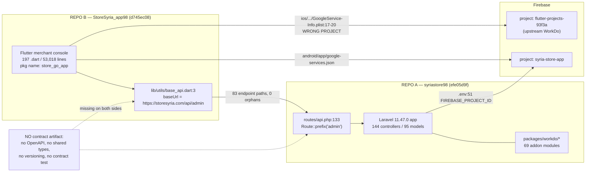

# 01 — Repository Inventory

## 0. How to read this document

This is the factual base layer of the Phase 0 audit. It answers one question: **what, exactly, exists?**
It deliberately does **not** assess whether features work — that is documents 02 onward. Where a
component's existence implies nothing about its function, this document says so explicitly.

Status vocabulary used here: **VERIFIED / PARTIAL / MISSING / UNKNOWN / BLOCKED**.
Where an implementation judgement is unavoidable, the implementation vocabulary is used:
**IMPLEMENTED AND VERIFIED / IMPLEMENTED BUT NOT VERIFIED / PARTIALLY IMPLEMENTED / PLACEHOLDER OR MOCK / MISSING / UNKNOWN**.
Severity is **CRITICAL / HIGH / MEDIUM / LOW**; business priority is **P0 / P1 / P2 / P3**.

Repo A = `syriastore98` (local checkout `/home/user/syriastore98`).
Repo B = `StoreSyria_app98` (local checkout `/home/user/StoreSyria_app98`).
All paths are relative to the respective checkout root.

---

## 1. Accessibility, identity and liveness

**Status: VERIFIED.** Both repositories were cloned and are fully readable locally. **Neither is empty.**
Both have two branches (`main` and `claude/pensive-cerf-h6rizn`) present locally and on the remote;
both checkouts are on `claude/pensive-cerf-h6rizn`.

| Property | Repo A — Main Platform | Repo B — Associated App |
|---|---|---|
| Remote (`git remote -v`) | `https://github.com/fullstackfull/syriastore98` | `https://github.com/fullstackfull/StoreSyria_app98` |
| Branches present | `main`, `claude/pensive-cerf-h6rizn` (+ both on `origin`) | `main`, `claude/pensive-cerf-h6rizn` (+ both on `origin`) |
| Checked-out branch | `claude/pensive-cerf-h6rizn` | `claude/pensive-cerf-h6rizn` |
| HEAD | `efe05d9f1d770c5fef86d9d8175ff013f8d71ee2` | `d745ec08da5244cf50bc35b12fcd804bcf695023` |
| Commits reachable from HEAD | **6** | **68** |
| Tracked files | **58,982** | **463** |
| Working tree size on disk | **906 MB** (excl. `.git`) | **7.2 MB** |
| `.git` size | **317 MB** | — |
| **Total clone footprint** | **~1.2 GB** | ~10 MB |
| Accessible / readable | **VERIFIED — yes** | **VERIFIED — yes** |
| Empty? | **No** | **No** |
| Primary language | PHP 8.2+ / Blade | Dart (Flutter) |
| Activity window (commit dates) | 2026-08-27, then 2026-10-11 | 2026-08-04 → 2026-10-11 |
| Active? | **Marginally.** Five of six commits land on one day (2026-10-11); there is no development cadence | **Yes.** ~10 weeks of near-continuous single-developer work |
| CI / CD present | **MISSING** — no `.github/`, no pipeline file of any kind | **MISSING** — no `.github/`, no `.gitlab-ci.yml`, no `codemagic.yaml` |
| Project documentation | **MISSING** — `README.md` is the unmodified stock Laravel skeleton (`repo-A README.md:64-66` discusses only the Laravel framework's MIT licence); no `docs/` existed before this report | **MISSING** — stock `flutter create` README |

### 1.1 Repo A — product identity

Repo A is **not a bespoke platform**. It is a customised copy of the commercial WorkDo
"eCommerceGo SaaS" product, and the repository states its own version:

```php
// repo-A config/verification.php:3-6
return [
    'system' => 'EcommerceGo SaaS',
    'system_version' => '8.8.2',
];
```

Each of the three storefront themes repeats the same product stamp
(`repo-A themes/greentic/verification.php:4-5`, `repo-A themes/stylique/verification.php:4-5`,
`repo-A themes/techzonix/verification.php:4-5`).

**FACT.** Vendor fingerprints are unremoved throughout: every one of the 69 module manifests
names `"WorkDo" <support@workdo.io>` as author (`repo-A packages/workdo/ProductReview/composer.json:12-17`
is representative), and the module generator stamps the same address into newly scaffolded modules
(`repo-A app/Console/Commands/CreatePackage.php:127`).

**UNRESOLVED (legal, not technical).** `find . -maxdepth 3 -iname 'LICENSE*'` returns **nothing** —
there is no licence file anywhere in Repo A. The only licence strings present are stub `MIT`
declarations inherited from the generator: `repo-A composer.json:9` (the stock `laravel/laravel`
value) and `repo-A packages/workdo/ProductReview/composer.json:5` (identical in all 69 modules).
There is **no purchase-code field and no Envato/CodeCanyon verification call anywhere in the code**.
The repository therefore contains nothing from which redistribution terms can be cited. **The owner
must produce the WorkDo/CodeCanyon purchase record.** This is a go/no-go input and is flagged, not
asserted. Severity MEDIUM, priority **P1**.

### 1.2 Repo B — product identity

**Status: VERIFIED.** Repo B carries **four** distinct identities simultaneously:

| Identity | Evidence |
|---|---|
| `store_go_app` (Dart package) | `repo-B pubspec.yaml:1`; `repo-B ios/Runner/Info.plist:18` (`CFBundleName`); every `package:store_go_app/...` import across all 197 Dart files |
| `Store Syria` | `repo-B lib/store_go.dart:34` (`title: 'Store Syria'`); `repo-B android/app/src/main/AndroidManifest.xml:14` (`android:label="Store Syria"`) |
| `Syria Store` — **word order reversed vs Android** | `repo-B ios/Runner/Info.plist:9-10` (`CFBundleDisplayName` → `Syria Store`) |
| `com.ecommerce.ecommercegoapp` — **the upstream WorkDo registration** | `repo-B ios/Runner/GoogleService-Info.plist:17-18` |

The Android application id is correctly branded — `applicationId = "com.syriastore.app"`
(`repo-B android/app/build.gradle.kts:27`) — so the identity drift is confined to iOS and to the
internal package name. Severity MEDIUM, priority **P2** (store-listing coherence, not function).

---

## 2. Commit history: character and what it forecloses

### 2.1 Repo A — six commits, all authored as `root` on the production server

```
efe05d9f | 2026-10-11 08:18:06 +0000 | root <root@server1.storesyria.com> | Chore: Ignore entire storage folder and temporary files
5882399e | 2026-10-11 08:16:07 +0000 | root <root@server1.storesyria.com> | Chore: Ignore storage log files
f33e8525 | 2026-10-11 08:15:12 +0000 | root <root@server1.storesyria.com> | Update: Controllers, DataTables and Helper adjustments on server
de014225 | 2026-10-11 08:13:34 +0000 | root <root@server1.storesyria.com> | Chore: Ignore vendor folder in git
4a5f686a | 2026-10-11 08:10:54 +0000 | root <root@server1.storesyria.com> | Chore: Ignore uploads and storage folders in git, update composer.json
3c39c160 | 2026-08-27 08:10:08 +0000 | root <root@server1.storesyria.com> | Initial commit 98
```

Four facts follow, and each has a direct business consequence.

**(a) `3c39c160` is a squashed snapshot, not a project history.** It imports all 58,982 files in one
commit and originally included 24,092 `vendor/` paths, which `de014225` then deleted
(24,093 files changed, 3,223,362 deletions). **Consequence: no upstream diff is possible.** There is
no way, from git alone, to separate WorkDo's stock eCommerceGo 8.8.2 code from the Store Syria team's
own modifications. Any such separation must be reconstructed by diffing against an independently
obtained copy of eCommerceGo 8.8.2 — which requires the vendor licence (§1.1) to obtain legally.
This is the single most expensive consequence of the repository's history and it affects every
estimate in this audit. Severity HIGH, priority **P1**.

**(b) Git is being operated as `root` inside the deployed directory.** All six commits are authored
`root <root@server1.storesyria.com>`, and `f33e8525`'s own message says *"adjustments on server"*.
The progressive addition of ignore rules across `4a5f686a` → `de014225` → `5882399e` → `efe05d9f`
is the signature of `git init` being run inside a live document root and then being taught, commit by
commit, what not to track. **Consequence:** there is no development environment of record, no review
step, and changes are made on the production filesystem. Severity HIGH, priority **P1**.

**(c) There is no release process.** No tags (`git tag` is empty), no CI, no `.github/`, no branch
protection evidence, no deploy script. `repo-A composer.json` does include `laravel/pint` as a dev
dependency, but with no configuration file and no pipeline step it is never enforced.

**(d) Commit messages are adequate but the granularity is useless.** `f33e8525` ("Controllers,
DataTables and Helper adjustments on server") is the only substantive code commit in the entire
history. Everything the Syria team wrote is either inside the squashed import or inside that single
commit. **Consequence: `git blame` has no investigative value in this repository.**

### 2.2 Repo B — 68 commits, effectively one developer, terse messages

**Status: VERIFIED.** Author distribution (`git log --format='%an <%ae>' | sort | uniq -c`):

| Author | Commits | Note |
|---|---|---|
| `tala <flutter02sy@gmail.com>` | 60 | |
| `flutter02sy <flutter02sy@gmail.com>` | 4 | **same e-mail address as `tala`** |
| `yazan <flutter01sy@gmail.com>` | 2 | |
| `fluttertala990-png <fluttertala990@gmail.com>` | 2 | |

So **64 of 68 commits (94%) come from a single e-mail address** under two display names. The brief's
"two author identities" understates it only in form: there are four *identities* but effectively
**one developer**, with a second contributing two commits. **Business consequence: this is a single
point of failure. If that developer becomes unavailable, 53,018 lines of Dart have no second reader,
no tests (§6.5) and no CI to describe correct behaviour.** Severity HIGH, priority **P1**.

**Activity window: 2026-08-04 → 2026-10-11** (~10 weeks). Earliest commit `de937d1` "test merge"
(2026-08-04 00:58 −0700); latest `d745ec0` "last update" (2026-10-11 12:08 +0300). *This corrects
the Phase 0 brief, which gave the window as September–October; work began on 4 August.*

**Commit-message quality is poor and will make archaeology expensive.** Verified examples from the
log: `ede3087 "ي"`, `7d2db68 "ب"` (single Arabic letters), `3092f1f "1"`, `7524fff "w"`,
`9bcab3a "g"`, `c87227f "j"`, `99cbe08 "end"`, `9d2b1db "end"`, `07b91ff "create order donnnnnnne"`,
`cd24396 "new"`, `b43f3ac "last update before claude"`, `d745ec0 "last update"`. Two merge commits
record a **GitLab origin** (`1232947` and `bdd3289` merge
`https://gitlab.com/flutter02sy/syria_store2`), so the GitHub remote is not the project's original
home. **UNKNOWN:** whether the GitLab repository still exists and whether it holds history or
branches absent from GitHub. Worth one question to the developer.

---

## 3. Are the two repositories technically related?

**Status: VERIFIED — yes, conclusively.** Three independent proofs, two of which this document
re-measured directly:

1. **Shared production host.** Repo B's compile-time base URL is
   `https://storesyria.com/api/admin` (`repo-B lib/utils/base_api.dart:3`). Repo A's committed
   environment sets `APP_URL=https://storesyria.com` (`repo-A .env:6`).
2. **Shared Firebase project.** Repo A sets `FIREBASE_PROJECT_ID=syria-store-app`
   (`repo-A .env:51`). Repo B's Android configuration resolves to the **same project**:
   `project_info.project_id = syria-store-app` with
   `package_name = com.syriastore.app` (`repo-B android/app/google-services.json`, key paths read
   programmatically; no values printed).
3. **Complete API surface match.** The integration dossier established that all 83 distinct endpoint
   paths Repo B calls resolve to real routes inside Repo A's `Route::prefix('admin')` group
   (`repo-A routes/api.php:133`), with zero orphans in either direction.

**A precise correction worth recording here**, because it is an inventory fact and it was not in the
brief: **Repo B's iOS target points at a different, upstream Firebase project.**
`repo-B ios/Runner/GoogleService-Info.plist:17-20` gives `BUNDLE_ID = com.ecommerce.ecommercegoapp`
and `PROJECT_ID = flutter-projects-93f3a` — i.e. the stock WorkDo eCommerceGo registration, **not**
`syria-store-app`. So the Android app and the backend share a Firebase project; **the iOS app does
not share it with either.** Consequence: iOS push and analytics would be attributed to a third
party's Firebase project, and iOS FCM would be expected to fail once the bundle id is corrected.
Severity HIGH, priority **P1** — but only if iOS is in scope (see §6.7).

**Relationship direction and the organisational gap:** Repo B is a **client** of Repo A; Repo A has
no knowledge of Repo B. There is no shared schema, no OpenAPI document, no generated client, no
versioned API path and no contract test on either side. Repo A's own history shows it is a
production-server snapshot edited in place (§2.1b), so **nothing prevents a server-side rename from
bricking the shipped app.** Full analysis in `02-ARCHITECTURE` and the integration-contract findings.



---

## 4. Repo A — annotated directory structure

Tracked-file distribution by top-level path (`git ls-files | awk -F/ '{print $1}' | sort | uniq -c | sort -rn`):

| Top-level path | Tracked files | Note |
|---|---|---|
| `packages/` | **56,243** | 69 addon modules; 52,107 of these files are one module (§4.2) |
| `public/` | 843 | pre-built asset tree, served via `asset()` |
| `resources/` | 577 | Blade views, language files, 3 unused ES modules |
| `app/` | 389 | the application itself |
| `uploads/` | 407 | **real customer data, committed** (§8.2) — 337 under the bare `uploads` prefix plus 70 whose filenames contain a quote character |
| `themes/` | 265 | 3 storefront themes |
| `database/` | 113 | 105 migrations + 6 seeders + factories |
| `theme_json/` | 37 | theme-customiser field schemas |
| `stubs/` | 34 | module generator templates |
| `config/` | 28 | |
| `tests/` | 10 | **stock Laravel Breeze scaffolding only** (§8.6) |
| `routes/` | 6 | |
| `country/` | 4 | geo CSVs + one committed LibreOffice lock file |
| `bootstrap/` | 4 | incl. 2 committed build artefacts (§8.5) |
| root files | 18 | incl. 5 junk/hazard files (§8) |

```
syriastore98/                             HEAD efe05d9f · 58,982 tracked files · ~1.2 GB clone
│
├── index.php                             SECOND front controller. Stock Laravel server.php renamed.
│                                         :17-21 serves existing public/* then forwards to public/index.php.
│                                         Exists ONLY because the deployed document root is the app root.
├── .htaccess                             37 lines. :3 Options -MultiViews -Indexes. :6-9 the ONLY
│                                         access-control directive in the entire repo (deny <Files .env>).
│                                         :24-26 front-controller rewrite guarded by !-f. :30-31 explicit
│                                         /packages/workdo/ passthrough. :33-36 rewrites css|assets|
│                                         market_assets|images|landing|uploads|storage|installer|js|vendor
│                                         INTO public/ — rules that are meaningless unless requests land
│                                         at the app root. See §8.1.
├── .env                                  TRACKED AND COMMITTED (in 3c39c160). 51 lines. §8.1
├── .env.example                          64 lines, stock Laravel 11 placeholders, no secrets
├── .gitignore                            5 lines ONLY. §8.7
├── .gitattributes                         11 lines; :9 still export-ignores a .github dir that does not exist
├── artisan                               stock, 15 lines
├── composer.json / composer.lock         200 prod + 39 dev locked packages. §7.1
├── composer.phar                         3.5 MB Composer binary, COMMITTED. §8.3
├── package.json / package-lock.json      dead toolchain. lockfileVersion 1, name null. §7.3
├── vite.config.js / tailwind.config.js / postcss.config.js
│                                         dead — zero @vite directives repo-wide, no public/build. §7.3
├── phpunit.xml                           :25-26 the sqlite in-memory overrides are COMMENTED OUT. §8.6
├── serviceWorker.js                      26 lines, cache name "dev-coffee-site-v1", assets = []. Tutorial residue.
├── README.md                             unmodified stock Laravel skeleton README
├── error_log                             PRODUCTION PHP fatal-error log, COMMITTED. §8.3
├── _active', 1)                          52,832-byte file whose name is a shell accident; content is the
│                                         less(1) help screen. COMMITTED. §8.3
├── avatar.png                            stray 8 KB image at repo root
│
├── app/                                  389 tracked files — the application
│   ├── Http/                             158 .php total
│   │   ├── Controllers/                  144 controllers (incl. Api/ApiController.php, >6,300 lines)
│   │   ├── Middleware/                   12 middleware (13 aliases registered in bootstrap/app.php:16-29)
│   │   └── Requests/                     2 FormRequest classes — for 144 controllers
│   ├── Models/                           95 models (incl. Utility.php, a god-object)
│   ├── DataTables/                       39 yajra server-side table classes
│   ├── Services/                         15 (Chatwoot×4, Firebase notif×3, NMIService, OrderFinancialService,
│   │                                     PaymentService, StoreCurrencyConversionService, StoreNotification-
│   │                                     Service, WebuzoDomainService, Zid, DeliveryBoyNotificationService)
│   ├── Helper/helper.php                 ONE FILE, 2,560 lines, ~68 global functions, loaded unconditionally
│   │                                     via composer.json:92-93 AND again in autoload-dev:100-101
│   ├── Providers/                        8 files, 6 registered (bootstrap/providers.php:4-9)
│   ├── Xendit/ (13) · Coingate/ · Khalti/ · Package/ (4) · Libraries/ (7)
│   │                                     FIVE payment SDKs vendored into app/ instead of composer
│   ├── Console/Commands/                 7 (CreatePackage, MakePackageComponent, PackageMigrate,
│   │                                     PackageSeed, FindDuplicateRouteNames, ZidProcessEvents,
│   │                                     ZidRefreshTokens)
│   ├── Events/ (12) · Listeners/ (4) · Mail/ (8) · Observers/ (1) · Exports/ (3)
│   ├── Traits/ (1) · Facades/ (1) · Classes/ (3) · View/ (4) · Exceptions/ (1) · Notifications/
│
├── bootstrap/
│   ├── app.php                           68 lines. :8-14 withRouting wires web/api/console/channels +
│   │                                     health '/up'. NOTE routes/customer.php and routes/auth.php are
│   │                                     NOT wired here. :16-29 aliases 13 middleware. :31 appends only
│   │                                     SetLocate to the web group. :33-64 exempts 29 URI patterns from
│   │                                     CSRF. :66-68 withExceptions is EMPTY.
│   ├── providers.php                     :4-9 registers 6 of the 8 providers in app/Providers/
│   └── cache/{packages,services}.php     COMMITTED BUILD ARTEFACTS. §8.5
│
├── config/                               28 files, 3,495 lines. §7.4
├── country/                              4 files, 904 KB: cities.csv (640 KB), states.csv (256 KB),
│                                         countries.csv (10 KB) + .~lock.states.csv# (committed
│                                         LibreOffice lock file leaking the upstream vendor dev's
│                                         OS username). §8.3
├── database/
│   ├── migrations/                       105 files
│   ├── seeders/                          6 (AddonSeeder, AiTemplateSeeder, DatabaseSeeder,
│   │                                     DefaultSetting, PermissionTableSeeder, PlansTableSeeder)
│   └── factories/
├── packages/workdo/                      69 MODULES, 56,243 tracked files. §4.2 + §9
├── public/                               canonical webroot that is NOT the deployed document root
│   ├── index.php                         stock Laravel 11 front controller, 17 lines
│   ├── .htaccess                         21 lines, stock, CORRECT — and bypassed by the root .htaccess
│   ├── assets/ · js/ · css/ · images/ · market_assets/ · installer/ (2.7 MB) · vendor/ · authorizenet/
│   └── storage                           committed as a REGULAR FILE containing the vendor's hardcoded
│                                         absolute path, not a symlink (see 07-storefront findings)
├── resources/
│   ├── views/                            ~1,232 .blade.php repo-wide; front_end/ holds 104 shared
│   │                                     storefront pages
│   ├── lang/                             18 locale dirs/files
│   ├── css/app.css · js/{app,bootstrap,echo}.js
│                                         3 ES modules; echo.js imports laravel-echo and pusher-js,
│                                         NEITHER of which is in package.json. §7.3
├── routes/                               1,891 lines total
│   ├── web.php                           1,161    ├── api.php      393
│   ├── customer.php                        259    ├── auth.php      63
│   ├── console.php                           8    └── channels.php    7
├── stubs/workdo-stubs/                   34 .stub generator templates — the SOURCE of the repeated
│                                         module defects (the api.stub produced 67 identical dead
│                                         auth:api endpoints; the routeserviceprovider.stub produced
│                                         the double route registration)
├── themes/                               3 themes, 44 .blade.php total
│   ├── stylique/   16 MB · 13 views      ACTIVE + PARENT default (config/theme.php:12,24)
│   ├── greentic/   12 MB · 16 views
│   └── techzonix/  6.4 MB · 15 views (+ sass/)
├── theme_json/                           28 JSON field-schema files for the theme customiser
├── tests/                                10 files, ALL stock Laravel Breeze. §8.6
└── uploads/                              89 MB, 407 tracked files of REAL CUSTOMER DATA. §8.2
    └── 11/ 15/ 16/ 18/ 19/ 2/ 3/ profile/ receipt/ stylique/ uploads/ + 2 loose .jpg at the root
```

### 4.1 Aggregate code inventory, Repo A

| Measure | Count | How measured |
|---|---|---|
| Tracked files | 58,982 | `git ls-files \| wc -l` |
| `.php` files | 3,113 | `git ls-files \| grep -c '\.php$'` |
| `.blade.php` files | 1,232 | `git ls-files \| grep -c '\.blade\.php$'` |
| `.svg` files | **49,636** | `git ls-files \| grep -c '\.svg$'` |
| …of which in `packages/workdo/Marketing` | **49,558 (99.8%)** | `git ls-files packages/workdo/Marketing \| grep -c '\.svg$'` |
| Controllers (`app/Http/Controllers`) | 144 | `find … -name '*.php' \| wc -l` |
| Files under `app/Http` | 158 | idem |
| Models (`app/Models`) | 95 | idem |
| DataTables | 39 | idem |
| FormRequest classes | **2** | `ls app/Http/Requests` |
| Migrations — root | 105 | `ls database/migrations/*.php \| wc -l` |
| Migrations — modules | 102 | `find packages/workdo -path '*database/[Mm]igrations/*.php'` |
| **Migrations — total** | **207** | |
| Seeders — root / modules | 6 / 213 | |
| Core route lines | 1,891 | `wc -l routes/*.php` |
| Module route lines (web / api) | 2,253 / 1,172 (**3,425**) | `find packages/workdo -path '*[Rr]outes/*.php'` |
| Module Blade views | 670 | |
| Theme Blade views | 44 | |
| `app/Helper/helper.php` | 2,560 lines | `wc -l` |
| Config files / lines | 28 / 3,495 | `ls config/` ; `wc -l config/*.php` |

### 4.2 The single largest fact about this repository

**Status: VERIFIED · Severity HIGH · Priority P1.**
**88.3% of Repo A is one bundled module that is not an e-commerce feature.**

```
git ls-files | awk -F/ '{print $1"/"$2"/"$3}' | sort | uniq -c | sort -rn | head -3
  52107 packages/workdo/Marketing
    773 packages/workdo/LandingPage
    414 public/assets/js
```

`52,107 / 58,982 = 88.3%` of tracked files; `du -sh packages/workdo/Marketing` → **535 MB**.
The module is **misnamed**: its models are `CardProduct`, `CardPayment`, `Storeqr`, `Gallery`,
`Service`, `StoreHours`, `Social`, `Appoinment` [sic], `Testimonial`, `MarketingContact`, and its
asset tree is `src/resources/assets/custom/card_theme` plus 21 numbered "theme" directories.
This is WorkDo's **digital business card / vCard product**, not store marketing.

It is not inert: it ships **16 migrations** and 68 lines of `src/routes/web.php`, so if its row exists
in the `add_on_managers` table it registers routes and creates tables inside this store (§5.2).

*FACT:* the counts, sizes, model names and asset paths. *INFERENCE:* that it is the vCard product —
drawn from the model names and the `card_theme` asset tree, not from vendor documentation (every
`module.json` ships an empty `description`).

**Business consequence:** clone time, CI time, backup cost and developer onboarding are all dominated
by a product nobody ordered. Removing it is the single highest-leverage hygiene action available and
is close to free, **conditional on confirming the module is not enabled in `add_on_managers`** —
which requires database access this audit did not have (**UNKNOWN / BLOCKED**).

---

## 5. Repo A — entry points and key configuration

### 5.1 Entry points

| Path | Role | Verified detail |
|---|---|---|
| `repo-A public/index.php` | canonical front controller | Stock Laravel 11, 17 lines |
| **`repo-A index.php`** | **second front controller** | `:17-21` — `if ($uri !== '/' && file_exists(__DIR__.'/public'.$uri)) { return false; } … require_once __DIR__.'/public/index.php';`. This is Laravel's old `server.php` renamed. The Laravel 11 skeleton ships **neither** a root `index.php` nor a root `.htaccess`, so both are deliberate shared-hosting additions. `git log --oneline --all -- index.php .htaccess` → only `3c39c160` |
| `repo-A artisan` | CLI | stock, 15 lines |
| `repo-A bootstrap/app.php` | application factory | see tree annotation, §4 |
| `repo-A bootstrap/providers.php:4-9` | provider registry | registers 6 of 8 providers in `app/Providers/` |
| `repo-A .htaccess` | Apache rewrites | 37 lines; the deployment-layout evidence, §8.1 |
| `repo-A public/.htaccess` | Apache rewrites | 21 lines, stock, correct — and inert under the deployed layout |
| `/up` | health endpoint | `repo-A bootstrap/app.php:13` |
| `repo-A serviceWorker.js` | PWA worker | 26 lines; caches nothing (`assets = []`); no registration call found |

**Finding — two front controllers is not redundancy, it is a deployment statement.** The root
`index.php` exists only because the hosting document root could not be moved to `public/`. Combined
with `repo-A .htaccess:33-36` and `repo-A error_log:1`, this is the inventory-level evidence for the
document-root exposure in §8.1.

### 5.2 Module loading — a runtime, database-driven autoloader

**Status: VERIFIED · Severity HIGH · Priority P1.** This is an inventory fact with large downstream
consequences, so it belongs here rather than only in the architecture document.

`repo-A composer.json:137-145` declares a path repository for `packages/workdo/*`, **but no
`workdo/*` package appears in the `require` block and
`jq '[.packages[]|select(.name|test("workdo"))]|length' composer.lock` returns `0`** — zero of 200
locked packages. There is no `wikimedia/composer-merge-plugin` anywhere. **So `composer install`
installs none of the 69 modules and generates no PSR-4 map for them; the path repository is
decorative.**

Loading happens instead at runtime, and the active module set comes from a **database table**:

```php
// repo-A app/Providers/PackageServiceProvider.php:14-23
public function register(): void
{
    $staticAddons = ['LandingPage'];
    $this->loadAddons($staticAddons);
    // Defer database queries until after DB connection is ready
    $this->app->booted(function () {
        $this->loadDynamicAddons();
    });
}
```

```php
// repo-A app/Providers/PackageServiceProvider.php:27-41
    try {
        if (! Schema::hasTable('add_on_managers')) { return; }
        $dbAddons = AddOnManager::pluck('module')->toArray();
        …
        $this->loadAddons($dbAddons);
    } catch (\Exception $e) {
        // Handle silently
    }
```

Three consequences recorded as inventory facts:

1. **Which classes and routes exist depends on database rows.** `php artisan route:cache` and
   `optimize` cannot produce a correct, stable artefact.
2. **`catch (\Exception $e) { // Handle silently }`** means a broken module disappears instead of
   erroring — a module can be "installed" and invisible with no signal.
3. **Nothing in this repository can tell you which of the 69 modules is live.** Answering that
   requires reading `add_on_managers` from the production database. **UNKNOWN / BLOCKED.**

**Therefore: throughout this report, "a module exists" must never be read as "a feature works."**
The clearest demonstration is in `repo-A config/services.php:65-98`, (verified at `:60-99`), where eight OAuth
provider blocks (`cashfree`, `google`, `github`, `linkedin-openid`, `twitter`, `bitbucket`, `slack`,
`facebook`) all carry empty-string `client_id`/`client_secret` or `key`/`secret` — while seven corresponding
`SignInWith*` modules are fully present with providers, routes, migrations and seeders.

### 5.3 Key configuration files (28 files, 3,495 lines)

| File | Lines | State and the one thing that matters |
|---|---|---|
| `app.php` | 126 | stock. `:42` reads `APP_DEBUG` — see §8.1 |
| `auth.php` | 142 | **customised.** `:38-51` defines exactly three guards — `web`, `customers`, `deliveryboy`. **There is no `api` guard**, which is why 67 module `api.php` stubs using `auth:api` are dead |
| `verification.php` | 6 | **`'EcommerceGo SaaS'` / `'8.8.2'`** — the product-identity stamp (§1.1) |
| `services.php` | 126 | **hardcoded live third-party secrets**, see §8.1. `:29-35` Zid block (`:31` `client_secret`, `:33` `hook_user`, `:34` `hook_pass`), `:42-45` `deliverysyria` block (`:44` `api_key`), `:60-99` eight empty OAuth blocks, `:108-126` firebase / delivery_firebase / webuzo |
| `jwt.php` | 300 | **`:18` ships a hardcoded default signing secret** as the second argument to `env('JWT_SECRET', …)`, and `grep -c JWT_SECRET .env` → **0**, so the committed default is what is used. `:125` `algo` defaults to `HS256` (symmetric) |
| `myfatoorah.php` | 40 | `:10` literal `api_key`; `:15` `test_mode`; `:20` `country_iso` |
| `filesystems.php` | 91 | **customised:** `:47-51` defines a `theme` disk whose `root` is `base_path('')` — i.e. the entire application directory |
| `files_types.php` | 101 | admin upload-extension picker map; includes `exe`, `html`, `js`, `phtml`, `php` |
| `laratrust.php` | 369 | RBAC. `teams.enabled => false` — roles are global, not per-store. Directly relevant to tenancy |
| `theme.php` | 33 | `:12` `'active' => 'stylique'`, `:24` `'parent' => 'stylique'` |
| `installer.php` | 145 | install wizard, fully wired; prescribes `777` on six paths; `updaterEnabled => 'true'` |
| `mail.php` / `queue.php` / `broadcasting.php` | 117 / 112 / 82 | stock Laravel 11 — they read `MAIL_MAILER`, `QUEUE_CONNECTION`, `BROADCAST_CONNECTION`, which the committed `.env` does **not** set (§8.1) |
| `session.php` | 217 | stock defaults: `encrypt` false, `secure` unset, `same_site` null |
| `logging.php` | 147 | **customised:** the default `stack` channel is `['single','larabug']`, shipping every log line to the third-party larabug.com SaaS |
| `chatify.php` / `forrest.php` | 104 / 94 | **ORPHANS** — `jq` over `composer.lock` finds no `munafio/chatify` and no `omniphx/forrest`; these configure packages that are not installed |
| `superadminaccess.php` | 17 | flat list of 13 permission strings reserved to super admin |
| `google2fa.php` · `reverb.php` · `cache.php` · `database.php` · `timezones.php` · `visitor.php` · `larabug.php` · `theme_form_options.php` · `laravel-translatable-string-exporter.php` | | remainder |

**Absent relative to stock Laravel 11:** `config/cors.php`, `config/hashing.php`,
**`config/sanctum.php`**, `config/view.php`, `config/concurrency.php`. Sanctum is a declared
dependency (`repo-A composer.json` → `laravel/sanctum ^4.0`, resolved `v4.0.5`) but is unconfigured;
`view.paths` is mutated at runtime from `app/Providers/ViewServiceProvider.php` instead.

---

## 6. Repo B — annotated directory structure

```
StoreSyria_app98/                        HEAD d745ec08 · 463 tracked files · 7.2 MB
│
├── pubspec.yaml                         :1 name: store_go_app · :19 version: 1.0.0+1
│                                        :22 sdk: '>=3.1.3 <4.0.0'  ← CONTRADICTS pubspec.lock (§6.6)
│                                        :34-35 flutter_localizations declared and NEVER WIRED
│                                        :43 syncfusion_flutter_charts (COMMERCIAL, no key registered)
│                                        :49 win32  ·  :50 flutter_quill  (both unused)
├── pubspec.lock                         193 locked packages. sdks: dart ">=3.9.0 <4.0.0",
│                                        flutter ">=3.35.1"
├── analysis_options.yaml                :10 include: package:flutter_lints/flutter.yaml — untouched
│                                        template, empty `rules:` block
├── .metadata                            :7 revision "20f8274939..." · :8 channel "stable" — an opaque
│                                        hash; NO file in the repo states a human-readable Flutter version
├── .gitignore                           :51-54 correctly excludes key.properties, *.keystore, *.jks, *.p12
│                                        :55-56 `#**/*.env` and `#.env` are COMMENTED OUT — the env
│                                        ignore rules were deliberately disabled
├── README.md                            stock flutter create README
├── devtools_options.yaml · .editorconfig
│
├── lib/                                 197 .dart files · 53,018 lines
│   ├── main.dart                        bootstraps GetStorage, Firebase, dotenv; locks portrait
│   ├── store_go.dart                    GetMaterialApp. :34 title 'Store Syria'. Sets `translations`,
│   │                                    `locale`, `fallbackLocale` — but NOT localizationsDelegates
│   │                                    or supportedLocales (§6.4)
│   ├── bindings/                        11 files; 2 are 100% commented out and unreferenced
│   ├── config/
│   │   ├── repository/                  18 repositories, 906 lines total (median ~50)
│   │   └── theme_light/                 light/dark palettes applied by MUTATING static AppColor fields
│   ├── core/
│   │   ├── controller/                  31 controllers
│   │   ├── model/                       29 models (3 marked `// updated` are type-hardened; 26 are not)
│   │   └── services/                    2 (fcm_token_service, firebase_messaging_service)
│   ├── network/network.dart             1,005 lines — the best-engineered file in the repo:
│   │                                    5 verbs, explicit timeouts, a Result/Failure sum type,
│   │                                    centralised error taxonomy, global 401 handling.
│   │                                    ALSO logs every request and response body in full.
│   ├── routes/routes.dart               29 route-name constants declared; 17 GetPages registered
│   ├── translations/                    en.dart (640 keys) / ar.dart (642 keys) — near parity
│   ├── utils/
│   │   ├── base_api.dart                133 lines. :3 baseUrl = "https://storesyria.com/api/admin"
│   │   │                                :4 a commented-out ngrok tunnel is the only "staging" mechanism
│   │   ├── prefer.dart                  GetStorage wrapper: token, userId, storeId, email, name
│   │   ├── images.dart                  :82-86 FIVE absolute URLs on apps.rajodiya.com (§6.3)
│   │   ├── helper.dart · constant.dart · pick_file.dart
│   └── view/
│       ├── screen/                      47 files across 16 feature dirs + welcome_screen.dart:
│       │                                auth · category_screen · coupon_screen · customers ·
│       │                                dashboard_manager · delivery_boys · home_screen ·
│       │                                notification_screen · onboarding_screen · order_screen ·
│       │                                plans · product_screen · profile_screen · setting_screen ·
│       │                                statistics_screen · wallet
│       ├── new_widgets/                 29 files (shimmer.dart, 668 lines, 20 importers)
│       └── widget/                      11 files (common_snak_bar_widget.dart, 43 importers)
│
├── assets/                              fonts/ icon/ images/ lottie/ svg/
│   └── .env                             COMMITTED. Contents: exactly `IS_DEMO_MODE=false`. No secret.
├── android/                             20 tracked files
│   ├── app/build.gradle.kts             :27 applicationId "com.syriastore.app" · :31 targetSdk 36
│   │                                    :37-43 release { signingConfig = signingConfigs.getByName("debug") }
│   │                                    NO isMinifyEnabled, NO isShrinkResources, NO ProGuard rules
│   ├── app/google-services.json         project_id = syria-store-app (MATCHES repo-A .env:51)
│   ├── app/src/main/AndroidManifest.xml :14 android:label "Store Syria"
│   │                                    :35-37 firebase_crashlytics_collection_enabled = "false"
│   └── (no gradlew / wrapper jar — deliberately gitignored)
├── ios/                                 67 tracked files
│   ├── Runner/Info.plist                :9-10 CFBundleDisplayName "Syria Store" · :17-18 CFBundleName
│   │                                    "store_go_app" · :67-68 NSPhotoLibraryUsageDescription is the
│   │                                    VERBATIM TEMPLATE STRING · no NSCameraUsageDescription
│   ├── Runner/GoogleService-Info.plist  :17-18 BUNDLE_ID com.ecommerce.ecommercegoapp ·
│   │                                    :19-20 PROJECT_ID flutter-projects-93f3a  ← WRONG PROJECT (§3)
│   └── (NO Podfile and NO Podfile.lock tracked, and ios/.gitignore does not exclude them)
├── macos/ (28) · windows/ (18) · linux/ (9) · web/ (7)
│                                        flutter create residue; all four carry store_go_app branding
└── test/widget_test.dart                THE ONLY TEST. Stock counter smoke test (§6.5)
```

### 6.1 Aggregate code inventory, Repo B

| Measure | Count | How measured |
|---|---|---|
| Tracked files | 463 | `git ls-files \| wc -l` |
| Dart files under `lib/` | **197** | `find lib -name '*.dart' \| wc -l` (and `git ls-files lib \| grep -c '\.dart$'` = 197) |
| Dart files total (incl. `test/`) | 198 | |
| Lines of Dart under `lib/` | **53,018** | `find lib -name '*.dart' -exec cat {} + \| wc -l` |
| Models | 29 | `lib/core/model/` |
| Controllers | 31 | `lib/core/controller/` |
| Repositories | 18 (906 lines) | `lib/config/repository/` |
| Services | 2 | `lib/core/services/` |
| Bindings | 11 (2 fully commented out) | `lib/bindings/` |
| Screen files | 47 | `lib/view/screen/` |
| Widgets (`new_widgets/` + `widget/`) | 29 + 11 | |
| Route constants / registered pages | 29 / 17 | `lib/routes/routes.dart` |
| Translation keys (en / ar) | 640 / 642 | `lib/translations/` |
| Locked packages | 193 | `pubspec.lock` |
| Test files | **1** (stock, cannot pass) | `test/` |
| Bare `print(` calls | **180**, across 33 files | `grep -rnoE '(^\|[^a-zA-Z_.])print\(' lib` |
| `dart:developer` `log(` calls | 16 | idem for `log(` |
| `kReleaseMode` / `kDebugMode` / `kProfileMode` | **0** | `grep -rn … lib` |
| Files with a file-wide `// ignore_for_file:` | **63 of 197** | `grep -rl 'ignore_for_file' lib` |
| Deprecated `withOpacity(` calls | **314** | `grep -rn 'withOpacity(' lib` |

*Note: this document measures **180** bare `print(` calls; the source dossier reported 161. The
discrepancy is a counting-method difference, not a disagreement about the defect. The measurement
above is reproducible with the command given.*

Largest files (god-object risk; nine files exceed 900 lines, four screens exceed 1,000):

| File | Lines |
|---|---|
| `repo-B lib/view/screen/order_screen/order_detail_screen.dart` | 2,041 |
| `repo-B lib/view/screen/product_screen/product_detail_screen.dart` | 1,471 |
| `repo-B lib/view/screen/statistics_screen/statistics_screen_widget.dart` | 1,375 |
| `repo-B lib/view/screen/product_screen/add_new_product_screen.dart` | 1,112 |
| `repo-B lib/network/network.dart` | 1,005 |
| `repo-B lib/view/screen/customers/customer_bottom_sheet.dart` | 954 |

### 6.2 What Repo B is — definitively

**Status: VERIFIED.** Repo B is a **merchant / store-owner admin console**, not a customer shopping
app and not a delivery-driver app. This was asked as an open question in the brief; it is now closed.

| Hypothesis | Verdict | Decisive evidence |
|---|---|---|
| Merchant / store-owner admin console | **CONFIRMED** | Five bottom-nav tabs are Home-dashboard / Orders / Products / Categories / More (`repo-B lib/core/controller/dashboard_manager_controller/dashboard_manager_controller.dart:14-36`); it manages taxes, shipping, coupons, customers, delivery-boy accounts, a wallet, store settings and the store's **own subscription plan**; the single auth endpoint is `/adminlogin` (`repo-B lib/utils/base_api.dart:5`) |
| Delivery-driver app | **REJECTED** | It *assigns* orders to drivers (`repo-B lib/config/repository/order_repository.dart:10-21`) and CRUDs driver accounts. Repo A's separate `'/delivery-syria/orders/update-status'` route is never called from this app |
| Customer shopping app | **REJECTED** | There is no cart, no checkout and no wishlist screen in the 47 files of `repo-B lib/view/screen/`. The only cart/wishlist matches are passive API response fields and one orphan translation key |
| Multi-role in one binary | **REJECTED** | `repo-B lib/view/screen/auth/` contains exactly one file; no role claim is read from the login response; no role-conditional routing |
| Multi-**store** (one owner, many stores) | **CONFIRMED** | `storeId` in preferences + a `changestore` endpoint + a `StoreChangeService` fan-out; `store_id` is appended to nearly every request |

### 6.3 Repo B — third-party and vendor couplings in the inventory

| Coupling | Evidence | Why it is an inventory finding |
|---|---|---|
| Five absolute URLs on the **upstream WorkDo vendor's demo server** | `repo-B lib/utils/images.dart:82-86` — `profileImg`, `productImg`, `codImg`, `bankTransferImg`, `stripeImg`, all under `apps.rajodiya.com/ecommercego-*` | `profileImg` is live as the `errorWidget` of the merchant avatar on two production screens, so every device requests a third party's server on the home screen. Availability dependency on a vendor with no contract. **Severity HIGH / P1** |
| Production host as a compile-time constant | `repo-B lib/utils/base_api.dart:3`, with `:4` a commented-out ngrok tunnel as the only alternative | There is no `--dart-define`, no flavour and no build config. Changing environment means editing source. **Severity HIGH / P1** |
| Commercial charting library, no licence key | `repo-B pubspec.yaml:43` → `syncfusion_flutter_charts`, locked `34.1.32`; `grep -rn "SyncfusionLicense\|registerLicense" lib/` → **nothing** | Used in two live screens (statistics tab and dashboard home). **Commercial/legal exposure, severity HIGH / P1.** The owner must answer: does this project hold a Syncfusion licence? |
| "Powered by Lynomia" on the login screen | `repo-B lib/view/widget/powered_by_lynomia.dart` → a link to `https://lynomia.com`, rendered from the login widget | A fourth brand on the primary surface of a product called Store Syria. A **business** question for the owner, not a defect |

### 6.4 Repo B — declared-but-unwired, in the inventory sense

Three dependencies are declared and the feature they imply does not exist. These belong in the
inventory because a reader counting `pubspec.yaml` entries would otherwise conclude the opposite:

| Declared | Line | Reality |
|---|---|---|
| `flutter_localizations` | `repo-B pubspec.yaml:34-35` | `grep -rn "localizationsDelegates\|supportedLocales\|GlobalMaterialLocalizations" lib/` → **nothing**. In an Arabic-default, Arabic-fallback app, the ambient text direction is therefore LTR. **Status MISSING, severity HIGH, priority P0 (product-defining)** |
| `firebase_analytics` | `repo-B pubspec.yaml:62` | not imported anywhere in `lib/`. **No analytics event is ever logged** |
| `firebase_remote_config` | `repo-B pubspec.yaml:60` | not imported anywhere in `lib/`. **No remote flag is ever read** |

This corrects a natural assumption: **the live Firebase surface is core + messaging + crashlytics
only** — and Crashlytics itself is wired in Dart while being switched off in the Android manifest at
`repo-B android/app/src/main/AndroidManifest.xml:35-37`.

### 6.5 Repo B — the test and release-readiness inventory

| Item | Status | Evidence |
|---|---|---|
| Business-logic tests | **MISSING** | `test/` contains exactly one file |
| The one test that exists | **PLACEHOLDER OR MOCK, and red** | `repo-B test/widget_test.dart:13-28` is the unmodified `flutter create` counter test: `expect(find.text('0'), findsOneWidget)` then `tester.tap(find.byIcon(Icons.add))`, pumped against `StoreGoApp()` — a merchant console with no counter and no `Icons.add` at its root, which in any case cannot mount because `GetStorage.init()`, `Firebase.initializeApp()` and `dotenv.load()` happen only in `main()`. **The suite is not empty, it is failing** |
| CI | **MISSING** | no `.github/`, no `.gitlab-ci.yml`, no `codemagic.yaml` |
| Android release signing | **MISSING** | `repo-B android/app/build.gradle.kts:37-43` — `release { signingConfig = signingConfigs.getByName("debug") }`, still carrying the `flutter create` TODO comment. No `signingConfigs.create("release")` exists, and no `android/key.properties`, `.jks` or `.keystore` file exists anywhere in the working tree or the history. **Google Play rejects debug-signed uploads, so there is no release path today. Severity CRITICAL / P0** |
| Code shrinking / obfuscation | **MISSING** | no `isMinifyEnabled`, no `isShrinkResources`, no ProGuard/R8 rules file |
| **Hygiene win, for the record** | **PASS** | No keystore and no keystore password has ever been committed. `repo-B .gitignore:51-54` excludes `android/key.properties`, `**/*.keystore`, `**/*.jks` and `**/*.p12`, and `repo-B android/.gitignore:12-14` independently repeats the first three. The exposure here is a *missing* config, not a *leaked* one |

### 6.6 Repo B — the SDK contradiction

**Status: VERIFIED · Severity MEDIUM · Priority P2.**

| Source | Declares |
|---|---|
| `repo-B pubspec.yaml:22` | `sdk: '>=3.1.3 <4.0.0'` |
| `repo-B pubspec.lock` (`sdks:` block) | `dart: ">=3.9.0 <4.0.0"` · `flutter: ">=3.35.1"` |

The resolved 193-package set requires **Dart ≥ 3.9.0 and Flutter ≥ 3.35.1**; the manifest advertises
Dart 3.1.3. A developer or CI runner honouring `pubspec.yaml` provisions an SDK on which this project
cannot resolve. Compounding it, `repo-B .metadata:6-8` pins only an opaque revision hash, so **no
file in the repository states the Flutter version to build with.** With no CI (§6.5) and no committed
`gradlew`, a new engineer has **no reproducible path to a build**.

### 6.7 Repo B — platform targets

| Target | Tracked files | Assessment |
|---|---|---|
| `android/` | 20 | **Viable**, once release signing exists (§6.5) |
| `ios/` | 67 | **No evidence it has ever been built.** Three independent signals: no `Podfile`/`Podfile.lock` tracked (and `ios/.gitignore` does not exclude them, so this is an omission rather than a policy); the Firebase registration is still the upstream WorkDo one (§3); `NSPhotoLibraryUsageDescription` is the verbatim template string (`repo-B ios/Runner/Info.plist:67-68`), which is an automatic App Store review rejection, and there is no `NSCameraUsageDescription` at all |
| `macos/` · `windows/` · `linux/` · `web/` | 28 · 18 · 9 · 7 | **Non-functional residue.** The app locks portrait orientation and fixes a 360×800 design size (a phone-only layout contract), the network layer uses `dart:io` `File()` for multipart upload (unavailable on web), and `flutter_launcher_icons` is configured for Android and iOS only. All four carry the `store_go_app` branding. **62 tracked files of dead scaffolding** — deleting them is the cheapest branding cleanup available |

---

## 7. Languages, frameworks and **resolved** versions

Constraints are what the manifests *ask for*; resolved versions are what the lockfiles *pin*. The
distinction matters and this section reports both.

### 7.1 Repo A — framework and platform

`repo-A composer.lock`: **200 production + 39 development packages**,
`plugin-api-version 2.9.0`, `platform: {"php": "^8.2"}`,
`content-hash 244359141627dcf032b508387d619113`.

| Component | Constraint | **Resolved (`composer.lock`)** | Released |
|---|---|---|---|
| PHP | `^8.2` (`repo-A composer.json:11`) | platform constraint only. *Note the inconsistency:* `repo-A config/installer.php` separately claims a minimum PHP of 8.1.0 | — |
| `laravel/framework` | `^11.9` | **v11.47.0** | 2025-11-28 |
| `livewire/livewire` | *transitive — not in `require`* | v3.7.3 | — |
| `laravel/sanctum` | `^4.0` | **v4.0.5** | 2024-11-26 |
| `laravel/reverb` | `^1.11` | v1.11.0 | 2026-06-25 |
| `santigarcor/laratrust` | `^8.3` | **8.3.1** | 2024-04-03 |
| `yajra/laravel-datatables` | `^11.0` | v11.0.0 | 2024-03-16 |
| `qirolab/laravel-themer` | `^2.3` | 2.3.3 | 2024-05-15 |
| `php-open-source-saver/jwt-auth` | `^2.6` | 2.7.2 | 2024-09-27 |
| `maatwebsite/excel` | `^3.1.x-dev` | **3.1.x-dev** | 2024-11-25 |
| `rachidlaasri/laravel-installer` | `^4.1` | **4.1.0 — ABANDONED** | 2020-05-19 |

PHP-side languages and asset forms present: PHP (application + 69 modules + config), Blade (1,232
templates), JavaScript (`public/js` + 414 files in `public/assets/js`; only 3 ES modules in
`resources/js`), CSS/SCSS (`public/assets/css`, `themes/techzonix/sass`), JSON (18 locale files +
per-module `resources/lang` + 28 `theme_json/*.json`), CSV (`country/`, 904 KB of geo data).

### 7.2 Repo B — framework and platform

| Component | Declared | **Resolved (`pubspec.lock`)** |
|---|---|---|
| Dart SDK | `>=3.1.3 <4.0.0` (`repo-B pubspec.yaml:22`) | **`>=3.9.0 <4.0.0`** — contradiction, §6.6 |
| Flutter SDK | not stated anywhere | **`>=3.35.1`** |
| Flutter revision of record | `repo-B .metadata:7` → opaque hash `20f8274939…`, channel `stable` | no human-readable version anywhere |
| State management | `get` `^4.7.3` | **4.7.3** |
| Local storage | `get_storage` `^2.1.1` | 2.1.1 |
| HTTP | `http` `^1.6.0` | 1.6.0 |
| Logging | `logger` `^2.7.0` | 2.7.0 |
| Charts | `syncfusion_flutter_charts` `^34.1.32` | **34.1.32 (commercial)** |
| Firebase core / messaging / crashlytics | `^2.32.0` / `^14.7.10` / `^3.5.7` | **2.32.0 / 14.7.10 / 3.5.7** |
| Lints | `flutter_lints` `^3.0.1` | **3.0.2** — two major lint generations behind a Flutter 3.35 project |
| Total locked packages | — | **193** |

### 7.3 Repo A — the entire Node/Vite/Tailwind toolchain is dead code

**Status: VERIFIED · Severity MEDIUM · Priority P1.** This is an inventory fact because
`package.json`, `vite.config.js`, `tailwind.config.js` and `postcss.config.js` all exist and imply a
build step that does not happen.

| Proof | Measurement |
|---|---|
| Nothing consumes the build | `grep -rl "@vite" resources/views themes` → **0 files**. `ls public/build` → *No such file or directory*. Assets are loaded from the pre-built `public/assets` tree via `asset()` |
| `npm run build` cannot succeed | `repo-A resources/js/echo.js` imports `laravel-echo` and `pusher-js`; **neither is in `package.json`**. Vite would fail to resolve both |
| The lockfile is from a different era | `jq '{name,version,lockfileVersion}' package-lock.json` → `{"name": null, "version": null, "lockfileVersion": 1}`. `lockfileVersion: 1` is npm 6 (2019), against a `package.json` declaring `"type": "module"` with Vite 5 |
| Even a successful build would be wrong | `repo-A tailwind.config.js` scans only `resources/views/**/*.blade.php`; it does **not** scan `themes/*/views` (44 storefront blades) or `packages/workdo/*/src/resources/views` (670 blades), so most utility classes would be purged |

**Business consequence:** do not budget for "the existing front-end build"; there is none. Conversely,
do not budget for *fixing* it either — the application does not use it, so the correct action is
deletion, not repair.

### 7.4 Repo A — complete direct dependency inventory (61 packages)

Every entry in `repo-A composer.json`'s `require` block except the `php` platform constraint, with
the version actually pinned by `composer.lock` and its upstream release date.

| Package | Constraint | **Resolved** | Released | Flag |
|---|---|---|---|---|
| `anandsiddharth/laravel-paytm-wallet` | `^2.0` | **v2.0.0** | 2020-10-28 | stale (pre-2021 release) |
| `anhskohbo/no-captcha` | `^3.6` | **3.6.0** | 2024-03-13 |  |
| `authorizenet/authorizenet` | `^2.0` | **2.0.4** | 2024-09-18 |  |
| `aws/aws-sdk-php` | `^3.321` | **3.369.5** | 2025-12-30 |  |
| `barryvdh/laravel-dompdf` | `^3.0` | **v3.0.0** | 2024-07-31 |  |
| `braintree/braintree_php` | `^6.19` | **6.21.0** | 2024-10-31 |  |
| `codexshaper/laravel-woocommerce` | `^3.0` | **v3.0.4** | 2024-03-05 |  |
| `coingate/coingate-php` | `^4.1` | **v4.1.0** | 2022-05-20 |  |
| `dipesh79/laravel-esewa` | `^1.0` | **v1** | 2022-12-11 |  |
| `dipesh79/laravel-phonepe` | `^1.0` | **1.0.1** | 2024-05-04 |  |
| `fedapay/fedapay-php` | `^0.4.2` | **0.4.2** | 2024-03-12 |  |
| `genealabs/laravel-model-caching` | `^12.0` | **12.0.2** | 2025-02-27 |  |
| `google/auth` | `^1.53` | **v1.53.0** | 2026-07-22 |  |
| `iyzico/iyzipay-php` | `^2.0` | **v2.0.57** | 2024-10-17 |  |
| `jeroendesloovere/vcard` | `^1.7` | **v1.7.4** | 2023-09-07 |  |
| `kkomelin/laravel-translatable-string-exporter` | `^1.22` | **1.22.0** | 2024-03-13 |  |
| `konekt/html` | `^6.5` | **6.5.1** | 2024-09-27 |  |
| `lab404/laravel-impersonate` | `^1.7` | **1.7.5** | 2024-03-11 |  |
| `lahirulhr/laravel-payhere` | `^1.0` | **v1.0.4** | 2024-08-01 |  |
| `larabug/larabug` | `^3.1` | **3.1** | 2024-04-10 |  |
| `laravel/cashier-paddle` | `^1.9` | **v1.11.1** | 2024-08-08 |  |
| `laravel/framework` | `^11.9` | **v11.47.0** | 2025-11-28 |  |
| `laravel/reverb` | `^1.11` | **v1.11.0** | 2026-06-25 |  |
| `laravel/sanctum` | `^4.0` | **v4.0.5** | 2024-11-26 |  |
| `laravel/socialite` | `^5.16` | **v5.16.0** | 2024-09-03 |  |
| `laravel/tinker` | `^2.9` | **v2.10.0** | 2024-09-23 |  |
| `league/flysystem-aws-s3-v3` | `^3.28` | **3.29.0** | 2024-08-17 |  |
| `league/oauth2-client` | `^2.7` | **2.7.0** | 2023-04-16 |  |
| `maatwebsite/excel` | `^3.1.x-dev` | **3.1.x-dev** | 2024-11-25 | **NON-STABLE PIN** |
| `mashape/unirest-php` | `^3.0` | **v3.0.4** | 2016-08-11 | stale (pre-2021 release) |
| `mediaburst/clockworksms` | `^2.0` | **2.0.0** | 2017-11-30 | stale (pre-2021 release) |
| `melipayamak/php` | `^1.0` | **1.0.0** | 2019-12-23 | stale (pre-2021 release) |
| `mercadopago/dx-php` | `^3.0` | **3.0.8** | 2024-09-03 |  |
| `mercadopago/sdk` | `^0.5.6` | **v0.5.6** | 2019-04-15 | **ABANDONED, no replacement** |
| `midtrans/midtrans-php` | `^2.5` | **2.6.1** | 2024-10-16 |  |
| `milon/barcode` | `^11.0` | **v11.0.0** | 2024-02-28 |  |
| `mollie/laravel-mollie` | `^3.0` | **v3.0.0** | 2024-03-17 |  |
| `myfatoorah/laravel-package` | `*` | **2.2.4** | 2023-11-05 |  |
| `obydul/laraskrill` | `^1.2` | **v1.2.0** | 2022-07-03 |  |
| `orhanerday/open-ai` | `^5.2` | **5.2** | 2024-05-29 |  |
| `paynow/php-sdk` | `^1.0` | **1.0.5** | 2019-05-13 | stale (pre-2021 release) |
| `paytabscom/laravel_paytabs` | `^1.7` | **1.8.0** | 2024-09-24 |  |
| `php-open-source-saver/jwt-auth` | `^2.6` | **2.7.2** | 2024-09-27 |  |
| `pragmarx/google2fa` | `^8.0` | **v8.0.3** | 2024-09-05 |  |
| `pragmarx/google2fa-laravel` | `^2.2` | **v2.2.0** | 2024-03-26 |  |
| `qirolab/laravel-themer` | `^2.3` | **2.3.3** | 2024-05-15 |  |
| `rachidlaasri/laravel-installer` | `^4.1` | **4.1.0** | 2020-05-19 | **ABANDONED, no replacement** |
| `santigarcor/laratrust` | `^8.3` | **8.3.1** | 2024-04-03 |  |
| `shetabit/visitor` | `^4.3` | **v4.3.1** | 2024-05-06 |  |
| `simplesoftwareio/simple-qrcode` | `^4.2` | **4.2.0** | 2021-02-08 |  |
| `smsgatewayme/client` | `^0.0.1` | **v0.0.1** | 2018-05-16 | stale (pre-2021 release) |
| `srmklive/paypal` | `^3.0` | **3.0.32** | 2024-06-24 |  |
| `stripe/stripe-php` | `^15.8` | **v15.10.0** | 2024-09-18 |  |
| `twilio/sdk` | `^8.2` | **8.3.8** | 2024-11-15 |  |
| `tzsk/sms` | `^8.0` | **8.0.0** | 2024-03-12 |  |
| `webklex/laravel-imap` | `^5.3` | **5.3.0** | 2023-06-20 |  |
| `whichbrowser/parser` | `^2.1` | **v2.1.8** | 2024-04-17 |  |
| `xendit/xendit-php` | `^6.0` | **6.0.0** | 2024-08-15 |  |
| `xendit/xendit-php-clients` | `^6.0` | **6.0.0** | 2024-08-15 | **ABANDONED → xendit/xendit-php** |
| `yajra/laravel-datatables` | `^11.0` | **v11.0.0** | 2024-03-16 |  |
| `yoomoney/yookassa-sdk-php` | `^3.5` | **3.7.1** | 2024-10-28 |  |

Dev dependencies (9): `barryvdh/laravel-debugbar` **v3.15.4**, `fakerphp/faker` **v1.24.1**,
`laravel/breeze` **v2.2.6**, `laravel/pint` **v1.18.3**, `laravel/sail` **v1.39.1**,
`mockery/mockery` **1.6.12**, `nunomaduro/collision` **v8.5.0**, `openai-php/client` **v0.10.3**,
`phpunit/phpunit` **11.4.4**.

#### Dependency risk flags, Repo A

| Risk | Detail | Severity / Priority |
|---|---|---|
| **Non-stable version pin in a payments app** | `repo-A composer.json:135` sets `"minimum-stability": "dev"` and the `maatwebsite/excel` constraint is `^3.1.x-dev`. `composer.lock` duly pins **`3.1.x-dev`** — the only non-stable version among 200 packages. A moving branch pointer means `composer update` can pull arbitrary new commits into a production system that handles money | **HIGH / P1** |
| **3 abandoned packages** | `mercadopago/sdk v0.5.6` (2019-04-15, no replacement); `rachidlaasri/laravel-installer 4.1.0` (2020-05-19, no replacement) — and this one drives the live install/update wizard; `xendit/xendit-php-clients 6.0.0` → superseded by `xendit/xendit-php`, **and `composer.json` requires both** | **MEDIUM / P2** |
| **Pre-2021 code in the trust path** | `mashape/unirest-php v3.0.4` (2016-08-11); **`namshi/jose 7.2.3` (2016-12-05)** — JWT crypto, pulled transitively by `jwt-auth`, upstream-unmaintained; `mediaburst/clockworksms 2.0.0` (2017-11-30); `smsgatewayme/client v0.0.1` (2018-05-16); `paynow/php-sdk 1.0.5` (2019-05-13); `melipayamak/php 1.0.0` (2019-12-23); `anandsiddharth/laravel-paytm-wallet v2.0.0` (2020-10-28); `simplesoftwareio/simple-qrcode 4.2.0` (2021-02-08) | **MEDIUM / P2** |
| **24 payment gateways as direct dependencies** | Paytm, Authorize.Net, Braintree, CoinGate, eSewa, PhonePe, FedaPay, Iyzico, PayHere, Paddle (via `cashier-paddle`), Mollie, MyFatoorah, Skrill, MercadoPago (×2 packages), Midtrans, PayNow, PayTabs, PayPal, Stripe, Xendit (×2), YooKassa — **plus five more SDKs vendored directly into `app/`** (`app/Xendit/`, `app/Coingate/`, `app/Khalti/`, `app/Package/` for Tap, `app/Libraries/Easebuzz/` and `app/Libraries/PhonePe/`). Each is an unaudited remote-money code path, and for a Syria/Kuwait-facing store the great majority are presumed unused | **MEDIUM / P2** — attack surface and audit cost, not a defect |
| **Config files for packages that are not installed** | `repo-A config/chatify.php` (104 lines) and `repo-A config/forrest.php` (94 lines) configure `munafio/chatify` and `omniphx/forrest`, neither of which appears in `composer.json` or `composer.lock` | **LOW / P3** |
| **Lockfile freshness UNKNOWN** | `composer validate` and `composer install --dry-run` could not be run (`vendor/` absent, installs prohibited), so it cannot be confirmed that `content-hash 244359141627dcf032b508387d619113` still matches `composer.json`. If stale, the resolved versions above are not what an install would produce | **UNKNOWN / BLOCKED** |

### 7.5 Repo B — complete direct dependency inventory (42 packages + 2 SDK + 1 dev)

Usage is measured as "does any file under `lib/` contain `package:<name>/`".

| Package | Constraint | **Resolved** | Declared at | Used in `lib/`? |
|---|---|---|---|---|
| `flutter_localizations` | `sdk:` | **0.0.0** | pubspec.yaml:34 | **UNUSED in `lib/`** |
| `flutter_launcher_icons` | `^0.14.4` | **0.14.4** | pubspec.yaml:36 | **UNUSED in `lib/`** |
| `cupertino_icons` | `^1.0.9` | **1.0.9** | pubspec.yaml:37 | **UNUSED in `lib/`** |
| `get` | `^4.7.3` | **4.7.3** | pubspec.yaml:38 | used |
| `get_storage` | `^2.1.1` | **2.1.1** | pubspec.yaml:39 | used |
| `flutter_svg` | `^2.3.0` | **2.3.0** | pubspec.yaml:40 | used |
| `fluttertoast` | `^9.0.0` | **9.0.0** | pubspec.yaml:41 | **UNUSED in `lib/`** |
| `qr_flutter` | `^4.1.0` | **4.1.0** | pubspec.yaml:42 | used |
| `syncfusion_flutter_charts` | `^34.1.32` | **34.1.32** | pubspec.yaml:43 | used |
| `flutter_slidable` | `^4.0.3` | **4.0.3** | pubspec.yaml:44 | used |
| `flutter_rating_bar` | `^4.0.1` | **4.0.1** | pubspec.yaml:45 | used |
| `dotted_border` | `^3.1.0` | **3.1.0** | pubspec.yaml:46 | used |
| `html` | `^0.15.6` | **0.15.6** | pubspec.yaml:47 | used |
| `image_picker` | `^1.1.2` | **1.1.2** | pubspec.yaml:48 | used |
| `win32` | `^5.15.0` | **5.15.0** | pubspec.yaml:49 | **UNUSED in `lib/`** |
| `flutter_quill` | `^11.5.0` | **11.5.0** | pubspec.yaml:50 | **UNUSED in `lib/`** |
| `share_plus` | `^12.0.2` | **12.0.2** | pubspec.yaml:51 | used |
| `http` | `^1.6.0` | **1.6.0** | pubspec.yaml:52 | used |
| `multi_select_flutter` | `^4.1.3` | **4.1.3** | pubspec.yaml:53 | **UNUSED in `lib/`** |
| `open_file` | `^3.3.2` | **3.5.11** | pubspec.yaml:54 | used |
| `file_picker` | `^11.0.2` | **11.0.2** | pubspec.yaml:56 | used |
| `pdf` | `^3.12.0` | **3.12.0** | pubspec.yaml:58 | used |
| `printing` | `^5.14.3` | **5.14.3** | pubspec.yaml:59 | used |
| `firebase_remote_config` | `^4.4.7` | **4.4.7** | pubspec.yaml:60 | **UNUSED in `lib/`** |
| `url_launcher` | `^6.3.2` | **6.3.2** | pubspec.yaml:61 | used |
| `firebase_analytics` | `^10.10.7` | **10.10.7** | pubspec.yaml:62 | **UNUSED in `lib/`** |
| `firebase_core` | `^2.32.0` | **2.32.0** | pubspec.yaml:63 | used |
| `firebase_crashlytics` | `^3.5.7` | **3.5.7** | pubspec.yaml:64 | used |
| `firebase_messaging` | `^14.7.10` | **14.7.10** | pubspec.yaml:65 | used |
| `device_info_plus` | `^10.1.0` | **10.1.2** | pubspec.yaml:66 | used |
| `flutter_local_notifications` | `^17.0.0` | **17.2.4** | pubspec.yaml:67 | used |
| `liquid_pull_to_refresh` | `^3.0.1` | **3.0.1** | pubspec.yaml:68 | used |
| `cached_network_image` | `^3.4.1` | **3.4.1** | pubspec.yaml:69 | used |
| `flutter_dotenv` | `^6.0.1` | **6.0.1** | pubspec.yaml:70 | used |
| `flutter_screenutil` | `^5.9.3` | **5.9.3** | pubspec.yaml:71 | used |
| `device_preview` | `^1.3.1` | **1.3.1** | pubspec.yaml:72 | used |
| `floating_bottom_navigation_bar` | `^1.5.2` | **1.5.2** | pubspec.yaml:73 | **UNUSED in `lib/`** |
| `stylish_bottom_bar` | `^1.1.1` | **1.1.1** | pubspec.yaml:74 | used |
| `intl` | `^0.20.2` | **0.20.2** | pubspec.yaml:75 | used |
| `lottie` | `^3.3.3` | **3.3.3** | pubspec.yaml:76 | used |
| `flutter_html` | `^3.0.0` | **3.0.0** | pubspec.yaml:77 | used |
| `logger` | `^2.7.0` | **2.7.0** | pubspec.yaml:78 | used |
| `visibility_detector` | `^0.4.0+2` | **0.4.0+2** | pubspec.yaml:79 | used |
| `flutter_lints` | `^3.0.1` | **3.0.2** | pubspec.yaml:90 | **UNUSED in `lib/`** |

#### Dependency risk flags, Repo B

| Risk | Detail | Severity / Priority |
|---|---|---|
| **Commercial library, no licence key** | `syncfusion_flutter_charts` **34.1.32** is used in two live screens; no `registerLicense` call exists anywhere. **Legal/commercial exposure; needs an answer from the owner before any release** | **HIGH / P1** |
| **10 declared-but-unused packages** | `win32` (Windows API bindings in a portrait-locked mobile app), `flutter_quill` (a heavy rich-text editor), `firebase_analytics`, `firebase_remote_config`, `multi_select_flutter`, `fluttertoast` (superseded by an in-house snackbar used by 43 files), `floating_bottom_navigation_bar` (superseded by `stylish_bottom_bar`, which *is* used), `flutter_localizations` (this is the RTL defect, §6.4), `cupertino_icons` (conventional and harmless), `flutter_launcher_icons` (a build-time tool that belongs in `dev_dependencies`) | **MEDIUM / P2** |
| **A runtime dependency that is permanently disabled** | `device_preview` **1.3.1** is a production dependency, wired in `main.dart` with `enabled: false`. Still linked into the shipped binary | **LOW / P3** |
| **Firebase generation lag** | `firebase_core 2.32.0`, `firebase_messaging 14.7.10`, `firebase_crashlytics 3.5.7` sit beside bleeding-edge `syncfusion_flutter_charts 34.1.32` on a lock demanding Flutter ≥ 3.35.1. **To be precise and fair: these versions are mutually resolvable — the lockfile proves it, so this is not a dependency conflict.** The risk is that the Firebase 2.x/14.x generation is approaching end of support, pulls older Android Firebase BoM artifacts, and is the generation most likely to break on a new Xcode or a Play target-SDK bump | **MEDIUM / P2** |
| **Lint floor two generations behind** | `flutter_lints` **3.0.2** against Flutter ≥ 3.35.1, with an untouched template `analysis_options.yaml` (`repo-B analysis_options.yaml:10`) and an empty `rules:` block, and **63 of 197 files carrying a file-wide `// ignore_for_file:` suppression** | **MEDIUM / P2** |
| **Resolution could not be validated** | No Dart/Flutter SDK in this environment, so `flutter pub get`, `flutter pub outdated` and `flutter analyze` were not run. **Whether this project compiles at all is UNVERIFIED.** The 314 deprecated `withOpacity(` calls and the duplicate map keys in both translation files are read directly from source, but no analyzer issue count can be reported | **BLOCKED** |

---

## 8. Repository hygiene — Repo A

This section is the one most likely to drive an immediate decision, so each item states what is a
measured fact and what is inference.

### 8.1 Committed secrets and the deployment layout

**Status: VERIFIED (the commits) / PARTIAL (the live exposure) · Severity CRITICAL for the committed
secrets, HIGH for the layout · Priority P0.**

**`.env` is tracked at HEAD and was committed in `3c39c160`.** Both verified:
`git ls-files --error-unmatch .env` succeeds, and `git show --name-only 3c39c160 | grep '^\.env$'`
matches. The file is 52 lines long and declares 41 named variables.

**Which variables actually hold real values** — names and set/empty status only, no values, measured
by a length-only probe:

| Variable | `repo-A .env` line | Status |
|---|---|---|
| `APP_KEY` | `:3` | **SET** (51 chars) — a real Laravel application key |
| `DB_PASSWORD` | `:13` | **SET** (14 chars) — a real database password |
| `REVERB_APP_KEY` | `:37` | **SET** (20 chars) |
| `REVERB_APP_SECRET` | `:38` | **SET** (20 chars) |
| `VITE_REVERB_APP_KEY` | `:43` | **SET** (17 chars) |
| `FIREBASE_CREDENTIALS` | `:52` | SET (41 chars) — a filesystem path, not a secret |
| `MAIL_PASSWORD` | `:29` | **literal placeholder `null` — NOT a real secret** |
| `REDIS_PASSWORD` | `:22` | **literal placeholder `null` — NOT a real secret** |
| `MAIL_USERNAME` | `:28` | literal placeholder `null` |
| `PUSHER_APP_KEY` / `PUSHER_APP_SECRET` | `:33-34` | empty |

**This is a correction to the Phase 0 brief**, which listed `MAIL_PASSWORD` among the populated
secrets. It is the literal string `null`. The real committed secrets are **`APP_KEY`,
`DB_PASSWORD`, `REVERB_APP_KEY`/`REVERB_APP_SECRET` and `VITE_REVERB_APP_KEY`** — four live
credentials in git history, which is bad enough and must be rotated, but the mail account is not
among them. Accuracy here matters because rotation effort should be aimed at what is actually exposed.
Note in particular that **rotating `APP_KEY` invalidates every `Crypt::`-encrypted column**, so the
encrypted-at-rest inventory must be established before rotation.

**Secrets hardcoded in `config/`, which is strictly worse.** Unlike `.env`, `config/` is tracked by
design and is not ignorable. Variable names and locations only:

| Location | Variable | Note |
|---|---|---|
| `repo-A config/services.php:30` | `services.zid.client_id` | integer literal |
| `repo-A config/services.php:31` | `services.zid.client_secret` | **literal secret** |
| `repo-A config/services.php:33` | `services.zid.hook_user` | literal |
| `repo-A config/services.php:34` | `services.zid.hook_pass` | **literal password** |
| `repo-A config/services.php:44` | `services.deliverysyria.api_key` | literal |
| `repo-A config/myfatoorah.php:10` | `myfatoorah.api_key` | literal long token |
| `repo-A config/jwt.php:18` | `jwt.secret` **default** | a hardcoded default is passed as the second argument to `env('JWT_SECRET', …)`, and `grep -c JWT_SECRET .env` → **0**, so **the shipped default is what is in use**. Because this default is part of the shipped WorkDo product, every CodeCanyon buyer of eCommerceGo SaaS holds it |
| `repo-A config/services.php:110`, `:116` | `firebase.credentials`, `delivery_firebase.credentials` | hardcoded default paths naming a real Firebase project |

*The brief gave the `deliverysyria` api_key as `config/services.php:45`; the verified line is `:44`.*

**The deployment layout.** `repo-A error_log:1` is committed and was written server-side:

```
[03-Aug-2026 13:23:30 UTC] PHP Fatal error:  Cannot use App\Models\Store as Store because the name
is already in use in /home/<redacted-account>/<redacted-docroot>/app/Http/Controllers/Api/ApiController.php on line 42
```

(Path redacted here; see `repo-A error_log:1` in the repository itself. The unredacted string names
the deployment's absolute filesystem path, the host OS account name and the hosting layout; it is
recorded verbatim on `error_log:1-3`, while `:4-5` log the same class of fatal with a relative path.)

So `app/` sits directly inside `public_html` — **the web document root is the Laravel application
root, not `public/`.** The root `index.php:17-21` forwarding shim and the `repo-A .htaccess:33-36`
rewrites *into* `public/` are meaningless under any other arrangement. The front-controller rewrite
is guarded by `RewriteCond %{REQUEST_FILENAME} !-f` (`repo-A .htaccess:25`), so **any path resolving
to a real file at the app root is served by Apache and never reaches Laravel** — which makes every
route-group middleware, CSRF check and authorization check irrelevant for those paths by construction.
The only access-control directive in the whole repository is a single-filename deny
(`repo-A .htaccess:6-9`, `<Files .env>`); an exhaustive search found exactly two `.htaccess` files
and no `.user.ini`, `php.ini`, `web.config` or `nginx.conf`.

**What this does and does not establish**, stated precisely because the adversarial review
narrowed it:

- **Established (HIGH / P1):** the non-PHP files at the app root are anonymously fetchable —
  `/composer.lock` (616,086 bytes; the exact pinned version of every dependency, i.e. a ready-made
  CVE target list), `/composer.json`, `/package.json`, `/package-lock.json`, `/.env.example`,
  `/error_log` (leaks the absolute server path and the cPanel account name), `/composer.phar`, the
  52,832-byte `` `_active', 1)` `` file, and `/uploads/**` (407 tracked customer files, with no auth
  and no signed URL). `Options -MultiViews -Indexes` (`repo-A .htaccess:3`) blocks directory listing,
  so upload filenames must be guessed or enumerated — real, but rate-limited.
- **REFUTED:** "full PHP source is disclosed". `.php` files under the app root are executed by the
  PHP handler, not emitted as text; `error_log:1` is itself positive proof that PHP executes under
  this root. (A narrower real vector does exist: Blade templates are run through PHP, which echoes
  everything outside `<?php ?>` verbatim, so Blade markup leaks as text for a known template path.)
- **UNVERIFIED and must not be asserted:** that `/.git/` is deployed and therefore that the full
  history including the committed `.env` is web-reachable. Nothing in either `.htaccess` denies
  dotted directories, and the git shape is suggestive (a `git init` inside a deployed directory),
  but the repository cannot see the server. The live `.env` **is** covered by the
  `repo-A .htaccess:6-9` deny. **Live HTTP confirmation was BLOCKED** — probes to storesyria.com
  failed at the sandbox egress proxy (curl 56, CONNECT 403).

**The single highest-value check the owner can run by hand, from outside:**
`GET https://storesyria.com/.git/config`. **If that returns 200, the deployment-layout finding
becomes CRITICAL and the committed `.env` must be treated as publicly disclosed.**

Also recorded here because it is an inventory fact with operational consequences:
`repo-A .env:2` `APP_ENV=local` and `repo-A .env:4` `APP_DEBUG=true` are committed, against
`repo-A .env:6` `APP_URL=https://storesyria.com`. The committed environment of a production system
declares itself to be a local development environment with debug output on.

### 8.2 Committed customer data

**Status: VERIFIED · Severity HIGH · Priority P0 (for history purge) / P1 (for relocation).**

`git ls-files uploads | wc -l` → **407 tracked files**; `du -sh uploads` → **89 MB**. Subdirectories:
`uploads/{11,15,16,18,19,2,3}/` (per-store), `uploads/profile/`, `uploads/receipt/`,
`uploads/stylique/`, `uploads/uploads/`, **plus two loose customer `.jpg` files directly at
`uploads/`** with names of the form `<id>_<unix-timestamp>_<original filename>.jpg`.

These are not placeholder assets. `uploads/receipt/` holds customer-uploaded payment receipts and
`uploads/profile/` holds avatars. They are (a) committed to git history, so they persist in every
clone and fork regardless of future deletion, and (b) served from the app root with no auth and no
signed URL (§8.1). **`repo-A .gitignore:1` ignores `/public/uploads/` — the wrong path.** The
directory that actually holds the data, `/uploads/` at the repository root, is not ignored at all.

### 8.3 Committed junk and hazards at the repository root

All five verified tracked via `git ls-files --error-unmatch`.

| Path | Size | What it actually is |
|---|---|---|
| `` repo-A `_active', 1)` `` | 52,832 bytes | **The `less(1)` help screen.** `file` reports `ASCII text, with overstriking`; `head` shows `SSUUMMMMAARRYY OOFF LLEESSSS …`. A shell accident — a mis-quoted redirect — committed and never noticed. Served as raw text from the app root |
| `repo-A error_log` | 975 bytes | **PHP fatal-error log from the production host.** Discloses `/home/<redacted-account>/<redacted-docroot>` and the cPanel account name (path redacted here; see `repo-A error_log:1` in the repository itself). *Note: the fatals it records (duplicate `use` statements in `Api/ApiController.php`) were already fixed in `f33e8525`, so the file is a stale August 2026 artefact — its value to an attacker is the path disclosure, not the error* |
| `repo-A composer.phar` | 3,642,137 bytes | The Composer binary, vendored into the application root. Under the deployed layout this is at `https://<host>/composer.phar`. **Its version could not be determined** — `php composer.phar --version` refused to run in this non-interactive session (**UNKNOWN**) |
| `repo-A avatar.png` | 8,117 bytes | Stray image at the repository root (a copy also exists at `uploads/profile/avatar.png`) |
| `repo-A country/.~lock.states.csv#` | 85 bytes | **A committed LibreOffice lock file.** Its single line leaks the upstream vendor developer's OS username and home directory |
| `repo-A packages/workdo/Marketing/**/.DS_Store` | 19 files | macOS metadata, committed |

### 8.4 The SVG count

**Status: VERIFIED.** `git ls-files | grep -c '\.svg$'` → **49,636 tracked SVG files**, of which
**49,558 (99.8%) are in `packages/workdo/Marketing`** (§4.2). They are the icon sets of 21 "card
themes" in the vCard product. *The brief gave 49,603; the measured figure at this HEAD is 49,636.*
This single number is why a clone of a Laravel storefront costs 1.2 GB.

### 8.5 Committed build artefacts

**Status: VERIFIED · Severity MEDIUM · Priority P2.** `git ls-files bootstrap/` returns four files:

```
bootstrap/app.php
bootstrap/cache/packages.php     ← Laravel's package-discovery manifest
bootstrap/cache/services.php     ← Laravel's compiled service manifest
bootstrap/providers.php
```

Both `cache/` files are generated artefacts frozen at whatever `vendor/` looked like when they were
committed. On a fresh clone they are present while `vendor/` is absent (`repo-A .gitignore:3`), so the
manifest describes providers whose classes do not exist until `composer install` runs
`package:discover` and overwrites them. Any divergence produces class-not-found failures that look
like autoload corruption.

### 8.6 Tests

**Status: MISSING (business-logic coverage) · Severity HIGH · Priority P1.**

`repo-A tests/` contains exactly 10 files, all unmodified Laravel Breeze scaffolding:

```
tests/Feature/Auth/{Authentication,EmailVerification,PasswordConfirmation,
                    PasswordReset,PasswordUpdate,Registration}Test.php
tests/Feature/{ExampleTest,ProfileTest}.php
tests/Unit/ExampleTest.php
tests/TestCase.php
```

**Zero tests cover any of the 144 controllers, 95 models, 207 migrations or 69 modules.** There are
also zero tests anywhere inside `packages/workdo/`.

And the configuration is actively dangerous:

```xml
<!-- repo-A phpunit.xml:21-30 -->
<env name="APP_ENV" value="testing"/>
<env name="APP_MAINTENANCE_DRIVER" value="file"/>
<env name="BCRYPT_ROUNDS" value="4"/>
<env name="CACHE_STORE" value="array"/>
<!-- <env name="DB_CONNECTION" value="sqlite"/> -->
<!-- <env name="DB_DATABASE" value=":memory:"/> -->
```

**Lines 25-26 — the SQLite in-memory database overrides — are commented out, and there is no
`.env.testing`.** The consequence, reported as an assessed risk rather than an observed event because
the suite was not run: `phpunit` from a checkout carrying the committed `.env` would connect to
whatever `DB_*` that `.env` names, and the Breeze test classes that use `RefreshDatabase` would run
migrations against it. **Nobody should run `php artisan test` or `phpunit` in this repository until
`phpunit.xml:25-26` is uncommented.** Severity CRITICAL as a footgun, priority **P0**, trivially
fixable (two lines).

### 8.7 Is `.gitignore` adequate?

**Status: MISSING / inadequate · Severity HIGH · Priority P0.** The entire file is five lines:

```
1  /public/uploads/
2  /storage/app/public/
3  /vendor/
4  /storage/logs/*.log
5  /storage/
```

| Gap | Consequence |
|---|---|
| **`.env` is not ignored at all** | It is tracked at HEAD. `git rm --cached .env` plus an ignore rule is needed; the history purge is separate |
| **The wrong uploads path is ignored** | `:1` ignores `/public/uploads/`; the 407 committed customer files are at `/uploads/` (§8.2) |
| **No ignore for `bootstrap/cache/`** | Two build artefacts are committed (§8.5) |
| **No ignore for `composer.phar`, `error_log`, `*.DS_Store`, LibreOffice lock files** | All committed (§8.3) |
| **`:5` ignores all of `/storage/`** | A deliberate choice with a side effect: the installer's "already installed" marker lives at `storage/installed`, so it is **never present in a fresh clone**. Five code sites gate on `file_exists(storage_path()."/installed")`, which means a newly deployed copy routes login, register and password-reset into the install wizard. Whether `/install` is then *publicly* reachable depends on vendor middleware that could not be read (`vendor/` absent) — **UNKNOWN / BLOCKED**, flagged for the security document |

### 8.8 Repository hygiene — Repo B, for comparison

Repo B's hygiene is **substantially better** than Repo A's, and that should be said plainly.

| Item | Repo B status |
|---|---|
| Secrets committed | **None found.** A secret-pattern grep over `lib/` returns nothing. No keystore, no `key.properties`, no `.p12` has ever been added (verified against the full history) |
| `.env` committed | **MINOR.** `repo-B assets/.env` is tracked and contains exactly `IS_DEMO_MODE=false`. No secret. But `repo-B .gitignore:55-56` shows `#**/*.env` and `#.env` **commented out**, i.e. the env ignore rules were deliberately disabled — so the next `.env` to appear will also be committed |
| Firebase config committed | **ACCEPTABLE.** `android/app/google-services.json` and `ios/Runner/GoogleService-Info.plist` hold client-side identifiers that Google designs to ship inside the app binary. Key paths were enumerated programmatically; **no values are reproduced in this report.** The real control is Firebase console API-key restriction plus security rules, which live outside this repository |
| Junk / build artefacts | **None.** No stray binaries, no OS metadata, no committed caches |
| Repository size | **7.2 MB** — proportionate |
| `.gitignore` adequacy | **Good for secrets, incomplete for env files.** `repo-B .gitignore:51-54` correctly excludes `android/key.properties`, `**/*.keystore`, `**/*.jks` and `**/*.p12` |

---

## 9. Repo A — the complete 69-module inventory

**All counts in this table were measured directly by this document**, by scripted traversal of
`packages/workdo/<M>/` for: tracked files (`git ls-files`), size (`du -sm`), lines in
`src/[Rr]outes/web.php` and `src/[Rr]outes/api.php`, `.php` files under `src/database/[Mm]igrations/`
and `src/database/[Ss]eeders/`, `.php` files under `src/app/Models/` or `src/Entities/`, `.php` files
under any `Http/Controllers/` path, and `.blade.php` files under `src/resources/views/` or
`src/Resources/views/`.

**Two layout conventions coexist.** 68 modules use the newer `src/app/…` + `src/routes/…` +
`src/resources/…` layout; **`LandingPage` alone** uses the older nwidart-style `src/Http/…` +
`src/Entities/…` + `src/Routes/…` + `src/Resources/…`. The application itself knows this: the XSS
middleware tries both `src/Database/Migrations` and `src/database/migrations` spellings.

**Every one of the 69 modules has a ServiceProvider** (a non-empty `extra.laravel.providers` array in
its `composer.json`, 1–3 entries) **and both a `web.php` and an `api.php` route file.** The one
exception is cosmetic rather than structural: `packages/workdo/BulkDelete/src/routes/api.php` exists
but is a **zero-byte file** (`ls -la` reports size 0), which is why its line count below is 0. In 67 of
the 69 modules that `api.php` is the untouched generator stub registering one `auth:api` route — on a
guard that **does not exist** in
`repo-A config/auth.php:38-51`. **"Purpose" below is INFERRED** from module, controller and model
names: every single `module.json` ships `"description": ""`, so there is no vendor-written purpose to
quote.

| # | Module | Files | MB | web L | api L | Mig | Seed | Models | Ctrl | Views | Inferred purpose |
|---:|---|---:|---:|---:|---:|---:|---:|---:|---:|---:|---|
| 1 | AdditionalCustomFields | 52 | 2 | 25 | 17 | 2 | 4 | 2 | 1 | 9 | Custom per-product field definitions |
| 2 | AdditionalFieldInCheckout | 54 | 2 | 19 | 17 | 2 | 4 | 2 | 1 | 8 | Extra checkout-form fields |
| 3 | Api | 49 | 2 | 21 | 17 | **0** | 5 | 1 | 1 | 3 | Toggle/settings shell for the REST API; no tables |
| 4 | AuctionProduct | 74 | 3 | 38 | 17 | 3 | 4 | 3 | 3 | 21 | Auction listings, bids, auction orders |
| 5 | AutomaticOrderPrinting | 55 | 2 | 32 | 17 | 1 | 3 | 1 | 1 | 16 | Auto-print order slips |
| 6 | BackupRestore | 44 | 1 | 21 | 17 | 1 | 4 | 1 | 1 | 4 | DB/file backup with a log table — **and no restore** |
| 7 | BoostSales | 38 | 2 | 25 | 17 | **0** | 2 | **0** | 1 | 5 | Upsell/cross-sell widget; **settings-only** |
| 8 | BulkDelete | 41 | 1 | 18 | **0** | **0** | 3 | **0** | 1 | 6 | Multi-row delete for admin tables. **The only module whose `api.php` is a zero-byte file** |
| 9 | BundleProduct | 47 | 2 | 20 | 17 | 1 | 4 | 1 | 1 | 7 | Product bundles / kits |
| 10 | Campaigns | 77 | 2 | 56 | 17 | 2 | 5 | 2 | 3 | 29 | Marketing campaigns with a paid cost model |
| 11 | CartQuantityControl | 45 | 3 | 19 | 17 | 2 | 2 | 1 | 1 | 7 | Min/max cart quantity rules |
| 12 | CheckoutAttachment | 41 | 2 | 23 | 17 | 1 | 3 | 1 | 1 | 5 | Customer file upload at checkout — **upload surface** |
| 13 | CountDownTimer | 78 | 11 | 22 | 17 | 1 | 3 | 1 | 1 | 11 | Promo countdown banners |
| 14 | CouponEmail | 44 | 2 | 23 | 17 | 1 | 2 | 1 | 1 | 5 | Email coupons to customers |
| 15 | CouponList | 37 | 2 | 23 | 18 | **0** | 2 | **0** | 1 | 4 | Storefront list of active coupons; **settings-only** |
| 16 | DigitalProduct | 51 | 2 | 23 | 17 | 1 | 4 | 1 | 1 | 8 | Downloadable products |
| 17 | Donation | 74 | 3 | 42 | 17 | 3 | 4 | 3 | 3 | 22 | Donation collection + history |
| 18 | Duo2FA | 45 | 1 | 27 | 17 | 2 | 4 | 2 | 1 | 4 | Duo Security two-factor auth |
| 19 | EMailBox | 115 | 2 | 34 | 17 | 1 | 4 | 2 | 2 | 9 | IMAP mailbox in admin; **3rd largest module** |
| 20 | FreeShippingPopup | 40 | 1 | 20 | 18 | **0** | 2 | **0** | 1 | 4 | "Free shipping at $X" popup; **settings-only** |
| 21 | FrequentlyProduct | 41 | 2 | 28 | 17 | **0** | 4 | 2 | 1 | 4 | "Frequently bought together"; **2 models, no tables** |
| 22 | GoogleAuthentication | 41 | 1 | 31 | 18 | 1 | 3 | **0** | 1 | 5 | Google Authenticator TOTP |
| 23 | GoogleLogin | 38 | 2 | 25 | 17 | 1 | 2 | **0** | 1 | 4 | Google OAuth — **credentials empty in config** |
| 24 | Helpdesk | 70 | 2 | 56 | 17 | 4 | 7 | 4 | 3 | 17 | Support tickets, categories, statuses, conversations |
| 25 | HubSpot | 78 | 2 | 27 | 17 | 1 | 3 | 1 | 1 | 7 | HubSpot CRM product sync |
| 26 | ImportExport | 88 | 2 | 65 | 17 | **0** | 3 | **0** | 8 | 25 | CSV import/export (products, brands, geo) |
| 27 | **LandingPage** | **773** | **64** | **352** | 17 | 6 | 4 | 7 | **19** | **110** | Public marketing site + SaaS pricing/marketplace. **The only ALWAYS-ON module** (hardcoded in `PackageServiceProvider.php:16`), the only one on the legacy layout, the only one with real API routes |
| 28 | LotteryPrizes | 85 | 3 | 60 | 17 | 3 | 4 | 3 | 3 | 27 | Prize draws / ticket purchases |
| 29 | MarketPlaceList | 41 | 1 | 35 | 17 | 1 | 2 | 1 | 1 | 6 | Multi-store directory with business hours |
| 30 | **Marketing** | **52,107** | **535** | 68 | 18 | **16** | 4 | **16** | 3 | 35 | **NOT store marketing — a digital business card / vCard product.** 88.3% of the repository (§4.2) |
| 31 | PDFVouchers | 56 | 2 | 32 | 17 | 4 | 2 | 2 | 3 | 9 | PDF gift vouchers + coupon requests |
| 32 | PartialPayments | 61 | 3 | 34 | 17 | 2 | 4 | 2 | 1 | 14 | Deposit / instalment orders — **money path** |
| 33 | PreOrder | 44 | 3 | 32 | 18 | 4 | 4 | 3 | 2 | 12 | Pre-orders with history |
| 34 | ProductAffiliate | 52 | 2 | 27 | 17 | 4 | 4 | 3 | 1 | 7 | Affiliate commissions + payouts — **money path** |
| 35 | ProductBadgeManagement | 46 | 2 | 24 | 17 | 5 | 2 | 2 | 2 | 4 | "New"/"Sale" product badges |
| 36 | ProductBarCode | 47 | 2 | 26 | 17 | 1 | 4 | 1 | 1 | 7 | Barcode generation |
| 37 | ProductCSV | 36 | 2 | 22 | 17 | **0** | 2 | **0** | 1 | 3 | Product CSV import — **joint-smallest module; duplicates #26** |
| 38 | ProductCatelog | 52 | 3 | 25 | 17 | 1 | 4 | 1 | 1 | 10 | Catalogue PDF/print [sic spelling] — **duplicates #45** |
| 39 | ProductCompare | 45 | 3 | 24 | 19 | 1 | 2 | 1 | 1 | 7 | Side-by-side product comparison |
| 40 | ProductEnquiry | 48 | 2 | 25 | 19 | 1 | 3 | 1 | 1 | 9 | "Ask about this product" form |
| 41 | ProductImageZoom | 69 | 2 | 20 | 17 | **0** | 2 | **0** | **0** | 3 | Hover-zoom. **Zero controllers, zero models, zero migrations — a pure feature flag carrying a ServiceProvider and 37 lines of dead routing** |
| 42 | ProductPricing | 43 | 3 | 24 | 17 | 1 | 2 | 1 | 1 | 7 | Pricing rules engine |
| 43 | ProductQuickView | 39 | 3 | 18 | 17 | **0** | 3 | **0** | 1 | 4 | Modal quick view; **settings-only** |
| 44 | ProductReview | 50 | 2 | 25 | 17 | 1 | 4 | 2 | 1 | 9 | Product ratings / reviews |
| 45 | ProductsPDF | 39 | 2 | 21 | 18 | **0** | 2 | **0** | 1 | 5 | Export products to PDF; **settings-only** |
| 46 | PurchaseNotification | 37 | 2 | 23 | 17 | **0** | 2 | **0** | 1 | 4 | "Someone just bought…" social proof; **settings-only** |
| 47 | QuickCheckout | 38 | 3 | 22 | 17 | **0** | 2 | **0** | 1 | 4 | One-page checkout; **settings-only** |
| 48 | RecentOrders | 37 | 1 | 22 | 17 | **0** | 2 | **0** | 1 | 4 | Recent-orders widget; **settings-only** |
| 49 | RecentlyViewedProducts | 48 | 3 | 23 | 17 | 1 | 4 | 1 | 1 | 8 | Recently-viewed tracking |
| 50 | ReviewReminder | 56 | 2 | 32 | 18 | 1 | 4 | 1 | 1 | 6 | Post-purchase review emails — **depends on mail** |
| 51 | RewardClubPoint | 47 | 2 | 23 | 17 | 2 | 2 | 1 | 1 | 11 | Loyalty points — **money-adjacent** |
| 52 | SMS | 53 | 2 | 29 | 17 | 2 | 5 | 3 | 2 | 6 | SMS notifications + templates |
| 53 | SidebarCustomization | 55 | 3 | 30 | 17 | 2 | 5 | 2 | 4 | 10 | Admin sidebar reordering. **Has two controllers both named `SettingsController`** |
| 54 | SignInWithBitbucket | 37 | 1 | 27 | 17 | 1 | 2 | **0** | 1 | 4 | Bitbucket OAuth — **credentials empty** |
| 55 | SignInWithFacebook | 39 | 2 | 28 | 19 | 1 | 2 | **0** | 1 | 4 | Facebook OAuth — **credentials empty** |
| 56 | SignInWithLinkedIn | 39 | 2 | 26 | 17 | 1 | 2 | **0** | 1 | 4 | LinkedIn OAuth — **credentials empty** |
| 57 | SignInWithOutlook | 37 | 2 | 25 | 17 | **0** | 2 | **0** | 1 | 4 | Outlook OAuth — **credentials empty, no migration** |
| 58 | SignInWithSlack | 41 | 1 | 26 | 17 | 1 | 2 | **0** | 1 | 4 | Slack OAuth — **credentials empty** |
| 59 | SignInWithTwitter | 37 | 1 | 25 | 17 | 1 | 2 | **0** | 1 | 4 | Twitter OAuth — **credentials empty** |
| 60 | Signinwithgithub | 38 | 1 | 25 | 17 | 1 | 2 | **0** | 1 | 4 | GitHub OAuth — **credentials empty.** Note the inconsistent lowercase directory name |
| 61 | SkipCart | 48 | 3 | 27 | 17 | **0** | 3 | **0** | 1 | 7 | Buy-now straight to checkout; **settings-only** |
| 62 | SpamPrevent | 46 | 3 | 24 | 17 | 1 | 4 | 1 | 1 | 6 | Comment/review spam filtering |
| 63 | SpinToWinReward | 58 | 5 | 31 | 17 | 2 | 4 | 2 | 2 | 11 | Spin-the-wheel discount game |
| 64 | StoreLocator | 48 | 3 | 23 | 17 | 1 | 2 | 1 | 1 | 7 | Physical store finder / map |
| 65 | Subscribe | 36 | 2 | 21 | 17 | **0** | 2 | **0** | 1 | 3 | Newsletter signup; **joint-smallest, settings-only** |
| 66 | TawktoMessenger | 44 | 2 | 19 | 19 | **0** | 2 | **0** | 1 | 4 | tawk.to live-chat embed; **settings-only** |
| 67 | ThemeCustomizer | 45 | 2 | 23 | 17 | 1 | 3 | 1 | 1 | 4 | Per-store theme section editor |
| 68 | WholesaleProduct | 44 | 3 | 22 | 18 | 1 | 3 | 2 | 1 | 5 | B2B / wholesale tier pricing |
| 69 | Wizzchat | 45 | 2 | 20 | 17 | **0** | 2 | **0** | 1 | 5 | WizzChat widget; **settings-only** |
| | **TOTAL** | **56,243** | **~760** | **2,253** | **1,172** | **102** | **213** | — | — | **670** | |

### 9.1 What the module table tells you

1. **Two modules are 93% of the module tree.** `Marketing` (52,107 files) and `LandingPage` (773)
   together are 52,880 of 56,243 tracked module files. The remaining 67 modules average **50 files**
   each.
2. **Exactly 17 modules have zero models AND zero migrations**, measured directly: `BoostSales`,
   `BulkDelete`, `CouponList`, `FreeShippingPopup`, `ImportExport`, `ProductCSV`, `ProductImageZoom`,
   `ProductQuickView`, `ProductsPDF`, `PurchaseNotification`, `QuickCheckout`, `RecentOrders`,
   `SignInWithOutlook`, `SkipCart`, `Subscribe`, `TawktoMessenger`, `Wizzchat`. Sixteen of those are
   effectively **feature flags** — each still paying for a ServiceProvider, two route files, a
   controller and 2–5 seeders. `ImportExport` is the one genuine exception in that list: it has no
   tables of its own but ships 8 controllers, because it operates on other modules' data. Separately,
   `FrequentlyProduct` declares **2 models with 0 migrations**, and six of the seven `SignInWith*`
   modules ship a migration but no model.
3. **`ProductImageZoom` (#41) has no controller at all**, and still ships 37 lines of routing.
4. **Four pairs duplicate each other:** `ProductCSV` ↔ `ImportExport`; `ProductsPDF` ↔
   `ProductCatelog`; `GoogleLogin` ↔ `GoogleAuthentication` (adjacent concerns, overlapping UI);
   `floating_bottom_navigation_bar` ↔ `stylish_bottom_bar` is the Repo B analogue.
5. **Seven `SignInWith*` modules are installed with empty credentials.** This is the clearest single
   demonstration of §5.2's rule: *installed ≠ working.*
6. **The plan/billing metadata the SaaS gating depends on is unpopulated.** Every `module.json` has
   an empty `description`, and `monthly_price`/`yearly_price` are **0** for all 69.
7. **Spelling defects are baked into public namespaces and will be expensive to correct:**
   `ProductCatelog`, `Signinwithgithub`, `Appoinment` (a Marketing model), `loyality_program.json`,
   and in the core helper, `getCurrenctStoreId` and `GetCurrenctTheme`.
8. **Module `version` values in `module.json` range 1.1–3.3 and bear no relation to the application
   version 8.8.2** — so there is no coherent versioning scheme across the product.

---

## 10. What could not be verified, and why

Recorded explicitly so no reader mistakes an absence of evidence for evidence of absence.

| # | Item | Status | Why |
|---:|---|---|---|
| 1 | Any third-party PHP package behaviour | **BLOCKED** | `repo-A vendor/` does not exist in the checkout and installs are prohibited by the audit mandate. Nothing could be read of `laravel-installer`'s route registration, `jwt-auth`'s guard wiring, `larabug`'s no-op-without-key behaviour or `qirolab/laravel-themer`'s view resolution |
| 2 | Whether Repo A's lockfile is still fresh | **UNKNOWN** | `composer validate` and `composer install --dry-run` could not be run. If `content-hash` is stale, §7.4's resolved versions are not what an install would produce |
| 3 | The effective route table, and the real duplicate-route count | **BLOCKED** | No `php artisan route:list` (no vendor, no DB). Route counts in this document are line counts and registration counts read from source |
| 4 | **Which of the 69 modules is actually enabled** | **UNKNOWN / BLOCKED** | The active set comes from the `add_on_managers` database table at runtime (§5.2). No database access. **This is the single most consequential unknown in this document**, because it determines whether the 535 MB `Marketing` module can simply be deleted |
| 5 | Whether `/.git/` is deployed on the live host | **UNKNOWN — live probe BLOCKED** | Egress proxy refused CONNECT to storesyria.com:443 (curl 56 / 403). This is the check that decides whether §8.1 is HIGH or CRITICAL. **One manual `GET /.git/config` from outside settles it** |
| 6 | Whether the committed `.env` values equal the current live ones | **UNKNOWN** | The working-tree `.env` was not diffed against `3c39c160:.env`. Both matter — history alone is sufficient exposure |
| 7 | `repo-A composer.phar` version | **UNKNOWN** | `php composer.phar --version` refused to run in a non-interactive session |
| 8 | Whether Repo B compiles at all | **BLOCKED** | No Dart or Flutter SDK, no `.dart_tool/`. `flutter analyze`, `flutter test`, `flutter pub get`, `flutter build` and any APK/IPA size figure are all unavailable. Every Repo B statement in this document is static reading |
| 9 | Repo B release-build log behaviour, empirically | **UNKNOWN** | That `print` and `dart:developer.log` survive into release builds, and that `package:logger`'s default filter prints at trace level regardless of build mode, are documented platform semantics. The code is verified fact; the emission is well-founded inference. **One `flutter build apk --release` plus `adb logcat` would settle it** |
| 10 | Whether a Syncfusion licence is held | **UNKNOWN** | A commercial fact outside both repositories. No key is registered in code — that much is verified |
| 11 | Whether Repo B's iOS target has ever been built | **UNKNOWN (strongly suggestive)** | No `Podfile`/`Podfile.lock`, stale upstream Firebase registration, template privacy string. Circumstantial, not proof |
| 12 | WorkDo / CodeCanyon redistribution terms | **UNRESOLVED (legal)** | The repository contains no licence artefact to cite (§1.1). **The owner must produce the purchase record** |
| 13 | Whether the GitLab origin of Repo B holds history absent from GitHub | **UNKNOWN** | Two merge commits reference `gitlab.com/flutter02sy/syria_store2`. One question to the developer |
| 14 | Whether Repo A upload extension restrictions are enforced | **PARTIAL** | `repo-A config/files_types.php` includes `php`/`phtml`/`exe` and the admin picker is populated from it, but whether the chosen set is enforced as an allow-list at upload time is a different document's scope |

---

## 11. Inventory-level conclusions

These are conclusions about **what exists**, not about whether it works. They are the facts that
should shape every subsequent estimate in this report.

| # | Conclusion | Status | Severity / Priority |
|---:|---|---|---|
| 1 | **Both repositories are accessible, non-empty and technically coupled.** Repo B is a merchant admin console whose entire API surface resolves against Repo A, and the two share a production host and (on Android) a Firebase project | **VERIFIED** | — |
| 2 | **Repo A is not a bespoke product.** It is WorkDo eCommerceGo SaaS 8.8.2 on a current Laravel 11.47.0 base, re-skinned. The vendor's licence must be produced before any commercial decision | **VERIFIED** / licence **UNRESOLVED** | MEDIUM / **P1** |
| 3 | **No upstream diff is possible from git.** The 58,982-file squashed import means the Syria team's own code cannot be separated from the vendor's without an independently obtained copy of eCommerceGo 8.8.2 | **VERIFIED** | HIGH / **P1** |
| 4 | **88.3% of Repo A is one bundled module that is a different product** (a vCard/digital-business-card SaaS). Removing it is nearly free — but only after confirming it is not enabled in `add_on_managers`, which needs database access | **VERIFIED** (removal gated by an **UNKNOWN**) | HIGH / **P1** |
| 5 | **Live credentials are in git history and in tracked `config/` files.** `APP_KEY`, `DB_PASSWORD`, `REVERB_APP_KEY`/`SECRET` in the committed `.env`; Zid OAuth and webhook credentials, a MyFatoorah token and a shipped default JWT signing secret in `config/`. Rotation must precede everything else, and `APP_KEY` rotation requires an encrypted-column inventory first | **VERIFIED** | CRITICAL / **P0** |
| 6 | **The deployed document root is the application root.** Non-PHP files at the root, including `composer.lock` and 407 customer upload files, are anonymously fetchable. PHP source is *not* disclosed. Whether `/.git/` is reachable is **UNVERIFIED** and is the one check that would escalate this to CRITICAL | **PARTIAL** (live probe **BLOCKED**) | HIGH / **P1** |
| 7 | **407 customer files, including payment receipts, are committed to git history**, and `.gitignore` ignores the wrong path | **VERIFIED** | HIGH / **P0** for purge |
| 8 | **Neither repository has CI, and neither has business-logic tests.** Repo A's 10 tests are Breeze scaffolding; Repo B's single test is a stock counter test that cannot pass. Nothing in either repository verifies that it compiles | **MISSING** | HIGH / **P1** |
| 9 | **Running Repo A's test suite from a checkout carrying the committed `.env` is dangerous** — `phpunit.xml:25-26` has the SQLite overrides commented out and there is no `.env.testing`. Two uncommented lines fix it | **VERIFIED** (not executed) | CRITICAL as a footgun / **P0** |
| 10 | **Repo B cannot produce a shippable release today** — the Android release build is signed with the debug keystore. This is a config gap, not a leaked secret; Repo B's secret hygiene is otherwise clean | **MISSING** | CRITICAL / **P0** |
| 11 | **Neither repository states how to build it.** Repo A has no documentation at all (stock Laravel README, no `docs/`, no `.github/`); Repo B's `pubspec.yaml` contradicts its own lockfile and no file names the Flutter version. A new engineer has no reproducible path to a build in either | **MISSING** | HIGH / **P1** |
| 12 | **Repo B is a single-developer artefact** — 64 of 68 commits from one e-mail address, ~10 weeks, 53,018 lines, no tests, no CI, terse commit messages. Key-person risk is the dominant organisational finding | **VERIFIED** | HIGH / **P1** |
| 13 | **Repo A's entire Node/Vite/Tailwind toolchain is dead code.** Budget neither for using it nor for fixing it; the correct action is deletion | **VERIFIED** | MEDIUM / **P1** |
| 14 | **Module presence must never be read as feature availability.** Modules are PSR-4-injected at runtime from a database table, with failures swallowed silently; seven OAuth login modules ship with empty credentials; every module's billing metadata is zero. This rule governs the reading of the whole report | **VERIFIED** | — |

---

## 12. Cheapest high-value actions arising from this inventory alone

Deliberately scoped to hygiene and inventory. Functional and security remediation is sequenced in the
later documents; these are items where the inventory alone is sufficient grounds to act, and each
reuses what is already in the repositories rather than replacing it.

| Action | Effort | Why the inventory justifies it |
|---|---|---|
| **Uncomment `repo-A phpunit.xml:25-26`** and add a `.env.testing` | Minutes | Removes the risk of a test run touching the live database (§8.6). Two lines |
| **Run `GET https://storesyria.com/.git/config` from outside** and report the status code | Minutes | Decides whether §8.1 is HIGH or CRITICAL. Nothing else in this audit is this cheap or this decisive |
| **Rotate the four credentials genuinely exposed in git history** — `APP_KEY`, `DB_PASSWORD`, `REVERB_APP_KEY`, `REVERB_APP_SECRET` — and the hardcoded `config/` secrets (§8.1) | Hours, plus coordination | They are in history and cannot be un-published. **Inventory the `Crypt::`-encrypted columns before rotating `APP_KEY`**, and coordinate the JWT secret rotation with a Repo B release, since it logs every mobile session out at once |
| **Replace the hardcoded `config/` secrets with `env()` calls** | Hours | The surrounding blocks in the same files already use `env()`, so the pattern is one line each. `repo-A config/jwt.php:18` just needs its second argument deleted — and `JWT_SECRET` then set in every environment |
| **Flip `firebase_crashlytics_collection_enabled` to `true`** at `repo-B android/app/src/main/AndroidManifest.xml:35-37` | One line | Both Dart error hooks and the Gradle plugin are already in place. With no tests and no CI, crash telemetry is currently the only feedback channel this project would have — and it is switched off. **Do this after the credential-logging cleanup**, so logged passwords are not shipped to Crashlytics |
| **Create a real Android release signing config** | Half a day, plus owner custody of the keystore | Without it there is no release path at all (§6.5). The `.gitignore` hygiene is already correct, so the standard recipe drops in with no new risk of committing a secret. **The keystore must be escrowed outside the repository, in two places, before first upload** |
| **Delete the 10 unused Repo B dependencies** and move `device_preview` and `flutter_launcher_icons` to `dev_dependencies` | Hours | Measured, not guessed (§7.5). Reduces binary size and the Firebase project's surface |
| **Delete Repo B's `macos/`, `windows/`, `linux/`, `web/` targets** | Hours | 62 tracked files of non-functional `flutter create` residue carrying the wrong brand (§6.7) |
| **Delete Repo A's committed junk** — `` `_active', 1)` ``, `error_log`, `composer.phar`, root `avatar.png`, `country/.~lock.states.csv#`, the 19 `.DS_Store` files, `bootstrap/cache/*` — and **rewrite `.gitignore`** to cover `.env`, `/uploads/`, `bootstrap/cache/`, `*.phar`, `error_log`, `.DS_Store` and LibreOffice lock files | Hours | §8.3, §8.5, §8.7. Note that deleting from HEAD does not remove anything from history; the history purge is a separate, later step and must follow credential rotation, not precede it |
| **Remove `packages/workdo/Marketing` (535 MB, 52,107 files)** | Hours, once the gate is cleared | Takes the clone from ~1.2 GB to well under 300 MB. **Gated on reading `add_on_managers` to confirm it is not enabled** (§10, item 4) |
| **Write a real `README.md` for each repository** stating the product's WorkDo origin and version, the PHP/Node/Dart/Flutter versions required, the install sequence, and the environment variables | A day | Repo A has no documentation whatsoever, and Repo B contradicts itself about its own SDK. This is the prerequisite for a second engineer existing at all |

---

*End of document 01. Repository architecture and code organisation continue in `02-ARCHITECTURE`.
Every security finding referenced in passing here is treated at full depth in the security documents;
nothing in this document should be read as a complete security assessment.*
