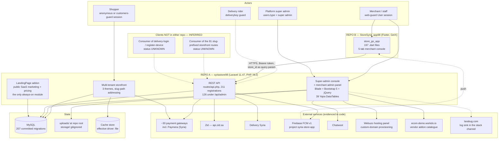
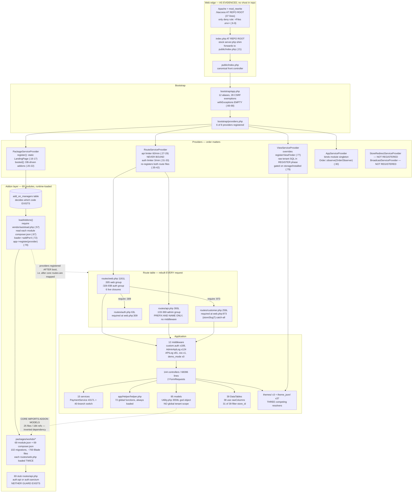
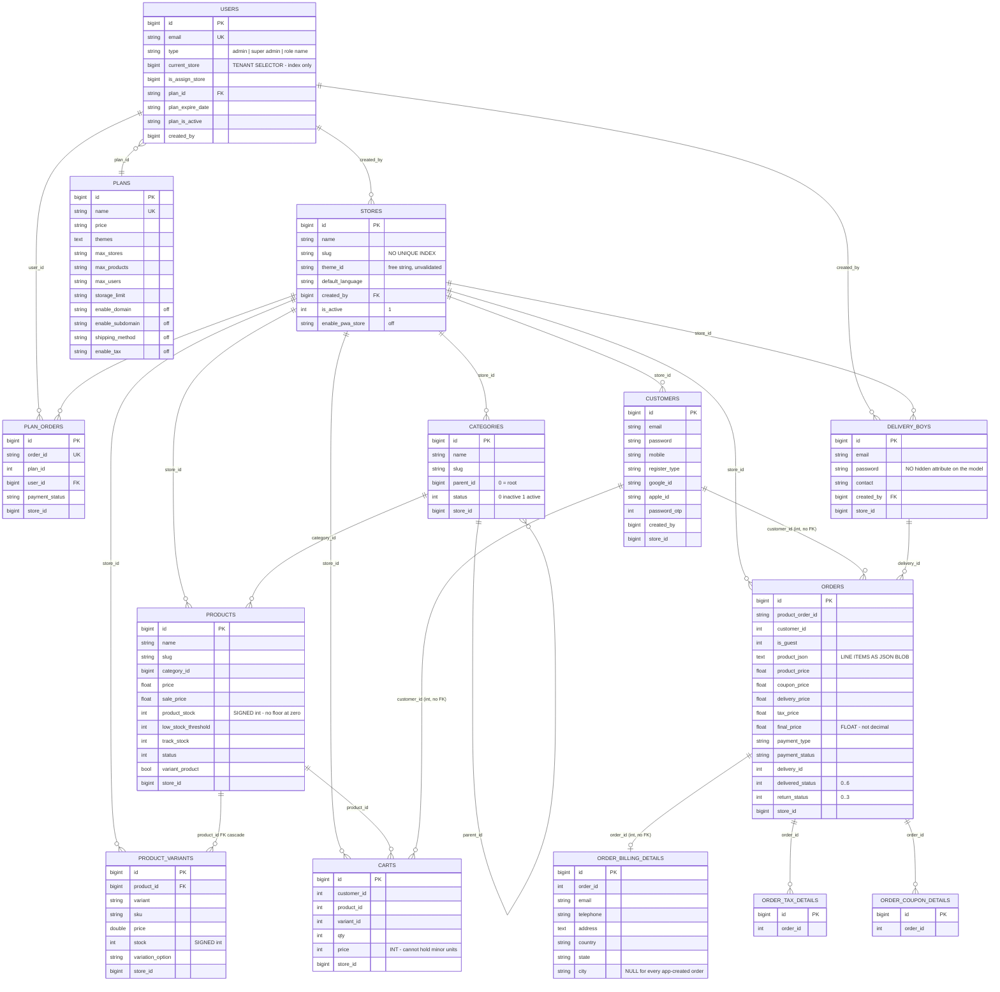
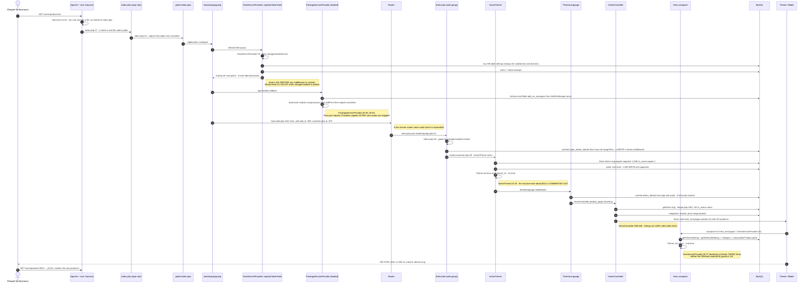
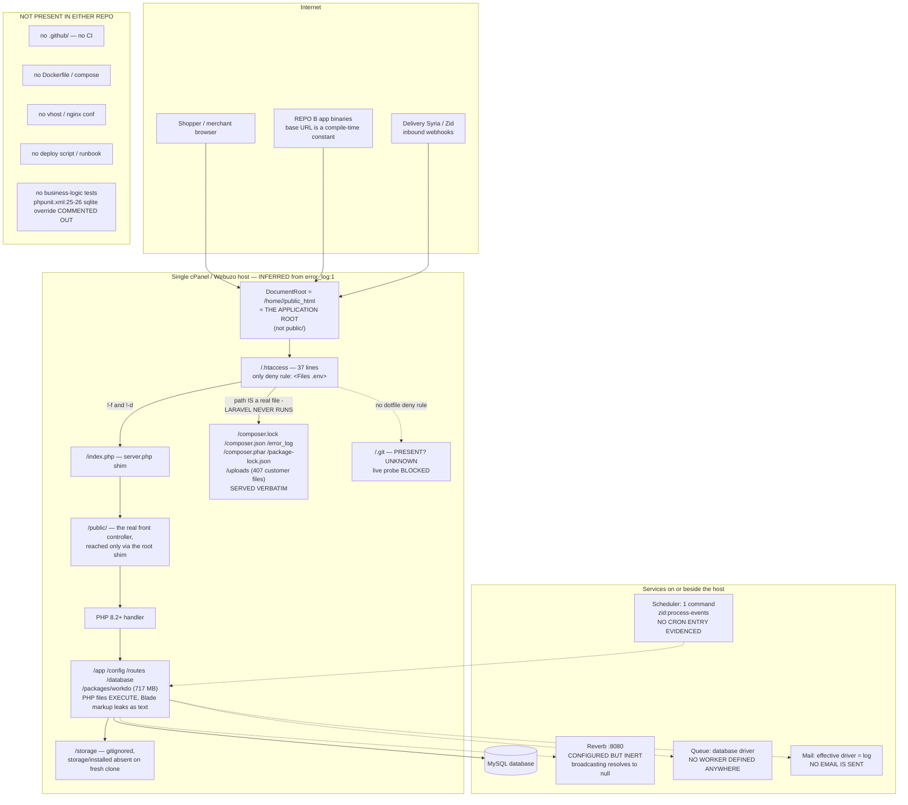

# Store Syria — System Architecture (As-Built)

> **Scope of this document.** This is a description of the architecture **as it actually is**,
> not as it was intended. Where a named component does not run, this document says so.
> Database detail (schema reproducibility, tenancy enforcement, the missing-migration
> inventory) lives in doc 04; security exploitation paths live in the security documents.
> Here we establish the structure, the boundaries, and what crosses them.

---

## 1. Executive architecture summary

**Repo A has no architecture of its own.** It is a customised copy of the commercial WorkDo
"eCommerceGo SaaS" product — `repo-A config/verification.php:4-5` declares
`'system' => 'EcommerceGo SaaS'`, `'system_version' => '8.8.2'` — running on a current
Laravel 11 / PHP ^8.2 skeleton. The Syria team's own work was appended wherever was nearest:
business logic inside route closures, a 4,317-line payment service, a 2,560-line global
helper file, and tenancy resolved four different ways in four different layers.

The six architectural facts that matter most for a go/no-go decision:

| # | Fact | Evidence | Status |
|---|---|---|---|
| 1 | The API has **one** authentication middleware and it validates the token **id** only, never the secret — and passes anonymous requests straight through | `repo-A app/Http/Middleware/CustomAuth.php:23-24, 32-34, 54` | VERIFIED (V3, V6 CONFIRMED) |
| 2 | The 69 addon modules are **not installed by Composer at all**; their classes exist only because a provider injects PSR-4 prefixes at runtime from a **database table** | `repo-A app/Providers/PackageServiceProvider.php:28-38, 55-83` | VERIFIED |
| 3 | `php artisan route:cache` cannot run (6 live closure routes), so ~1,891 lines of core routes are re-parsed every request | `repo-A routes/web.php:582, 978, 982, 987, 1026, 1146`; `wc -l routes/*.php` = 1,891 | VERIFIED |
| 4 | The Vite/Tailwind/npm toolchain is entirely dead code — `@vite` appears **0 times** in 1,232 Blade files and `public/build` does not exist | `grep -rl '@vite' resources/views themes` -> 0; `ls public/build` -> absent | VERIFIED |
| 5 | **Repo B is Repo A's client, proven.** All 83 distinct endpoint paths the Flutter app calls resolve to real routes inside Repo A's `Route::prefix('admin')` group — 0 orphans | `repo-B lib/utils/base_api.dart:3` vs `repo-A routes/api.php:133`; match table in §8 | VERIFIED |
| 6 | **No deployment configuration exists in either repository.** No Dockerfile, no compose file, no CI, no vhost, no nginx conf, no deploy script, no `.github/` | `find`/`git ls-files` over both repos | VERIFIED |

**Architecture verdict.** The platform can be *operated*. It cannot be *safely extended* in its
current shape: every new feature lands in a 3,000–7,600-line controller or a 2,560-line helper,
the module system re-reads up to 69 `composer.json` files plus a DB table per request to decide
what code exists, and there are **2** FormRequest classes against **1,330** controller methods
(`repo-A app/Http/Requests/` = 2 files). The reuse-first path is to keep this codebase and fix
the five structural seams named in §13 — not to rewrite it.

---

## 2. System context

Repo A is simultaneously three products sharing one Laravel application: a **super-admin SaaS
console**, a **per-merchant admin panel**, and a **multi-tenant storefront**. Repo B is a fourth
surface — a merchant/store-owner mobile console — that talks only to the admin API.



**Citations for the context diagram.** Repo B base URL `repo-B lib/utils/base_api.dart:3`
(`https://storesyria.com/api/admin`); Repo A `APP_URL` in the committed `.env:6` is
`https://storesyria.com`. Guards `web`, `customers`, `deliveryboy` at
`repo-A config/auth.php:38-51`, providers at `:70-82`, default guard `web` at `:16-17`.
Admin API group `repo-A routes/api.php:133`. Firebase project id `syria-store-app` at
`repo-A .env:51` (variable `FIREBASE_PROJECT_ID`) and in
`repo-B android/app/google-services.json` `.project_info.project_id`. Webuzo integration
`repo-A app/Services/WebuzoDomainService.php:29-43`. Vendor addon catalogue fetched by
`file_get_contents('https://ecom-demo.workdo.io/cronjob/addon.json')` at
`repo-A app/Models/Utility.php:1073`. Larabug is wired into the default `stack` log channel at
`repo-A config/logging.php:55-57`.

**The two inferred clients matter for change management.** `repo-A routes/api.php` registers 81
routes under `/api/{slug}/...` (a customer/storefront API) and a complete delivery-rider surface
at `repo-A routes/api.php:315-331`, including a **second** Firebase service account for riders
(`repo-A config/services.php:116`). Neither has a client in these two repositories. Status:
**UNKNOWN** — this is an owner question, not a code question, and it sets the blast radius of any
API change.

---

## 3. Backend architecture

### 3.1 Bootstrap and the request entry points

Laravel 11 slim-skeleton style. There is **no** `app/Http/Kernel.php` (verified absent) and
**no** `providers` key in `config/app.php`. Configuration happens in two files:

| Concern | Where | Note |
|---|---|---|
| Route files | `repo-A bootstrap/app.php:8-14` | `web.php`, `api.php`, `console.php`, `channels.php`, health at `/up`. `routes/customer.php` and `routes/auth.php` are **not** listed here — they are `require`d from `web.php` (`:309`, `:973`) |
| Middleware aliases | `repo-A bootstrap/app.php:16-29` | 12 aliases; `custom.auth` at `:23` |
| Global group mutation | `repo-A bootstrap/app.php:31` | the **only** one: `appendToGroup('web', SetLocate::class)` |
| CSRF exemptions | `repo-A bootstrap/app.php:33-64` | **28 URI patterns**, mostly payment callbacks — but also `'/login'` (`:48`), `'*/checkout'` (`:57`) and `'delivery-syria/status'` (`:62`) |
| Exception handling | `repo-A bootstrap/app.php:66-68` | **empty closure** |
| Providers | `repo-A bootstrap/providers.php:3-10` | 6 registered of 8 present in `app/Providers/` |

Two consequences are load-bearing:

- **`app/Exceptions/Handler.php` never executes.** The legacy class exists and contains real
  API-specific logic (a clean 405 JSON for `api/*`, plus a CSRF-expiry redirect) at
  `repo-A app/Exceptions/Handler.php:28-39`, but `withExceptions` is empty and nothing binds the
  class. Status: MISSING (the customisation never runs). *Inference on the binding mechanism —
  `vendor/` absent; the empty closure and the absent binding are FACT.*
- **Routes are registered twice.** `repo-A bootstrap/app.php:8-14` registers `web.php` and
  `api.php`, and `repo-A app/Providers/RouteServiceProvider.php:35-42` registers both again.
  This is a Laravel 10 -> 11 migration leftover. Mostly idempotent, but it doubles route-boot
  cost and makes the winner of any duplicate method+URI pair indeterminate from source.

### 3.2 Layer sizes (measured, not estimated)

| Layer | Files | Lines | Note |
|---|---|---|---|
| `app/Http/Controllers` | 144 | 68,396 | 1,330 `function` declarations |
| `app/Models` | 95 | 11,441 | 31% is one file |
| `app/Services` | 15 | 8,430 | 51% is one file |
| `app/DataTables` | 39 | 3,782 | 38 of 39 call `rawColumns` |
| `app/Helper/helper.php` | 1 | **2,560** | 72 globally autoloaded functions |
| `app/Http/Requests` | **2** | — | against 1,330 controller methods |
| `app/Jobs` | **absent** | — | nothing is asynchronous |
| `app/Policies` | **absent** | — | `AuthServiceProvider` has an empty `$policies` |
| `routes/` | 6 | 1,891 | `web.php` 1,161; `api.php` 393; `customer.php` 259; `auth.php` 63 |
| `packages/workdo/` | 69 modules | — | 102 further migrations, ~700 Blade files |

The four largest single files, all verified by `wc -l`:
`repo-A app/Http/Controllers/Api/DashboardController.php` **7,631**,
`repo-A app/Http/Controllers/Api/ApiController.php` **7,404**,
`repo-A app/Services/PaymentService.php` **4,317**,
`repo-A app/Models/Utility.php` **3,559**.

Verified god-methods: `PaymentService::getProductStatus()` spans
`repo-A app/Services/PaymentService.php:1873-2900` (**1,028 lines**);
`ProductController::store()` spans `repo-A app/Http/Controllers/ProductController.php:94-880`
(~787 lines).

### 3.3 There is no abstraction layer

`grep -rln "interface \|abstract class" app/` matches only `app/Package/Tap.php` and two files
inside the vendored Xendit SDK (`app/Xendit/Exceptions/ExceptionInterface.php`,
`app/Xendit/HttpClient/ClientInterface.php`). There is no `app/Contracts`, no
`app/Repositories`, no `app/Actions`, no `app/DTO`. Payment dispatch is a single
`switch ($paymentMethod)` at `repo-A app/Services/PaymentService.php:86` routing to ~40 private
`process*` methods **in the same class** — and the same gateway logic is duplicated again in 25+
`*PaymentController` / `*PaymnetController` classes at the HTTP layer.

Status: **PARTIALLY IMPLEMENTED** (the code works; the shape prevents safe change).
Severity HIGH, priority P1.

### 3.4 Component diagram, including the addon layer



### 3.5 The Workdo addon / module system

This is the single most consequential piece of the backend architecture, because **it decides at
runtime which classes and routes exist**.

`repo-A composer.json:137-143` declares a path repository for `packages/workdo/*`, but **none of
the 69 packages appears in `require`**, and `jq '.packages[]|select(.name|test("workdo"))'`
over `composer.lock` returns nothing — zero of ~200 locked packages. There is no
`composer-merge-plugin`. **Composer installs none of the modules.** The path repository is
decorative.

Loading happens instead in `repo-A app/Providers/PackageServiceProvider.php`:

```php
// repo-A app/Providers/PackageServiceProvider.php:14-23
public function register(): void
{
    $staticAddons = ['LandingPage'];
    $this->loadAddons($staticAddons);
    // Defer database queries until after DB connection is ready
    $this->app->booted(function () {
        $this->loadDynamicAddons();
    });
}
```

```php
// repo-A app/Providers/PackageServiceProvider.php:55-83 (abridged, verbatim lines)
$loader = require base_path('vendor/autoload.php');            // :57
foreach ($addons as $addon) {
    $packageDir = base_path("packages/workdo/{$addon}");       // :60
    $composerConfig = json_decode(file_get_contents($composerFile), true);  // :67
    foreach ($composerConfig['autoload']['psr-4'] as $namespace => $path) {
        $loader->addPsr4($namespace, "{$packageDir}/{$path}"); // :72
    }
    foreach ($composerConfig['extra']['laravel']['providers'] as $provider) {
        $this->app->register($provider);                       // :79
    }
}
```

The enabled set comes from the database — `repo-A app/Providers/PackageServiceProvider.php:28`
(`Schema::hasTable('add_on_managers')`) and `:32` (`AddOnManager::pluck('module')`) — and every
failure is swallowed at `:39-41` (`catch (\Exception $e) { // Handle silently }`).

**Architectural consequences, all verified from code:**

| Consequence | Evidence | Status |
|---|---|---|
| `route:cache` / `optimize` cannot produce a stable artifact — the route set depends on DB rows | `:28-38` + 6 closure routes | VERIFIED |
| Addon providers register **inside `booted()`**, i.e. *after* core routes are mapped, so route order is "core first, addons last" | `:20-22` vs `RouteServiceProvider.php:35-42` | VERIFIED |
| Per-request cost: one `Schema::hasTable`, one `pluck`, and one `file_get_contents`+`json_decode` per enabled module, uncached | `:28`, `:32`, `:67` | VERIFIED |
| A broken module `composer.json` silently removes a feature with no log line | `:39-41` | VERIFIED |
| Every module registers its own route file **twice** — once via `loadRoutesFrom` in its ServiceProvider and once via a nested `RouteServiceProvider` wrapped in `web` | `packages/workdo/ProductReview/src/app/Providers/ProductReviewServiceProvider.php:13-25` and `packages/workdo/ProductReview/src/app/Providers/RouteServiceProvider.php:47-52`; the pattern holds for 68 of 69 | VERIFIED |
| 67 of 69 modules ship a stub `src/routes/api.php` guarded by `auth:api` or `auth:sanctum` — **neither guard exists** in `config/auth.php:38-51` | e.g. `packages/workdo/MarketPlaceList/src/routes/api.php:16` | VERIFIED |
| The **core depends on optional addons** (inverted dependency): `grep -rlF 'Workdo\' app/` -> 25 core files, 184 references, unguarded by `class_exists` | e.g. `repo-A app/Models/Utility.php:21-23` imports `AuctionProductOrder`, `AffiliateSetting`, `AffiliateTransaction`, used at `:2269`, `:3413-3418` | VERIFIED |

That the double registration is a known, lived-with problem is itself evidenced: the project
ships a bespoke artisan command for it —
`repo-A app/Console/Commands/FindDuplicateRouteNames.php:12`,
`protected $signature = 'route:find-duplicates';`.

**One module dominates the repository.** `packages/workdo/Marketing` is 52,107 of 58,982 tracked
files (88.3%) and 535 MB, and it is not store marketing: its models are `CardProduct`,
`CardPayment`, `Storeqr`, `StoreHours`, `Appoinment` — WorkDo's **digital business card**
product, bundled in with 16 migrations of its own. *Fact on the counts and model names;
inference that it is the vCard product.*

**Status of the module system:** IMPLEMENTED BUT NOT VERIFIED (it evidently works in production,
but which modules are live is UNKNOWN without DB access). Severity HIGH, priority P1.

---

## 4. Frontend architecture

There are **two unrelated front ends** inside Repo A, plus Repo B.

### 4.1 The admin panel: Blade + Bootstrap + jQuery + Yajra DataTables

The merchant and super-admin panels are server-rendered Blade over Bootstrap 5 and jQuery.
The data grids are 39 Yajra `DataTable` service classes in `repo-A app/DataTables/` (verified
count). These are not a pure presentation layer — they own both tenant filtering and HTML
generation:

```php
// repo-A app/DataTables/OrderDataTable.php:156-162
public function query(Order $model): QueryBuilder
{
    return $model->newQuery()
        ->with('ShippingMethod')
        ->where('store_id', getCurrentStore())
        ->orderBy('created_at', 'desc');
}
```

**38 of 39** DataTables call `rawColumns(...)` (e.g.
`repo-A app/DataTables/OrderDataTable.php:149`), i.e. they opt out of Blade escaping for columns
built by string concatenation from model attributes. **31 of 39** reference `store_id`; the other
8 do not. Table chrome is emitted from the global helper `buildDataTable()` at
`repo-A app/Helper/helper.php:2169`, which returns a ~90-line JavaScript string — so changing a
grid's behaviour means editing the global helper file.

Status: IMPLEMENTED AND VERIFIED (it works). Severity MEDIUM, priority P2 — this is a
maintainability finding, not a defect.

### 4.2 The asset pipeline is dead code

| Proof | Evidence |
|---|---|
| Nothing consumes a build | `grep -rl '@vite' resources/views themes` -> **0 files** |
| No build output exists | `ls public/build` -> absent |
| `npm run build` could not succeed | `repo-A vite.config.js:7-11` declares two inputs; `resources/js/echo.js:1-3` imports `laravel-echo` and `pusher-js`, **neither of which is in `package.json`** |
| The lockfile predates the toolchain | `package-lock.json` is `lockfileVersion: 1` (npm 6, 2019) with `name: null`, while `package.json` declares `vite ^5.0` |
| Tailwind would purge the storefront anyway | `repo-A tailwind.config.js:6-10` scans only `resources/views/**`, not `themes/*/views` (44 Blade files) nor `packages/workdo/*/src/resources/views` (~700) |

Assets are instead served from a pre-built `public/assets` tree via `asset()` — e.g.
`repo-A resources/views/layouts/app.blade.php:83, 88-99`.

**On the storefront, Tailwind is compiled in the browser.** Each theme layout loads a
~410–480 KB Tailwind runtime in `<head>`:
`themes/greentic/assets/js/tailwind.js` 477,348 B;
`themes/stylique/assets/js/tailwind.js` 477,551 B;
`themes/techzonix/assets/js/tailwind.js` 407,076 B. That is blocking, non-deferred JS that then
scans the DOM and generates CSS on every pageview, with no minification, no purge and no
content-hash cache-busting.

Status: MISSING (there is no asset build in use). Severity HIGH for storefront performance,
priority P1. The architectural decision this forces is explicit: either delete the six dead
toolchain files, or make the pipeline real. Leaving it ambiguous costs every new developer a day.

### 4.3 Repo B — the Flutter merchant console

`repo-B pubspec.yaml:1` names the package `store_go_app`; `:19` pins `version: 1.0.0+1`.
**197 `.dart` files**, 463 tracked files. State management is **GetX** (`repo-B pubspec.yaml:38`,
`get: ^4.7.3`) with `get_storage` (`:39`). HTTP is the plain `http` package (`:52`), wrapped in
`repo-B lib/network/network.dart`.

Screen inventory under `repo-B lib/view/screen/`: `auth`, `category_screen`, `coupon_screen`,
`customers`, `dashboard_manager`, `delivery_boys`, `home_screen`, `notification_screen`,
`onboarding_screen`, `order_screen`, `plans`, `product_screen`, `profile_screen`,
`setting_screen`, `statistics_screen`, `wallet`, `welcome_screen.dart`.

**This is a merchant/store-owner console, not a customer shopping app — VERIFIED.** Three
independent proofs: it authenticates via `/adminlogin` (`repo-B lib/utils/base_api.dart:5`)
against Repo A's `users` table; every endpoint it calls is under `/api/admin`
(`repo-B lib/utils/base_api.dart:3`); and it **assigns** orders to delivery boys rather than
receiving them. There is no cart and no checkout anywhere in `lib/`. Firebase is wired for
core, messaging, analytics, crashlytics and remote config (`repo-B pubspec.yaml:60-65`).

Architecturally relevant gaps in Repo B:

- **The base URL is a compile-time constant** (`repo-B lib/utils/base_api.dart:3`) with a
  developer's ngrok tunnel still commented beside it at `:4`. `flutter_dotenv` is a dependency
  (`repo-B pubspec.yaml:70`) and `assets/.env` exists carrying only `IS_DEMO_MODE` — so the
  mechanism for configurable endpoints is present and unused.
- **`firebase_remote_config` is declared and never used** (`repo-B pubspec.yaml:60`;
  `grep -rn RemoteConfig lib/` -> no match), no app version is sent on any request
  (`repo-B lib/network/network.dart:44-48` sends only content-type, cache-control and accept),
  and `git tag` is empty. **There is no kill switch and no minimum-version gate**, so a breaking
  API change cannot be mitigated on the client side at all.

Status: IMPLEMENTED BUT NOT VERIFIED — no Flutter SDK exists in this environment, so
`analyze`/`test`/`build` were **BLOCKED** and all Repo B findings are static reads.

---

## 5. Storefront resolution and theming

### 5.1 Addressing is slug-path, resolved in the first URL segment

Every storefront route lives in `repo-A routes/customer.php`, inside **one** middleware group:

```php
// repo-A routes/customer.php:49-51
Route::middleware([ActiveTheme::class, 'themelanguage'])->group(function () {
    Route::get('{storeSlug?}/product-list', [HomeController::class, 'product_page'])->name('page.product-list');
```

That file is pulled in at `repo-A routes/web.php:973` — i.e. **after ~970 lines of admin
routes** — inside the `web` group opened at `repo-A routes/web.php:305` and closed at `:974`.
Note two structural facts this creates:

1. **Whether a URL is an admin page or a storefront page depends on declaration order in the
   file.** Any admin route added after `routes/web.php:973` is shadowed by the storefront
   catch-all.
2. `{storeSlug?}` is an **optional parameter in a non-terminal position** on ~90 routes. Laravel
   supports trailing optional parameters only, so the `?` is decorative and the segment is
   effectively required.

Tenant resolution itself is the single worst piece of duplication in the codebase. The same
question — *which store is this request for?* — is answered independently in four places with
**three different rulesets**:

| # | Layer | Code | Checks `is_active`? |
|---|---|---|---|
| 1 | Provider **register** phase, raw SQL, ~118 lines | `repo-A app/Providers/ViewServiceProvider.php:77-196` | no |
| 2 | Middleware, Eloquent | `repo-A app/Http/Middleware/ActiveTheme.php:21` | **yes** — but the rejection is commented out at `:23-25` |
| 3 | Global helper | `repo-A app/Helper/helper.php:2302-2304` | **no** |
| 4 | View composer | `repo-A app/Providers/ViewServiceProvider.php:23-40` | no |

```php
// repo-A app/Http/Middleware/ActiveTheme.php:21-34  (verbatim)
$store = Store::where('slug', request()->segment(1))->where('is_active', 1)->first();

//if (empty($store)){
   // return abort('403', 'The store is not active.');
// }
if($store && $store->theme_id) {
    visitor()->visit($store);
    $themeName = $store->theme_id;
} else {
    $themeName = $this->getThemeNameFromUrl($request);
}
if (!empty($themeName)) {
    Theme::set($themeName);
}
```

Three things to read off that snippet. The inactive-store rejection is **commented out**, so an
inactive store still serves pages. `visitor()->visit($store)` at `:27` is a **DB write on every
storefront request**, bots included. And when no store matches, `getThemeNameFromUrl()`
(`:38-51`) lets **the requester choose the theme via the URL**.

Meanwhile the helper every storefront controller actually uses has no activity check at all:

```php
// repo-A app/Helper/helper.php:2302-2304
function getStore($storeSlug = null)
{
    return Store::where('slug', $storeSlug ?? request()->route('storeSlug'))->first();
}
```

And `stores.slug` has **no unique index** — `repo-A database/migrations/2023_12_14_090259_create_stores_table.php:18`
is a bare `$table->string('slug');`. Resolution is `->first()`, so with duplicate slugs the
lowest id silently wins, and there is no reserved-word list protecting `admin`, `login`,
`storage` or `themes`.

Status: PARTIALLY IMPLEMENTED. Severity CRITICAL for tenancy, priority P0.

### 5.2 Custom domains and subdomains

Custom domain is **not** a column on `stores`. The values live as rows in the `settings` table
under the names `domains`, `subdomain`, `enable_domain`, `enable_subdomain` — see the resolver at
`repo-A app/Helper/helper.php:195-198`. Plan entitlement flags do exist in schema:
`repo-A database/migrations/2023_12_08_123752_create_plans_table.php:25-26`
(`enable_domain`, `enable_subdomain`, both defaulting to `'off'`).

The provisioning layer is **genuinely custom Syria-team code** (Arabic comments) wired to a
Webuzo hosting panel: `repo-A app/Http/Controllers/AppSettingController.php:685-755` calling
`repo-A app/Services/WebuzoDomainService.php:29-43`. This is real engineering and the most
valuable non-stock asset in the storefront area. It has three architectural problems:

- **No TLS is requested.** `addDomain(string $domain, bool $issueSsl = false)` sends
  `'issue_lecert' => $issueSsl ? 1 : 0` (`:43`), and both call sites pass `false`
  (`AppSettingController.php:755`, `:868-872`). *Verification verdict V22 corrects the severity:
  the integration is currently **non-functional**, because `WEBUZO_HOST`, `WEBUZO_USERNAME` and
  `WEBUZO_API_KEY` are resolved through bare `env()` at `repo-A config/services.php:120-122`
  and none of the three appears among the 41 variable names in the committed `.env` (verified by
  name-only enumeration). So `validateConfiguration()` (`WebuzoDomainService.php:383-396`)
  throws on every call. The `issueSsl=false` default is a **latent** defect: MEDIUM / P2 today,
  rising to HIGH the moment credentials are configured.*
- **No uniqueness** is enforced on `domains`/`subdomain` across tenants before writing.
- **The dedicated domain router is dead code.** `repo-A app/Providers/StoreRedirectServiceProvider.php`
  is 131 lines that look exactly like the multi-tenant domain router — `Route::bind('storeSlug', …)`
  at `:22`, `DB::table(...)` at `:30-38` — and it is **absent from
  `repo-A bootstrap/providers.php:3-10`**. It could not run even if registered: its only import
  is `use Illuminate\Support\ServiceProvider;` (`:5`), so `Route::` and `DB::` resolve to
  non-existent `App\Providers\Route` / `App\Providers\DB`. `php -l` passes because facades are
  resolved at runtime. What actually serves a bare custom domain is the platform root route
  `repo-A routes/web.php:320` -> `HomeController::Landing` (`repo-A app/Http/Controllers/HomeController.php:43`).

Status: PARTIALLY IMPLEMENTED / currently non-functional. Priority P0 as a product decision
(keep Webuzo, or move to a reverse proxy with on-demand TLS), P2 as a code defect.

### 5.3 Theming: three competing mechanisms, two of which run on the same request

The declared mechanism is `qirolab/laravel-themer ^2.3` (`repo-A composer.json:57`), configured
at `repo-A config/theme.php:12` (`'active' => 'stylique'`), `:24` (`'parent' => 'stylique'`) and
`:33` (`base_path('themes')`). Note that `active` and `parent` are **the same theme**, so the
parent-fallback hierarchy the file's own comment describes (`:18-23`) is a no-op.

Three resolvers coexist:

| Mechanism | Where | Runs when |
|---|---|---|
| Themer `Theme::set()` | `repo-A app/Http/Middleware/ActiveTheme.php:33` **and** `repo-A app/Providers/ViewServiceProvider.php:48` | twice per storefront request, from two different store lookups |
| Manual `view.paths` mutation with raw SQL | `repo-A app/Providers/ViewServiceProvider.php:77-196`, eight near-identical `\Config::set('view.paths', [...])` blocks | provider register phase, gated on `file_exists(storage_path()."/installed")` (`:79`) |
| Helpers `APP_THEME()` / `getFrontThemeUrl()` | `repo-A app/Helper/helper.php:385`, `:2526` | on demand |

Theme inventory (verified by `find`):

| Theme | Blade files | `theme_json` | RTL CSS shipped |
|---|---|---|---|
| `greentic` | 16 | 32 | none |
| `stylique` | 13 | 32 | `ltr.css`, `rtl.css` present |
| `techzonix` | 15 | 32 | none |

A "theme" here is a header/footer/homepage reskin, **not** an independently themable storefront:
the actual pages live in `repo-A resources/views/front_end` (**104 files**, verified) and are
shared across all three themes. There is no page builder — `themes/*/theme_json/pages.json`
declares 25 customizable pages whose fields are rendered by exactly 12 field types in a
`@switch` at `repo-A resources/views/theme_customize/customize.blade.php:108-630`, and each
homepage section is hard-coded in Blade behind an on/off guard. Verdict: a **settings form**.

**Theme-path precedence is the one architectural question this area could not settle.**
`ViewServiceProvider` puts `resources_path('views')` **first** in `view.paths`, while the themer
package normally *prepends* theme paths. `vendor/` is absent, so which wins is **UNKNOWN**.
*Verification verdict V21 resolves it on the evidence that matters:* the storefront home view
`main_file` exists **only** under `themes/*/views/`, and `repo-A app/Http/Controllers/HomeController.php:506`
gates the page on `view()->exists('main_file')` — so the homepage could not render at all unless
theme paths are searched first. Each theme's own
`themes/{greentic,stylique,techzonix}/views/front_end/layouts/app.blade.php:18` loads
`main-style.css` unconditionally. The stale copy at
`repo-A resources/views/front_end/layouts/app.blade.php:18, 74` that references the non-existent
`rtl-main-style.css` / `rtl-custom.js` is therefore **dead code**, and the real Arabic defect is
narrower: `dir="rtl"` is set (`themes/*/views/front_end/layouts/app.blade.php:2`) with **no RTL
override stylesheet loaded**, so Arabic storefronts are mis-mirrored rather than unstyled.
Severity MEDIUM / P2, not CRITICAL.

One deployment-shaped storefront defect belongs here because it is architectural, not cosmetic:
`public/storage` is **committed as a regular file** (mode `100755`, not a symlink) whose single
line is the upstream vendor's absolute path `/var/www/html/Product/EcommerceGo/main_file/storage/app/public`.
Until it is deleted and `storage:link` is run, every `asset('storage/...')` URL — product images,
category images, the favicon fallback, the PWA manifest — 404s on a fresh deploy.
Status: MISSING. Severity CRITICAL, priority P0.

---

## 6. Database architecture overview

> Full schema analysis, the missing-migration inventory and tenancy enforcement are doc 04.
> This section establishes only the **shape**.

**Engine and connection.** MySQL, selected by `DB_CONNECTION` in the committed `.env`.
`repo-A config/database.php` defines five connections; note `mysql.engine => null` at `:56`
(no explicit InnoDB).

**Tenancy model: (A) shared database, `store_id` discriminator column.** This is the correct
model for this product and nothing in the audit forces a change. The architectural problem is
that **isolation is purely conventional**:

| Enforcement mechanism | Present? | Evidence |
|---|---|---|
| Eloquent global scopes | **no** | `grep -rn "addGlobalScope"` over `app/Models/` -> 0 hits |
| Tenant trait / scope class | **no** | `app/Traits/` contains only `ApiResponser.php` |
| Policies | **no** | `app/Policies` absent; `app/Providers/AuthServiceProvider.php:15-17` has an empty `$policies` |
| `authorize()` / `Gate::` calls | **no** | 0 hits across `app/` and `packages/` |
| Laratrust teams (per-store roles) | **disabled** | `repo-A config/laratrust.php:242` `'enabled' => false` |
| Hand-written `where('store_id', …)` | **yes** | **487** explicit `where('store_id', getCurrentStore())` call sites in `app/` + `packages/` (330 in `app/` alone); **1,260** `where('store_id', …)` clauses in total; `getCurrentStore()` called 1,281 times — commands below |
| Laratrust `isAbleTo()` permission checks | **yes** | 362 call sites across 59 controller files |

So the platform *does* have an authorization layer (Laratrust) and *does* have a tenant resolver
(`getCurrentStore()`, `repo-A app/Helper/helper.php:357-381`) — but the permission checks answer
*"may this role touch coupons?"* and never *"does this record belong to the caller's store?"*,
and there is no backstop when a developer omits the filter.

**Reproducing the filter-site count.** The hand-written filter is the only thing isolating
tenants, so the figure is load-bearing and is published with its command. At `repo-A` root:
`grep -rn "where('store_id', *getCurrentStore()" app/ packages/ --include=*.php | wc -l` = **487**
(the same command against `app/` alone = **330**), and the wider count of every
`where('store_id', …)` clause regardless of its second argument,
`grep -rnE "where\((['\"])store_id\1," app/ packages/ --include=*.php | wc -l` = **1,260**.
`grep -rn "getCurrentStore()" app/ packages/ --include=*.php | wc -l` = **1,281**. Take 487 as the
headline: tenant isolation *is* implemented, pervasively — as a manual per-query convention a
developer must remember at 487 call sites (1,260 counting every form of the clause), with no
global scope, policy or trait behind it. Both numbers make the same architectural point, and
neither is a mechanism; nothing fails loudly when one site is missed.

**Model files carrying `store_id`: 119 of 188** platform-wide (**57 of 95** in `app/Models/`
alone). Commands:
`find app/Models packages -type f -name '*.php' \( -path '*/Models/*' -o -path '*/Entities/*' \) | wc -l`
= 188, the same `find` piped to `xargs grep -l "store_id" | wc -l` = 119;
`ls app/Models/*.php | wc -l` = 95, `grep -l store_id app/Models/*.php | wc -l` = 57.

**Migration inventory.** 105 in `repo-A database/migrations/` plus 102 under
`packages/workdo/*/src/database/migrations/` = **207** (verified by `ls`/`find`). The schema the
code actually runs against is **not reproducible from this repository** — 15 tables that live,
routed code reads and writes have no `Schema::create` anywhere, 6 of them money-bearing. That is
doc 04's subject; it is named here because it is the gating constraint on every other
architectural fix. Status VERIFIED (verification verdicts V7, V18 CONFIRMED CRITICAL/P0).

### 6.1 Core commerce entity relationships

The diagram below shows only the **core commerce tables whose migrations exist and were read
directly**. Column lists are abridged to the keys and the fields that carry architectural
meaning.



**Four structural observations from the schema itself**, each with a citation:

1. **Order line items are a JSON blob.** `repo-A database/migrations/2024_01_23_061635_create_orders_table.php:15`
   is `$table->text('product_json')->nullable();`. There is no `order_items` table. Every
   per-line operation — stock restore, refund, invoice rendering — parses that blob, which is
   why the stock-restore bug in doc 06 is possible.
2. **Money is `float`, not `decimal`.** `orders.product_price`, `coupon_price`, `delivery_price`,
   `tax_price`, `final_price`, `return_price` are all `$table->float(...)` at
   `:17-22` of the same migration; `carts.price` is a bare `integer`
   (`repo-A database/migrations/2024_01_18_103138_create_carts_table.php:20`). Zero
   `decimal()` columns exist across the 105 core migrations. For SYP amounts this is a
   correctness problem, not a style one.
3. **Tenancy columns are indexed but not constrained.** `store_id` is consistently
   `unsignedBigInteger(...)->nullable()->index()` — never a foreign key. `orders.customer_id`
   and `order_billing_details.order_id` are plain `integer` with no FK. The only cascading FKs
   in the core commerce set are `stores.created_by -> users.id`,
   `product_variants.product_id -> products.id`, `delivery_boys.created_by -> users.id` and
   `plan_orders.user_id -> users.id`.
4. **`users.current_store` is the tenant selector and it is writable over the API.** It is a
   plain indexed column (`repo-A database/migrations/2014_10_12_000000_create_users_table.php:25`),
   and `POST /api/admin/changestore` sets it to any store id with no ownership check
   (`repo-A app/Http/Controllers/Api/DashboardController.php:3550-3557`). Architecturally this
   means a single unprotected write converts every correctly-scoped web controller into a
   cross-tenant one. Status VERIFIED by the dossiers; listed in the unverified-claims set, so
   treat the exploit path as PLAUSIBLE pending a live check, and the missing ownership filter as
   FACT.

---

## 7. API boundaries and the authentication schemes behind them

`repo-A routes/api.php` is 393 lines containing **211 route registrations** (209 distinct
method+URI pairs). It has exactly **one** group:

```php
// repo-A routes/api.php:133
Route::prefix('admin')->as('admin.')->group(function(){
```

closing at `:369`. **That group adds a URL prefix and a name prefix only — no middleware.**
Everything outside it (lines 35–131 and 376–384) is at file top level. Walking outward from any
route therefore terminates at the framework `api` group, and
`repo-A bootstrap/app.php:15-65` never calls `throttleApi()`, `statefulApi()` or
`appendToGroup('api', ...)` — so that group is `[SubstituteBindings]` only.
*Inference on the framework default (vendor/ absent); the absence of the opt-in call is FACT.*

### 7.1 The four API boundaries

| Boundary | Path shape | Route lines | Count | Client |
|---|---|---|---|---|
| **Merchant admin API** | `/api/admin/...` | `repo-A routes/api.php:133-369` | 126 | **Repo B** (uses 83) |
| **Storefront / customer API** | `/api/{slug}/...` | `repo-A routes/api.php:46-131, 394` | 81 | **none in either repo** |
| **Delivery-rider API** | `/api/admin/delivery-*`, `register-device`, `notifications/*` | `repo-A routes/api.php:315-331` | 14 (subset of the 126) | **none in either repo** |
| **Third-party inbound** | `/api/delivery-syria/*` | `repo-A routes/api.php:35-38, 376-384` | 3 | Delivery Syria / Zid |

### 7.2 Five authentication schemes, one of which actually guards anything

| Scheme | Installed | Guard configured? | Routes it guards | Verdict |
|---|---|---|---|---|
| `custom.auth` -> `App\Http\Middleware\CustomAuth` | app code | n/a — logs into the three **session** guards | **189 of 211** | **BROKEN** — see below |
| `laravel/sanctum v4.0.5` | yes | **no `sanctum` guard** in `config/auth.php:38-51` | **0** — `auth:sanctum` appears only commented out at `repo-A routes/api.php:26` | tokens are *minted* by Sanctum, never *validated* by it |
| `php-open-source-saver/jwt-auth 2.7.2` | yes | **no** | **0** — zero `JWTAuth`/`JWTSubject` usages | dead dependency; ships a committed default secret at `repo-A config/jwt.php:18` with no `JWT_SECRET` in `.env` |
| `auth:api` / `auth:sanctum` in 69 module stubs | n/a | **neither guard exists** | 69 dead stub routes | would throw `Auth guard [api] is not defined` if hit *(inference)* |
| Per-store shared secret, `hash_equals` | app code | n/a | 1 route (`repo-A routes/api.php:35`) | **correct** — `repo-A app/Http/Controllers/Api/DeliverySyriaOrderController.php:157-179` |

**The decisive code.** `repo-A app/Http/Middleware/CustomAuth.php:21-55` — read verbatim:

```php
$token = $request->header('Authorization');     // :23
if ($token) {                                    // :24
    $token = substr($token, 7);                  // :26
    $token = explode('|', $token);               // :28
    $tokenId = $token[0] ?? null;                // :29  <-- the id half only
    if ($tokenId) {
        $tokenExists = \DB::table('personal_access_tokens')
        ->where('id', $tokenId)                  // :33  <-- lookup by PRIMARY KEY alone
        ->first();
        ...
    }
}
return $next($request);                          // :54  <-- no header => PROCEEDS ANONYMOUSLY
```

Two architectural failures, both confirmed by the adversarial verification (V3 and V6, both
CONFIRMED CRITICAL):

1. **The token secret is never compared.** `personal_access_tokens.token` (stock Sanctum
   `string('token', 64)`, a SHA-256 hash) is never read, hashed or compared. The second segment
   of the token — the actual proof of possession — is parsed out at `:28` and discarded.
2. **No header means no 401.** The `if ($token)` at `:24` has no `else`; execution reaches
   `return $next($request)` at `:54` with no authenticated user. The 401 at `:47-49` fires only
   when a *present* header carries a non-existent id.

That this is a defect rather than a design choice is proved 20 lines away in the same codebase:
`repo-A app/Http/Controllers/Api/DashboardController.php:620-633` (`logouto`) does it correctly
with `hash_equals($token->token, hash('sha256', $tokenValue))`.

**Architectural consequence.** `custom.auth` is an *identity-attachment* middleware, not an
auth gate — so **every controller must re-implement the check in its own body**. Some do:
`repo-A app/Http/Controllers/StoreFinanceController.php:1198-1231` performs a null check, a
Laratrust `isAbleTo('Add Finance Balance')` check and a store-ownership check, in that order.
Most do not. There is no single point where an unauthenticated request is stopped.

### 7.3 Routes with no authentication middleware at all

**22 of 211** registrations carry no auth middleware. Seven of them are bulk tenant-data
exports, and **Repo B calls all seven**:

```php
// repo-A routes/api.php:163-169  (verbatim)
Route::get('categorylist', [DashboardController::class, 'CategoryList'])->middleware(['AdminApiLog']);
Route::get('productlist', [DashboardController::class, 'ProductList'])->middleware(['AdminApiLog']);
Route::get('variantlist', [DashboardController::class, 'VariantList'])->middleware(['AdminApiLog']);
Route::get('orderlist', [DashboardController::class, 'OrderList'])->middleware(['AdminApiLog']);
Route::get('couponlist', [DashboardController::class, 'CouponList'])->middleware(['AdminApiLog']);
Route::get('shippinglist', [DashboardController::class, 'ShippingList'])->middleware(['AdminApiLog']);
Route::get('taxlist', [DashboardController::class, 'TaxList'])->middleware(['AdminApiLog']);
```

`AdminApiLog` is a pass-through: `repo-A app/Http/Middleware/AdminApiLog.php:19-22` is
`public function handle(Request $request, Closure $next) { return $next($request); }`. Its only
other method is `terminate()`. **It performs no authentication of any kind.** Verification
verdict V16 CONFIRMED this as CRITICAL/P0: the handler takes the tenant from the query string
(`repo-A app/Http/Controllers/Api/DashboardController.php:918`, `$store = Store::find($request->store_id);`)
and applies `Order::where('store_id', $store->id)` at `:926` — so the query **is** scoped, but
the tenant is chosen by an attacker-supplied integer with no authorization that the caller
belongs to it, and nothing rate-limits the walk.

Two further write endpoints have **no middleware array at all** —
`repo-A routes/api.php:203-211`, `POST /orders/notes/create` and
`DELETE /orders/notes/delete`.

### 7.4 Rate limiting: defined, never bound

`repo-A app/Providers/RouteServiceProvider.php:27-29` defines an `api` limiter at 60/min keyed
on user-or-IP, and `:31-33` defines an `auth` limiter at 3/min keyed on IP. **The `api` limiter
is referenced by nothing.** Exactly 2 of 211 registrations carry a throttle
(`repo-A routes/api.php:48` and `:316`), and the login throttle is bypassable because the same
`DashboardController@login` action is registered twice — at `/api/adminlogin` **with**
`throttle:auth` (`:47-48`) and at `/api/admin/adminlogin` **without** it (`:134`). Repo B calls
the second one (`repo-B lib/utils/base_api.dart:5`, `loginUrl = '/adminlogin'` resolved against
the `/api/admin` base). Status: MISSING. Severity CRITICAL, priority P0.

### 7.5 No versioning, four response envelopes

There is **no version segment** anywhere in the live API surface — the shapes are
`/api/{slug}/...` and `/api/admin/...`. The only `v1` in the tree is a dead module stub at
`packages/workdo/Api/src/routes/api.php:16` behind the non-existent `auth:sanctum` guard. Repo B
hard-codes the unversioned base URL as a compile-time constant, so **any breaking change to the
API breaks every installed app build with no migration path** (and per §4.3 there is no remote
config and no minimum-version gate to mitigate it).

Four mutually incompatible JSON envelopes coexist, and the dominant one returns **HTTP 200 for
failures**:

```php
// repo-A app/Traits/ApiResponser.php:54-60
protected function error($data = [], $message = 'fail', int $code = 200, $status = 0 , $count_data = '')
{
    $res_array = [ 'status' => $status, 'message' => $message, 'data' => $data ];
```

Repo B's transport branches on the HTTP status (`repo-B lib/network/network.dart:376-382`), so
server-side failures land in the **success** path. This is the architectural root of the two
"reports success on failure" flows named in §8.3.

---

## 8. The Repo A <-> Repo B relationship

### 8.1 Hypothesis tested and DISPROVEN: "the app targets a backend not present in Repo A"

**It does not. Repo B is Repo A's client, proven at the route level.**

| Evidence | Citation |
|---|---|
| Repo B's single base URL | `repo-B lib/utils/base_api.dart:3` — `static String baseUrl = "https://storesyria.com/api/admin";` |
| Repo A's own declared host | `repo-A .env:6` — variable `APP_URL`, value `https://storesyria.com` |
| Repo A's admin group produces exactly that path | `repo-A bootstrap/app.php:10` (`api:` with no `apiPrefix` override, so the default `api` prefix applies) + `repo-A routes/api.php:133` (`Route::prefix('admin')`) |
| Shared Firebase project | `repo-A .env:51` (`FIREBASE_PROJECT_ID`, value `syria-store-app`) = `repo-B android/app/google-services.json` `.project_info.project_id` |
| Android package name | `repo-B android/app/google-services.json` -> `com.syriastore.app` |

### 8.2 ENDPOINT MATCH TABLE RESULT

`repo-B lib/utils/base_api.dart` declares 106 `static String` constants, of which 89 are endpoint
paths and 8 are commented out, leaving **81 active path constants**. Three further endpoints are
hard-coded inline in `repo-B lib/config/repository/order_repository.dart:86, 107, 127`
(`/orders/update-status`, `/orders/notes/create`, `/orders/notes/delete`). After de-duplication:

> **83 distinct endpoint paths. 83 resolve to a registered route inside Repo A's
> `Route::prefix('admin')` group. 0 orphans. 0 NO MATCH.**
>
> HTTP verbs agree on all 83, including the three non-obvious cases
> (`toggle-currency-status` and `update-currency-rate` are `PUT` on both sides;
> `deliveryboysUpdate/{id}` is `PUT` on both; `base_url` is a client `GET` against a server
> `Route::any` at `repo-A routes/api.php:160`).

Summary of the match result, by authentication posture:

| Category | Count | Note |
|---|---|---|
| Matched to a real route | **83 / 83** | full per-endpoint table in dossier 15, §T1 |
| Guarded by `custom.auth` | 73 | identity-attachment only — see §7.2 |
| **Served with NO auth middleware** | **10** | `#1 /adminlogin` and `#2 /adminlogout` are unauthenticated by design; the other **8 are unintended**: `base_url`, `categorylist`, `productlist`, `orderlist`, `couponlist`, `shippinglist`, `taxlist`, `orders/notes/create`, `orders/notes/delete` |
| Present in the only doc artifact | 38 | `repo-A packages/workdo/Api/src/documentation/admin.json` |
| **Undocumented** | **45** | every endpoint the Syria team added — wallet, delivery boys, customers, currency, plans, notifications, order notes, order status |

**Dead contract surface also exists:** 8 constants in `repo-B lib/utils/base_api.dart:62, 66, 76-81`
are commented out while the corresponding Repo A routes remain live, and the app's three
payment-configuration screens (`repo-B lib/view/screen/setting_screen/payment_setting_screen/`)
have their network calls commented out at
`repo-B lib/config/repository/payment_setting_repository.dart:16-31`. Those screens are
**PLACEHOLDER OR MOCK**.

### 8.3 There is no integration *contract* — only a coincidence of string literals

Absence proofs, run over both repos:

| Artifact | Repo A | Repo B |
|---|---|---|
| OpenAPI / Swagger | none (`git ls-files \| grep -icE "\.(yml\|yaml)$"` -> 0) | none |
| Postman collection | only stock vendor JSON (see below) | none |
| Generated client / shared types | none | none (`grep -niE "retrofit\|chopper\|openapi\|json_serializable\|freezed" pubspec.yaml` -> no match) |
| Versioned endpoint | none | none |
| Contract test | none (`grep -rln "api/admin" tests/` -> empty) | `repo-B test/widget_test.dart` is the stock counter test and **cannot pass** |
| `docs/` directory | **absent** at audit time | absent |
| CI | **no `.github/`** | none |

The one doc artifact — `repo-A packages/workdo/Api/src/documentation/admin.json` (114 KB) and
`theme.json` (426 KB) — is **untouched stock WorkDo content**: `git log` over those paths shows
only the squashed initial commit `3c39c160`, every URL in it points at
`https://ecom-demo.workdo.io` or `https://example.com`, and
`grep -c "wallet\|deliveryboys\|createOrderViaApi\|customerlist"` returns **0**.

**Tenancy crosses the boundary as a client-supplied parameter.** `repo-B lib/utils/base_api.dart:10-11`
defines `storeIdUrl = '?store_id='` and `andStoreIdUrl = '&store_id='`, appended from local
storage at **82** call sites (`grep -rn "Prefs.getStoreID()" lib/ | wc -l` = 82). Server side,
`DashboardController.php` reads a request-supplied `store_id` in **117** places and performs an
ownership check (`where('created_by', $user->id)`) in **16**. Both patterns live side by side in
the same file — the secure shape exists at `:4597-4611` (`CustomerList`) and `:90-98`
(`saveStoreFcmToken`), which means the fix is a mechanical application of a pattern already
written, not new design.

**Business logic is duplicated across the boundary in eleven places**, five of which already
disagree. The architecturally important ones:

| Concern | Dart | PHP | Agree? |
|---|---|---|---|
| Order status `0..6` -> label | `repo-B lib/core/controller/order_controller/order_controller.dart:350-369` | `repo-A app/Models/Order.php:94-113` **and** `:329-345` **and** validation at `repo-A app/Http/Controllers/Api/DashboardController.php:234-239` | **no** — four copies of one enum; the Dart map collapses `delivered_status = 3` to a single "return" label and loses all three `return_status` sub-states; the server's own two copies disagree on spelling (`Comfirmed` at `Order.php:330`) |
| Currency formatting | `repo-B lib/view/screen/order_screen/invoice.dart:442-445` (always 2 decimals, always symbol-suffix, no thousands separator) | `repo-A app/Helper/helper.php:1105-1157` (honours 5 store settings) | **no** — and the endpoint the app uses to learn its currency (`repo-A app/Http/Controllers/Api/DashboardController.php:6532-6538`) returns **none** of the formatting knobs, so the app cannot be made consistent without a server change |
| Coupon application | full coupon CRUD in the app | `repo-A app/Http/Controllers/Api/DashboardController.php:5041` hard-codes `'coupon_price' => 0` | **no** — coupons never apply to app-created orders |
| Grand total | `repo-B lib/view/screen/order_screen/create_order_screen.dart:806-811` | `repo-A app/Http/Controllers/Api/DashboardController.php:5026-5028` | yes today; structurally fragile |

**Two app flows report success on server-side failure.** `createOrderNote` and
`updateOrderStatus` set `success = true` inside `onSuccess` without inspecting the envelope
(`repo-B lib/core/controller/order_controller/order_controller.dart:730-738` and `:684-695`),
while `AddOrderNote` fails via `$this->error([...])` -> **HTTP 200** with `status: 0`
(`repo-A app/Http/Controllers/Api/DashboardController.php:97-120`). The merchant sees "order note
added successfully" when the note was rejected; `updateOrderStatus` additionally mutates local
state optimistically at `:689-690`.

### 8.4 The repos are technically coupled and organisationally uncoupled

This is the architectural risk that outranks any individual defect.

```
repo-A git log --format="%h %ad %an %s" --date=short
  efe05d9f 2026-10-11 root  Chore: Ignore entire storage folder and temporary files
  5882399e 2026-10-11 root  Chore: Ignore storage log files
  f33e8525 2026-10-11 root  Update: Controllers, DataTables and Helper adjustments ON SERVER
  de014225 2026-10-11 root  Chore: Ignore vendor folder in git
  4a5f686a 2026-10-11 root  Chore: Ignore uploads and storage folders in git
  3c39c160 2026-08-27 root  Initial commit 98

repo-B git log --oneline -- lib/utils/base_api.dart | wc -l   ->  15   (author: tala)
```

Repo A has **two** commits that ever touched the API surface, both authored by `root` on the
production host, the later one titled "adjustments **on server**" and adding 120 route lines in
one shot. Repo B's endpoint table was edited **15 times** across five weeks in feature-named
increments. **Inference, clearly labelled:** the server is edited in place in production and
periodically snapshotted into git, while the client is developed normally. There is no shared
point in the process where a contract could be written down, reviewed or tested — which is the
root cause of every finding in §8.3.

**Net effect: nothing prevents a server-side rename from silently bricking the shipped app**,
and nothing on the client can force an upgrade afterwards.

### 8.5 What must ship together

| Change | Breaks Repo B? | Why |
|---|---|---|
| Add auth middleware to the 8 unintentionally-open endpoints | **No** | the app already sends `Authorization: Bearer` on every call (`repo-B lib/network/network.dart:54-64`) — **do this first, A-only** |
| Fix `CustomAuth` to verify the token hash | **No** | the client already sends the full `id|secret` token |
| Rename or move any of the 83 endpoints | **Yes, hard fail** | paths are compile-time constants; no remote config, no min-version gate |
| Change a response envelope or an error status code | **Yes, silently** | 77 hand-written `data['status']` checks; §8.3 |
| Re-seed or change `countries.id` | **Yes** | the app hard-codes `country_id = 215` at `repo-B lib/config/repository/customer_repository.dart:15` and `repo-B lib/core/controller/order_controller/order_controller.dart:246`, validated server-side as `exists:countries,id` |
| Add a new order status `7` | **Yes, degrades** | `repo-B lib/core/controller/order_controller/order_controller.dart:366-367` renders "unknown"; server validation is `in:0,1,2,3,4,5,6` |

---

## 9. Request lifecycle

### 9.1 Storefront page request



**Per-request fixed cost, read off the code path (counts of call sites, not measurements):** up
to 5 DB round-trips in the provider register phase, 1 `Schema::hasTable` + 1 `pluck` + N
`file_get_contents`/`json_decode` for the module loader, 1 visitor-tracking insert, 2 locale
resolvers, 2 `Theme::set()` calls, ~1,891 lines of route definitions re-parsed, and — in the view
layer — `get_file()` at `repo-A app/Helper/helper.php:141-145` issuing **two queries per image
URL**, which on a 20-product grid is ~60 extra queries just to build `src` attributes.

### 9.2 Authenticated API request (Repo B -> Repo A)

```mermaid
sequenceDiagram
    autonumber
    participant MA as REPO B Flutter app
    participant AP as Apache
    participant FC as public/index.php
    participant BA as bootstrap/app.php
    participant PSP as PackageServiceProvider
    participant RT as Router (api group)
    participant CA as CustomAuth (custom.auth)
    participant AL as AdminApiLog
    participant SF as StoreFinanceController
    participant DB as MySQL
    participant LG as storage/logs/api.log

    MA->>AP: POST /api/admin/wallet/add-balance<br/>Authorization header - Bearer id-pipe-secret<br/>query store_id=N
    Note right of MA: base URL is a COMPILE-TIME constant<br/>(base_api.dart:3). store_id comes from<br/>device storage (82 call sites).
    AP->>FC: rewrite
    FC->>BA: boot
    BA->>PSP: the SAME per-request provider cost as a web request
    PSP->>DB: add_on_managers lookup
    BA->>RT: api group is SubstituteBindings only
    Note right of RT: bootstrap/app.php:15-65 never calls throttleApi().<br/>The 60/min api limiter at RouteServiceProvider:27-29<br/>is DEFINED and NEVER BOUND.
    RT->>CA: custom.auth middleware (routes/api.php:364)
    CA->>CA: CustomAuth:26-29 - substr 7, split on pipe, keep segment 0
    CA->>DB: SELECT from personal_access_tokens WHERE id equals that segment
    Note right of CA: CustomAuth:32-34 - the SECRET IS NEVER COMPARED.<br/>CustomAuth:54 - with no header, the request<br/>PROCEEDS UNAUTHENTICATED.
    CA->>CA: auth login on web / customers / deliveryboy by tokenable_type
    CA->>AL: AdminApiLog middleware
    AL->>SF: handle is a bare pass-through (AdminApiLog:19-22)
    SF->>SF: auth user null check yields 401  (:1198-1205)
    SF->>SF: isAbleTo Add Finance Balance yields 403  (:1207-1213)
    SF->>SF: store ownership / super-admin check yields 403  (:1221-1231)
    Note right of SF: AUTHORIZATION LIVES IN THE CONTROLLER BODY.<br/>Each of 1330 controller methods must remember.<br/>This one does; most do not.
    SF->>DB: DB transaction plus lockForUpdate on the wallet row
    SF->>DB: wallet mutation plus ledger row with created_by
    SF-->>AL: JSON response
    AL->>LG: terminate logs the full request and the full response
    Note right of LG: APILog/AdminApiLog:24-35 serialise the whole<br/>request and response into a 15-day daily channel<br/>(config/logging.php:134-139).
    AL-->>MA: 200 or 401 or 403 JSON
    Note right of MA: ApiResponser::error() defaults to HTTP 200 (:54),<br/>while network.dart:376-382 treats 200 as success.
```

### 9.3 Middleware inventory and actual usage

Usage counts are raw occurrences across `repo-A routes/*.php` plus all 69
`packages/workdo/*/src/routes/*.php`.

| Middleware | Alias (`bootstrap/app.php`) | Route usages | What it actually does |
|---|---|---|---|
| `CustomAuth` | `custom.auth` (`:23`) | **189** | §7.2 — attaches identity, never enforces |
| `AdminApiLog` | `AdminApiLog` (`:20`) | 124 | pass-through `handle()`; `terminate()` logs the full request/response |
| `APILog` | `APILog` (`:19`) | 81 | **behaviourally identical** to `AdminApiLog` — pure duplication |
| `PlanModuleCheck` | `PlanModuleCheck` (`:24`) | 59 | plan/module entitlement, **not** auth; super admins bypass at `:34`; returns `$next()` for any unauthenticated request at `:83` |
| `ThemeLanguage` | `themelanguage` (`:18`) | 30 | second locale resolver, different fallback chain and cache key from `SetLocate` |
| `PragmaRX\Google2FALaravel\Middleware` | `2fa` (`:27`) | 22 | third-party |
| `RedirectIfAuthenticated` | `guest` (`:26`) | 20 | stock |
| `SetLocate` | `setlocate` (`:17`) + **appended to the whole `web` group** (`:31`) | 7 | everything inside `if (file_exists(storage_path()."/installed"))`; also **mutates the user** via `assignPlan()` |
| `XSS` | `xss` (`:21`) | **1** | `routes/web.php:326` only. See note below |
| `EmailIsVerified` | `verified` (`:25`) | 1 | **overrides** Laravel's built-in `verified`; email verification is a runtime setting |
| `ActiveTheme` | `activeTheme` (`:22`) | **0** as alias | used as `ActiveTheme::class` at `routes/customer.php:49`, so the alias has zero usages |
| `DemoModeMiddleware` | `demo_mode` (`:28`) | **0** | **dead** — calls `$this->handleDemoMode()`, a method that exists nowhere in the repository |
| `PreventRequestsDuringMaintenance` | **none** | 0 | orphan |

**On the `xss` middleware.** `repo-A app/Http/Middleware/XSS.php:51-60` calls
`htmlspecialchars_decode()` on every string in `$request->all()`, has its only real tag-stripping
regex **commented out** at `:56`, then applies
`str_replace(['&lt;','&gt;','javascript','alert'], '', $value)` and merges the mutated values
back. Verification verdict V2 corrects both the mechanism and the severity: because the denylist
never removes literal `<` or `>`, the middleware is **approximately a no-op for XSS, not an
amplifier of it** — but it is still net-negative on **data-integrity** grounds the original
audit missed. `PUT /user-password-update` (`repo-A routes/web.php:782`) sits inside the `xss`
group, so a password containing the substring `alert` or `javascript` is silently truncated when
set (`repo-A app/Http/Controllers/UserController.php:406`) but **not** when logging in
(`repo-A routes/auth.php:23` carries only `throttle:auth`), producing a permanent self-lockout.
Severity MEDIUM, priority P1. The recommendation is to **delete** the middleware, not repair it.

**Group boundaries in `routes/web.php` — verified by direct read, correcting one dossier
citation.** `:305` opens `Route::middleware(['web'])`. `:326` opens
`Route::middleware(['auth', 'xss', 'setlocate', 'verified'])`. `:938` closes the auth group.
`:973` is `require __DIR__ . '/customer.php';`. `:974` closes the web group. Therefore **lines
939–973 are inside `web` but outside `auth`** — and that range contains the order-mutation
endpoints (`order-payment-status` at `:950`, `order-status-change/{id}` at `:949`,
`update-order-status/{id}` at `:953`, `order-return-request` at `:955`, the refund endpoints at
`:957-961`). Verification verdict V17 CONFIRMED this as CRITICAL/P0 and added the one mitigation
the original audit missed: CSRF **is** enforced on these paths (they are absent from the
`bootstrap/app.php:33-64` exception list), so exploitation needs one anonymous GET to harvest a
session and token first — a speed bump, not authentication.

---

## 10. Caching, queues, realtime and storage

**The configuration is drifted.** The committed `.env` uses **Laravel 10 variable names** that
Laravel 11 does not read. Verified by enumerating variable names only (no values):

| `.env` sets | Config actually reads | Default taken | Real effect |
|---|---|---|---|
| `MAIL_DRIVER` | `env('MAIL_MAILER', 'log')` — `repo-A config/mail.php:18` | **`log`** | **no email is sent** — order confirmations, password resets and verification mails go to the log file |
| `BROADCAST_DRIVER` | `env('BROADCAST_CONNECTION', 'null')` — `repo-A config/broadcasting.php:18` | **`null`** | Reverb is configured in detail (`repo-A config/reverb.php:32-33, 70`) and broadcasting is a **no-op** |
| `QUEUE_DRIVER` | `env('QUEUE_CONNECTION', 'database')` — `repo-A config/queue.php:16` | **`database`** | jobs are persisted to the `jobs` table instead of running inline; **no worker process is defined anywhere in the repo** |
| *(absent)* | `env('FILESYSTEM_DISK', 'local')` — `repo-A config/filesystems.php:16` | `local` | the default disk is `storage/app`, which is **not** web-accessible |
| `CACHE_STORE=file` ✓ | `env('CACHE_STORE', 'file')` — `repo-A config/cache.php:18` | `file` | correct, and takes effect; the legacy `CACHE_DRIVER` beside it is dead weight |
| `SESSION_DRIVER=file` ✓ | `env('SESSION_DRIVER', 'database')` — `repo-A config/session.php:21` | `file` | correct |

*Fact: every `.env` variable name and every config line above. Inference: the business
consequences, which follow directly from the resolved drivers but could not be observed without
booting the application.*

**Queues: nothing is asynchronous.** `app/Jobs` does not exist. Nothing in `app/` implements
`ShouldQueue` except framework `Mail`/`Notification` classes. Order notifications, Chatwoot
sync, Firebase pushes and payment callbacks all run **inside the request**. The scheduler
registers exactly one command:

```php
// repo-A routes/console.php:9  (verbatim — note the missing import)
Schedule::command('zid:process-events')->everyMinute()->withoutOverlapping();
```

`routes/console.php` imports only `Illuminate\Foundation\Inspiring` and
`Illuminate\Support\Facades\Artisan` (`:3-4`) — there is **no** `use Illuminate\Support\Facades\Schedule;`.
Whether this resolves via a global facade alias is **UNKNOWN** (`vendor/` absent); dossier 13
assesses it as breaking every artisan invocation. Treat as PLAUSIBLE, not confirmed. Either way
there is no evidence anywhere in either repo that a cron entry or a queue worker is configured.

**Realtime.** `laravel/reverb ^1.11` is installed and configured in detail
(`repo-A config/reverb.php:32-33` host `0.0.0.0:8080`, scaling disabled at `:41`, app
credentials from env at `:70+`), with `REVERB_*` and `VITE_REVERB_*` variables populated in the
committed `.env`. It is **inert**, for two independent reasons: broadcasting resolves to `null`
(above), and `repo-A app/Providers/BroadcastServiceProvider.php` is **not registered** in
`repo-A bootstrap/providers.php:3-10`. `repo-A routes/channels.php` is 7 lines with a single
`App.Models.User.{id}` channel. The client side is dead too —
`repo-A resources/js/echo.js:1-3` imports `laravel-echo` and `pusher-js`, neither of which is in
`package.json`, and nothing loads a built bundle (§4.2).
Status: **MISSING** (configured, not wired). Severity MEDIUM, priority P2.

**Caching.** `repo-A config/cache.php` defines 7 stores; the effective one is `file`. There is
**no storefront page cache and no HTTP cache headers** —
`grep -n "Cache::" app/Http/Controllers/HomeController.php` returns nothing, and no
`spatie/laravel-responsecache`-class package is required. `genealabs/laravel-model-caching` is
installed and the `Cachable` trait is applied to `Store`, `Page`, `Blog`, `Faq`, `Wishlist`,
`Menu`, `MenuItem` — but there is **no `config/model-caching.php`**. Two cache-usage patterns
are architecturally risky: `repo-A app/Classes/Module.php:39-41` does
`Cache::rememberForever($name, fn() => $this)` — caching a **live object instance** (carrying an
Eloquent model) under a cache key that is just the bare module name, in a global key namespace;
and `ThemeLanguage` caches "the first `type='admin'` user on the whole instance" under the
global key `admin_details`, a cross-tenant default.

**Storage.** Five disks at `repo-A config/filesystems.php`: `local` (`:33-35`,
`storage_path('app')`), `public` (`:39-41`), **`theme` (`:47-49`, `'root' => base_path('')`)**,
`s3` (`:53`) and `wasabi` (`:65`). The `theme` disk is rooted at the **application base path**,
so any code writing through `Storage::disk('theme')` can reach `config/`, `routes/`, `app/` and
`.env` with no path confinement. Separately, `uploads/` is a **repo-root directory with 407
tracked files** of real customer data (receipts, profile images), and `storage/` is gitignored
wholesale (`repo-A .gitignore:5`) — which is why `storage/installed`, the marker that gates
theme resolution and localisation, is **never present in a fresh clone**.

---

## 11. Deployment topology as evidenced

> **State plainly: there is no deployment configuration in either repository.** No Dockerfile,
> no `docker-compose.yml`, no Kubernetes manifest, no `Procfile`, no `.ebextensions`, no nginx
> or Apache vhost, no `.github/` workflows, no deploy script, no runbook. `repo-A README.md` is
> the **unmodified stock Laravel skeleton README** — 66 lines about Laravel and Laracasts with
> zero mention of Store Syria, install steps, env requirements or deployment. Verified by
> `git ls-files` filtered on `vhost|nginx|apache|\.conf$|Dockerfile|docker-compose|Procfile|\.ebextensions`
> over both repos: **no hits**.

What *can* be established is the shape of the deployment that the committed artifacts imply.

**The application root, not `public/`, is web-served.** Three independent pieces of evidence:

1. A stock Laravel `server.php` sits at the application root renamed to `index.php`:
   ```php
   // repo-A index.php:17-21
   if ($uri !== '/' && file_exists(__DIR__.'/public'.$uri)) {
       return false;
   }
   require_once __DIR__.'/public/index.php';
   ```
   The Laravel 11 skeleton ships **neither** a root `index.php` **nor** a root `.htaccess`, so
   both are deliberate shared-hosting additions.
2. The root `.htaccess` rewrites static prefixes **into** `public/` — rules that are meaningless
   unless requests land at the application root:
   ```apache
   # repo-A .htaccess:33-36
   RewriteCond %{REQUEST_FILENAME} !-d
   RewriteCond %{REQUEST_FILENAME} !-f
   RewriteCond %{REQUEST_URI} !^/public/
   RewriteRule ^(css|assets|market_assets|images|landing|uploads|storage|installer|js|vendor)/(.*)$ public/$1/$2 [L,NC]
   ```
   plus an explicit passthrough for `/packages/workdo/` at `:28-31`.
3. `repo-A error_log:1` — a production-written PHP fatal committed to git — records the absolute
   path `/home/<redacted-account>/public_html/app/Http/Controllers/Api/ApiController.php`, i.e. the
   application's `app/` directory sits **directly inside the cPanel document root**.

The architectural consequence is the one that matters: `repo-A .htaccess:24-25` guards the
front-controller rewrite with `RewriteCond %{REQUEST_FILENAME} !-d` and `!-f`, so **any path
resolving to a real file under the application root is served by the web server and never
reaches Laravel** — making every route-group middleware, CSRF check, Laratrust gate and the
custom XSS middleware irrelevant *by construction* for those paths. The only access-control
directive in the entire repository is a single-filename deny:

```apache
# repo-A .htaccess:6-9  (the ONLY deny rule in either repo)
<Files .env>
    Order Allow,Deny
    Deny from all
</Files>
```

An exhaustive search found exactly two `.htaccess` files (`./.htaccess` and `./public/.htaccess`,
the latter containing no deny rule at all) and no `.user.ini`, `php.ini`, `web.config` or
`nginx.conf` anywhere.

**Verification verdicts V1 and V4 bound this precisely, and the bounding matters** — two limbs
of the original audit claim are wrong or unproven and must not be asserted:

| Limb | Verdict |
|---|---|
| Non-PHP files at the app root are directly fetchable: `/composer.lock` (616 KB — a pinned CVE target list), `/composer.json`, `/package-lock.json`, `/error_log` (leaks the absolute server path and internal controller names), `/composer.phar`, `/.env.example`, the 52 KB junk file `` _active', 1) ``, and `/uploads/**` (407 tracked customer files) | **CONFIRMED** conditional on docroot == app root |
| "Full source is disclosed" | **REFUTED.** `.php` files under the app root are **executed** by the PHP handler, not emitted as text — `error_log:1-5` is itself positive proof that PHP runs under this root. A narrower real vector: the 1,232 tracked `*.blade.php` files are run through PHP, which echoes everything outside `<?php ?>` verbatim, so Blade markup leaks as text |
| "Full git history including the committed `.env` is disclosed" | **UNVERIFIED and must not be asserted.** It depends on whether a `.git/` directory exists at `/home/<redacted-account>/public_html` and on whether the vhost blocks dotfile paths — neither is visible from the repository, and the live probe was BLOCKED (sandbox egress proxy refused CONNECT). The **live** `.env` is covered by the `.htaccess:6-9` deny. The **committed** `.env` remains a separate CRITICAL finding on its own merits (secrets in GitHub history) but is not established as web-reachable |

Net severity of the deployment layout: **HIGH / P1** (unauthenticated dependency-inventory,
internal-path and customer-document disclosure), not CRITICAL — and it becomes CRITICAL the
moment anyone confirms `/.git/config` returns 200. **That single HTTP request is the cheapest
highest-value check the owner can run, and it requires no code access.**



**Two further deployment facts with architectural weight:**

- **The install wizard is reachable on any fresh deploy.** `rachidlaasri/laravel-installer 4.1.0`
  is required (`repo-A composer.json:58`) and is **abandoned upstream** (released 2020-05-19).
  The "already installed" gate is `file_exists(storage_path()."/installed")`, checked in five
  places (`repo-A app/Providers/ViewServiceProvider.php:79`,
  `app/Http/Middleware/SetLocate.php:26`, and the three Auth controllers). Because
  `repo-A .gitignore:5` ignores all of `/storage/`, that marker is **never** in a fresh clone, so
  login/register/password-reset redirect into a wizard that writes `.env` and runs migrations.
  `repo-A config/installer.php:132` leaves `installedAlreadyAction` at the empty default, and
  `:46-53` prescribes `777` on six paths. Status PARTIAL (the public reachability depends on
  vendor middleware that could not be read). Severity HIGH, priority P1.
- **The repository is edited as root on the production server.** All six commits are authored by
  `root <root@server1.storesyria.com>`, and `f33e8525`'s own message is "Controllers, DataTables
  and Helper adjustments **on server**". `3c39c160` is a single squashed import of 58,982 files,
  so **Workdo's stock code cannot be distinguished from Store Syria's customisations by git
  alone**. This is the architectural reason the audit had to be done by reading code rather than
  diffing history.

---

## 12. Architecture scorecard

| Area | Status | Implementation | Severity | Priority |
|---|---|---|---|---|
| Framework baseline (Laravel 11.47 / PHP ^8.2) | VERIFIED | IMPLEMENTED AND VERIFIED | — | — |
| Bootstrap / provider wiring | VERIFIED | PARTIALLY IMPLEMENTED (2 of 8 providers dead, routes registered twice, empty `withExceptions`) | MEDIUM | P2 |
| Exception handling | VERIFIED | MISSING (`app/Exceptions/Handler.php` never runs) | HIGH | P1 |
| Layering / separation of concerns | VERIFIED | PARTIALLY IMPLEMENTED (2 FormRequests / 1,330 methods; 0 interfaces; no Jobs) | HIGH | P1 |
| Addon / module system | VERIFIED | IMPLEMENTED BUT NOT VERIFIED (DB-driven runtime autoload; double route registration; 67 dead stub APIs) | HIGH | P1 |
| Route caching / boot cost | VERIFIED | MISSING (`route:cache` impossible — 6 live closures) | HIGH | P1 |
| Tenant resolution | VERIFIED | PARTIALLY IMPLEMENTED (4 resolvers, 3 rulesets, no global scope, no unique slug index) | CRITICAL | P0 |
| Theming | PARTIAL | PARTIALLY IMPLEMENTED (3 competing mechanisms; 2 run per request; `active` == `parent`) | HIGH | P1 |
| Storefront page builder | VERIFIED | PARTIALLY IMPLEMENTED (a settings form; section ordering persists and is never read) | MEDIUM | P2 |
| Custom domain + subdomain | PARTIAL | PARTIALLY IMPLEMENTED / currently non-functional (`WEBUZO_*` unset; no TLS requested; dedicated router is dead code) | MEDIUM | P2 |
| Admin frontend (Blade + DataTables) | VERIFIED | IMPLEMENTED AND VERIFIED | MEDIUM | P2 |
| Asset pipeline (Vite / Tailwind / npm) | VERIFIED | MISSING (0 `@vite`, no `public/build`, browser-side Tailwind) | HIGH | P1 |
| `public/storage` link | VERIFIED | MISSING (committed as a regular file holding the vendor's absolute path) | CRITICAL | P0 |
| API authentication (`CustomAuth`) | VERIFIED | PARTIALLY IMPLEMENTED — token id only, fail-open | CRITICAL | P0 |
| API authorization boundary | VERIFIED | MISSING (group adds prefix only; authorization lives in 1,330 controller bodies) | CRITICAL | P0 |
| API rate limiting | VERIFIED | MISSING (`throttleApi()` never called; 2 of 211 throttled; login throttle bypassable) | CRITICAL | P0 |
| API versioning | VERIFIED | MISSING | MEDIUM | P1 |
| API response contract | VERIFIED | PARTIALLY IMPLEMENTED (4 envelopes; `error()` defaults to HTTP 200) | HIGH | P1 |
| Repo A <-> Repo B coupling | VERIFIED | IMPLEMENTED AND VERIFIED (83/83 paths, 83/83 verbs) | — | — |
| Repo A <-> Repo B **contract** | MISSING | MISSING (no spec, no shared types, no version, no contract test; 45 of 83 undocumented) | HIGH | P1 |
| Queues / async | VERIFIED | MISSING (`app/Jobs` absent; effective driver `database`; no worker) | HIGH | P1 |
| Realtime (Reverb) | VERIFIED | MISSING (configured, provider unregistered, broadcasting resolves to `null`) | MEDIUM | P2 |
| Mail | VERIFIED | MISSING (effective driver `log` — no email is sent) | HIGH | P0 |
| Caching strategy | VERIFIED | PARTIALLY IMPLEMENTED (no page cache; live objects cached `rememberForever`; cross-tenant global keys) | HIGH | P1 |
| Storage architecture | VERIFIED | PARTIALLY IMPLEMENTED (`theme` disk rooted at `base_path('')`; `uploads/` in git) | HIGH | P1 |
| Deployment configuration | MISSING | MISSING (nothing in either repo) | HIGH | P1 |
| Document-root isolation | VERIFIED | MISSING (app root is web-served; one deny rule) | HIGH | P1 |
| CI / automated verification | MISSING | MISSING (no `.github/`; zero business-logic tests) | HIGH | P1 |

---

## 13. Architectural recommendations

Reuse-first. Every item below keeps the existing codebase and fixes a named seam; none is a
rewrite. Ordered by what unblocks the most risk per unit of work.

### A-1 (P0) — Replace `CustomAuth` with real Sanctum verification, and close the 8 open endpoints

**Problem solved.** The single point of failure for the entire API (`§7.2`). Fixing one
middleware contains ten CRITICAL findings at once.

**Reuse.** Directly, twice over. (a) The correct verification already exists in this codebase at
`repo-A app/Http/Controllers/Api/DashboardController.php:620-633`
(`hash_equals($token->token, hash('sha256', $tokenValue))`) — lift it, or better, use Sanctum's
own `PersonalAccessToken::findToken()`. Sanctum is already a dependency and already mints the
tokens. (b) Add `custom.auth` to `repo-A routes/api.php:160, 163-169` and to the two bare
registrations at `:203-211`.

**Risk.** Part (b) is **invisible to Repo B** — the app already sends
`Authorization: Bearer {id}|{secret}` on every call (`repo-B lib/network/network.dart:54-64`),
so this is a safe A-only change and should ship first, in one commit with part (a). Part (a)
converts today's silent anonymous access into 401s, which is the point — but
`repo-A app/Http/Controllers/Api/ApiController.php` has **zero** occurrences of `auth()->user()`
across 7,404 lines, so a large part of the customer API is written assuming an optionally-present
identity. Check which Repo B screens call `base_url` (`:160`) **before** login; if any do, leave
that one endpoint public and strip it to the two URL strings it returns.

**Prerequisites.** None for (b). For (a): `vendor/` installed so the change can be exercised, and
an endpoint-by-endpoint decision on which of the 189 `custom.auth` routes are genuinely public
(the `*-guest` variants at `repo-A routes/api.php:61, 64, 66, 73, 77, 80, 83, 85` look
deliberately so).

### A-2 (P0) — One tenant resolver, one global scope

**Problem solved.** §5.1 — four implementations of "which store is this" with three different
rulesets, `return 1` fallbacks in three helpers, and **zero** enforcement at the query layer
across the 487 hand-written `where('store_id', getCurrentStore())` filter sites (1,260 counting
every `where('store_id', …)` clause) and 8 unscoped DataTables.

**Reuse.** Substantially. `repo-A app/Http/Middleware/ActiveTheme.php:21` already has the most
correct lookup (slug + `is_active`) — promote it into a `ResolveStore` middleware that binds the
store into the container, then make `getStore()`, `getCurrentStore()`, `getCurrenctStoreId()`,
`getStoreIdFromUser()` and `getStoreIdFromSlugOrUser()` thin wrappers over it so all 1,281
existing call sites keep working. Then add a `BelongsToStore` trait with `addGlobalScope` to the
119 `store_id`-bearing model files; `repo-A app/Models/Order.php:63` already has a `booted()`
hook to copy the pattern from. For the API side, the correct ownership shape is already written
three times — `repo-A app/Http/Controllers/StoreFinanceController.php:1198-1231`,
`repo-A app/Http/Controllers/Api/ApiController.php:90-98`,
`repo-A app/Http/Controllers/Api/DashboardController.php:4597-4611`.

**Risk.** HIGH. A global scope changes the result of queries that today work only because they
are unscoped, including super-admin cross-store views (note `getCurrentStore()` hardcodes
`return 1` for super admins at `repo-A app/Helper/helper.php:374`). Roll out model-by-model with
`withoutGlobalScope` escapes, never all at once. Un-commenting the inactive-store `abort(403)` at
`ActiveTheme.php:23-25` will take currently-serving stores offline — check the `stores.is_active`
distribution first. Repo B passes `store_id` on nearly every call, so the parameter must keep
being **accepted** (and validated against the principal) rather than removed.

**Prerequisites.** A characterisation test suite (A-6). There is currently **no** test that would
catch a tenancy regression. Also add the missing unique index on `stores.slug` plus a
reserved-word list.

### A-3 (P0) — Rewrite `.env` to Laravel 11 variable names

**Problem solved.** §10 — three subsystems are mis-wired by configuration drift alone, and "no
order emails are being sent" is a revenue bug, not a config nit. **This is the cheapest
high-impact fix in the entire audit.**

**Reuse.** Complete. `repo-A .env.example` is the stock Laravel 11 template and already names
every variable correctly. **No application code changes.** Set `MAIL_MAILER`,
`MAIL_FROM_ADDRESS`, `MAIL_FROM_NAME`, `BROADCAST_CONNECTION`, `QUEUE_CONNECTION`,
`FILESYSTEM_DISK`, `LOG_LEVEL`, `LOG_CHANNEL`; set `APP_ENV=production`, `APP_DEBUG=false`.

**Risk.** Switching `QUEUE_CONNECTION` from the accidental `database` to `sync` makes every
queued job run inline — measure first, or keep `database` and **actually run a worker**. Turning
off `APP_DEBUG` will surface the fact that `withExceptions` is empty, so unhandled errors become
bare 500s with no reporting: pair it with A-4. Enabling SMTP may fire a backlog of
previously log-only mail.

**Prerequisites.** Decide whether a queue worker (supervisor/systemd) exists; verify the SMTP
credentials still work. Rotate every secret in the committed `.env` first — it is in GitHub
history regardless of web reachability.

### A-4 (P1) — Make exception handling real, and stop logging request bodies

**Problem solved.** The team wrote an exception handler and it has never run (§3.1), so a CSRF
expiry on the storefront shows a default 419 and API method mismatches return HTML. Separately,
`APILog` and `AdminApiLog` are byte-identical and both serialise the **full** request and
response into a 15-day daily channel (`repo-A app/Http/Middleware/APILog.php:24-35`,
`repo-A config/logging.php:134-139`) — and they are attached to register, login and
forgot-password endpoints (`repo-A routes/api.php:46, 48, 50-52, 134`).

**Reuse.** Port the two branches from `repo-A app/Exceptions/Handler.php:28-39` into the
`withExceptions()` closure at `repo-A bootstrap/app.php:66-68` using `$exceptions->render(...)`,
then delete the class (fix the dead glob at `:35` while doing it —
`$request->is('{storeSlug}/?')` can never match a real URL). For the logs: delete
`AdminApiLog.php` and re-alias `AdminApiLog` to `APILog` so all 124 route usages keep working
without edits, then log method + path + status + duration + a **redacted** body. The
`$dontFlash` list at `repo-A app/Exceptions/Handler.php:18-22` is a ready-made starting
redaction list.

**Risk.** LOW technically. Operationally: if anyone debugs integrations by reading
`storage/logs/api.log`, they lose that — offer a verbose mode gated on `APP_DEBUG`. Turning on
the API 405 JSON response changes what Repo B receives for malformed calls; verify
`repo-B lib/network/network.dart` tolerates a JSON error body. Existing production log files
must be **assumed already compromised** and handled as evidence before deletion.

### A-5 (P1) — Make `route:cache` possible, then cache routes

**Problem solved.** §3.4 — ~1,891 lines of core routes plus 606 addon `Route::` statements
(registered twice) are parsed on every request because 6 closures block serialisation. This is
the largest cheap latency win available and needs no redesign. It also forces the closures —
which is where the worst code lives, including a route that prints decrypted Zid OAuth tokens
behind a hardcoded 8-digit literal key (`repo-A routes/web.php:1147`) — into controllers where
they can be reviewed and tested.

**Reuse.** `ZidOAuthController` already exists (`repo-A routes/web.php:1154, 1159, 1162`), as do
the `ZidProcessEvents` / `ZidRefreshTokens` commands. Move `/zid/{storeId}/orders`,
`/zid/{storeId}/webhooks` and `/zid/events/{v?}` into a controller. Delete
`/zid/show-token` outright and rotate the exposed Zid tokens.

**Risk.** MEDIUM. The first `route:cache` will surface the 5 duplicate route names and the
double registration of all 68 addon route files as hard failures or silent last-wins changes;
expect pages to break. Critically, `repo-A app/Providers/PackageServiceProvider.php:20-22`
registers addon providers inside `booted()`, **after** routes are loaded, so route caching may
not capture addon routes at all until that moves into `register()`. **Sequence: fix the addon
double-registration first (A-7), then cache.**

**Prerequisites.** A-7; resolve duplicate route names using the tool the team already built,
`php artisan route:find-duplicates`.

### A-6 (P1) — Characterisation tests and a CI job, before anything else is changed

**Problem solved.** There are 10 test files, all unmodified Laravel Breeze scaffolding, zero
business-logic tests across 95 models / 144 controllers / 69 modules, and no CI. Every
recommendation above is unsafe to execute in this state.

**Reuse.** Yes, and cheaply. The single highest-value test is a route-resolution assertion: one
PHPUnit feature test that walks the 83 paths from the §8.2 match table and asserts each resolves
with the expected verb **and middleware list**. It needs no database and **would have caught the
8 open endpoints directly**. Mirror it in Repo B with a test that reflects over the `API` class's
constants and diffs them against a checked-in copy of the same list, so adding an endpoint in
Dart without adding it to the contract fails the build. Replace
`repo-B test/widget_test.dart` — it asserts on a counter widget that `StoreGoApp` does not
contain and therefore cannot pass. `repo-A phpunit.xml` and `tests/TestCase.php` already exist.

**Risk.** **The first step must be uncommenting the SQLite overrides at
`repo-A phpunit.xml:25-26`.** They are commented out with no `.env.testing`, so the 8
`RefreshDatabase` test classes would run `migrate:fresh` against the live MySQL database named in
the committed `.env`. **Running the suite today is itself a destructive action.** Beyond that:
enabling the stock Breeze tests against the real schema will likely fail immediately, since the
`User` model and auth flow have been customised — budget time to fix or quarantine rather than
starting with a red build everyone learns to ignore.

**Prerequisites.** A throwaway database. Confirmation that the committed credentials have been
rotated.

### A-7 (P1) — Fix the addon system's per-request cost and double registration

**Problem solved.** §3.5. Every request reads `add_on_managers`, then `file_get_contents` +
`json_decode` per enabled addon, and registers 68 route files twice.

**Reuse.** Surgical edits. In each module provider, delete **either** the `loadRoutesFrom` call
**or** the nested `RouteServiceProvider` registration — 68 identical one-line edits, with
`repo-A stubs/workdo-stubs/providers/routeserviceprovider.stub` and
`repo-A stubs/workdo-stubs/routes/api.stub` fixed too, or the next generated module reintroduces
both bugs. In `PackageServiceProvider`, cache the enabled set under one versioned key and
invalidate it in `repo-A app/Classes/Module.php::enable()/disable()` (`:146-165`), which already
calls `moduleCacheForget()`. Replace the silent `catch` at `:39-41` with real logging. Namespace
the cache keys (`module:{name}`) instead of the bare module name, and stop caching `$this`.
Delete the 67 dead `auth:api` stub route files — nothing references them.

**Risk.** MEDIUM. Deciding **which** route-loading path to keep changes the middleware stack for
all 355 addon routes (one path wraps them in `web`, the other does not), and the module route
files already declare `'web'` inline
(`packages/workdo/ProductReview/src/routes/web.php:19`). Caching the addon set means enabling an
addon no longer takes effect instantly.

**Prerequisites.** Pick one module as the reference implementation (`ProductReview` is the
smallest complete example), verify it, then apply mechanically. Do **not** attempt all 69 blind.
`add_on_managers` contents, so you know which modules are actually live.

### A-8 (P1) — Write the integration contract down, then version the API

**Problem solved.** §8.3 — 45 of 83 endpoints are documented nowhere, the only artifact is stock
vendor JSON from a demo site, and there is no version segment, so every future fix to the
envelope, the tenancy model or a status enum is a hard cutover against binaries that cannot be
updated.

**Reuse.** Partially. `knuckleswtf/scribe` or `dedoc/scramble` generates OpenAPI from the
existing routes plus the `$request->validate([...])` arrays, many of which already exist
(`repo-A app/Http/Controllers/Api/DashboardController.php:909-916`, `:4914-4935`, `:222-253`) —
that is real machine-readable input already in the code. `repo-B lib/utils/base_api.dart` is a
ready-made list of the 83 endpoints that actually matter and should be documented and
regression-tested first. The in-app docs **viewer** is reusable and correctly permission-gated
(`repo-A packages/workdo/Api/src/app/Http/Controllers/ApiController.php:19-59`); only the JSON is
stale. Then wrap the existing `Route::prefix('admin')` group (`repo-A routes/api.php:133`) in
`Route::prefix('v1')` and register the current unversioned group as a deprecated **alias** of the
same controllers, so Repo B changes exactly one line.

**Risk.** A generated spec is only as honest as the validation rules; handlers with no
`validate()` call produce empty schemas and give false confidence. Treat it as a starting
inventory, then fill response schemas by hand for the ~20 endpoints the app depends on most.
On versioning: two live surfaces must stay in sync until Repo B moves — make the unversioned
group a literal alias, not a copy. A sunset date needs agreement with whoever owns the other two
inferred clients (§2), and **that owner is currently UNKNOWN**.

**Prerequisites.** A-6 (so the spec can be asserted against). Also: a release process for Repo B.
It has 68 commits with messages like "new", "ي", "ب", no CI, no tags, and `version: 1.0.0+1`
after five weeks of development — so "coordinated release" is itself a capability that does not
yet exist and should be built **before** any breaking API change.

### A-9 (P1) — Move the document root to `public/`, or deny explicitly

**Problem solved.** §11. The one check that decides this finding's severity is a single HTTP
request to `/.git/config`.

**Reuse.** This is mostly **deletion**. `repo-A public/index.php` and `repo-A public/.htaccess`
are already correct stock Laravel. Point `DocumentRoot` at `.../public_html/public`, then delete
the root `index.php` and the root `.htaccess`. If the docroot cannot move, add explicit denies
for dotfiles, `.git`, `*.lock`, `*.json`, `*.log`, `error_log` and `composer.phar`, and relocate
`uploads/` under `public/` behind signed URLs.

**Risk.** The `asset('public/assets/...')` calls at
`repo-A resources/views/layouts/app.blade.php:100, 103` carry a doubled `public/` prefix that
**only works today because of the root rewrite** — grep for `asset('public/` across all Blade
files before cutting over. `themes/` is **not** in the `.htaccess:36` rewrite list and resolves
only because it is a real directory at the document root, so every storefront theme asset URL
needs re-checking. The `/packages/workdo/` passthrough at `:30-31` also needs replacing — module
favicons are built as `url('/packages/workdo/' . $name . '/favicon.png')` at
`repo-A app/Classes/Module.php:54, 67, 80`.

**Prerequisites.** Hosting control-panel access (Webuzo, judging by
`repo-A config/services.php:120-126`); a staging copy; then credential rotation. Note that
**rotating `APP_KEY` invalidates every `Crypt`-encrypted column** — the Zid OAuth tokens in
`zid_stores` are stored `Crypt`-encrypted, so audit what is encrypted at rest *before* rotating.

### A-10 (P2) — Decide the asset pipeline, explicitly

**Problem solved.** §4.2. `package.json`, `vite.config.js`, `tailwind.config.js`,
`postcss.config.js`, `resources/css`, `resources/js` and a `lockfileVersion: 1`
`package-lock.json` all exist and none of it is used. Meanwhile the storefront ships ~470 KB of
blocking browser-side Tailwind per pageview.

**Reuse.** If the decision is **delete**: remove the six files/dirs; nothing references them (0
`@vite` hits). If the decision is **make it real**: `repo-A resources/js/echo.js` is already a
correct Reverb client — add `laravel-echo` and `pusher-js` to `package.json`, regenerate the
lockfile, extend `tailwind.config.js:6-10` to cover `themes/*/views` **and**
`packages/workdo/*/src/resources/views`, add per-theme inputs to `vite.config.js` (note
`themes/techzonix/vite.config.js` already exists, unreferenced), and emit `main-style.css` plus a
real RTL sheet per theme — which also closes the Arabic mis-mirroring in §5.3.

**Risk.** Deleting is near-zero risk but forfeits any path to a modern asset pipeline, leaving
33 MB of hand-maintained `public/assets` as the only option. Making it real risks Tailwind's
preflight reset colliding with `public/assets/css/plugins/style.css`, which was not built with
Tailwind, and requires a Node build step that a shared-hosting/Webuzo target may not have —
budget for building artifacts in CI and shipping them. Making Echo real is pointless until A-3
fixes `BROADCAST_CONNECTION`.

**Prerequisites.** A product decision on whether the storefront will be rebuilt. The
~44-file storefront theme layer is the only defensible migration target in this codebase; all
69 addon modules ship Blade (670 files / 105,502 lines) and theme switching is a Blade view-path
swap, so **the admin panel should be improved in place, not rewritten**.

### A-11 (P2) — Carve `PaymentService` and `ProductController` along the seams that already exist

**Problem solved.** §3.2-3.3. `PaymentService::getProductStatus()` is 1,028 lines and is the
shared order-creation path for COD and every gateway; `ProductController::store()` is ~787 lines.
Nobody can review a 1,028-line method, which is why a dead copy named `processPaymera00000`
(`repo-A app/Services/PaymentService.php:275`) hardcoding a third-party host survived in the
production file.

**Reuse.** The seams are already cut. The `switch` at
`repo-A app/Services/PaymentService.php:86` dispatches to ~40 `process*` methods with an
**identical signature** `($request, $slug, $cartList)` — that is a strategy interface waiting to
be extracted. Define `PaymentGateway::process(...)`, move each body into its own class, replace
the switch with a keyed resolver, one gateway at a time. `OrderFinancialService` (598 lines)
already exists and is already wired via `OrderObserver`
(`repo-A app/Providers/AppServiceProvider.php:30`), so it should own the ledger side. For
`ProductController`, the variant/attribute helpers are already separate methods
(`combinations` at `:1809`, `combination` at `:1825`, `sku_combination` at `:1783`).

**Risk.** HIGH without A-6. These are revenue paths with ~40 external integrations and no tests.
Do not refactor a gateway you cannot exercise in a sandbox. Note that gateway logic is **also**
duplicated in 25+ `*PaymentController` classes — extracting the service without reconciling the
controllers doubles the surface rather than halving it.

**Prerequisites.** A-6; sandbox credentials for whichever gateways are actually in use.

### A-12 (P3) — Delete the dead weight

All verified unreferenced: `repo-A app/Http/Middleware/DemoModeMiddleware.php` plus its alias
(`bootstrap/app.php:28`, 0 route usages, and it calls a method that does not exist);
`repo-A app/Http/Middleware/PreventRequestsDuringMaintenance.php`;
`repo-A app/Providers/StoreRedirectServiceProvider.php` (read it first — its 131 lines may
document intended redirect behaviour worth re-implementing);
`repo-A app/Providers/BroadcastServiceProvider.php`;
`repo-A app/Exceptions/Handler.php` (after A-4 ports its two branches); the `activeTheme` alias
(`bootstrap/app.php:22`, 0 usages); the six `*_backup` / `*00000` methods; the 67 stub addon
`api.php` files; `repo-A serviceWorker.js` (a tutorial artifact with `assets = []` and a
cache-first fetch handler that will serve stale prices indefinitely); the root junk
`` _active', 1) ``, `error_log`, `composer.phar`, `avatar.png`,
`country/.~lock.states.csv#`; and — pending a product decision — `packages/workdo/Marketing`
(52,107 files / 535 MB of a digital-business-card product). Before deleting Marketing, check
`add_on_managers` and the `card_*` / `storeqr` / `appoinment*` tables: its 16 migrations may
already have created tables other code reads.

---

## 14. Open architectural questions the repository cannot answer

These are owner questions, not code questions. Each materially changes the risk picture and
none can be settled from these two checkouts.

| # | Question | Why it matters | How to settle it |
|---|---|---|---|
| 1 | Does `/.git/` exist at `/home/<redacted-account>/public_html`? | Decides whether §11 is HIGH or CRITICAL, and whether the committed `.env` secrets are web-reachable | One `curl` to `/.git/config` from outside. BLOCKED here: sandbox egress refused CONNECT |
| 2 | Is the production `DocumentRoot` the app root or `public/`? | If `public/`, §11 collapses to "dead root scaffolding" | Read the vhost. No vhost exists in either repo |
| 3 | What is in `add_on_managers`? | Decides which of the 69 modules — and which routes, tables and 67 dead `auth:api` stubs — actually exist at runtime | One read-only `SELECT module, is_enable FROM add_on_managers` |
| 4 | **Who owns the two inferred clients** (the consumer of the 81 `/api/{slug}/...` routes, and the delivery-rider app)? | Sets the blast radius of every API change. A-1, A-8 and any envelope change depend on it | Ask the owner. No amount of code reading will produce this |
| 5 | Does the production database contain the 15 tables and 3 columns that no migration creates? | Decides whether the schema gap is "production is down" or "production cannot be rebuilt, cloned or restored" | Compare a live `SHOW TABLES` against the migration set. Doc 04 |
| 6 | Does a cron entry or queue worker exist on the host? | Decides whether the one scheduled command runs and whether `database`-queued jobs ever execute | Read the host's crontab / supervisor config |
| 7 | What are the CodeCanyon/Envato licence terms for eCommerceGo SaaS 8.8.2? | There is **no LICENSE file anywhere** in Repo A, no purchase-code check and no Envato verification call; the only licence strings are stock Laravel/stub `MIT`. This is the one finding engineering cannot fix | The owner must produce the purchase record and licence tier |
| 8 | Does `storage/installed` exist in the deployment? | If absent, theme view paths are never configured and the localisation subsystem is a no-op | `ls` on the host |

---

*End of document. Schema and data-layer detail: doc 04. Security findings and exploitation paths:
the security documents. Testing and operational readiness: doc 13's area.*
