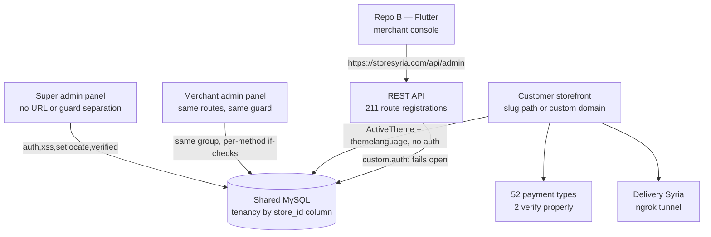

# 03 — Feature Matrix

This is the central reference for the Phase 0 audit. Everything else in the report either
summarises or elaborates on these tables.

## How to read this document

**The distinction this matrix exists to make.** Repo A is a customised copy of the commercial
WorkDo *eCommerceGo SaaS* product (`repo-A config/verification.php:4-5`). The stock product has
a very large feature surface. That surface being *present as code* is not evidence that it
*works in this deployment*. Every row below was scored by opening the controller or service
body — not the route name, the filename, the migration or the menu entry. Section 3 lists the
features that exist in stock WorkDo and are **not** verified working here; that section is the
point of the exercise.

**Vocabulary (used exactly as defined).**

| Term | Meaning in this document |
|---|---|
| IMPLEMENTED AND VERIFIED | A dossier opened the controller/service body and the logic does what the feature claims. Does not mean tested, and does not mean secure. |
| IMPLEMENTED BUT NOT VERIFIED | Code exists and looks complete, but correctness could not be established from reading alone (needs a DB, an SDK or a live call). |
| PARTIALLY IMPLEMENTED | Some of the capability works; a named part is missing, broken or unguarded. |
| PLACEHOLDER OR MOCK | Scaffolding, stub, hardcoded constant, dead variable or commented-out body presented as a feature. |
| MISSING | The capability does not exist in either repo. |
| UNKNOWN | Could not be determined from code; the blocker is named. |

Status values used in prose: **VERIFIED / PARTIAL / MISSING / UNKNOWN / BLOCKED**.
Severity: **CRITICAL / HIGH / MEDIUM / LOW**. Business priority: **P0 / P1 / P2 / P3**.

**Priority is a business priority**, not an engineering one. P0 means the platform cannot be
operated commercially until it is fixed; P1 means it will cause merchant-visible loss or
support cost shortly after launch; P2 is hardening and quality; P3 is hygiene.

**Citations.** `repo-A path:line` = `/home/user/syriastore98`; `repo-B path:line` =
`/home/user/StoreSyria_app98`. Line numbers were re-verified against the working tree for every
load-bearing claim in this document. Secret values are never reproduced — only variable names
and locations.

## Surface map

Evidence for the shape: `repo-A routes/web.php:305` opens the `web` group, `:326` opens the
only authenticated group `['auth','xss','setlocate','verified']`, which closes at `:938`; the
`web` group closes at `:974`. The storefront group is `repo-A routes/customer.php:49`
(`[ActiveTheme::class,'themelanguage']` — no auth). The API group is
`repo-A routes/api.php:133` (`Route::prefix('admin')->as('admin.')->group(` — prefix and name
only, no middleware). Repo B's base URL is `repo-B lib/utils/base_api.dart:3`.

---

# 1. Feature matrix

## 1.1 Platform Administration

The platform-admin surface is what the SaaS owner uses to run the business. The super-admin
menu exposes exactly ten entries (`repo-A app/Listeners/SuperAdminMenuListener.php:18-146`):
Dashboard, Add-on Manager, Users (= merchants), Coupons, Plan, Plan Request, Email Templates,
Settings, Country, Currency. Anything not in that list has no platform entry point even when
the code exists.

| Feature | Repo | Implementation status | Evidence (file:line) | Dependencies | Known problems | Missing functionality | Business importance | Priority |
|---|---|---|---|---|---|---|---|---|
| Super-admin dashboard (platform KPIs) | A | IMPLEMENTED AND VERIFIED | `repo-A app/Http/Controllers/HomeController.php:133-147` dispatches on `type == 'super admin'`; aggregation at `:149-188`; single view `resources/views/superadmin/dashboard.blade.php` | `PlanOrder`, `Order`, `shetabit_visits` | Thin metric set; figures derive from `float` money and from orders whose `payment_status` is always `'Paid'`, so revenue is overstated | MRR/ARR, churn, failed payments, plan-expiry view, health panel, audit panel | HIGH | P2 |
| Super-admin menu / navigation | A | IMPLEMENTED AND VERIFIED | `repo-A app/Listeners/SuperAdminMenuListener.php:18-146`; admission logic `app/Classes/Menu.php:19` | Laratrust permissions, `ActivatedModule()` | Add-on Manager entry declares no permission, so it is visible to every role built from this listener | Menu entries for roles, finance, newsletter, reports, audit — all exist as routes with no menu | MEDIUM | P2 |
| Merchant (store-owner) listing | A | IMPLEMENTED AND VERIFIED | `repo-A app/Http/Controllers/StoreController.php:41` gated `type == 'super admin'`; `:874` `list` | `Store`, `User` | — | — | HIGH | P2 |
| Merchant create (admin side) | A | IMPLEMENTED AND VERIFIED | `repo-A app/Http/Controllers/StoreController.php:91-423`; seeds wallet at `:178-190` and 13 currency rates at `:192-206` | `StoreWallet`, `CurrencyRate` (neither table has a migration) | Hardcoded `'mobile' => '7878787878'`, `'plan_id' => '1'`, `'created_by' => 1` at `:266-272`; password validated only `'required'` at `:107`; not transactional; currency block duplicated verbatim at `:341-355` | Transaction; real defaults | HIGH | P1 |
| Merchant edit / update | A | PARTIALLY IMPLEMENTED | `repo-A app/Http/Controllers/StoreController.php:436` edit, `:452-488` update (both `type` gated) | `User`, `Store` | `'email' => 'required'` with no `email` format rule and no uniqueness, written to both store and owner login at `:476`,`:480` — a malformed or duplicate address silently breaks that merchant's login | Validation | MEDIUM | P1 |
| Merchant delete | A | PARTIALLY IMPLEMENTED | `repo-A app/Http/Controllers/StoreController.php:493-504` | `Setting` | Deletes only the `users` row and that user's settings. Leaves `stores`, `products`, `orders`, `customers`, `roles`, `plan_orders` and uploads orphaned; the deleted merchant's storefront keeps serving because routing is keyed on slug | Cascading delete, soft delete, deletion record | HIGH | P1 |
| Merchant suspend / activate | A | PARTIALLY IMPLEMENTED | `repo-A app/Http/Controllers/StoreController.php:849-872`; route `routes/web.php:654` | — | No authorization of any kind, so any authenticated user can take any merchant offline; `$store->created_by` dereferenced at `:852` before the `if ($store)` check at `:861`; it is a `GET`, so CSRF does not apply | Authorization; POST verb; null guard | CRITICAL | P0 |
| Store delete (owner store) | A | PARTIALLY IMPLEMENTED | `repo-A app/Http/Controllers/StoreController.php:671-714` | 14 cascaded models | Guard is a count of the *caller's own* stores; `$store` is never checked for ownership, so a user with two stores can destroy another tenant's store and all its data. No transaction | Ownership check | CRITICAL | P0 |
| Merchant impersonation | A | PARTIALLY IMPLEMENTED | `repo-A app/Http/Controllers/StoreController.php:716-724` (verified verbatim: `User::find(decrypt($id))` then `Impersonate::take()` on `auth()->check()` alone); route `routes/web.php:766` | `lab404/laravel-impersonate` | No `type == 'super admin'` check, no `isAbleTo`, no `canImpersonate()`/`canBeImpersonated()` override on `User`, no published impersonate config. Guarding is Blade-only. With the committed `APP_KEY` the `decrypt($id)` is not a control | Role gate; model overrides | CRITICAL | P0 |
| Platform password reset of any user | A | PARTIALLY IMPLEMENTED | `repo-A app/Http/Controllers/StoreController.php:646-669` (verified: validates only `password`, then `User::find($id)` and `forceFill(['password' => Hash::make(...)])->save()`); route `routes/web.php:663` | — | No authorization. Takes a **raw integer** id while its own GET sibling at `:638-641` decrypts, so `POST /store-reset-password-update/1` overwrites user 1. Reachable by any web-guard session, including an account created by anonymous self-registration | Any authorization; encrypted id; notification; audit | CRITICAL | P0 |
| Store switching (`current_store`) | A | PARTIALLY IMPLEMENTED | `repo-A app/Http/Controllers/StoreController.php:624-636`; route `routes/web.php:665` | `getCurrentStore()` | No ownership check on the target id, and `if ($store && $store->is_active = 1)` at `:625` is an assignment, so the active check never fails. Re-points the caller's whole admin session at another tenant | Ownership check; comparison operator | CRITICAL | P0 |
| Subscription plan CRUD | A | IMPLEMENTED AND VERIFIED | `repo-A app/Http/Controllers/PlanController.php:18,36,56,106,125` all `isAbleTo` gated; quota validation `:63-66`; migration `database/migrations/2023_12_08_123752_create_plans_table.php:14-32` (verified: `max_stores`, `max_products`, `max_users`, `storage_limit`, `enable_domain`, `enable_subdomain`, `enable_chatgpt`, `pwa_store`, `shipping_method`, `enable_tax`) | Laratrust | `plans.price` is a `string` column; merchants see only `is_disable = 1` plans at `:22-26`; only one plan is seeded (`database/seeders/PlansTableSeeder.php:22-39`, Free, max 2 stores / 5 products / 5 users) | Per-duration pricing columns; a real tier set | CRITICAL | P1 |
| Plan delete | A | PARTIALLY IMPLEMENTED | `repo-A app/Http/Controllers/PlanController.php:245-263` | — | No permission check (no `Delete Plan` permission exists anywhere); `$plan->id` dereferenced on a possibly-null `$plan` | Permission; null guard | HIGH | P1 |
| Plan enable / disable | A | PARTIALLY IMPLEMENTED | `repo-A app/Http/Controllers/PlanController.php:308-324` | — | No permission check — any authenticated user can flip `is_disable` on any plan | Permission | HIGH | P1 |
| Plan trial grant | A | PARTIALLY IMPLEMENTED | `repo-A app/Http/Controllers/PlanController.php:326-358` (verified: `planTrial(Request $request, $plan)` decrypts the id then assigns) | `User::assignPlan()` | No permission check, no check that `$plan->trial == 1`, no check that the user already used a trial. Any logged-in merchant can call it repeatedly for any paid plan and receive the full entitlement each time | Permission; one-trial-per-account; trial flag check | CRITICAL | P0 |
| Plan refund / forced downgrade | A | PARTIALLY IMPLEMENTED | `repo-A app/Http/Controllers/PlanController.php:360-369` | `PlanOrder` | No permission check; it is a `GET`, so CSRF-able; updates by `$request->id` while the route supplies `$id`, so the path segment is ignored; `$user_id` is raw | Permission; POST verb | HIGH | P1 |
| Plan coupons (platform discounts) | A | PARTIALLY IMPLEMENTED | `repo-A app/Http/Controllers/PlanCouponController.php:22,37,52,111,126,178` | `PlanUserCoupon` | Gated on the *store* coupon permission names (`Manage/Create/Edit/Delete Coupon`), which are granted to the merchant role, so merchant staff can mint platform discounts; `show()` and `applyCoupon()` ungated; exhaustion tested with `==` not `>=`; `plan_coupons.limit` is a `string` | Separate permission namespace; `is_active` toggle in the UI; expiry dates | HIGH | P1 |
| Plan requests (manual upgrade) | A | IMPLEMENTED AND VERIFIED (accept path) | `repo-A app/Http/Controllers/PlanRequestController.php:67` `acceptRequest` is `type == 'super admin'` gated; writes `PlanOrder` with `'payment_type' => __('Manually')` at `:103` | `PlanRequest`, `User::assignPlan()` | `cancelRequest($id)` at `:54-63` has no authorization and takes a raw user id — any authenticated user can wipe any merchant's pending request; `:80` passes two arguments to a one-parameter `assignPlan`; `:81` reads non-existent `Month_price`/`Year_price`; `store_id` is written twice in one array literal at `:100`/`:108`, so every manual order is attributed to store 1 | Authorization on cancel; correct attribution | HIGH | P1 |
| Subscription payment — offline bank transfer | A | PARTIALLY IMPLEMENTED | `repo-A app/Http/Controllers/BankTransferController.php:17-148`; receipt validated as image `:19-26`; status `'Pending'` `:79-82`; approve `:119-136` (verified verbatim); routes `routes/web.php:467-468` (verified: `Route::any('order_approve/{id}', ...)`) | `PlanOrder`, `User::assignPlan()` | **This is the only Syria-viable billing rail and its approval endpoint has no authorization at all** — no `type` check, no `isAbleTo`, and the route sits inside the plain auth group at `routes/web.php:326`. `Route::any` means a `GET` works. A merchant can approve their own plan order; ids are sequential so other merchants' can be approved or rejected too | Role gate on approve/reject | CRITICAL | P0 |
| Platform invoicing of merchants | A | MISSING | `repo-A resources/views/plans/receipt.blade.php` (whole file) links out to Stripe's hosted receipt, to the merchant's self-uploaded bank-transfer image, or renders `-`; `app/Models/PlanOrder.php:12-29` has no invoice number, tax, billing address or line items | `barryvdh/laravel-dompdf` is installed and used only by two addons | No invoice entity, no sequential numbering, no tax/VAT, no PDF for ~43 of the gateways | Invoice number, tax fields, line items, PDF, gap-free numbering | CRITICAL | P1 |
| Platform and store settings | A | PARTIALLY IMPLEMENTED | `repo-A app/Http/Controllers/SettingController.php` — verified 2,538 lines with **zero** `isAbleTo` occurrences; `index()` at `:134-137` is a bare view return | `Setting` keyed on `store_id` + `created_by` | ~30 mutating endpoints reachable by any authenticated user: SMTP, payment, SMS, storage, recaptcha, stock, currency, cookie, WhatsApp, Twilio. UI hides tabs in Blade only. Writes are scoped to the caller's own store, so the platform bucket is not directly writable by staff | Any authorization | HIGH | P0 |
| Settings AJAX tab renderer | A | PARTIALLY IMPLEMENTED | `repo-A app/Http/Controllers/SettingController.php:1520-1525` chooses the settings bucket; tab whitelist `:1528-1558`; the gateway partial renders credentials as `type="text" value="..."` in `resources/views/setting/payment_partials/payment_gateway.blade.php:59-60` | — | No permission check. A merchant's lowest-privilege staff account can POST `tab_type=payment_setting` and read that store's live gateway secrets, SMTP password and S3 credentials in plaintext. The method also performs writes on a render path (inserts 13 default currency rows at `:1572-1608`) | Permission; secret masking; write-only fields; encryption at rest | HIGH | P0 |
| Payment-gateway configuration | A | PARTIALLY IMPLEMENTED | `repo-A app/Http/Controllers/PaymentSettingController.php:18-24` (verified: no guard, `$this->store_id = !empty(getCurrentStore()) ? getCurrentStore() : '1'`); 52 gateway definitions `:159-422`; route `routes/web.php:398` | `Setting` | No permission check and no validation. The `: '1'` fallback writes a caller with no resolvable store into **store 1**, the super admin's own store | Permission; validation; drop the fallback | HIGH | P0 |
| Email templates (multi-locale) | A | PARTIALLY IMPLEMENTED | `repo-A app/Http/Controllers/EmailTemplateController.php:59-104` `updateEmailSettings`; seed data `app/Models/Utility.php:549-641` with Arabic first for 5 templates across 16 locales | `EmailTemplate`, `EmailTemplateLang`, `UserEmailTemplate` | **No authorization in any method.** Templates are platform-global with no `store_id`, so any authenticated user can rewrite the body and `from` of password-reset and verification mail — a ready-made phishing primitive. `:25` null-derefs on an empty table; `:32` writes `lang` where every other line uses `language`. The Arabic owner-confirmation template at `Utility.php:597` has malformed HTML (`</ p>` and an Arabic semicolon inside a CSS declaration) | Authorization; preview; per-tenant override | HIGH | P0 |
| Roles and permissions administration | A | PARTIALLY IMPLEMENTED | `repo-A app/Http/Controllers/RoleController.php:156-160` and `:216-221` (verified: `update(Request, Role $role)` and `destroy(Role $role)` with only `isAbleTo` guards); the `users.type` rewrite at `:182-183` (verified verbatim) | Laratrust 8.3 | `Role` is route-model-bound with **no `store_id` or `created_by` scoping**, so a merchant holding `Edit Role` can rewrite or delete the global `super admin` role, and `:183` stamps an attacker-chosen string onto `users.type` for every holder. `edit()` at `:133` has no check at all. `create()`/`edit()` hand out the entire global permission catalogue. The platform owner is **never granted `Manage Role`** (verified: `Manage Role` occurs at `app/Models/Utility.php:2654` and `:2870` only, both merchant-tier lists; the super-admin grant list at `:3066-3095` omits it), so RBAC is unadministrable by its owner | Tenant scoping; permission allowlist; super-admin grant | CRITICAL | P0 |
| Permission catalogue seeding | A | PARTIALLY IMPLEMENTED | `repo-A app/Models/Utility.php:2645-2858` builds ~200 names and upserts them; merchant grant `:2860-3062`; super-admin grant `:3064-3095`; called from `database/seeders/PermissionTableSeeder.php:119` **and** from `app/Http/Controllers/Auth/AuthenticatedSessionController.php:83` (verified: bare `\App\Models\Utility::addNewData();`) | Laratrust | Runs on **every login** — a 471-line function issuing ~200 `SELECT ... LIKE` plus ~190 permission checks on the hot path. The seeder call is nested inside `if(empty($company))`, so re-seeding an existing database never repairs missing grants. `config/superadminaccess.php`'s 13 platform-only permissions are enforced in Blade only | Idempotent deploy-time seeding; server-side delegation allowlist | HIGH | P1 |
| Add-on / module manager | A | PARTIALLY IMPLEMENTED | `repo-A app/Http/Controllers/ModuleController.php:22` index and `:125`,`:299` gated; `enable()` at `:45-123` and `install()` at `:211-214` (verified: `public function install(Request $request)` then `$fileName = $request->file('file')->getClientOriginalName();`, extract target `'packages/workdo/' . $fileName` at `:251`) ungated | `AddOnManager`, Artisan, filesystem | `install` has no authorization, no mime/extension validation and no zip-slip guard, and writes into the PSR-4 autoload path that `app/Providers/PackageServiceProvider.php:32` reads with **no `is_enable` filter** and `:79` registers — authenticated-user code execution. `enable` interpolates `$request->name` into an Artisan command string. Disabling a module removes it from the sidebar but leaves its routes registered | Authorization; upload validation; real disable | CRITICAL | P0 |
| Theme add-on installer | A | PARTIALLY IMPLEMENTED | `repo-A app/Http/Controllers/AddonController.php:54` `ThemeInstall` (verified) and `:65` `$zip->extractTo('themes/');` (verified verbatim); route `routes/web.php:787` | `ZipArchive`, filesystem | No authorization (contrast `:21` and `:153`, which do check `type == 'super admin'`), no validation, chmod 0777 at `:72-74`, and `themes/` is under the served document root — second authenticated-user code-execution path. `destroy()` at `:46-52` is equally ungated and does an unsanitised recursive delete | Authorization; validation; path containment | CRITICAL | P0 |
| Country / state / city management | A | IMPLEMENTED BUT NOT VERIFIED | `repo-A app/Http/Controllers/CountryController.php` (6 `type` checks), `StateController.php` (3), `CityController.php` (3) per the dossier-04 guard census | `countries`/`states`/`cities` CSV seeds | Not opened method-by-method. `states` does supply Syrian governorates and is read at `app/Services/PaymentService.php:2721-2722` | — | MEDIUM | P2 |
| Global currency catalogue | A | IMPLEMENTED BUT NOT VERIFIED | `repo-A app/Models/Currency.php:9-16`; migration `database/migrations/2024_01_04_052630_create_currency_table.php:14-18` | `settings` rows `defult_currancy` | The base `currency` table has **no rate column**, so it coexists with the separate per-store `currency_rates` FX system. Legacy seed gives SYP the pound-sterling symbol and the name "Pounds" (`database/seeders/DefaultSetting.php:190`) | One authoritative currency model | HIGH | P1 |
| Language manager (in-app translation editor) | A | IMPLEMENTED BUT NOT VERIFIED | `repo-A app/Http/Controllers/LanguageController.php` 9 methods (`:21,29,85,142,202,271,327,332,382`); auto-RTL write at `:39-51` | 17 locale JSON files under `resources/lang/` | `:31` calls `Artisan::call('cache:clear')` on every language switch, which destroys the file-cache entries that in-flight Paymera payments depend on | Scoped cache invalidation | MEDIUM | P2 |
| Newsletter subscriber capture / export | A | PARTIALLY IMPLEMENTED | `repo-A app/Http/Controllers/NewsletterController.php:21` index and `:111` destroy gated; `create/show/edit/update` are empty stubs; `fileExport()` at `:122-126` ungated; export is store-scoped at `app/Exports/NewsletterExport.php:35-36` | `maatwebsite/excel` | The resource is registered **outside** the auth group at `routes/web.php:943`, so the stub actions are anonymously reachable and return blank 200s | Any send or campaign capability; double opt-in; unsubscribe | MEDIUM | P2 |
| Support tickets (customer to merchant) | A | PARTIALLY IMPLEMENTED | `repo-A app/Http/Controllers/SupportTicketController.php:19` excludes `type != 'super admin'`; only `index`, `edit`, `conversion_store`, `destroy`, `ticket_status_change` exist | `SupportTicket` | `Route::resource` at `routes/web.php:839` plus `routes/web.php:840` register `show`/`create`/`store`/`update` and `ticket-view`, none of which exist — `BadMethodCallException`. `edit()` and `destroy()` declare two parameters against single-parameter resource routes. `ticket_status_change` has no permission check and no tenant scope. The platform owner cannot see merchant tickets here at all | Working show/edit/delete; SLA; assignment; super-admin view | HIGH | P1 |
| Helpdesk (merchant to platform) | A | PARTIALLY IMPLEMENTED | `repo-A packages/workdo/Helpdesk/src/routes/web.php:52-55` puts `show` and a reply endpoint in a `['web']`-only group; `HelpdeskController::show` at `:204-218` renders any decryptable ticket id | `PlanModuleCheck:Helpdesk` | Ticket ids are `time()` at creation (`:112`), a small guessable space, and the group has no `auth` — anonymous ticket enumeration. Index/create/store/edit are correctly permission-gated | Auth on the show route; unguessable ids | HIGH | P1 |
| Landing page / marketing CMS | A | PARTIALLY IMPLEMENTED | `repo-A packages/workdo/LandingPage/src/Http/Controllers/LandingPageController.php:20` and `:110` are `type` gated; the two mutators `store()` at `:44-54` and `seoStore()` at `:121-147` are not | `LandingPageSetting` | Any authenticated user can deface the platform homepage banner and rewrite its SEO metadata. `create`/`show`/`edit` return views that do not exist (500). `PixelController` is unrouted and fatally broken (missing `Schema` import, inverted condition) | Authorization on mutators | HIGH | P1 |
| Homepage bootstrap behaviour | A | PARTIALLY IMPLEMENTED | `repo-A app/Http/Controllers/HomeController.php:121-126` (verified verbatim: `Artisan::call('package:migrate LandingPage');` then `Artisan::call('package:seed LandingPage');`); route `routes/web.php:303` | `display_landing` setting | When the landing page is on, **every anonymous `GET /` runs a migration and a seeder synchronously** — an unauthenticated denial-of-service on the front door, plus non-deterministic landing content. The same two calls already exist in `database/seeders/DatabaseSeeder.php:21-22`, where they belong | Delete the two lines | CRITICAL | P0 |
| Backup and restore | A | PARTIALLY IMPLEMENTED | `repo-A packages/workdo/BackupRestore/src/app/Http/Controllers/BackupRestoreController.php:54` `store()` (no permission check, unlike `:26`, `:42`, `:256`); DB backup `:169-190` ending in `shell_exec($command)` | `mysqldump`, `ZipArchive`, `shell_exec` | **There is no restore** — `update()` at `:243-246` is comments and no restore route or view exists. `database_name` is validated only `'required'` and is interpolated into the shell string, giving command injection to any plan-entitled merchant or their unprivileged staff. The DB password is passed as `-p` on the command line. The file backup zips the entire application root including the committed `.env`, chmods 0777, writes on-box, and its delete path checks a relative path the write path never used, orphaning archives | Restore; offsite target; encryption; retention; `.env` exclusion; permission check | HIGH | P0 |
| Audit log | A | PLACEHOLDER OR MOCK | `repo-A app/Models/AuditLog.php:9` `protected $table = 'audit_logs';`; `record()` at `:28-48` has no try/catch; nine call sites, all in `app/Http/Controllers/UserController.php` (`:131`, `:246`, `:283`, `:333`, `:410`, `:426`, `:511`, `:569`) | — | **No migration creates `audit_logs`** (verified: zero `Schema::create('audit_logs'` anywhere), and the model is **never read** — no controller, route, view or DataTable consumes it. On a schema built from this repo every one of those nine write paths raises `QueryException` *after* the mutation has already committed, so operations half-complete and the UI reports failure | The table; a read surface; retention | HIGH | P1 |
| API request logging | A | IMPLEMENTED AND VERIFIED (and harmful) | `repo-A app/Http/Middleware/APILog.php:24-35` and `AdminApiLog.php:24-35` (byte-identical apart from the class name); both `handle()` are pass-throughs at `:19-22` | `API_log` channel, `config/logging.php:134-139` (daily, debug, 15 days) | `Log::info($request)` and `Log::info($response)` stringify the whole objects, so plaintext passwords (on `register`, `adminlogin`), bearer tokens, SMTP and gateway secrets and customer PII are written to `storage/logs/api.log` under the served document root. No redaction. Nothing in the admin UI reads it | Redaction; a log sink anyone reads | HIGH | P0 |
| Platform monitoring / observability UI | A | MISSING | No routes, controllers or views exist for `AuditLog`, `ActivityLog` or the API logs; `app/Models/ActivityLog.php` is read only by `app/DataTables/CustomerDataTable.php:26` | — | The one place with deliberate audit instrumentation surfaces nothing an operator can see | Audit UI, error/health panel, alerting | HIGH | P1 |
| First-run installer wizard | A | UNKNOWN | `repo-A composer.json:58` requires `rachidlaasri/laravel-installer`; `config/installer.php` present and customised (demands `777` on four paths at `:48-54`); views published to `resources/views/vendor/installer`, assets to `public/installer/` | A marker file under `storage/`, which is absent from the checkout | Reachability cannot be determined from the repo. If `/install` is live it is an unauthenticated wizard that rewrites `.env` and runs migrations — i.e. total instance takeover. `installedAlreadyAction` is the empty string at `:132` | A probe of the live host; explicit `'404'` | HIGH (if reachable) | P1 |

## 1.2 Merchant Operations

Breadth here is genuine — products, variants, categories, orders, customers, coupons, flash
sales, POS, delivery boys, reports, settings and a bespoke wallet all exist as working code.
Depth is not. Two patterns recur and explain most rows: list surfaces are correctly
store-scoped (`repo-A app/DataTables/OrderDataTable.php:156-162`,
`app/DataTables/ProductDataTable.php:108-111`) while anything Laravel's route-model binding
fetches is not; and permission checks are per-method `if` statements, so the omissions are
invisible next to the ones that are present.

| Feature | Repo | Implementation status | Evidence (file:line) | Dependencies | Known problems | Missing functionality | Business importance | Priority |
|---|---|---|---|---|---|---|---|---|
| Merchant dashboard | A | PARTIALLY IMPLEMENTED | `repo-A app/Http/Controllers/HomeController.php:143-146` dispatch, `:188-312` data, all scoped `where('store_id', getCurrentStore())` at `:204-205` | `Order`, `Product`, `Customer`, `Plan` | Trend percentages are mathematically always ≤ 0 — `calculatePercentageToday($todayCount, $allCount)` at `:340-352` (verified verbatim) computes `(today - all)/all` and is called as today-vs-all-time at `:201`, `:207`, `:245-251`; the intended yesterday comparison is commented out at `:243`. Revenue at `:211-216` includes cancelled and returned orders because the `orWhere('return_status','!=',2)` admits them. "Top selling" counts orders, not units. Staff users fall into the `else` branch at `:406-427` and see platform-wide `PlanOrder` data with no store scoping | Correct trend baseline; correct revenue filter; unit-based ranking | HIGH | P1 |
| Product CRUD | A | PARTIALLY IMPLEMENTED | `repo-A app/Http/Controllers/ProductController.php:37` index and `:94` store are gated and scoped; `:881` `show(Product $product)`, `:911` `edit(Product $product)`, `:965` `update(Request $request, Product $product)`, `:1653` `destroy(Product $product)` (all four verified) | `ProductImage`, `ProductVariant`, `Cart` | All four bound verbs accept a raw id with **no `store_id` check**, while their sibling queries inside the same methods are carefully scoped (e.g. `:895`) — the scoping was simply forgotten on the bound model. `destroy` is a hard delete plus filesystem deletion plus variant and cart cleanup. `store`/`update` are not transactional (zero `DB::transaction` in 3,101 lines) and leak raw exception text to the UI at `:847-851`. The variant branch of `update` validates no prices at all (`:983-990`) | Tenant scoping; transaction; variant price validation | CRITICAL | P0 |
| Product variants and variant pricing | A | PARTIALLY IMPLEMENTED | `repo-A app/Http/Controllers/ProductController.php:706-835` build variants; `:817-821` writes `default_variant_id`; migration `database/migrations/2024_01_01_104858_create_product_variants_table.php:19-21` | `product_variants` | `products.default_variant_id` has **no migration**. The variant stock roll-up at `:822-829` is dead code (compares an `integer` column to the string `'in_stock'`, then assigns to a non-existent `products.stock`). `VariantDelete` at `:3039-3048` references a class (`ProductVariantOption`) and a column (`variants_json`) that do not exist and is not routed | The missing column; a working roll-up | HIGH | P1 |
| Product attributes, brands, labels, tags | A | IMPLEMENTED BUT NOT VERIFIED | Dedicated controllers and migrations exist; `product_attributes.terms` is in `$fillable` with no migration (the column exists on `product_attribute_options`) | — | Not opened method-by-method; assume the tenancy pattern of the rest of the controller family | — | MEDIUM | P2 |
| Categories and subcategories | A | PARTIALLY IMPLEMENTED | `repo-A app/Http/Controllers/CategoryController.php:174-176` update, `:271-279` destroy; tree builder `app/Helper/helper.php:2417-2430` | `products.category_id` FK | `parent_id` is assigned raw at `:252` with no self/cycle/tenant validation, and `buildCategoryTree` is unbounded recursion — a self-parented category exhausts memory on category create/edit and product create/edit. Deleting a category **silently hard-deletes every product in it** via the `onDelete('cascade')` FK, while `product_images` has no FK and is orphaned. Not transactional. `update`/`destroy` are unscoped | Cycle validation; confirmation on cascade; transaction | HIGH | P1 |
| Inventory / stock tracking | A | PARTIALLY IMPLEMENTED | Write side `repo-A app/Http/Controllers/ProductController.php:288-300`, `:583-589`; decrement `app/Services/PaymentService.php:2162-2164` (verified verbatim: `$remain_stock = $Product->product_stock - $qtyy;` then assign and `save()`), variant path `:2090-2092`, gated on `stock_management == 'on'` at `:2083` | `products.product_stock`, `product_variants.stock` | Non-transactional unlocked read-modify-write with **no `stock >= qty` guard and no floor at zero**; both columns are signed `integer`, so negative stock persists. One request with `qty > stock` oversells; concurrency makes it worse. Pre-checkout guards in `app/Http/Controllers/CartController.php:221,226,250,273,325` compare *current* stock to a threshold and never compare the requested quantity | Atomic reserve/release; quantity guard; zero floor | CRITICAL | P0 |
| Stock restore on return | A | PARTIALLY IMPLEMENTED | `repo-A app/Models/Order.php:616-625` (verified verbatim: the loop variable `$product` is overwritten by `Product::find($product_id)` and then read as `$product['qty']`); same bug independently at `app/Http/Controllers/OrderController.php:458-466`; a third copy at `packages/workdo/AuctionProduct/src/app/Models/AuctionProductOrder.php:308` | `products`, `product_variants` | `products` has no `qty` column, accessor, cast or append, so `+= null` adds **zero**: returned non-variant inventory is never restocked and inventory drifts permanently downward. The variant branch at `:629` is correct, so the drift is silent and selective. Neither path is idempotent, so repeated calls re-inflate variant stock without bound | Correct variable scoping; idempotency marker | HIGH | P0 |
| Order list and view | A | IMPLEMENTED AND VERIFIED | `repo-A app/DataTables/OrderDataTable.php:156-162` store-scoped; `app/Http/Controllers/OrderController.php:265` index gated; status badges `:114-147` | `Order`, `orders.product_json` | Order lines live in a `text` JSON blob plus a CSV `product_id` column, so nothing can be aggregated in SQL and every consumer re-parses with different key expectations (`qty` vs `quantity`, `app/Models/Order.php:264-287`) | Normalised `order_items` | HIGH | P2 |
| Order lifecycle / status transitions | A | PARTIALLY IMPLEMENTED | `repo-A app/Models/Order.php:496-598` is the canonical chain, with only two guards (cancel requires `delivered_status == 0` at `:502-510`; return requires `!= 0` at `:557-562`); the merchant API bypasses it entirely at `app/Http/Controllers/Api/DashboardController.php:234-338` | `OrderObserver` | **There is no state machine.** `confirmed`, `pickedup`, `shipped` and `delivered` have no precondition, so `cancelled → delivered` and `returned → shipped` are reachable in one call. Two independently written implementations over one column, with no shared guard. Statuses 7 (Partially Paid) and 8 (Pre Order) are unreachable from the API's `in:0,1,2,3,4,5,6` whitelist. Cancel sets `payment_status = 'Unpaid'` at `:513`, which fires the wallet observer | An explicit transition matrix; one implementation | HIGH | P1 |
| Order payment-status change | A | PARTIALLY IMPLEMENTED | `repo-A app/Http/Controllers/OrderController.php:556-564` (verified verbatim: `Order::find($request->order_id)` then assign and save); route `routes/web.php:950` | `OrderObserver` → `OrderFinancialService` | The route sits at `routes/web.php:940-973`, **outside** the auth group that closes at `:938` (verified), so its only middleware is `web` plus `themelanguage`. No auth, no tenant scope, no validation, no null check. Marking any order in any store `'Paid'` credits that store's wallet. CSRF applies, but the token is emitted to anonymous visitors in the guest layout, so it is a two-request bypass, not a control | Auth; permission; tenant scope; validation | CRITICAL | P0 |
| Manual order creation (merchant) | A | PARTIALLY IMPLEMENTED | `repo-A app/Http/Controllers/OrderController.php:43-188` — the only order path with an explicit stock check and a transaction (`:71` `DB::beginTransaction()`, checks at `:97-102` and `:117-122`, commit `:188`) | `Customer`, `Product`, `ProductVariant` | No permission check. `final_price` is client-supplied (`:55` validates only `numeric\|min:0`, `:152` stores it verbatim) while the computed total is stored separately and never compared — and the wallet is credited from `final_price`, so an arbitrary value is an arbitrary wallet credit. `exists:` rules are global, so another store's `product_id` can be submitted and that store's stock decremented. No `lockForUpdate` | Permission; server-side total; tenant-scoped validation | HIGH | P1 |
| Order refunds | A | PARTIALLY IMPLEMENTED (status) / MISSING (money) | `repo-A app/Http/Controllers/OrderRefundController.php:229-243` (verified verbatim: writes `refund_status` and a client-supplied `refund_amount`, returns JSON); `:27` index is the only gated method | `OrderRefund` | **No gateway refund call exists anywhere in `app/`** — `app/Package/Payment.php:231` (Tap refunds), `app/Libraries/PhonePe/PhonePe.php:107` and `app/Libraries/Easebuzz/refund.php` have zero call sites. So every refund must be paid out manually while the system reports "Refunded". No permission check, no tenant scope, no cap at the order total, no wallet debit, no state check, and client-side `localStorage` is the only replay suppression. `RefundStock` at `:196-205` looks the variant up by **product** id. `CancelRefundStatus` at `:155-174` raises `final_price` without touching `payment_status`, so the wallet and the orders permanently diverge | Gateway refund; wallet debit; authorization; amount cap | CRITICAL | P0 |
| Order notes | A | PARTIALLY IMPLEMENTED | `repo-A routes/web.php:951` resource; API side `app/Http/Controllers/Api/DashboardController.php:88-200` | — | The API routes at `routes/api.php:203`,`:208` carry **no middleware at all**, and store and order come from the body; `note_type` accepts `to_customer`, so an anonymous caller can attach customer-visible text to a stranger's order | Auth; tenant scope | HIGH | P0 |
| Shipping label / order receipt | A | PARTIALLY IMPLEMENTED | `repo-A app/Http/Controllers/OrderController.php:408` returns `view('order.shippinglabel')`, `:423` returns `view('order.receipt')`; RTL rules in `resources/views/order/shippinglabel.blade.php:156-165` | — | HTML only — no PDF on the core order path despite dompdf being installed. Both endpoints `Crypt::decrypt($id)` with **no store scope**, so any logged-in staff member of any tenant can read any order's billing details. The label's weight loop at `:390` passes an array as an id. The template opens `<html lang="en">` and pulls its font and CSS from remote CDNs at `:12-15` | PDF; tenant scope; self-hosted assets | MEDIUM | P1 |
| Customers CRUD | A | PARTIALLY IMPLEMENTED | `repo-A app/Http/Controllers/CustomerController.php:19` store (scoped on write), `:95` show gated; `destroy` at `:75-80` and `customerStatus` at `:116-123` and `customerTimeline` at `:125-138` have no permission check and no store scope | `customers` table | **`edit` and `update` do not exist** (verified: `grep "function edit\|function update"` returns nothing), yet `Route::resource('customer', ...)` at `routes/web.php:855` declares both — a merchant cannot edit a customer at all. `Customer` applies `SoftDeletes` with no `deleted_at` column anywhere, so on a schema built from this repo every customer read fails | Edit/update; the `deleted_at` column; authorization | CRITICAL | P0 |
| Customer segmentation / filters | A | PARTIALLY IMPLEMENTED | `repo-A app/Http/Controllers/CustomerController.php:172` `CustomFilterData` (store-scoped, no permission check), filter logic `:225-231` and `:248-276` | `ActivityLog`, orders | `$AOV = $text_field_float` at `:229` is an assignment, so the "Equal" AOV filter matches every customer. "More Than" is unreachable on two filters because the same condition is repeated at `:248-254` and `:270-276`. N+1 across all customers at `:217`, `:245`, `:267` | Correct comparisons; query-level filtering | MEDIUM | P1 |
| Customer groups | A | MISSING | Repo-wide search for `customer_group`/`customergroup` returns nothing | — | There is no segmentation primitive at all; the broken filters above are the entire substitute | The whole capability | MEDIUM | P2 |
| Coupons | A | PARTIALLY IMPLEMENTED | `repo-A app/Http/Controllers/CouponController.php:25,48,123,174,231` are `isAbleTo` gated | `coupons`, `user_coupons` | Codes and names are validated `unique:coupons` **globally** at `:74-80`, so one store blocks another's code and the error confirms another tenant uses it — a cross-tenant oracle. `show/edit/update/destroy` accept unscoped bound ids. Applied products/categories are never validated as belonging to the store. The minimum-spend sanity check only runs when that field is present | Store-scoped uniqueness; tenant scoping | MEDIUM | P1 |
| Flash sales | A | PARTIALLY IMPLEMENTED | `repo-A app/Http/Controllers/FlashSaleController.php:225-232` writes the product set as JSON; migration `database/migrations/2023_12_25_093243_create_flash_sales_table.php:21` declares `sale_product` as `string` | `FlashSaleCondition` | A JSON id array overflows `VARCHAR(255)` at roughly 40-50 products — data-too-long or silent truncation to invalid JSON. The set is a **snapshot**, so later products never join. `:96` iterates `$request->fields` unguarded while `:81` guards it, so a sale with no conditions crashes *after* `:79` has already saved an orphan row. `updateStatus` at `:519-529` has no permission check and no store scope. No date validation | Normalised join table; validation | HIGH | P1 |
| POS | A | PARTIALLY IMPLEMENTED | `repo-A app/Http/Controllers/PosController.php:199-208` (verified verbatim: `Product::where('id', $product_id)->update(['product_stock' => $product_quantity])` from a session snapshot) | `session('pos_...')` | Stock is written as an **absolute** value from a stale snapshot, so any sale in between is overwritten and lost; no `store_id` filter; no zero floor; **no variant branch at all**, so variant sales do not decrement variant stock. `$pos->product_id` at `:230` keeps only the last loop value, which is what the product reports key on. `final_price` at `:232` has no zero floor, so a large discount stores a negative total on an order hard-set to `'Paid'` at `:244`. `:188-189` has no null check and looks the address up by the wrong column | Atomic decrement; variant handling; per-line records | HIGH | P1 |
| Delivery boys CRUD | A | PARTIALLY IMPLEMENTED | `repo-A app/Http/Controllers/DeliveryBoyController.php:95,109,152,164,176` are permission-gated but **not store-scoped**; password reset at `:192-195` | `delivery_boys` | `DeliveryBoy::find($id)` with no tenant filter on edit, update, destroy and password reset — cross-tenant courier account takeover. `commission_percentage` and `is_commission_enabled` are validated and written but have **no migration**. Emails are globally unique | Tenant scoping; the missing columns | HIGH | P1 |
| Delivery-boy commission and earnings | A | PARTIALLY IMPLEMENTED | `repo-A app/Http/Controllers/OrderController.php:694-714` creates `DeliveryEarning` with `'status' => 'pending'` | `delivery_earnings` (no migration) | The trigger is `strtolower(trim($shippingMethod->method_name)) === 'local pickup'` — an English string match on a merchant-editable field, so localising the method name silently disables all commission. `status` is written `'pending'` and **never advanced**: there is no payout path anywhere, so riders accrue an unsettleable balance. `order_assign` at `:675` has no permission check and its `exists:` rules are unscoped | A payout path; a provider enum; authorization | HIGH | P1 |
| Merchant wallet and finance dashboard | A | PARTIALLY IMPLEMENTED | `repo-A app/Http/Controllers/StoreFinanceController.php:19,71,315,396,494,624` (all six verified: `if (!auth()->user() \|\| !auth()->user()->isAbleTo('<name>'))`) | `store_wallets`, `store_wallet_transactions` (no migrations) | **None of the six permission names is created by anything** (verified: zero occurrences of `View Finance Dashboard`, `Add Finance Balance` or `Request Finance Withdrawal` in `app/Models/Utility.php` or `database/seeders/`), so `isAbleTo` is false for every user including the super admin and the whole guarded half of the module is unreachable — fail-closed, remediable with one seeder change. Nine of the ten finance routes also sit at file top level with no `auth` middleware (`routes/web.php:168-197`, verified) | The six permission rows; route-level auth | HIGH | P0 |
| Wallet withdrawals (request / approve / reject / pay) | A | PARTIALLY IMPLEMENTED | `repo-A app/Http/Controllers/StoreFinanceController.php:494` request is gated; `:644` `approveWithdrawal($id)`, `:719` `rejectWithdrawal(...)`, `:888` `payWithdrawal($id)` have **no guard** (all three verified); routes `routes/web.php:186,189,192` (verified) | `store_withdrawals` (no migration) | The three state-transition endpoints have neither route auth nor an in-controller check, while their six siblings all do — a demonstrable omission. Any authenticated same-tenant staff account holding zero finance permissions can advance a payout to `'paid'`, mutate wallet balances and forge `reviewed_by`. Anonymous access fails only incidentally, because `getCurrentStore()` returns null for a guest. `payWithdrawal` makes **no gateway call** — it is pure DB mutation, so the impact is ledger integrity and broken maker-checker, not funds leaving a bank. Internals are the best code in the area: `DB::transaction` + `lockForUpdate()` + status and balance guards | Authorization; separation of duties between requester and approver | HIGH | P1 |
| Order financial ledger (COD reconciliation) | A | PARTIALLY IMPLEMENTED | `repo-A app/Services/OrderFinancialService.php:17-116` snapshots amounts, cost and gross profit under `DB::transaction` with `lockForUpdate()`; `:284` `markFinancialAsPaid`, `:397` `markFinancialAsUnpaid`, `:226` `syncFromOrder`; currency snapshotted per order at `:66-80`; wired by `app/Providers/AppServiceProvider.php:30` and `app/Observers/OrderObserver.php:13-21` (verified verbatim, including the Arabic comment stating it credits the wallet immediately when the order is Paid) | `store_order_financials`, `store_wallets` (no migrations) | This is a genuinely well-built ledger that is fed the wrong input: because `payment_status` is hardcoded `'Paid'` at `app/Services/PaymentService.php:2280` (verified), COD and bank-transfer orders enter as paid and the merchant wallet is credited before any cash is collected. The observer swallows every exception into `Log::error` at `:18-20`, so on any deployment missing `store_wallets` orders save successfully and **all financial tracking silently does nothing** | Correct `payment_status` at creation; the missing tables; a refund debit | CRITICAL | P0 |
| Per-store currency rates (FX) | A | PARTIALLY IMPLEMENTED | `repo-A app/Http/Controllers/CurrencyRateController.php:10` index, `:20` update; model `app/Models/CurrencyRate.php:9` with `'rate_per_usd' => 'decimal:8'` cast at `:21`; consumers `app/Services/StoreCurrencyConversionService.php:57,147-152`, `app/Services/OrderFinancialService.php:134,328,472,494`, and ~12 sites in `app/Http/Controllers/Api/DashboardController.php` | `currency_rates` (no migration) | Routes at `routes/web.php:156,161` have **no `auth` middleware** and the controller has no permission check, so any authenticated tenant user can rewrite the rates that drive order pricing; anonymous callers fail only because `getCurrentStore()` returns null. `created_by` is overwritten with the last editor at `:40`. The web storefront does not use `CurrencyRate` at all (zero references in `themes/` or `resources/`), so shoppers and the merchant app can see different numbers for the same order | Auth; permission; rate history; storefront parity | HIGH | P0 |
| Store settings (merchant side) | A | PARTIALLY IMPLEMENTED | `repo-A app/Http/Controllers/SettingController.php` — 36 methods, zero `isAbleTo` (verified); representative method `:1077-1097`; write shape `:1100-1112` | `settings` table | Any authenticated store user can rewrite SMTP, payment, SMS, storage and stock configuration. `settings` has **no unique key** on `(name, store_id)` and writes key on `created_by` too, so a staff edit inserts a second row; `Utility::GetValueByName` at `app/Models/Utility.php:181-201` then reads an arbitrary one while `getAdminAllSetting` at `app/Helper/helper.php:322-341` reads the owner's — staff changes appear to save and are invisible to half the codebase | Permission checks; a unique key | HIGH | P1 |
| Staff users and roles (merchant side) | A | PARTIALLY IMPLEMENTED | `repo-A app/Http/Controllers/UserController.php:69` store, `:207` update, `:274` destroy are permission-gated; quota check `:97-101` | Laratrust, `AuditLog` | `Role::find($request->role)` at `:104` is **not** scoped to the caller's store, so a merchant can create a user with `type = 'super admin'`. `password` is absent from the validator, so a user can be created with an effectively blank password. `$user->plan_id = $objUser->plan` at `:118` reads a non-existent property, so every staff user gets `plan_id = null` and the next quota check 500s. `update` mass-assigns `$request->all()` over a `$fillable` that includes `type`, `plan_id`, `created_by` and `current_store`, and then raises a `TypeError` at `:246` by passing the never-assigned `$oldValues` into an `array`-typed parameter — the scalar fields commit, the role change at `:256-258` never runs, and the request 500s | Role scoping; password validation; mass-assignment allowlist; variable ordering | CRITICAL | P0 |
| Reports and analytics | A | PARTIALLY IMPLEMENTED | `repo-A app/Http/Controllers/ReportController.php` — 3,136 lines, 12 report families, all queries store-scoped; stock reports `:2978`, `:3034`, `:3082` | `orders`, `products` | `index()` at `:29-33` and the three stock reports have **no permission check** although `Manage Stock Reports` exists. 24 `get()->count()` calls hydrate every row to count it; the stock reports load all products, issue one variant query per product and hand a PHP array to DataTables, so pagination and search never reach the database. `$product->ProductData->name` null-derefs for a product with no category. Every figure inherits the `float` money and the always-`'Paid'` status, so the numbers are wrong | Permission checks; SQL aggregation; null guards | MEDIUM | P2 |
| Merchant push notifications | A | PARTIALLY IMPLEMENTED | `repo-A app/Services/StoreNotificationService.php:29-38` builds the payload, `:75-125` `orderPaid` with per-order idempotency at `:78-97`; delivery via `app/Services/FirebaseNotificationService.php:61` (FCM HTTP v1) | `store_notifications`, `store_devices` (these two **do** have migrations) | The title and body are hardcoded **Arabic strings used as translation keys**, so an English-language store receives Arabic. Call sites exist only on the storefront checkout path (`app/Services/PaymentService.php:2577`, `app/Http/Controllers/PaymentController.php:1378-1379`) — manual merchant orders and POS sales never notify. Errors swallowed into `Log::error` at `:61-69` | Translation keys; wiring for manual and POS orders | LOW | P2 |
| Product import / export | A | IMPLEMENTED BUT NOT VERIFIED | `packages/workdo/ImportExport`, `ProductCSV`, `BulkDelete` addons; quota enforced on import at `repo-A app/Http/Controllers/WoocomProductController.php:104` and `ShopifyProductController.php:162` | Module enablement (DB state) | Whether the modules are enabled is UNKNOWN without a database | — | MEDIUM | P2 |
| Abandoned cart | A | IMPLEMENTED BUT NOT VERIFIED | `repo-A app/Http/Controllers/newsyria/AbandonedCartController.php`; routes `routes/web.php:221-230` with no `auth` middleware | `chatwoot_integrations` (no migration) | Routes are declared at file top level outside every group | Auth | MEDIUM | P2 |
| Chatwoot support integration | A | PARTIALLY IMPLEMENTED | `repo-A app/Services/ChatwootOrderVariableService.php`, `ChatwootAbandonedCartService.php`, models `app/Models/ChatwootIntegration.php`, `ChatwootNotificationTemplate.php`; listener `app/Providers/EventServiceProvider.php:13,33` | `chatwoot_integrations`, `chatwoot_notification_templates` (no migrations) | Push-out only; no inbound route. Both tables are unmigrated, so the feature cannot run on a schema built from source | The tables | MEDIUM | P2 |
| OTP integration (SMS / WhatsApp login) | A | PARTIALLY IMPLEMENTED | `repo-A app/Http/Controllers/OtpIntegrationController.php` (388 lines, SMS and WhatsApp channels at `:237-300`); routes `routes/web.php:200-211` with no `auth` | `otp_integrations` (no migration) | Provider-agnostic design is good; the table it stores configuration in does not exist. Routes are ungrouped | The table; auth | HIGH | P1 |
| Zid marketplace channel | A | PARTIALLY IMPLEMENTED | `repo-A app/Services/Zid.php:11,25`; `app/Console/Commands/ZidProcessEvents.php:47,57,90` and the **correct** COD formula at `:145`,`:159-160`; OAuth at `app/Http/Controllers/ZidOAuthController.php` | `zid_stores`, `zid_orders`, `zid_events` (no migrations) | None of the three tables has a migration, and the `deliverysyria.api_key` the OAuth exchange sends appears to be a placeholder, so it is not established that this channel has ever run. `GET /zid/{storeId}/orders` at `routes/web.php:978-980` has **no middleware** while the very next route has `auth`. `GET /zid/show-token` at `routes/web.php:1146-1148` (verified verbatim) prints decrypted third-party OAuth tokens behind the literal key `'12345678'` | The tables; auth on both endpoints; delete the debug route | HIGH | P0 |
| Merchant onboarding wizard | A | MISSING | `repo-A app/Http/Controllers/Auth/RegisteredUserController.php:73-78` validates exactly four fields; repo-wide search for onboarding/wizard in the merchant path returns nothing | — | Registration is a single form. No multi-step flow, no "complete your store" checklist, no progress state, no guided first product or first payment method | The whole capability | MEDIUM | P1 |

## 1.3 Storefront

The storefront is the stock WorkDo theme layer: three visually distinct but functionally thin
themes (13-16 Blade files each) over a shared page set of 104 files in
`repo-A resources/views/front_end`. It is **not** a page builder — it is a JSON-declared
settings form with hardcoded section markup. The one genuinely custom asset in this area is the
Webuzo custom-domain provisioning layer, which is Syria-team code.

| Feature | Repo | Implementation status | Evidence (file:line) | Dependencies | Known problems | Missing functionality | Business importance | Priority |
|---|---|---|---|---|---|---|---|---|
| Slug-path store addressing | A | IMPLEMENTED AND VERIFIED | `repo-A app/Http/Middleware/ActiveTheme.php:21-34` resolves `Store::where('slug', request()->segment(1))->where('is_active', 1)`; `app/Helper/helper.php:2301-2304` `getStore()`; route group `routes/customer.php:49` | `stores.slug` | The store-not-active abort is **commented out** at `ActiveTheme.php:23-25`, so an inactive store still renders with a fallback theme. `visitor()->visit($store)` writes a `shetabit_visits` row on every request including bots. `stores.slug` has **no unique index** (`database/migrations/2023_12_14_090259_create_stores_table.php:14-27`) and no reserved-word list, so a store slugged `admin`, `login` or `storage` collides with real paths | Unique index; reserved words; bot filter | HIGH | P1 |
| Custom-domain resolution | A | PARTIALLY IMPLEMENTED | `repo-A app/Http/Controllers/HomeController.php:57-110` is the live resolver; duplicates at `:451-490`, `app/Helper/helper.php:462-492` and `app/Providers/ViewServiceProvider.php:89-120` | `settings` rows named `domains` / `subdomain` | Host→store resolution is copy-pasted four times plus a fifth dead copy. The dedicated resolver `app/Providers/StoreRedirectServiceProvider.php` is **not registered** (`bootstrap/providers.php:3-10`) and would fatal if it were, because it imports only `ServiceProvider`. Resolution is anchored on the owner's `current_store` in three of four branches, so a merchant switching stores in admin can 403 their own live custom domain. Internal links are generated slug-first, so a custom domain yields `https://shop.example.com/<slug>/...` — two URL spaces, no canonical. `HomeController.php:45-47` bounces a logged-in merchant to the dashboard before the storefront renders | One resolver; slug-free URLs on custom domains | HIGH | P1 |
| Custom-domain provisioning (Webuzo) | A | PARTIALLY IMPLEMENTED | `repo-A app/Services/WebuzoDomainService.php:29` `addDomain(string $domain, bool $issueSsl = false)` and `:43` `'issue_lecert' => $issueSsl ? 1 : 0` (both verified verbatim); call sites `app/Http/Controllers/AppSettingController.php:755` and `:868` both pass `false`; config `config/services.php:119-124` | Webuzo panel API | Genuinely custom Syria-team code and the most valuable asset in this area, but: it requests **no TLS certificate**; `WEBUZO_HOST`/`USERNAME`/`API_KEY` are absent from `.env`, so `validateConfiguration()` at `:383-396` throws on every call and the feature is currently **non-functional** — the custom-domain path fails closed with an error banner, and the subdomain path raises an uncaught exception (HTTP 500) because `domainExists()` at `:423` is called with no try/catch. No uniqueness check on `domains`/`subdomain` across tenants. No charset, length or reserved-host validation on the subdomain. `replaceDomain()` at `:136` has no callers | TLS issuance; credentials; uniqueness; validation; exception handling | HIGH | P0 |
| Subdomain provisioning | A | PARTIALLY IMPLEMENTED | `repo-A app/Http/Controllers/AppSettingController.php:842-872`; `app/Services/WebuzoDomainService.php:401-419` | As above | Same missing credentials and same `issue_lecert = 0`. `:823` reads `env('APP_URL')` directly, which returns null under `config:cache` | As above | HIGH | P1 |
| Plan entitlement for domains | A | MISSING | `plans.enable_domain` / `enable_subdomain` exist (`database/migrations/2023_12_08_123752_create_plans_table.php:25-26`) and are read in **Blade only** (`resources/views/plans/index.blade.php:135`, `resources/views/AppSetting/index.blade.php:486,499`); `grep '$plan->'` over `AppSettingController.php` matches only lines 1163-1164, a different method | — | A merchant on a plan with `enable_domain = 'off'` can POST directly to `theme-settings` and enable a custom domain. A paid feature given away | Server-side entitlement check | HIGH | P1 |
| Theme engine (3 themes) | A | PARTIALLY IMPLEMENTED | `repo-A config/theme.php:12,24,33`; `composer.json:57` `qirolab/laravel-themer ^2.3`; `app/Http/Middleware/ActiveTheme.php:33` `Theme::set()`; themes at `themes/{greentic,stylique,techzonix}` | `stores.theme_id` | Theme view-path precedence is ambiguous: `app/Providers/ViewServiceProvider.php:78-103` rewrites `view.paths` with `resources/views` **first**, while the themer package prepends theme paths. 26 files have same-path twins in `resources/views` with divergent behaviour. The evidence that theme paths win is that `main_file.blade.php` exists only under `themes/` and `app/Http/Controllers/HomeController.php:506` gates the homepage on `view()->exists('main_file')`. `themes/stylique/views/layouts/app.blade.php` is a 27-line stub containing a literal `// ... existing code ...` placeholder and shadows the 423-line admin layout | One precedence rule; delete the duplicates | HIGH | P1 |
| Theme settings form (marketed as a page builder) | A | PARTIALLY IMPLEMENTED | `repo-A themes/*/theme_json/pages.json` declares 25 pages; field renderer `resources/views/theme_customize/customize.blade.php:108-630` handles 12 types; defaults merged at `app/Helper/helper.php:2264-2298` | `theme_customizes` table | It is a settings form, not a builder: no block model, no drag-and-drop canvas, no arbitrary section insertion. Section markup and order are hardcoded per theme (`themes/stylique/views/main_file.blade.php:10,68`). The `meta_keywords` field type references an undefined variable and is used by no theme JSON — SEO fields were scaffolded and never connected | A real block model, if that is what is being sold | MEDIUM | P2 |
| Theme settings write authorization | A | MISSING | `repo-A app/Http/Controllers/ThemeCustomizeController.php:72-78` and `:131-139` — the `isAbleTo('Edit Theme')` check and its else branch are **commented out**, while siblings at `:20`, `:43`, `:55`, `:156` all check | — | Any authenticated, verified tenant user can write arbitrary key/value pairs into that store's theme settings, with no allowlist against `theme_json`. Those values render through 62 unescaped `{!! !!}` outputs across the storefront (e.g. `themes/stylique/views/front_end/partison/footer.blade.php:15`), giving persistent XSS on every page of the store including checkout. Upload branching is decided by substring (`strpos($key,'_image')`), so attacker-chosen key names control it | The permission check; a key allowlist; output escaping or sanitisation | HIGH | P0 |
| Homepage section re-ordering | A | PLACEHOLDER OR MOCK | `repo-A app/Http/Controllers/ThemeCustomizeController.php:176-180` persists to `ThemeCustomizeOrder`; table migration `database/migrations/2025_05_23_043026_create_theme_customize_orders_table.php`; sortable UI `resources/views/theme_customize/order.blade.php:54-57` | — | Repo-wide search finds **only four** references to the model — the controller and the model file. No storefront view reads it. Saving a new order changes nothing | Read the order at render time | MEDIUM | P2 |
| Theme colour customizer (addon) | A | PARTIALLY IMPLEMENTED | `repo-A packages/workdo/ThemeCustomizer/src/app/Providers/ViewComposer.php:28-50` genuinely pushes `:root` CSS variables into `@stack('page-style')`; emitted by `packages/workdo/ThemeCustomizer/src/resources/views/pages/style.blade.php:1-14` | `StoreThemeCustomizer` | `:31` reads `$view->getData()['storeSlug']` with no default. The composer lacks the `module_is_active` guard its sibling has, so it queries even when the addon is off. The default-colour reader at `ThemeCustomizerController.php:83,98` fetches the app's **own CSS over HTTP** via `asset()` + `file_get_contents`, which needs `allow_url_fopen` and outbound access to itself | Guards; local file read | MEDIUM | P2 |
| Arabic / RTL storefront | A | PARTIALLY IMPLEMENTED | Live theme layouts set direction: `repo-A themes/stylique/views/front_end/layouts/app.blade.php:2` `dir="{{ ($currantLang == 'ar' \|\| $currantLang == 'he') ? 'rtl' : 'ltr' }}"`, same at greentic `:2` and techzonix `:2`; they load `main-style.css` at `:18` and `custom.js` (`:89`/`:94`/`:170`) **unconditionally** | `stores.default_language`, `LANGUAGE` cookie | Corrected from the first audit pass: the Arabic storefront **does** get its main stylesheet and custom JS. The real defect is narrower — direction flips to RTL but **no RTL override stylesheet is ever loaded**, so floats, one-sided margins, text-align and icon direction stay LTR and the page is mis-mirrored. greentic and techzonix ship no RTL CSS at all; stylique ships `themes/stylique/assets/css/rtl.css` which its front_end layout never references. Separately, the **unused** stock layout `resources/views/front_end/layouts/app.blade.php:18,74` references `rtl-main-style.css` and `rtl-custom.js`, which exist in no theme — dead code that should be deleted. Three standalone payment pages do use the stale path and 404 in Arabic (`resources/views/payment/nmi-payment.blade.php:5`, `resources/views/front_end/payment/nmi-payment.blade.php:6`, `resources/views/plans/Powertranz-payment.blade.php:7`). Two locale sources of truth disagree: `app/Http/Middleware/ThemeLanguage.php:23-37` ignores `stores.default_language` and falls back to the first `type='admin'` user platform-wide under the global cache key `admin_details`, while `app/Providers/ViewServiceProvider.php:48-50` uses the store's | An RTL stylesheet per theme; one locale resolver; delete the dead layout | HIGH | P0 |
| Product listing and filtering | A | PARTIALLY IMPLEMENTED | `repo-A app/Http/Controllers/HomeController.php:595-640` returns **no products** — only filter scaffolding; products arrive via AJAX from `:642-731` rendering `front_end.pages.product_list_filter` to a JSON string | — | Every category, collection, brand and product-list URL serves a product-less HTML shell with no `<a>` pagination, so crawlers discover no product URLs. Category resolution is a substring `LIKE` at `:608-613`, so `/collections/shirt` also matches `t-shirts`. `whereIn('category_id', ...)` cannot represent multi-category products. The price-slider ceiling costs an extra near-full sort per page and excludes variant products. `count()` is issued twice because `paginate()` already counts | Server-rendered first page; exact slug match | HIGH | P1 |
| Product detail page | A | PARTIALLY IMPLEMENTED | `repo-A app/Http/Controllers/HomeController.php:744` `Product::where('slug', $product_slug)->where('store_id', $store_id)->first()` | — | No `status` filter and no `product_type` constraint, unlike every listing query — a disabled product stays publicly reachable and indexable by direct URL. `:797-798` runs `inRandomOrder()` on every product page | Status filter | MEDIUM | P1 |
| Storefront search | A | PARTIALLY IMPLEMENTED | `repo-A app/Http/Controllers/HomeController.php:925-963`; client behaviour `resources/views/front_end/jQueryRoute.blade.php:363-388` | — | **There is no search results page.** The JS jumps to `response[0].url` — an arbitrary first row with no ranking — or to `/{slug}/error`. The controller's no-match branch returns a one-element array, so the JS "no results" branch is unreachable. The query is a leading-wildcard `LIKE` with no index, no limit, no pagination, no `status` filter (so disabled products are returned) and searches `name` only. No Scout, Meilisearch, Algolia or FULLTEXT index anywhere. Arabic needs alef/hamza/tatweel/diacritic normalisation that `LIKE` cannot provide | A results page; a real search index with Arabic normalisation | HIGH | P1 |
| CMS pages | A | PARTIALLY IMPLEMENTED | `repo-A app/Http/Controllers/HomeController.php:1704-1712` (verified verbatim: `$store` is resolved at `:1706` then `Page::where('page_slug', ...)->where('page_status', 1)->first()` at `:1708` with no `store_id`); route `routes/customer.php:73` (verified) | `pages.store_id` exists and is indexed | The tenant filter is missing although the column exists and all five sibling queries use it. Corrected scope: because there is no `ORDER BY` and the call ends in `->first()`, the bug is **not steerable** — for a given slug the whole platform returns one row (in practice the oldest), so no attacker can choose a victim and the row returned is already publicly served at its owner's URL. The real impact is integrity: `app/Helper/helper.php:911-939` seeds eight identical default slugs into every store, so on every collision each store except the oldest renders another tenant's content, and because `resources/views/front_end/pages/page.blade.php:26` renders `{!! $page->page_content !!}` unescaped, the oldest tenant's raw HTML and JS execute on every other tenant's storefront origin — cross-tenant stored script injection, defacement, and the wrong Privacy Policy shown to another merchant's customers | The `store_id` clause; a `(store_id, page_slug)` unique index; escaping | HIGH | P1 |
| Blog and articles | A | PARTIALLY IMPLEMENTED | `repo-A app/Http/Controllers/HomeController.php:543-560` blog (paginated, store-scoped), `:562-592` article | `blogs` table | `Blog` has **no publish state, no scheduling and no SEO fields** — a post is live the instant it is saved. `app/Models/Blog.php:14` has `title` and no `name`, yet the menu generator reads `$relatedModel->name`, so blog menu items render with a blank label. The category list is prefixed with a hardcoded English `'All'` at `:556` | `status`/`published_at`; a `name` accessor | MEDIUM | P2 |
| FAQ | A | PARTIALLY IMPLEMENTED | `repo-A app/Http/Controllers/HomeController.php:526-536`; model `app/Models/Faq.php` | `faqs` table | The model declares **no `$fillable`**, so Laravel's default guarding makes `Faq::create()` throw. No status column and no ordering column, so FAQs cannot be unpublished or sequenced | `$fillable`; `status`; `order` | MEDIUM | P2 |
| Menus and navigation | A | PARTIALLY IMPLEMENTED | `repo-A app/Models/Menu.php`, `MenuItem.php` (polymorphic, recursive), `CustomLink.php`; consumed in all three theme headers and footers via `getNavMenu()`; URL generation `app/Helper/helper.php:2353-2387` | — | Category menu items generate `/{slug}/{category-slug}`, a two-segment path for which **no route exists** (the catch-all is commented out at `routes/customer.php:247`) — they 404. Blog items generate `/{slug}/blog/{slug}` while the real route is `/article/{slug}` — they 404 too, and render with an empty label. `helper.php:2398` re-queries children despite the eager load, so the tree N+1s per node on every page, in header and footer and mobile menu | Correct route names; a `name` accessor on `Blog`; use the eager load | HIGH | P1 |
| Wishlist | A | PARTIALLY IMPLEMENTED | `repo-A app/Http/Controllers/HomeController.php:1665-1673` (verified verbatim: the auth check and the customer-scoped query are **commented out** and replaced with `Wishlist::all()`); route `routes/customer.php:64`, public | `Wishlist` and six per-row accessors | The query is unbounded and unscoped — every wishlist row of every customer of every store. Currently mitigated only by accident: `resources/views/front_end/pages/wishlist.blade.php` never iterates `$wishlists`, so the rows are hydrated (plus ~6 queries each via accessors) and discarded. One careless `@foreach` turns it into a full cross-tenant breach. Separately `app/Http/Controllers/WishlistController.php:392` is customer-scoped but **not** store-scoped, `:304` trusts a request-supplied `customer_id`, and `:203` adds unscoped products | Restore the three commented lines; store scoping | HIGH | P0 |
| Storefront customer accounts | A | IMPLEMENTED BUT NOT VERIFIED | `repo-A config/auth.php:43-46` and `:75-78` define a separate `customers` session guard on `App\Models\Customer`; `routes/customer.php:79-80` login, `:175-177` the only `auth:customers` group | `customers` table | The guard separation is real and is the one thing that keeps storefront customers out of the admin surface. But `Customer` applies `SoftDeletes` with no `deleted_at` column, so on a schema built from this repo customer login itself fails | The `deleted_at` column | HIGH | P0 |
| Order confirmation page | A | PARTIALLY IMPLEMENTED | `repo-A app/Http/Controllers/OrderController.php:347` `orderComplete`, `:360-362` (verified verbatim: `$order_id = $request['data']['order_id']; $order = Order::find($order_id);`), `:373` builds the detail URL with `Crypt::encrypt($order->id)` | `order_cmp_status` theme setting, default `'1'` in all three themes | Unauthenticated and completely unscoped: `GET /{anySlug}/order-complete?data[order_id]=N` returns any order's human-readable number **and** the exact encrypted token that the `order.details` route accepts. Replaying that token at `routes/customer.php:143` (also unauthenticated; store-scoped but not customer-scoped) yields the full order plus shipping and billing name, email, phone, city, state, country and post code. Order ids are sequential and nothing is throttled, so the whole platform's order book is enumerable | `auth:customers`; a customer-ownership check; a signed single-use token | CRITICAL | P0 |
| Order tracking page | A | IMPLEMENTED BUT NOT VERIFIED | `repo-A app/Http/Controllers/HomeController.php:1695` `orderTrack`; route `routes/customer.php:75` | — | Store-scoped per the route table; not opened line by line | — | MEDIUM | P2 |
| SEO — per-page meta tags | A | PLACEHOLDER OR MOCK | `repo-A resources/views/front_end/layouts/app.blade.php:10` calls `metaKeywordSetting($metakeyword ?? null, $metadesc ?? null, $metaimage ?? null, $slug)`; the helper is `app/Helper/helper.php:775-800` | — | The three data arguments are **never supplied anywhere** (no `compact('metakeyword'...)`, no `View::share`, nothing in the view composer), so every page — home, every product, every category, every article, every CMS page — emits title and description equal to `config('app.name')`, while `pages.page_meta_title/description/keywords` sit unused in the schema. `og:url` and `twitter:url` are hard-wired to the store home, so every social share of a product resolves to the homepage. The string is built with unescaped single-quoted attributes and returned through a single-argument `sprintf`, so a store meta description containing `%` would throw and a `'` is stored XSS | Pass the data; escape; drop the `sprintf` | HIGH | P1 |
| SEO — sitemap | A | MISSING | Repo-wide search for `sitemap` matches only a CSS icon name | — | No sitemap route and no generator | The capability | HIGH | P1 |
| SEO — canonical tags | A | MISSING | Repo-wide search for `canonical` returns nothing | — | Especially damaging because the slug-path and custom-domain URL spaces serve identical content | The capability | HIGH | P1 |
| SEO — structured data | A | MISSING | Repo-wide search for `ld+json`, `schema.org`, `itemprop` returns nothing | — | No Product, Offer, BreadcrumbList or Organization markup — rich results are forfeited entirely | The capability | HIGH | P1 |
| SEO — robots.txt | A | PARTIALLY IMPLEMENTED | `repo-A public/robots.txt` is two lines: `User-agent: *` and an empty `Disallow:` | — | Empty `Disallow` allows everything, including `/dashboard`, `/login` and `/theme-customize` | Real rules | MEDIUM | P2 |
| Tracking pixels (Meta / Google / TikTok) | A | PLACEHOLDER OR MOCK | Admin side is complete: `repo-A app/Models/PixelField.php`, `PixelFields.php`, `app/Http/Controllers/PixelFieldsController.php` full CRUD, UI at `resources/views/setting/pixel_field_setting.blade.php:34-47`. Storefront side at `resources/views/front_end/layouts/app.blade.php:60-65` plus the two theme equivalents reads `$pixelScript` | — | `$pixelScript` has **three reads and zero writes** — no controller, composer, provider or middleware ever assigns it, so `isset()` is always false and **no pixel ever fires**. All paid-acquisition measurement and retargeting is silently dead while the UI confirms the pixel was saved. Note the sink is raw `<?= $script ?>`, so wiring it naively converts a dead feature into an admin-controlled script-injection feature | A view composer; store the id not the script body | HIGH | P1 |
| PWA (installable storefront) | A | PARTIALLY IMPLEMENTED | Toggle `repo-A database/migrations/2023_12_14_090259_create_stores_table.php:23`, set at `app/Http/Controllers/StoreController.php:516`; manifest read `app/Models/Store.php:34-46`, written `StoreController.php:612-618`, served `resources/views/front_end/layouts/app.blade.php:36-37` | `public/storage` symlink | The read path (`storage_path`), the write path (CWD-relative) and the URL path (`asset('storage/...')`) are **three different directories**, and the URL path additionally depends on the broken `public/storage`. `mkdir(..., 0777)`. `pwa_store()` is called three times in the `<head>`, each a DB query plus a filesystem read plus a JSON decode, and returns `[]` on failure, after which the layout dereferences it as an object | One storage path; caching | HIGH | P1 |
| Service worker | A | PLACEHOLDER OR MOCK | `repo-A serviceWorker.js` (23 lines) — cache name `dev-coffee-site-v1`, `assets = []`, cache-first `fetch` handler; registered at `resources/views/front_end/jQueryRoute.blade.php:185-192` | — | Tutorial boilerplate. `assets` is empty so nothing is precached and there is **no offline capability**; the fetch handler is cache-first for every GET with no expiry, so a shopper can be served a stale HTML document or a stale price indefinitely. There is no unregister path, so turning the toggle off leaves old workers serving the stale cache forever | A real caching strategy; an unregister path | HIGH | P1 |
| Served storage symlink | A | MISSING | `repo-A public/storage` is tracked as a **regular file** (verified: `file public/storage` reports ASCII text) containing the upstream vendor's absolute build path | `storage/app/public` | Every `asset('storage/...')` URL 404s on a fresh deploy — all product, category and brand images, the favicon fallback and the PWA manifest — until the file is deleted and `storage:link` is run. It also leaks the vendor's filesystem layout and names the upstream product | Delete and re-link in deploy | CRITICAL | P0 |
| Theme default images | A | PARTIALLY IMPLEMENTED | Audit of every `themes/<t>/assets/images/<file>` literal in `themes/*/theme_json/` and `themes/*/default_data/`: 48 of 109 unique references are absent | — | greentic 23 missing, stylique 14 (including **both default hero slides** referenced by `themes/stylique/theme_json/home.json:22`), techzonix 11. A freshly seeded stylique store renders a broken-image hero above the fold | Recover the stock assets | HIGH | P1 |
| Storefront asset build pipeline | A | MISSING | `repo-A resources/views/front_end/layouts/app.blade.php:22` and each theme layout at `:20` load `themes/<t>/assets/js/tailwind.js` — 477 KB (greentic), 478 KB (stylique), 407 KB (techzonix); `vite.config.js:7-10` builds only `resources/css/app.css` and `resources/js/app.js` | — | **Tailwind is compiled in the browser** — ~470 KB of blocking, non-deferred JS in `<head>` that scans the DOM and generates CSS on every pageview, guaranteeing unstyled flash and poor LCP/CLS. No theme asset is in the Vite pipeline, so there is no purge, no minification and no cache-busting hash. stylique additionally ships a 1.53 MB `all.min.js`. 18 Google Font weights are requested with no `preconnect` | Per-theme build with purge and hashing; self-hosted fonts | HIGH | P1 |
| Storefront caching | A | MISSING | Repo-wide: no `Cache::` in `HomeController`, `ProductController` or `BlogController`; no response-cache package; `config/model-caching.php` does not exist while `Cachable` is applied to eight models | `CACHE_STORE` | No HTTP cache headers, no full-page cache, no fragment cache. The "model cache" is configured onto the database, so it adds round-trips to the same MySQL instance | Any cache layer, with a tenant-aware key | HIGH | P1 |
| Storefront query efficiency | A | PARTIALLY IMPLEMENTED | `repo-A app/Helper/helper.php:141-145` `get_file()` issues **two queries per image URL** and reads the *super admin's* settings, not the tenant's; `app/Http/Controllers/HomeController.php:517-518` and `:797-798` use `inRandomOrder()`; `app/Providers/ViewServiceProvider.php:42-43` loads every product name in the store on every page | — | A 20-product grid with a 5-slide hero and 8 category tiles costs ~60 extra queries just to build `src` attributes. `ORDER BY RAND()` materialises and sorts the whole filtered set per request and is inherently uncacheable. The view composer at `:23-40` also dereferences `$store` three times **before** its own `if (!$store) abort(404)` at `:37-39`, so a bad slug is a 500 rather than a 404, and if neither `storeSlug` nor `theme` is present `$store` is never assigned at all | Memoisation; drop RAND; fix the guard order | HIGH | P1 |
| Image pipeline / responsive images | A | MISSING | No `intervention/image` or `glide` in `composer.json`; `themes/stylique/views/components/product-card.blade.php:7-10` renders the original at display size | — | `loading="lazy"` and explicit dimensions are present and good, but there is no thumbnailing, no `srcset` and no WebP/AVIF | The capability | HIGH | P1 |
| Document-root isolation | A | MISSING | `repo-A index.php:17-21` is Laravel's `server.php` shim promoted to a production front controller; root `.htaccess:24-26` rewrites to it only when the path is not an existing file; `.htaccess:33-36` redirects a fixed asset-prefix list into `public/`; `error_log:1` records the absolute server path `/home/<redacted-account>/public_html/app/...` | Apache with `AllowOverride` | The application root is the document root. Corrected scope after verification: `.php` files are **executed**, not source-disclosed, so "full source is exposed" is refuted. What is served verbatim is the non-PHP set at the root — `composer.lock` (616 KB, an exact pinned dependency inventory and therefore a ready-made CVE target list), `composer.json`, `package-lock.json`, `phpunit.xml`, `.env.example`, `error_log`, `composer.phar`, the 52 KB junk file named `` `_active', 1)` ``, and 407 tracked files under `uploads/` including customer-uploaded receipts. The only access-control directive in the repo is a single-filename deny for `.env` (`.htaccess:6-9`); `public/.htaccess` has none. Whether `/.git/` is deployed is **UNKNOWN** and was not resolvable from the repo; if it is, the committed `.env` becomes web-reachable and the severity becomes CRITICAL | Move `DocumentRoot` to `public/`; delete the root shim; deny dotfiles and lockfiles; relocate `uploads/` behind signed URLs | HIGH | P1 |

## 1.4 Commerce Infrastructure

This is the money path, and it is the area where the gap between "the feature exists" and "the
feature is safe to operate" is widest. Three facts govern the whole section: the order total is
assembled partly from HTTP request fields; the shared payment-return handler never checks
whether payment succeeded; and the entire order-creation sequence runs with no database
transaction and no row locking.

| Feature | Repo | Implementation status | Evidence (file:line) | Dependencies | Known problems | Missing functionality | Business importance | Priority |
|---|---|---|---|---|---|---|---|---|
| Guest cart (cookie / session keyed) | A | PARTIALLY IMPLEMENTED | `repo-A app/Models/Cart.php:32` `addtocart_cookie`, row insert `:157-164`; keyed by `cookie_session_id = session()->getId()` with a `cart` cookie holding that id as a bare string (`:153-183`) | `carts` table | The insert **omits** `final_price`, so `carts.price` stays at its `0` default and every total is recomputed live. `carts.price` is an `integer` column, so even the written value truncates fractional currency. Two dead reimplementations of the old cookie-JSON design remain (`Cart::cookie_to_cart` at `:821-859`, `Cart::CartCount` at `:636-662`) and both `json_decode` a cookie that no longer holds JSON | Price snapshotting; delete the dead code | MEDIUM | P1 |
| Authenticated cart | A | PARTIALLY IMPLEMENTED | `repo-A app/Http/Controllers/CartController.php:368-372` writes a `customer_id`-keyed row with a price | `carts` table | The written price is never read back — `cart_list` recomputes too, so prices are always live and a price change between add-to-cart and pay silently changes what the customer is charged, with no confirmation step. `cart_remove` at `:98-113` deletes by `cart_id` with **no customer and no store check** — any logged-in customer can delete any other's cart row | Price confirmation; ownership check | MEDIUM | P1 |
| Add-to-cart quantity validation | A | MISSING | `repo-A app/Http/Controllers/CartController.php:189` (verified verbatim: `$qty = $request->qty ?? 0;`); accumulation at `:365`,`:371` | — | No `Validator`, no `integer\|min:1`, no comparison against available stock, and the product lookup is not store-scoped. A negative `qty` produces a negative line total that reduces the charged amount; an oversized `qty` drives stock negative in one request. The declared `minimum_quantity`/`maximum_quantity` columns are never enforced | Validation | CRITICAL | P0 |
| Cart merge on login | A | PARTIALLY IMPLEMENTED | `repo-A app/Http/Controllers/Customer/Auth/CustomerLoginController.php:605-612` | — | No `store_id` filter, so it claims guest rows from **every** store in that session, and no merge with an existing row for the same product/variant, so duplicate cart lines appear. The post-order clear at `app/Services/PaymentService.php:2562-2563` likewise has no store filter, so ordering in one store empties the shopper's carts in all stores | Store scoping; dedupe | MEDIUM | P1 |
| Checkout flow | A | PARTIALLY IMPLEMENTED | `repo-A app/Http/Controllers/PaymentController.php:316` `processOrder`; route `routes/customer.php:150`, inside only `[ActiveTheme, themelanguage]` so guest checkout is supported (`PaymentController.php:325`) | `Cart`, `PaymentService` | Validation is minimal and its result is **ignored**: `app/Services/PaymentService.php:1958-1964` calls the validator, builds the message bag and then discards the return value, so execution continues and the order is created regardless. `billing_state`, `billing_city`, `delivery_state`, `delivery_city` and `delivery_id` rules are all commented out (`PaymentController.php:589-594`, `:1014`, `:1021`) while the Delivery Syria payload requires state and city, so parcels are created with empty destinations. Unknown cities are auto-created from free text. `*/checkout` is CSRF-exempt (`bootstrap/app.php:57`) | Enforced validation; required address fields | HIGH | P0 |
| Server-side order total | A | PARTIALLY IMPLEMENTED | Tax: `repo-A app/Http/Controllers/PaymentController.php:764` (verified verbatim: `$tax_price = $request->tax_price ?? 0;`) returned unchanged at `:766-771` whenever shipping is off or `method_id` is absent, then folded into the gateway amount at `:792` and persisted at `app/Services/PaymentService.php:2247` and `:2463`. Shipping: `app/Models/Cart.php:198-200` (verified: `$data['shipping_final_price'] ?? 0` cast to `(int)`) and `app/Http/Controllers/Api/ApiController.php:188`, preferred over the server figure at `PaymentService.php:2032-2034`. Coupon: `PaymentController.php:728-734` (verified verbatim: takes `coupon_info.coupon_discount_amount` and skips `apply_coupon` entirely) and `PaymentService.php:1982-1983` | — | **Tax is the whole-amount vector**: a negative `tax_price` lowers the amount actually sent to the gateway, verified end to end on the web checkout. Shipping and coupon corrupt the persisted order total, the tax ledger and the coupon records but do **not** reach the gateway charge (corrected from the first pass: `prepareFinalRequestData` overwrites `shipping_final_price` before the service reads it, and `processCoupon` returns `cartlist_final_price` unchanged). The mobile `place-order` path is **not** affected for tax or coupon — `app/Http/Controllers/Api/ApiController.php:2985-3024` recomputes both server-side; only the shipping leak survives there. `apply_coupon` additionally trusts a `final_sub_total` field that is never assigned server-side (`ApiController.php:3571-3584`, `:3621-3629`), bypassing minimum/maximum spend and scaling percentage discounts | One `OrderTotalCalculator` fed only from the DB, called twice and compared | CRITICAL | P0 |
| Coupon application | A | PARTIALLY IMPLEMENTED | `repo-A app/Http/Controllers/Api/ApiController.php:3542` `apply_coupon` **is** correctly store-scoped; cart-total lookup `app/Models/Cart.php:574-580` is **not** | `coupons`, `user_coupons` | The inconsistency is the bug: a coupon code belonging to any other tenant discounts this store's cart display and, via the request-supplied discount, the order. `Cart::getCouponTotalAmount` at `:989-992` has no floor at zero, so a flat coupon larger than the subtotal yields a negative line price | Store scoping; zero floor | HIGH | P1 |
| Tax engine | A | PARTIALLY IMPLEMENTED | `repo-A app/Models/Cart.php:876-954` walks `TaxMethod` rows by `priority` matching country/state/city; inclusive handling `:883-915`; rounding honoured `:601-603` | `taxes`, `tax_methods`, `order_tax_details` | The final `if` inside the exclusive loop at `:944-947` is a **per-iteration fallback**, so as long as no earlier row matched, every non-matching row's rate is charged anyway — a store with per-governorate rates over-taxes out-of-zone customers. The inclusive branch has the mirror defect. `taxes` has only `id, name, store_id` while `app/Models/Tax.php:36-41` reads `tax_type`, `tax_amount` and `tax_name`, so `tax_string` degrades to `" ()"`. `tax_methods.tax_rate` is a `string` used in float arithmetic. `order_tax_details` has **no `store_id`** | Collect-then-fallback restructure; the missing columns | HIGH | P1 |
| Shipping zones and methods | A | PARTIALLY IMPLEMENTED | `repo-A app/Http/Controllers/CartController.php:398-460` computes cost server-side per method type; migrations `database/migrations/2023_12_19_055003_create_shipping_zones_table.php:14-21` and `..._061038_create_shipping_methods_table.php:14-22` | `states` (supplies Syrian governorates) | `ShippingMethod::find($request->method_id)` at `:401` is **not store-scoped**, so a customer can pass another tenant's method id — including any `Free shipping` row, which returns cost 0. The method's `zone_id` is never compared to the delivery address, so zones are decorative. `shipping_methods.cost` is a `string` column. The order creator then prefers the request value over calling this at all | Store scoping; zone validation | HIGH | P0 |
| Free-shipping conditions | A | PLACEHOLDER OR MOCK | `repo-A app/Models/ShippingMethod.php:18-28` declares five requirement modes and `shipping_methods.shipping_requires` stores the choice | — | `shipping_requires` is **never evaluated** anywhere on the checkout path; `get_shipping_method` treats `'Free shipping'` as unconditional cost 0 at `CartController.php:456-459`. Separately the `FreeShippingPopup` addon zeroes shipping when `total_sub_price >= free_shipping_apply_price` at `:478-491`, and that total already contains the **client-supplied** shipping figure, so the threshold can be reached by inflating it | Evaluate the conditions | MEDIUM | P1 |
| Payment gateway dispatch (52 types) | A | PARTIALLY IMPLEMENTED | `repo-A app/Services/PaymentService.php:85-196` dispatch table; allow-list `app/Http/Controllers/PaymentController.php:562-573` checked at `:336-339`; 52 definitions `app/Http/Controllers/PaymentSettingController.php:159-422` | ~30 vendor SDKs in `composer.json` | **No per-store enabled check exists on the order path** — `grep "_enabled"` over the payment controller and service matches only a Twilio key, so the `is_cod_enabled`, `is_stripe_enabled`, `is_Paymera_enabled` flags that the settings screen writes are never consulted. A customer can POST `payment_type=cod` to a store that switched COD off and receive a `'Paid'` order | Per-store gating | HIGH | P0 |
| Payment return verification | A | PLACEHOLDER OR MOCK | `repo-A app/Services/PaymentService.php:365-366` and `:387-400` generate `return_type=success` and `return_type=cancel` pointing at the **same** route; the only repo-wide reader is `packages/workdo/Campaigns/src/app/Http/Controllers/CampaignsController.php:131`, a different module. The handler is `app/Http/Controllers/PaymentController.php:897` onward and writes `$order->payment_status = 'Paid'` at `:1354` | `Session::get('request_data')` stashed at `PaymentService.php:409-410` | **The marker is written in 11 places and read in zero.** Only three gateways verify server-side — PhonePe at `:913-925`, toyyibpay at `:929-939`, Tap at `:941-953`. Every other gateway reaches the unconditional `'Paid'` write, so Stripe's `cancel_url`, PaymentWall's error callback and Paymera's decline branch all create a paid order. PayPal and Skrill send success and failure to byte-identical URLs, so no reader could ever have been written. For Paystack, Razorpay and Flutterwave the browser JS discards the transaction reference and simply sets `window.location.href` to the success URL. **Zero inbound signature verification exists on any payment callback** — the only `hash_equals` in `app/` is an unrelated OAuth state check | Read `return_type`; per-gateway server-side verification; amount comparison; webhooks | CRITICAL | P0 |
| Paymera (the Syrian card rail) | A | PARTIALLY IMPLEMENTED | `repo-A app/Services/PaymentService.php:209-218` (verified verbatim: request-supplied `cartlist_final_price`, separators stripped, `(int)` cast, then the hardcoded `https://egate-t.paymera.cc/api/create-payment` and `$base = 'https://storesyria.com'`); status poll `app/Http/Controllers/PaymentController.php:62-68`, decision at `:95-102`; trigger `:215-246` re-polls the gateway and takes a `Cache::lock` | `PAYMERA_TERMINAL_ID`, `PAYMERA_USERNAME` settings | The architecture is right — it re-polls rather than trusting the redirect — and the defects are configuration. The host is a hardcoded literal with no config seam and is very likely the gateway's test host. The verification call reads `config('services.paymera.username')`, and **no `paymera` key exists in any config file**, so the bearer token sent is empty; if the endpoint requires it, every successful payment is treated as cancelled. The decline redirect goes to the handler that ignores `return_type`, so **a declined Paymera payment still produces a paid order**. The amount comes from the request with its decimal separator stripped, so one currency class is mis-charged by 100x. The gateway-facing id is `uniqid()` with only a 2-hour **file-cache** link to the order. Four dead duplicate handlers remain, one pointing at `lynomia.com` | Config seam; the missing credential key; server-computed amount; delete the duplicates | CRITICAL | P0 |
| Cash on delivery | A | PARTIALLY IMPLEMENTED | `repo-A app/Models/Setting.php:24-39` is COD's entire server-side model (three settings strings); dispatch `app/Services/PaymentService.php:139` routes straight to the shared order writer | `is_cod_enabled`, `cod_info`, `cod_image` | For the market's primary rail this is a display toggle. There is **no COD surcharge, no order-value ceiling, no per-zone availability, no blocked-customer list and no collection record** (`cash_collected`/`collected_at`/`collected_by` exist nowhere), so there is nothing for the ledger to reconcile against. And because `payment_status` is hardcoded `'Paid'`, COD revenue is booked as collected at checkout | Fee, ceiling, zone rules, collection record | CRITICAL | P0 |
| Bank transfer (storefront orders) | A | PARTIALLY IMPLEMENTED | `repo-A app/Models/Setting.php:41-56`; receipt column `database/migrations/2024_10_22_103923_add_payment_receipt_to_orders_table.php:16-18`, populated at `app/Services/PaymentService.php:2289`; the only check is `'payment_receipt' => 'required\|image'` at `:1878-1880` | — | An image upload is the sole gate — no amount, no reference, no reviewer — and the order is written `'Paid'` immediately, crediting the wallet. There is no merchant review queue for storefront transfers (the Pending/Approved/Rejected flow in `BankTransferController` operates on **plan** orders, not store orders) | A review queue; `'Pending'` at creation | HIGH | P0 |
| WhatsApp / Telegram contact-to-pay | A | IMPLEMENTED BUT NOT VERIFIED | `repo-A app/Http/Controllers/PaymentSettingController.php:272-280`; dispatch `app/Services/PaymentService.php:127` and `:143` | — | Not opened end to end. Both are Syria-workable rails and worth keeping in the launch set | — | MEDIUM | P2 |
| Partial payments / deposits (addon) | A | PARTIALLY IMPLEMENTED | `repo-A packages/workdo/PartialPayments/src/app/Http/Controllers/PartialPaymentsController.php:596-598` prefers `$request['total_sub_price']` over the server figure; charged amount `app/Http/Controllers/PaymentController.php:816`, remainder `:822-824` takes `$request->payment_amount` | `enable_partial_payment` setting, logged-in customer | The deposit actually charged is client-supplied in both branches | Server-computed deposit | HIGH | P1 |
| Refund to gateway | A | MISSING | Refund clients exist and have **zero call sites**: `repo-A app/Package/Payment.php:231` (Tap `/v2/refunds`), `app/Libraries/PhonePe/PhonePe.php:107`, `app/Libraries/Easebuzz/refund.php` | — | No money moves on refund anywhere in the platform. This is a chargeback and legal exposure, not a feature gap: 100% of refunds silently require an out-of-band manual payout while the record says "Refunded" | The capability | CRITICAL | P0 |
| Order-creation atomicity | A | MISSING | Verified: zero `DB::transaction`, `beginTransaction` or `lockForUpdate` across `repo-A app/Services/PaymentService.php` (4,317 lines) and `app/Http/Controllers/PaymentController.php` (2,533 lines). The only locked code on the path is the wallet write at `app/Services/OrderFinancialService.php:19-23` | — | Stock is decremented at `PaymentService.php:2061-2219` and the order row is only created at `:2237-2292`, so a failed insert loses the stock with no order. Concurrent checkouts lose updates. External I/O (email, WhatsApp, the carrier POST) runs inline in the same sequence | A transaction with locking, and the I/O moved outside it | CRITICAL | P0 |
| Unauthenticated order mutation surface | A | PARTIALLY IMPLEMENTED | `repo-A routes/web.php:945-961` (verified verbatim: `order-return`, `orders/order_view/{id}`, `order-receipt/{id}`, `order-status-change/{id}`, `order-payment-status`, `update-order-status/{id}`, `order-return-request`, `update-refund-status`, `cancel-refund-status`, `refund-stock`, `update-final-price/{id}`, `refund-amount/{id}` — each carrying only `->middleware('themelanguage')`), all **after** the auth group closes at `:938` | `web` group, CSRF | Twelve order and refund endpoints are reachable by an unauthenticated actor in two requests (one anonymous GET to harvest the CSRF token from the guest layout, then the POST). None of the handlers compensates in-controller. `status_cancel` at `routes/customer.php:142` is the same shape and restocks **before** checking whether the status change succeeded (`app/Http/Controllers/OrderController.php:602-615`), so replaying it inflates inventory without bound and the cancel branch also sets `payment_status = 'Unpaid'`, debiting the merchant wallet | Move the block inside the auth group; split true customer actions behind `auth:customers` plus an ownership check | CRITICAL | P0 |
| Delivery Syria carrier integration | A | PARTIALLY IMPLEMENTED | `repo-A app/Services/PaymentService.php:2805` and `app/Http/Controllers/DeliverySyriaController.php:54` (both verified: `https://jingle-name-buddhism.ngrok-free.dev/...`); payload `PaymentService.php:2747-2768`; hardcoded charges `:2725-2734`; `'cash_collection' => '0'` at `:2756` and `'cod_amount2' => '1'` at `:2766` (both verified verbatim); selection by `method_name === 'Delivery Syria'` at `:2607` | `states`, `settings` | **The only local courier rail posts customer PII and order amounts to an ephemeral ngrok developer tunnel**, while the rest of the codebase uses the real `https://deliverysyria.com` for the same service. The charge breakdown is eight invented constants unrelated to the order. **The courier is never told how much cash to collect** — `cash_collection` is the literal `'0'` for every parcel — which is the COD launch blocker. The same repo proves this is wrong: the Zid channel computes it correctly at `app/Console/Commands/ZidProcessEvents.php:145`. Selection is an English string match on a merchant-editable field, so renaming the method silently disables parcel creation. Failure is logged and swallowed at `:2617-2623`, so the customer gets an order-complete page with no shipment | The production host; real charges; the COD amount; a provider enum | CRITICAL | P0 |
| Other shipping carriers | A | MISSING | Repo-wide search for Aramex, DHL, FedEx, UPS, SMSA, Naqel, Bosta and others returns nothing; `app/Models/ShippingZone.php:62-71` offers only Delivery Syria, Flat Rate, Free shipping and Local pickup | — | No carrier redundancy — one courier outage is a platform outage | At least one fallback | MEDIUM | P1 |
| Inbound delivery-status endpoints | A | PARTIALLY IMPLEMENTED | Verified by direct read: `repo-A routes/api.php:376` `/delivery-syria/status` and `:381` `/delivery-syria/zid-statuses-test` have **no middleware**; `routes/web.php:1026` registers a third copy as an inline closure accepting **GET**; the one correct implementation is `app/Http/Controllers/Api/DeliverySyriaOrderController.php:157-179`, which does `hash_equals` against `users.deliverysyria_secret` | `zid_orders` | Of three inbound paths for the same job, one verifies a shared secret and two do not. The unverified ones read `product_order_id` and `status` from the body and push a status change to Zid using that store's decrypted OAuth credentials. `zid-statuses-test` hardcodes `$storeId = 3191416` and returns the upstream body plus `$e->getMessage()` on failure — an unauthenticated credential proxy. The `web.php` closure accepts GET, so a status change is one clickable URL | Delete the duplicates; add the secret check | CRITICAL | P0 |
| Order invoice PDF | A | MISSING | `repo-A composer.json:16` requires `barryvdh/laravel-dompdf`; repo-wide only two `loadView` call sites exist, both in addons; `config/dompdf.php` was never published; the only invoice-shaped view is `resources/views/pos/printview.blade.php` | — | No order invoice exists. **Flagged for the design decision**: dompdf performs no Arabic glyph shaping or bidirectional reordering on its defaults, so the moment an Arabic invoice is built on this stack it renders as disconnected reversed letterforms. Choose the engine and font before writing the feature | The capability, with Arabic shaping verified | MEDIUM | P1 |
| Order confirmation email | A | PARTIALLY IMPLEMENTED | `repo-A app/Models/Utility::sendEmailTemplate` at `:2380-2390`; `app/Mail/CommonEmailTemplate.php:10` **imports** `ShouldQueue` at `:8` but does not implement it; call site `app/Services/PaymentService.php:2493-2503` wrapped in try/catch | `EmailTemplate`, `EmailTemplateLang` | Sent **inline, blocking the checkout request on SMTP**, with failures swallowed. The committed `.env` sets the Laravel 10 key `MAIL_DRIVER` while Laravel 11 reads `MAIL_MAILER`, so the effective transport is the **log** driver and no mail is delivered at all | Queue it; fix the env key | HIGH | P0 |
| SMS notifications | A | PARTIALLY IMPLEMENTED | `repo-A app/Models/Utility.php:2471-2522` `SendMsgs` — despite the name it posts **only** to the WhatsApp Cloud API at `:2491`; real SMS exists only in `packages/workdo/SMS/src/Entities/SendMsg.php:11,46` via `tzsk/sms` | 8 SMS SDKs in `composer.json` | The function called on the order path sends no SMS. There is **no `config/sms.php`**, which `tzsk/sms` needs for its driver map, so whether any SMS driver works is UNKNOWN. All send errors are swallowed (`SendMsg.php:50-51`). A separate Twilio path exists at `Utility.php:3169` | A working, configured SMS rail | HIGH | P1 |
| Push notifications (FCM HTTP v1) | A | IMPLEMENTED AND VERIFIED | `repo-A app/Services/FirebaseNotificationService.php:61` posts to `https://fcm.googleapis.com/v1/projects/{projectId}/messages:send` with a service-account scope at `:78`; same shape in `DeliveryFirebaseNotificationService.php:61` | `google/auth`, `FIREBASE_*` env | This is the correct modern path and the one that `StoreNotificationService` feeds | — | MEDIUM | P2 |
| Legacy FCM sender | A | PLACEHOLDER OR MOCK | `repo-A app/Models/Utility.php:3267-3280` and `:3334` post to the decommissioned legacy `https://fcm.googleapis.com/fcm/send` with an `Authorization: key=` header built at `:3370` | — | Dead against a retired Google endpoint, and **a legacy FCM server key is hardcoded in tracked source** at `app/Models/Utility.php:3365` (variable `$FCM_KEY`; value not reproduced). Treat that credential as compromised and rotate it | Delete the sender; rotate the key | HIGH | P0 |
| Realtime broadcasting | A | PLACEHOLDER OR MOCK | `repo-A app/Events/GetProductStatus.php:9` imports `ShouldBroadcast` but `:13` declares the class with **no `implements`**; the same is true of `OrderPaymentStatus`, `AddAdditionalFields`, `AddRewardClubPoint`, `AuthorizeNetPayment`, `SendOrderReviewMail`, `CreateCustomer`. Only `app/Events/TestEvent.php:10` implements it | `laravel/reverb` | Nothing order-related is ever broadcast. The committed `.env` sets `BROADCAST_DRIVER`, while Laravel 11 reads `BROADCAST_CONNECTION`, so the effective driver is `null` anyway | Implement the interface, or remove Reverb | LOW | P3 |
| Queues and background jobs | A | MISSING | Verified by search: zero `dispatch(`, `->onQueue` or `Bus::` anywhere in `app/`; `app/Jobs` does not exist; the only `Job` classes are three in `packages/workdo/LotteryPrizes` | `jobs` table migration exists | The committed `.env` sets the Laravel 10 key `QUEUE_DRIVER=sync` while Laravel 11 reads `QUEUE_CONNECTION`, which is absent, so the effective connection is **`database`** — and there is no worker anywhere in the repo. Consequently everything that *is* queued (seven `ShouldQueue` mailables, two password-reset notifications) **silently never runs**, while order email, SMS, push and the carrier POST all execute inside the checkout request | A worker; async notification dispatch | HIGH | P0 |
| Money column types | A | PARTIALLY IMPLEMENTED (incorrect) | Verified: **zero** `$table->decimal(` across all 105 migrations. `repo-A database/migrations/2024_01_23_061635_create_orders_table.php:22-27` declares `product_price`, `coupon_price`, `delivery_price`, `tax_price`, `final_price`, `return_price` as precision-less `float`; `..._create_products_table.php:31-32` the same; `product_variants` uses `double(10,2)`; `plans.price`, `plan_orders.discount_price` and `shipping_methods.cost` are **`string`** | MySQL | Precision-less `FLOAT` represents integers exactly only to 2^24 = 16,777,216. For SYP that ceiling corresponds to a low four-figure USD order, above which totals are silently rounded and the components stop reconciling against `final_price`. The conversion service compounds it by typing `float` and rounding to **2 decimals**, which is meaningless for SYP | `decimal` sized for SYP magnitude; currency-aware rounding | CRITICAL | P0 |

## 1.5 SaaS Infrastructure

This is the part that decides whether the product can be *sold* as a service. The SaaS
machinery is real and more complete than expected — self-service onboarding, plans with
server-enforced quotas, a super-admin tier, 69 addon modules, custom-domain resolution, a
merchant wallet ledger and an offline billing rail all exist. What is missing is enforcement,
reproducibility and isolation.

| Feature | Repo | Implementation status | Evidence (file:line) | Dependencies | Known problems | Missing functionality | Business importance | Priority |
|---|---|---|---|---|---|---|---|---|
| Tenancy model (shared DB, `store_id` column) | A | IMPLEMENTED AND VERIFIED (as a convention) | `repo-A app/Helper/helper.php:357-381` `getCurrentStore()` resolves `$user->current_store`, falling back to store 1 for a super admin; 1,281 call sites and **487** explicit `where('store_id', getCurrentStore())` call sites across `app/` and `packages/` (`grep -rn "where('store_id', *getCurrentStore()" app/ packages/ --include=*.php \| wc -l` = 487; `app/` alone = 330), inside a wider **1,260** `where('store_id', …)` clauses counting any second argument (`grep -rnE "where\((['\"])store_id\1," app/ packages/ --include=*.php \| wc -l` = 1,260); **119 of 188** model files platform-wide carry `store_id` (`find app/Models packages -type f -name '*.php' \( -path '*/Models/*' -o -path '*/Entities/*' \) \| wc -l` = 188; the same `find` piped to `xargs grep -l "store_id" \| wc -l` = 119), **57 of 95** in `app/Models/` alone (`ls app/Models/*.php \| wc -l` = 95; `grep -l store_id app/Models/*.php \| wc -l` = 57) | `users.current_store` | The resolver returns **null** for a guest because the function has no return statement when `$user` is falsy — several unguarded endpoints fail closed by that accident rather than by design | — | CRITICAL | P2 |
| Tenant isolation enforcement | A | MISSING | Verified absences: zero Eloquent global scopes, zero tenant traits or scope classes, `app/Policies` does not exist, `app/Providers/AuthServiceProvider.php:15-17` has an empty `$policies`, zero `authorize()`/`Gate` calls, and Laratrust teams are disabled at `config/laratrust.php:243` | — | Isolation rests entirely on those 487 hand-written `where('store_id', getCurrentStore())` filters. There is **no backstop**, and the omissions cluster systematically on route-model-bound and `find($id)` single-record lookups — 126 show/edit/update/destroy actions in `app/Http/Controllers/*.php` take a bound model or raw id. The permission layer answers "may this role touch coupons?" and never "does this record belong to the caller's store?" | A `BelongsToStore` trait with a global scope, plus policies | CRITICAL | P0 |
| Merchant self-registration | A | IMPLEMENTED AND VERIFIED | `repo-A app/Http/Controllers/Auth/RegisteredUserController.php:100-132` (verified verbatim: creates the `User` with `'type' => 'admin'` at `:104`, then the `Store` at `:115-122`, sets `current_store`, `Auth::login`, `defaultSetting`, `pageDefaultData`, and attaches the shared global `admin` role at `:131-132`); `store_name` is required at `:77`; route `routes/auth.php:18` under `['guest','setlocate']` | reCAPTCHA (optional), Stripe (paid plans) | A merchant and their first store are created in one request, so no merchant can exist without a store — this genuinely works. But `'created_by' => 1` is **hardcoded** at `:110` and `:189`, so every self-registered merchant is attributed to user id 1 regardless of who the super admin is; the whole flow is not transactional, so a partial tenant can be left behind; and the chosen plan is discarded — plan 1 is assigned unconditionally before any redirect to payment | Transaction; correct attribution; honour the chosen plan | CRITICAL | P1 |
| Store provisioning completeness | A | PARTIALLY IMPLEMENTED | Admin path `repo-A app/Http/Controllers/StoreController.php:178-190` creates the `StoreWallet` and `:192-206` seeds 13 currency rates; the self-registration path at `app/Http/Controllers/Auth/RegisteredUserController.php:204-209` creates **neither** (verified: zero `CurrencyRate` references in that file) | `StoreWallet`, `CurrencyRate` | The two provisioning paths are not equivalent, and the failure is **silent**: `OrderFinancialService::createForOrder` opens with `StoreWallet::...->firstOrFail()` and the observer swallows the exception into `Log::error`, so every order for a self-registered merchant completes normally while **no wallet credit and no financial record is created**. The same merchant also hits a hard exception on any non-USD conversion because `getRate()` throws when no rate row exists | One `StoreProvisioningService` used by both paths, in a transaction | CRITICAL | P0 |
| Plan quotas (products, users, stores, storage) | A | IMPLEMENTED AND VERIFIED | `repo-A app/Http/Controllers/ProductController.php:171` and `:501` (`$total_products < $plan->max_products \|\| $plan->max_products == -1`); `app/Http/Controllers/UserController.php:97-101`; `app/Http/Controllers/StoreController.php:127-131`; storage `app/Models/Utility.php:781-798`; retroactive deactivation in `app/Models/User.php:239-288`; API parity at `app/Http/Controllers/Api/DashboardController.php:2117`, `:5621` | `plans` columns | These are genuinely enforced server-side, consistently, with `-1` meaning unlimited. Two caveats: staff users get `plan_id = null` from the typo at `UserController.php:118`, after which every quota check on that account 500s (it fails closed, so it denies rather than permits); and `Utility::updateStorageLimit` uses `number_format`, which would truncate a terabyte-scale single upload | — | CRITICAL | P2 |
| Plan feature flags (domain, theme, PWA, ChatGPT, tax) | A | PARTIALLY IMPLEMENTED | Enforced: `shipping_method` at 66 sites including `repo-A app/Services/PaymentService.php:2032`. Not enforced: `enable_domain`/`enable_subdomain` (Blade only), `enable_tax` (menu only, `app/Listeners/CompanyMenuListener.php:235`), `pwa_store` and `enable_chatgpt` (reporting only, `app/Http/Controllers/Api/DashboardController.php:5763-5764`) | — | Four of the six upsell levers in the price list are enforced by hiding a form field. Theme entitlement is **dead code**: `app/Http/Controllers/AppSettingController.php:1161-1166` reads `$user->plan`, a property that does not exist (the column is `plan_id`), so `Plan::find(null)` returns null and the restriction never applies. `plans.custom_plan` is read at `app/Models/User.php:202` and exists in no migration | A `PlanEntitlement` service enforced server-side | HIGH | P1 |
| Plan-to-module entitlement | A | IMPLEMENTED AND VERIFIED (addons only) | `repo-A app/Http/Middleware/PlanModuleCheck.php:19-84`; chain `app/Models/User.php:195-234` → `app/Helper/helper.php:1319-1365` → `:1247-1313` | `userActiveModule`, `add_on_managers` | It is a **module** gate, not a plan gate — it never reads `max_products`, `storage_limit` or any feature flag. Usage is **zero** in `routes/web.php`, `routes/api.php` and `routes/customer.php` and 59 in `packages/`, so plan-based gating applies only to addons, never to core features. Calling it with no argument is a hard deny for every non-super-admin. Unauthenticated requests pass straight through. 10 of 69 modules never use it, 9 of those still register routes. Super admins short-circuit to true, and `app/Providers/PackageServiceProvider.php:32` loads providers for every registered addon with no `is_enable` filter, so disabling a module leaves its URLs live | A plan gate for core features | MEDIUM | P1 |
| Plan expiry enforcement | A | MISSING | `repo-A app/Http/Middleware/SetLocate.php:73-90` (verified verbatim: the expiry redirect at `:79` and both trial redirects at `:87-88` are **commented out**, and at `:73-75` an expired user with an empty `plan_id` is assigned the plan whose `duration` is `'Unlimited'`); the only other check is at login, `app/Http/Controllers/Auth/AuthenticatedSessionController.php:84-117`; `routes/console.php` schedules one unrelated command | — | The middleware detects expiry and then does nothing, so a lapsed merchant keeps full access indefinitely — and in one branch expiry **upgrades** them. There is no scheduled job, so a merchant who stays logged in never re-checks. For a business whose only revenue is subscriptions this is *the* revenue leak | Uncomment the redirects; remove the Unlimited assignment; add a scheduled job | CRITICAL | P0 |
| Recurring billing | A | MISSING | `repo-A composer.json` requires `laravel/cashier-paddle ^1.9` and `app/Models/User.php:15,25` applies `Billable`, but there is **no cashier config, no subscriptions or transactions migration and no `subscribe()` call anywhere**; `PaddlePaymentController.php` uses the raw Paddle vendor API instead | — | Every plan payment is a one-shot charge. No renewal, no dunning, no grace period, no webhook handling, no proration. Carrying an unused payment SDK on the User model is itself a liability | Recurring billing, or remove Cashier | CRITICAL | P0 |
| Subscription payment — card gateways | A | PARTIALLY IMPLEMENTED | ~40 plan payment routes at `repo-A routes/web.php:358-530`; Stripe reference path `app/Http/Controllers/StripePaymentController.php:75-170` charges at `:116-125` and writes a `PlanOrder` at `:136-154`; coupon redemption `:86-97`, `:156-166` | Gateway SDKs | All but one of the ~40 are non-Syrian providers by origin, so whether any is commercially available to a Syrian-operated platform is a sanctions-and-acquiring question for counsel — **this audit asserts nothing about it**. Separately, `PlanController::planPrepareAmount` tests coupon exhaustion with `==` and leaves the exhausted branch **empty**, returning a bodyless HTTP 200 the front end cannot interpret | A commercially viable card rail | CRITICAL | P0 |
| Subscription payment — offline bank transfer | A | PARTIALLY IMPLEMENTED | See the Platform Administration row. `repo-A app/Http/Controllers/BankTransferController.php:17-148`; approve `:119-136`; routes `routes/web.php:467-468` | `PlanOrder` | This is the answer to "how do merchants pay if no card gateway works in Syria", and the flow is complete — receipt upload, duplicate guard, Pending/Approved/Rejected. It is undermined by the total absence of an authorization check on approve and reject, which lets a merchant grant themselves a paid plan | A role gate | CRITICAL | P0 |
| Platform commission on merchant GMV | A | MISSING | Every `commission` match in `app/` and `database/` is either delivery-boy commission (`repo-A app/Models/DeliveryEarning.php:16-17`) or affiliate commission (`app/Models/Utility.php:3423-3431`) | — | Nothing takes a platform cut of a merchant's order — no `platform_fee`, no `admin_commission`, no GMV billing, no usage metering beyond the four static plan limits. So 100% of platform revenue depends on the one rail that is neither enforced nor authorized. In a market with uncertain card acquiring, subscriptions-only is a defensible *choice*; the defect is enforcement, not the model | A decision, then either metering or nothing | MEDIUM | P1 |
| RBAC (Laratrust) | A | PARTIALLY IMPLEMENTED | `repo-A composer.json:59` `santigarcor/laratrust ^8.3`; `app/Models/User.php:19-25`; schema `database/migrations/2023_12_08_100022_laratrust_setup_tables.php` (with the non-stock additions `roles.module`, `roles.created_by`, `roles.store_id`); 362 `isAbleTo()` call sites across 59 controller files, 167 distinct ability strings | — | Authorization is **advisory**: Laratrust's `permission:` route middleware is used **once** in the entire route tree (`routes/web.php:164`), everything else is in-controller, and `permissions_as_gates` is false while one Blade file uses `@can`, so that block is always hidden. `config/laratrust.php:125` points `team` at a class that does not exist. The `roles.name` unique index is created and then dropped by a **raw MySQL** migration, which is non-portable | Middleware-based enforcement | CRITICAL | P0 |
| Permission catalogue completeness | A | PARTIALLY IMPLEMENTED | `repo-A app/Models/Utility.php:2645-2858` creates ~200 names; merchant grant `:2860-3062` (~160); super-admin grant `:3064-3095` (verified: 28 entries, ending `'Delete Language'`) | — | Verified absences from the super-admin grant that matter: `Manage/Create/Edit/Delete Role` (so RBAC is unadministrable), `Delete Plan` (which is why that endpoint has no check), `Manage/Delete Newsletter`, and every support-ticket permission. Verified absent from the catalogue entirely: all six Finance permissions, so that module is unreachable by everyone. `config/superadminaccess.php` lists 13 platform-only permissions and is enforced **only in Blade**, so `RoleController::store` loops the raw request array and a merchant can grant a sub-user `Create Plan`, `Manage Module` or `Manage currency` | The missing grants; server-side delegation filtering | CRITICAL | P0 |
| Multi-currency | A | PARTIALLY IMPLEMENTED | `repo-A app/Models/CurrencyRate.php:9,21`; conversion `app/Services/StoreCurrencyConversionService.php:15-68`; in-place price rewrite `:103-108`; seeding `app/Http/Controllers/StoreController.php:192-206` (verified verbatim: SYP present with the correct Arabic symbol, **`'rate' => 1`** for all 13 currencies) | `currency_rates` (no migration) | SYP is supported with a proper symbol in a deliberately Levant-first list — the localisation intent is real. But every rate is seeded at 1, so a new store is provisioned with 1 SYP = 1 USD, and switching store currency **rewrites product, sale and cost prices in place** with no snapshot and no undo. The seed list is duplicated in four places. The web storefront does not use `CurrencyRate` at all, so shoppers and the merchant app can see different numbers for the same order | The migration; real rates or `is_active = 0` until set; a price snapshot before conversion | CRITICAL | P0 |
| FX rate source | A | MISSING | Verified: no `exchangerate`, `openexchange`, `fixer.io`, `currencylayer`, `frankfurter` or `currencyapi` reference anywhere in `app/`, `packages/` or `config/`; `repo-A app/Http/Controllers/CurrencyRateController.php` exposes only `index()` and `update()` | — | Manual entry is arguably the right call for SYP, where published and street rates diverge — but the code provides no support for operating it: no rate history, no staleness warning, no "last updated" surface, no bulk update, no approval step, and the conversion service will happily convert at a default rate of 1 | Rate history, staleness guard, a documented source | HIGH | P1 |
| Multi-language (admin and app) | A, B | IMPLEMENTED AND VERIFIED | `repo-A resources/lang/ar.json` holds 2,848 keys with only 26 values identical to their key — a real translation; auto-RTL write at `app/Http/Controllers/LanguageController.php:39-51`; admin layouts honour it at `resources/views/layouts/app.blade.php:54` and two more; `repo-B lib/translations/translation_service.dart:8` sets Arabic as the **fallback** locale and `repo-B lib/translations/ar.dart` carries 642 keys against en's 640, with zero keys missing from Arabic | 17 locale files | This is the strongest localisation result in either repo. Residual defects: `SITE_RTL` defaults to `off`; the `changelanguage` persistence is inside `if(Auth::check())`, so a **guest** shopper switching to Arabic gets no RTL; new stores default to the super admin's language with an `'en'` fallback rather than Arabic; three duplicate map keys per Repo B translation file | Arabic-by-default for new stores; guest RTL | HIGH | P1 |
| Transactional email templates (16 locales) | A | IMPLEMENTED AND VERIFIED | `repo-A app/Models/Utility.php:549-641` — Arabic is the first locale key in every template block, with genuine Arabic bodies for order created (`:553`), status change (`:575`), owner confirmation (`:597`), back-in-stock (`:619`) and abandoned cart (`:641`) | `EmailTemplateLang` | Real translation, not placeholder text. One defect: the Arabic owner-confirmation template at `:597` has malformed HTML (`</ p>` with a space and an Arabic semicolon inside a CSS declaration), so that one renders broken. And because the effective mail transport is `log` (see Commerce), none of it is currently delivered | Fix the one template; fix the mail driver | MEDIUM | P1 |
| Schema reproducibility | A | MISSING | Verified by per-table search: **zero** `Schema::create` anywhere for `currency_rates`, `store_wallets`, `store_wallet_transactions`, `store_withdrawals`, `store_order_financials`, `audit_logs`, `delivery_earnings`, `delivery_boy_devices`, `delivery_boy_notifications`, `otp_integrations`, `chatwoot_integrations`, `chatwoot_notification_templates`, `zid_stores`, `zid_orders`, `zid_events` — 15 tables. Also missing: `orders.currency_code` and `currency_symbol` (written on **every** order insert by the `static::creating` hook at `repo-A app/Models/Order.php:63-80`, verified verbatim), `customers.deleted_at` (required by the `SoftDeletes` trait at `app/Models/Customer.php:16,20`, verified), `products.cost_price` (validated `required` at `app/Http/Controllers/ProductController.php:115`), `products.default_variant_id`, `products.other_description_api`, `product_variants.track_stock`, `delivery_boys.commission_percentage`, `delivery_boys.is_commission_enabled`, `users.deliverysyria_secret`, `product_attributes.terms`. No `.sql` dump is tracked and `database/schema/` does not exist | — | **The repository is not a reproducible source of truth.** Precise framing, after verification: `php artisan migrate` **succeeds** — all 207 migrations are internally valid — and then produces a schema the application cannot run against. Customer login fails (unknown column `customers.deleted_at`), every order insert fails (unknown column `currency_code`), the merchant product API 500s, sub-user creation 500s after the user has already been saved, and order financials are silently dropped to the log. The production schema exists only on the live server and was built by hand; commit `f33e8525`'s own message says "adjustments **on server**". With no CI, no tests, no `docs/` and no dump, a disk loss, a host migration or onboarding a second developer cannot be recovered from | Reconstruct from `SHOW CREATE TABLE` on production, commit as idempotent catch-up migrations, verify by diffing a fresh migrate against a dump | CRITICAL | P0 |
| Migrations and seeders | A | PARTIALLY IMPLEMENTED | 105 migrations in `repo-A database/migrations/` plus 102 under `packages/workdo/*/src/database/migrations`; `database/seeders/PermissionTableSeeder.php` (146 lines) creates users and roles and calls `Utility::addNewData()` at `:119` | — | Seeded credentials are weak and hardcoded: `PermissionTableSeeder.php:31,34` creates a well-known super-admin email with a **four-character numeric** password literal, and `:78,80` does the same for the first merchant admin. If the production install was seeded and never rotated, that is a direct takeover — **this must be checked against the live `users` table**. The permission grant is nested inside `if(empty($company))`, so re-seeding never repairs missing grants | Rotate; env-driven seeder with no default; move the grant out of the guard | CRITICAL | P0 |
| CI / CD | A, B | MISSING | No `.github/`, no `.gitlab-ci.yml`, no `codemagic.yaml`, no Dockerfile, no deploy script, no Procfile in either repo; `repo-A README.md` is the stock Laravel readme | — | Nothing enforces even "it compiles". Every one-line guard added to fix the findings above can be silently deleted by the next refactor | A pipeline | CRITICAL | P0 |
| Automated tests | A, B | MISSING | `repo-A tests/` holds 10 files of unmodified Laravel Breeze scaffolding and zero business-logic tests; zero tests across all 69 addon modules. `repo-B test/widget_test.dart:13-27` is the stock counter test, which **cannot pass** against a merchant console that has no counter and whose root depends on `GetStorage.init()`, `Firebase.initializeApp()` and `dotenv.load()` | — | Not merely empty — red. Additionally `repo-A phpunit.xml:25-26` has the SQLite override **commented out** with no `.env.testing`, so the 8 `RefreshDatabase` classes would run `migrate:fresh` against the live MySQL database named in the committed `.env`. **Do not run the test suite against any checkout carrying that file** | A test harness, starting with one 403 assertion per admin route | CRITICAL | P0 |
| Deployment configuration | A | PARTIALLY IMPLEMENTED | Committed `.env` (tracked in `3c39c160`): `APP_ENV=local` at `:2`, `APP_DEBUG=true` at `:4`, `APP_URL=https://storesyria.com` at `:6`, `CACHE_DRIVER=file` at `:16`, `SESSION_DRIVER=file` at `:18`, `QUEUE_DRIVER=sync` at `:19`, `MAIL_DRIVER=smtp` at `:25`; `bootstrap/app.php:66-68` has an **empty** `withExceptions` | — | Production runs in local mode with debug on, so any unhandled exception renders a stack trace with file paths and credentials to the visitor — and the schema gaps above guarantee exceptions on ordinary paths. Three env keys use Laravel 10 names that Laravel 11 does not read (`MAIL_DRIVER`, `QUEUE_DRIVER`, `BROADCAST_DRIVER`), so mail silently goes to the log, the queue to `database` with no worker, and broadcasting to null. File cache and file sessions pin a customer to one node and let a language switch destroy an in-flight payment's context. `app/Exceptions/Handler.php` exists, contains real API handling, and is **never registered** — dead code | Production env; correct key names; Redis; a registered handler | CRITICAL | P0 |
| Secrets management | A | MISSING | `repo-A config/services.php:30-34` holds the Zid `client_id`, `client_secret`, `redirect_uri`, `hook_user` and `hook_pass` as **literals**, and `:44` the Delivery Syria `api_key` — while `:120-124` correctly uses `env()` for Webuzo, so the pattern was known and not followed. `config/jwt.php:18` ships a 64-character literal as the `JWT_SECRET` fallback. `app/Models/Utility.php:3365` holds a legacy FCM server key. `routes/web.php:1147` gates decrypted OAuth tokens behind the literal `'12345678'`. `.env` itself is tracked with populated `APP_KEY`, `DB_PASSWORD`, `MAIL_PASSWORD` and `REVERB_APP_SECRET` | — | Variable names and locations only — no values are reproduced in this report. Rotation requires a code change and redeploy. The Zid secret and the FCM key must be treated as compromised. `APP_KEY` disclosure is load-bearing: it defeats the `Crypt::encrypt` route ids used for impersonation, password-reset links, plan ids and helpdesk tickets, and it decrypts the stored `zid_stores` credentials — so rotating it requires re-encrypting those rows under the old key first | Move to env; rotate everything; purge from history | CRITICAL | P0 |
| Backup and disaster recovery | A | PARTIALLY IMPLEMENTED | See the Platform Administration row for `packages/workdo/BackupRestore` | `mysqldump` | There is **no recovery path for this platform**: no restore capability, no offsite target, no encryption, no retention, and the backup itself archives the committed `.env` and the whole source tree into a world-readable zip. Combined with the unreproducible schema, a disk loss is unrecoverable | Restore; offsite; encryption; a tested recovery drill | CRITICAL | P0 |
| Addon module ecosystem (69 modules) | A | IMPLEMENTED BUT NOT VERIFIED | `repo-A packages/workdo/` holds 69 modules shipping 670 Blade files; loading is DB-driven (see next row) | `add_on_managers` table | Which modules are enabled in production is **UNKNOWN** without a database, so the live feature set cannot be stated from source. Note that 88.3% of the repository by file count — 52,107 of 58,982 tracked files, 535 MB — is one bundled module, `packages/workdo/Marketing`, which is WorkDo's **digital-business-card** product, not store marketing | A manifest of what is actually enabled | MEDIUM | P2 |
| Module loading mechanism | A | IMPLEMENTED AND VERIFIED | `repo-A app/Providers/PackageServiceProvider.php:32` plucks every row from `add_on_managers`, reads up to 69 `composer.json` files, PSR-4-injects the namespaces and registers each declared provider at `:79` | `add_on_managers` | The 69 modules are **not installed by Composer at all** — zero workdo entries in `composer.lock` — so module classes exist only because of this runtime injection. Consequences: `route:cache`/`optimize` cannot produce a correct artifact (and in any case 6 live closure routes make `route:cache` impossible), every module's routes are loaded twice, and the pluck has **no `is_enable` filter**, so a disabled module's routes stay registered and an uploaded module executes on the next request | An `is_enable` filter; real Composer installation | HIGH | P1 |
| Super-admin / merchant separation | A | MISSING | There is no `/admin` prefix, no separate guard and no separate route file: both tiers share `repo-A routes/web.php:326` (`['auth','xss','setlocate','verified']`, verified) and the same `App\Models\User` on the `web` guard. Separation is ~41 hand-written `if ($user->type == 'super admin')` statements across 12 controllers, and the real discriminator is the `users.type` **string** column (default `'admin'`, 80 comparison sites) | — | This is the root cause of most of the P0 authorization findings: every new controller method is an opportunity to forget the check, and `RoleController.php:183` can rewrite the very column the checks depend on | A prefixed route file with a `super_admin` middleware | CRITICAL | P1 |
| Upgrade path from upstream WorkDo | A | PARTIALLY IMPLEMENTED | Verified: `git show --name-only f33e8525 \| grep -c '^packages/workdo/'` returns **0** — the big post-import commit touched no addon file while rewriting 23 Models, 21 `app/Http` files, 11 Services, `app/Helper/helper.php`, `routes/` and `resources/views/` | CodeCanyon / WorkDo release | Good news and bad news in equal measure: **addons are upgradeable** (pristine relative to the import) and **core is not** — 100% of the Syria work lives in exactly the files a core update overwrites, undocumented and untested. There is **no upstream baseline in git** (the import is one squashed commit of 85,679 files), so even an automated diff is impossible from the repo; the matching WorkDo release must be obtained separately. Caveat: "zero addon modifications" is true only for the five post-import commits; changes baked into the squashed import are undetectable | A vendor baseline branch, or an explicit fork decision | HIGH | P1 |
| Licence terms for SaaS resale | A | UNKNOWN (BLOCKED by design) | Verified: every licence file in the repo belongs to a bundled front-end library (TinyMCE, FontAwesome, jQuery UI); there is **no WorkDo EULA, no Envato certificate, no purchase code and no root `LICENSE`**; `composer.json:9` declares MIT but that is the unmodified Laravel skeleton header describing Laravel, not eCommerceGo | — | Nothing in the code states the resale terms. This is the one finding engineering cannot resolve, and it can invalidate the business. The owner must obtain in writing: which tier was purchased and whether it permits multi-tenant SaaS where end users pay; whether per-tenant licensing applies; ownership of the custom `app/` work; whether removing vendor branding is permitted; and the support/update entitlement duration (material, given the manual upgrade path above) | Written answers before launch | CRITICAL | P0 |
| Vendor coupling at runtime | A | PARTIALLY IMPLEMENTED | `repo-A app/Models/Utility.php:1073` calls `file_get_contents('https://ecom-demo.workdo.io/cronjob/addon.json')` with no timeout, no validation and no failure handling; 1,267 files mention `ecommercego`; `resources/views/layouts/app.blade.php:59` sets `<meta name="author" content="WorkDo.io" />`; `app/Http/Controllers/Api/ApiController.php:6372` hands clients a `workdo.io` link; `repo-B lib/utils/images.dart:82-86` points avatar and payment-icon fallbacks at the vendor's demo server `apps.rajodiya.com` | — | The platform phones home to the vendor's **demo** server for addon configuration, advertises the upstream vendor's store inside the operator's own admin panel, and Repo B issues a request to the vendor's demo host on the merchant home screen whenever an avatar is missing — an availability dependency and a user-base traffic leak to a party with no contract | Remove the phone-home; de-brand (licence permitting); self-host the fallbacks | HIGH | P1 |

## 1.6 Application & API Layer

The API is the contract between Repo A and Repo B, and it is the single most exposed surface in
the platform. Its shape is adequate — 211 route registrations covering 209 distinct method+URI
pairs, and every endpoint the shipped Flutter app calls resolves to a real action. Its
authentication does not work.

| Feature | Repo | Implementation status | Evidence (file:line) | Dependencies | Known problems | Missing functionality | Business importance | Priority |
|---|---|---|---|---|---|---|---|---|
| API routing surface | A | IMPLEMENTED AND VERIFIED | `repo-A routes/api.php` (393 lines, **211** route registrations covering 209 distinct method+URI pairs — `grep -cE "Route::(get\|post\|put\|patch\|delete\|any\|match\|resource\|apiResource)" routes/api.php` = 211, while 213 lines contain the bare string `Route::`; 211 is the route count used throughout this report); the file's only group is `:133` `Route::prefix('admin')->as('admin.')->group(` (verified — prefix and name only, **no middleware**) | — | The file is registered **twice** — once by `bootstrap/app.php:8-14` and again by the Laravel-10 leftover `app/Providers/RouteServiceProvider.php:35-42` — which doubles route-boot cost and makes duplicate-URI resolution indeterminate. Two intra-file duplicates exist (`admin/updateStoreLanguage` at `:199` and `:265`; `admin/getAvailableLanguages` at `:200` and `:268`) | Delete the stale provider | MEDIUM | P2 |
| API authentication (`custom.auth`) | A | PLACEHOLDER OR MOCK | `repo-A app/Http/Middleware/CustomAuth.php:23-55`, verified verbatim: `$token = $request->header('Authorization'); if ($token) { ... }` with the header split on `\|` at `:28`, **only the first segment kept** as `$tokenId` at `:29`, looked up with `DB::table('personal_access_tokens')->where('id', $tokenId)->first()` at `:32-34`, then `auth()->login()` by `tokenable_type` at `:38/:41/:44` — and an unconditional `return $next($request);` at `:54` | `laravel/sanctum 4.0.5` for minting | Two independent failures. (1) **Fail-open**: with no `Authorization` header the `if` is skipped entirely and the request reaches the controller with no authenticated user — so all 189 routes guarded only by this middleware are effectively anonymous. (2) **Forgeable**: the token secret is parsed out and discarded; the `token` column (sha256 of the plaintext) is never hashed or compared, and `expires_at` and `abilities` are never checked, so `Authorization: Bearer <any-existing-row-id>\|anything` authenticates as that row's owner. `personal_access_tokens.id` is auto-increment, so ids are trivially enumerable, and nothing rate-limits the enumeration. The correct check exists 20 lines from a vulnerable call site — `app/Http/Controllers/Api/DashboardController.php:620-633` uses `hash_equals($token->token, hash('sha256', $tokenValue))` — which proves this is a defect, not an alternate design. Precise correction: the middleware is not a total no-op, because `:47-49` does return 401 for a present id that matches no row; the defect is that it validates row **existence** and ignores the ownership proof | Replace with `PersonalAccessToken::findToken()` plus a real 401 | CRITICAL | P0 |
| Sanctum token minting | A | IMPLEMENTED AND VERIFIED | `repo-A app/Http/Controllers/Api/AuthController.php:127`, `:207`, `:369` and `app/Http/Controllers/Api/DashboardController.php:585` all call `createToken(...)->plainTextToken`; `HasApiTokens` on `app/Models/DeliveryBoy.php:13` | `laravel/sanctum` | Minting is correct. There is **no `config/sanctum.php`**, so token expiry is the framework default of never | Expiry | HIGH | P1 |
| Sanctum guard configuration | A | MISSING | `repo-A config/auth.php:38-51` defines `web`, `customers` and `deliveryboy`, all `driver => 'session'`. There is **no `sanctum` guard and no `api` guard**, and the only `auth:sanctum` in `routes/api.php` is the commented-out stock stub at `:26` | — | Tokens are minted and then validated by a broken bespoke middleware against session guards. One labelled residual uncertainty: that `auth()->login()` on the session-backed `web` guard persists through a stateless API request (Laravel 11's api group omits `StartSession`) is inferred, not executed — it is supported by every admin controller consuming `auth()->user()` and by Repo B shipping against these endpoints. If it were disproved, the finding degrades from impersonation to fail-open | Real guards | CRITICAL | P0 |
| JWT authentication | A | MISSING (dead dependency) | `repo-A composer.json:54` requires `php-open-source-saver/jwt-auth 2.7.2` and `config/jwt.php` exists, but repo-wide search for `JWTAuth`/`JWTSubject` returns **nothing** | — | Dead weight — except that `config/jwt.php:18` ships a hardcoded 64-character literal as the `JWT_SECRET` fallback and no `JWT_SECRET` exists in `.env`, so if anyone ever wires it, tokens would be signed with a key that is public | Remove the dependency | MEDIUM | P1 |
| API authorization and tenancy | A | MISSING | The pattern, verbatim from `repo-A app/Http/Controllers/Api/ApiController.php:6169-6184`: `if (!auth('customers')->user()) { $rules = ['customer_id' => 'required']; ... $customer_id = $request->customer_id; } else { $customer_id = auth('customers')->user()->id; }` — and because `custom.auth` never forces authentication, the first branch is always reachable | — | Identity comes from the request body across the surface: `order-list`, `return-order-list`, `change-password` (**no current-password check**, so any customer account can be taken over), `logout`, `change-address`, `update-user-image`, `order-detail`, `order-status-change`, `product-return`, `delete-address`, `assignOrders`. Merchant endpoints take the tenant from `store_id` in the query string with no check that the caller belongs to it | Derive identity from the principal; a `resolveStoreForUser` helper | CRITICAL | P0 |
| Unauthenticated API endpoints | A | MISSING (auth) | Verified by direct read: `repo-A routes/api.php:163-169` — `categorylist`, `productlist`, `variantlist`, `orderlist`, `couponlist`, `shippinglist`, `taxlist` each carry `->middleware(['AdminApiLog'])` and nothing else, inside the middleware-free group at `:133`; the middleware is a pass-through (`app/Http/Middleware/AdminApiLog.php:19-22`); the handler `app/Http/Controllers/Api/DashboardController.php:907-926` (verified verbatim) validates `store_id` as merely a required integer, resolves `Store::find($request->store_id)` and returns `Order::where('store_id', $store->id)` | — | `GET /api/admin/orderlist?store_id=N&per_page=100` returns any tenant's full order list to an anonymous caller, with per-order customer name or email appended (`app/Models/Order.php:49-57`, `:209-221`) and **no `$hidden`** on the model, so `product_json`, prices, `payment_status` and `customer_id` all serialise. Iterating `store_id` dumps the platform. `productlist` additionally returns `cost_price` — merchant gross margins. Note the mechanism precisely: these queries **do** filter by `store_id`; the tenant is simply chosen by the caller. Enumeration is not even distinguishable by status code, because `app/Traits/ApiResponser.php:54` defaults the error code to **200**. 22 of 211 registrations have no auth middleware at all; `routes/api.php:203`,`:208` (order notes) and `:376`,`:381` (delivery status) have none either | Auth plus an ownership check | CRITICAL | P0 |
| Unauthenticated password reset (admin table) | A | PARTIALLY IMPLEMENTED | `repo-A routes/api.php:52` carries `['APILog']` only; handler `app/Http/Controllers/Api/AuthController.php:396-408` (verified: `$has_email = User::where('email', $email)->first();` then `$has_email->password = bcrypt($request->password); $has_email->save();`) | — | `POST /api/{anySlug}/forgot-password-save` with `{email, password}` resets the password of **any row in the `users` table including the super admin**, with no OTP, no reset token, no authentication and no rate limit. The slug is not even validated. Separately the OTP path at `:265-336` generates a 4-digit OTP, does not invalidate or count wrong guesses, and on success resets every user to the **same hardcoded literal password** (`:334`) | A token-based reset flow; throttling | CRITICAL | P0 |
| Social-login registration path | A | PARTIALLY IMPLEMENTED | `repo-A app/Http/Controllers/Api/AuthController.php:41-42` applies `unique:customers,email` **only** when `register_type == 'email'`; `:56-77` otherwise loads the existing customer by email, `:79-88` overwrites their fields, `:107` sets `google_id` from the request, `:126-128` logs them in and issues a token | `laravel/socialite` is installed but **not used by the API** | No social token is ever verified against Google, Apple or Facebook. `POST /api/{slug}/register` with `register_type=google` and a victim's email returns a valid bearer token for that account and permanently binds the attacker's `google_id` to it, which `login()` at `:165-183` then accepts as a durable backdoor | Provider token verification | CRITICAL | P0 |
| Rate limiting | A | MISSING | Verified: `bootstrap/app.php:15-65` never calls `throttleApi()`, `throttleWithRedis()` or `statefulApi()`; a limiter named `api` **is** defined at `app/Providers/RouteServiceProvider.php:27-29` and is **never referenced**; exactly two of 211 registrations carry `throttle:auth` (`routes/api.php:48` and `:316`) | `CACHE_STORE` | Without throttling, token-id enumeration, 10,000-guess OTP brute force and `store_id` iteration are all practical in minutes. **The one login throttle is trivially bypassed**: the same `DashboardController@login` action is registered at `/api/adminlogin` **with** `throttle:auth` and again at `/api/admin/adminlogin` at `:134` **without** it. The `auth` limiter keys on IP alone, so one NAT'd office shares a 3/min budget. And the effective cache driver is `file`, which does not rate-limit correctly across workers | Call `throttleApi()`; delete the duplicate route; key on identity | CRITICAL | P0 |
| API versioning | A | MISSING | `repo-A routes/api.php` contains no version segment; the only `v1` is in dead module stubs; `repo-B lib/utils/base_api.dart:3` hardcodes `https://storesyria.com/api/admin` (verified) | — | Any breaking change to the API breaks every installed app build with no migration path. There is no `Accept`-header versioning either. This is what makes fixing authentication operationally hard rather than technically hard | A `/api/v1` alias to freeze, and a v2 to fix | HIGH | P1 |
| CORS policy | A | UNKNOWN | **There is no `config/cors.php`** (verified against the 28 files in `config/`) and no middleware adds CORS headers; `public/.htaccess` is the stock 21-line rewrite file | Laravel 11 framework default | BLOCKED: `vendor/` is absent, so the framework default cannot be cited. If the documented default holds (`paths: ['api/*']`, `allowed_origins: ['*']`, `supports_credentials: false`), every `api/*` endpoint is callable cross-origin from any website. Because the API is bearer-token rather than cookie based, that is not by itself a CSRF vector — but it does mean the unauthenticated endpoints above can be driven from any visitor's browser and there is no origin allow-list scoping the API to the app and the storefront | An explicit policy | MEDIUM | P1 |
| Error envelope and HTTP status codes | A | PARTIALLY IMPLEMENTED | `repo-A app/Traits/ApiResponser.php:54-67` — `error($data, $message, int $code = 200, ...)`, default **200**, and the overwhelming majority of call sites omit the code | — | "Invalid login details", "Store not found", "Order not found" and validation failures all return **HTTP 200** with `{"status":0,...}`. Repo B branches on the status code (`repo-B lib/network/network.dart:377`, `:518-519`), so errors land in the success path and the 401 handler almost never fires. Worse, the second positional parameter is `$message`, not `$code`, so the four calls at `app/Http/Controllers/DeliveryBoyNotificationController.php:22,55,78,106` produce `message: 401` with HTTP 200 — indistinguishable from success on the wire. A minority of newer endpoints bypass the trait and return correct codes, so the API mixes two incompatible conventions | One convention, shipped behind a version boundary | HIGH | P1 |
| API exception shaping | A | MISSING | `repo-A bootstrap/app.php:66-68` is an empty `withExceptions` closure (verified); `app/Exceptions/Handler.php` exists, contains real `api/*` handling at `:28-31`, and is bound by nothing | `APP_DEBUG` | With `APP_DEBUG=true` committed, an unhandled exception returns the class, message, file, line and full stack trace as JSON to any caller — and triggering one is unauthenticated and trivial, because `getStore($slug)` returns null for an unknown slug and `AuthController::register` dereferences it at `:87` with no guard. Two controllers leak `$e->getMessage()` unconditionally regardless of `APP_DEBUG` | Register a handler; shape `api/*` errors | CRITICAL | P0 |
| API documentation | A | PLACEHOLDER OR MOCK | The "Api" addon is a **documentation viewer**, not an API: `repo-A packages/workdo/Api/src/app/Http/Controllers/ApiController.php:19-59` reads JSON from `src/documentation/` and renders a view, correctly gated by `isAbleTo('Manage Api')` at `:24` | The two bundled JSON files | The viewer works; the content is the untouched stock WorkDo Postman collections and documents **none** of the Syria-specific endpoints — verified zero hits for `deliveryboysIndex`, `customerlist`, `createOrderViaApi`, `getCurrencyRatesApi`, `assignOrders` and `fcm-token`. So the backend contract for Repo B is undocumented: 38 of the ~83 endpoints the app depends on are covered, and every endpoint the Syria team added is not | A generated OpenAPI document | HIGH | P1 |
| Storefront / customer API | A | PARTIALLY IMPLEMENTED | 78 registrations at `repo-A routes/api.php:54-131` and `:394`, handled by `app/Http/Controllers/Api/ApiController.php` | `custom.auth`, `APILog` | Functionally broad (catalogue, cart, wishlist, address, order, coupon, loyalty, payment sheet, reviews, currency) and uniformly undermined by the authentication and identity defects above. `POST /api/{slug}/user-delete` at `:125` deletes **any `users` row** by id and cascades deletes keyed on `customers.id`, so deleting admin #7 destroys customer #7's orders, addresses and wishlist — irreversible, no soft delete, no transaction | Auth; tenancy; the correct table | CRITICAL | P0 |
| Merchant admin API | A | PARTIALLY IMPLEMENTED | 92 registrations across `repo-A routes/api.php:142-313`, handled by `app/Http/Controllers/Api/DashboardController.php` (7,631 lines) | `custom.auth`, `AdminApiLog` | The write endpoints (`deleteorder`, `deleteproduct`, `destroyCustomer`, `AddCustomer`, `updateStoreOwnerInfo`, `createStoreApi`, `addcoupon`, `assignOrders`) are gated only by the broken middleware. `POST /api/admin/changestore` sets the caller's `current_store` to an arbitrary id, converting every correctly-scoped web controller into cross-tenant read/write. The order state machine here bypasses `Order::order_status_change` entirely — it **is** store-scoped and transactional, which is better than the web path, but it sets `delivered_status` straight from the request with no transition validation | Working auth; transition guards | CRITICAL | P0 |
| Delivery-boy API | A | PARTIALLY IMPLEMENTED | `repo-A app/Http/Controllers/Api/DeliveryBoyApiController.php:15-41` index, `:48-103` store, `:109` update, `:165` destroy, `:198` reset password; routes `routes/api.php:336-345` | `custom.auth` | There is **no `auth()->user()` call anywhere in the file** — every method scopes only by the attacker-supplied `store_id`, so `POST /api/admin/deliveryboysReset-password/{id}?store_id=N` sets any courier's password. And `app/Models/DeliveryBoy.php` declares `$fillable` but **no `$hidden`** (verified: zero occurrences), so `->get()` into `response()->json()` serialises the `password` column — `GET /api/admin/deliveryboysIndex?store_id=N` returns every driver's bcrypt hash to an anonymous caller. Contrast `app/Models/Customer.php:65-68`, which does declare `$hidden` | Auth; ownership; `$hidden` | CRITICAL | P0 |
| Wallet / finance API | A | IMPLEMENTED AND VERIFIED | `repo-A app/Http/Controllers/StoreFinanceController.php:1195-1348` `addBalanceApi` — `auth()->user()` null check → 401 at `:1197-1204`, permission check at `:1206-1212`, **ownership** check `Store::where('id',$storeId)->where('created_by',$adminUser->id)` with a super-admin escape at `:1220-1230`, validation, `DB::transaction` + `lockForUpdate()` at `:1237-1241`, audit row at `:1266-1280`; same shape in `deductBalanceApi` and `walletTransactionsApi` at `:1023-1052`, whose `search_field` is whitelisted through a `switch` at `:1082-1099` | — | **This is the correct pattern and it already exists in this codebase.** The fix for the rest of the API is to generalise these three methods, not to invent anything. Residual: the broken middleware still lets a forged privileged token satisfy these checks legitimately | — | HIGH | P2 |
| Store FCM token API | A | IMPLEMENTED AND VERIFIED | `repo-A app/Http/Controllers/Api/ApiController.php:62-154` — validation, `Auth::user()` check at `:82-87`, ownership check at `:90-98`, transaction, cross-store device de-duplication | `store_devices` | Another correct exemplar worth copying | — | MEDIUM | P2 |
| Zid integration endpoints | A | PARTIALLY IMPLEMENTED | Inbound webhook `repo-A routes/web.php:987` **does** verify a shared secret at `:988-989`, but with `===` rather than `hash_equals`, and the secret is committed in `config/services.php:33-34`; on rejection it logs the request **body** at `:995`; `:1012-1014` deletes `zid_stores` rows for a **client-supplied** `store_id` whenever the raw payload merely *contains the substring* `application.uninstall` | `zid_*` tables (no migrations) | A destructive action driven by substring matching, no HMAC over the body so replay is unrestricted, and CSRF explicitly removed at `:1017` | `hash_equals`; an env-held secret; exact event matching | HIGH | P1 |
| Outbound store-configured webhooks | A | PARTIALLY IMPLEMENTED | `repo-A app/Models/Utility.php:2089-2110` `WebhookCall` builds a cURL handle from a URL stored by `app/Http/Controllers/WebhookController.php:50-55`, validated `'required'` only at `:41` | — | **No `url` rule, no scheme or host restriction**, so a merchant can point a webhook at `127.0.0.1` or a cloud metadata endpoint and have the server fetch it (SSRF). No `CURLOPT_TIMEOUT`, and `paymentWebhook()` at `:2112-2126` calls it **inline during order placement**, so a hanging endpoint stalls checkout. Outbound payloads carry no HMAC, so receivers cannot authenticate them. `Utility::webhook()` at `:2072-2087` reflects the unvalidated `Host` header into the payload | URL validation; allow-list; timeout; signature; queue it | HIGH | P1 |
| Addon module API surface | A | PLACEHOLDER OR MOCK | Verified: 69 files match `packages/workdo/*/routes/api.php`, every one a 17-19 line generator stub whose body is `fn (Request $request) => $request->user()`, guarded by `auth:api` (61 files) or `auth:sanctum` (8) | — | **Neither guard name exists in `config/auth.php`**, so any request to these URIs would throw `Auth guard [api] is not defined` — HTTP 500. Dead surface. Separately `packages/workdo/MarketPlaceList/src/routes/web.php:19-21` registers a full resource controller inside the `web` group with **no `auth`** | Delete the stubs | LOW | P3 |
| SQL injection in product search | A | PARTIALLY IMPLEMENTED (defect) | `repo-A app/Http/Controllers/Api/ApiController.php:4494-4496`, verified verbatim: `$product_query->whereRaw('ROUND(average_rating) =' . $request->rating);` | — | Client input concatenated into raw SQL with no binding and no cast, reachable at `POST /api/{slug}/search` and `/search-guest` (`routes/api.php:60-61`), both effectively anonymous. This is the **only** unparameterised raw-SQL site in the two API controllers — of 13 `whereRaw`-family hits, 12 are constant strings and the one user-driven coupon lookup at `:4351` is correctly bound. Exfiltration depth was not traced | One-line fix: bind and cast | CRITICAL | P0 |
| API request / response logging | A | IMPLEMENTED AND VERIFIED (and harmful) | See the Platform Administration row — `repo-A app/Http/Middleware/APILog.php:24-35` | `API_log` channel | Attached to `register`, `adminlogin`, `changestore`, `editprofile`, `updatepassword`, `bank-payment`, `stripe-payment` and `emailsetting`, so plaintext passwords, fresh bearer tokens, gateway secrets, SMTP passwords and customer PII are written to a file under the served document root with 15-day retention | Redaction | HIGH | P0 |

## 1.7 Mobile App (Repo B)

**What it is, definitively.** Repo B is a **merchant / store-owner admin console** for the Repo A
backend. It is not a customer shopping app and not a delivery-driver app. The five bottom-nav
tabs are Home, Orders, Products, Categories and More
(`repo-B lib/core/controller/dashboard_manager_controller/dashboard_manager_controller.dart:14-36`,
verified verbatim); it **assigns** orders to delivery boys rather than receiving them
(`repo-B lib/config/repository/order_repository.dart:10-21`) and CRUDs driver accounts; there is
no cart, checkout or wishlist screen anywhere in its 47 screen files; and its single auth entry
point is `POST /api/admin/adminlogin` (`repo-B lib/utils/base_api.dart:5`). Multi-**store**
switching for one owner is supported.

Scale: 198 Dart files, 53,018 lines, 29 models, 31 controllers, 18 repositories, 193 locked
packages. **Everything in this section is a static read — no Flutter or Dart SDK exists in the
audit environment, so it is not established that Repo B compiles.**

| Feature | Repo | Implementation status | Evidence (file:line) | Dependencies | Known problems | Missing functionality | Business importance | Priority |
|---|---|---|---|---|---|---|---|---|
| App role and navigation shell | B | IMPLEMENTED AND VERIFIED | `repo-B lib/core/controller/dashboard_manager_controller/dashboard_manager_controller.dart:14-36` (verified: the five tabs and the five screens kept alive in an `IndexedStack`); double-back-to-exit at `lib/view/screen/dashboard_manager.dart:61-90` | GetX | 12 of 29 declared route constants are never registered (`lib/routes/routes.dart:33-61` declares 29, `:66-159` registers 17), so `Get.toNamed(AppRoutes.profile)` would hit the unknown-route path. The drawer that targets them (`lib/core/controller/home_controller/drawer_controller.dart:10-21`) is itself unimported, so the breakage is dormant | Register or delete the constants | MEDIUM | P2 |
| Login and session | B | PARTIALLY IMPLEMENTED | `repo-B lib/core/controller/auth/auth_controller.dart:149-165` (verified verbatim), token and store stored at `:178-182` | `http`, `GetStorage` | **The login e-mail and plaintext password are written to the device log** at `:152` via `dart:developer.log`, and the entire decoded login response — including the bearer token — is printed at `:164`. There are **zero `kReleaseMode`/`kDebugMode` guards anywhere in `lib/`** (verified: the grep returns nothing), against 180 bare `print(` calls across 33 files. In a release build these reach the platform log, so any process with `READ_LOGS`, any `adb logcat` session and any OEM log collector sees the merchant's password | Release-mode guards; redaction | CRITICAL | P0 |
| API response logging | B | IMPLEMENTED AND VERIFIED (and harmful) | `repo-B lib/network/network.dart:125-158` `_logResponse` writes the whole body to `logger.d`, called on the success *and* failure path of all five verbs (`:366`, `:487`, `:609`, `:790`, `:909`); the `Logger` at `:29-38` is constructed with no `level:` and no `filter:` | `package:logger` | The default filter prints at trace level regardless of build mode, so every response body is logged in release. One mitigation worth crediting: `_logRequest` accepts a `headers` parameter at `:94` and never writes it, so the `Authorization` header is not logged by the request logger — the token still leaks via the login response. Nine further full-payload prints sit in `lib/config/repository/order_repository.dart` alone, carrying customer names, addresses, phones and order totals | A release filter | CRITICAL | P0 |
| Token storage at rest | B | PARTIALLY IMPLEMENTED | `repo-B lib/utils/prefer.dart:48-54` reads and writes the token through `GetStorage`; `userId`, `storeId`, `fcm_token`, `device_id`, email and name stored alongside at `lib/core/controller/auth/auth_controller.dart:178-182` | `get_storage 2.1.1` | Persisted to a **plaintext JSON file** in the app's documents directory; no `flutter_secure_storage`, Keychain or Keystore anywhere. Calibrated honestly: on a non-rooted device this is inside the app sandbox and not remotely exploitable on its own. It matters because it is trivially readable on a rooted device or via a backup, there is no refresh-token flow and no expiry handling (the only expiry path is a reactive 401 at `lib/network/network.dart:333-341`), and the same token is also written to the log | Keychain / Keystore | HIGH | P1 |
| Network layer | B | IMPLEMENTED AND VERIFIED | `repo-B lib/network/network.dart` (1,005 lines, read in full): five verbs, explicit 30s/60s timeouts at `:26-27` applied to every call, a per-verb exception ladder mapping `TimeoutException`/`SocketException`/`ClientException`/`HttpException` to translated `FailureReason` values at `:395-458`, centralised error-body parsing with Laravel `errors` captured as `validationErrors` at `:229-262`, a global 401 handler guarded against re-entry at `:333-341`, a `Result`/`Success`/`Failure` sum type with `fold`, and `File(...).existsSync()` checks before multipart attach at `:746`,`:764` | `http` | The best-engineered file in either repo. Gaps: no retry or backoff of any kind, so a single timeout on a flaky connection is a hard user-visible failure; no request cancellation, so an in-flight call completes after its screen is disposed and `_handleUnauthorized` can navigate from a dead route; no `http.Client` reuse, so no connection pooling; GET treats only `200` as success while POST/PUT accept `200\|\|201` and DELETE `200\|\|204`, so a `202` or `204` from a GET endpoint becomes a `Failure`; and `Map<String,dynamic>.from(jsonDecode(...))` at `:377-381` throws if an endpoint returns a top-level array, which lands in the catch-all as "unexpected_error" and masks the cause | Retry; cancellation; a shared client | MEDIUM | P2 |
| Repository layer | B | PARTIALLY IMPLEMENTED | 18 repositories, 906 lines, uniform shape: build the endpoint from `API.*` plus `Prefs.getStoreID()`, call `NetworkHttps.*`, return | `base_api.dart` | Multi-tenancy is handled consistently by appending `store_id` on essentially every call, which matches Repo A's expectations. But almost all methods are **untyped** (`getOrderData(...) async {`), so the `Result`/`Failure` type safety built in `network.dart` is discarded at the layer boundary and callers cannot be type-checked. Three endpoints are inline string literals (`lib/config/repository/order_repository.dart:86`, `:107`, `:127`) while 107 constants live in `base_api.dart` | Return types; move the literals | MEDIUM | P2 |
| API contract against Repo A | B | IMPLEMENTED AND VERIFIED | All 48 distinct endpoint paths extracted from `repo-B lib/utils/base_api.dart` resolve to real routes inside `repo-A routes/api.php`'s `Route::prefix('admin')` group at `:133` — zero orphans in either direction. Representative: `/adminlogin` → `routes/api.php:47`,`:134`; `/assignOrders` → `:195`; `/createOrderViaApi` → `:222`; `/store/fcm-token` → `:148`; `/wallet/transactions` → `:361`; `/deliveryboysIndex` → `:336`; `/customerlist` → `:214`; `/get-currency-rates` → `:253` | — | **The strongest positive finding in Repo B.** The integration is real, not aspirational. But it is a coupling without a contract: no OpenAPI, no shared types, no versioned path, no contract test on either side, and the app's base URL matches Repo A's committed `APP_URL`, so a server-side rename bricks every shipped app build | A contract artifact and a contract test | HIGH | P1 |
| Dashboard home | B | IMPLEMENTED BUT NOT VERIFIED | `repo-B lib/view/screen/home_screen/home_screen_widget.dart` (507 lines) | Syncfusion charts | Uses the unlicensed charting library (below) and the vendor-demo avatar fallback (below) | — | HIGH | P2 |
| Orders list and detail | B | IMPLEMENTED BUT NOT VERIFIED | `repo-B lib/view/screen/order_screen/order_detail_screen.dart` (2,041 lines, the largest file) | `order_repository.dart` | A 2,041-line god object mixing layout, validation, formatting and controller orchestration in one `build`, so no part of it is testable | Decomposition | HIGH | P2 |
| Order creation | B | IMPLEMENTED BUT NOT VERIFIED | `repo-B lib/view/screen/order_screen/create_order_screen.dart` (951 lines); `createOrder` is one of only two typed repository methods | `/createOrderViaApi` → `repo-A routes/api.php:222` | Not exercised | — | HIGH | P2 |
| Order status update | B | PARTIALLY IMPLEMENTED | `repo-B lib/config/repository/order_repository.dart:86` posts to the inline literal `/orders/update-status`; client success test `lib/network/network.dart:497` | Repo A's error envelope | **Reports success to the merchant when the server rejected the operation**, because Repo A returns HTTP 200 for failures and the client treats 200 as success without reading the envelope. The same applies to `createOrderNote` | Read the envelope | HIGH | P1 |
| Assign order to delivery boy | B | IMPLEMENTED AND VERIFIED (contract) | `repo-B lib/config/repository/order_repository.dart:10-21` → `repo-A routes/api.php:195` | — | The server endpoint has **no `auth()->user()` call** and takes the tenant from the query string, so anyone can reassign any order to any driver | Server-side auth | HIGH | P0 |
| Products, categories, customers, coupons, taxes, shipping | B | IMPLEMENTED BUT NOT VERIFIED | `repo-B lib/view/screen/product_screen/product_detail_screen.dart` (1,471), `add_new_product_screen.dart` (1,112), `lib/view/screen/customers/customer_bottom_sheet.dart` (954), `lib/view/screen/home_screen/add_category_bottomsheet.dart` (922), `lib/view/screen/coupon_screen/new_coupon_bottomsheet.dart` (918) | 18 repositories | Breadth is real; none exercised. Four screens exceed 1,000 lines | — | HIGH | P2 |
| Delivery-boy management | B | IMPLEMENTED BUT NOT VERIFIED | `repo-B lib/view/screen/delivery_boys/`, endpoints `lib/utils/base_api.dart:128-132` | `repo-A routes/api.php:336-345` | Two different delivery-boy bottom sheets exist for the same job — `lib/view/new_widgets/delivery_boy_bottom_sheet.dart` (247 lines, used by two screens) and `lib/view/screen/delivery_boys/delivery_boy_bottom_sheet.dart` (562 lines) | Consolidation | MEDIUM | P2 |
| Wallet | B | IMPLEMENTED BUT NOT VERIFIED | `repo-B lib/view/screen/wallet/wallet_screen.dart`, which is one of only three screens that wrap themselves in an explicit `Directionality` (`:66-67`) | `repo-A routes/api.php:361-365` | Backed by the one correctly-authorised API surface in Repo A — but against unmigrated tables | — | HIGH | P2 |
| Statistics and charts | B | PARTIALLY IMPLEMENTED | `repo-B pubspec.yaml:43` requires `syncfusion_flutter_charts ^34.1.32`, imported by `lib/view/screen/statistics_screen/statistics_screen_widget.dart` (1,375 lines) and `lib/view/screen/home_screen/home_screen_widget.dart`; verified: `registerLicense`/`SyncfusionLicense` appear **nowhere** in `lib/` | Syncfusion (commercial) | No licence key is registered at any point. Syncfusion Flutter is commercial software; without a key the widgets render a licence banner in release builds and shipping it without a paid or qualifying Community licence is a violation. **The owner needs to answer a question he has probably not been asked: does this project hold a Syncfusion licence?** If not, the dashboard and the statistics tab are legally unshippable as built. (The licence terms themselves are the vendor's published terms, not something verified here) | A licence, or a different chart library | HIGH | P1 |
| Subscription plan view | B | PARTIALLY IMPLEMENTED | `repo-B lib/view/screen/plans/my_plan_screen.dart`; `indexAllPlan` → `repo-A routes/api.php:198` | — | View-only, with no purchase flow — which is fortunate, because it means **no in-app-purchase policy exposure** for subscriptions on either store | — | MEDIUM | P2 |
| Payment-method configuration | B | PLACEHOLDER OR MOCK | Six files are **100% commented out** (verified ratios): `repo-B lib/view/screen/setting_screen/payment_setting_screen/cod_screen.dart` 159/159, `stripe_screen.dart` 169/169, `bank_transfer_screen.dart` 152/152, plus their three controllers (133, 116, 98 lines). The three screens are additionally unimported. The matching endpoint constants are commented out in lockstep at `lib/utils/base_api.dart:76-81` | — | ~640 lines of dead code. What survives is read-only: the merchant can **see** which payment methods are active via `/getActivePaymentMethods` but **cannot configure COD, Stripe or bank transfer from the app**. The filenames imply otherwise | Delete, or finish | MEDIUM | P2 |
| Store settings and currency rates | B | IMPLEMENTED BUT NOT VERIFIED | `repo-B lib/config/repository/store_settings_repository.dart:73-87` wires `getCurrencyRatesData`, `updateCurrencyRate`, `toggleCurrencyStatus`; display widget `lib/view/new_widgets/exchange_currency_widget.dart` | `currency_rates` (no migration in Repo A) | Mirrors Repo A's manual-only FX model, with the same absence of rate history or staleness warning | — | HIGH | P2 |
| Multi-store switching | B | IMPLEMENTED AND VERIFIED | `repo-B lib/utils/base_api.dart:83` `changeStoreUrl`; fan-out via `lib/core/controller/home_controller/store_change_service.dart:19-26` | `Prefs.storeId` | The service's `_resolvers` list is **append-only** — no dedup, no unregister, no clear — and it is `permanent: true`, while **eight controllers** call `register(() => this)` from `onInit` and are `lazyPut` per screen visit. After *n* visits a single store switch fires *n* duplicate network refetches and the list never shrinks. The code comment claiming the closure form yields "the latest instance" is **incorrect**: `() => this` captures the registering instance and pins each disposed controller in memory | Dedup and unregister | MEDIUM | P2 |
| Push notification receipt | B | PARTIALLY IMPLEMENTED | `repo-B lib/core/services/firebase_messaging_service.dart:108-121` channel, `:145-174` foreground local notification, `:16-24` background handler; token registration genuinely POSTs from the **second** service at `lib/core/services/fcm_token_service.dart:167` | `firebase_messaging 14.7.10` | Full FCM tokens are printed unredacted at `firebase_messaging_service.dart:243-262` (the sibling service deliberately truncates to 20 chars, so the team knows better elsewhere), and `_sendTokenToBackend` at `:287-322` is a **stub whose real HTTP call is inside a block comment** and which returns `true` unconditionally — a false success signal. Registration works only because a duplicate service does it properly; both are initialised back to back in `main.dart:35-36` and both subscribe to `onTokenRefresh` | One service; redaction | HIGH | P1 |
| Notification tap routing | B | MISSING | `repo-B lib/core/services/firebase_messaging_service.dart:210-240` — the handler decodes the payload and then every `Get.toNamed` in the `switch` is **commented out**; it only prints | — | Tapping "new order" lands the merchant on the dashboard, never on the order. The commented routes `/order-details`, `/product-details` and `/messages` do not exist in `lib/routes/routes.dart` either, so uncommenting them would throw | Deep linking | HIGH | P1 |
| Crash reporting | B | PARTIALLY IMPLEMENTED | Dart side is complete: `repo-B lib/main.dart:49-55` installs both `FlutterError.onError` and `PlatformDispatcher.instance.onError`; the Gradle plugin is applied at `android/app/build.gradle.kts:7`. But `android/app/src/main/AndroidManifest.xml:35-37` (verified verbatim) sets `firebase_crashlytics_collection_enabled` to **`false`** and nothing in `lib/` calls `setCrashlyticsCollectionEnabled(true)` | `firebase_crashlytics 3.5.7` | Collection is off at the SDK level on Android — the pipeline was built and then switched off, with no comment or commit message explaining it. **The owner will believe he has crash telemetry and will receive none from Android.** iOS has no equivalent opt-out key, so iOS would report | Flip the flag | HIGH | P1 |
| Firebase Analytics / Remote Config | B | MISSING (declared, unused) | `repo-B pubspec.yaml:60`,`:62` declare `firebase_remote_config` and `firebase_analytics`; verified: no analytics event is ever logged and no remote flag is ever read | — | Dead weight in the binary and in the Firebase project. The real Firebase surface is core + messaging + crashlytics only | Wire or remove | MEDIUM | P2 |
| Arabic translations | B | IMPLEMENTED AND VERIFIED | `repo-B lib/translations/ar.dart` 642 keys vs `en.dart` 640; **zero** keys present in en and missing from ar; locale machinery at `lib/translations/translation_service.dart:8-13`,`:35-43`; Arabic is the default from `lib/utils/prefer.dart:97-99` and the fallback at `translation_service.dart:8` | `get` | Unusually good parity and clearly maintained. Two content defects: three duplicate map keys per file (`Image`, `Status`, `password` — the later entry silently wins) and one orphan storefront key (`add_to_cart`) | — | HIGH | P2 |
| RTL / localisations wiring | B | MISSING | `repo-B pubspec.yaml:34-35` declares `flutter_localizations`; verified: `localizationsDelegates` and `supportedLocales` appear **nowhere** in `lib/`, and the `GetMaterialApp` at `lib/store_go.dart:32-58` sets `translations`, `locale` and `fallbackLocale` but neither delegate | — | Without `GlobalWidgetsLocalizations`, `MaterialApp` falls back to `DefaultWidgetsLocalizations`, whose direction is always LTR — so in an **Arabic-default, Arabic-fallback** app the ambient `Directionality` is LTR while the text is Arabic. Consequences: the 34 `*Directional` layout calls across 11 files resolve start/end the wrong way, so mirrored layouts silently do not mirror; only three screens self-correct with an explicit `Directionality`; and Material built-ins such as the date picker render with English labels. `TranslationService.isRTL` exists at `:31-33` and is **never called** | Two lines in `GetMaterialApp` | HIGH | P0 |
| Dark mode | B | IMPLEMENTED BUT NOT VERIFIED | `repo-B lib/core/controller/setting_controller/theme_controller.dart:22-171` builds two full `ThemeData`s across 14 sub-themes, persists the choice at `:177`, restores at `:184-192`, animates via `ThemeSwitchOverlay.capture()` at `:175` | `GetStorage` | The most complete feature in the app. Two structural concerns: it works by **reassigning static fields** on `AppColor` (`lib/config/theme_light/light_theme.dart:25-30`), so correctness depends on those mutators running before any widget reads a colour — and a comment at `theme_controller.dart:81` acknowledges a past bug of exactly that class; and `lib/store_go.dart:42-52` passes the **same object** as both `theme` and `darkTheme`, so the OS-level dark-mode preference is ignored and there is no "follow system" option | Immutable palettes; a system option | MEDIUM | P2 |
| Loading, shimmer, empty and error states | B | IMPLEMENTED BUT NOT VERIFIED | `repo-B lib/view/new_widgets/shimmer.dart` is **668 lines of hand-rolled shimmer** with no package dependency, theme-aware at `:16-28` and RTL-aware at `:117`, imported by 20 files; `lib/view/widget/error_empty_state.dart:7-66` `EmptyState` (scrollable via `SliverFillRemaining` so pull-to-refresh still works on an empty list — a thoughtful touch) and `:68+` `ErrorState` with `onRetry`, imported by 15 files; pull-to-refresh in 17 files | — | The strongest UX area and it should be credited. Visual correctness unverified | — | MEDIUM | P3 |
| Model deserialisation robustness | B | PARTIALLY IMPLEMENTED | Three hardened models carry an `// updated` marker and guard both null **and** container type (`repo-B lib/core/model/product_model.dart:11-16`, `:40-66`); the other 26 assign straight through from `dynamic json` (`lib/core/model/dashboard_model.dart:17-22`) | 29 models | Every field is nullable, which protects against *missing* fields — but the hardened files use `as int?` / `as String?` (78 such casts in `product_model.dart` alone), and `as int?` **throws a `TypeError` when the value arrives as a String**, which a Laravel JSON payload commonly does. So the "safe" models are the ones that throw on type drift while the loose ones store a String in an `int?` field and fail later. No coercion layer exists. With zero tests, a one-line Eloquent cast change in Repo A can crash a screen with nothing to catch it. Positive: no `json[...]!` assertions and no bare `int.parse(` in any model | A `num.tryParse` coercion layer | HIGH | P1 |
| Connectivity and offline behaviour | B | MISSING | Verified: no `connectivity` reference anywhere in `lib/` and no `connectivity_plus` in `pubspec.yaml`; offline handling is purely reactive (a `SocketException` becomes a toast) | — | The app cannot distinguish "no network" from "server down" before issuing a request, cannot queue writes and has no banner or retry affordance. A partial read-cache exists at `lib/core/controller/home_controller/cahe.dart` (filename misspelled) with `save`/`get<T>`/`clear` at `:13-40`, but it has **no TTL and no versioning**, and `get<T>` does a blind `value as T` inside a try/catch that swallows the cast error, so a model shape change silently degrades to a cache miss. How widely it is adopted is UNKNOWN | Connectivity awareness | MEDIUM | P2 |
| Accessibility | B | MISSING | Verified: zero `Semantics(`, `semanticLabel` or `excludeSemantics` across all 198 files | — | Icon-only controls — the five-tab bar built from `SvgPicture.asset`, the overflow menu, the password-visibility toggle — expose no label to TalkBack or VoiceOver. `minTextAdapt: true` helps text scaling somewhat, but `.sp` sizing against a fixed `designSize` does not honour the OS font-scale setting | Labels on every interactive control | MEDIUM | P3 |
| Social login buttons | B | PLACEHOLDER OR MOCK | `repo-B lib/view/screen/auth/login_widget.dart:182-224` renders an "or continue with" divider and two full-width Apple and Google buttons whose `onPressed` are **empty closures**; no `google_sign_in`, `sign_in_with_apple` or `firebase_auth` in `pubspec.yaml`; matching dead data at `lib/core/controller/auth/auth_controller.dart:29-62` | — | A merchant tapping "Google" gets silence — not an error, not a toast. Shipping a dead primary-surface control invites support tickets and looks broken. Note Apple requires working Sign-in-with-Apple if any third-party social login ships on iOS | Wire or remove | MEDIUM | P2 |
| Android release signing | B | MISSING | `repo-B android/app/build.gradle.kts:37-43` (verified verbatim: the unmodified `flutter create` placeholder, `signingConfig = signingConfigs.getByName("debug")` with the TODO above it); no `signingConfigs { create("release") }`, no `android/key.properties`, no `.jks` anywhere | — | **The release build is signed with the debug keystore**, so Google Play will reject the artifact and the app's signing identity is not under the owner's control. Also absent from the block: `isMinifyEnabled`, `isShrinkResources` and any ProGuard rules, so release builds are unobfuscated and unshrunk. One hygiene win: no keystore or password is committed, and both `.gitignore` files correctly exclude them — this is a *missing* config, not a *leaked* one | A release signing config; minify and shrink | CRITICAL | P0 |
| iOS build readiness | B | UNKNOWN | `repo-B ios/Runner/GoogleService-Info.plist:18` carries `BUNDLE_ID` **`com.ecommerce.ecommercegoapp`** — the stock WorkDo registration — while `android/app/build.gradle.kts:27` sets `com.syriastore.app`; no `ios/Podfile` or `Podfile.lock` is tracked and `ios/.gitignore` does not exclude them; `ios/Runner/Info.plist:67-68` still contains the template string "Explain why your app uses photo library" and has **no `NSCameraUsageDescription`** despite `image_picker` being a dependency | CocoaPods | The placeholder privacy string is an automatic App Store rejection, and a camera invocation would terminate the app. With the stale Firebase bundle id, no pinned pod versions and six Firebase plugins, **there is no evidence the iOS target has ever been built successfully** | A Podfile; real privacy strings; a Store Syria Firebase iOS app | HIGH | P1 |
| Environment switching | B | MISSING | `repo-B lib/utils/base_api.dart:1-4` (verified: production host as a compile-time constant with a commented ngrok line beside it); a second independent hardcoding at `lib/utils/helper.dart:64-76` resolves every relative image path against `https://storesyria.com` | — | The only way to point at staging is to edit the source and swap a commented line. No `--dart-define`, no flavours, no build config; `assets/.env` carries one key and no URL. `Prefs.setBaseUrl` exists at `lib/utils/prefer.dart:40-46` and is **never called** — a runtime override was built and abandoned. Two sources of truth for one environment. Positive: both are `https://` and the single `http://` match in `lib/` is a `startsWith` guard, not a request URL | Build-time configuration | HIGH | P1 |
| Demo mode | B | PARTIALLY IMPLEMENTED | `repo-B assets/.env` is a single committed line `IS_DEMO_MODE=false`, bundled as an asset; loaded at `lib/main.dart:38-40`; read in 9 live files | `flutter_dotenv` | `main.dart:40` uses `bool.parse` with no try/catch, so a stray space or `False` in a rebuilt `.env` is an **unhandled exception before `runApp`** — a white-screen launch crash. The gating is cosmetic and uneven: in `lib/view/screen/setting_screen/email_setting_screen.dart:67-140` it is used as `obscureText` on eight fields and only once as an actual write block, and there is **no demo guard on order creation, product CRUD, customer CRUD, delivery-boy CRUD or wallet add/deduct**. Demo mode must not be relied on as a security boundary for a shared demo tenant | Consistent write blocking, or drop the claim | MEDIUM | P2 |
| TLS posture | B | IMPLEMENTED AND VERIFIED (no weakening) / MISSING (pinning) | Verified: no `badCertificateCallback`, `HttpOverrides`, `SecurityContext` or `setTrustedCertificates` anywhere in `lib/`; `repo-B android/app/src/main/AndroidManifest.xml` sets no `usesCleartextTraffic` and no `networkSecurityConfig` on `targetSdk = 36`; `ios/Runner/Info.plist` has no `NSAppTransportSecurity` dict at all | — | Transport is sound and the more common sin — a TLS bypass for debugging — is absent. Certificate pinning is absent too, which for a financial-adjacent console is worth considering but is the industry default; rated MEDIUM, not HIGH | Pinning | MEDIUM | P2 |
| Firebase configuration files | B | IMPLEMENTED AND VERIFIED (acceptable) | `repo-B android/app/google-services.json` and `ios/Runner/GoogleService-Info.plist` are tracked; their key paths were enumerated, **never their values** | — | These are client-side identifiers that Google designs to ship inside the app binary, so committing them is normal practice and is not rated as a leak. The real control is Firebase Console API-key restriction plus security rules, which live outside this repo. The one genuine defect is the stale iOS bundle id above | Console-side restriction | LOW | P3 |
| Android permissions | B | IMPLEMENTED AND VERIFIED (proportionate) | `repo-B android/app/src/main/AndroidManifest.xml:3-11` requests nine permissions: `INTERNET`, `WRITE_EXTERNAL_STORAGE`, `READ_EXTERNAL_STORAGE`, `ACCESS_NETWORK_STATE`, `RECEIVE_BOOT_COMPLETED`, `VIBRATE`, `WAKE_LOCK`, `POST_NOTIFICATIONS`, `USE_FULL_SCREEN_INTENT` | `flutter_local_notifications`, `image_picker` | Not over-permissioned — no location, contacts, camera, SMS or phone state. Two notes: the two storage permissions are no-ops on `targetSdk = 36` and should be scoped or dropped; and `USE_FULL_SCREEN_INTENT` is policy-reviewed by Google Play and is hard to justify for merchant order alerts, so expect a Play Console challenge. `ACCESS_NETWORK_STATE` is requested but no connectivity package is used | Tidy-up | LOW | P3 |
| Dependency hygiene | B | PARTIALLY IMPLEMENTED | 193 locked packages; verified unused by import scan: `win32 ^5.15.0` (**Windows API bindings in a portrait-locked mobile app**), `flutter_quill ^11.5.0` (a rich-text editor), `firebase_analytics`, `firebase_remote_config`, `multi_select_flutter`, `fluttertoast`, `floating_bottom_navigation_bar`, `flutter_localizations`; `device_preview ^1.3.1` is a **runtime** dependency wired at `lib/main.dart:57` with `enabled: false` and still linked into the release binary | — | `repo-B pubspec.yaml:21-22` declares `sdk: '>=3.1.3 <4.0.0'` while `pubspec.lock` requires Dart `>=3.9.0` and Flutter `>=3.35.1`, so a CI runner honouring the manifest provisions an SDK on which the project cannot resolve — and `.metadata:6-8` pins only a commit hash, so **no file in the repo states the Flutter version to build with**. The Firebase set is a full generation behind (core 2.32.0, messaging 14.7.10, crashlytics 3.5.7) beside bleeding-edge Syncfusion 34.1.32; to be fair, the lockfile proves these are mutually resolvable, so this is upgrade *pressure*, not a conflict | Prune; pin the SDK | MEDIUM | P2 |
| Lint and static analysis | B | PARTIALLY IMPLEMENTED | `repo-B analysis_options.yaml:10` is the untouched template with an **empty `rules:`** block at `:24-26`; `flutter_lints` is pinned at `3.0.2` against a Flutter `>=3.35.1` requirement — two lint generations behind | — | **63 of 198 files carry a file-wide `// ignore_for_file:`** suppression and zero narrow inline ignores — it is always the blunt instrument. Named defects the analyser would surface: **314 deprecated `withOpacity(` calls**; a deprecated `MaterialStateProperty`; a dead null-aware expression at `lib/core/controller/setting_controller/theme_controller.dart:186`; `equal_keys_in_map` in both translation files; unused imports. The issue count itself is **BLOCKED** — no SDK | Strict analysis in CI | MEDIUM | P2 |
| Tests and CI | B | MISSING | `repo-B test/` holds one file, the stock counter test at `widget_test.dart:13-27`; `ios/RunnerTests/RunnerTests.swift:7-10` is the empty stock `testExample()`; no `.github/`, `.gitlab-ci.yml` or `codemagic.yaml` | — | Not merely empty — **red**: `StoreGoApp` has no counter and no `Icons.add`, and `pumpWidget` would fail earlier because the root depends on initialisation that only `main()` performs. Zero coverage of the `Result` type, the 29 model `fromJson` paths, the 18 repositories or the order flow. Commit-message quality compounds it: `"ي"`, `"ب"`, `"1"`, `"w"`, `"g"`, `"end"`, `"last update"` | A harness and a pipeline | CRITICAL | P0 |
| Product identity and branding | B | PARTIALLY IMPLEMENTED | Four identities coexist: `store_go_app` (`pubspec.yaml:1`, `lib/store_go.dart:14-15` and all 198 import paths, plus iOS `CFBundleName`, web, Windows, Linux and macOS configs); "Store Syria" (`lib/store_go.dart:34`, `android/app/src/main/AndroidManifest.xml:14`); **"Syria Store"** with the words reversed (`ios/Runner/Info.plist:10` `CFBundleDisplayName`); and "Powered by Lynomia" with a link to `lynomia.com`, rendered **on the login screen** (`lib/view/widget/powered_by_lynomia.dart:6,14,18`, used at `lib/view/screen/auth/login_widget.dart:228`) | — | The Dart package name cannot be renamed cheaply. But the Android label and the iOS display name disagreeing on word order is a store-listing defect, and the agency attribution on the login screen of a product called Store Syria needs an explicit yes or no from the owner — a business question, flagged not answered | One name; a decision on the attribution | MEDIUM | P2 |
| Vendor demo-server dependency | B | PARTIALLY IMPLEMENTED | `repo-B lib/utils/images.dart:82-86` holds five absolute URLs on `apps.rajodiya.com` — the upstream eCommerceGo vendor's own demo deployment. `profileImg` is live in **two production screens** as the merchant avatar's `errorWidget`: `lib/view/screen/profile_screen/profile_screen.dart:305-308` and `lib/view/screen/home_screen/home_screen_widget.dart:203-206` | — | Whenever a merchant has no avatar, **every app on every device issues a request to a third party's server on the home screen** — an availability dependency on a vendor with no contract, a traffic and IP leak of the user base to that vendor, and a branding leak. `productImg` is dead; the payment icons are referenced only from the commented-out controllers | A bundled local asset | HIGH | P1 |
| Platform targets | B | PARTIALLY IMPLEMENTED | Tracked files per platform: android 20, ios 67, macos 28, windows 18, linux 9, web 7 | — | Only Android and iOS can work: `lib/network/network.dart:3,744-774` uses `dart:io File()` for multipart upload, unavailable on web; `lib/core/services/fcm_token_service.dart:42-51` falls through to a timestamp as a *device id* on web, i.e. a new identity every launch; `lib/main.dart:23-25` locks portrait and `lib/store_go.dart:29` fixes a 360x800 design size; launcher icons are configured for Android and iOS only. The desktop and web scaffolding is `flutter create` residue carrying the `store_go_app` branding | Delete the unused targets | LOW | P3 |
| Invoice PDF (app side) | B | IMPLEMENTED BUT NOT VERIFIED | `repo-B pubspec.yaml:57-58` bundles `pdf ^3.12.0` and `printing ^5.14.3`; `lib/view/screen/order_screen/invoice.dart:150-158` uses `pw.TextDirection` — one of only three places in the app that handles direction explicitly | — | Not exercised. Notably this is a **better** foundation for Arabic invoices than Repo A's unconfigured dompdf, and should be considered when deciding where invoices are generated | — | MEDIUM | P2 |
| Customer shopping app | B | MISSING | Verified by exhaustive screen listing: no cart, checkout or wishlist screen exists in the 47 files of `repo-B lib/view/screen/`; the only cart references are passive API fields on `lib/core/model/product_model.dart:112,210,283` and one orphan translation key | — | **There is no customer-facing mobile app in either repo.** Repo A's API does expose a 78-route storefront surface for one, so the backend exists and the client does not. If a shopper app is part of the product story, it is unbuilt | The whole application | HIGH | P1 |

---

# 2. The owner's ten business-model questions, answered

Each answer carries a status label and citations. Where the answer is "yes", it is a yes about
*what the code does*, not a claim that the capability is safe or complete — the matrix above
holds those qualifications.

| # | Question | Answer | Status | Implementation | Decisive evidence |
|---|---|---|---|---|---|
| 1 | Is it already structured as a SaaS platform? | **Yes** | VERIFIED | IMPLEMENTED AND VERIFIED | Three independent structural markers, all read in code: plans with quota columns are migrated (`repo-A database/migrations/2023_12_08_123752_create_plans_table.php:14-32`); tenant and plan columns sit on `users` (`repo-A app/Models/User.php:32-55` — `current_store`, `plan_id`, `plan_expire_date`, `plan_is_active`, `storage_limit`, `active_module`); and the dashboard dispatches on tier (`repo-A app/Http/Controllers/HomeController.php:138-146`). Inference worth stating: this structure is inherited from stock WorkDo, not a local design decision |
| 2 | Is it a marketplace, a single store, or a multi-tenant store builder? | **A multi-tenant store builder** | VERIFIED | IMPLEMENTED AND VERIFIED | One merchant owns N stores (`repo-A app/Models/User.php:158-166` `hasMany(Store::class,'created_by')`; `app/Models/Store.php:48-51`); each store is a **separate catalogue**, not a stall in a shared one, with `store_id` carried on products, orders, customers, roles and settings — even on `roles` (`repo-A database/migrations/2023_12_08_100022_laratrust_setup_tables.php:25`); the plan quota is `max_stores`, enforced per owner (`repo-A app/Http/Controllers/StoreController.php:131`). **Not** a marketplace: across 95 models there is no Vendor, Seller or Merchant model (the merchant *is* a `User` with `type='admin'`), no per-vendor order splitting and no commission ledger keyed to a vendor. `resources/views/marketplace/` is the **add-on** marketplace for buying WorkDo modules, not a vendor marketplace |
| 3 | Can merchants self-register and create their own stores? | **Yes, in one request** | VERIFIED | IMPLEMENTED AND VERIFIED | `repo-A routes/auth.php:18` under `['guest','setlocate']` → `app/Http/Controllers/Auth/RegisteredUserController.php:100-132`, verified verbatim: the `User` is created with `'type' => 'admin'`, the `Store` immediately after, `current_store` is set, the session is opened and the shared `admin` role attached. `store_name` is required at `:77`, so no merchant can exist without a store. **Caveats that matter commercially**: `'created_by' => 1` is hardcoded, the flow is not transactional, and the plan the merchant selected is discarded in favour of plan 1 |
| 4 | Can each merchant configure a separate storefront? | **Partly** | PARTIAL | PARTIALLY IMPLEMENTED | The primary mechanism works: slug-path addressing resolved by `repo-A app/Http/Middleware/ActiveTheme.php:21-34` and `app/Helper/helper.php:2301-2304`, with a per-store `theme_id`, three themes and a JSON-driven settings form. Custom domains and subdomains exist and are genuinely custom Syria-team code (`repo-A app/Services/WebuzoDomainService.php:29,43`) but are **currently non-functional** (no `WEBUZO_*` credentials, so every call throws), issue **no TLS certificate**, enforce no uniqueness across tenants, and leave the store slug in every internal link so a custom domain yields a duplicate URL space with no canonical. There is no `Route::domain()` anywhere, and the dedicated resolver `app/Providers/StoreRedirectServiceProvider.php` is unregistered dead code that would fatal if registered |
| 5 | Do merchant subscriptions work? | **Partly — one-off charges only, with no expiry enforcement** | PARTIAL | PARTIALLY IMPLEMENTED | All five models and their migrations exist (`Plan`, `PlanOrder`, `PlanRequest`, `PlanCoupon`, `PlanUserCoupon`) and the purchase flow is real end to end (`repo-A app/Http/Controllers/StripePaymentController.php:116-154`), with ~40 gateway routes plus an offline bank-transfer rail. But: **there is no recurring billing** — `laravel/cashier-paddle` is installed and `Billable` is on the User model while no cashier config, no subscriptions migration and no `subscribe()` call exist; **expiry is not enforced** — the redirects in `repo-A app/Http/Middleware/SetLocate.php:79,87-88` are commented out and one branch assigns the Unlimited plan to an expired user; there is no scheduled job, so the only check is at login; and the bank-transfer approval endpoint has no authorization, so a merchant can grant themselves a paid plan |
| 6 | Is there a central platform / super-admin panel? | **Yes, but it shares the merchant URL space** | VERIFIED | IMPLEMENTED AND VERIFIED | A distinct view and a distinct data path (`repo-A app/Http/Controllers/HomeController.php:138-142` and `:149-185`), a dedicated menu listener, and ~41 `type == 'super admin'` guards across 12 controllers. The architectural weakness is that there is **no URL separation, no separate guard and no separate route file** — both tiers share `repo-A routes/web.php:326` and the same `User` model on the `web` guard, so separation is per-method `if` statements. That is the root cause of the authorization findings in §1.1 |
| 7 | Is there a separate merchant admin panel? | **Yes — two of them** | VERIFIED | IMPLEMENTED AND VERIFIED | Web: `repo-A app/Http/Controllers/HomeController.php:143-146` → `view('dashboard')`, with every query in `handleRegularUser` (`:188-300`) scoped to `getCurrentStore()`, and store switching at `routes/web.php:665`. Mobile: Repo B is a full merchant console (§1.7), served by `repo-A routes/api.php` → `app/Http/Controllers/Api/DashboardController.php`. This settles the "what is Repo B" question definitively |
| 8 | Is there a customer-facing storefront? | **Yes** | VERIFIED | IMPLEMENTED AND VERIFIED | A dedicated route file (`repo-A routes/customer.php`, 259 lines, required at `routes/web.php:973`) covering product list, filter, detail, cart, checkout, address, order tracking, wishlist, search, blog, FAQ, contact, CMS pages and customer login; a **dedicated auth guard** (`repo-A config/auth.php:43-46` and `:75-78`, `customers` → `App\Models\Customer`), which is the one control keeping shoppers out of the admin surface; and three themes with real view files |
| 9 | Can merchants manage products, orders, customers, inventory and payments? | **Yes functionally; no safely** | VERIFIED (function) / PARTIAL (authorization and correctness) | IMPLEMENTED AND VERIFIED / PARTIALLY IMPLEMENTED | Each controller body was opened, not inferred: products `repo-A app/Http/Controllers/ProductController.php` (3,101 lines, 30 methods), orders `OrderController.php` (764 lines, 22 methods), customers `CustomerController.php` (297 lines), inventory on the checkout path `app/Services/PaymentService.php:2162-2164`, payment configuration `PaymentSettingController.php`. All five capabilities genuinely exist. The qualifications are the whole of §1.2: customers cannot be **edited** at all (no `edit`/`update` method), inventory arithmetic is wrong in five independent ways, payment-gateway configuration has **no authorization**, and the product, coupon, category, flash-sale, delivery-boy and customer CRUD surfaces are cross-tenant on every route-model-bound verb |
| 10 | Is the architecture suitable for scaling into a commercial SaaS product? | **Not as it stands** | PARTIAL | PARTIALLY IMPLEMENTED | The business model is coherent and the feature surface is genuinely there — this is a working WorkDo eCommerceGo install with real Syria-specific additions. Six findings are each independently disqualifying, and none is stylistic: (a) **the repository cannot rebuild its own schema** — 15 tables and ~11 columns that live code reads have no migration, so there is no staging, no disaster recovery and no way to onboard a second developer; (b) **the API has no working authentication** (`repo-A app/Http/Middleware/CustomAuth.php:23-55`), so the backend contract Repo B depends on is open; (c) **the money path is not safe** — the order total is partly client-supplied, the shared payment-return handler never checks whether payment succeeded, and refunds move no money; (d) **tenant isolation has no backstop** — zero global scopes, zero policies, 126 bound-model actions and a `changestore` endpoint that re-points a session at any tenant; (e) **the subscription rail is neither enforced nor authorized**, so 100% of platform revenue leaks; (f) **there is no CI, no tests and no deploy process**, so every fix can be silently undone. Verdict: **the product concept is viable; this codebase needs an authorization rebuild, a schema-recovery project and a money-path rewrite before it can be sold as SaaS** |

---

# 3. Features that exist in the stock WorkDo product but are NOT verified working here

**This section is the point of the matrix.** Repo A is a customised copy of WorkDo eCommerceGo
SaaS, so almost any e-commerce capability can be found *somewhere* in 58,982 tracked files. The
rows below are capabilities a buyer, a merchant or a feature list would reasonably assume are
working — and that the code shows are not. Nothing here is an inference from a filename: each
row names the body that was opened and what was found in it.

Three recurring reasons appear throughout, and they are worth naming because they predict where
the next surprise will be:

1. **Scaffolded and never connected** — the admin side is complete, the storefront or runtime
   side reads a variable nobody assigns.
2. **Commented out** — a guard, a redirect or an entire body disabled in place, with the
   surrounding code left looking live.
3. **Unmigrated** — the feature's table exists only on the production server, so the capability
   is real in production and absent from any environment built from this repository.

| Stock capability | What is actually true here | Evidence | Why it looks working | Reason class |
|---|---|---|---|---|
| ~52 payment gateways | Of 52 wired payment types, **2 verify payment properly** (Tap, PhonePe), 2 partially (Paymera, toyyibpay), **0 verify the amount** and **0 verify any inbound signature**. The shared return handler sets `'Paid'` unconditionally | `repo-A app/Services/PaymentService.php:85-196` dispatch; `app/Http/Controllers/PaymentController.php:1354` the unconditional write; `:913-953` the only three verified gateways | 52 gateways appear in the settings UI and all 52 accept an order | Scaffolded / never connected |
| Recurring subscription billing | No recurring billing exists. Cashier-Paddle is installed and `Billable` is applied, with **no config, no subscriptions migration and no `subscribe()` call** | `repo-A composer.json`; `app/Models/User.php:15,25`; verified absence of cashier config and migrations | The dependency and the trait are present | Scaffolded / never connected |
| Plan expiry and downgrade | Detected and then ignored — both redirects are **commented out**, and an expired user with an empty `plan_id` is **assigned the Unlimited plan** | `repo-A app/Http/Middleware/SetLocate.php:73-90` (verified) | The middleware contains the whole expiry calculation | Commented out |
| Theme entitlement by plan | Dead code: the gate reads `$user->plan`, a property that does not exist (the column is `plan_id`), so `Plan::find(null)` returns null and the restriction never applies | `repo-A app/Http/Controllers/AppSettingController.php:1161-1166` | `plans.themes` exists and the plan editor writes it | Scaffolded / never connected |
| Custom-domain and subdomain entitlement | Enforced in **Blade only**. A merchant on a plan with `enable_domain = 'off'` can POST directly to `theme-settings` and enable one | `repo-A resources/views/AppSetting/index.blade.php:486,499`; verified absence of any `$plan->` check in the handler | The flags exist on `plans` and appear in the pricing table | Scaffolded / never connected |
| Finance / wallet / withdrawals module | ~2,100 lines of well-built code that **no user can reach**, because none of its six permission names is created by any seeder, and whose three payout endpoints have **no authorization at all** | `repo-A app/Http/Controllers/StoreFinanceController.php:19,71,315,396,494,624` (verified) vs verified zero occurrences in `app/Models/Utility.php` and `database/seeders/`; ungated `:644`, `:719`, `:888` | A full finance UI and a wallet appear in the merchant app | Scaffolded / never connected + Unmigrated |
| Backup and restore | **There is no restore.** The update method is comments, and no restore route or view exists | `repo-A packages/workdo/BackupRestore/src/app/Http/Controllers/BackupRestoreController.php:243-246` | The module is named "Backup & Restore" and appears in the super-admin menu | Commented out |
| Customer editing | `edit` and `update` **do not exist** on the controller, yet `Route::resource` declares both — hitting either throws | Verified: `grep "function edit\|function update"` over `repo-A app/Http/Controllers/CustomerController.php` returns nothing; route `routes/web.php:855` | The customer list renders an edit affordance | Scaffolded / never connected |
| Support-ticket show / create / store / update | Four resource actions are registered and **the methods do not exist** (`BadMethodCallException`); `edit` and `destroy` declare two parameters against single-parameter routes (`ArgumentCountError`) | `repo-A app/Http/Controllers/SupportTicketController.php` (only five methods exist); routes `routes/web.php:839-840` | A full ticket resource is registered | Scaffolded / never connected |
| Landing-page create / show / edit | The three actions return views that exist nowhere under that namespace — `InvalidArgumentException` | `repo-A packages/workdo/LandingPage/src/Http/Controllers/LandingPageController.php:34,66,76`; only `index.blade.php` exists at that namespace root | A resource controller with 19 sibling controllers | Scaffolded / never connected |
| Newsletter campaigns | The module **collects and exports addresses only** — there is no send or campaign capability anywhere, and four of its resource actions are empty stubs registered **outside** the auth group | `repo-A app/Http/Controllers/NewsletterController.php:34,84,92,100`; route `routes/web.php:943` | A "Newsletter" module with CRUD routes | Scaffolded / never connected |
| Tracking pixels (Meta, Google, TikTok) | **No pixel ever fires on the e-commerce storefront.** `$pixelScript` is read in **four** storefront layouts behind an `isset()` guard, and it **is** assigned — but only inside the Marketing (vcard) and LandingPage modules, whose producers render `marketing::card.*` views and never supply these layouts. No e-commerce storefront controller passes it, so the guard is always false here. (Supersedes an earlier wording of "three reads, zero writes"; see `05-SECURITY-AND-QUALITY-AUDIT.md` §2.1.) | `repo-A resources/views/front_end/layouts/app.blade.php:60-61` plus the three theme layouts (`themes/techzonix/views/front_end/layouts/app.blade.php:156-157`, `themes/greentic/views/front_end/layouts/app.blade.php:76-77`, `themes/stylique/views/front_end/layouts/app.blade.php:80-81`); the only producers are `packages/workdo/LandingPage/src/Entities/Pixel.php:28,37,42` and `packages/workdo/Marketing/src/app/Http/Controllers/StoreController.php:209,213` (passed via `compact()` at `:299`), which feed the Marketing vcard views, **not** these storefront layouts | A complete pixel CRUD screen that confirms the save | Scaffolded / never connected — MEDIUM |
| Homepage section re-ordering | Persisted and **never read**. The sortable UI works, the table exists, and no storefront view consults it | `repo-A app/Http/Controllers/ThemeCustomizeController.php:176-180`; verified only four repo-wide references to the model | A drag-and-drop ordering screen | Scaffolded / never connected |
| "Page builder" | A JSON-declared settings form with 12 field types. No block model, no canvas, no arbitrary section insertion; section markup and order are hardcoded per theme | `repo-A themes/*/theme_json/pages.json`; renderer `resources/views/theme_customize/customize.blade.php:108-630`; hardcoded sections `themes/stylique/views/main_file.blade.php:10,68` | 25 "customizable pages" per theme | Scaffolded / never connected |
| PWA / installable storefront | The manifest's read path, write path and URL path are **three different directories**, and the URL path depends on a `public/storage` that is a committed text file | `repo-A app/Models/Store.php:39` vs `app/Http/Controllers/StoreController.php:612-618` vs `resources/views/front_end/layouts/app.blade.php:36-37` | A per-store PWA toggle in the admin | Scaffolded / never connected |
| Offline support / service worker | Tutorial boilerplate with an **empty precache list**, so there is no offline capability, and a cache-first handler with no expiry that can serve a stale price forever | `repo-A serviceWorker.js` (23 lines) | A registered service worker gated on a store setting | Scaffolded / never connected |
| SEO (meta, canonical, sitemap, structured data) | Per-page meta is a helper that is **never passed any data**, so every page emits the app name as its title and description; sitemap, canonical and structured data do not exist | `repo-A resources/views/front_end/layouts/app.blade.php:10` → `app/Helper/helper.php:775-800`; verified zero assignments and zero `canonical`/`ld+json`/`sitemap` references | `pages.page_meta_title/description/keywords` exist in the schema and in the admin form | Scaffolded / never connected |
| Product search | There is **no search results page** — the client jumps to an arbitrary first match or to a 404 page, and the "no results" branch is unreachable because the controller always returns one element | `repo-A app/Http/Controllers/HomeController.php:925-963`; client `resources/views/front_end/jQueryRoute.blade.php:363-388` | A search box that returns suggestions | Scaffolded / never connected |
| Free-shipping conditions | Five requirement modes are declared and the chosen one is stored; `shipping_requires` is **never evaluated** on the checkout path | `repo-A app/Models/ShippingMethod.php:18-28`; `app/Http/Controllers/CartController.php:456-459` treats free shipping as unconditional | A requirements dropdown in the shipping-method form | Scaffolded / never connected |
| Refunds | A status string. **No gateway refund call exists anywhere in `app/`**; three vendor refund clients are present with zero call sites | `repo-A app/Http/Controllers/OrderRefundController.php:229-243` (verified); `app/Package/Payment.php:231`, `app/Libraries/PhonePe/PhonePe.php:107`, `app/Libraries/Easebuzz/refund.php` | A refund-request queue with Accept/Reject/Refunded states | Scaffolded / never connected |
| Order invoices / receipts (PDF) | HTML views only on the core order path. dompdf is installed, used by two addons, and `config/dompdf.php` was never published — so no Arabic-capable font is configured | `repo-A app/Http/Controllers/OrderController.php:408,423`; verified two `loadView` sites, both in addons | Shipping-label and receipt routes exist and render | Scaffolded / never connected |
| SMS notifications | The function called on the order path (`Utility::SendMsgs`) sends **only** WhatsApp Cloud API messages despite the name; real SMS lives in an addon, and **no `config/sms.php`** exists for its driver map | `repo-A app/Models/Utility.php:2471-2522`, endpoint at `:2491`; `packages/workdo/SMS/src/Entities/SendMsg.php:11,46` | Eight SMS SDKs in `composer.json` and an SMS settings screen | Scaffolded / never connected |
| Realtime order updates | Seven order-related events **import** `ShouldBroadcast` and none implements it; the committed broadcast env key is the Laravel 10 name, so the effective driver is null | `repo-A app/Events/GetProductStatus.php:9` vs `:13`; only `app/Events/TestEvent.php:10` implements it | Reverb is installed and configured | Scaffolded / never connected |
| Queued jobs and async work | **No `app/Jobs` directory and zero `dispatch()` calls** in `app/`. The committed queue env key is the Laravel 10 name, so the effective connection is `database` with no worker — everything genuinely queued silently never runs | Verified absences; `repo-A app/Mail/CommonEmailTemplate.php:8` imports `ShouldQueue` without implementing it | Seven `ShouldQueue` mailables exist | Scaffolded / never connected |
| Transactional email delivery | The committed `.env` sets `MAIL_DRIVER`, which Laravel 11 does not read, so the effective transport is the **log** driver — order confirmations, password resets and verification mail are written to a file, not sent | `repo-A .env:25`; `config/mail.php` reads `MAIL_MAILER` | Fully translated templates in 16 locales | Commented out / drifted |
| Impersonation guards | `lab404/laravel-impersonate` is installed and the trait applied, with **no `canImpersonate()`/`canBeImpersonated()` override, no published config and no role check at the only take site** | `repo-A app/Http/Controllers/StoreController.php:716-724` (verified); verified absence of overrides in `app/Models/User.php` | An "impersonate" action in the super-admin store list | Scaffolded / never connected |
| Laratrust permission gates in Blade | `permissions_as_gates` is false while a Blade file uses `@can`, so that block is **always hidden**; and `config/laratrust.php:125` points `team` at a class that does not exist | `repo-A config/laratrust.php:265`, `:125`; `resources/views/email_templates/index.blade.php:16` | A full RBAC package with 167 abilities in use | Scaffolded / never connected |
| Laratrust admin panel | Registered as **false**, so the one runtime path that could create the missing permission rows is unavailable | `repo-A config/laratrust.php:285`, with `create_permissions => true` at `:347` rendered moot | A documented package feature | Commented out |
| JWT authentication | Installed with a config file and **zero usages**; the config ships a hardcoded secret fallback and no `JWT_SECRET` exists in `.env` | `repo-A composer.json:54`; `config/jwt.php:18`; verified zero `JWTAuth`/`JWTSubject` references | A JWT package in the dependency list | Scaffolded / never connected |
| Addon module API endpoints | All **69** module API route files are generator stubs guarded by `auth:api` or `auth:sanctum` — **neither guard exists** in `config/auth.php`, so any request to them would 500 | Verified: 69 files, each 17-19 lines with body `fn ($request) => $request->user()` | 69 modules each advertising an API | Scaffolded / never connected |
| API documentation | The viewer is real and correctly permission-gated; the content is the **untouched stock WorkDo Postman collections**, covering 38 of ~83 endpoints and **none** of the Syria-specific ones | `repo-A packages/workdo/Api/src/app/Http/Controllers/ApiController.php:19-59`; verified zero hits for six Syria-specific endpoint names | An in-app API documentation screen | Scaffolded / never connected |
| Module enable / disable | Disabling removes a module from the sidebar and blocks non-super-admins, but **leaves its routes registered**, because the provider loads every row in `add_on_managers` with no `is_enable` filter | `repo-A app/Providers/PackageServiceProvider.php:32`, `:79`; `app/Http/Middleware/PlanModuleCheck.php:34` | An enable/disable toggle per module | Scaffolded / never connected |
| Vite / Tailwind / Alpine build pipeline | Entirely dead: `@vite` appears **0 times** in all 1,232 Blade files, there is no `public/build`, and no theme asset is in the Vite config. The real admin is Bootstrap plus jQuery, and the storefront compiles Tailwind **in the browser** from a ~470 KB runtime | `repo-A vite.config.js:7-10`; `resources/views/front_end/layouts/app.blade.php:22` | A complete modern front-end toolchain in `package.json` | Scaffolded / never connected |
| `route:cache` / `optimize` | Impossible: six live closure routes exist in `routes/web.php`, and the 69 modules are PSR-4-injected from a database table rather than installed by Composer, so no correct artifact can be produced. ~1,891 core route lines plus 606 addon statements are re-parsed every request | Verified: zero workdo entries in `composer.lock`; `app/Providers/PackageServiceProvider.php:32` | A standard Laravel deployment step | Scaffolded / never connected |
| WooCommerce, HubSpot, Chatwoot, Wizzchat integrations | All four are **outbound only** — no inbound webhook route exists for any of them | `repo-A app/Http/Controllers/WoocomCouponController.php:10,25-35`; `packages/workdo/HubSpot/src/routes/web.php:18`; `app/Services/Chatwoot*.php`; `packages/workdo/Wizzchat/src/routes/web.php:17-20` | Four named integrations with settings screens | Scaffolded / never connected |
| Shopify / WooCommerce product import | Plausible and quota-enforced, but not exercised, and whether the modules are enabled is DB state | `repo-A app/Http/Controllers/ShopifyProductController.php:162`; `WoocomProductController.php:104` | Import screens in the merchant menu | Unverifiable without a DB |
| Audit trail | The model is well-formed and is written from nine call sites. Its table has **no migration** and **nothing reads it** — no controller, route, view or DataTable | `repo-A app/Models/AuditLog.php:9,28-48`; verified zero `Schema::create('audit_logs'` and zero readers | Nine deliberate audit instrumentation points | Unmigrated + Scaffolded |
| Zid marketplace channel | Three supporting tables have **no migration** and the Delivery Syria API key the OAuth exchange sends appears to be a placeholder, so it is **not established that this channel has ever run** | `repo-A app/Services/Zid.php:11,25`; `app/Console/Commands/ZidProcessEvents.php:47,57,90`; `config/services.php:44` | A full OAuth flow, a webhook, a scheduled processor and a status mapper | Unmigrated |
| Chatwoot support and OTP login | Both features' configuration tables (`chatwoot_integrations`, `chatwoot_notification_templates`, `otp_integrations`) have **no migration**, so neither can run on a schema built from source | `repo-A app/Models/ChatwootIntegration.php:9`, `OtpIntegration.php:9`; verified zero `Schema::create` | Full controllers and settings UIs | Unmigrated |
| Delivery-boy commission and earnings | Accrues and can **never be paid** — `status` is written `'pending'` and never advanced, there is no payout path anywhere, and both the table and the two `delivery_boys` columns are unmigrated | `repo-A app/Http/Controllers/OrderController.php:694-714`; verified zero `Schema::create('delivery_earnings'` | A commission percentage field per driver and an earnings screen in the app | Unmigrated + Scaffolded |
| Multi-currency / FX | `currency_rates` has **no migration**; all 13 seeded rates are `1`; self-registered stores get no rates at all; the web storefront never uses the FX layer | `repo-A app/Http/Controllers/StoreController.php:192-206` (verified); `app/Services/StoreCurrencyConversionService.php:61-68` throws when no row exists | A currency-rate screen in both the web admin and the mobile app | Unmigrated |
| Installer wizard | Installed with published views and assets; reachability depends on a marker file under `storage/`, which is absent from the checkout, so it is **UNKNOWN** whether `/install` is live on the host | `repo-A composer.json:58`; `config/installer.php:107-132` | A standard CodeCanyon first-run wizard | Unverifiable without the host |
| The `Marketing` module (535 MB) | 88.3% of the repository by file count — 52,107 of 58,982 tracked files — is one bundled module that is WorkDo's **digital-business-card product**, not store marketing | `repo-A packages/workdo/Marketing/` | A module named "Marketing" in a commerce platform | Mis-bundled vendor content |
| Payment-method configuration in the mobile app | Six files totalling ~640 lines are **100% commented out** and three are unimported, so the merchant can see which methods are active but cannot configure COD, Stripe or bank transfer from the app | `repo-B lib/view/screen/setting_screen/payment_setting_screen/{cod,stripe,bank_transfer}_screen.dart` and their three controllers | Screen filenames that imply the capability | Commented out |
| Crash reporting in the mobile app | Fully wired in Dart and **switched off in the Android manifest**, with nothing re-enabling it at runtime | `repo-B lib/main.dart:49-55` vs `android/app/src/main/AndroidManifest.xml:35-37` (both verified) | Crashlytics in `pubspec.yaml` and the Gradle plugin applied | Commented out |
| RTL in the mobile app | `flutter_localizations` is declared and **never wired**, so an Arabic-default, Arabic-fallback app renders with global LTR direction and its 34 `*Directional` calls resolve the wrong way | `repo-B pubspec.yaml:34-35` vs verified absence of `localizationsDelegates` | A complete Arabic translation set and a language switcher | Scaffolded / never connected |
| Firebase Analytics and Remote Config in the app | Declared and **never used** — no event is logged and no flag is read | `repo-B pubspec.yaml:60,62`; verified zero usages | Two Firebase products in the dependency list | Scaffolded / never connected |
| Social login in the mobile app | Two prominent login buttons with **empty `onPressed` closures** and no social-auth package of any kind | `repo-B lib/view/screen/auth/login_widget.dart:182-224` | Apple and Google buttons on the login screen | Scaffolded / never connected |

---

# 4. Missing features required for a commercial SaaS

These are capabilities that **do not exist in either repository** (or exist only as the
placeholders catalogued in §3) and that a commercial multi-tenant SaaS cannot operate without.
They are grouped by what they block, and ordered within each group by priority. Reuse-first: for
every item where this codebase already contains a correct implementation of the same pattern,
that exemplar is named — the fix is to generalise it, not to invent something.

## 4.1 Blocks operating the platform at all (P0)

| # | Missing capability | Why it blocks | Existing code to build on |
|---|---|---|---|
| 1 | **The schema in version control** | 15 tables and ~11 columns that live code reads have no migration, so no staging, no disaster recovery, no second developer and no safe way to test any other fix. Everything below is blocked on this | The models' `$fillable` and `$casts` give most column names (`repo-A app/Models/CurrencyRate.php:12-23`, `StoreWallet.php:11-19`, `DeliveryEarning.php:11-27`), and `app/Services/OrderFinancialService.php:90-116` enumerates every `store_order_financials` column with its meaning. Reconstruct from `SHOW CREATE TABLE` on production, then diff a fresh `migrate` against a dump |
| 2 | **Working API authentication** | `custom.auth` fails open and accepts forged tokens, so the contract Repo B ships against is open and the 189 routes it guards are anonymous | The correct check already exists in the same codebase: `repo-A app/Http/Controllers/Api/DashboardController.php:620-633` uses `hash_equals($token->token, hash('sha256', $tokenValue))`. Better, use Sanctum's `PersonalAccessToken::findToken()`, which performs the comparison. `PersonalAccessToken` is already imported (unused) in both log middlewares |
| 3 | **A tenancy backstop that cannot be forgotten** | Isolation rests on 487 hand-written `where('store_id', getCurrentStore())` filters with zero global scopes and zero policies, and the omissions cluster on the 126 bound-model actions | Every tenant model already carries an indexed `store_id` and `getCurrentStore()` already resolves it (`repo-A app/Helper/helper.php:357-381`). A `BelongsToStore` trait adding a global scope plus a `creating` stamp closes the 20-plus known IDORs at once. **Hazard to test first**: `GeneaLabs\LaravelModelCaching\Cachable` is applied to `Product` and `Order`, and its cache keys must incorporate the scope or one tenant will serve another's cached rows |
| 4 | **Server-side order totals and gateway verification** | Tax is accepted from the request and reaches the gateway charge; the shared return handler never checks whether payment succeeded; 50 of 52 gateways verify nothing | The server-side computation already exists and is simply bypassed: `repo-A app/Models/Cart.php:876-954` (tax) and `app/Http/Controllers/CartController.php:398-460` (shipping). The correct verification shape exists at `app/Http/Controllers/PaymentController.php:939-952` (Tap) and `:903-927` (PhonePe), and `handlePaymeraTrigger` at `:215-246` shows the right pattern of re-polling rather than trusting a redirect. **Strong recommendation: cut the launch set to COD, Paymera and one card rail** — 52 unverified gateways is 52 attack surfaces nobody can test |
| 5 | **Transactional, locked order creation** | Stock is decremented before the order is created, with no transaction and no lock, so a failed insert loses inventory and concurrent checkouts oversell | The pattern is already written correctly twice in this repo: `repo-A app/Services/OrderFinancialService.php:19-23` and `app/Http/Controllers/StoreFinanceController.php:513-523` both use `DB::transaction` + `lockForUpdate()` with a balance guard. Move the email, SMS and carrier I/O outside the transaction first |
| 6 | **Refunds that move money** | "Refunded" is a status string; 100% of refunds silently require an out-of-band manual payout. This is a chargeback and legal exposure | Three vendor refund clients are already vendored with zero call sites (`repo-A app/Package/Payment.php:231`, `app/Libraries/PhonePe/PhonePe.php:107`, `app/Libraries/Easebuzz/refund.php`). Depends on item 4, because a payment whose gateway reference was never captured cannot be refunded |
| 7 | **COD settlement and reconciliation** | COD is the market's primary rail and has no fee, no ceiling, no per-zone availability, no blocked-customer list and **no collection record**, while every COD order is booked as collected at checkout | The ledger to reconcile against is already built and permission-gated: `repo-A app/Services/OrderFinancialService.php` plus `app/Http/Controllers/StoreFinanceController.php:17-32`. The single change that makes it correct is branching `payment_status` on `payment_type` at `app/Services/PaymentService.php:2280` — `normalizePaymentStatus` already maps `'pending'` correctly. Add `cash_collected`/`collected_at`/`collected_by` to orders |
| 8 | **Subscription enforcement and recurring billing** | Expiry is detected and ignored, there is no scheduled job, there is no renewal or dunning, and the one offline rail's approval endpoint has no authorization — so 100% of platform revenue leaks | `repo-A app/Models/User::assignPlan()` at `app/Models/User.php:167-293` already implements the full downgrade including over-quota deactivation, so a scheduled command only needs to find expired merchants and call it — the highest value per line of code in this audit. `routes/console.php` already demonstrates `Schedule::command()`. For authorization, `app/Http/Controllers/PlanRequestController.php:67` is the pattern two files away |
| 9 | **A working production environment configuration** | `APP_ENV=local` with `APP_DEBUG=true` on a production URL, three env keys using Laravel 10 names that Laravel 11 ignores (so no mail is sent, no queue worker exists and broadcasting is null), file cache and file sessions, and an unregistered exception handler | Redis settings are already present in the committed `.env`, so a worker and a shared cache are configuration, not a build. `repo-A app/Exceptions/Handler.php:28-31` already contains correct `api/*` handling and only needs registering. **Stand up logging and alerting before flipping `APP_DEBUG` off**, or the diagnostics that currently surface these faults disappear |
| 10 | **Credential rotation and secrets management** | A tracked `.env` with a populated `APP_KEY`, plus hardcoded third-party secrets in `config/services.php`, `config/jwt.php` and `app/Models/Utility.php` | `config/services.php:120-124` already uses `env()` correctly for Webuzo, so the pattern is known. **Sequencing matters**: `APP_KEY` rotation invalidates every session and makes `zid_stores.authorization`/`access_token` undecryptable, so decrypt and re-encrypt those rows under the old key first |
| 11 | **CI, a deploy pipeline, and a first test suite** | Nothing enforces that the code compiles, and every one-line guard added to fix the above can be silently deleted. Development currently happens on the production server and is reverse-committed | `repo-A phpunit.xml` and the Breeze harness exist, so scaffolding cost is near zero. The highest-value first tests are boring: for every platform-admin route, assert that merchant staff get 403 and the super admin gets 200 — one parameterised test would have caught at least a dozen of the §1.1 findings. **First, fix `phpunit.xml:25-26`**, whose commented-out SQLite override means the suite would run `migrate:fresh` against the live database |
| 12 | **Written licence terms for SaaS resale** | No WorkDo EULA, no Envato certificate and no purchase code exist in the repo, so it cannot be established from code that this product may be resold as multi-tenant SaaS where end users pay | Nothing to reuse — this is an owner action. Obtain in writing before launch: the tier purchased and whether it permits SaaS; per-tenant terms; ownership of the custom `app/` work; whether de-branding is permitted; and the support entitlement duration |

## 4.2 Blocks a credible launch (P1)

| # | Missing capability | Why it matters | Existing code to build on |
|---|---|---|---|
| 13 | **A production Paymera configuration and a production Delivery Syria endpoint** | The only Syrian card rail is hardcoded to a test host and verifies with a config key that does not exist; the only local courier rail posts customer PII to an ephemeral ngrok tunnel and tells the courier to collect zero cash | `config('services.deliverysyria.url')` already exists and is already used correctly by `repo-A app/Console/Commands/ZidProcessEvents.php:152`, and the same file computes the COD amount correctly at `:145` — reuse both verbatim. Add the missing `services.paymera` block, or reuse the per-store credential that `processPaymera` already reads |
| 14 | **Platform invoicing with tax** | No invoice entity, no sequential numbering, no VAT handling and no PDF for ~43 of the gateways — merchants cannot get a document for what they paid, and the platform cannot report its own revenue or meet MENA tax obligations | `barryvdh/laravel-dompdf` is already required and already used for shipping labels, and `app/Mail/invoicePay.php` exists. `PlanOrder` is the natural parent and needs `invoice_number`, `tax_amount`, `tax_rate`, billing fields and a line-item child. Numbering must be gap-free and row-locked, not `uniqid()` |
| 15 | **Arabic-capable order invoices** | There is no order invoice at all, and the bundled PDF engine performs no Arabic shaping or bidirectional reordering on its unpublished defaults | `repo-A resources/views/order/shippinglabel.blade.php:156-165` already carries RTL table rules and is the right starting template (fix its `lang="en"` and self-host its remote fonts). Consider generating client-side instead: `repo-B pubspec.yaml:57-58` already bundles `pdf` and `printing`, and `repo-B lib/view/screen/order_screen/invoice.dart:150-158` already handles `pw.TextDirection` |
| 16 | **An RTL stylesheet per storefront theme** | The live theme layouts set `dir="rtl"` for Arabic and load only the LTR stylesheet, so an Arabic storefront is fully styled but mis-mirrored | `repo-A themes/stylique/assets/css/rtl.css` already exists and is simply never referenced by the front-end layout; the Blade markup already carries `ltr:`/`rtl:` Tailwind variants, so the groundwork is done. Delete the dead stock layout that references non-existent RTL assets at the same time |
| 17 | **RTL wiring in the mobile app** | Two lines of `GetMaterialApp` configuration separate an Arabic-default app from correct direction across 34 `*Directional` call sites | `repo-B lib/translations/translation_service.dart:31-33` already exposes `isRTL` and is never called |
| 18 | **A search results page and a real search index** | There is no results page, and the query is an unindexable leading-wildcard `LIKE` with no limit that also returns disabled products. Arabic additionally needs alef, hamza, tatweel and diacritic normalisation that `LIKE` cannot provide | `repo-A app/Http/Controllers/HomeController.php:595` and `:642` already implement a paginated, filtered listing renderer — adding a `q` parameter to that pipeline reuses pagination, sorting and filters for free. Then decide cheap (MySQL FULLTEXT) versus proper (Scout plus Meilisearch, which handles Arabic stemming) |
| 19 | **SEO: meta, canonical, sitemap, structured data** | A store on this platform is close to invisible to search engines: identical title and description on every page, every social share resolving to the homepage, no canonical to disambiguate the two URL spaces, no sitemap, no product rich results, and listings that contain no products in the HTML | `metaKeywordSetting()` is the right seam and only needs a context object, escaping and a real canonical. `pages.page_meta_*` already exist. Server-rendering the first listing page can reuse the same partial the AJAX endpoint already renders. **Fix the single-argument `sprintf` first** — a `%` in a merchant's meta description currently throws on every page of their store |
| 20 | **Tracking-pixel rendering** | A merchant can enter a pixel id, the UI confirms it, and nothing is ever emitted, so every paid-acquisition campaign on this platform is unmeasurable | The CRUD, model, migration and settings UI all exist, and all **four** storefront layouts already contain the render loop (a working producer also exists in the Marketing/LandingPage modules to copy from). One view composer following the exact shape of `repo-A packages/workdo/ThemeCustomizer/src/app/Providers/ViewComposer.php:28-50` completes it. **Store the pixel id, not a script body** — the sink is raw, so a naive fix converts a dead feature into an injection feature |
| 21 | **An FX rate workflow** | Manual entry is the right call for SYP, but there is no rate history, no staleness warning, no "last updated" surface and no approval step — and conversion proceeds at a default rate of 1, rewriting product prices in place with no snapshot | `CurrencyRate` plus `CurrencyRateController` plus the Flutter rate screens are the right foundation. Replace the four duplicated seed lists with one, require an explicit rate before a currency can be activated, and snapshot prices before `StoreCurrencyConversionService::convertStoreCurrentValues` rewrites them |
| 22 | **A customer-facing mobile app** | There is no shopper app in either repo, although Repo A exposes a 78-route storefront API for one. If a shopper app is part of the product story, it is unbuilt | The API surface exists; Repo B's `network.dart` error taxonomy and `Result` type are reusable as a foundation |
| 23 | **Mobile release engineering** | The Android release build is signed with the debug keystore and is unminified and unobfuscated; the iOS target has a stale WorkDo bundle id, no tracked Podfile and a placeholder privacy string, so there is no evidence it has ever been built | Nothing to reuse — this is configuration plus a signing key the owner controls, and a Store Syria Firebase iOS app |
| 24 | **Release-mode log guards in the mobile app** | The merchant's e-mail and plaintext password and every API response body including the bearer token are written to the device log, with zero build-mode guards across 180 bare `print(` calls in 33 files | `repo-B lib/core/services/fcm_token_service.dart:75,102,164` already truncates tokens deliberately, so the team knows the pattern. Set a `Logger` filter and gate the prints |
| 25 | **A navigable audit trail** | The one place with deliberate audit instrumentation has no table and no reader, so no operator action is reviewable | `repo-A app/Models/AuditLog.php` is well-formed (correct `$fillable`, array casts, actor and IP capture) and needs a migration, the one-line reorder that fixes the `TypeError`, and a DataTable — of which `app/DataTables/` offers 39 worked examples. Do not extend it to settings before secrets are encrypted, or secrets land in the audit table |
| 26 | **Working transactional email delivery** | Order confirmations, password resets and verification mail are written to the log file instead of being sent, and the one path that is wired runs inline and blocks checkout on SMTP | Templates are complete and genuinely translated in 16 locales. Fix the env key, run a worker, and make `CommonEmailTemplate` implement the `ShouldQueue` it already imports |
| 27 | **Carrier redundancy** | One courier integration exists, so a Delivery Syria outage is a platform outage | The delivery-boy module is a ready in-house fallback (models, API controller and a management screen in the app all exist); `ShippingZone::modules()` is the extension point |
| 28 | **Server-side permission delegation filtering** | `config/superadminaccess.php` lists the 13 platform-only permissions and is enforced **only in Blade**, so a merchant can grant a sub-user `Create Plan`, `Manage Module` or `Manage currency` and log in as them | The allowlist already exists — it only needs moving from the Blade template into `RoleController::store` and `::update`, intersected against the ids the actor may delegate |
| 29 | **Normalised order lines** | Order lines are a `text` JSON blob plus a CSV id column, which is the root cause of the broken stock restore, the wrong "top selling" ranking, the index-aligned refund arrays and an export that resolves only the first product | `repo-A app/Models/Order::order_detail()` at `app/Models/Order.php:242-495` already contains the canonical normalisation including the `qty`/`quantity` fallbacks — it is the specification for a backfill into an `order_items` table |
| 30 | **A merchant onboarding flow** | Registration is a single four-field form with no checklist, no progress state and no guided first product or payment method, and it provisions an incomplete store (no wallet, no FX rates) | Extract `repo-A app/Http/Controllers/StoreController.php:135-227` verbatim into one `StoreProvisioningService::provision()` inside a transaction and call it from both registration paths — that fixes the provisioning gap and the duplicated currency block together |

## 4.3 Needed to scale and to sell confidently (P2)

| # | Missing capability | Why it matters | Existing code to build on |
|---|---|---|---|
| 31 | **Super-admin / merchant separation** | One route group, one guard, one User model and one URL space, with separation implemented as ~41 hand-written `if` statements — the structural cause of most P0 authorization findings | The dashboard split, `SuperAdminMenuListener` and the `superadmin/` view directory are a starting point. A `routes/admin.php` under a prefix with a `super_admin` middleware. **Do this after the quick guards land**, not before — the guards are what make the system safe to operate while this refactor is in flight |
| 32 | **Middleware-based authorization** | "Every method re-implements its own `if (isAbleTo(...))`" has failed open in at least 25 cited places, and a method with no check looks exactly like one with a check | Laratrust already registers its `role:`/`permission:` middleware and `repo-A routes/web.php:164` already uses it, so the mechanism is live and proven here. The permission vocabulary already exists. **Fix the missing grants first**, or the new middleware locks the super admin out |
| 33 | **A storefront asset build and cache layer** | ~470 KB of blocking browser-side Tailwind per pageview, no purge, no minification, no cache-busting, no page cache, two queries per image URL, `ORDER BY RAND()` on the homepage and every product page | `tailwind.config.js`, `postcss.config.js` and `vite.config.js` all exist at the root, and `themes/techzonix/vite.config.js` shows someone started this. Caching must key on store, theme, locale and currency — and must come **after** the cross-tenant read defects are closed, or the cache will serve one tenant's page to another |
| 34 | **An image pipeline** | Originals are served at display size with no thumbnailing, no `srcset` and no modern formats | `loading="lazy"` and explicit dimensions are already in place in the product card |
| 35 | **Customer groups and segmentation** | No segmentation primitive exists at all, and the filters that substitute for it contain an assignment-for-comparison bug and an unreachable branch | Nothing to reuse; the filter UI is the requirements document |
| 36 | **API versioning and a contract artifact** | No version segment, no OpenAPI, no shared types and no contract test, while Repo B hardcodes an unversioned base URL — so fixing authentication cannot be rolled out without breaking every installed app build | `repo-B lib/utils/base_api.dart` is a ready-made list of the ~83 endpoints the app actually depends on and should be the first thing documented and regression-tested. Freeze the current surface as `/api/v1` and ship fixes behind `/api/v2`. Note that "a coordinated release" is itself a capability Repo B does not yet have — 68 commits with messages like `"ي"` and no CI — and should be built before any breaking API change |
| 37 | **Accessibility in the mobile app** | Zero `Semantics` wrappers or labels across 198 files, so every icon-only control is unlabelled to screen readers | Nothing to reuse |
| 38 | **A tested disaster-recovery procedure** | The backup module has no restore, writes on-box and unencrypted, and archives the committed `.env`; combined with the unreproducible schema, a disk loss is unrecoverable | `BackupRestoreLog` and its migration are worth keeping as the job ledger. `league/flysystem-aws-s3-v3` is already required for an offsite target. **Decide explicitly whether a merchant should ever be able to dump the shared platform database** — today a plan can be sold that capability |

---

# 5. Summary counts

Counts are of **matrix rows**, not of defects, and are given so the shape of the result is
visible at a glance. A row's status is the status of the capability, not of the code volume
behind it.

| Implementation status | Platform Admin | Merchant Ops | Storefront | Commerce | SaaS Infra | API | Mobile (B) | Total |
|---|---|---|---|---|---|---|---|---|
| IMPLEMENTED AND VERIFIED | 7 | 1 | 1 | 1 | 7 | 5 | 10 | **32** |
| IMPLEMENTED BUT NOT VERIFIED | 3 | 3 | 2 | 1 | 1 | 0 | 10 | **20** |
| PARTIALLY IMPLEMENTED | 27 | 30 | 20 | 19 | 12 | 9 | 15 | **132** |
| PLACEHOLDER OR MOCK | 1 | 0 | 4 | 4 | 0 | 3 | 2 | **14** |
| MISSING | 2 | 2 | 10 | 6 | 10 | 7 | 9 | **46** |
| UNKNOWN | 1 | 0 | 0 | 0 | 1 | 1 | 1 | **4** |
| **Rows** | **41** | **36** | **37** | **31** | **31** | **25** | **47** | **248** |

A row carrying two labels (for example "IMPLEMENTED AND VERIFIED (function) / PARTIALLY
IMPLEMENTED (authorization)") is counted once, under the first label in the cell.

**How to read that distribution.** The dominant status is PARTIALLY IMPLEMENTED, and that is the
honest characterisation of the whole platform: this is not an empty shell and it is not a
finished product. It is a working commercial product with a thick, un-reviewed customisation
layer, where breadth is real and depth is not. The 32 IMPLEMENTED AND VERIFIED rows matter
disproportionately, because several of them are the exemplars the rest of the fixes should be
built from — notably the wallet API's auth-permission-ownership-transaction shape
(`repo-A app/Http/Controllers/StoreFinanceController.php:1195-1348`), the correct Sanctum token
check (`app/Http/Controllers/Api/DashboardController.php:620-633`), the order financial ledger
(`app/Services/OrderFinancialService.php`), the FCM v1 sender, and Repo B's network error
taxonomy (`repo-B lib/network/network.dart`).

---

# 6. Could not verify / BLOCKED

Stated explicitly so that no row above is read as stronger than it is.

| # | What could not be established | Why | What it would change |
|---|---|---|---|
| 1 | Anything requiring Laravel, Sanctum, Laratrust, qirolab-themer or lab404 internals | **`repo-A vendor/` does not exist.** Every framework-default claim is an inference from `composer.lock` versions plus the absence of the opt-in call in application code | Specifically: whether `isAbleTo` on a non-existent permission returns false; whether the `permission:` route middleware alias self-registers; whether `lab404`'s `take()` self-guards; the CORS default; Symfony's request stringification; and whether an undefined guard yields a 500 |
| 2 | Anything requiring the production database | No database was reachable and DB-touching commands were out of scope | Which of the 69 modules are enabled, and therefore the live feature set; whether the 15 unmigrated tables exist in production (they almost certainly do, built by hand); whether the seeded four-character super-admin password still exists — **this one must be checked by hand before launch**; whether `display_landing` is on, which arms the migrations-on-the-homepage defect; and which gateway credentials point at sandbox versus live |
| 3 | Whether Repo B compiles, and its analyser issue count | **No Flutter or Dart SDK and no `.dart_tool/`.** `flutter analyze`, `pub get`, `test` and `build` were not attempted | Whether the 314 deprecated calls and the named analyser defects are errors or warnings; actual bundle size; and empirical confirmation that the password really does reach the release log, which is one `flutter build apk --release` plus `adb logcat` away |
| 4 | Whether `/install`, `/.git/` or `/composer.lock` are reachable on the live host | No HTTP request was made; live probes from the audit sandbox failed at the egress proxy | If `/.git/` is served, the committed `.env` becomes web-reachable and the deployment-layout finding moves from HIGH to CRITICAL. If `/install` is live, it is an unauthenticated wizard that rewrites `.env` and runs migrations. **Both are single manual checks from outside and should be run before the go/no-go meeting** |
| 5 | Whether Paymera's host is a test host, whether its status endpoint requires the bearer token, and whether its amount is major or minor units | Paymera's API specification is not in the repo | Whether every successful payment is currently treated as cancelled, and which currency class is mis-charged by 100x. Must come from Paymera in writing |
| 6 | Whether the Delivery Syria tunnel is live, and what its real API contract is | No network calls were made | Nothing about the finding — the ngrok literal in source and the correct production domain used elsewhere for the same service are both facts regardless |
| 7 | Commercial availability of card acquiring, SMS delivery, CDN reachability, hosting terms and app-store publishing for a Syrian-operated service | All are commercial and legal facts outside the code. **This audit asserts nothing about them** | Whether the platform has one card rail or none. Counsel and the acquirers must answer it |
| 8 | WorkDo / Envato resale terms | No licence artifact exists in the repo | Whether the product may be resold as multi-tenant SaaS at all. **BLOCKED by design, not by method** |
| 9 | Whether modifications exist inside the squashed import's `packages/workdo/` | The import is one commit of 85,679 files with no upstream baseline in git | Whether the "addons are pristine and upgradeable" conclusion holds for the import itself. Requires the matching WorkDo release from the owner's CodeCanyon account |
| 10 | Whether `auth()->login()` on the session-backed `web` guard persists through a stateless API request | Not executed; `vendor/` absent | If disproved, the `CustomAuth` finding degrades from impersonation to a fail-open defect. Supported by every admin controller consuming `auth()->user()` and by Repo B shipping against these endpoints. **The header-absent IDOR path does not depend on this at all** |
| 11 | Exploitability depth of the one SQL injection, and ~20 payment IPN callbacks not opened line by line | Budget; the dossiers verified the shared order creator and four representative client-side gateways rather than all 52 | Whether `UNION`-based exfiltration is possible, and how many of the UNKNOWN gateway rows resolve to NO. **Given that `return_type` is unread globally, expect most to resolve to NO** |
| 12 | Theme view-path precedence, and therefore which of 26 shadowed Blade files actually renders | `vendor/` absent, so the themer's view finder could not be read | Resolved in favour of theme paths by independent evidence (`main_file` exists only under `themes/` and the homepage is gated on its existence), but confirm with `app('view.finder')->getPaths()` on a running instance **before deleting either side** of the duplicates |
| 13 | ~13,000 of the ~15,000 lines in the two API controllers, and the remaining 60 addon modules | Budget; reading was directed by the task's questions | **Absence of further findings is not evidence of absence.** Given the hit rate in what was read, assume more findings of the same classes exist |
| 14 | Any exploit, end to end | Read-only mandate; nothing was executed | Every "an attacker can" statement is a code-reading conclusion. Six of them are a single `curl` each and should be confirmed against a throwaway staging copy before the go/no-go meeting: the `CustomAuth` bypass, the unauthenticated `orderlist`, the unauthenticated `forgot-password-save`, the order-complete IDOR, the delivery-status endpoints and the SQL injection |

---

# 7. How this document is meant to be used

- **For the go/no-go decision**, read §2 question 10 and then §4.1. The twelve items in §4.1 are
  the whole of the answer; nothing in §4.2 or §4.3 changes it.
- **For scoping remediation**, work from §4 rather than §1. §4 is deliberately ordered by what
  unblocks the most risk per unit of work, and every item names the existing code to build on,
  because the correct patterns for nearly every fix already exist somewhere in this repository.
- **For judging vendor or contractor claims about the feature set**, use §3. If a capability is
  listed there, it is in the product's marketing and not in this deployment, and the row names
  the exact body that was opened to establish it.
- **Do not treat IMPLEMENTED AND VERIFIED as "tested" or "secure."** It means a human opened the
  controller or service body and the logic does what the feature claims. There are zero
  business-logic tests in either repository, so nothing in this matrix is verified by execution.
