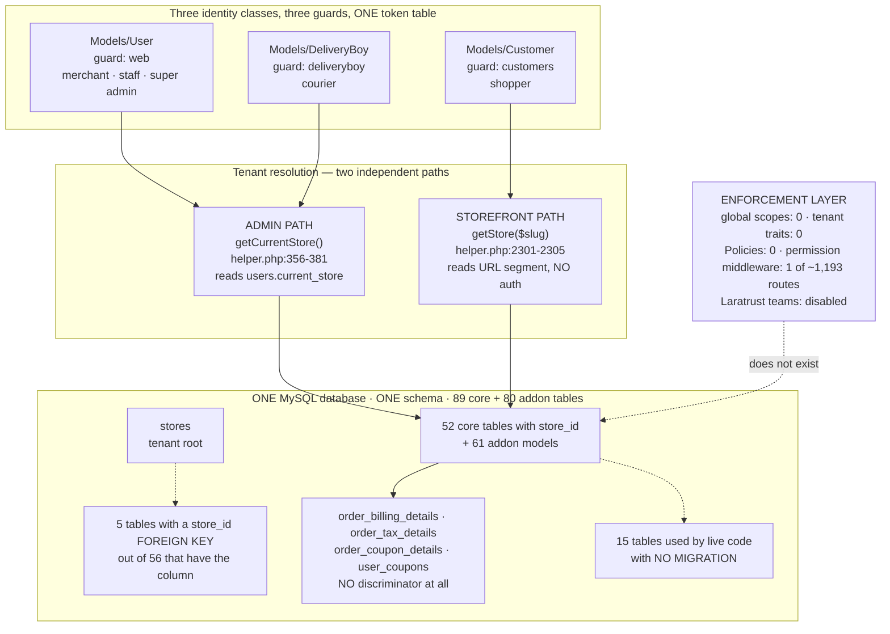

---
**Document:** 04 — Database & Multi-Tenancy
**Phase:** Phase 0 — Discovery & Audit
**Date:** 2026-10-11
**Repo A ("Main Platform"):** `github.com/fullstackfull/syriastore98` — branch `claude/pensive-cerf-h6rizn`, HEAD `efe05d9f`
**Repo B ("Associated App"):** `github.com/fullstackfull/StoreSyria_app98` — branch `claude/pensive-cerf-h6rizn`, HEAD `d745ec08`
**Evidence basis:** All findings in this document are **code-level and static**, derived by reading migrations, models, controllers, middleware, route files and config in the two checkouts named above, with every claim cited as `repo path/file:line`. The following checks were **BLOCKED** and no conclusion is asserted from them: (1) **no database access** — `SHOW CREATE TABLE`, index cardinality, row counts, orphan counts and whether the production schema matches the repo could not be determined; (2) **`vendor/` is absent** (`ls vendor` → "No such file or directory"), so library internals — specifically `genealabs/laravel-model-caching` key derivation and `laravel/sanctum` token internals — could not be read, and no PHP could be executed; (3) **no migrations, seeders or artisan commands were run**, so "what a fresh install produces" is derived by reading the migration set, not by running it; (4) **no test suite exists to run** (`tests/` is stock Laravel Breeze scaffolding), so no behavioural assertion about tenant isolation has been executed — every isolation claim below is a code reading. Where a count differs from another dossier in this audit, the figure printed here is the one I measured myself and the command is given.

---

## 1. Bottom line

Repo A is a **shared-database, single-discriminator-column multi-tenant system (model A)**: one MySQL database, one set of tables, a `store_id` column on 52 of the 89 core tables, and a tenant resolved from a column on the authenticated user's own row. That is a legitimate, conventional and — for this product at this scale — correct architecture. **Nothing in the evidence justifies changing it, and nothing justifies a rewrite.**

The problem is not the model. It is that **the model is not enforced by anything**. There are **zero** Eloquent global scopes, **zero** tenant traits or scope classes, **zero** Policies, and **one** permission-middleware declaration in the entire route tree. Isolation is 487 hand-written `where('store_id', getCurrentStore())` clauses (`grep -rn "where('store_id', *getCurrentStore()" app/ packages/ --include=*.php | wc -l` → 487; 1,260 counting every `where('store_id', …)` clause) across 119 of 188 tenant-bearing model files, and I have read the places where the clause is simply absent — including an unauthenticated cross-tenant order read on the public storefront, four cross-tenant order writes reachable by any logged-in merchant staff account, seven completely unauthenticated admin API list endpoints that take the tenant from the query string, and one API endpoint that lets a caller re-point their own `current_store` at any tenant on the platform, which converts every *correctly* scoped controller in the product into a cross-tenant tool.

Independently of security, the repository **cannot rebuild its own schema**. Fifteen tables that live, routed code reads and writes have **no migration anywhere** in either migration tree — six of them money-bearing. `orders.currency_code` and `orders.currency_symbol` are written on every single order insert and exist in no migration. `App\Models\Customer` applies the `SoftDeletes` trait while `deleted_at` appears in **zero** migrations repo-wide, which means that on a schema built from this repo *every customer query fails*, including login. The authoritative schema exists only on the production server, in no artifact under version control.

And the money is stored in the wrong column type. Across 105 core migrations there are **zero** `decimal()` columns and **20** `float()` plus **3** `double()`. `orders.final_price` is a bare single-precision `FLOAT`. That is a correctness defect, not a style preference, and it matters more here than in most systems because the target currency is SYP.

**Go/no-go position for this area:** the database and tenancy layer is **not production-safe as it stands**, but it is **remediable without a rewrite**, and the remediation has a short critical path: reconstruct the schema into version control, fix authentication, then install an enforced tenant scope behind cross-tenant denial tests. Sections 12–14 set out the options comparison, the single recommendation and the concrete first steps.

| Dimension | Status | Implementation | Severity | Priority |
|---|---|---|---|---|
| Tenancy model chosen (shared DB + `store_id`) | VERIFIED | PARTIALLY IMPLEMENTED | MEDIUM | P1 |
| Tenant isolation enforced by the framework | VERIFIED (absent) | MISSING | CRITICAL | P0 |
| Schema reproducible from source | VERIFIED (not reproducible) | MISSING | CRITICAL | P0 |
| Referential integrity on tenant relationships | VERIFIED | PARTIALLY IMPLEMENTED | HIGH | P1 |
| Money column types | VERIFIED (float/double, no decimal) | IMPLEMENTED BUT WRONG | HIGH | P1 |
| Transactions on the checkout/stock path | VERIFIED (absent) | MISSING | HIGH | P1 |
| Index coverage on tenant + hot columns | VERIFIED | PARTIALLY IMPLEMENTED | HIGH | P1 |
| Model cache invalidation | PARTIAL | IMPLEMENTED BUT NOT VERIFIED | HIGH | P1 |
| Cache-key tenant safety | UNKNOWN (BLOCKED — `vendor/` absent) | UNKNOWN | — | P2 |

---

## 2. The actual tenancy model

### 2.1 What it is — FACT

**Model (A): one shared database, one shared schema, a `store_id` discriminator column.** This is established from configuration and schema, not inferred:

- **One connection, stock drivers only.** `config/database.php:32` opens `'connections'`, and the only connections defined are `sqlite` (`:34`), `mysql` (`:42`), `mariadb` (`:62`), `pgsql` (`:82`), `sqlsrv` (`:97`). There is no `tenant` connection and no connection template.
- **No dynamic connection switching exists.** `grep -rn "setDatabaseName\|DB::purge\|config(\['database" app/ packages/ --include=*.php` → **0 hits**. Nothing in the codebase can point a query at a different database or schema.
- **No tenancy library.** `grep -niE "tenan|multi-?db|stancl|spatie/laravel-multi" composer.json` → **0 hits**. There is no `stancl/tenancy`, no `spatie/laravel-multitenancy`.
- **`stores` is an ordinary table.** `repo-A database/migrations/2023_12_14_090259_create_stores_table.php:14-25` — `id`, `name`, `email`, `theme_id`, `slug` (`:19`), `default_language`, `created_by` (`:21`), `is_active`, `enable_pwa_store`, `timestamps`, and one foreign key: `created_by → users.id ON DELETE CASCADE` (`:25`).
- **52 of 89 core tables carry `store_id`**, measured per-migration (see §5).

### 2.2 How the tenant is resolved — FACT

Tenant resolution is a global helper reading a column on the user row — `repo-A app/Helper/helper.php:356-381`:

```php
function getCurrentStore($user_id = null)
{
    if (!empty($user_id)) { $user = User::find($user_id); }
    else { $user = auth()->user(); }

    if ($user) {
        $storeId = $user->current_store;
        if (!empty($storeId)) { return $storeId; }
        else {
            if ($user->type == 'super admin') { return 1; }
            else { $store = Store::where('created_by', $user->id)->first(); return $store ? $store->id : null; }
        }
    }
}
```

Three properties of this function are load-bearing for everything below:

1. **The tenant is a mutable column**, `users.current_store` — `repo-A database/migrations/2014_10_12_000000_create_users_table.php:25`: `$table->unsignedBigInteger('current_store')->nullable()->index();` with **no foreign key to `stores`**. Whoever can write that column can re-tenant themselves (§4.4).
2. **There is no `else`** on `if ($user)`. For an unauthenticated caller the function falls off the end and returns `null`. That null is accidentally protective — `where('store_id', null)` matches nothing — and several unauthenticated routes are saved only by it (`repo-A app/Http/Controllers/StoreFinanceController.php:644`, `:719`, `:888`, reached from `repo-A routes/web.php:186`, `:189`, `:192`). **Any refactor that makes `getCurrentStore()` fall back to a default store converts those routes from harmless to exploitable.** Treat the `null` as a deliberate invariant.
3. **It is called 1,323 times** (`grep -rn "getCurrentStore(" app/ packages/ resources/ --include=*.php | wc -l` → 1323). It is the de-facto tenancy API and therefore the correct single place to harden.

The **storefront** resolves the tenant differently — from the URL slug, with no authentication at all — `repo-A app/Helper/helper.php:2301-2305`:

```php
function getStore($storeSlug = null)
{
    return Store::where('slug', $storeSlug ?? request()->route('storeSlug'))->first();
}
```

So the platform has **two independent tenant resolvers with different trust properties**: a session-derived one for the admin panel and a URL-derived one for the storefront. Both are advisory — each returns a store, and it is then the caller's responsibility to use it.

### 2.3 Tenancy at a glance



---

## 3. Is isolation ENFORCED or CONVENTIONAL?

**CONVENTIONAL. Status: VERIFIED. Implementation: MISSING. Severity: CRITICAL. Priority: P0.**

### 3.1 The enforcement census — all figures measured in this checkout

| Enforcement mechanism | Command | Result |
|---|---|---|
| Eloquent global scopes | `grep -rn "addGlobalScope" app/ packages/ \| wc -l` | **0** |
| Model `booted()` hooks in any model | `grep -rn "function booted" app/Models/ packages/workdo/*/src/app/Models/` | **1** — `repo-A app/Models/Order.php:63`, and it is a *currency defaulter*, not a scope |
| Tenant trait / scope class | `find app packages -iname "*Scope*.php"`; `ls app/Traits/` | **0** scope classes; `app/Traits/` holds one file, `ApiResponser.php` |
| Policy directory | `ls app/Policies` | **does not exist** |
| Registered policies | `repo-A app/Providers/AuthServiceProvider.php:15-17` | empty `$policies = [ // ];` |
| `permission:` / `role:` route middleware | `grep -rn "permission:" routes/` | **1** — `repo-A routes/web.php:164` (`permission:View Finance Dashboard`) |
| Laratrust teams (its native tenancy feature) | `repo-A config/laratrust.php:232,242` | **disabled** (`'enabled' => false`) |
| Laratrust gate integration | `repo-A config/laratrust.php:265` | **disabled** (`'permissions_as_gates' => false`) |
| Models carrying `store_id` — `app/Models` | `ls app/Models/*.php \| wc -l` → 95, then `grep -l store_id app/Models/*.php \| wc -l` | **57** of 95 |
| Models carrying `store_id` — addon-glob subset | `grep -rl "store_id" packages/workdo/*/src/app/Models/*.php \| wc -l` | **61** of 85 |
| **Tenant-bearing model files with no enforced scope — platform-wide** | `find app/Models packages -type f -name '*.php' \( -path '*/Models/*' -o -path '*/Entities/*' \) \| wc -l` → **188**; the same `find` piped to `xargs grep -l "store_id" \| wc -l` → **119** | **119 of 188** |
| Hand-written tenant filters — headline | `grep -rn "where('store_id', *getCurrentStore()" app/ packages/ --include=*.php \| wc -l` | **487** (`app/` alone, same command: **330**) |
| All `where('store_id', …)` clauses, any second argument | `grep -rnE "where\((['\"])store_id\1," app/ packages/ --include=*.php \| wc -l` | **1,260** |
| `getCurrentStore()` call sites | `grep -rn "getCurrentStore(" app/ packages/ resources/ --include=*.php \| wc -l` | **1,323** |
| Inline capability checks | `grep -rn "isAbleTo(" app/ --include=*.php \| wc -l` | **201** |

**How the model-file and filter figures reconcile — read this before quoting any of them.** The two model counts measure different file sets and both are printed deliberately. The `packages/workdo/*/src/app/Models/*.php` glob reaches 85 addon model files, which with `app/Models`' 95 gives the 180-file denominator used in earlier drafts of this audit; the `find` above reaches **188** files because it also covers `Entities/` directories and nested `Models/` directories that the glob's fixed depth misses, and it finds **one** additional tenant-bearing file — `repo-A packages/workdo/SMS/src/Entities/SendMsg.php`. The platform-wide figure is therefore **119 of 188 model files platform-wide (57 of 95 in `app/Models/` alone)**, and any figure of the form "118 of 180" is the narrower glob measurement, not an error of fact but a different denominator; **119 of 188** is the one to quote. Likewise the two filter counts: **487** is the headline — explicit `where('store_id', getCurrentStore())` call sites across `app/` and `packages/`, with the whitespace-tolerant command given above — while **1,260** is the wider count of *all* `where('store_id', …)` clauses regardless of the second argument, which includes `$request->store_id`, `$store->id` and literal ids, and therefore includes the API methods that take the tenant from the caller (§4.4). Every figure in the table above was measured in this checkout with the command printed beside it.

**The honest reading of these numbers — and this is a correction to a looser framing that appears elsewhere in the audit:** isolation is not "absent". It is *pervasively implemented by hand*, 487 times by the headline count and 1,260 times counting every `store_id` predicate, and authorization is *pervasively implemented by hand*, 201 times. What is absent is a **backstop**. The 201 `isAbleTo()` calls answer "may this role touch coupons?" and never "does this coupon belong to the caller's store?" — capability without ownership. And because nothing fails closed, a developer who forgets one `where()` creates a cross-tenant hole that no test, no CI (there is no `.github/`) and no framework layer will catch.

### 3.2 The proof that it is a convention: the same file gets it right and wrong

The decisive evidence is not a count. It is two methods in one controller, 200 lines apart.

**Correct** — `repo-A app/Http/Controllers/OrderController.php:566-575` (`orderDetails`) scopes by store and aborts:

```php
$id = decrypt($request->route('id'));
$order = Order::order_detail($id);
$store = getStore($request->route('storeSlug'));
$order_data = Order::where('id', $id)->where('store_id', $store->id)->first();
if (!$order_data) { abort(404); }
```

**Incorrect** — `repo-A app/Http/Controllers/OrderController.php:347-374` (`orderComplete`) resolves the store from the URL on line 349, then never compares it to the order:

```php
347  public function orderComplete(Request $request)
348  {
349      $store = getStore($request->route('storeSlug'));
350      if (!$store) {
351          abort(404);
352      }
...
360          if (!empty($request['data']['order_id'])) {
361              $order_id = $request['data']['order_id'];
362              $order = Order::find($order_id);
...
371      if (isset($order) && !empty($order)) {
372          $storeUrl = getFrontThemeUrl($store);
373          $url = $storeUrl.'/' . $store->slug . '/order/' . \Illuminate\Support\Facades\Crypt::encrypt($order->id ?? '');
374          return view('front_end.pages.order-complete', compact('url', 'order'));
```

The route is public — `repo-A routes/customer.php:144` — inside the only enclosing group `Route::middleware([ActiveTheme::class, 'themelanguage'])` at `repo-A routes/customer.php:49`, itself inside `Route::middleware(['web'])` at `repo-A routes/web.php:305` (the file is required at `repo-A routes/web.php:973`). Neither middleware authenticates: `repo-A app/Http/Middleware/ActiveTheme.php:19-36` only calls `Theme::set()` and its `abort()` is commented out at `:23-25`; `repo-A app/Http/Middleware/ThemeLanguage.php:21-38` only calls `App::setLocale()`.

This was adversarially verified in this audit. **Corrected finding (overrides the looser original wording):** `GET /{anyStoreSlug}/order-complete?data[order_id]=N` is a **two-hop** anonymous cross-tenant chain, not a single-request full-order dump. Hop 1 returns the victim order's human-readable number plus `Crypt::encrypt($order->id)` — the exact capability token that `order.details` accepts (`repo-A routes/customer.php:143`). Hop 2 replays that token at `/{victimStoreSlug}/order/{token}`, where `orderDetails` *is* store-scoped but is not customer-scoped and not authenticated, and the page renders shipping/billing name, e-mail, phone, city, state, country and post code (`repo-A resources/views/front_end/pages/order-detail.blade.php:131-190`). Hop 1 also hands the attacker the fully-formed hop-2 URL, because `$url` at `:373` embeds the owning store's slug. Order ids are sequential and no throttle applies to either route. **Status: VERIFIED. Severity: CRITICAL. Priority: P0.**

### 3.3 Concrete unscoped-query examples, read in full

These are the ones I opened and read to the closing brace. They are a sample of a larger class, not an exhaustive list.

| # | Entry point | Code site | Actor required | Effect |
|---|---|---|---|---|
| 1 | `GET {slug}/order-complete` (`repo-A routes/customer.php:144`) | `repo-A app/Http/Controllers/OrderController.php:360-362` — `Order::find($request['data']['order_id'])` | **anonymous** | Cross-tenant order read + mints the `order.details` token |
| 2 | `POST order-assign` (`repo-A routes/web.php:700`) | `repo-A app/Http/Controllers/OrderController.php:677-690` | any authenticated merchant/staff | Reassigns **any** store's order to **any** store's courier, and deletes that order's `DeliveryEarning` rows |
| 3 | `POST update-order-status/{id}` (`repo-A routes/web.php:953`) | `repo-A app/Http/Controllers/OrderController.php:640-647` — `Order::find($id)`, **no `isAbleTo`, no store filter** | any authenticated user | Marks any order on the platform delivered |
| 4 | `DELETE /coupon/{coupon}` (`repo-A routes/web.php:746`) | `repo-A app/Http/Controllers/CouponController.php:229-242` — route-model-bound `$coupon`, gated only on `isAbleTo('Delete Coupon')` | merchant holding a routine coupon permission | Deletes another tenant's coupon |
| 5 | `GET /coupon/{coupon}/edit` | `repo-A app/Http/Controllers/CouponController.php:135-145` | any authenticated user — **no permission check at all** | Reads another tenant's coupon; note `:137-138` store-filters the *dropdown* data while the bound `$coupon` is unfiltered |
| 6 | `GET /api/admin/orderlist?store_id=N` (`repo-A routes/api.php:166`) | `repo-A app/Http/Controllers/Api/DashboardController.php:909-926` | **anonymous** | Any tenant's full order book, incl. customer names via the `user_name` append |
| 7 | `POST /api/admin/changestore` (`repo-A routes/api.php:305`) | `repo-A app/Http/Controllers/Api/DashboardController.php:3550-3553` | any API caller | **Re-tenants the caller** — see §4.4 |
| 8 | Coupon-redemption ledger | `repo-A app/DataTables/UserCouponDataTable.php:80-83` — `where('coupon_id', $this->couponId)` only | merchant holding `Create Coupon` | Reads another store's redemptions; `user_coupons` has **no `store_id` column to filter by** (`repo-A database/migrations/2023_12_29_100550_create_user_coupons_table.php:14-26`) |

Example 2 deserves a specific note because it shows the convention failing *through validation*, `repo-A app/Http/Controllers/OrderController.php:677-690`:

```php
677      $request->validate([
678          'order_id' => 'required|integer|exists:orders,id',
679          'delivery_boy' => 'required|integer|exists:delivery_boys,id',
680      ]);
681
682      $order = Order::find($request->order_id);
683      $deliveryBoy = \App\Models\DeliveryBoy::find($request->delivery_boy);
684
685      if ($order->deliveryboy_id != $request->delivery_boy) {
686          \App\Models\DeliveryEarning::where('order_id', $order->id)->delete();
687      }
688
689      $order->deliveryboy_id = $request->delivery_boy;
690      $order->save();
```

`exists:orders,id` means "exists in **any** store". The validator makes the cross-tenant reference pass. The correct rule is `Rule::exists('orders','id')->where('store_id', getCurrentStore())`.

### 3.4 The three mitigations that do exist, and must not be regressed

Stating these is as important as stating the gaps, because a fix that ignores them will break the product.

1. **Guard separation is real.** `repo-A config/auth.php` defines `web` → `App\Models\User`, `customers` → `App\Models\Customer`, `deliveryboy` → `App\Models\DeliveryBoy`. A storefront shopper's session therefore **cannot** satisfy the bare `auth` middleware on the admin routes. The actor for the web-route findings above is merchant staff, not an anonymous visitor or a customer. This materially narrows several findings and should be reflected in any remediation brief.
2. **487 correct `store_id` filters and 201 `isAbleTo()` checks exist.** A global scope will layer *on top of* working code, not replace missing code. The super-admin and cross-store screens depend on *not* being filtered.
3. **`getCurrentStore()` returns `null` when unauthenticated** (`repo-A app/Helper/helper.php:356-381`), which is the only thing preventing the three unauthenticated withdrawal endpoints from being exploitable.

### 3.5 The authentication caveat that voids all of the above

Tenant isolation is irrelevant while authentication does not work. `repo-A app/Http/Middleware/CustomAuth.php:21-55`, aliased as `custom.auth` and attached to **189 route registrations** in `repo-A routes/api.php`:

```php
23          $token = $request->header('Authorization');
24          if ($token) {
26              $token = substr($token, 7);
28              $token = explode('|', $token);
29              $tokenId = $token[0] ?? null;
31              if ($tokenId) {
32                  $tokenExists = \DB::table('personal_access_tokens')
33                  ->where('id', $tokenId)
34                  ->first();
35                  if ($tokenExists) {
36                      if ($tokenExists->tokenable_type == 'App\Models\Customer') {
...
47                  } elseif ($tokenId && !$tokenExists) {
48                      return $this->error(['message' => __('Unauthenticated.')], __('Unauthenticated.'), 401 );
49                  }
50              }
52          }
54          return $next($request);
```

Two defects, both CONFIRMED by adversarial verification:

- **The token secret is never verified.** A Sanctum plaintext token is `"<id>|<secret>"`, and the sha256 of the secret is stored in `personal_access_tokens.token` (`repo-A database/migrations/2019_12_14_000001_create_personal_access_tokens_table.php:18` — `$table->string('token', 64)->unique();`). This middleware splits on `|`, keeps only `$token[0]`, looks the row up **by primary key**, and logs in the owner. `Authorization: Bearer 3|anything` authenticates as the owner of token row 3. Ids are auto-increment and nothing throttles the API (`throttleApi()` is never called in `repo-A bootstrap/app.php`), so enumeration is free.
- **A missing header is a silent pass-through.** Line 54 is reached unconditionally when no `Authorization` header is present. The 401 at `:48` fires only for a *present* header bearing a non-existent id.

The same codebase contains the correct comparison 25 lines from a vulnerable call site — `repo-A app/Http/Controllers/Api/DashboardController.php:625-628` uses `hash_equals($token->token, hash('sha256', $tokenValue))`. So this is a defect, not an alternate design.

One **residual uncertainty, labelled**: that `auth()->login()` on the session-backed `web` guard persists through a stateless API request (Laravel 11's `api` group omits `StartSession`) is **inferred**, not executed. It is supported by every admin controller consuming `auth()->user()` and by Repo B shipping against these endpoints. If it were disproved, the forgery limb would degrade from impersonation to a fail-open defect. The **header-absent** limb needs no such assumption.

---

## 4. Specific tenancy failure modes worth naming separately

### 4.1 Two discriminator conventions coexist, and a third grain exists — VERIFIED, HIGH, P1

| Convention | Core migrations | Addon migrations |
|---|---|---|
| mentions `store_id` | 56 of 105 | 66 of 102 |
| mentions `created_by` | 17 of 105 | 50 of 102 |
| has a `store_id` **FOREIGN KEY** | **5** | **1** |

`settings` carries **both**, and `created_by` is a **string** — `repo-A database/migrations/2023_12_11_100148_create_settings_table.php:14-20`:

```php
14      Schema::create('settings', function (Blueprint $table) {
15          $table->id();
16          $table->string('name');
17          $table->longText('value')->nullable();
18          $table->string('created_by');
19          $table->unsignedBigInteger('store_id')->nullable()->index();
20          $table->timestamps();
```

and callers pick inconsistently between the two: `repo-A app/Helper/helper.php:145` filters on `store_id` only; `:314` on both; `:349-351` on `created_by` only. The consequence is concrete and destructive — `repo-A app/Http/Controllers/StoreController.php:498`: `Setting::where('created_by', $user->id)->delete();` deletes the settings of **every store that user owns**, not the one being deleted.

`email_templates` has `created_by` and **no `store_id`** (`repo-A database/migrations/2023_12_18_044149_create_email_templates_table.php:18`), and is queried per-user. A merchant with two stores shares one set of e-mail templates across both. That is a **different tenancy grain**, and a naive `store_id` scope applied to it would break the feature. Decide the intended grain before scoping it.

### 4.2 Four tenant-data tables have no discriminator at all — VERIFIED, HIGH, P1

The worst is **order PII** — `repo-A database/migrations/2024_01_23_065547_create_order_billing_details_table.php:14-33`:

```php
14      Schema::create('order_billing_details', function (Blueprint $table) {
15          $table->id();
16          $table->integer('order_id')->default(0);
17          $table->string('product_order_id')->nullable()->comment('get from order table');
18          $table->string('first_name')->nullable();
...
28          $table->string('delivery_address')->nullable();
...
33          $table->timestamps();
```

No `store_id`, **no foreign key** (`order_id` is a plain `integer`), **no index**. The same shape applies to `order_tax_details` (`repo-A database/migrations/2024_01_23_065814_...:14`), `order_coupon_details` (`repo-A database/migrations/2024_02_07_090758_...:16`) and `user_coupons` (`repo-A database/migrations/2023_12_29_100550_...:14-26`).

A tenancy fact with a sharp edge: `repo-A app/Http/Controllers/OrderController.php:165-176` passes `'store_id' => $storeId` (`:176`) into `OrderBillingDetail::create([...])` (`:165`), but `store_id` is neither a column nor in `$fillable`. **Eloquent silently drops it.** The developer believed billing details were tenant-scoped. They are not. These four tables cannot be scoped by a trait until `store_id` is backfilled from their parent.

### 4.3 Slug generation and lookup are global, not per-store — VERIFIED, MEDIUM, P2

`repo-A app/Models/Product.php:68-97`:

```php
78          $table = with(new Product)->getTable();
80          $allSlugs = self::getRelatedSlugs($table, $slug ,$id = 0);
82          if (!$allSlugs->contains('slug', $slug)) {
83              return $slug;
84          }
85          for ($i = 1; $i <= 100; $i++) {
86              $newSlug = $slug . '-' . $i;
...
94      protected static function getRelatedSlugs($table, $slug, $id = 0)
96          return DB::table($table)->select()->where('slug', 'like', $slug . '%')->where('id', '<>', $id)->get();
```

Three consequences. (a) **Cross-tenant namespace coupling** — if store A has `iphone-15`, store B's identically-named product silently becomes `iphone-15-1`, leaking the existence of A's catalogue and breaking B's URL expectations. (b) **Performance** — `SELECT *` with `LIKE 'x%'` across the entire multi-tenant `products` table on every product save, on an **unindexed** column (§10), hydrating every match into PHP. (c) **A silent NULL** — the `for` loop has no `return` after it, so the 101st collision returns `null` and writes a NULL slug. The same idiom recurs in `Customer.php`, `ProductAttribute.php`, `ProductBrand.php`, `ProductLabel.php`, `Tag.php`, `User.php`.

### 4.4 The master key: `current_store` is writable from the API — VERIFIED, CRITICAL, P0

`repo-A routes/api.php:305`: `Route::post('changestore', [DashboardController::class, 'ChangeStore'])->middleware(['custom.auth','AdminApiLog']);`

`repo-A app/Http/Controllers/Api/DashboardController.php:3550-3554`:

```php
3550          $store = Store::find($request->store_id);
3551          if (!empty($store)) {
3552              $user->current_store = $store->id;
3553              $user->update();
3554              return $this->success(['message' => __('Store Change Successfully!')]);
```

No `->where('created_by', $user->id)`, no membership check, and the new value is **persisted to the caller's own `users` row**. Because the entire admin panel derives its tenant from `getCurrentStore()` → `users.current_store`, this single call turns **every correctly scoped controller in the product into a cross-tenant tool**. The correct form already exists 57 lines later in the same class (`DeleteStore`, `:3607-3609`, which does filter on `created_by`).

This is the most important single finding in this document for anyone evaluating option A versus B/C in §12: *a shared-DB tenancy model whose discriminator is attacker-writable provides no isolation at all, no matter how many `where()` clauses are correct.*

---

## 5. Full table inventory

**Scope and method.** 105 migration files in `repo-A database/migrations/`, 102 in `repo-A packages/workdo/*/src/database/migrations/`. Distinct literal `Schema::create('…')` names: **89** core, **80** addon, with `pixel_fields` duplicated across the two trees — **168 distinct tables**. One further core table is created with a non-literal name: `repo-A database/migrations/2024_01_26_112423_create_visits_table.php:17` — `Schema::create(config('visitor.table_name'), …)`, i.e. `shetabit_visits` — bringing the core total to **90**. `failed_jobs` is created twice *within* the core tree (`repo-A database/migrations/0001_01_01_000002_create_jobs_table.php:45` and `repo-A database/migrations/2019_08_19_000000_create_failed_jobs_table.php:16`), both guarded by `hasTable`.

The inventory below was generated programmatically from the migration files (one row per `Schema::create`, line numbers from `grep -n` against the named file) and then spot-verified by reading 14 migrations in full. **Disc.** = tenant discriminator: `S` = `store_id`, `C` = `created_by`, `S+C` = both, `G` = intentionally global/platform data, `T` = tenant only transitively through a parent FK, `—` = none.

### 5.1 Core tables (90)

| # | Table | Migration prefix : `Schema::create` line | Disc. (line) | FK→`stores` | FKs | Idx | Uniq | Notes |
|---|---|---|---|---|---|---|---|---|
| 1 | `cache` | `0001_01_01_000001:14` | G | no | 0 | 0 | PK | framework |
| 2 | `cache_locks` | `0001_01_01_000001:20` | G | no | 0 | 0 | PK | framework |
| 3 | `jobs` | `0001_01_01_000002:16` | G | no | 0 | 1 | — | queue |
| 4 | `job_batches` | `0001_01_01_000002:29` | G | no | 0 | 0 | PK | queue |
| 5 | `failed_jobs` | `0001_01_01_000002:45` / dup `2019_08_19_000000:16` | G | no | 0 | 0 | `uuid` | both `hasTable`-guarded |
| 6 | `users` | `2014_10_12_000000:14` | C (`:40`, **no FK**) | no | 1 | 2 | `email:17` | `current_store:25` indexed, **no FK to stores**; `plan_id` type is ordering-dependent (§8a) |
| 7 | `password_reset_tokens` | `2014_10_12_100000:14` | G | no | 0 | 0 | PK `email` | shared by two brokers |
| 8 | `personal_access_tokens` | `2019_12_14_000001:14` | G | no | 0 | 0 | `token:18` | the hash `CustomAuth` never reads |
| 9 | `app_settings` | `2022_06_29_092348:16` | S (`:21`) | no | 0 | 1 | — | PWA/theme JSON |
| 10 | `roles` | `2023_12_08_100022:17` | S+C (`:24-25`) | no | 4 | 1 | `name:19` → **dropped** by `2024_06_05_094055:22` | per-tenant roles on a once-global name |
| 11 | `permissions` | `2023_12_08_100022:30` | C (`:37`) | no | — | 0 | `name:32` | **no `store_id`** — one global permission namespace |
| 12 | `role_user` | `2023_12_08_100022:42` | — | no | 1 | PK | PK | pivot |
| 13 | `permission_user` | `2023_12_08_100022:54` | — | no | 1 | PK | PK | pivot |
| 14 | `permission_role` | `2023_12_08_100022:66` | — | no | 2 | PK | PK | pivot |
| 15 | `plans` | `2023_12_08_123752:14` | G | no | 0 | 0 | `name:16` | `price` is a **`string`** (`:17`) |
| 16 | `settings` | `2023_12_11_100148:14` | S+C (`:18-19`) — `created_by` is a **string** | no | 0 | 1 | — | §4.1 |
| 17 | `plan_requests` | `2023_12_11_100414:14` | G | no | 2 | 0 | — | |
| 18 | `plan_coupons` | `2023_12_11_100854:14` | G | no | 0 | 0 | — | `discount` is `float:18` |
| 19 | `plan_user_coupons` | `2023_12_11_101905:14` | G | no | 2 | 0 | — | |
| 20 | `plan_orders` | `2023_12_11_102124:14` | S (`:36`) | no | 1 | 1 | `order_id:16` | `price` is `float:24` |
| 21 | **`stores`** | `2023_12_14_090259:14` | C (`:21`) | n/a | 1 | 0 | **none on `slug:19`** | **the tenant root**; `created_by` FK is `ON DELETE CASCADE` (`:25`) |
| 22 | `customers` | `2023_12_15_112855:15` | S+C (`:42-43`) | no | 0 | 2 | **none on `email`** | model applies `SoftDeletes`; `deleted_at` **does not exist** (§7.4) |
| 23 | `activity_logs` | `2023_12_18_031955:14` | S (`:19`) | no | 0 | 1 | — | |
| 24 | `newsletters` | `2023_12_18_032417:14` | S (`:18`) | no | 0 | 1 | — | PII |
| 25 | `countries` | `2023_12_18_033409:14` | G | no | 0 | 0 | — | ref data |
| 26 | `states` | `2023_12_18_033631:14` | G | no | 1 | 0 | — | ref data |
| 27 | `cities` | `2023_12_18_034121:14` | G | no | 2 | 0 | — | ref data |
| 28 | `email_templates` | `2023_12_18_044149:14` | **C only (`:18`)** | no | 1 | 0 | — | different tenancy grain (§4.1) |
| 29 | `email_template_langs` | `2023_12_18_044212:14` | T | no | 1 | 0 | — | |
| 30 | `user_email_templates` | `2023_12_18_044226:14` | — | no | 2 | 0 | — | |
| 31 | `delivery_addresses` | `2023_12_18_062620:14` | S (`:28`) | no | 4 | 1 | — | PII; `customer_id` has `default(0)` **+ FK** (§7.5) |
| 32 | `pages` | `2023_12_18_101105:14` | S (`:24`) | no | 0 | 1 | none on `page_slug` | cross-tenant CMS read (dossier 07) |
| 33 | `contacts` | `2023_12_18_101425:14` | S (`:22`) | no | 0 | 1 | — | PII |
| 34 | `faqs` | `2023_12_18_101636:14` | S (`:18`) | no | 0 | 1 | — | |
| 35 | `pixel_fields` | `2023_12_18_101848:14` **dup across trees** | S (`:18`) | no | 0 | 1 | — | §8b — addon version silently skipped |
| 36 | `webhooks` | `2023_12_18_102124:14` | S (`:19`) | no | 0 | 1 | — | |
| 37 | `shippings` | `2023_12_19_054936:14` | S (`:19`) | no | 0 | 1 | none on `slug` | |
| 38 | `shipping_zones` | `2023_12_19_055003:14` | S (`:20`) **not indexed** | no | 2 | 0 | — | index gap |
| 39 | `shipping_methods` | `2023_12_19_061038:14` | S (`:22`) | no | 1 | 1 | — | |
| 40 | `blog_categories` | `2023_12_21_110612:14` | S (`:18`) | no | 0 | 1 | — | |
| 41 | `blogs` | `2023_12_21_110736:14` | S (`:23`) | no | 1 | 1 | none on `slug` | |
| 42 | `taxes` | `2023_12_22_060417:14` | S (`:17`) | no | 0 | 1 | — | |
| 43 | `tax_options` | `2023_12_22_101328:14` | S+C (`:18-19`) | no | 0 | 1 | — | |
| 44 | `tax_methods` | `2023_12_25_040519:14` | S (`:24`) | no | 4 | 1 | — | |
| 45 | `categories` | `2023_12_25_093024:14` | S (`:24`) | no | 0 | 1 | **none on `slug`** | |
| 46 | `flash_sales` | `2023_12_25_093243:14` | S+C (`:25-26`) | no | 0 | 1 | — | `discount_amount` is `float:23` |
| 47 | `flash_sale_conditions` | `2023_12_25_094939:14` | S (`:18`) | no | 1 | 1 | — | |
| 48 | **`products`** | `2023_12_26_092822:14` | S+C (`:49-50`) | no | 1 | 1 | **none on `slug:17`** | `category_id` FK is **`ON DELETE CASCADE`** (`:55`) — §7.3; `price`/`sale_price` are `float` (`:31-32`) |
| 49 | `menus` | `2023_12_26_094357:14` | S (`:17`) | no | 0 | 1 | — | |
| 50 | `custom_links` | `2023_12_26_094427:14` | T (`menu_id`) | no | 1 | 0 | — | |
| 51 | `testimonials` | `2023_12_26_095726:14` | S (`:24`) | no | 1 | 1 | — | `category_id` `default(0)` **+ FK** (§7.5) |
| 52 | `menu_items` | `2023_12_26_102906:14` | T (`menu_id`) | no | 1 | 0 | — | |
| 53 | `delivery_boys` | `2023_12_26_112245:14` | S+C (`:22-23`) | no | 1 | 1 | **none on `email`** | |
| 54 | `product_attributes` | `2023_12_27_054045:14` | S (`:18`) | no | 0 | 1 | none on `slug` | |
| 55 | `tags` | `2023_12_29_031105:14` | S+C (`:18-19`) | no | 0 | 1 | none on `slug` | |
| 56 | `coupons` | `2023_12_29_092412:14` | S (`:33`) | no | 0 | 1 | **none on `coupon_code`** | `discount_amount` is `float:29` |
| 57 | `user_coupons` | `2023_12_29_100550:14` | **— none** | no | 3 | 0 | — | `user_id`/`coupon_id` `default('0')` **+ FKs**; `order_id` FK commented out (`:25`); `amount` is `float:18` |
| 58 | `product_attribute_options` | `2024_01_01_032743:14` | S (`:19`) | no | 1 | 1 | — | |
| 59 | `product_variants` | `2024_01_01_104858:14` | S (`:30`) | no | 1 | 1 | **none on `sku`** | `product_id` FK cascade (`:33`); `price` is `double(10,2)` (`:19`) |
| 60 | `product_images` | `2024_01_02_064847:14` | S (`:19`) | no | 0 | 1 | — | `product_id` is a plain `integer` |
| 61 | `currency` | `2024_01_04_052630:14` | G | no | 0 | 0 | — | created with **no primary key**; `id` added by `2024_05_16_054044:16` |
| 62 | `carts` | `2024_01_18_103138:14` | S (`:21`) | no | 0 | 1 | — | `cookie_session_id` added later, **unindexed**, and is the guest-cart lookup key |
| 63 | `product_questions` | `2024_01_22_031625:14` | S+C (`:19,21`) | no | 3 | 1 | — | |
| 64 | `wishlists` | `2024_01_22_040531:14` | S (`:20`) | no | 1 | 1 | — | `product_id` `default('0')` **+ FK** (§7.5) |
| 65 | `addons` | `2024_01_23_051158:14` | G | no | 0 | 0 | — | |
| 66 | **`orders`** | `2024_01_23_061635:14` | S (`:43`) | no | **0** | **1 (`store_id` only)** | **none, incl. `product_order_id:16`** | all six money columns are **`float`** (`:22-27`) — §7.6 |
| 67 | `order_billing_details` | `2024_01_23_065547:14` | **— none** | no | **0** | **0** | — | **order PII**, no FK, no index (§4.2) |
| 68 | `order_tax_details` | `2024_01_23_065814:14` | **— none** | no | 0 | 0 | — | `float` money (`:20-21`) |
| 69 | `support_tickets` | `2024_01_25_072330:14` | S+C (`:23-24`) | no | 1 | 1 | — | |
| 70 | `support_conversions` | `2024_01_25_072513:14` | S (`:21`) | no | 1 | 1 | — | |
| 71 | `templates` | `2024_01_26_071125:14` | G | no | 0 | 0 | — | AI prompt templates |
| 72 | `order_notes` | `2024_01_26_100237:16` | S (`:23`) | no | 2 | 1 | — | |
| 73 | `shetabit_visits` | `2024_01_26_112423:17` (**non-literal name**) | S (`:19`) | no | 0 | 1 + 2 morphs | — | analytics; `whereDate` scans (§10) |
| 74 | `woocommerce_conections` | `2024_01_30_050713:14` | S (`:17`) plain `integer`, **not indexed** | no | 0 | 0 | — | index gap |
| 75 | `shopify_conections` | `2024_01_31_052851:14` | S (`:16`) | no | 0 | 1 | — | |
| 76 | `whatsapp_messages` | `2024_01_31_113056:14` | S+C (`:20-21`) | no | 0 | 1 | — | |
| 77 | `purchased_products` | `2024_02_02_030433:14` | S (`:19`) | no | 0 | 1 | — | |
| 78 | `order_refunds` | `2024_02_07_071800:14` | S (`:24`) | no | 1 | 1 | — | `refund_amount` is `float:23` |
| 79 | `order_refund_settings` | `2024_02_07_090422:14` | S (`:19`) | no | 1 | 1 | — | |
| 80 | `order_coupon_details` | `2024_02_07_090758:16` | **— none** | no | 1 | 0 | — | three `float` money columns (`:24-26`) |
| 81 | `apikey_setiings` | `2024_03_13_084315:14` | C (`:17`) | no | 0 | 0 | — | table name is misspelled in the schema |
| 82 | `user_active_modules` | `2024_03_19_054231:14` | — | no | 0 | 1 | — | |
| 83 | `product_brands` | `2024_03_21_051038:14` | S+C (`:21-22`) | **YES (`:25`, cascade)** | 2 | 0 | none on `slug` | one of only 5 |
| 84 | `notify_users` | `2024_03_21_084240:14` | S (`:18`) | **YES (`:21`, cascade)** | 3 | 0 | — | one of only 5 |
| 85 | `add_on_managers` | `2024_03_21_103650:14` | G | no | 0 | 0 | — | drives runtime module autoload |
| 86 | `product_labels` | `2024_03_26_090355:14` | S+C (`:19-20`) | **YES (`:23`, cascade)** | 2 | 0 | none on `slug` | one of only 5 |
| 87 | `theme_customizes` | `2025_05_22_034433:14` | S (`:18`) | **YES (`:21`, cascade)** | 1 | 0 | — | one of only 5 |
| 88 | `theme_customize_orders` | `2025_05_23_043026:14` | S (`:18`) | **YES (`:20`, cascade)** | 1 | 0 | — | one of only 5 |
| 89 | `store_notifications` | `2026_08_03_123739:11` | S (`:14`, non-nullable) | no | 0 | **2 composite (`:31-32`)** | — | 2026 Syria-team table — best-engineered indexes in the repo |
| 90 | `store_devices` | `2026_08_03_124518:14` | S (`:18`, non-nullable) | no | 0 | **2 composite (`:28-29`)** | — | 2026 Syria-team table |

**Column-level patches applied by later core migrations** (all `Schema::table`, all additive): `plans` +`trial,trial_days,is_disable` (`2024_03_13_062916:15-17`), +`modules` (`2024_04_10_031608:15`); `users` +`trial_plan,trial_expire_date` (`2024_03_13_065856:17-18`), +`is_enable_login` (`2024_03_15_055922:15`), +`active_module` (`2024_04_10_041733:15`); `plan_orders` +`is_refund`; `testimonials` +`user_id`; `products` +`brand_id` (`2024_03_21_071117:15`, **no FK** although `product_brands` exists), +`label_id` (`2024_03_26_102706:15`, **no FK**), +`product_type`; `orders` +`deliveryboy_id` (`2024_03_28_034154:15`, **no FK, no index**), +`payment_receipt`, +`product_order_status,lottery_code`; `carts` +`size_data`, +`cookie_session_id` (`2024_11_22_052453:16`, **no index**); `roles`/`permissions` +`module`; `add_on_managers` +4 columns.

### 5.2 Addon tables

**80 distinct tables** across 102 migration files in `repo-A packages/workdo/*/src/database/migrations/`. 66 of the 102 files mention `store_id`, 50 mention `created_by`, and exactly **1** declares a `foreign('store_id')`. These were audited at the migration/model-census level only — the 69 addon modules' controllers were **not** read, so module-specific tenant leaks are **UNKNOWN and should be presumed to exist**, given that the core findings above were produced by the same authors. This is the largest unexamined surface in this area.

### 5.3 Unique-constraint census — no tenant-scoped uniqueness exists anywhere

All `->unique()` declarations in the core tree (`grep -rn -- "->unique(" database/migrations/*.php | grep -v dropUnique`):

| Constraint | File:line | Tenant-scoped? |
|---|---|---|
| `jobs.uuid` / `failed_jobs.uuid` | `0001_01_01_000002:47`, `2019_08_19_000000:18` | n/a (global) |
| `users.email` | `2014_10_12_000000:17` | no — global |
| `personal_access_tokens.token` | `2019_12_14_000001:18` | n/a |
| `roles.name` | `2023_12_08_100022:19` — later **dropped** | was global despite `roles.store_id` |
| `permissions.name` | `2023_12_08_100022:32` | global — one permission namespace for the platform |
| `plans.name` | `2023_12_08_123752:16` | n/a (platform data) |
| `plan_orders.order_id` | `2023_12_11_102124:16` | n/a |

**There is no `unique(['store_id','slug'])`, no `unique(['store_id','coupon_code'])`, no `unique(['store_id','email'])` on `customers`, and no uniqueness on `orders.product_order_id`.** Combined with §4.3's global slug generator, the product has global namespaces where it needs per-tenant ones, and no uniqueness where it needs it.

---

## 6. Tables used by live code with NO migration

**Status: VERIFIED. Implementation: MISSING. Severity: CRITICAL. Priority: P0.**

Verified in this checkout by a per-table search across both migration trees — `for t in …; do grep -rl "Schema::create('$t'" database/ packages/ | wc -l; done` → **0 for all fifteen**:

| Table | Declared / used at (`repo-A`) | Business function | Money? |
|---|---|---|---|
| `store_wallets` | `app/Models/StoreWallet.php:9`; `app/Services/OrderFinancialService.php`; `app/Http/Controllers/StoreFinanceController.php` | merchant wallet balance | **YES** |
| `store_wallet_transactions` | `app/Models/StoreWalletTransaction.php:9` | wallet ledger | **YES** |
| `store_withdrawals` | `app/Models/StoreWithdrawal.php:9` | merchant payouts | **YES** |
| `store_order_financials` | `app/Services/OrderFinancialService.php:28,90,228` | per-order P&L | **YES** |
| `currency_rates` | `app/Models/CurrencyRate.php:9`; `app/Http/Controllers/CurrencyRateController.php:14,22` | FX rates | **YES** |
| `delivery_earnings` | `app/Models/DeliveryEarning.php:9`; `app/Http/Controllers/OrderController.php:686,706` | courier commission | **YES** |
| `audit_logs` | `app/Models/AuditLog.php:9`; `app/Http/Controllers/UserController.php:131,246,283,…` | audit trail | no |
| `otp_integrations` | `app/Models/OtpIntegration.php:9` | OTP provider config | no |
| `chatwoot_integrations` | `app/Models/ChatwootIntegration.php:9` | support-chat config | no |
| `chatwoot_notification_templates` | `app/Models/ChatwootNotificationTemplate.php:9` | support-chat templates | no |
| `delivery_boy_devices` | `app/Models/DeliveryBoyDevice.php:12` | courier push tokens | no |
| `delivery_boy_notifications` | `app/Models/DeliveryBoyNotification.php:12` | courier push log | no |
| `zid_stores` | `app/Services/Zid.php:11,25` | Zid **OAuth tokens** | no (credentials) |
| `zid_orders` | `app/Console/Commands/ZidProcessEvents.php:90`; `app/Http/Controllers/DeliverySyriaStatusController.php:192` | Zid order mirror | no |
| `zid_events` | `app/Console/Commands/ZidProcessEvents.php:47,57`; `routes/web.php:1004` | Zid webhook queue | no |

**Plus two columns on `orders`.** `grep -rn "currency_code\|currency_symbol" database/migrations packages/workdo/*/src/database/migrations` → **0 hits**, yet both are in `$fillable` (`repo-A app/Models/Order.php:26-27`) and are assigned on **every** `creating` event — `repo-A app/Models/Order.php:63-80`:

```php
63      protected static function booted()
64      {
65          static::creating(function ($order) {
66              $storeId = $order->store_id ?? (function_exists('getCurrentStore') ? getCurrentStore() : null);
68              if (empty($order->currency_code)) {
69                  $order->currency_code = \App\Models\Utility::GetValueByName('defult_currancy', $storeId)
...
74              if (empty($order->currency_symbol)) {
```

Because there is no `DB::table('orders')->insert` anywhere in `app/`, `packages/` or `routes/`, **every** order creation goes through Eloquent and therefore through this hook, so both columns are always present in the INSERT.

**Exhaustiveness of the search (so this cannot be dismissed as a missed artifact).** `database/` contains only `factories/`, `migrations/`, `seeders/` — no `schema/` squashed dump. There are **no `.sql` files** anywhere in the repo. The only `CREATE TABLE` strings are five comment lines in `repo-A database/migrations/2023_12_08_100022_laratrust_setup_tables.php`. The only raw `DB::statement`/`DB::unprepared` calls toggle `foreign_key_checks` or drop one FK. `vendor/` is absent and untracked, so no vendor-published migration can supply these. No `Schema::create($var)` call exists. The authoritative schema for these fifteen tables exists **only on the production server**.

### 6.1 Two precision corrections that must appear in any brief

These come from adversarial verification of this finding and **override** the looser phrasings used elsewhere.

1. **"The repo cannot build its own schema" is imprecise about the mechanism.** `php artisan migrate` would *succeed*: all 207 migrations are internally valid and none references the fifteen tables, and no foreign key points at them. What fails is the **application code running against the resulting schema**. The accurate statement is: *migrations run clean but produce a schema missing 15 tables and 3 columns that the application queries unconditionally.*
2. **This is a reproducibility and disaster-recovery defect, not an active outage.** Production almost certainly has these objects, created by hand outside version control. That cannot be confirmed or denied from the checkout (no DB access). The realised harm is that **no fresh environment can be stood up from this repository** — no staging, no new-developer laptop, no DR rebuild, no host migration — in a repo with no CI (`.github/` does not exist) and no business-logic tests. On those grounds CRITICAL / P0 stands.

### 6.2 How a fresh install actually fails — three distinct modes

Derived by reading the call paths; **no migration was executed**.

- **Hard 500, customer-facing.** `App\Models\Customer` applies `SoftDeletes` (`repo-A app/Models/Customer.php:16,20`), which installs a global scope appending `customers.deleted_at is null` to **every** Customer query. The column exists in no migration (`grep -rn "softDeletes\|deleted_at" database/migrations/*.php packages/workdo/*/src/database/migrations/*.php` → **0 hits**), and `repo-A config/auth.php` binds the `customers` guard to that model. So customer registration, customer login and every admin customer listing fail with `Unknown column 'customers.deleted_at'`. **The storefront has no working customer authentication on a schema built from this repo.**
- **Hard 500, merchant-facing.** `AuditLog::record()` has no internal try/catch and is called bare from `repo-A app/Http/Controllers/UserController.php:131` — *after* the user row has already been saved — so creating a sub-user persists the user and then returns HTTP 500, leaving a half-completed operation. Likewise `repo-A app/Http/Controllers/Api/DashboardController.php:832` queries `CurrencyRate` with no try/catch inside `ProductList` (`:814`), so the merchant product-list endpoint **that Repo B consumes** returns 500.
- **Silent money loss — the worst mode.** `repo-A app/Providers/AppServiceProvider.php:30` registers `Order::observe(OrderObserver::class)`, and `repo-A app/Observers/OrderObserver.php:15-20` and `:36-41` wrap the financial calls in `catch (\Exception $e) { \Log::error(...) }`. `QueryException` descends from `\Exception`, so **order creation does not crash**: every order is accepted while its `store_order_financials` row and the merchant's wallet credit are silently dropped to the log. The system keeps taking money and quietly loses the accounting for it. This is why "cannot be provisioned" is the wrong description — it provisions, runs, and under-reports revenue with no user-visible error.

### 6.3 Provenance note — this rating overrides a dissenting verifier

**This is an integrity disclosure, not a retraction. The finding stands at CRITICAL / P0 and continues to gate G1.** It is recorded here because the rating published above does not match what every verifier of this audit returned, and the document must not override a verifier silently.

**The disagreement.** Two independent adversarial verifiers reviewed this finding and reached different ratings:

- **Dissent — HIGH / P1 on the wider claim.** One verifier explicitly downgraded the finding, summarising it as "core fact VERIFIED; conclusion OVERSTATED; one cited number WRONG". Its substantive objection is the one already absorbed into §6.1: `php artisan migrate` succeeds, production almost certainly holds these objects from hand-run DDL, and the realised harm is reproducibility and disaster recovery rather than an active outage.
- **Confirmation — CONFIRMED / CRITICAL / P0 on the `Customer` `SoftDeletes` limb specifically.** A sibling verifier returned that limb as confirmed at CRITICAL / P0 and did not contest it.

**What the CRITICAL / P0 rating actually rests on.** Not the table count — the `Customer` limb. Re-confirmed in this checkout for this note:

- `repo-A app/Models/Customer.php:16` imports `Illuminate\Database\Eloquent\SoftDeletes`, and `:20` applies it in the class's `use` list (`use Cachable, Notifiable, CanResetPassword,HasApiTokens,Billable,SoftDeletes;`).
- `grep -rn "Schema::create('customers'" database/ packages/` → **1 hit**, `repo-A database/migrations/2023_12_15_112855_create_customers_table.php:15`, and that migration creates no `deleted_at` column (`grep -n "deleted_at\|softDeletes" database/migrations/2023_12_15_112855_create_customers_table.php` → **0**). Repo-wide, `grep -rn "softDeletes\|deleted_at" database/migrations/*.php packages/workdo/*/src/database/migrations/*.php | wc -l` → **0**. **No migration anywhere creates `customers.deleted_at`.**
- `repo-A config/auth.php:43-45` defines the `customers` guard and `:75-77` binds its provider to `App\Models\Customer::class`.

Because the trait installs a global scope, every Customer query on a schema built from source appends `customers.deleted_at is null` against a column that does not exist — so **customer login is broken on any environment built from this repository**. That limb alone is a release blocker, and it is the limb on which the two verifiers agree.

**Provenance of the "15 missing tables" count.** The fifteen tables in the table above are a **union of two dossiers' lists** — ten tables in one, nine in the other, with overlap — de-duplicated into one set, not a single independent measurement. The count is sound but its provenance is a merge, and it should be quoted that way. The union was re-verified table by table for this note: `for t in store_wallets store_wallet_transactions store_withdrawals store_order_financials currency_rates delivery_earnings audit_logs otp_integrations chatwoot_integrations chatwoot_notification_templates delivery_boy_devices delivery_boy_notifications zid_stores zid_orders zid_events; do grep -rl "Schema::create('$t'" database/ packages/ | wc -l; done` → **0 for all fifteen**, individually, in this checkout.

**Which rating governs, and why.** **CRITICAL / P0 governs, and G1 stands.** The dissent's downgrade attaches to the *aggregate* framing — "the repository cannot be provisioned" — and §6.1 has already been corrected in the dissent's favour on exactly that point: migrations run clean, and the defect is reproducibility, disaster recovery and a set of uneven runtime failures. The downgrade does not attach to the `Customer` limb, where a broken authentication path on any schema built from source is a P0 by any reading, nor to the silent-money-loss mode in §6.2. A gate clearable only by committing the missing DDL is therefore the right treatment, and the dissent's HIGH / P1 is recorded here so the owner can take the narrower view if they prefer it.

**Status discipline.** Nothing in this note was demonstrated by execution. `vendor/` is absent, no migration, seeder or artisan command was run, and the PHPUnit suite was **NOT EXECUTED (BLOCKED, not failed)**. Every statement above is a code reading with the command and the `file:line` given.

---

## 7. Data relationships and integrity

### 7.1 Foreign-key coverage — VERIFIED, HIGH, P1

| Measurement | Command | Result |
|---|---|---|
| `->foreign(` declarations, core | `grep -rho -- "->foreign(" database/migrations/*.php \| wc -l` | **63** |
| Core migration files declaring any FK | `grep -rl -- "->foreign(" database/migrations/*.php \| wc -l` | **39** of 105 |
| `foreign('store_id')` declarations, core | `grep -rn "foreign('store_id')" database/migrations/*.php` | **5** |
| `foreign('store_id')` declarations, addons | same over `packages/` | **1** |
| Core migration files mentioning `store_id` | | **56** |

The five core `store_id` constraints, in full:

```
database/migrations/2024_03_21_051038_create_product_brands_table.php:25
database/migrations/2024_03_21_084240_create_notify_users_table.php:21
database/migrations/2024_03_26_090355_create_product_labels_table.php:23
database/migrations/2025_05_22_034433_create_theme_customizes_table.php:21
database/migrations/2025_05_23_043026_create_theme_customize_orders_table.php:20
```

So **`store_id` on `orders`, `products`, `customers`, `categories`, `carts`, `coupons`, `settings`, `pages` and ~43 other tables is a bare `unsignedBigInteger` with no referential integrity** — roughly 51 of 56 store-scoped relationships are enforced only by application convention, which §3 has established is not enforced either.

### 7.2 Orphan risk is live, not theoretical — VERIFIED, HIGH, P1

`repo-A app/Http/Controllers/StoreController.php:493-504`:

```php
493      public function destroy($id)
494      {
496          if (auth()->user() && auth()->user()->type == 'super admin') {
497              $user = User::find($id);
498              Setting::where('created_by', $user->id)->delete();
499              $user->delete();
500              return redirect()->back()->with('success', __('Store Successfully Deleted!'));
```

Three defects in eight lines. (a) The method is **named and routed as store deletion but keyed on a user id**. (b) Deleting the user cascades `stores` away via `stores.created_by → users.id ON DELETE CASCADE` (`repo-A database/migrations/2023_12_14_090259_create_stores_table.php:25`) — so for a **multi-store merchant this destroys all their stores**. (c) Because `products`, `orders`, `customers`, `carts`, `categories`, `coupons` and `pages` have **no** `store_id` FK, every one of those rows **survives forever, pointing at a dead `store_id`**. The data is invisible to every query (which filters by a store that no longer exists) but still present in storage, in raw exports and in any future backfill. Line 498 additionally deletes the settings of every store that user owned.

### 7.3 A destructive cascade in the opposite direction — VERIFIED, HIGH, P1

`repo-A database/migrations/2023_12_26_092822_create_products_table.php:55`:

```php
$table->foreign('category_id')->references('id')->on('categories')->onDelete('cascade');
```

Deleting **one category hard-deletes every product in it**, which then cascades to `product_variants` (`2024_01_01_104858:33`), `product_questions` (`2024_01_22_031625:26`), `wishlists` (`2024_01_22_040531:24`) and `notify_users` (`2024_03_21_084240:22`). With **no soft deletes anywhere in the schema** (§6, 0 hits) this is unrecoverable from within the application. `CategoryController::destroy` is reachable behind `Route::resource('category', …)` with exactly the route-model-binding problem of §3.3. **This is the single highest-value one-line change in this document:** change it to `onDelete('set null')` or `restrict`, with an explicit reassignment flow.

### 7.4 `Customer` soft-deletes a column that does not exist — VERIFIED, CRITICAL, P0

`repo-A app/Models/Customer.php:14-20`:

```php
15  use GeneaLabs\LaravelModelCaching\Traits\Cachable;
16  use Illuminate\Database\Eloquent\SoftDeletes;
17  class Customer extends Authenticatable implements CanResetPasswordContract
18  {
20      use Cachable, Notifiable, CanResetPassword,HasApiTokens,Billable,SoftDeletes;
```

`repo-A database/migrations/2023_12_15_112855_create_customers_table.php` creates the table with no `deleted_at` in either branch, and `deleted_at`/`softDeletes` occur **zero** times across both migration trees. `Customer` is the **only** model in `app/Models` using the trait, so there is no soft-delete strategy — just one model broken against the checked-in schema. Impact is wider than "deletes fail": the trait's global scope touches every read (§6.2).

### 7.5 Four `default 0` columns carry foreign keys — VERIFIED, MEDIUM, P2

| Table | Column with `default(0)` + FK | File:line |
|---|---|---|
| `testimonials` | `category_id` → `categories` | `2023_12_26_095726:16` + `:27` |
| `delivery_addresses` | `customer_id` → `customers` | `2023_12_18_062620:16` + `:30` |
| `user_coupons` | `user_id`, `coupon_id` | `2023_12_29_100550:16-17` + `:23-24` |
| `wishlists` | `product_id` → `products` | `2024_01_22_040531:17` + `:24` |

Unless a sentinel row with `id = 0` exists in each parent table, any insert that relies on the default violates the constraint. Whether production has those sentinel rows is **UNKNOWN** — no DB access.

### 7.6 Money is stored in floating point — VERIFIED, HIGH, P1, and a genuine correctness bug

| Measurement | Core migrations | Addon migrations |
|---|---|---|
| `decimal(` declarations | **0** | **2** (both in `packages/workdo/ProductAffiliate`) |
| `->float(` declarations | **20** | 22 |
| `->double(` declarations | **3** | — |

`repo-A database/migrations/2024_01_23_061635_create_orders_table.php:22-27` — the entire money surface of an order:

```php
22              $table->float('product_price')->nullable()->default(0);
23              $table->float('coupon_price')->nullable()->default(0);
24              $table->float('delivery_price')->nullable()->default(0);
25              $table->float('tax_price')->nullable()->default(0);
26              $table->float('final_price')->nullable()->default(0);
27              $table->float('return_price')->nullable()->default(0);
```

These are **unqualified `float()`**, i.e. MySQL single-precision `FLOAT` — about 7 significant decimal digits. Two consequences, both correctness rather than cosmetics:

1. **Integers above ~16.7 million cannot be represented exactly.** For a USD store this is remote. For a **SYP** store it is routine: a mid-sized order is already in the millions of SYP, and totals above ~16,777,216 silently round. The whole money path — order total, tax amount, coupon discount, refund amount, courier commission — is affected, and so are `order_tax_details.tax_final_amount` (`2024_01_23_065814:21`), `order_coupon_details.*` (`2024_02_07_090758:24-26`) and `order_refunds.refund_amount` (`2024_02_07_071800:23`).
2. **Sums do not reconcile.** Float addition is not associative, so a dashboard total computed as `SUM(final_price)` and the same total computed per-order in PHP can differ, and the difference grows with volume. There is no reconciliation job anywhere to catch it.

Two adjacent oddities in the same class: `plans.price` is a **`string`** (`repo-A database/migrations/2023_12_08_123752_create_plans_table.php:17`), and `products.average_rating` is `double(8,2)` while `products.price` is a bare `float` — the schema is internally inconsistent about numeric precision.

**Recommendation:** when the §6 schema-reconstruction migration is written, convert money columns to `decimal(18,4)` (or `decimal(20,2)` if SYP will always be whole units) in the same release, with an explicit data-conversion step and a before/after sum reconciliation per store. Do **not** do this as a silent `ALTER` — floats that have already lost precision will not be recovered by widening the column.

---

## 8. Migration consistency and fresh-install reproducibility

**Status: VERIFIED. Implementation: PARTIALLY IMPLEMENTED. Severity: HIGH (CRITICAL in combination with §6). Priority: P0/P1.**

Beyond the fifteen missing tables, the migration set itself has five defects that change what a fresh install produces.

**(a) `users.plan_id` gets a different TYPE on a fresh install than existing deployments have.** `repo-A database/migrations/2014_10_12_000000_create_users_table.php:28-33`:

```php
28              if (Schema::hasTable('plans')) {
29                  $table->unsignedBigInteger('plan_id')->nullable();
30                  $table->foreign('plan_id')->references('id')->on('plans')->onDelete('cascade');
31              }
32              else{
33                  $table->string('plan_id')->nullable();
```

Migrations run in filename order. `2014_10_12_000000_create_users_table` runs at position 3; `2023_12_08_123752_create_plans_table` at position 9. On **any** fresh database `plans` does not yet exist, so the `if` branch is **dead** and `plan_id` is always created as a `VARCHAR` with **no** foreign key. A deployment migrated in a different order (e.g. incrementally over time) will have `BIGINT UNSIGNED` + FK. **Two different production schemas are reachable from one migration set, and the repo cannot tell you which one you have.** Which one production actually has is **UNKNOWN** (no DB access).

**(b) `pixel_fields` is created by two different trees with different columns, and the addon's version silently loses.** Core (`repo-A database/migrations/2023_12_18_101848_create_pixel_fields_table.php:14-20`) creates `id, platform, pixel_id, store_id, timestamps`. The Marketing addon (`repo-A packages/workdo/Marketing/src/database/migrations/2024_10_11_054127_create_pixel_fields_table.php:15-24`) wants `id, store_id, platform, pixel_id, created_by, timestamps` — but is guarded by `if (!Schema::hasTable('pixel_fields'))`, so it **skips silently** and the addon's expected `created_by` column never exists. Matching model duplication: `repo-A app/Models/PixelField.php` (no `$fillable` at all, so any `::create()` throws `MassAssignmentException`), `repo-A app/Models/PixelFields.php`, and a third in the Marketing addon. **Three models, one table, one missing column.**

**(c) Migrations are MySQL-only although five drivers are configured.** `repo-A database/migrations/2024_06_05_094055_drop_role_name_unique_in_roles_table.php:18` issues `SHOW INDEX FROM roles …`; `repo-A database/migrations/2024_05_29_102438_add_customers_tbale_forienkey_in_user_coupons_table.php:21,62` query `information_schema.KEY_COLUMN_USAGE` and toggle `SET foreign_key_checks = 0`. These fail on `pgsql`/`sqlite`, both of which `config/database.php` offers. Not currently breaking — `.env` selects mysql — but it means the configured `sqlite` connection cannot be used for a test database without rewriting those migrations, which matters directly for the testing recommendation in §14.

**(d) `roles` has no uniqueness at all in its end state.** `repo-A database/migrations/2023_12_08_100022_laratrust_setup_tables.php:19` makes `roles.name` globally unique; `repo-A database/migrations/2024_06_05_094055_drop_role_name_unique_in_roles_table.php:22` drops it. The end state has **no** uniqueness on roles — not even `unique(['store_id','created_by','name'])` — although `roles` carries both `store_id` and `created_by` (`:24-25`). Duplicate role names within one store are possible.

**(e) The seeders cannot produce a usable tenant, and `DatabaseSeeder` runs `migrate` from inside a seeder.** `repo-A database/seeders/DatabaseSeeder.php:19-28` opens with `Artisan::call('migrate')` followed by `package:migrate LandingPage` / `package:seed LandingPage`, inverting the normal order and causing `migrate --seed` to run migrations twice. Across all 688 seeder lines **no seeder creates a `User` or a `Store`**; `repo-A database/seeders/DefaultSetting.php:18` begins `$superAdmin = User::where('type','super admin')->first();` and then writes settings keyed to it — on a truly fresh DB that is `null`. So even with a correct schema there is **no reproducible way to stand up a tenant from this repo**, which is the direct reason no isolation claim in this document could be tested behaviourally.

### 8.1 Fresh-install reproducibility verdict

| Question | Answer | Evidence |
|---|---|---|
| Does `php artisan migrate` complete? | **Probably yes** (not executed) | 207 internally valid migrations, no FK references the missing tables |
| Does the resulting schema run the application? | **No** | §6 — 15 tables, 3 columns missing |
| Can a staging environment be created from this repo? | **No** | §6, §8e |
| Can a second developer be onboarded from this repo? | **No** | same |
| Can production be rebuilt from this repo after a disk loss? | **No** | no `.sql` dump, no `database/schema/`, no CI artifact |
| Is the production schema documented anywhere? | **No** | `docs/` did not exist before this audit; no schema artifact in the repo |

---

## 9. Transaction management in the order / payment / stock paths

**Status: VERIFIED. Implementation: PARTIALLY IMPLEMENTED. Severity: HIGH. Priority: P1.**

| Measurement | Command | Result |
|---|---|---|
| `DB::transaction` / `beginTransaction` in `app/` | `grep -rn … app/ --include=*.php \| wc -l` | **23** |
| Same across all 69 addon modules | `grep -rn … packages/ --include=*.php \| wc -l` | **0** |
| In `PaymentController.php` | `grep -cn "DB::transaction\|beginTransaction\|lockForUpdate"` | **0** |
| In `PaymentService.php` | same | **0** |
| In `Cart.php` | same | **0** |

**The money path is split in two, and the halves were built to different standards.**

**Guarded (correct):** the wallet/finance layer. `repo-A app/Services/OrderFinancialService.php:19` and `app/Services/StoreCurrencyConversionService.php:104` wrap their work in `DB::transaction` **and take a row lock** (`StoreWallet::…->lockForUpdate()` at `OrderFinancialService.php:22`). `repo-A app/Http/Controllers/StoreFinanceController.php` uses transactions at eight sites. `repo-A app/Http/Controllers/OrderController.php:71` (admin manual order) is a clean `beginTransaction` / `commit` / `rollBack` with stock checks **inside** the transaction. These are the patterns to copy — they already exist in this repo.

**Unguarded (the customer checkout):** the entire storefront order path. The chain is `repo-A routes/customer.php:150` → `PaymentController::processOrder` (`:316`) → `PaymentService::process` (`:140`) → `PaymentService::getProductStatus` (`:1873`), and **not one** of those files contains a transaction or a lock. Order creation, stock decrement and cart clearing are three independent writes.

The stock decrement itself is an unlocked read-modify-write with no quantity guard and no floor — `repo-A app/Services/PaymentService.php:2159-2164` (non-variant path):

```php
2159                      } elseif (!empty($product_id) && $product_id != 0) {
2161                          if (!empty($Product)) {
2162                              $remain_stock = $Product->product_stock - $qtyy;
2163                              $Product->product_stock = $remain_stock;
2164                              $Product->save();
```

and `:2090-2092` for the variant path. Nothing checks that available stock covers the ordered quantity, and the schema has no floor: `repo-A database/migrations/2023_12_26_092822_create_products_table.php:33` is `$table->integer('product_stock')->default(0)` — **signed**, not unsigned — and `repo-A database/migrations/2024_01_01_104858_create_product_variants_table.php:20` is the same. There is no CHECK constraint, no trigger, and no `setProductStockAttribute` mutator anywhere. **Negative stock is persisted, not rejected.** This was adversarially CONFIRMED, including the finding that **no concurrency race is required** — a single request with `qty` greater than stock drives the value negative, because `repo-A app/Http/Controllers/CartController.php:189` takes `$qty = $request->qty ?? 0;` raw with no validation rule and the only guards (`:221,226,250,273,325`) compare *current* stock against a threshold rather than the requested quantity. Concurrency makes it worse: with no `lockForUpdate`, N simultaneous checkouts each read the same pre-decrement value and the last `save()` wins.

**One scope correction**, for accuracy: the decrement block runs only when the store setting `stock_management` is `'on'` (`repo-A app/Services/PaymentService.php:2083`), and the variant branch additionally requires `manage_stock` in the variant's `variation_option` (`:2086-2089`). Where stock management is off there is no decrement — and no stock tracking either.

**Order creation is duplicated across 23 sites**, one per payment gateway (`Order::create(` / `new Order()` across `app/` and `packages/`, excluding `PlanOrder`): `AuthorizeNetPaymnetController.php:633`, `PayUPaymentController.php:587`, `NMIPayController.php:563`, `KhaltiPaymnetController.php:594`, `EasebuzzController.php:592`, `PaiementProPaymentController.php:588`, `PaymentWallPaymentController.php:91,160`, `MercadoPaymentController.php:84`, `SkrillPaymentController.php:104`, `PaystackPaymentController.php:77`, `RazorpayPaymentController.php:77`, `PosController.php:225`, `Api/ApiController.php:3190,7101`, `Api/DashboardController.php:5031`, `OrderController.php:141`, `Services/PaymentService.php:2237`, and others. **Any fix — a transaction, a row lock, a `store_id` scope, a currency snapshot, a `decimal` conversion — currently has to be applied 23 times and will be applied inconsistently.** That duplication, not the missing transaction, is the real cost driver here. Establishing *which* of the 23 gateways is actually live for Syria/Kuwait collapses the scope of this work dramatically and should be the first question asked.

---

## 10. Query efficiency, N+1 hotspots and index gaps

**Status: VERIFIED. Implementation: PARTIALLY IMPLEMENTED. Severity: HIGH. Priority: P1.** All findings here are static reads; **no `EXPLAIN` was run and no timings were measured** (no DB access).

### 10.1 Index coverage

| Measurement | Result |
|---|---|
| `->index(` calls, core migrations | **55** |
| **Composite** indexes in the entire core tree | **4**, all in the two 2026 Syria-team tables |

The four composite indexes: `repo-A database/migrations/2026_08_03_123739_create_store_notifications_table.php:31-32` (`['store_id','is_read']`, `['reference_type','reference_id']`) and `repo-A database/migrations/2026_08_03_124518_create_store_devices_table.php:28-29` (`['store_id','is_active']`, `['user_id','store_id']`). Everything older has single-column `store_id` indexes at best. Notably, the newest code in the repo has the best index design — the 2026 authors knew how to do this.

**The gaps that will hurt first:**

| Gap | Evidence | Why it matters |
|---|---|---|
| `orders` has exactly **one** index (`store_id`, `:43`) | `repo-A database/migrations/2024_01_23_061635_create_orders_table.php` | The merchant order **grid view** is `Order::where('store_id', getCurrentStore())->orderBy('created_at','desc')->paginate(16)` (`repo-A app/Http/Controllers/OrderController.php:739`, inside `order_grid_view`) — a **filesort over the store's entire order history on every page load**. No index on `customer_id`, `payment_status`, `delivered_status`, `deliveryboy_id` or `created_at`. Needs `['store_id','created_at']` and `['store_id','delivered_status']`. |
| **No `slug` column is indexed anywhere** — all 9 are plain strings | `stores:19`, `shippings:18`, `blogs:17`, `categories:17`, `products:17`, `product_attributes:17`, `tags:17`, `product_brands:17`, `product_labels:17` | **Every storefront request** resolves the tenant by slug (`repo-A app/Helper/helper.php:2301-2305`) and every product page does `Product::where('slug', …)->where('store_id', …)->first()`. Both are unindexed scans whose cost grows with **total platform size**, not per-store size. This is the single most important scaling defect in the schema. |
| `carts.cookie_session_id` unindexed | added by `2024_11_22_052453:16` | It is the guest-cart lookup key. |
| `shipping_zones.store_id` and `woocommerce_conections.store_id` unindexed | `2023_12_19_055003:20`, `2024_01_30_050713:17` | tenant filter without an index |
| `order_billing_details` has **no index at all** | `2024_01_23_065547` | Order-detail pages join on `order_id`, which is unindexed. |
| No tenant-scoped unique constraints | §5.3 | No database-level protection against duplicate slugs, coupon codes or order numbers within a store. |

### 10.2 `orders.product_order_id` is collision-prone and used as a cross-tenant key — VERIFIED, HIGH, P1

`repo-A app/Http/Controllers/PaymentController.php:1304-1309`:

```php
$product_order_id = '0' . date('YmdHis');
$is_guest = 1;
if (auth('customers')->check()) {
    $product_order_id = $request->customer_id . date('YmdHis');
    $is_guest = 0;
}
```

**Two guests checking out in the same second anywhere on the platform get the same `product_order_id`**, and the schema has no `unique`, no `index` and no `store_id` in the key (`repo-A database/migrations/2024_01_23_061635_create_orders_table.php:16`). It is then used as a lookup key with no tenant filter at `repo-A app/Http/Controllers/OrderController.php:358` and `:367` — inside the public `orderComplete` of §3.2 — so a collision resolves to whichever row MySQL returns first, possibly another tenant's. Note that `repo-A app/Http/Controllers/OrderController.php:139` uses a *better* scheme (`'ORD-' . strtoupper(uniqid()) . '-' . rand(1000, 9999)`, assigned at `:142`): **two incompatible order-number formats coexist in one column.**

### 10.3 N+1 hotspots — VERIFIED, MEDIUM, P2

| Site | Code | Shape |
|---|---|---|
| Cart line rendering | `repo-A app/Models/Cart.php:242` — `$cart_product_data = Product::find($cart_value->product_id);` inside `foreach ($Carts as …)` at `:240`, plus `ProductVariant::find(…)` at `:246` | 1–2 queries **per cart line** |
| Cart shipping resolution | `repo-A app/Models/Cart.php:1064,1067,1124,1127` — `Product::find()` then `Shipping::find()` inside a loop | 2 queries per line |
| Cart quantity update | `repo-A app/Models/Cart.php:171-172` — an `update()` followed by a `count()` per iteration | 2 queries per iteration |
| Order-item rendering | `repo-A app/Models/Utility.php:2297,2323` — `Product::where('id',$item->product_id)->first()` in a loop | 1 per line |
| **Merchant dashboard** | `repo-A app/Http/Controllers/Api/DashboardController.php:783-784` and `:2834-2835` — **two aggregate queries per day** inside a date loop, over `shetabit_visits` whose only index is `store_id`, using `whereDate('created_at', …)` which is **non-sargable** | 2 × N days, each a scan. **This is the endpoint Repo B calls.** |
| Order-item loop | `repo-A app/Http/Controllers/Api/DashboardController.php:4956` — `Product::find($item['product_id'])` per item | 1 per line |
| Product save | `repo-A app/Models/Product.php:96` — `SELECT *` with `LIKE 'slug%'` over the **whole multi-tenant** `products` table, on an unindexed column | 1 full scan per save |

The dashboard case is the one to fix first: it is customer-visible latency in the mobile app, it is a per-day loop that grows with the reporting range, and it collapses into a single `GROUP BY DATE(created_at)` query.

---

## 11. Caching and the tenant-safety of cache keys

**Status: PARTIAL. Implementation: IMPLEMENTED BUT NOT VERIFIED. Severity: HIGH. Priority: P1. Cache-key tenant safety: UNKNOWN — BLOCKED.**

| Fact | Evidence |
|---|---|
| `genealabs/laravel-model-caching ^12.0` is a dependency | `repo-A composer.json:23` |
| **78 of 95** models in `app/Models` apply `Cachable` | `grep -rl "Cachable" app/Models/*.php \| wc -l` → 78 — including `Order`, `Setting`, `Store`, `Customer`, `Product`, `Cart`, `Plan`, `User` |
| **No published config** | `ls config/ \| grep -i cach` → only `cache.php`. There is **no `config/model-caching.php`**, so every default (including whether caching is on, and the key prefix) is the library's |
| The cache store is **`file`** | `repo-A config/cache.php:18` — `'default' => env('CACHE_STORE', 'file')`; `repo-A .env:16-17` set `CACHE_DRIVER=file` and `CACHE_STORE=file` (variable names only, no values reproduced). Neither `file` nor `database` is a tag-aware store |
| A second, hand-rolled cache layer sits on the same data | `repo-A app/Helper/helper.php:385-388` — `Cache::remember("user_{$user_id}", 3600, …)`; also `RegisteredUserController.php:96-98,176-178` caches the super-admin User row for an hour with no invalidation |

**Confirmed invalidation bypasses — raw `DB::table()` writes to tables whose models are `Cachable`:**

- `repo-A app/Http/Controllers/Api/DashboardController.php:7070` — `\DB::table('theme_customizes')->updateOrInsert(…)`; `app/Models/ThemeCustomize.php` uses `Cachable`
- `repo-A app/Http/Controllers/Api/ApiController.php:6506` — `DB::table('notify_users')->insert($values)`; `app/Models/NotifyUser.php` uses `Cachable`
- `repo-A app/Http/Controllers/CurrencyController.php:57` — `DB::table('currency')->insert([...])`; `Currency` is `Cachable`
- `repo-A app/Http/Controllers/StoreController.php:695` — `DB::table('shetabit_visits')->where('store_id',$store->id)->delete()`

These writes emit no Eloquent events, so the model cache is never flushed and reads serve stale rows until TTL. The user-visible symptom is "the app ignored my change" on settings, themes and currency — and, because two independent caches cover the same entitlement data, a plan upgrade or a deactivation can take up to an hour to take effect in the module-entitlement path.

**On cache-key tenant safety — the honest answer is UNKNOWN, and this is a BLOCKED item, not a conclusion.** The library is documented to key entries on the compiled SQL plus bindings, which would mean `Product::where('store_id',5)->get()` and `…->where('store_id',6)->get()` occupy distinct keys, so tenant *reads* would not collide. **I could not verify this**: `vendor/` is absent, so I could not read `GeneaLabs\LaravelModelCaching` to confirm its key derivation, its behaviour when `Cache::supportsTags()` is false (the configured `file` store is not taggable), or whether a model flush degrades to a whole-store `Cache::flush()`. The verified exposure is **invalidation**, not key collision. Resolving this requires `composer install` in a sandbox, which this audit was forbidden to run.

There is one genuine interaction with tenancy worth flagging as a **design constraint on §12**: because model caching keys on the query, it is *compatible* with model A (the `store_id` binding is part of the key) but would need **per-tenant cache prefixes** under option C (database per merchant), since two tenants running the identical query against different databases would otherwise produce the same key. That is a real, if modest, migration cost for C.

---

## 12. Tenancy options: A, B, C, D compared against **this** codebase

The four options, assessed against the system as it actually is — 1 shared MySQL database, 207 migrations, 119 of 188 tenant-bearing model files, 23 duplicated order-creation sites, 70 `Store::find($request->store_id)` API methods, 39 DataTables, 69 addon modules of vendor code, 78 `Cachable` models, and 15 tables with no migration.

### Option A — Shared database, shared schema, tenant-id column (**the status quo**)

| Dimension | Assessment |
|---|---|
| **Fit to this codebase** | **Native.** It *is* the current design. `store_id` already exists on 52 core + 66 addon tables, `getCurrentStore()` already exists and is called 1,323 times, and 487 correct filters already use it. There is no tenancy library to remove and no connection-switching code to unwind (0 hits). |
| **Isolation strength as built** | **Very weak.** Nothing enforces it (§3). Worse, the discriminator is **attacker-writable** (§4.4). |
| **Isolation strength achievable** | **Good.** A `BelongsToStore` trait with a global scope converts 119 model files from "developer must remember" to "framework enforces, opting out is explicit and greppable" — and `where`-clause bugs then fail closed. It will never be *structurally* isolated like C, but combined with Policies and a fixed `changestore` it is the normal industry answer for a product at this size. |
| **Migration cost from today** | **Lowest by a wide margin.** **Zero data migration** for the dominant convention. One trait, ~12 high-value models first, Policies for the same 12, `withoutGlobalScope()` on the 8 cross-store DataTables and the super-admin listings, plus a `runForStore()` escape hatch for console/webhook context. Estimate ~2–3 weeks for the first tranche behind tests; incremental thereafter. The four tables with no discriminator (§4.2) need a `store_id` backfill first. |
| **Operational burden** | **Lowest.** One database, one backup, one `migrate`, one connection pool, one slow-query log. |
| **Cost at 10 / 100 / 1000 merchants** | **10:** trivial. **100:** fine, *provided* §10's index gaps are closed — the slug scans and the `orders` filesort are the binding constraint, and they grow with total platform size. **1000:** workable but the shared hot tables (`orders`, `products`, `carts`) become the scaling unit; expect to need composite indexes, read replicas and possibly partitioning by `store_id`. Infrastructure **cost figures cannot be given** — the hosting arrangement is a single cPanel/Webuzo account (inferred from `repo-A error_log:1`, which records `/home/<redacted-account>/public_html`), and no capacity or pricing data was available. |
| **Risks** | A global scope changes the result of hundreds of queries at once, with **no test suite** to catch regressions. Super-admin and cross-store screens break *loudly* if not exempted first. Queue jobs, console commands (`ZidProcessEvents`, `ZidRefreshTokens`) and the 23 payment-gateway callbacks run with **no authenticated user**, so `getCurrentStore()` is `null` there — the scope must treat that as "explicit bypass in marked context", never as a silent "do not filter" in HTTP, or it becomes a new leak. |

### Option B — Shared database, schema per tenant (one MySQL database per tenant, shared server)

| Dimension | Assessment |
|---|---|
| **Fit to this codebase** | **Poor.** Nothing supports it. There is no connection-switching code, no tenancy library, and no per-request connection resolution (0 hits for `setDatabaseName` / `DB::purge` / `config(['database…`). In MySQL a "schema" *is* a database, so B and C differ mainly in placement, not mechanism. |
| **Isolation strength** | **Strong by construction** — a missing `where()` can no longer reach another tenant, because the connection physically cannot see their rows. This is the genuine attraction. |
| **Migration cost from today** | **Very high, and currently impossible.** (1) **Blocked by §6:** you cannot provision a tenant schema from a migration set that cannot build the schema — the 15 missing tables must be reconstructed *first*, so B strictly depends on doing option A's prerequisite work anyway. (2) 207 migrations must run **per tenant**, including 102 addon migrations driven by `package:migrate`, with no orchestration code for that today. (3) All tenant data must be split out of the existing shared tables — ~52 tables, by `store_id`, including the four tables that **have no `store_id`** (§4.2) and must be backfilled from parents first. (4) Global data (`countries`, `states`, `cities`, `plans`, `permissions`, `currency`, `add_on_managers`) must be either duplicated per tenant or cross-database-joined, and the code currently joins it freely. (5) The 23 order-creation sites, 70 API methods and 39 DataTables all need connection-awareness. (6) `packages/workdo` is **vendor code that the next upstream update overwrites**, so any connection-awareness patched into 69 modules is a permanent maintenance tax. |
| **Operational burden** | **High.** `migrate` becomes a fan-out job over N schemas with partial-failure handling. Backup/restore becomes per-tenant. Schema drift between tenants becomes a real failure class — and this team has already demonstrated (§8a) that it cannot keep one schema consistent. |
| **Cost at 10 / 100 / 1000** | **10:** manageable. **100:** 100 × 207 migrations per release, plus 100 connection pools; MySQL handles hundreds of schemas but the deploy pipeline — which does not exist, there is no CI — becomes the bottleneck. **1000:** 207,000 migration executions per release and ~1000 schemas on one server; needs real tooling and dedicated ops, i.e. a different operating model and a different team. |
| **Risks** | A half-migrated tenant is a corrupted tenant. Cross-tenant platform reporting (the super-admin dashboards that exist today) becomes impossible without either a warehouse or N queries. Most importantly: **it does not fix the actual cause of today's leaks.** The §3.2 order IDOR, the §3.3 writes and the §4.4 master key all flow through `CustomAuth` (§3.5), which authenticates anyone. Per-tenant schemas with broken authentication are still breached — the attacker just arrives as a legitimate tenant. |

### Option C — Database per merchant (separate database instance or separate server)

| Dimension | Assessment |
|---|---|
| **Fit to this codebase** | **Very poor.** Everything in B, plus: `genealabs/laravel-model-caching` on 78 models would need per-tenant cache prefixes (§11), the session store would need partitioning, and the single `personal_access_tokens` table that `CustomAuth` reads (`repo-A app/Http/Middleware/CustomAuth.php:32-34`) is **platform-global by design** — identity cannot live in a tenant database, so a control plane has to be invented. |
| **Isolation strength** | **Strongest.** Separate credentials, separate backups, independently restorable, and a credible answer to a merchant who asks "is my data physically separate?". |
| **Migration cost from today** | **Highest.** All of B, plus a tenant-provisioning control plane (create DB, create user, grant, run 207 migrations, seed, register), plus a migration of identity/auth into a shared control-plane database, plus per-tenant cache and session namespacing. **Likely infeasible on the current hosting** — the deployment is a single cPanel/Webuzo account (inferred, `repo-A error_log:1`), and shared hosting typically caps database count and withholds `CREATE DATABASE`/`GRANT` from the account user. That is an **inference** from the one deployment artifact in the repo; it needs confirming with the host. |
| **Operational burden** | **Very high.** Per-tenant backup, restore, monitoring, migration, connection limits, and a provisioning pipeline that must be transactional. This is a platform-engineering function the project does not have — there is no CI, no Dockerfile and no deploy script anywhere in the repo. |
| **Cost at 10 / 100 / 1000** | **10:** plausible if the hosting allows it; 10 databases is tractable by hand. **100:** needs the full control plane and almost certainly managed database hosting — a step change in infrastructure spend. **1000:** an infrastructure product in its own right. Dollar figures **cannot be given** — no hosting, capacity or pricing data was available to this audit. |
| **Risks** | Massive scope on a codebase with zero business-logic tests. The addon layer (vendor code) will fight it at every upstream update. Platform-wide reporting requires a warehouse. And — again — **it does not fix authentication**, which is where today's breaches actually come from. |

### Option D — Hybrid (shared DB by default; dedicated DB for selected large/high-assurance tenants)

| Dimension | Assessment |
|---|---|
| **Fit to this codebase** | **Poor today, plausible later.** D is strictly *harder* than C to build, because the code must support **both** paths simultaneously and every query site must be connection-agnostic. Nothing in the codebase is. |
| **Isolation strength** | Strong for the dedicated tenants, unchanged for everyone else — so the weakest link stays exactly where it is now. |
| **Migration cost from today** | Option A's work **plus** option C's control plane, with the extra burden of keeping two code paths honest. |
| **Operational burden** | The union of A and C, with migration fan-out over a heterogeneous fleet. |
| **Cost at 10 / 100 / 1000** | Only rational at scale, and only when a specific commercial driver exists — a named enterprise merchant or a regulatory requirement that pays for its own isolation. |
| **Risks** | Two code paths means the less-exercised one rots. For a product whose current state is 6 git commits, no CI and no tests, this is premature by a wide margin. **It is, however, the correct destination to keep open:** option A done properly (one enforced tenant scope, one tenant resolver, no request-supplied `store_id`) is exactly the groundwork that makes D cheap in two years. Done badly, it makes D impossible. |

### Summary matrix

| | **A — shared DB + `store_id`** | **B — schema per tenant** | **C — DB per merchant** | **D — hybrid** |
|---|---|---|---|---|
| Fit to this codebase | **Native** | Poor | Very poor | Poor now |
| Isolation as built | Very weak | n/a | n/a | n/a |
| Isolation achievable | Good | Strong | Strongest | Strong (subset) |
| Data migration required | **None** | ~52 tables split per tenant | same + identity split | same |
| Code sites needing change | 1 trait + ~12 models + exemptions | 23 + 70 + 39 sites, **and 69 vendor modules** | all of B + cache + session + control plane | all of C, twice |
| Blocked by the missing-schema defect (§6)? | No — fix it in parallel | **Yes, absolutely** | **Yes, absolutely** | **Yes** |
| Fixes the actual cause of today's leaks? | **Yes** (with §14) | No — auth is still broken | No | No |
| Operational burden | Lowest | High | Very high | Highest |
| Viable at 1000 merchants? | Yes, with index work | Yes, with real ops tooling | Yes, as a platform product | Yes |
| **Verdict** | **RECOMMENDED** | Not justified | Not justified | Keep as a future option |

---

## 13. Recommendation

**Stay on option A — shared database with a `store_id` discriminator — and make it enforced rather than conventional.** One recommendation, four reasons grounded in this system:

1. **The evidence does not implicate the model; it implicates the absence of enforcement.** Every cross-tenant finding in §3 and §4 is a *missing predicate* or a *writable discriminator*, not a consequence of sharing a schema. A global scope makes the missing predicate impossible; a one-line `where('created_by', $user->id)` at `repo-A app/Http/Controllers/Api/DashboardController.php:3550` makes the discriminator unwritable.

2. **The most severe breaches are not database-layer problems at all, and B/C do not touch them.** `CustomAuth` (§3.5) authenticates anyone who guesses a small integer and lets header-less requests through entirely. Seven admin API endpoints have no authentication middleware at all (`repo-A routes/api.php:163-169`). Against a per-tenant-database architecture, an attacker who forges `Bearer 3|x` simply *is* that tenant and queries their database. **Spending the B/C budget would leave the headline vulnerability untouched.**

3. **B and C are literally blocked until option A's prerequisite is done.** You cannot provision a per-tenant schema from a migration set that cannot build the schema (§6). The first task on the B/C critical path is identical to the first task on the A critical path — so starting with A costs nothing in optionality and defers no decision.

4. **The cost asymmetry is decisive.** A needs **zero data migration**, one trait, and exemptions for ~8 known cross-store surfaces. B and C need ~52 tables split per tenant, connection-awareness threaded through 23 order-creation sites, 70 API methods, 39 DataTables and **69 modules of vendor code that upstream will overwrite**, plus a provisioning control plane, on a codebase with **no CI and no business-logic tests**. That is not a trade-off; it is a different project with a lower expected security outcome per unit of work.

Keep option D explicitly on the table for later. The hardening below is precisely the groundwork that makes a dedicated-database tier cheap if a specific enterprise merchant ever pays for one.

---

## 14. Concrete first steps to harden isolation WITHOUT a rewrite

Ordered by dependency. Steps 1 and 2 must precede step 4; step 3 ships this week independently.

### Step 0 (P0, gate on everything) — Reconstruct the schema into version control

Nothing below is testable until `migrate:fresh` boots a working app. Dump the live schema (`mysqldump --no-data`) and hand-write one `database/migrations/2026_10_XX_sync_production_schema.php` per missing object, every statement guarded with `Schema::hasTable()` / `hasColumn()` so it is a **no-op against production** and creates the object on fresh installs. The specifications already exist in the repo: the six money tables have Eloquent models with `$fillable` and relationships (`repo-A app/Models/StoreWallet.php`, `StoreWalletTransaction.php`, `StoreWithdrawal.php`, `DeliveryEarning.php`, `CurrencyRate.php`), and `repo-A app/Services/OrderFinancialService.php:90-120` documents `store_order_financials`' columns. Add `orders.currency_code`, `orders.currency_symbol` and `customers.deleted_at` in the same migration. Convert money columns to `decimal` here (§7.6) with a before/after per-store sum reconciliation — not as a silent `ALTER`. Then prove `migrate:fresh --seed` boots, which also forces fixing the seeder defects of §8e.

*Cost: ~3–5 engineer-days for 15 tables and 3 columns, plus ~1 day to prove the boot. Prerequisite: read access to the production and any staging database — and dump **every** environment and diff them first, because §8a says two different schemas are reachable from one migration set. Risk: low; all additive and idempotent.*

### Step 1 (P0, hours) — Fix authentication, because every scope below is decoration without it

Replace `CustomAuth` with `auth:sanctum`, or — if the three-guard dispatch must be kept — keep the class and replace lines 32-34 with `PersonalAccessToken::findToken($bearer)`, which performs the hash comparison and the `expires_at` check. Make a missing or invalid token a **401**, not a fall-through at `:54`. The correct comparison already exists in this codebase at `repo-A app/Http/Controllers/Api/DashboardController.php:625-628` and can be lifted verbatim. Add `custom.auth` (post-fix: `auth:sanctum`) to the seven unauthenticated endpoints at `repo-A routes/api.php:163-169`.

*Risk and prerequisite, both real: the `*-guest` endpoints in `repo-A routes/api.php` appear designed to serve unauthenticated browsing and currently depend on the fall-through. Enumerate them and move them into an explicitly public group **before** flipping the switch, or the storefront breaks. Repo B must be re-tested against the change and released in lockstep — `repo-B lib/utils/base_api.dart` is the contract surface.*

### Step 2 (P0, one line) — Make the discriminator unwritable

`repo-A app/Http/Controllers/Api/DashboardController.php:3550` — add the ownership predicate that the same class already uses 57 lines later at `DeleteStore` (`:3607-3609`):

```php
$store = Store::where('id', $request->store_id)->where('created_by', $user->id)->first();
```

Until this lands, **no tenant scope in the system means anything**, because the attacker simply chooses their tenant (§4.4). It is the highest security return per character changed in this entire document.

### Step 3 (P1, ~1 day, ship independently this week) — Patch the known holes with the pattern that already exists ten lines away

- `orderComplete` (`repo-A app/Http/Controllers/OrderController.php:360-365`): copy the predicate from `orderDetails` (`:572`) — `Order::where('id',$order_id)->where('store_id',$store->id)->first()` with `abort(404)` — and add a customer-ownership check, because `orderDetails` itself still lacks one.
- `order_assign` / `updateStatus` / `order_return_request` / `destroy`: replace `Order::find($x)` with `Order::where('id',$x)->where('store_id',getCurrentStore())->firstOrFail()`, and replace the `exists:orders,id` / `exists:delivery_boys,id` rules at `repo-A app/Http/Controllers/OrderController.php:678-679` with `Rule::exists(...)->where('store_id', getCurrentStore())`.
- `repo-A database/migrations/2023_12_26_092822_create_products_table.php:55`: change `onDelete('cascade')` to `set null` or `restrict` (§7.3) — one mis-click currently destroys a merchant's catalogue irrecoverably.
- Sweep the 70 `Store::find($request->store_id)` sites mechanically: after loading `$store`, assert `$store->id === getCurrentStore()` (or the caller is `super admin`). A single-line insertion repeated 70 times — a good candidate for a scripted patch plus review, not 70 hand edits.

*Risk: low and local. One check needed — whether super admins legitimately call `order-assign`, which the tightened `exists` rule would reject.*

### Step 4 (P0, the structural fix) — `BelongsToStore` trait + global scope + Policies

**Write the tests first.** They are the deliverable that makes this safe, and they do not exist today.

```php
// app/Traits/BelongsToStore.php  — NEW FILE, ~30 lines
trait BelongsToStore
{
    protected static function bootBelongsToStore(): void
    {
        static::addGlobalScope('store', function (Builder $q) {
            if (TenantContext::bypassed()) { return; }          // explicit, marked, greppable
            $storeId = getCurrentStore();
            if ($storeId === null) {                             // console / webhook / unauthenticated
                throw new MissingTenantContextException();        // FAIL CLOSED, never "no filter"
            }
            $q->where($q->getModel()->getTable().'.store_id', $storeId);
        });

        static::creating(function ($model) {
            if (empty($model->store_id)) { $model->store_id = getCurrentStore(); }
        });
    }
}
```

Four properties matter and each is grounded in something verified above:

- **It reuses `getCurrentStore()`** (`repo-A app/Helper/helper.php:356-381`), so no new tenant-resolution concept is introduced and all 1,323 existing call sites keep their meaning.
- **The `creating` hook follows an idiom already working in this repo** — `repo-A app/Models/Order.php:63-80` does exactly this shape for currency defaults.
- **It fails closed on a null tenant.** §2.2 established that `getCurrentStore()` returns `null` for console commands (`ZidProcessEvents`, `ZidRefreshTokens`), for the 23 payment-gateway callbacks, and for unauthenticated requests. A scope that silently skips filtering in that case is a **new** leak. The console and webhook paths must opt in explicitly via `TenantContext::runForStore($id, fn () => …)`.
- **Zero data migration.** The column is already there on 52 core + 66 addon tables.

**Apply it to 12 models first, not 119:** `Order`, `Product`, `Customer`, `Category`, `Coupon`, `Cart`, `Setting`, `Page`, `DeliveryBoy`, `ProductVariant`, `OrderNote`, `OrderRefund`. That covers every CRITICAL web-route finding in §3.3. Roll the remaining 107 incrementally, model by model, behind the tests.

**Exempt the known cross-store surfaces BEFORE the scope lands**, or they will silently start returning store 1's data:

| Surface | Evidence | Action |
|---|---|---|
| 8 DataTables with no `store_id` | `CurrencyDataTable`, `PlanCouponDataTable`, `PlanCouponDetailDataTable`, `PlanOrderDataTable`, `PlanRequestDataTable`, `StoreDataTable`, `UserCouponDataTable`, `UserDataTable` (measured per file) | 6 are legitimately platform-global → `withoutGlobalScope('store')`. `UserDataTable` (`:44`) and `StoreDataTable` (`:42-48`) are already scoped by `creatorId()` → leave. **`UserCouponDataTable` (`:80-83`) is a genuine leak** → it cannot be scoped at all until `user_coupons` gets a `store_id` (§4.2) |
| Super-admin listings | the `$user->type == 'super admin'` bypasses in `repo-A app/Http/Controllers/Api/DashboardController.php` | Replace the ad-hoc string checks with one `Gate::before` + one bypass in the scope |
| 4 tables with no discriminator | §4.2 | **Backfill `store_id` from the parent `order_id`/`coupon_id` first.** Until then they must be reached only through a scoped parent, never queried directly |
| `email_templates` | `created_by`-scoped, different grain (§4.1) | **Decide the intended grain before scoping.** A naive `store_id` scope breaks the feature |

**Add Policies for the same 12 models** and switch the route-model-bound actions from `isAbleTo('X')` to `$this->authorize('x', $model)`. The 201 existing `isAbleTo()` calls stay and become the **capability** half; the Policy supplies the **ownership** half. `repo-A app/Providers/AuthServiceProvider.php:15-17` is already the (empty) registration point.

### Step 5 (P0, must come first in practice) — The cross-tenant denial test

This is the single artifact that converts everything above from hope to engineering. It does not exist: `repo-A tests/` contains only stock Laravel Breeze scaffolding (Auth tests, `ExampleTest`, `ProfileTest`), **zero** business-logic tests, and there are **zero** tests across all 69 addon modules.

```php
// tests/Feature/Tenancy/CrossTenantDenialTest.php — the shape, not a claim that it passes
public function test_merchant_a_cannot_touch_merchant_b_order(): void
{
    [$a, $storeA] = $this->makeMerchantWithStore();   // helper needed: no User/Store seeder exists (§8e)
    [$b, $storeB] = $this->makeMerchantWithStore();
    $orderB = Order::factory()->for($storeB)->create();

    $this->actingAs($a)
         ->post(route('order.status.update', $orderB->id))   // routes/web.php:953
         ->assertNotFound();                                  // 404, not 200

    $this->assertDatabaseHas('orders', [
        'id' => $orderB->id, 'delivered_status' => 0,          // unchanged
    ]);
}

public function test_anonymous_cannot_read_another_tenants_order(): void
{
    $this->get("/{$storeA->slug}/order-complete?data[order_id]={$orderB->id}")
         ->assertNotFound();                                   // routes/customer.php:144
}

public function test_api_rejects_a_forged_token_secret(): void
{
    $real = $victim->createToken('t')->plainTextToken;         // "<id>|<secret>"
    $forged = explode('|', $real)[0] . '|wrong-secret';
    $this->withHeader('Authorization', "Bearer {$forged}")
         ->getJson('/api/admin/orderlist?store_id=1')
         ->assertUnauthorized();                               // 401, today it is 200
}

public function test_api_rejects_a_request_with_no_authorization_header(): void
{
    $this->getJson('/api/admin/orderlist?store_id=1')->assertUnauthorized();
}

public function test_changestore_rejects_a_store_the_caller_does_not_own(): void
{
    $this->actingAs($a)->postJson('/api/admin/changestore', ['store_id' => $storeB->id])
         ->assertStatus(403);
    $this->assertSame($storeA->id, $a->fresh()->current_store);
}
```

Write the **two authentication tests before step 1**, so you can prove the `CustomAuth` fix actually landed. Then parameterise the denial test over every list and mutate endpoint. Two blockers to resolve before the harness is trustworthy:

- **`phpunit.xml:25-26` has the SQLite override commented out and there is no `.env.testing`**, so the 8 `RefreshDatabase` test classes would run `migrate:fresh` against the **live MySQL database** named in the committed `.env`. Fix this before writing the first test. (Severity CRITICAL on its own; carried from the testing/ops dossier, not re-derived here.)
- **`repo-A routes/web.php` and `routes/api.php` are registered twice** — `repo-A bootstrap/app.php:8-14` via `withRouting()` **and** `repo-A app/Providers/RouteServiceProvider.php:35-42` via `$this->routes(...)`, with the provider active in `bootstrap/providers.php`. Which registration serves a request determines the effective middleware stack, and resolving it requires `php artisan route:list`, which was **BLOCKED** by the read-only mandate. **Confirm this in staging first**, or the tests will assert against a middleware stack that is not the one serving traffic.

### Step 6 (P1, ~2 days, pure win) — Index and integrity DDL, cheapest first

1. **Indexes only, no constraints** (zero behavioural risk, immediate latency win): `index` on `stores.slug`; `unique(['store_id','slug'])` on `products` and `categories` after a dedup pass; composite `['store_id','created_at']` and `['store_id','delivered_status']` on `orders`; `index` on `orders.customer_id`, `orders.deliveryboy_id`, `orders.product_order_id`, `carts.cookie_session_id`, `shipping_zones.store_id`, `woocommerce_conections.store_id`, `order_billing_details.order_id`.
2. **Unify order numbering** on the collision-free scheme that already exists at `repo-A app/Http/Controllers/OrderController.php:139`, then add `unique(['store_id','product_order_id'])`.
3. **Scope slug generation per store** — add `->where('store_id', getCurrentStore())` to `repo-A app/Models/Product.php:96` and add a fallback after the `for` loop at `:85-91` so the 101st collision cannot write `null`. One line fixes both the namespace leak and the full-table scan.
4. **Then** add `foreign('store_id')` constraints table by table, each preceded by an orphan-count query. Prefer `ON DELETE RESTRICT` over `CASCADE`: it turns `StoreController::destroy` into a loud error instead of silent orphaning, which is the correct behaviour until a real store-deletion routine exists.
5. **Rewrite `StoreController::destroy`** (`repo-A app/Http/Controllers/StoreController.php:493-504`) to take a *store* id, delete that store's data explicitly inside a transaction, and stop deleting the owning user and all their other stores.

*Risk: adding FKs to tables with existing orphans **fails**, and the cleanup queries are destructive — each needs a verified backup and a dry-run count. Index DDL on large MySQL tables needs an online-DDL plan. Prerequisite: step 0, plus per-table row counts to size the lock windows (unavailable to this audit — no DB access).*

### Step 7 (P1) — Make checkout transactional, starting with the gateways that are actually live

Extract one `PlaceOrderService::place(...)` from the already-correct `repo-A app/Http/Controllers/OrderController.php:71-192`, wrap it in `DB::transaction`, take `lockForUpdate()` on the `products`/`product_variants` rows being decremented (ordering locks deterministically by primary key to avoid deadlocks), add a quantity-vs-stock guard and a floor at zero, and have the gateway controllers call it. **Establish which of the 23 gateways is live for Syria before scoping this** — it is the single biggest cost lever in the whole remediation. The locking idiom to copy already exists at `repo-A app/Services/OrderFinancialService.php:19-22`.

### Step 8 (P2) — Decide the caching strategy deliberately

Either remove the `Cachable` trait from models where caching is not demonstrably needed (a deletion, not new code), or publish `config/model-caching.php`, move to a taggable store (Redis), and replace the four raw `DB::table()` writes of §11 with Eloquent so events fire. Measure before and after: the cache may currently be masking the N+1 patterns of §10.3, so removing it could surface a latency regression. This step is **partly BLOCKED** until `composer install` can be run and the library's key derivation read.

---

## 15. Does the evidence justify a rewrite?

**No. Explicitly and without hedging: the evidence does not justify a rewrite, and it does not justify re-platforming the tenancy model either.**

What the evidence actually shows is a **commercial product** — WorkDo eCommerceGo SaaS — with a locally-added customisation layer that was committed **without migrations, without tests, without CI and without an authorization model**. The platform's bones are sound: a real tenant root table, a discriminator column on 52 core and 66 addon tables, a working tenant resolver called 1,323 times, 487 correct tenant filters, 201 capability checks, three properly separated auth guards, plan quotas enforced server-side, and — in the newest tables (`store_notifications`, `store_devices`) — composite indexes that are better designed than anything else in the schema. `php -l` across all 3,113 PHP files reports **zero** syntax errors. This is not a codebase that cannot be worked on.

Three specific arguments against a rewrite, each anchored in a measurement above:

1. **The defects are concentrated, not uniform.** The money-path leaks are in one service and 23 duplicated gateway controllers. The authentication bypass is **one 55-line file**. The master-key tenancy failure is **one missing `where()` clause**. The schema gap is **15 tables** whose specifications already exist in committed model classes. A rewrite would discard the 487 working tenant filters and the 69 addon modules in order to re-solve problems that have single-line fixes.
2. **A rewrite would make the worst finding worse before it made it better.** Today the production schema exists **only on the server** (§6). A rewrite begins by needing exactly that schema — so step 0 of a rewrite is step 0 of the remediation. You cannot skip it, and once you have done it, the remaining remediation is weeks, not years.
3. **The addon layer is vendor code.** 69 modules, 102 migrations, 80 tables, 670 Blade files. A rewrite either reimplements all of it or keeps it — and if it keeps it, the rewrite inherits the architecture it was supposed to escape.

The correct read is a **remediation project with an ordered backlog and a clear gate**: reconstruct the schema (step 0) → fix authentication (step 1) → make the discriminator unwritable (step 2) → patch the known holes (step 3) → install the enforced scope behind tests (steps 4–5) → DDL and transactions (steps 6–7). Steps 1, 2 and 3 are days. Steps 0 and 4–5 are weeks. None of it is a rewrite.

**The one thing that should not be compromised on:** step 0 is the gate. Until `migrate:fresh --seed` boots a working application, there is no environment in which any of the security fixes above can be tested — and shipping untested changes to the authentication and tenant-scoping of a live multi-tenant commerce platform is a larger risk than the vulnerabilities themselves.

---

## 16. What could not be verified, and why

| # | Item | Why | Impact on this document |
|---|---|---|---|
| 1 | **The production schema** | No database access. `SHOW CREATE TABLE`, index cardinality, row counts and orphan counts were all unavailable. | §6 states what a schema built *from this repo* lacks. Whether production has the 15 tables, the 3 columns, the `id = 0` sentinel rows for §7.5, or hand-added indexes is **UNKNOWN**. §8a's question — whether `users.plan_id` is `VARCHAR` or `BIGINT` in production — is **UNKNOWN** and needs one `DESCRIBE`. |
| 2 | **Library internals** | `vendor/` is absent (`ls vendor` → no such file) and `composer install` was forbidden. | §11's cache-key tenant safety is **UNKNOWN**, not "safe". Sanctum's token wire format in §3.5 is inferred from `composer.json:35` plus the `plainTextToken` call sites, which is Sanctum's only format — this does not affect the header-absent limb. |
| 3 | **Nothing was executed** | No migrations, no seeders, no artisan, no tests, no HTTP requests. | §8's fresh-install behaviour and §6.2's three failure modes are **derived by reading the call paths**, not observed. They are stated as such. |
| 4 | **Effective middleware stack per URI** | `routes/web.php` and `routes/api.php` are registered twice (`repo-A bootstrap/app.php:8-14` and `repo-A app/Providers/RouteServiceProvider.php:35-42`). Resolving which wins needs `php artisan route:list`, which boots the app and touches the DB. | **BLOCKED.** Every "this route has no auth middleware" claim rests on reading the route file. If the duplicate registration changes the applied group, some severities shift. **This should be the first thing confirmed in staging.** |
| 5 | **All 70 `Store::find($request->store_id)` bodies** | `DashboardController.php` is 7,631 lines. | Three were read in full (`AddCategory`, `UpdateCategory`, `DeleteCategory`); the identical opening idiom was confirmed by grep for all 70. The generalisation is **labelled inference**. Note that roughly half of the sibling methods *are* correctly scoped (a list of correctly-scoped methods exists in dossier 10) — so a fix must be a global mechanism, not a patch list, and must not regress the correct half. |
| 6 | **All ~126 route-model-bound controller actions** | Volume. | `CouponController` was read in full and four `OrderController` actions in full. The generalisation that the pattern recurs is **VERIFIED as a pattern, UNKNOWN as an exact count**. |
| 7 | **The 69 addon modules' controllers** | Volume — 418 route definitions across 136 files. | Audited only at the migration/model-census level: 80 tables, `store_id`/`created_by` presence, FK count (1), transaction count (0), global-scope count (0). **Module-specific tenant leaks are UNKNOWN and should be presumed numerous**, given that the same authors produced the core findings. This is the largest unexamined surface in this area. |
| 8 | **Whether tenant isolation actually holds at runtime** | No test suite, no seeder that creates a `User` or a `Store` (§8e), no database. | **No isolation claim in this document has been executed.** Every one is a code reading. §14 step 5 is the artifact that would change that, and it is the main reason that step is listed as a prerequisite rather than a nice-to-have. |
| 9 | **Secret values** | Policy. | Only variable *names* were read from `.env` (`CACHE_DRIVER`, `CACHE_STORE`, `APP_ENV`, `APP_DEBUG`, `DB_CONNECTION`). **No secret value appears anywhere in this document.** |
| 10 | **Hosting, capacity and cost** | No infrastructure access. The only deployment artifact in the repo is `repo-A error_log:1`, which records the absolute path `/home/<redacted-account>/public_html`. | The §12 cost columns give **cost drivers and structural burden**, not currency figures. The claim that option C is likely infeasible on the current hosting is an **inference** from that one artifact and must be confirmed with the host. |
