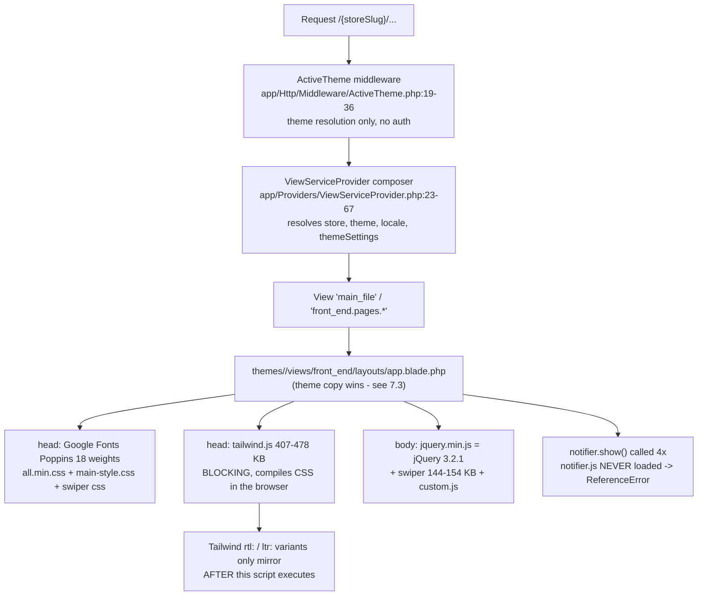
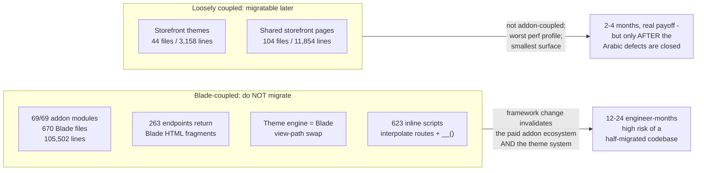

---
**Document:** 06 — UI/UX Assessment (Admin, Storefront, Mobile App)
**Phase:** Phase 0 — Discovery & Audit
**Date:** 2026-10-11
**Repo A ("Main Platform"):** `github.com/fullstackfull/syriastore98` — branch `claude/pensive-cerf-h6rizn`, HEAD `efe05d9f`
**Repo B ("Associated App"):** `github.com/fullstackfull/StoreSyria_app98` — branch `claude/pensive-cerf-h6rizn`, HEAD `d745ec08`
**Evidence basis:** Every finding in this document is **CODE-LEVEL AND STATIC**. **The application was never rendered and never run.** There was no browser, no device, no emulator, no database, no PHP execution, no Flutter/Dart SDK. Therefore **no visual, interactive or perceptual finding is claimed anywhere in this document** — not one statement here means "I looked at the screen". Claims are derived from reading Blade templates, CSS, JavaScript, Dart source, asset files, and from file-system facts (existence, byte size, line counts, duplicate hashes). The following checks were **BLOCKED** and nothing is asserted from them: (1) **no rendering** — colour contrast, focus-ring visibility, actual RTL mirroring, font-fallback appearance, flash-of-unstyled-content duration, layout shift, Lighthouse and axe scores are all unmeasured; (2) **`vendor/` is absent** in Repo A (`ls vendor` → "No such file or directory"), so `qirolab/laravel-themer` view-path precedence and `yajra/laravel-datatables` defaults could not be read from source; (3) **no Flutter/Dart SDK** in Repo B (`flutter: command not found`, `dart: command not found`, no `.dart_tool/`), so `flutter analyze`, `flutter test` and any build are BLOCKED — it is not even established that Repo B compiles; (4) **no database**, so every value stored in the `settings`, `theme_customizes` and `email_template_langs` tables is UNKNOWN, which bounds several findings below; (5) **no deployed host reachable** — HTTP probes to the production host failed at the sandbox egress proxy, so no 404, no asset weight and no real page was observed. Where a count here differs from a source dossier, the figure printed is the one I measured myself and the command is stated.

---

## 1. Bottom line

Repo A's user interface is the **stock WorkDo eCommerceGo SaaS frontend** — Bootstrap 5 + jQuery in the admin, Tailwind-in-the-browser in the storefront — with a thin Syrian customisation layer bolted on. It is **broad, consistent in a mediocre way, and very heavy**. It is not a design system, there is no build pipeline in use, and there is no component library worth the name: **22 Blade components are used 165 times across 1,232 Blade files**, 65 of those 165 uses being one component (`<x-datatable>`).

Three things matter far more than everything else in this document:

1. **Arabic is 88.9% translated and structurally incomplete in ways translation cannot fix.** The string catalogue is good — better than every other locale, including English. But `resources/lang/ar/` is missing `validation.php`, `auth.php`, `passwords.php` and `pagination.php` (Hebrew has all four), so **every server-side validation message renders in English** for an Arabic merchant; **no Arabic-capable webfont is declared or loaded anywhere in the repository**; **dates are formatted with PHP `date()` with zero `translatedFormat` calls**, so month and day names are permanently English; and the global client-side validator hardcodes English error strings. Worse, the 556 untranslated keys are concentrated precisely in the Syria-specific code: `resources/views/finance` **54.0%**, `resources/views/delivery-syria` **60.7%**. The money screens a Syrian merchant uses are the least translated screens in the product.
2. **Performance is the worst property of this frontend, and it is worst where the target market is weakest.** Every admin page emits ~**3.4 MiB of uncompressed CSS+JS across 54 asset requests** regardless of what the page needs, including a 517 KB `calendar.js`, a 490 KB `apexcharts.min.js` and a 364 KB `jspdf.umd.min.js` on pages that use none of them. The storefront **compiles Tailwind in the browser** from a 477 KB blocking script in `<head>`. 1,052 PNGs are tracked in git, `srcset` is used **0** times, and `loading="lazy"` appears on **45** `` tags. In a low-bandwidth market this is the single biggest UX defect in the product and it needs no redesign to fix.
3. **A cluster of small, cheap, verifiable bugs is degrading the experience right now.** The `data-ajax-popup` modal handler is registered **twice in the same file** (`public/js/custom.js:35` and `:311`), so each of **263** modal triggers fires two identical server round-trips; both copies swallow every error into a dead local variable; the storefront calls `notifier.show(...)` four times per layout while **never loading `notifier.js`**, so customer-facing flash messages cannot display in any language; the toast function ignores its own translated title and hardcodes `'Success'`/`'Error'`; and five admin asset URLs carry a `public/` path prefix that cannot resolve.

**Modernization verdict: improve in place. Do not migrate the admin panel.** This is not a reflex — it is priced. **All 69 of the 69 addon modules under `packages/workdo/` ship Blade views: 670 files, 105,502 lines.** Theme switching is implemented as a Blade view-path swap. **263 admin endpoints return rendered Blade HTML fragments, not JSON.** A React/Next.js or Inertia migration means building a JSON API for all of them, rewriting 1,232 templates, re-implementing the theme engine, and forking a commercial CodeCanyon addon contract you do not control — 12–24 engineer-months with a high chance of a half-migrated codebase. The defect list in this document is **roughly 25–40 engineer-days** and fixes what users actually experience. The only defensible migration target is the **customer storefront** (44 theme Blade files + 104 shared files, 15,012 lines), and only after the Arabic defects are closed — not before.

**Repo B (the Flutter merchant app) has the better UI engineering of the two codebases and the worse release posture.** Its loading/shimmer/empty/error states are genuinely built (a 668-line hand-rolled, theme-aware, RTL-aware shimmer used by 20 files), dark mode is complete, and translation parity is 640/642 keys. But `flutter_localizations` is **declared and never wired**, so an Arabic-default, Arabic-fallback app renders with a global LTR text direction; there are **zero** `Semantics` or `semanticLabel` usages in 198 Dart files; **zero** `kReleaseMode` guards against 180 `print(` calls; and the two social-login buttons on the login screen are wired to empty closures.

### 1.1 Verdict table

| Area | Status | Implementation | Severity | Priority |
|---|---|---|---|---|
| Frontend build pipeline (Vite/Tailwind/Alpine) | VERIFIED (present, unused) | MISSING | HIGH | P1 |
| Visual consistency — admin | VERIFIED | PARTIALLY IMPLEMENTED | MEDIUM | P2 |
| Visual consistency — storefront | PARTIAL | PARTIALLY IMPLEMENTED | MEDIUM | P2 |
| Merchant dashboard usability (lists/CRUD) | VERIFIED | PARTIALLY IMPLEMENTED | MEDIUM | P2 |
| Customer storefront experience | PARTIAL | PARTIALLY IMPLEMENTED | HIGH | P1 |
| Mobile responsiveness (breakpoint machinery) | VERIFIED | IMPLEMENTED BUT NOT VERIFIED | MEDIUM | P2 |
| Pinch-zoom / text resize (WCAG 1.4.4) | VERIFIED (disabled everywhere) | MISSING | MEDIUM | P1 |
| Arabic string coverage | VERIFIED (88.9%) | PARTIALLY IMPLEMENTED | HIGH | P1 |
| Arabic validation/auth/pagination messages | VERIFIED (absent) | MISSING | CRITICAL | P0 |
| Arabic typography (webfont) | VERIFIED (none exists) | MISSING | HIGH | P0 |
| Arabic date/number/bidi handling | VERIFIED (absent) | MISSING | HIGH | P1 |
| RTL — admin panel | VERIFIED | IMPLEMENTED BUT NOT VERIFIED | MEDIUM | P2 |
| RTL — storefront themes | PARTIAL | PARTIALLY IMPLEMENTED | HIGH | P1 |
| RTL — shared checkout/cart/product pages | PARTIAL | PARTIALLY IMPLEMENTED | HIGH | P1 |
| Arabic — transactional emails | PARTIAL | PARTIALLY IMPLEMENTED | MEDIUM | P1 |
| Arabic — PDF invoices | UNKNOWN | IMPLEMENTED BUT NOT VERIFIED | MEDIUM | P2 |
| Accessibility (code-level) | VERIFIED | PARTIALLY IMPLEMENTED | MEDIUM | P2 |
| Form handling & validation architecture | VERIFIED | PARTIALLY IMPLEMENTED | MEDIUM | P2 |
| Loading states — Repo A | PARTIAL | PARTIALLY IMPLEMENTED | MEDIUM | P2 |
| Error surfacing — Repo A | VERIFIED (silent failures) | PARTIALLY IMPLEMENTED | HIGH | P1 |
| Component reuse — Repo A | VERIFIED (near-absent) | PARTIALLY IMPLEMENTED | HIGH | P1 |
| Frontend performance — admin | VERIFIED | PARTIALLY IMPLEMENTED | CRITICAL | P0 |
| Frontend performance — storefront | VERIFIED | PARTIALLY IMPLEMENTED | HIGH | P1 |
| Frontend maintainability | VERIFIED | PARTIALLY IMPLEMENTED | HIGH | P1 |
| Repo B — loading/empty/error states | VERIFIED | IMPLEMENTED BUT NOT VERIFIED | — | — |
| Repo B — dark mode | VERIFIED | IMPLEMENTED BUT NOT VERIFIED | MEDIUM | P2 |
| Repo B — RTL / localisation plumbing | VERIFIED (not wired) | MISSING | HIGH | P0 |
| Repo B — accessibility | VERIFIED (none) | MISSING | MEDIUM | P3 |
| Repo B — widget layer organisation | VERIFIED | PARTIALLY IMPLEMENTED | MEDIUM | P2 |
| Repo B — dead primary-surface controls (social login) | VERIFIED | PLACEHOLDER OR MOCK | MEDIUM | P2 |

---

## 2. Method, and what "code-level" excludes

Sources: dossiers `12-repoA-frontend-uiux.md`, `14-repoB-flutter-audit.md`, `07-repoA-storefront.md`, read in full, with every load-bearing citation re-opened in the checkouts and re-verified before printing here.

Commands I ran myself (read-only; no writes to either repo, no `composer`/`npm`/`flutter` install, no artisan, no git writes): `grep -rn/-c/-o`, `find`, `wc -l`, `ls`, `stat -c%s`, `sed -n`, `cat`, `git ls-files`, `git ls-files -s`, and three `python3 -I` one-liners (JSON key counts, `difflib` similarity on view pairs, regex key extraction from the Dart translation maps).

**What this document therefore cannot tell you, and does not pretend to:**

* whether any screen *looks* good, coherent, modern or on-brand;
* whether Arabic text actually renders legibly, or where the layout visibly breaks under `dir="rtl"`;
* whether colour contrast passes WCAG AA anywhere;
* real page weight over the wire (everything below is **uncompressed** bytes on disk; gzip/brotli will reduce transfer substantially but not parse/execute cost);
* which of two candidate Blade layouts the production server actually renders in one specific case (see §7.3) — `vendor/` is absent, so `qirolab/laravel-themer`'s view-finder precedence could not be read. **However**, this one question *was* settled by an independent adversarial check during this audit, by a different route: `main_file` (the storefront homepage) exists **only** under `themes/*/views/` and nowhere in `resources/views/`, while `app/Http/Controllers/HomeController.php:506` gates the homepage on `view()->exists('main_file')` — the homepage could not render at all unless theme view paths are searched first. The theme layouts are therefore the live ones. That correction materially changes the severity of the storefront Arabic finding and is applied throughout §7.

---

## 3. Visual consistency, and the asset/component strategy behind it

### 3.1 There is no build pipeline in use. FACT.

```
$ grep -rln "@vite" resources/views themes packages --include='*.blade.php' | wc -l
0
$ ls public/build
ls: cannot access 'public/build': No such file or directory
```

`@vite` appears **zero** times in all 1,232 Blade files. There is no `public/build`, no `node_modules`. `vite.config.js`, `tailwind.config.js`, `package.json` and `resources/css/app.css` (59 bytes — three `@tailwind` directives) are **untouched Laravel Breeze scaffolding** that no rendered page consumes. Status: VERIFIED. Implementation: MISSING.

The real strategy is hand-written tags:

* **Admin:** Bootstrap 5 + jQuery 3.6.0, 28 `<link>` lines in `repo-A resources/views/layouts/app.blade.php:83-131` and 28 `<script src>` lines in `repo-A resources/views/partision/footerlink.blade.php:24-58`.
* **Storefront:** Tailwind **compiled in the browser** by `themes/<t>/assets/js/tailwind.js` loaded synchronously in `<head>` — `repo-A themes/greentic/views/front_end/layouts/app.blade.php:20` (same in stylique and techzonix). Sizes measured: greentic 477,348 B, stylique 477,551 B, techzonix 407,076 B.

**Consequence for a new developer (INFERENCE, high confidence):** anyone who reads `package.json` first will assume a modern pipeline and lose a day. There is no minification, no tree-shaking, no code splitting, no content-hash cache busting and no CSS purging anywhere in the pipeline that actually runs.

### 3.2 Consistency is real but accidental

The admin is visually consistent because **everything inherits one 423-line layout** (`repo-A resources/views/layouts/app.blade.php`) and one 589,357-byte stylesheet (`repo-A public/assets/css/style.css`), and because all 46 list screens route through one helper (§4). That is genuine consistency and it is worth protecting.

It is *accidental* consistency, though, because it is not expressed as reusable parts. Counts I verified:

| Thing | Count |
|---|---|
| Blade files (`resources/views` + `themes` + `packages`) | **1,232** |
| Blade component files in `resources/views/components/` | **22** |
| `app/View/Components/` classes | **4** |
| Total `<x-…>` component usages across all 1,232 files | **165** (dossier 12 measurement) |
| … of which `<x-datatable>` | **65** |
| Inline `<script>` blocks written in Blade (excluding `<script src=…>`) | **623** |
| Inline `$.ajax(` calls written in Blade | **285** |
| Unescaped `{!! … !!}` echoes | **2,394** |

So the design "system" is: one global stylesheet, one layout, one table helper, and 623 inline scripts. Any visual change that is not in the global stylesheet has to be made per file.

### 3.3 Asset hygiene defects that produce visible breakage. FACT.

**Five admin asset URLs carry a `public/` prefix that cannot resolve** (Laravel's `asset('public/x')` resolves to `{APP_URL}/public/x` → on-disk `public/public/x`, which does not exist):

| File:line | URL |
|---|---|
| `repo-A resources/views/layouts/app.blade.php:100` | `asset('public/assets/css/plugins/dropzone.css')` |
| `repo-A resources/views/layouts/app.blade.php:103` | `asset('public/assets/css/rtl-style-dark.css')` |
| `repo-A resources/views/partision/footerlink.blade.php:47` | `asset('public/assets/js/plugins/dropzone.min.js')` |
| `repo-A resources/views/partision/footerlink.blade.php:52` | `asset('public/assets/js/plugins/select2.min.js')` |
| `repo-A resources/views/partision/footerlink.blade.php:58` | `asset('public/js/html2pdf.bundle.min.js')` |

The correct-path sibling exists in the same file set — `repo-A resources/views/layouts/app.blade.php:83` loads `asset('assets/css/plugins/select2.min.css')` with no prefix. So on any admin form carrying `.select2` markup, the **stylesheet loads and the script does not**, and `repo-A resources/views/layouts/app.blade.php:276-291` then calls `$('.select2').select2(...)` from the layout's inline ready-block. The `.length > 0` guard makes this harmless on pages with no select2 markup; on pages that have it, the call target is undefined and the remainder of that ready-block does not execute. *Fact for the paths and the guard; INFERENCE (not browser-verified) for the TypeError.*

Same class of defect in the toast icons: `repo-A public/js/custom.js:236,239` build the icon URL as `site_url + '/public/assets/images/notification/ok-48.png'`, while the file exists at `public/assets/images/notification/ok-48.png`.

**Caveat, stated plainly:** another audit area established that this deployment is served with the **application root as the document root**, not `public/`. That does not rescue these five URLs — there is no `/assets`, `/js` or `/css` directory at the application root either, so one of the two addressing conventions in these files must be wrong in any single deployment. Which set breaks is UNKNOWN from code; that one set must is VERIFIED.

**Cache-busting is inverted:** `repo-A resources/views/layouts/app.blade.php:104` and five sibling lines append `{{ '?v=' . time() }}`, and `repo-A resources/views/partision/footerlink.blade.php:40,44` append `{{ "?".time() }}`. `time()` changes every second, so these URLs are unique per request and **permanently uncacheable** — roughly 280 KB (`custom.css` 84,680 + `loader.css` 2,082 + `choices.min.js` 177,465 + `custom.js` 16,210) re-downloaded on **every** navigation. The favicon is busted the same way at `:85`. Severity MEDIUM, Priority P2, trivial fix.

**Two unversioned/unpinned third-party CDN dependencies in the critical path**, neither with an `integrity` attribute: `repo-A resources/views/layouts/app.blade.php:128` loads `https://unpkg.com/leaflet/dist/leaflet.css` (no version at all — whatever unpkg resolves as latest), and `repo-A resources/views/partision/footerlink.blade.php:48-49` load two `cdnjs.cloudflare.com` pickadate scripts. For a Syrian audience this is both a supply-chain exposure and an availability risk on hosts that may be slow or blocked.

### 3.4 Duplication in the asset tree

`916 of 2,076` tracked JS/CSS files are byte-identical copies (1,160 unique MD5s of 2,076 files; dossier 12 measurement). FontAwesome's 1,122,836-byte `all.min.js` is committed **30 times** under `packages/workdo/Marketing/src/resources/assets/custom/` — once at `libs/@fortawesome/fontawesome-free/js/all.min.js`, 20 times at `theme{1..12,14..21}/libs/@fortawesome/fontawesome-free/js/all.min.js`, and 9 times at `theme{13..21}/fontawesome-free/js/all.min.js`. Total tracked JS+CSS is 32,567,322 bytes. This is inherited from the WorkDo product rather than introduced locally — but it is in this repository and in every deployment. Severity MEDIUM, P2.

---

## 4. Merchant dashboard usability

### 4.1 The 46 DataTables are the dashboard's biggest usability asset — genuinely

Verified counts: **39** classes in `repo-A app/DataTables/`, **7** more under `packages/`, **46** total; `<x-datatable>` used **65** times. The package is `yajra/laravel-datatables ^11.0` (`repo-A composer.json:71`).

Every one of them routes through **one local helper** — `repo-A app/Helper/helper.php:2169` `buildDataTable()` and `:2091` `buildDataTableColumn()`. This helper is **local Syrian-team work, not stock WorkDo**, and it is the best-engineered piece of frontend in Repo A. It means:

* every admin list has the same search box, page-length selector, Reset and Reload buttons, and the same `dom` layout (`repo-A app/Helper/helper.php:2219-2222`);
* each DataTable class collapses to ~20 declarative lines;
* the table chrome is localized in one place (`repo-A app/Helper/helper.php:2176-2186` sets `lengthMenu`, `searchPlaceholder` and `info` through `__()`), and those keys **do** exist in `resources/lang/ar.json`.

That is real UX consistency across the entire merchant surface, achieved by one file. **Do not refactor this away.**

### 4.2 What the DataTables architecture implies — the costs

**(a) Rows are rendered Blade, server-side, one view per row.** `repo-A app/DataTables/AbandonCartDataTable.php:35-37` returns `view('cart.action', compact(...))` per row, and `:32-34` runs a **separate `COUNT` query per row**:

```php
->addColumn('product', function (Cart $cart) {
    $cart_count = Cart::where('customer_id',$cart->customer_id)->where('store_id', getCurrentStore())->count();
    return view('cart.product', compact('cart','cart_count'));
})
```

With the default page length that is an N+1 on every list page. The same per-row `view()` pattern is the norm across the 46 classes. INFERENCE (not executed): list-page latency grows with page size, and every row's action menu is HTML generated on the server, which is also what makes the admin un-migratable to a JSON-first frontend cheaply (§15).

**(b) Search and sort are server-side callbacks.** `repo-A app/DataTables/AbandonCartDataTable.php:38-60` defines `filterColumn` and `orderColumn` closures with `whereHas(...)->where('first_name','like',"%$keyword%")` — leading-wildcard `LIKE` through a relation. Those callbacks only execute on the AJAX server-side path, which confirms server-side processing is in use even though `buildDataTable()` never sets `serverSide` explicitly (it relies on the package default, which could not be read — `vendor/` absent, so labelled UNKNOWN as to the literal flag, VERIFIED as to the callbacks existing).

**(c) Two localisation defects remain in the shared helper, and they hit all 65 tables at once.** Both are one-line fixes with 65× leverage:

1. `repo-A app/Helper/helper.php:2178-2179` hardcodes the pagination arrows as literal strings:
   ```php
   "next" => '<i class="ti ti-chevron-right"></i>',
   "previous" => '<i class="ti ti-chevron-left"></i>'
   ```
   Under `dir="rtl"` the next-page arrow points the wrong way on **every** admin list.
2. `emptyTable`, `zeroRecords`, `processing`, `loadingRecords`, `infoEmpty` and `infoFiltered` are **not set**, so DataTables' English defaults ("No data available in table", "No matching records found", "Processing...") appear in the Arabic UI. Note that `'No data available in table'` **is already translated** in `resources/lang/ar.json` — it is simply never wired into the `language` array.

**(d) A listener/instance leak on long admin sessions.** `repo-A app/Helper/helper.php:2224-2240` sets a `drawCallback` that re-instantiates **every** `[data-bs-toggle=tooltip]`, `[data-bs-toggle=popover]` and `.toast` on the page on **every** redraw (sort, page, search) without disposing the previous instances. INFERENCE: a merchant who sorts and pages a list repeatedly accumulates Bootstrap component instances. Severity MEDIUM, P2.

### 4.3 The CRUD surface: 263 AJAX modals, double-fired, failing silently

This is the defect with the widest blast radius in the admin, and it is cheap to fix.

```
$ grep -n "ajax-popup" public/js/custom.js
35:$(document).on('click', 'a[data-ajax-popup="true"], button[data-ajax-popup="true"], div[data-ajax-popup="true"]', ...
72:$(document).on('click', 'a[data-ajax-popup-over="true"], ...
311:$(document).on('click', 'a[data-ajax-popup="true"], button[data-ajax-popup="true"], div[data-ajax-popup="true"]', ...
$ grep -rho 'data-ajax-popup' resources/views themes packages --include='*.blade.php' | wc -l
263
```

**Two delegated handlers on the identical selector on `document`, in the same file.** jQuery runs both. Every modal open therefore issues **two** identical AJAX requests → two controller executions → two sets of DB queries. The first fills `#commanModel`, the second `#commonModal` (POS). Status: VERIFIED. Severity HIGH, Priority P1. Fix: delete or narrow the second registration — about an hour's work.

Both handlers then discard every error. `repo-A public/js/custom.js:65-67`:

```js
error: function (data) {
    data = data.responseJSON;
}
```

The response is assigned to a local and thrown away. No message, no toast, and in the second handler no `#loader` hide either (the first hides it on success at `:49`). **INFERENCE (high confidence):** on a 500, a 403 or a timeout the merchant sees a spinner that never clears and a modal that never opens, with no indication of what happened — across **263** entry points, i.e. most of the admin's create/edit surface. This is the mechanism by which the security and schema defects documented elsewhere in this audit (missing tables producing `QueryException`s, missing permissions producing 403s) become *invisible* to the operator rather than merely broken.

### 4.4 Flash messaging: one global toast, injected unescaped into a JS string literal

`repo-A resources/views/layouts/app.blade.php:400-412`:

```blade
@if (Session::has('success'))
    <script>
        show_toastr('{{ __('Success') }}', '{!! Session::get('success') !!}', 'success');
    </script>
```

Volume context from dossier 12: `with('error', …)` appears at **1,699** sites and `with('success', …)` at **466** — this toast is the primary feedback channel of the entire application. Three defects in one construct:

1. `{!! … !!}` inside a single-quoted JavaScript literal. Any apostrophe, newline, backslash or `</script>` in the message breaks the script or injects JS. Flash values routinely embed model data and exception text. There is no CSP in the layout. (The security area owns the XSS classification; recorded here because it is a frontend construct.)
2. **The translated title is passed and then ignored.** `repo-A public/js/custom.js:230-241`:
   ```js
   function show_toastr(title, message, type) {
       var o, i; var icon = ''; var cls = '';
       if (type == 'success') {
           cls = 'primary';
           notifier.show('Success', message, 'success', site_url + '/public/assets/images/notification/ok-48.png', 4000);
   ```
   `title` is never used; `'Success'`/`'Error'` are hardcoded English. **So the toast heading is English even in Arabic**, on every success and every error in the product. `o`, `i`, `icon` and `cls` are dead locals.
3. The icon URL carries the `/public/` prefix bug of §3.3.

Field-level error display is sparse by comparison: `@error` appears **232** times in **65** of 1,232 Blade files (5.3%) — verified by me.

### 4.5 Dashboard-level usability items worth naming

* **A placeholder settings modal ships on every admin page.** `repo-A resources/views/layouts/app.blade.php:265` unconditionally `@include('partision.settingPopup')`. That file (62 lines) is five `<input type="checkbox">` with ids `pcsetting1`..`pcsetting5`, **no `name`, no `<form>`, no route, no JS handler**, and a "Save changes" button with no handler. Every string is hardcoded English and un-`__()`-ed, including two typos carried from the vendor template ("you get lettest content at a time when data will updated", "Automaticaly take backup as par schedule"). It also uses Bootstrap-4 `pl-1` rather than `ps-1`, so its label padding does not mirror in RTL. Status: VERIFIED. Implementation: PLACEHOLDER OR MOCK. **Delete it.**
* **A duplicated DOM id breaks a module's forms.** The global handler at `repo-A resources/views/partision/footerlink.blade.php:162-166` dereferences `document.querySelector("#SITE_RTL")`, which exists in exactly one view (`repo-A resources/views/setting/brand_setting.blade.php:133`). But `id="cust-darklayout"` is reused for unrelated checkboxes in 8+ LandingPage views, e.g. `repo-A packages/workdo/LandingPage/src/Resources/views/custom_page/create.blade.php:55` (`name="footer"`) and `:62` (`name="login"`) — two elements with the same id in one document. **INFERENCE (high confidence):** clicking those checkboxes throws on a null dereference and swaps the header logo as a side effect.
* **`/profile` is a live authenticated route that renders a blank content area.** `repo-A routes/web.php:331` registers it; `repo-A resources/views/profile/edit.blade.php:1` opens with `<x-app-layout>`; `repo-A app/View/Components/AppLayout.php` renders `layouts.app`; and `grep -c 'slot' resources/views/layouts/app.blade.php` → **0** — that layout is `@yield('content')`-based (`repo-A resources/views/layouts/app.blade.php:212`), so the component's children are discarded. Mitigated by the fact that the real header links a different route; it is a reachable-by-URL dead page. Severity MEDIUM, P2. Delete the Breeze remnants.
* **Language names in the switcher are English-only.** `resources/lang/language.json` maps `"ar": "Arabic"`, rendered as `{{ Str::ucfirst($lang) }}` at `repo-A resources/views/partision/header.blade.php:211`. An Arabic-speaking merchant looking for their own language sees **`Arabic`, not `العربية`**. And `repo-A app/Models/Utility.php:1082-1101` maps `'ar' => '🇦🇪 ar'` (UAE flag for Arabic) and `'en' => '🇮🇳 en'` (India flag for English). Trivial fix, disproportionate perception impact in this market.

---

## 5. Customer storefront experience

### 5.1 "Three themes" is a header/footer/homepage reskin, not a themeable storefront. FACT.

Verified file counts: `themes/greentic` 16 Blade files, `themes/stylique` 13, `themes/techzonix` 15 — **44 total, 3,158 lines**. The actual storefront lives once in `repo-A resources/views/front_end/` — **104 Blade files, 11,854 lines** (verified).

Each theme ships only: `main_file.blade.php` (homepage), `front_end/layouts/app.blade.php`, `front_end/partison/{header,footer,announcement}`, a few `front_end/common/*` sections, and 5–7 `components/*` cards. **None of the three ships `cart`, `checkout`, `product-detail`, `product-list`, `account`, `order*`, `wishlist` or `address`.**

Two consequences, one bad and one good:

* **Bad:** a merchant switching theme does not get a different checkout, cart or product page. The themeable surface is cosmetic.
* **Good, and it governs the work plan below:** the conversion funnel is **one** set of files. Fixing RTL, accessibility or performance on checkout fixes it for all three themes at once. This is the single most favourable structural fact in the whole UI assessment.

### 5.2 Rendering and asset pipeline (storefront)



Everything in that diagram is a verified file fact; the two annotated consequences (`ReferenceError`, mirroring dependency) are INFERENCE.

### 5.3 Storefront defects that degrade the customer experience

| # | Defect | Evidence | Status / Severity |
|---|---|---|---|
| S1 | **Storefront flash messages cannot display, in any language.** `notifier.show(...)` is called 4× per theme layout and `notifier.js` is loaded **0** times on the storefront. The file exists (`public/assets/js/plugins/notifier.js`) and is loaded by the **admin** at `repo-A resources/views/partision/footerlink.blade.php:37`. | verified: `grep -c notifier themes/*/views/front_end/layouts/app.blade.php` → 4, 4, 4; `grep -rn notifier.js themes/*/views/front_end/layouts/app.blade.php` → 0 hits | VERIFIED / HIGH / P1 |
| S2 | **Customer-facing Shipping & Returns page is 100% hardcoded English**, 63 un-`__()`-ed text nodes, and is not themeable. | `repo-A resources/views/front_end/pages/shipping-return.blade.php` (dossier 12 count) | VERIFIED / MEDIUM / P2 |
| S3 | **Storefront loads jQuery 3.2.1** while the admin correctly loads 3.6.0 from the same repo. | `repo-A themes/greentic/views/front_end/layouts/app.blade.php:53` → `asset('js/jquery.min.js')`; `head -c 82 public/js/jquery.min.js` → `jQuery v3.2.1`; admin at `repo-A resources/views/partision/footerlink.blade.php:24` → `js/jquery-3.6.0.min.js` | VERIFIED / HIGH / P1 |
| S4 | **`public/storage` is committed as a regular file containing the vendor's absolute path**, so every `asset('storage/...')` image URL, the favicon fallback and the PWA manifest 404 on a fresh deploy. | `git ls-files -s public/storage` → mode `100755` (not `120000`); `cat public/storage` → `/var/www/html/Product/EcommerceGo/main_file/storage/app/public` | VERIFIED / CRITICAL / P0 |
| S5 | **48 of 109 default theme images referenced by `theme_json`/`default_data` are missing**, including stylique's two hero slides. A freshly seeded store renders broken images above the fold. | dossier 07 F10; `themes/stylique/theme_json/home.json:22` | VERIFIED / HIGH / P1 |
| S6 | **Product listings serve a product-less HTML shell.** `repo-A app/Http/Controllers/HomeController.php:595-640` returns filter scaffolding only; products arrive by AJAX into `product_list_filter`. No `<a>` pagination exists in the initial HTML. | dossier 07 F18 | VERIFIED / HIGH / P1 |
| S7 | **There is no search results page.** `repo-A app/Http/Controllers/HomeController.php:925-963` returns JSON; `repo-A resources/views/front_end/jQueryRoute.blade.php:363-388` then does `window.location.href = response[0].url` — the customer is teleported to an arbitrary first match with no ranking. Zero-result queries redirect to `/{slug}/error`. | dossier 07 F17 | VERIFIED / HIGH / P1 |
| S8 | **Per-page SEO meta is dead.** `metaKeywordSetting($metakeyword ?? null, …)` is called in every layout (`repo-A resources/views/front_end/layouts/app.blade.php:10`) and those variables are **never supplied by any controller, composer or `View::share`** — so every page emits the app name as its title and description, and `og:url` is hard-wired to the store home. | dossier 07 F15; `app/Helper/helper.php:775-800` | VERIFIED / HIGH / P1 |
| S9 | **Tracking pixels never fire on the e-commerce storefront.** `$pixelScript` is read in **four** storefront layouts behind an `isset()` guard. It **is** assigned, but only by the Marketing (vcard) and LandingPage modules, which render `marketing::card.*` views and never supply these layouts; no e-commerce storefront controller passes it, so the guard is always false here. The admin CRUD for pixels is complete. (Corrected: an earlier wording said "three layouts / assigned nowhere" — both limbs were wrong; the conclusion stands. Authority: `05-SECURITY-AND-QUALITY-AUDIT.md` §2.1.) | `repo-A resources/views/front_end/layouts/app.blade.php:60-61` plus the three theme layouts (`themes/techzonix/views/front_end/layouts/app.blade.php:156-157`, `themes/greentic/views/front_end/layouts/app.blade.php:76-77`, `themes/stylique/views/front_end/layouts/app.blade.php:80-81`); the only producers are `packages/workdo/LandingPage/src/Entities/Pixel.php:28,37,42` and `packages/workdo/Marketing/src/app/Http/Controllers/StoreController.php:209,213` (passed via `compact()` at `:299`), which feed the Marketing vcard views, **not** these storefront layouts | VERIFIED / MEDIUM / P1 |
| S10 | **Homepage section re-ordering is persisted and never read.** `ThemeCustomizeOrder` is referenced only by its own model and controller; `grep orders themes/*/views/main_file.blade.php` → nothing. Saving a new order changes nothing. | dossier 07 F12; `repo-A app/Http/Controllers/ThemeCustomizeController.php:176-180` | VERIFIED / MEDIUM / P2 |
| S11 | **The PWA service worker is tutorial boilerplate that caches nothing and is cache-first forever.** Cache name `dev-coffee-site-v1`, `assets = []`, and a fetch handler that serves any cached GET indefinitely with no expiry and no unregister path. For a storefront with prices and stock this is actively dangerous. | dossier 07 F24; repo-root `serviceWorker.js` | VERIFIED / HIGH / P1 |
| S12 | **Theme-settings write has its permission check commented out** and writes arbitrary key/value pairs rendered through 62 unescaped storefront outputs. | dossier 07 F13; `repo-A app/Http/Controllers/ThemeCustomizeController.php:72-78` | VERIFIED / HIGH / P0 (security area owns it) |

### 5.4 The "page builder" is a settings form. Say so to stakeholders.

`theme_json/pages.json` declares 25 customizable "pages" per theme; each page JSON declares sections with typed fields; `repo-A resources/views/theme_customize/customize.blade.php:108-630` renders exactly **12** field types. The storefront then hard-codes each section with an on/off guard, e.g. `repo-A themes/stylique/views/main_file.blade.php:10`. There is **no block model, no drag-and-drop canvas and no arbitrary section insertion**. Homepage sections per theme: greentic 10, stylique 11, techzonix 10. Status: VERIFIED. Implementation: PARTIALLY IMPLEMENTED (a settings form). If the product is being sold on "page builder" language, that language is not supportable.

---

## 6. Mobile responsiveness — what the code does and does not establish

**The breakpoint machinery is genuinely present.** Evidence (dossier 12 measurements, method documented there):

| Surface | Evidence |
|---|---|
| admin CSS | `@media` × **185** in `public/assets/css/style.css`, × 25 in `public/css/custom.css` |
| admin markup | `col-(sm\|md\|lg\|xl\|xxl)-N` × **2,268** in `resources/views` |
| theme markup | Tailwind `sm:`/`md:`/`lg:`/`xl:`/`2xl:` × **321** |
| viewport meta | present on **82 of 90** HTML documents |

So responsiveness was designed for and is not absent. **But nothing here establishes that it works** — that requires a device or an emulator, and both were BLOCKED. Implementation: IMPLEMENTED BUT NOT VERIFIED.

**One responsiveness finding is unambiguous and is a defect: every viewport meta in the product disables pinch-zoom.** Verified:

```
repo-A resources/views/layouts/app.blade.php:57
  content="width=device-width, initial-scale=1.0, user-scalable=0, minimal-ui"
repo-A themes/greentic/views/front_end/layouts/app.blade.php:6
  content="width=device-width, initial-scale=1.0, maximum-scale=1"
```

`user-scalable=0` / `maximum-scale=1` violates **WCAG 2.1 SC 1.4.4 (Resize Text)**. For a market where a large share of users read Arabic on small, low-cost phones — and where Arabic is currently rendering in an uncontrolled OS fallback font (§7.2) — blocking zoom is a concrete usability regression, not a compliance abstraction. It is a one-line change in six layout files. Severity MEDIUM, Priority **P1** (cheap, and it interacts with the Arabic font defect).

Eight documents have no viewport meta; three of those are email templates where it does not matter, and the rest are payment interstitials (`repo-A resources/views/plans/payu_request.blade.php`, `repo-A resources/views/myfatoorah/{checkout,error}.blade.php`, `repo-A resources/views/layouts/main.blade.php`) — i.e. the few pages a customer hits mid-payment are the ones that are not mobile-configured. Severity MEDIUM, P2.

---

## 7. RTL and Arabic support — the measured verdict

This is the section that decides whether the product is usable in its own market, so it is answered surface by surface, with the measurement first.

### 7.1 Coverage: 88.9%, and the missing 11% is the Syrian code

The mechanism is Laravel **JSON string translations** (`__('English sentence')`), one flat `{locale}.json` at `resources/lang/`, plus one per addon module, and **all 69/69 module service providers register theirs** (`loadJsonTranslationsFrom`).

Verified by me: `resources/lang/ar.json` holds **2,848** keys. Dossier 12's measurement against the real denominator (5,018 distinct real `__()` keys extracted from every tracked `*.php`, merged against the 69 module files):

| Locale | Merged keys | Covers code keys | % |
|---|---|---|---|
| **ar** | 4,634 | **4,462 / 5,018** | **88.9%** |
| fr | 4,605 | 4,437 | 88.4% |
| en | 4,597 | 4,429 | 88.3% |
| he | 4,543 | 4,384 | 87.4% |

**Arabic is the best-covered locale in the product — marginally ahead of the English base file itself.** That is a real and creditable investment. Of `ar.json`'s 2,848 values, 2,820 contain Arabic script and the 28 that do not are legitimately Latin (`POS`, `CVV`, `SEO`, `AWS S3`, `Twilio SID`, …). **Zero empty values.**

**Where the 556 gaps are** — and this is the finding that matters:

| Directory | Arabic coverage |
|---|---|
| `resources/views/finance` | **54.0% (54/100)** |
| `resources/views/delivery-syria` | **60.7% (17/28)** |
| `app/Services` | **64.7% (22/34)** |
| `resources/views/setting` | **73.4% (296/403)** |
| `app/Http` | 89.2% (790/886) |
| every other `resources/views/*` directory (45 of them) | **100%** |

**INFERENCE, high confidence:** the stock WorkDo product arrived with near-complete Arabic; the Syria-specific additions — the wallet/finance/withdrawals screens, the Delivery Syria integration, the custom services layer, the extended settings — were built with **no translation step at all**. Representative missing keys, all money-facing: `'Available balance:'`, `'Balance Before'`, `'Balance After'`, `'Awaiting Transfer'`, `'Approve this withdrawal request?'`, `'Balance added successfully.'`, `'All exchange rates are based on 1 USD for this store.'`

### 7.2 Four Arabic defects that translation cannot fix. All VERIFIED by me.

**(1) `resources/lang/ar/` is missing Laravel's core message files. Hebrew has them; Arabic does not.**

```
$ ls resources/lang/en/
auth.php  chatwoot.php  installer_messages.php  myfatoorah.php  pagination.php  passwords.php  validation.php
$ ls resources/lang/ar/
chatwoot.php  installer_messages.php  myfatoorah.php
$ ls resources/lang/he/
auth.php  installer_messages.php  pagination.php  passwords.php  validation.php
```

No `validation.php`, no `auth.php`, no `passwords.php`, no `pagination.php`. Laravel falls back to `en` (`repo-A config/app.php:83`). Consequence: **every message produced by the 364 `Validator::make` + 64 `$request->validate` call sites renders in English in the Arabic UI** — "The name field is required.", "The email must be a valid email address.", "These credentials do not match our records." — as does every pagination control. `en/validation.php` is 9,045 bytes, roughly 110 messages. Status: VERIFIED. Implementation: MISSING. Severity **CRITICAL**, Priority **P0**. This is the single largest volume of English text an Arabic merchant sees and the cheapest item in this entire document to fix.

Stated plainly: **the shipped product translates Laravel's core framework strings into Hebrew but not into Arabic.** `resources/lang/he/` carries `auth.php`, `pagination.php`, `passwords.php` and `validation.php`; `resources/lang/ar/` carries none of those four — only `chatwoot.php`, `installer_messages.php` and `myfatoorah.php`, which are an addon catalogue, an installer catalogue and a payment-gateway catalogue respectively, not framework messages. Re-verified by me directly in the repository:

```
$ ls resources/lang/ar/
chatwoot.php  installer_messages.php  myfatoorah.php
$ ls resources/lang/he/
auth.php  installer_messages.php  pagination.php  passwords.php  validation.php
```

**Reconciling this with §7.1 — both findings are true and they are not in tension.** Arabic coverage is strong at the *application* layer: `resources/lang/ar.json` holds **2,848** keys and is the best-covered locale in the product (§7.1). That file is the JSON catalogue for the `__('English sentence')` strings written in this codebase. The core framework messages use a *different* mechanism — PHP array files under `resources/lang/{locale}/`, resolved by key (`validation.required`, `auth.failed`, `pagination.previous`) and never routed through `ar.json`. A populated app-level `ar.json` therefore cannot cover them, and does not. The precise state of the product is: **a well-populated app-level Arabic catalogue sitting alongside entirely absent Arabic core message files** — which is why an Arabic merchant can see translated labels and buttons and English validation errors on the same screen.

**(2) No Arabic-capable webfont exists anywhere in the repository.**

```
$ grep -rln "Cairo\|Tajawal\|Almarai\|Noto Sans Arabic\|Amiri\|IBM Plex Sans Arabic" public themes resources --include='*.css' --include='*.blade.php'
(no output)
```

Independently re-run by me against a narrower target set, with a different grep engine flag and without the `--include` filters, to rule out a false negative from the first command's file-type restriction:

```
$ grep -rliE "Noto Sans Arabic|Cairo|Tajawal|Almarai|Amiri" resources/views themes public/css
(no output; exit status 1)
```

Neither command returns a single hit. **No Arabic-capable webfont is declared anywhere in the repository** — not in a `@font-face` rule, not in a Google Fonts `<link>`, not in any `font-family` stack. This also bounds §7.5: the `barryvdh/laravel-dompdf` dependency and the client-side `html2pdf` invoice path have no Arabic font available to embed or to inherit, because the repository neither contains nor references one. A server-side dompdf invoice route built today would have to ship a font with it.

Admin: `repo-A public/assets/css/style.css:16` (and the same line in `style-rtl.css`, i.e. the RTL build too) imports `fonts.googleapis.com/css2?family=Open+Sans:wght@400;500;600;700` — **no `subset=arabic`** — with `font-family: "Open Sans", sans-serif` as the body face. Storefront: all three theme layouts and the shared fallback load Poppins in **18 weights** (`repo-A themes/greentic/views/front_end/layouts/app.blade.php:12-14`), and `repo-A themes/greentic/assets/css/main-style.css:3` sets `font-family: "Poppins", sans-serif`. Neither family carries Arabic glyphs.

**INFERENCE:** Arabic therefore renders in each visitor's OS fallback — Tahoma on Windows, Geeza Pro on Apple, Noto Naskh on Android — with glyph heights, baselines and metrics unrelated to the Bootstrap and Tailwind line-heights the layouts were tuned against, which is the classic cause of clipped text in fixed-height buttons and badges. **This is very likely the most visible single Arabic quality defect in the product, and it is a one-file fix** (self-host an OFL/SIL family such as Cairo, Tajawal, Almarai, Noto Sans Arabic or IBM Plex Sans Arabic as woff2 and declare it ahead of Open Sans / Poppins in the existing `custom.css` / `rtl-custom.css` override layers). It also removes a hard dependency on `fonts.googleapis.com`, which is an availability risk from Syrian networks.

**(3) Dates and month names are permanently English.**

```
$ grep -rn 'translatedFormat\|Carbon::setLocale' app packages resources themes --include='*.php' | wc -l
0
```

`repo-A app/Models/Utility.php:249-253` is `return date($settings, strtotime($date));` and has 64 call sites. PHP's `date()` is **locale-insensitive** — `M`, `F`, `D`, `l` always emit English. The default format is `"M j, Y"` (`Oct 11, 2026`). A further **91** direct format calls use textual tokens (`format('d M Y h:i A')` ×19, `format('F j, Y')` ×11, …). Status: VERIFIED. Implementation: MISSING.

**(4) No bidirectional isolation anywhere, and the client-side validator hardcodes English.**

`grep -rho '<bdi' resources/views themes packages --include='*.blade.php' | wc -l` → **0**. Currency formatting itself is settings-driven and works correctly (`repo-A app/Helper/helper.php:1105-1157`, `number_format` used 110 times, Western digits — appropriate for Syria and **not** reported as a defect), but with no `<bdi>` or `dir="ltr"` wrapper, price strings embedded in Arabic sentences reorder under the Unicode bidi algorithm in ways that can visibly misplace the symbol or a trailing period. INFERENCE (standard bidi behaviour; not observed).

And the de-facto client-side validator hardcodes English — `repo-A public/js/loader.js`:

```
:31  '<span class="invalid-feedback" style="color: red;">This field is required.</span>'
:58  'Value must be greater than or equal to ' + min + '.'
:66  'Value must be less than or equal to ' + max + '.'
:86  '<span class="invalid-feedback" style="color: red;">Invalid format.</span>'
```

**Net effect on one interaction (INFERENCE, but mechanically forced by the three facts above):** an Arabic merchant filling an admin form sees Arabic labels, an **English** inline error from `loader.js`, and — if the submission reaches the server — an **English** Laravel validation message, with an **English** toast heading on top (§4.4). Three or four inconsistent languages in a single form submission.

### 7.3 RTL by surface

**Admin panel — RTL is genuinely implemented. Status: VERIFIED. Implementation: IMPLEMENTED BUT NOT VERIFIED.**

`repo-A resources/views/layouts/app.blade.php:20-22` reads the per-store `SITE_RTL` setting, `:49` then forces `$setting['SITE_RTL'] = 'on'` whenever the locale is `ar` or `he` regardless of that toggle, and `:54` emits `dir="rtl"` on `<html>`. The four-branch stylesheet selector at `:102-118` picks `style.css` / `style-rtl.css` / `style-dark.css` / `rtl-style-dark.css` (589,357 / 589,623 / 591,361 / 590,687 bytes) plus `custom.css` / `rtl-custom.css`. These are **real mirrors**, not stubs — `diff` shows genuine directional flips (`padding-left`↔`padding-right`, `text-align: left`↔`right`, `float`, `clear`). Admin markup is also reasonably logical-property-aware: Bootstrap-5 `ms-/me-/ps-/pe-` appear **258** times against **134** physical `ml-/mr-/pl-/pr-` in `resources/views` — a 2:1 ratio in RTL's favour.

The problem is **maintenance, not correctness**: there is **no `rtlcss` or `postcss-rtl` in `package.json`** and no build script, so each of the four 590 KB stylesheets is a separately committed artefact and every future CSS change must be hand-applied four times. They have **already drifted** — `custom.css` is 4,255 lines and `rtl-custom.css` is 4,265, differing on 438 lines. Severity MEDIUM, Priority P2, and the fix is additive tooling that keeps the four output filenames the layouts already reference, so **no Blade changes are needed**.

**Storefront — the live layouts are correct about `dir` and wrong about RTL styling. This is a corrected finding; read it carefully.**

An earlier audit pass reported that the Arabic storefront loads **no stylesheet and no JavaScript**, because `repo-A resources/views/front_end/layouts/app.blade.php:17-21,73-77` branches to `rtl-main-style.css` and `rtl-custom.js`, and **neither file exists in any theme** (verified: `ls themes/*/assets/css/rtl-main-style.css themes/*/assets/js/rtl-custom.js` → "No such file or directory"). That layout also has **no `dir` attribute at all** (`:2`, verified).

**That conclusion was REFUTED on adversarial re-check, and the corrected finding is narrower.** That shared file is **not the layout that renders the storefront.** Each theme ships its own override, and the theme view path is searched first — proven independently of `vendor/`: `main_file` exists **only** under `themes/*/views/` and `repo-A app/Http/Controllers/HomeController.php:506` gates the homepage on `view()->exists('main_file')`, so the homepage could not render at all unless theme paths won. I verified the live layouts directly:

```
repo-A themes/{greentic,stylique,techzonix}/views/front_end/layouts/app.blade.php:2
  <html lang="..." dir="{{ ($currantLang == 'ar' || $currantLang == 'he') ? 'rtl' : 'ltr' }}">
repo-A themes/{greentic,stylique,techzonix}/views/front_end/layouts/app.blade.php:18
  <link rel="stylesheet" href="{{ asset('themes/' . $currentTheme . '/assets/css/main-style.css') }}">
repo-A themes/greentic/views/front_end/layouts/app.blade.php:89
repo-A themes/stylique/views/front_end/layouts/app.blade.php:94
repo-A themes/techzonix/views/front_end/layouts/app.blade.php:170
  <script src="{{ asset('themes/' . $currentTheme . '/assets/js/custom.js') }}"></script>
```

All three load the main stylesheet and `custom.js` **unconditionally, with no language branch**. So the Arabic storefront **does** get its CSS and its JS, and it **does** get `dir="rtl"`.

**The genuine, defensible defect is this:** the layouts set `dir="rtl"` while loading **only the LTR stylesheet**, and **no RTL override sheet is loaded at all**. greentic and techzonix ship none (`assets/css/` = `all.min.css`, `main-style.css`, `swiper-bundle.min.css`). stylique *does* ship `themes/stylique/assets/css/rtl.css` (4,252 bytes) but its front_end layout never references it — only a dead 27-line stub does. Net: direction flips, no RTL overrides apply, and the LTR floats, one-sided margins and `text-align` values from `main-style.css` fight the direction. **Status: PARTIAL. Implementation: PARTIALLY IMPLEMENTED. Severity MEDIUM. Priority P2** — a mis-mirrored but fully styled and fully scripted Arabic page, not a blank one.

Two genuinely broken RTL references do remain, in views with **no** theme override, so the stale path really is used — but they are standalone payment interstitials, not the storefront: `repo-A resources/views/payment/nmi-payment.blade.php:5`, `repo-A resources/views/front_end/payment/nmi-payment.blade.php:6`, `repo-A resources/views/plans/Powertranz-payment.blade.php:7`. Severity LOW.

**Residual UNKNOWN, worth one check with a browser:** if any store's `theme_id` names a theme directory that exists on the production server but not in git, or one lacking `views/front_end/layouts/app.blade.php`, the finder falls through to the stale shared layout and the original "unstyled and LTR Arabic" symptom becomes real for that store. All three in-repo themes carry the override. No database access, so UNKNOWN.

**The shared conversion funnel is where storefront RTL actually fails.** Dossier 12's directional-utility census:

| Surface | Blade LOC | `rtl:` | `ltr:` | unguarded physical | logical |
|---|---|---|---|---|---|
| `themes/greentic` | 991 | 37 | 29 | 12 | — |
| `themes/stylique` | 1,030 | 17 | 5 | 6 | — |
| `themes/techzonix` | 1,137 | **9** | 7 | 12 | — |
| **`resources/views/front_end`** | **11,854** | **51** | 29 | **168** | 31 |

The themes were done carefully (every file using `space-x-` also uses `rtl:space-x-reverse` — zero offenders). The **shared pages**, which carry 85% of the storefront markup and the entire conversion funnel, carry **168 unguarded physical directional utilities** (my own count, pattern `ml-/mr-/pl-/pr-N`, `left-/right-N`, `text-left/right`, `space-x-N`; dossier 12 reported 150 with a slightly narrower pattern — the figure printed is mine). **72** of the 168 are specifically `mr-/ml-/pr-/pl-N`. Concrete, on checkout:

```
repo-A resources/views/front_end/pages/checkout.blade.php:124   class="text-primary focus:ring-primary mr-2"   ← shipping-method radio
repo-A resources/views/front_end/pages/checkout.blade.php:180   class="... mr-2 payment_change"                ← payment-method radio
repo-A resources/views/front_end/pages/checkout.blade.php:182   <span class="font-medium mr-3">{{ $payment['name_string'] }}</span>
repo-A resources/views/front_end/pages/product-detail.blade.php:93  class="... text-primary-dark mr-3 product-price-amount"
```

Under `dir="rtl"` each `mr-*` puts the gap on the wrong side of the radio, label or price — the space lands *away from* the text instead of between control and text. Because these files are shared, **this is one fix for all three themes**. Severity HIGH, Priority P1. Note the dependency: Tailwind `rtl:` variants and logical utilities only take effect after the 477 KB browser-side Tailwind runtime has loaded and executed, so storefront RTL is gated on a blocking script (§12).

**And one further RTL hazard worth naming: locale detection is a hardcoded two-value whitelist in 5+ places** (literal `'ar' || 'he'` at `repo-A resources/views/layouts/app.blade.php:48`, `repo-A resources/views/layouts/theme_layout.blade.php:64`, and the three theme layouts at `:2`). Adding Persian, Urdu or Kurdish — all plausible for this region — means editing code in five or more files rather than a data table.

### 7.4 Arabic in transactional emails — PARTIAL, with two concrete defects

**The content exists and this is better than expected.** `repo-A app/Models/Utility.php:549-701` defines six default transactional templates — `Order Created`, `Status Change`, `Order Created For Owner`, `Stock Status`, `Abandon Cart`, `Abandon Wishlist` — each with an `'ar'` body along`'en'` and ten-plus other locales, and the Arabic bodies are real Arabic prose with the correct `{order_id}` / `{app_name}` placeholders (verified: 6 `'ar' =>` entries and 6 `'en' =>` entries in that block). Per-language rows are stored in `email_template_langs` (`repo-A database/migrations/2023_12_18_044212_create_email_template_langs_table.php:14-23`), the send path selects by the recipient's language and sets the app locale (`repo-A app/Models/Utility.php:2353-2357`), and addon modules ship Arabic bodies too (e.g. `repo-A packages/workdo/PreOrder/src/app/Http/Controllers/PreOrderController.php:401,422,443`).

Two defects, both FACT:

1. **The subject line is single-language.** `repo-A app/Models/Utility.php:713` writes `'subject' => $defaultTemplate[$e->name]['subject']` inside the per-language loop — the **same English subject for every locale**. So an Arabic merchant receives an Arabic email body under the subject "Order Complete". Severity MEDIUM, Priority P1 (customer-visible, one-line schema-compatible fix: the `email_template_langs.subject` column already exists per language).
2. **The send path has no language fallback and no null guard.** `repo-A app/Models/Utility.php:2353` is `EmailTemplateLang::where('parent_id', …)->where('language','LIKE',$owner->language)->first();` and `:2355` immediately does `$content->from = $template->from;`. The admin editor **does** have an `en` fallback (`repo-A app/Http/Controllers/EmailTemplateController.php:31,48`); the send path does not. INFERENCE: a store owner whose language has no template row (e.g. `tr`, which ships a `tr.json` but no Arabic-equivalent template coverage) triggers a null property write when that mail is sent.
3. **No RTL at the email level.** The wrapper is Laravel's stock markdown mail layout (`repo-A resources/views/email/common_email_template.blade.php:1` → `@component('mail::layout')`), the `vendor/mail` views are **not published** (`ls resources/views/vendor/` → `installer notifications pagination payhere`), and `grep -rn 'dir=' resources/views/email resources/views/email_templates` returns nothing. So Arabic email bodies are delivered inside an LTR, left-aligned, Latin-font shell. Severity MEDIUM, P2.

**Verdict for emails: Arabic is PARTIAL — body yes, subject no, direction no.**

### 7.5 Arabic in PDF invoices — UNKNOWN, and that is itself the finding

There is **no server-side PDF invoice path**. `barryvdh/laravel-dompdf ^3.0` is a dependency (`repo-A composer.json:16`) but is used by exactly two addons (`repo-A packages/workdo/PDFVouchers/src/app/Http/Controllers/MailSettingController.php:132`, `repo-A packages/workdo/ProductCatelog/src/app/Http/Controllers/ProductCatelogController.php:336`) — neither of them order invoices.

Order invoices are generated **client-side by rasterising the DOM**:

```
repo-A resources/views/order/script.blade.php:2,11-18
  <script src="{{ asset('js/html2pdf.bundle.min.js') }}"></script>
  var element = document.getElementById('boxes');
  html2canvas: {scale: 4, dpi: 72, letterRendering: true},
  jsPDF: {unit: 'in', format: 'A4'}
  html2pdf().set(opt).from(element).save().then(closeScript);
repo-A resources/views/order/view.blade.php:597-620        (admin copy, A4)
repo-A resources/views/front_end/pages/order-detail.blade.php:295-298  (customer copy, A2)
```

What follows from this, as fact:

* The invoice **inherits every Arabic defect of the page it rasterises** — no Arabic webfont (§7.2), no RTL override stylesheet on the storefront (§7.3), English dates (§7.2).
* The PDF is produced on the **customer's or merchant's device**, using **their** OS font fallback. Two merchants printing the same invoice can get visually different documents. There is no embedded font and no server-side control.
* `html2pdf.bundle.min.js` is loaded globally through the broken `public/` path at `repo-A resources/views/partision/footerlink.blade.php:58` and correctly through `asset('js/html2pdf.bundle.min.js')` in the three invoice views — so the invoice pages work while the global include does not.
* Whether Arabic text shapes and orders correctly through `html2canvas` rasterisation **cannot be determined from code** and is **UNKNOWN**. Known limitations of that library around bidi text are not something I will assert as a finding here; it requires one browser test per locale.

**Verdict for PDF invoices: UNKNOWN / IMPLEMENTED BUT NOT VERIFIED. This is the one Arabic surface this audit genuinely cannot rule on, and it needs a 30-minute manual test: generate one Arabic order invoice from the admin and one from the storefront, on two devices.** If it fails, the fix is a server-side dompdf (or mPDF) invoice route with an embedded Arabic font — a bounded 3–5 day job, not a redesign.

### 7.6 The in-app translation editor cannot close the Arabic gap

There **is** a self-service translation UI (`repo-A app/Http/Controllers/LanguageController::manageLanguage`, linked from `repo-A resources/views/partision/header.blade.php:215`). Two limits make it unable to do the work:

* **It only shows keys that already exist.** `repo-A app/Http/Controllers/LanguageController.php:154-156` builds the editable list from `ar.json`'s own keys with **no source scan**, so none of the 556 missing keys can be entered through the UI. The only discovery tool is the CLI exporter, and `repo-A config/laravel-translatable-string-exporter.php:4-9` scans `app`, `resources`, `database/seeders`, `themes` — **`packages` is absent**, so it would not see any of the 69 addon modules' strings.
* **The PHP-message half of the save calls an undefined method.** `repo-A app/Http/Controllers/LanguageController.php:257` calls `$this->buildArray($fileData)`, and `grep -rn "buildArray"` over all non-vendor PHP finds **only that call site** — no definition. `php -l` passes (it is a runtime, not syntax, error). The PHP message groups are exactly `validation.php` / `auth.php` / `passwords.php` / `pagination.php` — **the four files Arabic is missing**. So the one UI path that could fix the §7.2(1) defect throws.
* Operationally it also writes into application source at runtime (`base_path()/resources/lang/`), so translations are lost on redeploy and invisible to git; `json_encode` without `JSON_UNESCAPED_UNICODE` stores Arabic as `\uXXXX` escapes on one line; and it `chmod`s those directories `0777`.

**Therefore: do the Arabic work as reviewed git commits, not through the admin editor.** Add `'packages'` to the exporter config first, and never let the exporter rewrite `ar.json` unreviewed — whether it would *delete* keys that are only referenced from `packages/` is UNKNOWN (exporter internals are in the absent `vendor/`).

### 7.7 Arabic verdict, stated plainly

| Surface | Arabic production-usable today? | Why |
|---|---|---|
| **Admin panel** | **NO — but close, and cheaply closable.** | Strings 88.9% and RTL stylesheets real, but all validation/auth messages are English, toast headings are English, inline JS validation is English, dates are English, no Arabic font, DataTable pagination arrows point the wrong way, and the money screens (`finance` 54.0%, `delivery-syria` 60.7%) are the least translated in the product. |
| **Customer storefront** | **NO — mis-mirrored, not broken.** | `dir="rtl"` is set and CSS/JS do load (corrected finding, §7.3), but no RTL override stylesheet is loaded on any theme and the shared checkout/cart/product pages carry 150 unguarded physical directional utilities. Plus no Arabic font and English dates. |
| **Transactional emails** | **PARTIAL.** | Arabic bodies exist and are selected by recipient language; subject lines are English for every locale; the shell is LTR with no `dir`. |
| **PDF invoices** | **UNKNOWN.** | No server-side PDF path for invoices; they are client-side DOM rasterisations that inherit the page's font and direction state. Requires one manual test to rule on. |

**Aggregate:** Arabic is **further along than a typical localisation effort and still not shippable**, and the remaining gap is unusually tractable because it is concentrated in four structural items (four language files, one webfont, one date helper, one directional sweep of the shared checkout) rather than spread across 1,232 templates.

---

## 8. Accessibility (code-level only)

Dossier 12's census, measured with a multiline regex over all tracked Blade. I re-verified the two that carry the most weight (`srcset` = 0, `loading="lazy"` = 45).

| Check | Result |
|---|---|
| `` tags | 1,496 |
| … with **no** `alt` attribute | **534 (35.7%)** |
| … with `alt=""` | 740 (49.5%) |
| … with meaningful `alt` | **222 (14.8%)** |
| form controls (excl. hidden/submit/button) | 1,602 |
| … with no `id` | 518 (32.3%) |
| … with any `aria-label` / `aria-labelledby` | **13 (0.8%)** |
| `<label>` tags | 1,619 |
| … with `for=` | **824 (50.9%)** |
| `role="alert"` | 213 |
| **`aria-live` regions** | **1** |
| skip-to-content link | **0** |
| `:focus` / `focus-visible` rules in `public/css/custom.css` | 3 |
| pinch-zoom permitted | **0 of 82** viewport metas |

ARIA that is present is almost entirely Bootstrap boilerplate (`aria-hidden` ×275, `aria-controls` ×142, `aria-expanded` ×76).

**The decisive combination (INFERENCE):** 263 AJAX modals (§4.3) plus 65 AJAX DataTables plus **exactly one** `aria-live` region means a screen-reader user is essentially never told that the page changed. Half of the labels have no `for=`, and 0.8% of controls have an ARIA name, so even static forms are weakly navigable.

Status: VERIFIED (the counts). Implementation: PARTIALLY IMPLEMENTED. Severity MEDIUM, Priority P2 — with the pinch-zoom item promoted to P1 because it is one line in six files and interacts with the Arabic font defect.

**Contrast, focus visibility and real screen-reader behaviour are BLOCKED** — they need rendering, and nothing here substitutes for an axe run on five representative pages.

The highest-leverage accessibility edits are small because of where the duplication is: the `product-card` component (15 uses) and `blog-card` (4 uses) cover most storefront image `alt` text, and the DataTable helper covers all 65 list regions in one file.

---

## 9. Form handling and validation

**Architecture: 2 FormRequest classes against 428 inline validation sites.** Both FormRequests are stock Breeze (`repo-A app/Http/Requests/Auth/LoginRequest.php`, `repo-A app/Http/Requests/ProfileUpdateRequest.php`). Against that: **364** `Validator::make(…)` and **64** `$request->validate(…)` call sites, 294 of them inside `app/Http`. There is no reusable validation layer at all — rules are re-declared per controller action. Status: VERIFIED. Implementation: PARTIALLY IMPLEMENTED. Severity MEDIUM, P2.

**Client side:** HTML5 `required` is used 476 times in `resources/views`; `novalidate` on only 3 forms; `jquery.validate.min.js` exists on disk but only 4 Blade files reference it (two of them the checkout). The de-facto validator is the global `repo-A public/js/loader.js`, which hooks submit clicks and hardcodes English (§7.2(4)).

**Error display:** `@error` 232 times in 65 of 1,232 files; `$errors->` 127 times; `.invalid-feedback` 46 times. So **94.7% of Blade files have no field-level error rendering at all** and rely on the global toast — which, per §4.4, strips its own translated title and is the same channel used for 1,699 `with('error', …)` sites.

**The practical consequence for a merchant (INFERENCE, forced by the above):** a failed form submit most often produces a single English-headed toast containing one server message, with no field highlighted, on a page whose 263 modal entry points discard errors entirely. This is the usability root cause behind "the system does not tell me what went wrong", and it is why the backend defects documented in other areas of this audit are hard to diagnose from the UI.

**One structural upside to note:** `repo-A app/View/Components/required.php` already exists, and `<x-datatable>` (65 uses) proves the Blade-component pattern works in this codebase. A `<x-form.input>` / `<x-form.select>` / `<x-form.switch>` / `<x-form.file>` set that encapsulates label + `for`/`id` pairing + `@error` + logical-property spacing + required marker is the single highest-leverage refactor available, because it makes the i18n, RTL and accessibility fixes one-file changes instead of 33-file changes (§11, §16).

---

## 10. Loading and error states

### 10.1 Repo A — a loader exists; error states largely do not

* **Loading:** there is a global `#loader` element driven from `public/js/loader.js` and `public/js/custom.js`. The first `data-ajax-popup` handler hides it on success (`repo-A public/js/custom.js:49`); **the duplicate handler at `:311` does not**. So on the POS-modal path, and on any failure of either path, the spinner is never cleared (§4.3). Implementation: PARTIALLY IMPLEMENTED.
* **Errors:** 263 modal entry points discard errors into a dead local (`repo-A public/js/custom.js:65-67` and the identical block in the second handler; the `data-ajax-popup-over` handler repeats it at `:72`). Severity HIGH, Priority P1.
* **Storefront:** flash messages cannot render at all — `notifier` is called four times per layout and `notifier.js` is never loaded (§5.3 S1). So a customer who gets a coupon error, an out-of-stock error, or a successful "added to cart" receives **no visible feedback**. Even if the script were loaded, the icon URL carries the `/public/` prefix bug. Severity HIGH, Priority P1 — the fix is copying two existing lines from the admin layout.
* **Confirm dialogs** are mostly localized but not fully: 113 `.show_confirm` triggers against 93 `data-text`, 92 `data-text-yes`, 92 `data-text-no`; the ~20 triggers without those attributes fall back to hardcoded English in `repo-A public/js/custom.js:114-124` ("Are you sure?", "This action can not be undone. Do you want to continue?", "Yes", "No").
* **There is no empty-state design.** DataTables' untranslated English defaults are the empty state for all 65 admin lists (§4.2c).

### 10.2 Repo B — this is the one area where the Flutter app is genuinely good

See §13.2. Summary: a 668-line hand-rolled shimmer used by 20 files, dedicated `EmptyState`/`ErrorState` widgets used by 15, pull-to-refresh in 17 files. It is better than Repo A's web frontend on this dimension by a wide margin, and it should be the reference for what "good" looks like inside this organisation.

---

## 11. Component reuse and duplication

### 11.1 Repo A — reuse is near-zero and the duplication is measurable

**165 component usages across 1,232 Blade files (174,606 lines).** Breakdown (dossier 12):

| Component | Uses |
|---|---|
| `x-datatable` | **65** |
| `x-dashboard-card` | 22 |
| `x-input` | 18 |
| `x-product-card` | 15 |
| `x-text-input` / `x-input-label` / `x-input-error` | 7 each |
| `x-auth-validation-errors` | 5 |
| `x-blog-card` | 4 |
| 13 others | 1–3 each |
| **Total** | **165** |

The 14 Breeze components are referenced **only** from the 4 stock Breeze views — i.e. they are dead weight that looks like a component library.

**Duplication instead.** I re-measured this myself with `difflib.SequenceMatcher.quick_ratio` over every `create.blade.php` / `edit.blade.php` sibling pair in `resources/views`:

```
pairs 33   >= 0.85 similarity: 28   approx duplicated lines: 1,664
0.99  resources/views/plan-coupon      0.99  resources/views/page (82/82 lines)
0.98  resources/views/wishlist         0.98  resources/views/taxes-method (123/124)
0.98  resources/views/plan_request     0.98  resources/views/order
0.98  resources/views/country          0.97  resources/views/testimonial (75/75)
0.97  resources/views/product_brand    0.97  resources/views/currency
```

(Dossier 12 reported 27 of 33 and ~1,642 lines; my own run gives **28 of 33** and **~1,664 lines**. Same conclusion, and my figure is the one printed.)

**This is the mechanical cause of the i18n drift measured in §7.1.** Every form-field change — add a validation hint, change a label, add RTL handling, add a `for=` attribute — must be applied twice per entity, across 33+ entities. Status: VERIFIED. Implementation: PARTIALLY IMPLEMENTED. Severity HIGH, Priority P1.

Largest Blade files, for god-object risk: `repo-A packages/workdo/Marketing/src/resources/views/store/index.blade.php` **3,812 lines**, `repo-A resources/views/plans/stripe.blade.php` **3,508**, `repo-A resources/views/marketplace/landing.blade.php` 1,768, `repo-A resources/views/setting/chatwoot.blade.php` 1,677, `repo-A resources/views/product/edit.blade.php` 1,184. And `packages/workdo/Marketing/src/resources/views/card/theme{1..21}/index.blade.php` are 21 near-duplicate 1,100–2,000-line files.

### 11.2 Repo B — the `widget/` vs `new_widgets/` question, answered with numbers

The brief for this audit asked whether `lib/view/widget` and `lib/view/new_widgets` are a duplicated or abandoned layer. **They are not. That hypothesis is REFUTED.** Verified file counts: `widget/` **11** files, `new_widgets/` **29** files. Both are live; importer counts (dossier 14, spot-verified by me for the top entries):

| `widget/` (11 files) | importers | `new_widgets/` (29 files) | importers |
|---|---|---|---|
| `common_snak_bar_widget.dart` | **43** | `shimmer.dart` | **20** |
| `common_appbar_widget.dart` | 31 | `app_txt_field.dart` | 8 |
| `common_space_divider_widget.dart` | 27 | `pop_up_menu.dart` | 6 |
| `app_dialog.dart` | 19 | `status_pill.dart` | 5 |
| `icon_and_image.dart` | 17 | `search_widget.dart` | 4 |
| `error_empty_state.dart` | 15 | `payment_status_bottom_sheet.dart` | 3 |
| `common_button.dart` | 14 | `date_filter.dart` | 3 |
| `loading_widget.dart` | 9 | 20 others | 1–2 each |
| `common_drop_down_widget.dart` | 3 | `app_snackbar.dart` | 0 |
| `theme_switch_overlay.dart` | 2 | `balance_bottomsheet.dart` | 1 |
| `powered_by_lynomia.dart` | 1 | | |

**The accurate finding is an undocumented split with no stated boundary, plus two concrete near-duplicates:**

1. **Two different bottom sheets for the same job.** `repo-B lib/view/new_widgets/delivery_boy_bottom_sheet.dart` is **247** lines and is imported by `order_screen.dart:12` and `order_detail_screen.dart:15`; `repo-B lib/view/screen/delivery_boys/delivery_boy_bottom_sheet.dart` is **562** lines and is imported by `delivery_boy_screen.dart:10`. Same filename, same purpose, two implementations, 809 lines total. **INFERENCE:** the delivery-boy assignment UI differs depending on which screen you reach it from.
2. **Two snackbar systems.** `widget/common_snak_bar_widget.dart` has 43 importers; `new_widgets/app_snackbar.dart` has **0** (my grep; dossier 14 found 1 intra-layer). One of them is dead.

Status: VERIFIED. Implementation: PARTIALLY IMPLEMENTED. Severity MEDIUM, Priority P2 — consolidation debt, not rot. The correct action is to **document the boundary and delete `app_snackbar.dart` and one of the two delivery-boy sheets**, not to reorganise 40 files.

**Repo B's real structural UI debt is screen size, not widget layering.** Verified:

| File | LOC |
|---|---|
| `repo-B lib/view/screen/order_screen/order_detail_screen.dart` | **2,041** |
| `repo-B lib/view/screen/product_screen/product_detail_screen.dart` | 1,471 |
| `repo-B lib/view/screen/statistics_screen/statistics_screen_widget.dart` | 1,375 |
| `repo-B lib/view/screen/product_screen/add_new_product_screen.dart` | 1,112 |
| `repo-B lib/view/screen/customers/customer_bottom_sheet.dart` | 954 |
| `repo-B lib/view/screen/order_screen/create_order_screen.dart` | 951 |

Nine files exceed 900 lines; four screens exceed 1,000. These mix layout, validation, formatting and controller orchestration in one `build`, which is why no part of them is testable — and `test/` contains exactly one file, the stock `flutter create` counter test, which cannot pass (it pumps `StoreGoApp`, which has no counter and depends on `GetStorage.init()` / `Firebase.initializeApp()` / `dotenv.load()` that only run in `main()`).

---

## 12. Frontend performance

### 12.1 Admin: ~3.4 MiB uncompressed across 54 requests on every page. Status: VERIFIED. Severity CRITICAL, Priority P0.

Measured by `stat -c%s` on each file resolved from the layout chain (`layouts/app.blade.php` + `partision/{sidebar,header,footerlink,settingPopup}` + `layouts/includes/datatable-{css,js}`). I re-verified the four largest.

| bytes | file | needed on how many pages? |
|---|---|---|
| **517,237** | `repo-A public/js/calendar.js` | the pages with a calendar |
| **489,566** | `repo-A public/assets/js/plugins/apexcharts.min.js` | dashboard + reports |
| **364,462** | `repo-A public/js/jspdf.umd.min.js` | invoice/export pages |
| 177,465 | `public/assets/js/plugins/choices.min.js` | — |
| 163,197 | `public/assets/css/summernote/summernote-bs4.js` | editor pages |
| 110,864 | `public/js/moment/min/moment.min.js` | — |
| 89,413 | `public/js/jquery-3.6.0.min.js` | all |
| 87,813 | `public/vendor/datatables/datatables.min.js` | list pages |
| … | 20 smaller files | |
| **2,586,195** | **JS total** | |
| **994,904** | **CSS total**, dominated by `public/assets/css/style.css` **589,357** and `public/css/custom.css` 84,680, plus **four** separate icon-font stylesheets (fontawesome 66,034 + tabler 64,300 + feather 13,222 + material 537) | |
| **~3,581,099 (3.42 MiB)** | **measured local total**, in **54 asset requests** (21 CSS + 33 JS), of which 3 are third-party CDN and 4–5 are guaranteed 404s | |

Plus ~280 KB re-downloaded on every navigation because of `?v=time()` (§3.3).

**The fix requires no architectural change and the mechanism already exists.** `@stack('scripts')` is wired at `repo-A resources/views/layouts/app.blade.php:267` (with `custom-script` and `custom-script1` stacks at `:268-269`) and already used **84** times, and `repo-A resources/views/components/datatable.blade.php:12-14` is a working precedent for a component pushing its own vendor bundle. Keeping only jQuery, popper, bootstrap, feather, `dash.js`, `notifier`, `custom.js`, `loader.js` and `sweetalert2` globally, and pushing the rest per page, is realistically a **~1.7 MB (≈65%) reduction** in per-page JS for the common list and form pages. Risk: any of the 623 inline Blade scripts that assumes a global (`moment`, `Swal`, `flatpickr`) breaks — so it must go one library per pull request, starting with `jspdf`/`html2pdf`, which have the narrowest use.

### 12.2 Storefront: Tailwind compiled in the browser, plus no image pipeline. Severity HIGH, Priority P1.

* **A 407–478 KB blocking script in `<head>` that generates the CSS at runtime.** Verified sizes above. It is the Tailwind Play/CDN browser build, which Tailwind documents as not for production. `repo-A themes/techzonix/views/front_end/layouts/app.blade.php:42` even sets `tailwind.config = {…}` inline, confirming runtime JIT. **INFERENCE:** flash of unstyled content on every pageview, main-thread work on low-end Android, and — because the `rtl:` variants live in that runtime — **Arabic mirroring does not appear until this script has executed**.
* stylique additionally ships `assets/js/all.min.js` at **1,530,755 bytes**, and every theme ships `swiper-bundle.min.js` at 144–154 KB.
* **A Google Fonts request for 18 Poppins weights** with no `preconnect` in the shared layout (`repo-A themes/greentic/views/front_end/layouts/app.blade.php:12-14`).
* **No image pipeline.** No `intervention/image` or `glide` in `composer.json`. Verified markup facts: `srcset` used **0** times across all 1,232 Blade files; `loading="lazy"` on **45** of 1,496 `` tags (3.0%); explicit `width=` on 33 (2.2%). **1,052 PNGs are tracked in git** (246 MB per dossier 12), with hero images at 4,208,539 B (`themes/stylique/theme_img/img_1.png`), 2,813,251 B and 2,684,844 B. `common-banner.png` at 2.68 MB is roughly the weight of the entire admin JS bundle. **INFERENCE:** no `width`/`height` on 98% of images means layout shift on slow connections; no `srcset`/WebP means a phone downloads the desktop asset.
* **Server-side cost that lands as frontend latency** (from dossier 07, cited for completeness because it is what makes caching the fix): `repo-A app/Helper/helper.php:141-145` `get_file()` — the image-URL helper used for *every* image — issues **two queries per call** (`User::where('type','super admin')->first()` then a settings pluck), so a 20-product grid with a 5-slide hero and 8 category tiles costs ~60+ extra queries just to build `src` attributes. `inRandomOrder()` (MySQL `ORDER BY RAND()`) is used on the homepage (`repo-A app/Http/Controllers/HomeController.php:518`) and the product page (`:797`), which is both expensive and inherently uncacheable. And there is **no storefront page cache or fragment cache of any kind**.

### 12.3 One more measured performance item: the admin layout's settings cost

The admin layout chain calls settings helpers **9** times before any content renders (`repo-A resources/views/layouts/app.blade.php:3,7,9,10,15,20,416`; `repo-A resources/views/partision/footerlink.blade.php:3,5`), and `repo-A app/Models/Utility.php:181-210` `GetValueByName()` **plucks the entire settings table for the store on every single key lookup**. There are **1,524** `GetValueByName(` call sites in the codebase. `App\Models\Setting` does use `GeneaLabs\LaravelModelCaching\Traits\Cachable`, so these are cache-backed after the first call per request — but the PHP-side full-array materialisation happens every time. **The effective cache driver was not verified (BLOCKED-4), so no millisecond claim is made.** Severity MEDIUM, P2.

---

## 13. Frontend maintainability

### 13.1 Repo A

| Property | Measurement | Implication |
|---|---|---|
| Build/lint/test tooling for frontend | **none in use** — `@vite` 0, no `node_modules`, no `.github/` | No JS can be linted, bundled, type-checked or tested |
| JS location | **623** inline `<script>` blocks, **285** inline `$.ajax(`, **133** inline `onclick=` in Blade | JS cannot be extracted to modules without first solving i18n and route injection — e.g. `repo-A resources/views/layouts/app.blade.php:309,312` interpolate `{{ __('Add Attribute Option') }}` and `{{ route('product-attribute-option.create') }}` *mid-JavaScript-string* |
| CSS location | **823** inline `style="…"` attributes, **221** `<style>` blocks | Same |
| RTL CSS | 4 hand-maintained ~590 KB stylesheets, already drifted by 438 lines | Every CSS change must be made four times |
| Duplication | 28 of 33 create/edit pairs ≥85% identical, ~1,664 lines | Every form fix is a 33× edit |
| Dead scaffolding shipped | Breeze `welcome.blade.php`, `navigation.blade.php`, `profile/*` (renders blank, §4.5), `auth/*`, `themes/stylique/assets/css/{ltr,rtl,responsive}.css`, a root `serviceWorker.js` | Misleads new developers |
| Known AI-generated placeholder in production source | `repo-A themes/stylique/views/layouts/app.blade.php:26` is literally `// ... existing code ...`, in a 27-line file that references a stylesheet (`themes/stylique/assets/css/style.css`) that does not exist, and that is named `layouts.app` — **the same Blade view name as the 423-line admin layout** | Delete it. It is the only `existing code` string in the repo |

**The maintainability verdict: this frontend is maintainable in the small and hostile in the large.** Changing one screen is easy. Changing a cross-cutting concern — a label convention, an RTL rule, an error-display pattern, an accessibility attribute — currently costs 33 to 1,232 edits, which is exactly why the Arabic coverage drifted to 54% in the newest code while the stock code sits at 100%.

### 13.2 Repo B

Better than Repo A on structure, worse on gates.

* **Coherent architecture on paper**, applied inconsistently: 11 binding files but **2 are entirely commented out and unreferenced** (`repo-B lib/bindings/order_binding.dart:7`, `repo-B lib/bindings/product_binding.dart:10-13`), 5 bindings use `lazyPut` and 2 use eager `put` with no stated rule, and **34 `Get.put`/`Get.lazyPut` calls live outside `lib/bindings/`, inside widgets**. `DeliveryBoyController` is `Get.put` from **three** different widgets *as well as* from its binding. INFERENCE: controller lifetime is unpredictable and a `Get.find` on an unusual navigation path can throw at runtime.
* **A per-visit closure leak with a UI symptom.** `repo-B lib/core/controller/home_controller/store_change_service.dart:19-26` is an append-only `List<StoreAware Function()> _resolvers` with no dedup, no `unregister` and no `clear`, on a `permanent: true` service. **Eight** controllers call `register(() => this)` from `onInit`. Because those controllers are per-screen, every revisit appends another closure, so `notifyStoreChanged()` fires `resetForStoreChange()` *n* times after *n* visits — ***n* duplicate network refetches on a single store switch**, which is a user-visible slowdown on exactly the multi-store flow the app is built around. The code comment at `:21-23` claims the closure form yields "the latest instance in memory"; it does not — `() => this` captures the registering instance and pins the disposed controller. Severity MEDIUM, P2.
* **No lint floor.** `analysis_options.yaml` is the untouched template with an empty `rules:` block, and **63 of 198 files carry a file-wide `// ignore_for_file:`** suppression (zero narrow inline `// ignore:`). Suppressed rules include `avoid_print` and `must_be_immutable`. **314 `withOpacity(` calls** (verified) are deprecated against the Flutter version the lockfile demands. `flutter analyze` **could not be run** (SDK absent) so no issue count is claimed — BLOCKED.
* **12 of 29 declared route constants are never registered** (`repo-B lib/routes/routes.dart:33-61` declares 29; `:66-159` registers 17). `repo-B lib/core/controller/home_controller/drawer_controller.dart` builds a drawer menu pointing at those unregistered names — but that file is itself unimported, so the broken drawer is dormant. Navigation in practice goes through the 5-tab `IndexedStack` and direct `Get.to(() => Screen())`.

---

## 14. Repo B — the Flutter merchant app's UI/UX, as a separate assessment

**What it is (VERIFIED, and this matters for how its UI should be judged):** Repo B is a **merchant / store-owner admin console**, not a customer shopping app and not a courier app. Five bottom-nav tabs — Home dashboard / Orders / Products / Categories / More (`repo-B lib/core/controller/dashboard_manager_controller/dashboard_manager_controller.dart:14-36`); it *assigns* orders to delivery boys rather than receiving them; there is **no cart, no checkout and no wishlist screen** anywhere in the 47 files of `lib/view/screen/`. Its auth entry point is `POST /api/admin/adminlogin`. So its UX should be benchmarked against Repo A's merchant panel, not against a shopping app — and on several dimensions **it is better than Repo A's web admin**.

### 14.1 What is genuinely good — credit where it is due

| Strength | Evidence |
|---|---|
| **Loading / shimmer** — the strongest UX artefact in either repo | `repo-B lib/view/new_widgets/shimmer.dart` is **668 lines** of hand-rolled shimmer with **no `shimmer` package dependency**. It is theme-aware (`ShimmerColors.of(context)` branches on brightness, `:16-28`) and **RTL-aware** (`:117` `final isRtl = Directionality.of(context) == TextDirection.rtl;`, with a direction-aware gradient `transform` at `:139`). **Imported by 20 files** — the most-reused widget in the codebase (verified). |
| **Empty and error states** | `repo-B lib/view/widget/error_empty_state.dart` provides `EmptyState` (`:7-66`, icon + message + optional action, made scrollable via `SliverFillRemaining` so pull-to-refresh still works on an empty list — a thoughtful detail) and `ErrorState` (`:68+`, with `onRetry`). **Imported by 15 files.** |
| **Pull-to-refresh** | present in **17** files (verified) |
| **Dark mode** | `repo-B lib/core/controller/setting_controller/theme_controller.dart:22-171` builds two full `ThemeData`s covering 14 sub-themes, persists the choice, restores on init and animates the transition via `ThemeSwitchOverlay.capture()`. This is the most complete feature in the app. |
| **Translation parity** | Verified with my own regex extraction: `repo-B lib/translations/en.dart` **640** keys, `repo-B lib/translations/ar.dart` **642** keys, **no key present in en and missing from ar**, two ar-only extras (`add_delivery_men`, `price_label`). (Dossier 14 additionally reported three duplicate keys per file; **my extraction found no duplicates** — `len(keys) == len(set(keys))` for both files — so I do not report that defect.) |
| **Exit protection** | double-back-to-exit with a 2s window and a snackbar (`repo-B lib/view/screen/dashboard_manager/dashboard_manager.dart:61-90`) |
| **Text scaling (partial)** | `flutter_screenutil` with `minTextAdapt: true` (`repo-B lib/store_go.dart:30`) |

**The content for Arabic is ready. The framework wiring is not.** That is the single sentence that describes this app's localisation state.

### 14.2 The RTL defect — this is the app's product-defining UI bug

**Status: VERIFIED. Implementation: MISSING. Severity HIGH. Priority P0.**

`pubspec.yaml:34-35` declares `flutter_localizations`. And then:

```
$ grep -rn "localizationsDelegates\|supportedLocales\|GlobalMaterialLocalizations" lib --include='*.dart' | wc -l
0
```

I read the app root to confirm. `repo-B lib/store_go.dart:32-58` sets `translations`, `locale` and `fallbackLocale` on `GetMaterialApp` and sets **neither `localizationsDelegates` nor `supportedLocales`**. Meanwhile Arabic is both the default (`repo-B lib/utils/prefer.dart:97-99`) and the fallback (`repo-B lib/translations/translation_service.dart:8` → `Locale('ar','AE')`).

Without `GlobalWidgetsLocalizations`, `MaterialApp` falls back to `DefaultWidgetsLocalizations`, whose `textDirection` is **always `TextDirection.ltr`**. So the ambient `Directionality` is LTR while every string is Arabic. Three consequences, each with evidence:

1. The **34 `*Directional` layout calls** across 11 files (`PositionedDirectional`, `EdgeInsetsDirectional`) resolve `start`/`end` as left/right — **mirrored layouts silently do not mirror**. The team wrote direction-aware layout code and it is inert.
2. Only **four files** self-correct by wrapping themselves in an explicit `Directionality` (verified): `repo-B lib/view/screen/wallet/wallet_screen.dart:66`, `repo-B lib/view/screen/setting_screen/language_screen.dart:41`, `repo-B lib/view/new_widgets/delivery_boy_widget.dart:78` and `repo-B lib/view/new_widgets/customer_widget.dart:76` — and two of those four pin `TextDirection.ltr` deliberately (for numeric rows). Everything else is LTR by default.
3. Material and Cupertino built-ins — date pickers (`repo-B lib/view/new_widgets/date_filter.dart` is 388 lines of filtering UI), text-selection menus, default tooltips — render with **English** labels regardless of the app locale.

`TranslationService.isRTL` exists at `repo-B lib/translations/translation_service.dart:31-33` and is **never called anywhere in `lib/`**.

*Fact: the declaration, the absence, and the four wrappers are read directly. INFERENCE: the resulting LTR rendering — that is documented Flutter behaviour, not something executable here.* **The fix is roughly ten lines** (add `localizationsDelegates` and `supportedLocales`, then delete the local `Directionality` workarounds) **plus a full visual RTL pass on 47 screens**, which is the real cost.

### 14.3 The rest of Repo B's UI/UX findings

| # | Finding | Evidence | Status / Severity / Priority |
|---|---|---|---|
| B1 | **Zero accessibility affordances.** Not one `Semantics` wrapper or `semanticLabel` in 198 files. Icon-only controls — the 5-tab `StylishBottomBar` built from `SvgPicture.asset`, the 6-item `pop_up_menu.dart`, the password-visibility `IconButton` — expose no label to TalkBack or VoiceOver. | verified: `grep -rn "Semantics(\|semanticLabel\|excludeSemantics" lib` → **0** | VERIFIED / MEDIUM / P3 |
| B2 | **Social login buttons are decorative.** The login screen renders an "or continue with" divider and two full-width buttons wired to empty closures. No `google_sign_in`, `sign_in_with_apple` or `firebase_auth` in `pubspec.yaml`. A merchant tapping "Google" gets silence — not an error, not a toast. | `repo-B lib/view/screen/auth/login_widget.dart:201` (`text: "Apple"`), `:206` (`onPressed: () {}`), `:214` (`text: "Google"`), `:220` (`onPressed: () {}`) — verified | VERIFIED / PLACEHOLDER OR MOCK / MEDIUM / P2 |
| B3 | **The merchant's avatar fallback points at the upstream vendor's demo server.** `profileImg` is the `errorWidget` of the avatar on **two production screens**, so whenever a merchant has no avatar every device requests an image from a third party nobody has a contract with — an availability dependency, a traffic/IP leak of the user base, and a branding leak. | `repo-B lib/utils/images.dart:82` → `https://apps.rajodiya.com/ecommercego-saas/storage/uploads/profile/avatar.png`; used at `repo-B lib/view/screen/profile_screen/profile_screen.dart:305-308` and `repo-B lib/view/screen/home_screen/home_screen_widget.dart:203-206` — all verified | VERIFIED / HIGH / P1 |
| B4 | **Three product identities, and a third party's attribution on the login screen.** `store_go_app` is the Dart package name and the iOS `CFBundleName`; Android's `android:label` is **"Store Syria"**; iOS `CFBundleDisplayName` is **"Syria Store"** — word order reversed between stores. And `repo-B lib/view/widget/powered_by_lynomia.dart:6,14,18` renders a tappable "Powered by Lynomia" linking to `https://lynomia.com` on the login screen (`repo-B lib/view/screen/auth/login_widget.dart:228`). | all verified | VERIFIED / MEDIUM / P2 — and the Lynomia placement is a **business decision the owner must make explicitly**, not a bug |
| B5 | **A commercial charting library with no licence key, in two live screens.** `syncfusion_flutter_charts` is imported by the statistics tab and the dashboard home tab, and `grep -rn "SyncfusionLicense\|registerLicense" lib` → **0**. Syncfusion Flutter is commercial; without a key the widgets render a licence banner in release builds. | verified: imports in `repo-B lib/view/screen/statistics_screen/statistics_screen_widget.dart` and `repo-B lib/view/screen/home_screen/home_screen_widget.dart`; 0 registration call sites | VERIFIED (code) / UNKNOWN (licence held?) / HIGH / P1 — **legal, answer before any release** |
| B6 | **Dark mode is built on global mutable colour state.** `AppDarkTheme.darkColor()` / `AppLightTheme.lightThemeColor()` work by **reassigning static fields** on `AppColor` (`repo-B lib/config/theme_light/light_theme.dart:25-30`), and the whole app then reads `AppColor.*` as if constant. Correctness depends on those mutators running before any widget reads a colour; they are invoked from three places. Also `theme:` and `darkTheme:` are handed the **same object** (`repo-B lib/store_go.dart:42-52`), so the OS-level dark preference is ignored — there is no "follow system" option. A comment at `repo-B lib/core/controller/setting_controller/theme_controller.dart:81` acknowledges a past bug of exactly this class. | verified | VERIFIED (works) / MEDIUM / P2 |
| B7 | **161–180 `print(` calls with zero build-mode guards.** My count: **180** `print(` call sites across **33** files, and `grep -rn "kReleaseMode\|kDebugMode"` over `lib/` → **0**. This is a UI/diagnostics finding here; the credential-logging consequence (login e-mail and plaintext password at `repo-B lib/core/controller/auth/auth_controller.dart:152`, bearer token at `:164`, every API response body at `repo-B lib/network/network.dart:125-158`) is owned by the security area and is **CRITICAL/P0 there**. | verified | VERIFIED / CRITICAL (security) / P0 |
| B8 | **Demo mode is a cosmetic gate, inconsistently applied.** `IS_DEMO_MODE` is the only env var; it is used as `obscureText:` on 8 fields in one screen and as a real write-block in nine places, but there is **no demo guard on order creation, product CRUD, customer CRUD, delivery-boy CRUD or wallet add/deduct**. Also `repo-B lib/main.dart:40` uses `bool.parse(isDemoMode)` with no try/catch, so a stray space in a rebuilt `.env` is an unhandled exception **before `runApp`** — a white-screen launch crash. | dossier 14 F-11 | PARTIAL / MEDIUM / P2 |

---

## 15. The modernization question, answered honestly

### 15.1 The decisive constraint, quantified

The question is not "is Blade modern". It is "what does the Blade coupling cost to break". I measured it.

| Coupling fact | Measurement | How verified |
|---|---|---|
| Addon modules under `packages/workdo/` | **69** | `ls -d packages/workdo/*/ \| wc -l` |
| … of which ship Blade views | **69 — all of them** | loop counting `*.blade.php` per module dir |
| Blade files in addon modules | **670** | `find packages -name '*.blade.php' \| wc -l` |
| Blade **lines** in addon modules | **105,502** | `find packages -name '*.blade.php' -exec cat {} + \| wc -l` |
| Blade files total | **1,232** (518 app + 44 theme + 670 addon) | verified |
| Theme switching mechanism | **Blade view-path swap** (`qirolab/laravel-themer`, `repo-A app/Providers/ViewServiceProvider.php:100`) | verified |
| Admin endpoints returning **rendered Blade HTML fragments** rather than JSON | **263** (`data-ajax-popup`) | `grep -rho 'data-ajax-popup' … \| wc -l` |
| Inline `<script>` blocks in Blade that interpolate PHP (routes, `__()`) | **623** | verified |
| Inline `$.ajax(` calls in Blade | **285** | verified |
| Blade components that a framework could replace | **22, used 165 times** | verified |
| Cross-module Blade includes in shared components | e.g. `@include('bulk-delete::pages.script')` at `repo-A resources/views/components/datatable.blade.php:16-18`, `module_is_active('SidebarCustomization')` at `repo-A resources/views/partision/footerlink.blade.php:30` | verified |



### 15.2 Why not React / Next.js — priced, not dismissed

The admin's **263** modal endpoints return *rendered HTML*. Migrating to any JavaScript framework therefore requires, in order: (1) build a JSON API for all 263; (2) re-render 1,232 Blade templates as components; (3) re-implement a Blade-coupled theme engine; (4) persuade **69 addon modules — a commercial CodeCanyon ecosystem you do not control** — to ship a second frontend, or fork them.

Step 4 is the one that ends the discussion. The moment you fork the addon contract, you lose the ability to take upstream WorkDo updates, which is the main commercial reason to be on a licensed product at all. (Note separately: this audit found **no WorkDo licence file in the repository**, so the resale and update terms must be confirmed with the vendor independently — that is a business prerequisite to any plan that leans on upstream updates.)

Realistic cost: **12–24 engineer-months**, with the dominant risk being a half-migrated codebase maintained in two paradigms at once. Against that, the measured defect list in this document is **~25–40 engineer-days** and fixes what Syrian users actually experience. The expected-value comparison is not close. **Recommendation: do not migrate the admin. This is a recommendation against migration, stated unambiguously.**

### 15.3 Why not Inertia either, for now

Inertia replaces Blade *views* with framework components while keeping Laravel routing and controllers. It is a strictly better fit than Next.js. But it is **the same 1,232-view rewrite**, and it does not survive the addon constraint: `@include('bulk-delete::pages.script')`, `module_is_active('SidebarCustomization')` and 69 modules' Blade view namespaces are Blade-native. Inertia and Blade *can* coexist per route, so this is not permanently closed — it is simply not a 2026 project for this product.

### 15.4 Where Livewire does fit — selectively, as islands, not as a migration

Livewire 3 composes **inside** Blade and is the only option that does not fight the addon system. Two narrow, high-value candidates, each independently shippable and reversible:

1. **The 263 `data-ajax-popup` modals.** One Livewire modal component would replace the duplicated jQuery handler (§4.3), give real loading and error states (§10.1), and retire a large share of the 623 inline scripts. Cost ~2–4 weeks for the modal layer.
2. **Form pages, after the component extraction of §16.** Once fields are components, promoting them to Livewire delivers server-side validation feedback without the English-hardcoded `loader.js` layer — which fixes an i18n defect as a side effect.

**Risk to manage:** a new runtime plus jQuery/Livewire DOM-ownership conflicts. This app has 65 jQuery-dependent files under `public/js` and a DataTables `drawCallback` that re-instantiates Bootstrap components on every redraw (§4.2d). Confine Livewire to islands jQuery does not touch, and do not put it inside a DataTable.

### 15.5 Where a JavaScript framework is genuinely arguable — the storefront, later

The storefront is **44 theme Blade files (3,158 lines) + 104 shared files (11,854 lines) = 15,012 lines**, is not addon-coupled the way the admin is, carries the Syrian customer-facing revenue, and **currently compiles Tailwind in the browser** — so it simultaneously has the worst performance profile and the smallest surface. A Nuxt or Next storefront against a JSON API is a credible 2–4 month project with a real payoff: Core Web Vitals, proper RTL via a build-time Tailwind pipeline, controlled Arabic typography, and no 477 KB blocking runtime.

**Two hard preconditions, and they are not negotiable:**

* **Do it after** the Arabic font, the Arabic validation files and the shared-checkout RTL sweep are done. Otherwise you are rebuilding on top of unanswered questions and maintaining two broken storefronts instead of one.
* **Do it with Lighthouse numbers in hand**, measured on the current storefront from a Syrian-representative connection. Right now nobody in this audit has a single rendered measurement of this product — including me.

And note what a storefront migration does **not** fix: the SEO layer (§5.3 S6–S8), the dead tracking pixels (S9), the search non-feature (S7) and the broken `public/storage` link (S4) are all server-side and must be fixed either way.

---

## 16. Concrete UI work list — cheapest first

Ordered by (user-visible improvement × Syrian-market relevance) ÷ cost. Every item names whether existing code is reused. Estimates are engineer-days and assume no CI exists (true: there is no `.github/`) and no business-logic tests exist (true: `tests/` is 10 stock Breeze files), so **every item below carries a manual-verification cost that is included**.

### Tier 0 — hours each, do this week (≈3–5 days total)

| # | Work | Why | Reuse |
|---|---|---|---|
| 1 | **Delete the duplicate `data-ajax-popup` handler** at `repo-A public/js/custom.js:311` (or narrow it to POS pages). | Halves server load on 263 modal triggers. ~1 hour. | Deletion only |
| 2 | **Give both `error:` callbacks a real body** — hide `#loader`, call `show_toastr`. | Turns 263 silent failures into visible ones. This is what makes every other defect in this audit diagnosable from the UI. ~2 hours. | Existing `show_toastr` |
| 3 | **Load `notifier.js` + `notifier.css` in the four storefront layouts.** | Storefront flash messages currently cannot display in any language. ~1 hour. | Copy two existing lines from `repo-A resources/views/partision/footerlink.blade.php:37` |
| 4 | **Make `show_toastr` honour its `title` argument** instead of hardcoding `'Success'`/`'Error'`. | Localizes the toast heading everywhere at once. ~1 hour. | The argument is already passed |
| 5 | **Remove `user-scalable=0` / `maximum-scale=1`** from the six layout files. | WCAG 1.4.4; matters more here because Arabic is in an uncontrolled fallback font. ~1 hour + a device pass. | One-line each |
| 6 | **Fix the four DataTable language keys** (`emptyTable`, `zeroRecords`, `processing`, `infoEmpty`) and make the pagination chevrons direction-aware at `repo-A app/Helper/helper.php:2178-2179`. | 65 tables fixed from one file; `'No data available in table'` is already translated in `ar.json`. ~2 hours. | The `language` array already exists |
| 7 | **Delete `repo-A resources/views/partision/settingPopup.blade.php` and its `@include`**, and delete `repo-A themes/stylique/views/layouts/app.blade.php` (the `// ... existing code ...` stub) plus the now-orphaned `themes/stylique/assets/css/{ltr,rtl,responsive}.css`. | Removes a non-functional modal from every admin page and the only AI placeholder in the repo, which also shadows the admin layout name. ~2 hours. | Deletion only |
| 8 | **Replace `?v=time()` with a deploy-time constant** on the six affected asset URLs. | Stops ~280 KB being re-downloaded per navigation. ~2 hours. | — |
| 9 | **Normalise the five `asset('public/…')` URLs** to the convention that the live document root actually uses, and fix the toast icon paths at `repo-A public/js/custom.js:236,239`. | Restores select2, dropzone and html2pdf's global include; fixes broken toast icons. ~0.5 day. Grep and review each hit individually — do not global-replace. | The correct-path siblings already exist in the same files |
| 10 | **Fix the duplicated `id="cust-darklayout"`** in the 8+ LandingPage views and null-guard `#SITE_RTL` at `repo-A resources/views/partision/footerlink.blade.php:112,163`. | Stops a null dereference on a module's forms. ~2 hours. | Null guard |

### Tier 1 — days each, do this month (≈12–18 days total)

| # | Work | Why | Reuse |
|---|---|---|---|
| 11 | **Add `resources/lang/ar/{validation,auth,passwords,pagination}.php`** — copy the four `en/` files (~110 messages, 9,045 + 673 + 751 + 533 bytes) and translate. Commit to git; do **not** route this through the admin editor, which throws (§7.6). | The single largest volume of English text an Arabic merchant sees, for the lowest effort in this document. Gate the merge on a placeholder-set diff (`:attribute`, `:min`) against `en`. **1–2 days.** | `resources/lang/he/` proves the shape works in this app |
| 12 | **Self-host an Arabic webfont** (Cairo / Tajawal / Almarai / Noto Sans Arabic / IBM Plex Sans Arabic — all OFL/SIL) as woff2 under `public/assets/fonts/`, declared ahead of Open Sans in `public/css/{custom,rtl-custom}.css` and ahead of Poppins in the three `main-style.css` files and the four layouts. `font-display: swap`, subset Arabic + Latin. | Probably the most visible Arabic quality defect, fixed in one change across admin and storefront. Also removes the `fonts.googleapis.com` availability risk. **1 day + a visual pass on admin forms** (line-heights were tuned to Open Sans metrics, so expect button-height regressions). | `custom.css` / `rtl-custom.css` already exist as override layers; `public/assets/fonts/` already hosts 4 icon-font families |
| 13 | **Fix RTL in the shared storefront pages, starting with checkout.** Mechanical: `mr-N`→`me-N`, `ml-N`→`ms-N`, `pr-/pl-`→`pe-/ps-`, `text-left/right`→`text-start/end`, `left-/right-`→`start-/end-`; wrap all prices in `<bdi>`. Scope: 168 occurrences across 11,854 lines. Start with `checkout.blade.php`, `cart.blade.php`, `product-detail.blade.php`, `product-list.blade.php`, `account.blade.php`, `order-detail.blade.php`. | 168 unguarded directional utilities on the conversion funnel; **one fix serves all three themes** because these files are not themeable. **3–5 days.** **Verify one `me-2` renders correctly in a browser before doing 168 of them** — the browser-compiled Tailwind version is pinned inside a 477 KB bundle I could not version-check. | 31 logical utilities and 51 `rtl:` variants already exist in these files, so the convention is established |
| 14 | **Translate the 556 missing keys**, prioritised by the §7.1 table (finance → delivery-syria → app/Services → setting). Add `'packages'` to `repo-A config/laravel-translatable-string-exporter.php:4-9` first; extract the missing-key list into a review sheet; merge as reviewed git commits. | Takes Arabic from 88.9% to effectively 100% on the paths a Syrian merchant actually uses. **5–8 days of translation + 1 day of tooling.** Needs a reviewer fluent in Syrian commercial terminology (withdrawal, settlement, delivery zone). Run the exporter on a branch and diff key counts — whether it deletes `packages/`-only keys is UNKNOWN. | The exporter is already a dependency with a config file |
| 15 | **Localize dates.** Replace `date()` in `repo-A app/Models/Utility.php:249-253` (64 call sites) with `Carbon::parse(...)->locale(app()->getLocale())->translatedFormat(...)`, then sweep the 91 textual-token format calls. | Month and day names are currently English in every Arabic screen, invoice and email. **2–3 days.** | One helper is the chokepoint for 64 of the sites |
| 16 | **Fix the email Arabic defects:** make `repo-A app/Models/Utility.php:713` write a per-language subject (the column already exists), add an `en` fallback and a null guard at `:2353-2355`, and add `dir` + RTL alignment to the mail shell. | Arabic merchants currently get Arabic bodies under English subjects in LTR shells. **2 days.** | `email_template_langs.subject` is per-language already; `EmailTemplateController.php:31,48` already contains the fallback pattern to copy |
| 17 | **Test the Arabic PDF invoice and decide.** Generate one Arabic invoice from `repo-A resources/views/order/view.blade.php` and one from `repo-A resources/views/front_end/pages/order-detail.blade.php`, on two devices. If Arabic shaping or ordering fails through `html2canvas`, build a server-side dompdf invoice route with an embedded Arabic font. | The only Arabic surface this audit cannot rule on. **0.5 day to test; 3–5 days if it fails.** | `barryvdh/laravel-dompdf ^3.0` is already installed and already used by two addons |

### Tier 2 — weeks, high leverage, do next quarter

| # | Work | Why | Estimate |
|---|---|---|---|
| 18 | **Split the asset bundle.** Keep only jQuery, popper, bootstrap, feather, `dash.js`, `notifier`, `custom.js`, `loader.js`, `sweetalert2` global; move `calendar.js`, `apexcharts`, `jspdf`/`html2pdf`, `summernote`, `moment`, `emojionearea`, `flatpickr` behind `@push('scripts')`. One library per pull request, starting with `jspdf`. | ~**1.7 MB (65%) reduction** in per-page admin JS. The mechanism already exists (`@stack('scripts')` wired at `repo-A resources/views/layouts/app.blade.php:267`, used 84 times; `repo-A resources/views/components/datatable.blade.php:12-14` is the precedent). **Risk:** grep the 623 inline blocks for each library's global before removing it. | 4–6 days |
| 19 | **Image pipeline.** WebP at 2–3 widths for `themes/*/assets/images/*` and `theme_img/*`; add `srcset`/`sizes`, `loading="lazy"`, `decoding="async"` and explicit `width`/`height` in the `product-card` (15 uses) and `blog-card` (4 uses) components; move the 1,052 tracked PNGs and the `uploads/` tree out of git. | Typically 70–85% byte reduction on storefront image weight, which dominates a product grid. Components mean a handful of files cover most cases. | 3–4 days |
| 20 | **Replace the four hand-maintained RTL stylesheets with `rtlcss`/`postcss-rtlcss`**, generating `style-rtl.css` and `rtl-custom.css` and **keeping the four output filenames the layouts already reference** so no Blade changes are needed. Diff generated output against the committed files first and add `/*rtl:ignore*/` where someone fixed something by hand. | Eliminates the drift class permanently (438 lines already diverged). Needs a Node step in CI — there is none today. | 2–3 days |
| 21 | **Extract a real form-field component set** (`<x-form.input>`, `<x-form.select>`, `<x-form.switch>`, `<x-form.file>`) encapsulating label + `for`/`id` + `@error` + logical-property spacing + required marker; then merge each `create`/`edit` pair into one `form.blade.php` with a `$model` argument. Pair with FormRequest classes per entity. Entity by entity: product, order, customer, coupon, category, finance. | **This is the structural precondition for items 11–15 not regressing.** It converts every future i18n/RTL/accessibility/validation fix from a 33-file edit into a one-file edit, and it is what closes the ~1,664 duplicated lines. Only start this once the decision in §15 is accepted. | 6–10 days |
| 22 | **Accessibility pass:** `aria-live="polite"` on the notifier container and the DataTables wrapper; a skip link in the admin and storefront layouts; `alt` triage starting with `product-card` and `blog-card`; `for=` on the 795 labels lacking it, starting with `resources/views/setting` and `resources/views/product` (much cheaper after item 21). | 263 AJAX modals + 65 AJAX tables + **one** `aria-live` region today. | 2–3 days (+ more after 21) |
| 23 | **Repo B: wire `flutter_localizations`** (`localizationsDelegates` + `supportedLocales` in `repo-B lib/store_go.dart:32-58`), delete the local `Directionality` workarounds, then do a full RTL visual pass over 47 screens. | The app's product-defining UI bug: an Arabic-default app renders LTR and its 34 `*Directional` calls are inert. ~10 lines of code; the pass is the cost. | 0.5 day + 4–6 days of visual pass |
| 24 | **Repo B: consolidate the duplicates and remove the dead primary-surface controls.** Delete `new_widgets/app_snackbar.dart` (0 importers) and one of the two `delivery_boy_bottom_sheet.dart` files (247 vs 562 lines); either wire the Apple/Google login buttons or remove them; replace the `apps.rajodiya.com` avatar fallback with a bundled asset; settle the Lynomia attribution question; answer the Syncfusion licence question. | Each is small, and the avatar and Syncfusion items are availability/legal exposure, not polish. | 2–3 days + one commercial decision |

### Which interfaces genuinely need redesign (as opposed to repair)

Most of this product needs repair, not redesign. Four interfaces are the exception, and I name them deliberately narrowly:

1. **The storefront search experience — redesign, because there is nothing to repair.** There is no search results page at all: `repo-A resources/views/front_end/jQueryRoute.blade.php:363-388` teleports the shopper to `response[0].url`, an arbitrary unranked first match, and because the controller's no-match branch still returns a one-element array the "no results" branch is unreachable, so zero-result queries land on `/{slug}/error`. A storefront without a results page has no browse-to-buy path. This needs a designed results page with facets, relevance, pagination and a real empty state — and a server-side query that is not a leading-wildcard `LIKE` with no `status` filter and no `limit`.
2. **The product listing / category pages — redesign of the rendering strategy.** `repo-A app/Http/Controllers/HomeController.php:595-640` serves a product-less shell and fills it over AJAX, so there are no `<a>` product links in the initial HTML. That is simultaneously the SEO problem (S6) and a slow first paint. Server-render the first page of products and progressively enhance the filters. This is the one storefront area where the *interaction model* is wrong, not just the styling.
3. **The admin's modal-driven CRUD layer — redesign of the pattern, incrementally.** 263 modals that each return a Blade fragment, fire twice, and discard errors is not a pattern that can be repaired into a good one. Replace it as Livewire islands (§15.4) one entity at a time, so each migration is shippable and reversible. Note that Tier-0 items 1 and 2 make the *current* pattern tolerable in a day — do those first and do not let them become an excuse to skip this.
4. **The finance / wallet / withdrawals screens — redesign, for a reason that is not aesthetic.** They are the newest code, they are **54.0% translated** in the product's primary language, and other areas of this audit established that the tables behind them have no migrations and the payout endpoints have no permission checks. They should be rebuilt as the **first consumer of the new form components (item 21)** with Arabic as the primary locale from the start — i.e. make the money screens the proof that the new pattern works, rather than retrofitting them last.

Everything else — the admin lists, the dashboard, the product and order forms, the three themes, the CMS screens — should be **improved in place**. They are consistent, they are complete, and the 46-DataTable helper and the 3-theme structure are assets worth building on.

### The one non-negotiable prerequisite for all of the above

**There is no CI (`.github/` does not exist) and no business-logic test in either repo** (Repo A's `tests/` is 10 stock Breeze files; Repo B's `test/` is one stock counter test that cannot pass). Every item above is therefore a manual-verification cost, and every item above can silently regress the day after it ships.

The cheapest protection is one CI job that fails on Arabic-coverage regression — the key-extraction and coverage script used to produce §7.1 is reusable as-is, and that single check protects items 11, 14, 15 and 16 from decaying. Add a `php -l` sweep (it passes clean on all 3,113 PHP files today) and, if item 20 lands, a Node step that regenerates the RTL stylesheets and fails on a diff.

---

## 17. What could not be assessed, and why it matters

| # | Blocked check | Why | What it would change |
|---|---|---|---|
| 1 | **Every visual and interactive judgement** — contrast, focus visibility, actual RTL breakage, font-fallback appearance, FOUC duration, layout shift, Lighthouse, axe | No browser, no device, no emulator, no rendering of any kind | This is the largest gap in this document. Nothing here tells you whether the product *looks* acceptable in Arabic. One day with a browser and a mid-range Android phone would be the highest-value follow-up in this entire audit |
| 2 | **Real asset weight over the wire** | All byte counts above are uncompressed on disk; no HTTP response was observed (egress proxy blocked the production host) | gzip/brotli will reduce transfer meaningfully but not parse/execute cost. The 54-request count and the 517/490/364 KB files are unaffected |
| 3 | **`qirolab/laravel-themer` precedence from source** | `vendor/` absent | Settled by other means (§7.3) — the theme layouts are live. But a one-line `view()->getFinder()->getPaths()` dump would close it formally |
| 4 | **Whether Repo B compiles at all** | No Flutter/Dart SDK; `flutter analyze`, `flutter test`, `flutter build` all BLOCKED | No analyzer issue count, no APK size, no runtime behaviour. Every Repo B finding here is a static read |
| 5 | **Arabic shaping through `html2canvas` in the PDF invoice** | Requires a browser | §7.5 — the one Arabic surface with no verdict |
| 6 | **Which asset addressing convention is live** | Depends on the deployed document root | §3.3 — VERIFIED that one set of URLs must 404; UNKNOWN which |
| 7 | **All `settings` / `theme_customizes` / `email_template_langs` values** | No database | Bounds §5.4 (which sections are enabled), §7.3 (which theme each store uses), §7.4 (which email languages exist per store) |
| 8 | **Whether `storage/installed` exists in the target deployment** | Not in the repo | `repo-A app/Http/Middleware/SetLocate.php:26` and `repo-A app/Providers/ViewServiceProvider.php:79` both no-op without it. If absent, **no locale is set at all and no theme view path is configured** — which would make §7 moot in the worst possible way. **Check this first; it is one `ls` on the server** |
| 9 | **Effect of running the string exporter** | Exporter internals are in the absent `vendor/`; `packages` is missing from its scan paths | §7.6 — do not let it rewrite `ar.json` unreviewed |
| 10 | **Repo B: whether a Syncfusion licence is held** | A commercial fact outside both repositories | §14.3 B5 — blocks release of two screens if the answer is no |

**Where my own measurements differ from the source dossiers**, the figure printed in this document is mine and the command was stated: create/edit duplication **28 of 33 pairs ≥0.85** and ~**1,664** duplicated lines (dossier 12: 27 and 1,642); inline Blade `<script>` blocks **623** excluding `<script src=…>` (dossier 12: 633); Repo B `print(` call sites **180** across 33 files (dossier 14: 161); Repo B files wrapping themselves in an explicit `Directionality` **4** (dossier 14: 3 screens); unguarded physical directional utilities in `resources/views/front_end` **168** (dossier 12: 150). One dossier claim did **not** reproduce and is therefore **not** reported as a finding: duplicate keys (`Image`, `Status`, `password`) in `repo-B lib/translations/{en,ar}.dart` — my regex extraction returns 640 and 642 keys with **zero** duplicates in either file.
