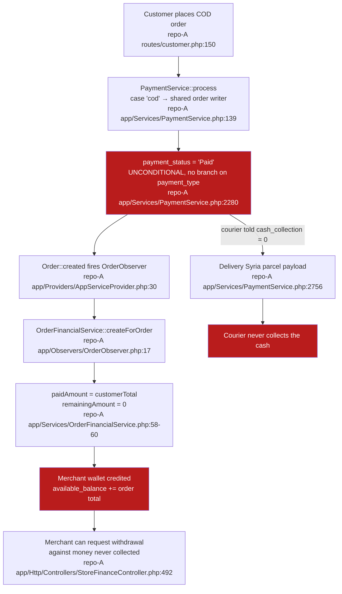
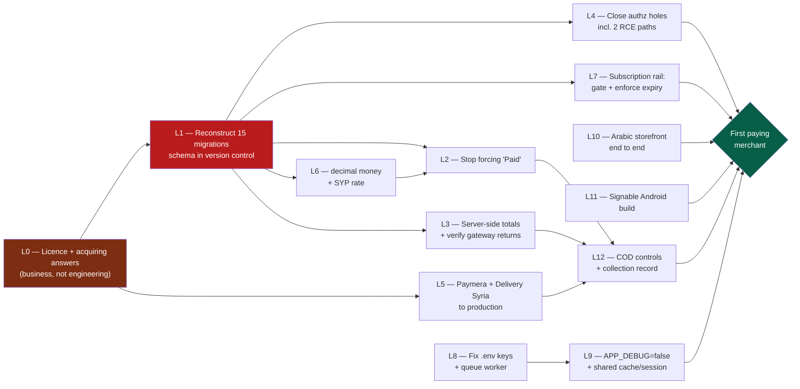

# 07 — SaaS Gap Analysis

## How to read this document

The target is a professional multi-merchant SaaS commerce platform — the class of product Shopify,
Salla and Zid occupy. This document answers one question: **what does Store Syria already have, and
what is actually missing, measured against that bar.**

Three framings that this audit established and that should govern the reading:

1. **This is not a generic product awaiting localisation. It is already localised, and the
   localisation is the weakest code in the repository.** A Syrian card rail (Paymera) and a Syrian
   courier rail (Delivery Syria) were hand-built into `app/`. Both are wired to non-production
   endpoints. The launch blockers in the Syria-specific layer are configuration and correctness
   defects, not absent features — and critically, **not sanctions**.

2. **The SaaS scaffolding is better than expected; the money layer is worse.** Self-service merchant
   onboarding, per-store plans with real server-side quota enforcement, 69 addon modules, a super-admin
   panel, a merchant panel, three storefront themes, a 211-route API, an Arabic-default merchant mobile
   app, and a purpose-built merchant wallet/withdrawal ledger all exist and are wired. Against that,
   every money column in 105 migrations is `float`, `double` or `string` — there is not one
   `decimal()` — and `payment_status` is hardcoded to `'Paid'` for every order including cash-on-delivery.

3. **The repository cannot rebuild its own database.** Fifteen tables that live code reads and writes
   have no migration anywhere. This is the single finding that gates every other fix, because nothing
   can be tested without a schema.

Severity and priority labels below follow the audit vocabulary exactly. Where an independent
adversarial verification pass corrected an auditor's severity or mechanism, **the corrected wording
is used here** and the correction is stated.

---

## 1. Capability-by-capability assessment

Seventeen capabilities, assessed against the Shopify/Salla/Zid bar.

- **Status** is the evidence status: VERIFIED / PARTIAL / MISSING / UNKNOWN / BLOCKED.
- **Launch gate** is a business judgement: ESSENTIAL FOR LAUNCH means a Syrian merchant cannot
  transact, or the platform cannot bill, without it. POST-VALIDATION means it can follow the first
  paying merchants.
- **Priority** is a business priority (P0–P3), not an engineering preference.

| # | Capability | Current state + evidence | Status | Gap | Launch gate | Priority |
|---|---|---|---|---|---|---|
| 1 | **Merchant self-service onboarding** | `POST /register` creates the `User` (type `admin`) **and** the first `Store` in one request; `store_name` is a required field, so no merchant can exist without a store — `repo-A app/Http/Controllers/Auth/RegisteredUserController.php:77`, `:100-132`, `:180-209`; route `repo-A routes/auth.php:14-18`. Default pages are seeded (`:130`), plan assignment and trial expiry handled (`:135-167`). | PARTIAL | Self-registration never seeds `currency_rates` (`grep -c CurrencyRate RegisteredUserController.php` = 0), so every self-registered merchant hits a hard exception on any non-USD conversion (`repo-A app/Services/StoreCurrencyConversionService.php:62-67` throws when no rate row exists). `theme_id` is hardcoded `'stylique'` (`:118`, `:198`); language defaults to `'en'`, not `ar` (`:121`, `:200`). `created_by` is hardcoded to `1` (`:110`, `:189`). User+Store creation is **not** in a transaction, so a partial tenant can be left behind. | ESSENTIAL | **P1** |
| 2 | **Independent online stores (multi-tenancy)** | Model (A) shared database + `store_id` column. **119 of 188** model files platform-wide carry `store_id` (**57 of 95** in `app/Models/` alone) — `find app/Models packages -type f -name '*.php' \( -path '*/Models/*' -o -path '*/Entities/*' \) \| wc -l` = 188, the same `find` piped to `xargs grep -l "store_id" \| wc -l` = 119; `ls app/Models/*.php \| wc -l` = 95, `grep -l store_id app/Models/*.php \| wc -l` = 57. Tenant resolution is `getCurrentStore()` (`repo-A app/Helper/helper.php:357-381`), called at 1,281 sites (`grep -rn "getCurrentStore()" app/ packages/ --include=*.php \| wc -l` = 1,281), with **487** explicit `where('store_id', getCurrentStore())` call sites across `app/` and `packages/` (`grep -rn "where('store_id', *getCurrentStore()" app/ packages/ --include=*.php \| wc -l` = 487; the same command against `app/` alone = 330), and **1,260** `where('store_id', …)` clauses counting every form of the clause regardless of its second argument (`grep -rnE "where\((['\"])store_id\1," app/ packages/ --include=*.php \| wc -l` = 1,260). Guard separation is real: customers authenticate on a separate `customers` guard against a separate model (`repo-A config/auth.php:43-46`, `:75-78`). | PARTIAL | **Isolation is conventional, not structural.** Zero Eloquent global scopes, no `app/Policies` directory, empty `$policies` (`repo-A app/Providers/AuthServiceProvider.php:15-17`), zero `authorize()` calls, Laratrust teams disabled (`repo-A config/laratrust.php:243`). Where a hand-written filter is missing, isolation breaks: `OrderController::orderComplete` is an unauthenticated cross-tenant order lookup that also returns the capability token for the full order page (`repo-A app/Http/Controllers/OrderController.php:360-362`, `:373`; route `repo-A routes/customer.php:144`) — VERIFIED CRITICAL. Model (A) is the right choice and nothing forces a rewrite; it must be hardened. | ESSENTIAL | **P0** |
| 3 | **Custom domains** | Host→store resolution genuinely works and is read from the generic `settings` table (`name` ∈ `domains`/`subdomain`) — `repo-A app/Helper/helper.php:195-198`; the serving path is the platform root route `repo-A routes/web.php:320` → `repo-A app/Http/Controllers/HomeController.php:57-58`, `:98-108`. Provisioning is **custom Syria-team code** against a Webuzo hosting panel (`repo-A app/Services/WebuzoDomainService.php:29-43`, callers at `repo-A app/Http/Controllers/AppSettingController.php:755`, `:868`). Plan entitlements exist (`repo-A database/migrations/2023_12_08_123752_create_plans_table.php:25-26`). | PARTIAL | **The provisioning integration is currently non-functional, which is a correction to the original finding.** `WEBUZO_HOST` / `WEBUZO_USERNAME` / `WEBUZO_API_KEY` are resolved through bare `env()` with no defaults (`repo-A config/services.php:120-122`) and are absent from the committed `.env`, the live `.env` and `.env.example`, so `validateConfiguration()` (`repo-A app/Services/WebuzoDomainService.php:383-396`) throws on every call. The custom-domain path catches it and shows an error banner; the subdomain path has no try/catch and returns HTTP 500. Latent on top of that: both call sites pass `issueSsl = false`, so `issue_lecert => 0` and **no TLS certificate would ever be requested** once credentials are supplied; there is no uniqueness check on `domains`/`subdomain` across tenants; and internal links re-inject the store slug (`repo-A themes/stylique/views/main_file.blade.php:55`), so a custom domain yields two URL spaces with no canonical tag. Paymera callbacks are additionally pinned to `https://storesyria.com` (`repo-A app/Services/PaymentService.php:217`), bouncing a custom-domain shopper off their own domain mid-payment. | POST-VALIDATION | P2 |
| 4 | **Store templates / themes** | Three themes — `repo-A themes/greentic`, `themes/stylique`, `themes/techzonix` — via `qirolab/laravel-themer` (`repo-A composer.json:57`, `repo-A config/theme.php:12`). Theme view paths are genuinely prepended ahead of `resources/views`, proven by `main_file.blade.php` existing **only** inside `themes/*/views/` while the homepage is gated on `view()->exists('main_file')` (`repo-A app/Http/Controllers/HomeController.php:506`, `:519`). | PARTIAL | Each theme is 13–16 Blade files; the real storefront lives in the 104 shared files under `repo-A resources/views/front_end/`. Plan-level theme entitlement is **dead code** — `repo-A app/Http/Controllers/AppSettingController.php:1162` reads `$user->plan`, a column that does not exist (`users` has `plan_id`, `repo-A app/Models/User.php:44`), so `Plan::find(null)` returns null and the restriction never applies. New stores are hardcoded to `stylique`. 48 of 109 default theme images referenced by `theme_json`/`default_data` are missing from the repo. | POST-VALIDATION | P2 |
| 5 | **Flexible storefront design** | A JSON-declared settings form drives per-theme appearance (`repo-A themes/stylique/theme_json/`); the `ThemeCustomizer` addon's colour overrides are genuinely wired through to the storefront. | PARTIAL | **This is not a page builder.** Section markup and section order are hard-coded in Blade, and homepage section re-ordering is persisted but **never read at render time** — a dead feature. `POST theme-customize/{theme}/update` has its permission check **commented out** and performs an unfiltered key/value write whose values are rendered through 62 unescaped `{!! !!}` outputs, giving an authenticated tenant user stored XSS against that store's shoppers. | POST-VALIDATION | P1 |
| 6 | **Product & inventory management** | Full stock Workdo surface: `products`, `product_variants`, stock reports (`repo-A routes/web.php:345-347`), plus `ProductCSV` / `ImportExport` / `BulkDelete` addons. | PARTIAL | **Inventory arithmetic is wrong in three verified ways.** (a) Checkout stock decrement is an unlocked, non-transactional read-modify-write with no quantity guard and no floor at zero: `repo-A app/Services/PaymentService.php:2162-2164` (simple) and `:2090-2092` (variant); `grep "DB::" app/Services/PaymentService.php` returns zero hits in the whole file, and `products.product_stock` is a **signed** `integer` (`repo-A database/migrations/2023_12_26_092822_create_products_table.php:33`). A single anonymous request with `qty` greater than stock drives stock negative — `qty` is read raw at `repo-A app/Http/Controllers/CartController.php:189` with no validation. (b) Both stock-restore paths are a silent **no-op for non-variant products**: the Eloquent model shadows the loop array, so `$product['qty']` resolves against a `products` table that has no `qty` column and adds nothing — `repo-A app/Models/Order.php:620-625` and `repo-A app/Http/Controllers/OrderController.php:461-466`. Returned simple-product inventory is never restocked. (c) `products.price` and `sale_price` are `float` (`:31-32`). | ESSENTIAL | **P0** |
| 7 | **Order & fulfilment management** | `orders` with a `delivered_status` lifecycle (0/1/2/3, plus 4/5/6 confirmed/picked-up/shipped and 8 pre-order) — `repo-A database/migrations/2024_01_23_061635_create_orders_table.php:33`, labels at `repo-A app/Models/Order.php:94-110`. RTL-styled printable shipping label (`repo-A resources/views/order/shippinglabel.blade.php:156-165`). In-house delivery-boy module: `DeliveryBoy`, `DeliveryBoyDevice`, `DeliveryBoyNotification`, `DeliveryEarning` models plus `repo-A app/Http/Controllers/Api/DeliveryBoyApiController.php`. | PARTIAL | `payment_status` is hardcoded `'Paid'` for every order (`repo-A app/Services/PaymentService.php:2280`) — see capability 8. Status transitions are a flat `if` chain with no RBAC, no store scoping and no legal-transition matrix. Order-mutating routes sit **outside** the auth group: `repo-A routes/web.php:940-973` is inside `web` (`:326`) but outside `['auth','xss','setlocate','verified']` (`:347-938`), so `/order-payment-status`, `/order-status-change/{id}`, `/update-order-status/{id}`, `/order-return`, `/order-return-request` and the refund endpoints are reachable by an unauthenticated actor after one anonymous GET to harvest a session and CSRF token — VERIFIED CRITICAL. | ESSENTIAL | **P0** |
| 8 | **Syrian payment + COD workflow** | COD and bank transfer are both wired and dispatch to the shared order writer (`repo-A app/Services/PaymentService.php:139-142`); gateway entries at `repo-A app/Http/Controllers/PaymentSettingController.php:161` (cod) and `:166` (bank_transfer). Paymera — the one Syria-oriented card rail — is registered end to end (`:176`; dispatch `repo-A app/Services/PaymentService.php:91`; callback/trigger routes `repo-A routes/web.php:300`, `:380`). A bank-transfer receipt column exists and is populated (`repo-A database/migrations/2024_10_22_103923_add_payment_receipt_to_orders_table.php:16-18`; written at `repo-A app/Services/PaymentService.php:2289`). | PARTIAL | **No working online rail, and COD is booked as collected at checkout.** See §2.1 and §2.2. Paymera is hardcoded to a test host with no config seam (`repo-A app/Services/PaymentService.php:216`), verifies payments with a config key that does not exist (`repo-A app/Http/Controllers/PaymentController.php:65`), and is charged an amount taken from a client-submitted field with its decimal separator stripped (`:209-211`). COD's entire server-side model is three settings strings — no surcharge, no order ceiling, no per-zone availability, no blocked-customer list, no `cash_collected`/`collected_at`/`collected_by` record. Of the **8** gateway callbacks read line-by-line, **2 verify properly** (Tap, PhonePe), 2 partially (Paymera, toyyibpay), **0 verify the amount** and **0 verify an inbound signature**; the remaining **~44 of the ~52** wired payment types were **NOT READ** and are **UNKNOWN, not clean** (see `10-OPEN-QUESTIONS-AND-DECISIONS.md` §2.2). | ESSENTIAL | **P0** |
| 9 | **Local shipping integration** | Manual zone/method model: `shipping_zones` (`repo-A database/migrations/2023_12_19_055003_create_shipping_zones_table.php:14-21`) and `shipping_methods` (`repo-A database/migrations/2023_12_19_061038_create_shipping_methods_table.php:14-22`), with the `states` table supplying Syrian governorates. `ShippingZone::modules()` offers `Delivery Syria / Flat Rate / Free shipping / Local pickup` only. | PARTIAL | **The only local carrier rail posts to an ephemeral developer tunnel and never tells the courier how much cash to collect.** Both Delivery Syria calls target `*.ngrok-free.dev`: `repo-A app/Http/Controllers/DeliverySyriaController.php:54` (parcel list) and `repo-A app/Services/PaymentService.php:2805` (parcel create). `cash_collection` is the literal string `'0'` (`:2756`) and `cod_amount2` the literal `'1'` (`:2766`) on every parcel; the whole `$chargeDetails` block is invented constants (`:2725-2734`). Zero carrier integrations otherwise (exhaustive grep for aramex/dhl/fedex/ups/smsa/naqel/bosta/shipox returns nothing but marketing copy). `shipping_methods.cost` is a `string` column (`:18`). Method selection is by English string equality on a merchant-editable field (`:2607`), so a merchant who renames the method gets no parcel. | ESSENTIAL | **P0** |
| 10 | **Subscription & billing infrastructure** | Five plan models, all migrated. Plan CRUD gated by `isAbleTo('Manage Plan')`/`('Create Plan')` with quota validation. **37 plan-payment gateway routes** in `repo-A routes/web.php:355-535`, and — decisively for this market — **offline bank transfer with receipt upload and super-admin approval**: `repo-A routes/web.php:464-468`, flow at `repo-A app/Http/Controllers/BankTransferController.php:19-26` (receipt validated as an image), `:35-39` (duplicate guard), `:79-82` (`Pending`), `:119-136` (`Approved` + `assignPlan`), `:138-148` (`Rejected`). A second manual rail, `PlanRequestController::acceptRequest`, **does** check `type == 'super admin'` (`:67`) and books `payment_type => 'Manually'` (`:103`). Quotas genuinely enforced server-side: `max_products` (`repo-A app/Http/Controllers/ProductController.php:171`), `max_users` (`repo-A app/Http/Controllers/UserController.php:101`), `max_stores` (`repo-A app/Http/Controllers/StoreController.php:131`), `storage_limit` (`repo-A app/Models/Utility.php:787-792`). | PARTIAL | **The revenue rail is unenforced and self-approvable.** Plan-expiry enforcement is **commented out** — `repo-A app/Http/Middleware/SetLocate.php:79` and `:87-88` — and when an expired user has an empty `plan_id` the code looks up the plan whose `duration` is `'Unlimited'` and **assigns it** (`:72-76`), so expiry upgrades them. `order_approve/{id}` grants a paid plan with **no authorisation check of any kind** in the controller (`repo-A app/Http/Controllers/BankTransferController.php:119`) and no role middleware on the route (`repo-A routes/web.php:467`, nested only inside `['auth','xss','setlocate','verified']` at `:326`) — any authenticated, email-verified merchant can approve their own subscription, and `{id}` is a sequential integer. No recurring billing: `laravel/cashier-paddle` is installed and `Billable` is on `User`, but there is no cashier config, no subscriptions migration and no `subscribe()` call. No expiry job: `repo-A routes/console.php` schedules one unrelated command. `plans.price` is a `string` column (`:17`) and only one plan is seeded, with tiny limits (`repo-A database/seeders/PlansTableSeeder.php:22-39`). | ESSENTIAL | **P0** |
| 11 | **Multi-language (Arabic end-to-end)** | Genuinely strong, and better than any other locale. `repo-A resources/lang/ar.json` holds **2,848 keys with only 26 values identical to their key** (measured with `json.load`) — a real translation. RTL is switched on automatically for Arabic rather than left to the admin (`repo-A app/Http/Controllers/LanguageController.php:39-51`), and admin/theme layouts honour it (`repo-A resources/views/layouts/app.blade.php:54`). Transactional email templates are seeded **with Arabic first** in every block (`repo-A app/Models/Utility.php:553`, `:575`, `:597`, `:619`, `:641`, 16 locales each). The merchant app defaults to Arabic: `static const fallbackLocale = Locale('ar', 'AE')` (`repo-B lib/translations/translation_service.dart:8`), with `isRTL` derived from the locale (`:31-33`). | PARTIAL | **Weakest exactly where it is customer-facing.** The storefront layout customers land on carries **no `dir` attribute at all**: `repo-A resources/views/front_end/layouts/app.blade.php:2`. `SITE_RTL` defaults to `off` and is persisted only for logged-in users, so a guest shopper switching to Arabic gets no RTL. The live theme layouts do set `dir="rtl"` for `ar`/`he` (`repo-A themes/stylique/views/front_end/layouts/app.blade.php:2`) but load only the LTR `main-style.css` (`:18`) — greentic and techzonix ship **no** RTL stylesheet, and stylique's `themes/stylique/assets/css/rtl.css` is never referenced by its storefront layout, so Arabic storefronts are **mis-mirrored rather than unstyled** (this corrects an earlier, more severe claim). `repo-A resources/lang/ar/` is missing `validation.php`, `auth.php`, `passwords.php` and `pagination.php` (Hebrew has all four), so server-side validation messages render in English. No Arabic-capable webfont is declared anywhere. The Arabic owner-confirmation email template is malformed (`repo-A app/Models/Utility.php:597` — `</ p>` tags and an Arabic semicolon inside a CSS declaration). `flutter_localizations` is declared (`repo-B pubspec.yaml:34`) but never wired, so the Arabic-default app renders with global LTR direction. | ESSENTIAL | **P1** |
| 12 | **Multi-currency (SYP)** | SYP **is** present with a correct Arabic symbol, in a deliberately Levant-first list of 13 currencies (`repo-A app/Http/Controllers/StoreController.php:192-205`). A per-store FX model and conversion service exist (`repo-A app/Models/CurrencyRate.php:9`, `repo-A app/Services/StoreCurrencyConversionService.php`), with manual rate management (`repo-A app/Http/Controllers/CurrencyRateController.php:14`, `:22`) mirrored in the merchant app (`repo-B lib/config/repository/store_settings_repository.dart:73-87`). | PARTIAL | **Every seeded rate is `1`** (`repo-A app/Http/Controllers/StoreController.php:195` — SYP at `'rate' => 1`), i.e. 1 SYP = 1 USD. Because `getRate()` divides by the stored rate, switching store currency at the default rate **rewrites every product row in place** with no snapshot and no undo (`repo-A app/Services/StoreCurrencyConversionService.php:107-112`). The `currency_rates` table **has no migration anywhere** (`repo-A app/Models/CurrencyRate.php:9` names it; zero `Schema::create('currency_rates'` in the repo), so store creation itself fails on a fresh database (`repo-A app/Http/Controllers/StoreController.php:197-209`). No FX source is integrated (exhaustive grep for exchangerate/openexchange/fixer/currencylayer/frankfurter returns nothing) and no rate history, staleness warning or approval step exists. The web storefront does not use `CurrencyRate` at all (`grep -rn CurrencyRate themes/ resources/` → no hits), so a web shopper and the merchant app can see different numbers. Two unrelated currency systems coexist, and the legacy seeder gives SYP the pound-sterling symbol (`repo-A database/seeders/DefaultSetting.php:190`). | ESSENTIAL | **P0** |
| 13 | **Merchant staff accounts & permissions** | Laratrust 8 is installed and genuinely used: 362 `isAbleTo()` call sites across 59 controller files, 167 distinct abilities, `roles.store_id` and `roles.created_by` tenancy columns (`repo-A database/migrations/2023_12_08_100022_laratrust_setup_tables.php:24-25`). The finance module is the model citizen — six sibling methods each open with an explicit gate (`repo-A app/Http/Controllers/StoreFinanceController.php:19`, `:71`, `:315`, `:396`, `:494`, `:624`). | PARTIAL | **The role table is a platform-takeover primitive, and coverage is inconsistent.** `RoleController::update()`/`::destroy()` take the tenant-global `Role` by implicit route-model binding with **zero ownership scoping** (`repo-A app/Http/Controllers/RoleController.php:156`, `:216`; route `repo-A routes/web.php:335`); `:182-183` then rewrites `users.type` for every holder of the bound role, and `:185-186` re-stamps the global `super admin` role into the attacker's store. The abilities needed are granted to the shared `admin` role on **every login** (`repo-A app/Models/Utility.php:2872-2873` via `repo-A app/Http/Controllers/Auth/AuthenticatedSessionController.php:83`), so revoking them does not stick, and `RoleController::edit()` (`:133`) has no gate at all. Permission assignment is unfiltered server-side — `repo-A config/superadminaccess.php` is enforced **only in Blade**. Only **1 route in the entire route tree** carries `permission:` middleware (`repo-A routes/web.php:164`). And `POST /store-reset-password-update/{id}` overwrites any user's password, including the super admin's, with no authorization check whatsoever (`repo-A app/Http/Controllers/StoreController.php:646-669`; route `repo-A routes/web.php:663`) — reachable by anyone who self-registers. | ESSENTIAL | **P0** |
| 14 | **API & app ecosystem** | **211** route registrations in `repo-A routes/api.php` (`grep -cE "Route::(get\|post\|put\|patch\|delete\|any\|match\|resource\|apiResource)" routes/api.php` = 211; 213 lines contain the string `Route::`, which is why a line-based count reads 213 — 211 is the route count); Sanctum installed; `APILog`/`AdminApiLog` middleware; **all 83 distinct endpoint paths the Flutter app calls resolve to real routes** under the `Route::prefix('admin')` group — zero orphans. The app's base URL matches the platform's committed `APP_URL` (`repo-B lib/utils/base_api.dart:3`). | PARTIAL | **The API has no working authentication.** `CustomAuth` — the middleware on 189 of 211 registrations — looks `personal_access_tokens` up **by row id alone** and never compares the token hash (`repo-A app/Http/Middleware/CustomAuth.php:32-34`), and when no `Authorization` header is sent it falls through unauthenticated (`:54`). The same codebase contains the correct check twenty lines from a vulnerable call site (`repo-A app/Http/Controllers/Api/DashboardController.php:620-633` uses `hash_equals`), so this is a defect, not a design. Seven admin list endpoints carry only a pass-through logging middleware (`repo-A routes/api.php:163-169`; `repo-A app/Http/Middleware/AdminApiLog.php:19-22` is `return $next($request);`) and take the tenant from a query parameter, so `GET /api/admin/orderlist?store_id=N` returns any merchant's orders and customer names to an anonymous caller. `throttleApi()` is never called, so enumeration is unrate-limited. There is **no API contract artifact of any kind** — no OpenAPI, no Postman collection, no shared types, no versioned path, no contract test on either side; the one doc file is untouched stock vendor documentation covering 38 of 83 endpoints. | ESSENTIAL | **P0** |
| 15 | **Analytics & reporting** | `ReportController`, `ThemeAnalyticController`, `shetabit/visitor`, Firebase Analytics in the app, and a `statistics_screen` in Repo B. | PARTIAL | **The reports are arithmetically wrong, not merely thin.** Figures derive from `float` money columns and from a `payment_status` that is hardcoded `'Paid'`, so revenue includes uncollected COD; the merchant dashboard additionally counts cancelled orders in revenue and its trend percentages are always ≤ 0. Storefront analytics are further undermined by tracking pixels that are configured in admin but **never rendered** — `$pixelScript` is read in **four** storefront layouts and *is* assigned — but only by the Marketing (vcard) and LandingPage modules, which never supply these layouts — so the `isset()` guard is always false on the e-commerce storefront (see G8 and `05-SECURITY-AND-QUALITY-AUDIT.md` §2.1). | POST-VALIDATION | P1 |
| 16 | **Mobile applications** | Repo B is definitively a **merchant/store-owner admin console**, not a customer shopping app: five tabs (Home/Orders/Products/Categories/More), it assigns orders to delivery boys rather than receiving them, and there is no cart or checkout anywhere. 198 Dart files, GetX, Firebase (core/messaging/analytics/crashlytics/remote_config), `com.syriastore.app` (`repo-B android/app/build.gradle.kts:27`), Arabic by default. A customer-facing API surface exists in `repo-A routes/api.php`. | PARTIAL | **No customer shopping app exists in scope**, and the merchant app is not shippable as-is: the Android release build is signed with the **debug keystore** (`repo-B android/app/build.gradle.kts:38-42`); the login e-mail and plaintext password are written to the device log (`repo-B lib/core/controller/auth/auth_controller.dart:152`) along with every API response body including the bearer token (`repo-B lib/network/network.dart:125-158`), with **zero** `kReleaseMode` guards anywhere in `lib/` (180 bare `print(` calls across 33 files); Crashlytics is wired in Dart but disabled by manifest meta-data (`repo-B android/app/src/main/AndroidManifest.xml:35-37`); an unlicensed commercial Syncfusion library is used in two live screens; the merchant avatar fallback points at the upstream vendor's demo server; and three product identities coexist in one codebase (`pubspec name: store_go_app`, `repo-B pubspec.yaml:1`). | POST-VALIDATION | P1 |
| 17 | **Platform monetization** | Subscriptions only. Plans carry `max_stores`, `max_products`, `max_users`, `storage_limit` (`repo-A database/migrations/2023_12_08_123752_create_plans_table.php:20-23`), all `string`-typed. | PARTIAL | **Nothing takes a platform cut of a merchant's order.** Exhaustive grep for `commission`/`platform_fee`/`admin_commission` finds only delivery-boy commission (`repo-A app/Models/DeliveryEarning.php:16-17`) and affiliate commission (`repo-A app/Models/Utility.php:3423-3431`) — no GMV rake, no per-transaction fee, no usage metering beyond the static plan quotas. So **100% of platform revenue depends on the one rail that is unenforced (capability 10)**. Subscriptions-only is a defensible model for this market — in a market where card acquiring is uncertain, a commission would be harder to collect than a subscription, not easier. The defect is enforcement, not the model. | ESSENTIAL | **P0** |

### 1.1 What the table says in one paragraph

Of 17 capabilities: **0 are VERIFIED clean**, 17 are PARTIAL, and the PARTIAL label is doing very
different work in different rows. In capabilities 3, 4, 5, 15 and 16 it means "real but incomplete" —
normal product debt. In capabilities 6, 7, 8, 9, 10, 12, 13, 14 and 17 it means "built, wired, and
wrong in a way that costs money or breaks tenancy". **Nine of the seventeen carry a P0.** None of the
nine needs a new subsystem; all nine need existing, already-built machinery to be corrected, gated or
configured. That is the single most important commercial fact in this document: this is a remediation
project, not a rebuild.

---

## 2. The Syrian-market reality — the commercial crux

This section is where the audit's engineering findings meet the business decision. Everything in
§2.1–§2.7 that concerns **what the code does** is a code finding with a citation. Everything that
concerns **what is commercially or legally available in or to Syria** is BUSINESS CONTEXT and is
explicitly marked as requiring confirmation with legal and commercial advisors. The audit makes no
sanctions assertion of any kind.

### 2.1 The payment-rails problem

**What the code establishes (FACT).** `composer.json` pulls roughly 30 payment SDKs and
`PaymentSettingController::getPaymentGateways()` exposes 52 configurable methods to merchants
(`repo-A app/Http/Controllers/PaymentSettingController.php:159-422`). An exhaustive grep for Syrian
and Levantine rails — Syriatel, MTN Cash, Fatora, Sham Cash, Bemo, Cham Bank, Al Baraka, Byblos,
any `sy_pay` variant — across `app/`, `packages/`, `resources/`, `database/`, `routes/` and `config/`
returns **nothing**. **51 of the 52 methods are non-Syrian by provider origin.** The single exception
is **Paymera**, which was hand-added by the Store Syria team to `app/` — it is not in `composer.json`
and not in `packages/workdo/` (`repo-A app/Http/Controllers/PaymentSettingController.php:176`).

**BUSINESS CONTEXT — requires confirmation with counsel and acquirers, in writing.** Whether a
Syrian-domiciled merchant can hold a live account with Stripe, PayPal, Braintree, Authorize.Net,
Mollie, Paddle, MyFatoorah, PayTabs, Tap, Benefit or any other bundled provider is a
sanctions-and-acquiring question. **Nothing in this code audit answers it, and no conclusion about
any provider's availability should be drawn from this document.** What the code does establish is
that the commercial answer decides whether the platform has one card rail or zero.

**The practical rails, as the code supports them today.** On the assumption — which the owner must
confirm — that international card acquiring is unavailable or unreliable, the usable rails are the
four manual/offline ones, and they are all present:

| Rail | Evidence | Implementation | Verdict |
|---|---|---|---|
| **Cash on delivery** | Gateway entry `repo-A app/Http/Controllers/PaymentSettingController.php:161`; dispatch `repo-A app/Services/PaymentService.php:139` | PARTIALLY IMPLEMENTED | **Primary rail.** Works as a checkout option; has no COD controls and is mis-booked (below). |
| **Offline bank transfer (storefront)** | `:166`; dispatch `:141`; receipt column `repo-A database/migrations/2024_10_22_103923_add_payment_receipt_to_orders_table.php:16-18` | IMPLEMENTED BUT NOT VERIFIED | Usable. No merchant review queue — the order is already `Paid` before anyone can look. |
| **WhatsApp contact-to-pay** | `repo-A app/Http/Controllers/PaymentSettingController.php:277`; dispatch `repo-A app/Services/PaymentService.php:143` | IMPLEMENTED BUT NOT VERIFIED | Usable, Syria-workable. |
| **Telegram contact-to-pay** | `:272`; dispatch `:129` | IMPLEMENTED BUT NOT VERIFIED | Usable, Syria-workable. |
| **Paymera (card)** | `:176`; dispatch `repo-A app/Services/PaymentService.php:91` | PARTIALLY IMPLEMENTED — broken configuration | **Intended Syrian card rail, launch-blocked by three defects.** |

**Paymera's three defects, each VERIFIED.**

1. **Hardcoded to a test host with no configuration seam.** `repo-A app/Services/PaymentService.php:216`
   sets `$api_url = 'https://egate-t.paymera.cc/api/create-payment'`; the same literal repeats at
   `:289` and at `repo-A app/Http/Controllers/PaymentController.php:67`. No `env()`, no `config()`,
   no per-environment switch. The adjacent `$base = 'https://storesyria.com'` (`:217`) hardcodes the
   callback base, breaking custom domains and any staging host. *The `-t` infix reading as "test" is
   an INFERENCE about Paymera's naming and must be confirmed with Paymera; the FACT that the endpoint
   cannot be changed without a code deploy stands either way.*
2. **Verification reads a config key that does not exist.** `repo-A app/Http/Controllers/PaymentController.php:65`
   sends `'Authorization' => 'Bearer ' . config('services.paymera.username')`, and
   `grep -i paymera config/*.php` returns nothing — so the header carries an empty token. The
   credential used to *create* the payment is a per-store setting (`repo-A app/Services/PaymentService.php:207`);
   the credential used to *verify* it is global and absent. This single poll is the only gate on order
   creation (`repo-A app/Http/Controllers/PaymentController.php:95-102`). **INFERENCE, flagged:** if
   Paymera's `/payment-status` endpoint requires the bearer token, every successful payment is treated
   as cancelled — the customer is charged and gets no order. If the endpoint ignores auth, it happens
   to work. Which is true is UNKNOWN from code and must be read off Paymera's API spec.
   *Credit where due: the design shape is correct — the callback re-polls the gateway rather than
   trusting the browser redirect, is idempotent via a `processed` flag, and takes a `Cache::lock`.
   The defect is the credential, not the architecture.*
3. **The charged amount comes from the request, with its decimal separator stripped.**
   `repo-A app/Services/PaymentService.php:209-211`:
   `$cartlist_final_price = $request['cartlist_final_price']` then
   `str_replace([' ', ',', '.'], '', ...)` then `(int)`. So `"1,234.56"` becomes `123456`.
   **INFERENCE, flagged:** if Paymera expects major units, a USD- or EUR-priced store is charged
   100×; if it expects minor units, an SYP store is charged 1/100×. One of the two currency classes
   is wrong; which is UNKNOWN from code.

**The deeper payment defect is not Paymera-specific.** The shared "payment succeeded" handler never
checks whether payment succeeded. `return_type=success|cancel` is generated in eleven places and
**read in zero** across the store commerce core — the one repo-wide reader belongs to an unrelated
addon. Consequently Stripe's `cancel_url`, PaymentWall's error callback and Paymera's own decline
branch all land on the same handler, which reaches
`$order->payment_status = 'Paid'` (`repo-A app/Http/Controllers/PaymentController.php:1354`) on the
straight-line path. Only **three** gateways verify an outcome at that endpoint — PhonePe (`:913-925`),
toyyibpay (`:929-939`) and Tap (`:941-953`). Paymera's own declined-payment path explicitly redirects
into this order-creating handler (`repo-A app/Http/Controllers/PaymentController.php:101-107`), so
**every declined Paymera transaction books a `'Paid'` order automatically** — no attacker required.
Separately, the tax amount is accepted straight from the HTTP request on the web checkout and lands
in the gateway charge (`repo-A app/Http/Controllers/PaymentController.php:764`, `:792`), so a negative
`tax_price` reduces what the gateway is asked to collect. Status: **NO-GO on live payments** until
totals are recomputed server-side at order creation and every gateway return is verified server-side.

**And COD is booked as collected at checkout.** This is the most commercially consequential finding
in this document, because COD is the market's primary rail:



The irony — and the opportunity — is that **the correct mechanism already exists and is
permission-gated.** `repo-A app/Services/OrderFinancialService.php` is a purpose-built, 598-line
financial ledger written by the Store Syria team: it snapshots product amount, discount, tax,
shipping, customer total, product cost and gross profit under `DB::transaction` with `lockForUpdate()`
on the wallet; it snapshots the **order's currency at the time of order** rather than reading live
settings later (exactly right for a volatile currency); and it has `markFinancialAsPaid` /
`markFinancialAsUnpaid` with reversal transactions. The merchant-facing control is authorization-checked
(`repo-A app/Http/Controllers/StoreFinanceController.php:17-26`) and store-scoped (`:29-32`).
**COD orders should enter that ledger as unpaid and be marked paid by a human when cash lands. One
line — `repo-A app/Services/PaymentService.php:2280` — inverts the meaning of the entire ledger.**
Fixing it is the cheapest high-value change in the whole audit.

Two cautions on that ledger. First, the observer swallows every exception into the log
(`repo-A app/Observers/OrderObserver.php:17-21`), and `createForOrder` opens with a `firstOrFail()`
on `store_wallets` — a table with no migration — so on any environment lacking that table **orders
save successfully and all financial tracking silently does nothing**, visible only in
`storage/logs`. Second, the three payout state-transition endpoints
(`repo-A routes/web.php:186`, `:189`, `:192`) have neither `auth` middleware nor any permission
check, so a merchant staff account holding **zero** finance permissions can advance its own store's
payouts to `paid` and corrupt wallet balances — severity **HIGH / P1** (corrected down from CRITICAL:
`payWithdrawal` performs no gateway call, the `store_id` scoping holds so there is no cross-tenant
reach, and an anonymous actor is blocked because `getCurrentStore()` returns null). Conversely the
six Finance permissions those methods' guarded siblings require are **created by no seeder anywhere**,
so six of the ten finance endpoints are fail-closed-unreachable for every role including super admin —
severity **HIGH / P1**, remediable by a single seeder addition.

### 2.2 How merchants would pay for their own subscription — an owner decision, and a hard dependency

**This is the question on which the SaaS business model stands or falls, and the audit's answer is
unusually good news followed by a precise blocker.**

If international card acquiring is unavailable to Store Syria as a *merchant of record* — again, a
commercial question for counsel, not a code finding — then 37 of the 38 plan-payment routes in
`repo-A routes/web.php:355-535` are commercially dead, and the platform has no way to collect
subscription revenue. The code already contains the exception:

**A complete offline bank-transfer subscription rail with receipt upload and super-admin approval.**
`repo-A routes/web.php:464-468`:

```php
Route::post('plan-pay-with-bank', [BankTransferController::class, 'planPayWithbank'])->name('plan.pay.with.bank');
Route::get('plan/orders/show/{id}', [BankTransferController::class, 'show'])->name('plan.order.show');
Route::delete('/bank_transfer/{order}/', [BankTransferController::class, 'destroy'])->name('bank_transfer.destroy');
Route::any('order_approve/{id}', [BankTransferController::class, 'orderapprove'])->name('order.approve');
Route::any('order_reject/{id}', [BankTransferController::class, 'orderreject'])->name('order.reject');
```

The flow is end to end: receipt validated as an image (`repo-A app/Http/Controllers/BankTransferController.php:19-26`),
duplicate-request guard (`:35-39`), upload (`:43-52`), coupon handling (`:56-71`), status `Pending`
(`:79-82`), then `Approved` + `assignPlan` (`:119-136`) or `Rejected` (`:138-148`). A second manual
rail exists alongside it and is correctly gated: `PlanRequestController::acceptRequest` checks
`type == 'super admin'` (`:67`) and books the order as `payment_type => 'Manually'` (`:103`).

**So the billing rail for a Syria-operated SaaS already exists. It has two P0 defects, both small.**

1. **`orderapprove` has no authorisation check whatsoever.** `repo-A app/Http/Controllers/BankTransferController.php:119`
   is `public function orderapprove($id)` followed immediately by `PlanOrder::find($id)` — no
   `type == 'super admin'` test (contrast `customDomain` in the same codebase), no `isAbleTo()`
   (contrast `StoreFinanceController.php:19`), no ownership check. The route carries no role
   middleware either: a brace-depth walk of `repo-A routes/web.php` places `:467` at depth 2 inside
   only `['web']` (`:305`) and `['auth','xss','setlocate','verified']` (`:326`), none of which is a
   role gate. **Any authenticated, email-verified merchant can approve their own `Pending` plan order
   and grant themselves the paid plan**, and because `{id}` is a sequential integer they can approve
   or reject other merchants' orders too — the latter being a denial-of-service against a competitor's
   subscription. Severity **CRITICAL / P0**.
2. **Plan expiry is not enforced.** `repo-A app/Http/Middleware/SetLocate.php:79` and `:87-88` are
   the two expiry redirects, both **commented out**; the surrounding `// if($plan)` / `// }` markers
   at `:61` and `:90` show the block was deliberately disabled. The middleware detects expiry and
   then does nothing. Worse, when an expired user has an empty `plan_id`, `:72-76` looks up the plan
   whose `duration` is `'Unlimited'` and **assigns it** — expiry upgrades them. Severity
   **CRITICAL / P0**.

**THE OWNER DECISION, stated plainly.** The platform's only revenue is subscriptions (capability 17:
there is no GMV commission anywhere in the code). Those subscriptions must be collected through a rail
that works for Syrian merchants. The code offers exactly one such rail — offline bank transfer with
receipt and manual approval — and that rail is currently self-serve and unenforced. **Three decisions
belong to the owner, not to engineering, and all three gate the business model:**

- **(a) Which collection instrument.** Bank transfer with receipt upload (built), cash collection at
  a physical office (no code; would be the `PlanRequestController` manual-grant path), a local-wallet
  rail (no code), or Paymera for subscriptions too (requires §2.1 resolved first). Each implies a
  different operational burden on the platform team — receipt review is manual labour per merchant
  per renewal cycle, and the code provides no reviewer queue, no renewal reminder, no dunning and no
  grace-period logic.
- **(b) Whether to run annual-only billing.** With no recurring-billing engine
  (`laravel/cashier-paddle` is installed and entirely unused — no cashier config, no subscriptions
  migration, no `subscribe()` call anywhere) and no expiry job (`repo-A routes/console.php` schedules
  one unrelated command), every renewal is a manual event. Longer billing periods reduce that
  operational cost linearly.
- **(c) What happens to a lapsed merchant's live storefront.** Re-enabling expiry enforcement will
  lock out every merchant currently running on a lapsed plan. That is a commercial and
  reputational decision, not a code change, and it must be made and communicated *before* `:79` is
  uncommented.

Until (a)–(c) are answered, **the SaaS business model has no collection path that both works in the
market and is protected from self-approval.** That is the hard dependency.

### 2.3 Local shipping

**What exists (FACT).** Zero carrier integrations in the conventional sense — an exhaustive grep for
aramex, dhl, fedex, ups, smsa, naqel, bosta, shipox, aymakan, shiprocket, easyship and shippo across
`app/`, `packages/`, `routes/` and `config/` returns only the words "delivery" and "recovery" inside
Workdo marketing copy, and none of the 69 addon modules is a carrier. The entire shipping model is
three thin tables — `shipping_zones` (`repo-A database/migrations/2023_12_19_055003_create_shipping_zones_table.php:14-21`),
`shipping_methods` (`repo-A database/migrations/2023_12_19_061038_create_shipping_methods_table.php:14-22`,
where `cost` is a `string`), and the per-method options exposed by `ShippingZone::modules()`:
`Delivery Syria`, `Flat Rate`, `Free shipping`, `Local pickup`.

**What a Syrian merchant can actually do today.** Define governorate-level zones (the `states` table
supplies Syrian governorates and is used on the parcel path at
`repo-A app/Services/PaymentService.php:2721-2722`), attach flat or per-product rates, print an
RTL-styled shipping label (`repo-A resources/views/order/shippinglabel.blade.php:156-165`), and
dispatch through the in-house delivery-boy module (`DeliveryBoy`, `DeliveryBoyDevice`,
`DeliveryBoyNotification`, `DeliveryEarning` models; `repo-A app/Http/Controllers/Api/DeliveryBoyApiController.php`;
a `delivery_boys` screen in Repo B). **That is a workable manual operation** — and it is the correct
fallback, because three of those four delivery-boy tables have no migration (§3).

**Delivery Syria — the only local carrier rail — is launch-blocked by configuration, not sanctions.**
Both storefront HTTP calls target an ephemeral developer tunnel:
`repo-A app/Http/Controllers/DeliverySyriaController.php:54` (parcel list) and
`repo-A app/Services/PaymentService.php:2805` (parcel create), both
`https://jingle-name-buddhism.ngrok-free.dev/...`. This is demonstrably the odd one out, because the
rest of the codebase already uses the production domain for the same service — `https://deliverysyria.com/api/secret/cheack`
(`repo-A app/Http/Controllers/SettingController.php:51`), `.../api/secret/state`
(`repo-A app/Http/Controllers/AccountProfileController.php:182`), and
`config('services.deliverysyria.url')` = `https://deliverysyria.com` (`repo-A config/services.php:43`)
consumed correctly at `repo-A app/Console/Commands/ZidProcessEvents.php:152`. **The Zid order channel
talks to production Delivery Syria while the Store Syria checkout talks to a tunnel.** If that tunnel
hostname lapses or is reassigned, every parcel creation ships `customer_name`, `customer_address`,
`customer_phone`, `lat`/`long` and `selling_price` to whoever holds it.

The payload is worse than the URL, and **this is the COD launch blocker stated precisely: the courier
is never told how much cash to collect.** `'cash_collection' => '0'`
(`repo-A app/Services/PaymentService.php:2756`) and `'cod_amount2' => '1'` (`:2766`) are literal
constants on every parcel regardless of order total, as are `'parcel_bank' => 'on'` and
`'fragileLiquid' => 'on'` (`:2764-2765`), and the whole `$chargeDetails` block — VAT, delivery
charge, COD charge, packaging, fragile surcharge — is eight invented numbers unrelated to the order,
to the merchant's own shipping rates, or to Syrian VAT (`:2725-2734`). That this is wrong is proven
**inside the same repository**, because the Zid channel computes it correctly:
`$cod = data_get($o, 'payment_status') === 'paid' ? 0 : (float) $order->total;`
(`repo-A app/Console/Commands/ZidProcessEvents.php:145`, used at `:159-160`). The correct formula
already exists and can be reused verbatim.

Two further defects on the same path: parcel dispatch fires only when the chosen method's
`method_name` is **exactly** the English string `'Delivery Syria'`
(`repo-A app/Services/PaymentService.php:2607`), so a merchant who names it `توصيل سوريا`,
`DeliverySyria` or `Delivery Syria ` silently gets no parcel — there is no provider id, enum or
foreign key; and parcel-creation failure is logged and swallowed (`:2617-2623`), so the customer gets
an order-complete page with no shipment behind it. Finally, the three delivery-status callback
endpoints are **completely unauthenticated** (`repo-A routes/api.php:35-38`, `:376-379`, and a
closure at `repo-A routes/web.php:1026` that accepts **GET**, making an arbitrary order-status change
one clickable URL).

### 2.4 SYP currency and money precision

This is the quietest finding in the audit and one of the most expensive.

**FACT: there is not one `decimal()` column in 105 migrations.** `grep -rn '\$table->decimal(' database/migrations/`
returns zero matches. Every money column is `float`, `double(10,2)` or `string`:

| Table | Columns | Declared type | Evidence |
|---|---|---|---|
| `orders` | `product_price`, `coupon_price`, `delivery_price`, `tax_price`, `final_price`, `return_price` | `float` (no precision) | `repo-A database/migrations/2024_01_23_061635_create_orders_table.php:22-27` |
| `products` | `price`, `sale_price` | `float` (no precision) | `repo-A database/migrations/2023_12_26_092822_create_products_table.php:31-32` |
| `product_variants` | `price`, `variation_price` | `double(10,2)` | `repo-A database/migrations/2024_01_01_104858_create_product_variants_table.php:19,21` |
| `order_coupon_details` | `coupon_discount_number`, `coupon_discount_amount`, `coupon_final_amount` | `float` | `repo-A database/migrations/2024_02_07_090758_create_order_coupon_details_table.php:24-26` |
| `order_tax_details` | `tax_discount_amount`, `tax_final_amount` | `float` | `repo-A database/migrations/2024_01_23_065814_create_order_tax_details_table.php:20-21` |
| `order_refunds` | `refund_amount` | `float` | `repo-A database/migrations/2024_02_07_071800_create_order_refunds_table.php:23` |
| `coupons` | `discount_amount` | `float` | `repo-A database/migrations/2023_12_29_092412_create_coupons_table.php:29` |
| `plans` | `price` | **`string`** | `repo-A database/migrations/2023_12_08_123752_create_plans_table.php:17` |
| `plan_orders` | `price` `float`; `discount_price` **`string`** | mixed | `repo-A database/migrations/2023_12_11_102124_create_plan_orders_table.php:24,28` |
| `shipping_methods` | `cost` | **`string`** | `repo-A database/migrations/2023_12_19_061038_create_shipping_methods_table.php:18` |
| `tax_methods` | `tax_rate` | **`string`**, used directly in float arithmetic | `repo-A database/migrations/2023_12_25_040519_create_tax_methods_table.php:17` |

Float money is a correctness bug in any currency. **Syria makes it a breaking one.**
`$table->float(...)` with no precision maps to MySQL single-precision `FLOAT`, which represents
integers exactly only up to 2²⁴ = 16,777,216. **LABELLED ARITHMETIC INFERENCE:** at an SYP/USD rate
in the low ten-thousands, that ceiling corresponds to roughly a four-figure USD order — above it, SYP
order totals are silently rounded and `product_price + delivery_price + tax_price` stops reconciling
against `final_price`. The exact threshold depends on the rate the owner sets; the ceiling itself is a
property of the declared column type, not an estimate.

The application layer compounds it: `StoreCurrencyConversionService` types its signature
`float $amount` → `: float` and rounds to **two decimals** throughout
(`repo-A app/Services/StoreCurrencyConversionService.php:25`, `:46`) — two decimal places are
meaningless for SYP, while the float round-trip is exactly where large-magnitude precision is lost.
Models that *do* declare decimal casts (`repo-A app/Models/CurrencyRate.php:21` casts
`rate_per_usd` to `decimal:8`) sit on top of tables that **have no migration at all**, so their real
database types are UNKNOWN.

**And the rates are seeded wrong.** `repo-A app/Http/Controllers/StoreController.php:192-205` seeds
13 currencies, Levant-first, with a correct Arabic symbol for SYP — and **every rate is `1`**
(`:195` is `['code' => 'SYP', 'name' => 'Syrian Pound', 'symbol' => 'ل.س', 'rate' => 1]`). A new
store is therefore provisioned with 1 SYP = 1 USD. Because `getRate()` divides by the stored rate, a
10 USD product becomes 10 SYP — and the currency switch **rewrites product rows in place** with no
pre-conversion snapshot and no undo (`repo-A app/Services/StoreCurrencyConversionService.php:107-112`).
The same seed list is duplicated verbatim in four places
(`repo-A app/Http/Controllers/StoreController.php:192-205`, `:341-354`,
`repo-A app/Http/Controllers/SettingController.php:1573-1590`,
`repo-A app/Http/Controllers/Api/DashboardController.php:5864`), so a fix must be applied four times
or consolidated into one seeder.

**Manual rate entry is arguably the right design choice for SYP** — published and street rates
diverge and FX APIs lag — and the audit found no FX provider integrated (exhaustive grep for
exchangerate, openexchange, fixer.io, currencylayer, frankfurter, currencyapi returns nothing). But
the code provides no support for *operating* a manual rate: no rate-change history, no staleness
warning, no "last updated" surface, no bulk update, no two-person approval. In a high-inflation
environment a merchant must simply remember.

### 2.5 Arabic end-to-end

Arabic is the strongest part of this codebase and the audit should say so without qualification in
three places and with precision in the fourth.

**VERIFIED strong.** `repo-A resources/lang/ar.json` holds **2,848 keys of which only 26 have a value
identical to their key** — a real translation, not a stub (for contrast, `en.json` has 2,817 keys of
which 2,800 are identical, exactly as expected for a source locale). RTL is switched on
*automatically* when Arabic is selected rather than being left to an admin toggle
(`repo-A app/Http/Controllers/LanguageController.php:39-51`, repeated at `:85-99`), and the admin and
theme layouts honour it (`repo-A resources/views/layouts/app.blade.php:54`,
`repo-A resources/views/layouts/theme_layout.blade.php:71`). Transactional email templates are seeded
with **Arabic as the first locale key in every block** — order created
(`repo-A app/Models/Utility.php:553`), status change (`:575`), owner confirmation (`:597`),
back-in-stock (`:619`), abandoned cart (`:641`), sixteen locales each. The merchant mobile app
**defaults to Arabic**: `static const fallbackLocale = Locale('ar', 'AE')`
(`repo-B lib/translations/translation_service.dart:8`), with `isRTL` derived from the locale (`:31-33`).

**PARTIAL where customers meet it.** Five defects, in descending order of commercial cost:

1. **The storefront layout customers land on has no direction at all.**
   `repo-A resources/views/front_end/layouts/app.blade.php:2` is
   `<html lang="{{ str_replace('_', '-', app()->getLocale()) ?? 'en' }}">` — no `dir` attribute.
   That file is extended by the customer auth and order pages
   (`repo-A resources/views/front_end/Auth/register.blade.php:1`, `.../forgot-password.blade.php:1`,
   `.../reset-password-otp.blade.php:1`, `repo-A resources/views/front_end/sections/order_detail.blade.php:1`),
   which therefore render LTR in Arabic.
2. **The live theme layouts set `dir="rtl"` but load no RTL stylesheet.**
   `repo-A themes/stylique/views/front_end/layouts/app.blade.php:2` sets the direction for `ar`/`he`
   and `:18` loads the LTR `main-style.css` unconditionally. `themes/greentic/assets/css/` and
   `themes/techzonix/assets/css/` ship **no** RTL stylesheet at all; stylique ships
   `themes/stylique/assets/css/rtl.css` and its storefront layout never references it. Net effect: an
   Arabic storefront is **fully styled and fully scripted but mis-mirrored** — floats, one-sided
   margins, text-align and icon direction fight the RTL direction. **This is a correction:** an
   earlier finding held that the Arabic storefront renders with no stylesheet and no custom JS at all.
   That was read from `resources/views/front_end/layouts/app.blade.php:18`, `:74`, which references
   `rtl-main-style.css` and `rtl-custom.js` — files that genuinely exist in no theme — but that layout
   is **dead code**: the theme view path is prepended, so each theme's own layout wins (proven by
   `main_file.blade.php` existing only inside `themes/*/views/` while the homepage is gated on
   `view()->exists('main_file')`, `repo-A app/Http/Controllers/HomeController.php:506`). Severity is
   therefore **MEDIUM / P2**, not CRITICAL. The dead layout should be deleted so the next reader is
   not misled.
3. **Arabic validation messages do not exist.** `repo-A resources/lang/ar/` is missing
   `validation.php`, `auth.php`, `passwords.php` and `pagination.php` — while `resources/lang/he/`
   has all four — so every server-side validation message renders in English for an Arabic user, and
   the global client-side validator hardcodes English strings. The 556 missing `__()` keys cluster
   precisely in the Syria-specific custom code (finance 54.0%, delivery-syria 60.7%,
   `app/Services` 64.7%).
4. **No Arabic-capable font is declared anywhere in the repository.** The admin uses Open Sans with
   no Arabic subset requested; all three storefront themes use Poppins, which has no Arabic glyphs.
   Arabic text therefore renders in an uncontrolled OS fallback. All dates use locale-insensitive
   `date()` with zero `translatedFormat` calls.
5. **Two content-level defects.** The Arabic owner-confirmation email template is malformed —
   closing tags written as `</ p>` with a space and an Arabic semicolon `؛` used as the CSS property
   separator inside a `style` attribute (`repo-A app/Models/Utility.php:597`) — so that one template
   renders broken while the others are well-formed. And `flutter_localizations` is declared
   (`repo-B pubspec.yaml:34`) but never wired, so the Arabic-default app renders with global LTR
   direction and its 34 `*Directional` layout calls resolve the wrong way on every screen but three.

**Invoices: a decision to take before writing the feature, not after.** There is **no order-invoice
PDF anywhere** — `barryvdh/laravel-dompdf` is required (`repo-A composer.json:16`) but across `app/`
and all 69 addons it is invoked exactly twice, neither for an order, and `config/dompdf.php` was
never published, so dompdf would run on its vendor defaults. **FLAGGED:** dompdf performs no Arabic
glyph shaping or bidirectional reordering by default, so the moment an Arabic invoice is built on
that stack it renders as disconnected, reversed letterforms — and it will be discovered by a customer.
Choose the engine and the font *first*. The existing HTML paths are the better foundation anyway,
since browser print engines shape Arabic correctly: `repo-A resources/views/order/shippinglabel.blade.php`
already carries RTL rules (`:156-165`), and Repo B already bundles `pdf: ^3.12.0` and
`printing: ^5.14.3` (`repo-B pubspec.yaml:58-59`).

### 2.6 SMS / email deliverability

**FACT — no email is currently being sent by the application.** The committed `.env` uses Laravel 10
variable names. `.env:25` sets `MAIL_DRIVER`, but Laravel 11's `repo-A config/mail.php:18` reads
`'default' => env('MAIL_MAILER', 'log')`, and `MAIL_MAILER` is **absent from the file**. The effective
mail transport is therefore **`log`** — order confirmations, password resets and verification mails
are written to a log file instead of delivered. The same key drift sends broadcasting to `null`
(`.env:15` sets `BROADCAST_DRIVER`; Laravel 11 reads `BROADCAST_CONNECTION`) and the queue to
`database` (`.env:19` sets `QUEUE_DRIVER`; Laravel 11 reads `QUEUE_CONNECTION`). **This is a
one-line-per-key configuration fix and should be the first thing checked on the live host**, because
if production carries this same `.env` then no merchant or customer has ever received a transactional
email from the platform.

**Compounding it: nothing is queued on the money path.** `grep -rn "dispatch(\|->onQueue\|Bus::" app/`
returns nothing and `app/Jobs` does not exist. `repo-A app/Mail/CommonEmailTemplate.php:10` *imports*
`ShouldQueue` but does not implement it, so order-confirmation mail is sent inline, blocking the
checkout request on SMTP, wrapped in a `try/catch` that silences failures. The Delivery Syria HTTP
call runs inside the checkout request too, with a retry budget up to 30 seconds
(`repo-A app/Services/PaymentService.php:2796-2802`) — so a slow or dead courier endpoint stalls the
customer's checkout. On high-latency links this is the difference between a working and an unusable
storefront. Conversely, the mailables and notifications that *do* implement `ShouldQueue` land in the
`jobs` table and **never run**, because no worker process is defined anywhere in the repository
(no `.github/`, no supervisor config, no `queue:work`).

**SMS: provider-agnostic by design, which is right — but the table it stores config in does not
exist.** `repo-A app/Http/Controllers/OtpIntegrationController.php` is 388 lines with SMS and
WhatsApp channels and a generic `$baseUrl . '/api/send/sms'` shape, so any Syrian aggregator can in
principle be plugged in. Five SMS SDKs are installed (`twilio/sdk`, `tzsk/sms`,
`mediaburst/clockworksms`, `melipayamak/php`, `smsgatewayme/client`). But `otp_integrations` is one
of the 15 tables with **no migration** (`repo-A app/Models/OtpIntegration.php:9` names it), there is
no `config/sms.php` that `tzsk/sms` needs for its driver map, and all send errors are swallowed.
Note also that `Utility::SendMsgs(...)` — called on the order path at
`repo-A app/Services/PaymentService.php:2553` and on status change at
`repo-A app/Http/Controllers/OrderController.php:526` — sends **WhatsApp Cloud API messages only**
despite its name (`repo-A app/Models/Utility.php:2471-2522`, endpoint at `:2491`); it contains no
SMS code at all. Real SMS exists only in the `SMS` addon.

**BUSINESS CONTEXT — requires confirmation with providers.** Which SMS route actually delivers to
Syriatel and MTN numbers, at what per-message price; and whether transactional email from this sender
reaches Syrian and regional inboxes. Neither is determinable from code. The engineering position is
favourable: the SMS layer is deliberately provider-agnostic, so the commercial answer can be plugged
in rather than rebuilt.

### 2.7 Hosting and app-store distribution

**FACT — the production deployment configuration is wrong in four ways that matter commercially.**
`.env:2` sets `APP_ENV=local` and `.env:4` sets `APP_DEBUG=true`, against `.env:6`
`APP_URL=https://storesyria.com`. Any unhandled exception therefore renders a Laravel debug page
exposing file paths, source and database credentials to the visitor — and because the Paymera
credential (§2.1), the missing `currency_rates` table (§2.4) and the self-registration currency gap
(capability 1) all throw on ordinary paths, this will fire in front of customers.
`.env:19` leaves the queue synchronous (§2.6). `.env:16` and `.env:18` put cache and session on the
**file** driver, which pins a customer to one web node for the duration of a payment and means
Paymera's pending-payment context — which lives in the cache — is destroyed by any `cache:clear`,
a command that `repo-A app/Http/Controllers/LanguageController.php:31` invokes **on every language
switch**.

**FACT — the web document root is the Laravel application root, not `public/`.** A stock Laravel
`server.php` sits at the app root as `index.php` (`repo-A index.php:17-21`) and the root `.htaccess`
rewrites static prefixes *into* `public/` (`repo-A .htaccess:33-36`), rules that are meaningless
unless requests land at the app root; `repo-A error_log:1` independently places the application at
`/home/<redacted-account>/public_html`, a cPanel document root. The front-controller rewrite is guarded by
`RewriteCond %{REQUEST_FILENAME} !-f` (`repo-A .htaccess:25`), so any path resolving to a real file
is served by the web server and never reaches Laravel. The only access-control directive in the
entire repository is a single-filename deny for `.env` (`repo-A .htaccess:6-9`).
**Two limbs must be stated carefully.** Source disclosure is **REFUTED** — `.php` files under the app
root are executed by the PHP handler, not emitted as text. What *is* anonymously fetchable is the
non-PHP set: `/composer.lock` (616 KB — the exact pinned version of every dependency, i.e. a
ready-made CVE target list), `/composer.json`, `/package-lock.json`, `/error_log` (which leaks the
absolute server path and internal controller names), `/composer.phar`, and `/uploads/**` — 407
tracked files including customer-uploaded receipt and profile documents, served with no auth and no
signed URL. Severity was assessed **HIGH / P1** by one verifier and **MEDIUM / P2** by another; both
agree there is no source disclosure and no demonstrated path to code execution or authentication
bypass. **The escalation to CRITICAL depends on one check this audit could not perform: whether a
`.git/` directory exists at `/home/<redacted-account>/public_html`.** If it does, the committed `.env` in
commit `3c39c160` — carrying populated `DB_PASSWORD`, `MAIL_PASSWORD`, `REVERB_APP_SECRET` and
`APP_KEY` — becomes anonymously retrievable. Status **UNKNOWN / BLOCKED**: the live probe failed at
the sandbox egress proxy. **This is the single highest-value manual check the owner can run from
outside the network today.**

**FACT — two remote-code-execution paths are reachable by anyone who self-registers.** Public
registration creates a `type = 'admin'` user and logs them in
(`repo-A app/Http/Controllers/Auth/RegisteredUserController.php:104`, `:111`, `:128`). From there,
`POST /theme-addon` (`repo-A routes/web.php:787` → `repo-A app/Http/Controllers/AddonController.php:54`)
extracts an uploaded zip into `themes/` (`:65`) with no authorization check and no extension
validation, and `POST /install-modules` (`repo-A routes/web.php:913` →
`repo-A app/Http/Controllers/ModuleController.php:214`) extracts into `packages/workdo/` (`:251`) and
registers the attacker's own service provider via the `add_on_managers` table
(`:279-287`, consumed at `repo-A app/Providers/PackageServiceProvider.php:32`, `:79`). Both
destinations sit inside the web-served application root. Sibling methods in the same two controllers
*do* check authorization (`AddonController.php:21`, `:153`; `ModuleController.php:24`, `:127`, `:300`),
so these are omissions, not design. Severity **CRITICAL / P0**. Any hosting decision is moot until
these are closed.

**BUSINESS CONTEXT — requires confirmation with the hosting provider, the stores, and counsel.**
Where the platform is hosted and under whose terms of service; whether that provider accepts a
Syrian-operated commercial service; whether any redundancy or backup exists; the reachability and
latency for Syrian end users of the CDNs the code depends on (`fonts.googleapis.com` and
`cdn.jsdelivr.net` are loaded on the print path, `repo-A resources/views/order/shippinglabel.blade.php:12-15`
— self-hosting those removes the dependency and is cheap); and whether a Syrian-domiciled publisher
can hold Google Play and Apple Developer accounts with Firebase services available to it.
**None of these is a code finding and none is asserted here.** One favourable engineering note: the
merchant app has only a view-only `my_plan_screen.dart` with no purchase flow, so there is **no
in-app-purchase policy exposure for subscriptions** — a real piece of luck, since app-store IAP rules
would otherwise collide directly with the §2.2 billing decision.

### 2.8 Business-context register — items that must be confirmed outside this audit

| # | Question | Who answers it | Why it is commercially load-bearing |
|---|---|---|---|
| 1 | Can Syrian merchants hold live accounts with any of the 51 bundled non-Syrian gateways? | Counsel + acquirers, **in writing** | Decides whether the platform has one card rail or zero (§2.1) |
| 2 | Is `egate-t.paymera.cc` a test host, and what is the production host? | Paymera | The only Syrian card rail cannot be pointed at production without this (§2.1) |
| 3 | Does Paymera's `/payment-status` require the bearer token? | Paymera API docs | Decides whether every successful payment is currently treated as cancelled (§2.1) |
| 4 | Is Paymera's `amount` in major or minor units? | Paymera API docs | Decides which currency class is mis-charged by 100× (§2.1) |
| 5 | What collection instrument will merchants use for subscriptions? | **Owner decision** | The SaaS model has no revenue path without it (§2.2) |
| 6 | What is the policy for a lapsed merchant's live storefront? | **Owner decision** | Must be set before expiry enforcement is re-enabled (§2.2) |
| 7 | Delivery Syria production API contract and a real API key | Delivery Syria | `config/services.php:44` holds what appears to be a placeholder, not a credential (§2.3) |
| 8 | Which rate — official or street — is authoritative for SYP? | **Owner decision** | Gates the currency fix and every price in the catalogue (§2.4) |
| 9 | Which SMS aggregator delivers to Syriatel/MTN, at what price? | SMS providers | OTP login and order notifications depend on it (§2.6) |
| 10 | Will transactional email from this sender reach Syrian/regional inboxes? | Mail provider | Password reset and order confirmation depend on it (§2.6) |
| 11 | Does `/.git/` exist on the production host? | **Owner, one manual HTTP request** | If yes, the committed `.env` secrets are anonymously retrievable (§2.7) |
| 12 | Can a Syrian-domiciled publisher hold Play and Apple Developer accounts with Firebase? | Both stores + Google | Decides mobile distribution strategy (§2.7) |
| 13 | What are the actual Workdo/Envato licence terms for SaaS resale? | Workdo + Envato, **in writing** | Can invalidate the business regardless of engineering (§4) |

---

## 3. Essential launch gaps vs. long-term product gaps

### 3.1 ESSENTIAL LAUNCH GAPS — the minimum to onboard a first paying merchant

These are ordered as a dependency chain, not by severity. Each row states what must be true before a
first real merchant takes a first real order and pays a first real subscription.

| # | Gap | Severity / Priority | Evidence anchor | Why it is a launch gate | Reuse available? |
|---|---|---|---|---|---|
| **L0** | **Settle the two questions code cannot answer: Workdo/Envato SaaS resale terms, and whether any card acquiring is available.** | CRITICAL / P0 | §4; §2.1 | These are the only findings engineering cannot resolve, and either can invalidate the business. Do not spend the remediation budget before they return. | n/a |
| **L1** | **Reconstruct the 15 missing migrations so a fresh environment can be stood up.** | CRITICAL / P0 | `repo-A app/Models/CurrencyRate.php:9`, `StoreWallet.php:9`, `StoreWalletTransaction.php:9`, `StoreWithdrawal.php:9`, `DeliveryEarning.php:9`, `DeliveryBoyDevice.php:12`, `DeliveryBoyNotification.php:12`, `AuditLog.php:9`, `OtpIntegration.php:9`, `ChatwootIntegration.php:9`, `ChatwootNotificationTemplate.php:9`, `repo-A app/Services/OrderFinancialService.php:28`, `repo-A app/Services/Zid.php:11`, `repo-A app/Console/Commands/ZidProcessEvents.php:47,90` | **Nothing else can be tested without a schema.** Precise mechanism, corrected: `php artisan migrate` **succeeds** — all 207 migrations are internally valid — and produces a schema missing 15 tables plus `orders.currency_code`, `orders.currency_symbol` and `customers.deleted_at`. The failures are at runtime and uneven: customer login and every customer read fail (SoftDeletes on `repo-A app/Models/Customer.php:20` adds `deleted_at is null` to every query), every order insert fails (the `creating` hook at `repo-A app/Models/Order.php:63-80` always writes the two currency columns), sub-user creation 500s, and the merchant product API the Flutter app calls 500s — while order financials fail **silently** because the observer swallows the exception. Production almost certainly has these objects from hand-run DDL; that is UNKNOWN and uncheckable here, which is exactly the problem. | **Substantially.** Each model declares `$fillable` and `$casts`, and `repo-A app/Services/OrderFinancialService.php:90-116` enumerates every `store_order_financials` column with its semantic. Best source of truth is `SHOW CREATE TABLE` on production, reviewed against these. |
| **L2** | **Stop forcing `payment_status = 'Paid'`; let COD and bank transfer enter the ledger unpaid.** | CRITICAL / P0 | `repo-A app/Services/PaymentService.php:2280` | Today every COD order credits the merchant's withdrawable wallet at checkout (§2.1 diagram). Every merchant's balance is fiction and `requestWithdrawal` pays against it. | **Heavily — the cheapest high-value fix in the audit.** The reconciliation ledger, the reversal transactions, the human mark-paid step and its permission gate are all already built (`repo-A app/Services/OrderFinancialService.php:284`, `:397`; `repo-A app/Http/Controllers/StoreFinanceController.php:17-26`). `normalizePaymentStatus` already maps `'pending'` correctly. |
| **L3** | **Recompute every total server-side at order creation, and verify every gateway return server-side.** | CRITICAL / P0 | Tax from request: `repo-A app/Http/Controllers/PaymentController.php:764`, `:792`. `return_type` unread: generated at `repo-A app/Services/PaymentService.php:365-366`, `:388-401`; the only repo-wide reader is an unrelated addon. Paid on the straight-line path: `repo-A app/Http/Controllers/PaymentController.php:1354` | A cancelled Stripe checkout, a declined Paymera transaction and a direct URL visit inside a live checkout session all produce a `'Paid'` order with stock decremented. A negative `tax_price` lowers the amount the gateway is asked to charge. **NO-GO on live payments until both are fixed.** | Partially. Tap (`:941-953`) and PhonePe (`:913-925`) show the correct verify-then-create shape and can be the template. |
| **L4** | **Close the authorization holes on the money and tenancy paths.** | CRITICAL / P0 | `repo-A routes/web.php:940-973` (order mutators outside the auth group); `repo-A app/Http/Controllers/OrderController.php:360-362`, `:373` (unauthenticated cross-tenant order IDOR); `repo-A app/Http/Controllers/StoreController.php:646-669` (password overwrite with no authz); `repo-A app/Http/Controllers/RoleController.php:156`, `:182-186` (global role takeover); `repo-A app/Http/Middleware/CustomAuth.php:32-34`, `:54` (API auth bypass); `repo-A routes/api.php:163-169` (seven anonymous cross-tenant list endpoints); `repo-A routes/web.php:787`, `:913` (two self-registration-to-RCE paths); `repo-A app/Http/Controllers/BankTransferController.php:119` (self-approve a paid plan) | A multi-tenant platform cannot onboard a second merchant while any tenant can read or write another's data, and cannot onboard a first one while anonymous self-registration reaches code execution. | Yes. The correct patterns exist in the same files — `hash_equals` at `repo-A app/Http/Controllers/Api/DashboardController.php:620-633`, `isAbleTo()` at `repo-A app/Http/Controllers/StoreFinanceController.php:19`, `type == 'super admin'` at `repo-A app/Http/Controllers/PlanRequestController.php:67`. |
| **L5** | **Point Paymera and Delivery Syria at production, and send the courier the real COD amount.** | CRITICAL / P0 | `repo-A app/Services/PaymentService.php:216`, `:217`, `:289`; `repo-A app/Http/Controllers/PaymentController.php:67`; `repo-A app/Http/Controllers/DeliverySyriaController.php:54`; `repo-A app/Services/PaymentService.php:2805`, `:2756`, `:2766`, `:2725-2734` | Without these the platform has no online payment and no local fulfilment. The courier is currently told to collect zero cash on every parcel. | **Yes, the structure is sound — it is configuration and payload.** `config('services.deliverysyria.url')` already exists and is already used correctly (`repo-A app/Console/Commands/ZidProcessEvents.php:152`), and the correct COD formula already exists at `:145` and can be reused verbatim. |
| **L6** | **Make money `decimal`, fix the SYP rate default, and seed rates on self-registration.** | CRITICAL / P0 | Zero `decimal()` in 105 migrations; `repo-A database/migrations/2024_01_23_061635_create_orders_table.php:22-27`; `repo-A app/Http/Controllers/StoreController.php:195`; `repo-A app/Services/StoreCurrencyConversionService.php:107-112` | SYP magnitudes exceed single-precision `FLOAT` integer exactness, and a merchant switching currency at the default rate of 1 destroys their price list irreversibly. | Yes. `CurrencyRate` + `CurrencyRateController` + the Repo B rate screens are the right foundation. Consolidate the four duplicated seed lists into one, require an explicit rate before a non-USD currency can be activated, and snapshot prices before the in-place rewrite. |
| **L7** | **Close the subscription revenue leak: gate `order_approve`, re-enable expiry, remove the Unlimited auto-grant.** | CRITICAL / P0 | `repo-A app/Http/Controllers/BankTransferController.php:119`; `repo-A routes/web.php:467-468`; `repo-A app/Http/Middleware/SetLocate.php:72-76`, `:79`, `:87-88` | 100% of platform revenue runs through a rail that is both unenforced and self-approvable. | **Almost entirely.** The gate pattern is two files away. Prefer route-level middleware on `:467-468` so a new entry point cannot bypass it. Audit `plan_orders` for rows approved by non-super-admins before deploying. |
| **L8** | **Fix the `.env` key drift so email actually sends, and get a queue worker running.** | HIGH / P1 | `.env:25` `MAIL_DRIVER` vs `repo-A config/mail.php:18` `env('MAIL_MAILER', 'log')`; `MAIL_MAILER`, `QUEUE_CONNECTION` and `BROADCAST_CONNECTION` all absent from `.env`; `.env:19`; `repo-A app/Mail/CommonEmailTemplate.php:10` | No merchant or customer can receive a password reset or an order confirmation. The Delivery Syria call currently runs inside the checkout request with a 30-second retry budget. | Yes — Redis settings are already in `.env:20-22`, so a worker is configuration, not a build. |
| **L9** | **Set `APP_ENV=production` and `APP_DEBUG=false`, and move cache/session off the file driver.** | HIGH / P1 | `.env:2`, `.env:4`, `.env:16`, `.env:18`; `repo-A app/Http/Controllers/LanguageController.php:31` | Debug pages currently expose credentials to customers on paths that are *known* to throw. File cache destroys in-flight Paymera context whenever an admin changes language. | Yes. **Risk to manage:** turning debug off converts today's visible errors into opaque 500s — stand up logging and alerting first (Larabug is already required) or the diagnostics that currently reveal L1 and L5 are lost. |
| **L10** | **Give Arabic shoppers a correctly laid-out storefront.** | HIGH / P1 | `repo-A resources/views/front_end/layouts/app.blade.php:2`; `repo-A themes/stylique/views/front_end/layouts/app.blade.php:2`, `:18`; missing `repo-A resources/lang/ar/validation.php` | "Store Syria" cannot launch with LTR customer auth pages, mis-mirrored storefronts, English validation errors and no Arabic font. | Yes — copy the working `dir` expression from `repo-A resources/views/layouts/app.blade.php:54`, better derived from the locale than from the `SITE_RTL` setting (which removes the guest-shopper gap), and default new stores to `ar`. Delete the dead layout. Budget a visual pass: enabling RTL will expose CSS that assumed LTR. |
| **L11** | **Make the Android merchant app shippable.** | HIGH / P1 | `repo-B android/app/build.gradle.kts:38-42`; `repo-B lib/core/controller/auth/auth_controller.dart:152`; `repo-B lib/network/network.dart:125-158`; `repo-B android/app/src/main/AndroidManifest.xml:35-37` | A release build signed with the debug keystore cannot be distributed, and the current build logs the merchant's plaintext password and bearer token to the device log with no `kReleaseMode` guard anywhere. | Yes — a signing config, a logging wrapper, and one manifest flag. Also resolve the unlicensed Syncfusion dependency before any store submission. |
| **L12** | **Build the minimum COD controls, and keep the in-house delivery-boy path as the fulfilment fallback.** | HIGH / P1 | `repo-A app/Http/Controllers/PaymentSettingController.php:160-164` (COD is three settings strings); `repo-A app/Models/DeliveryEarning.php`, `repo-A app/Http/Controllers/Api/DeliveryBoyApiController.php` | For a COD-primary market, a per-order ceiling, per-zone availability and a `cash_collected`/`collected_at`/`collected_by` record are fraud and reconciliation basics, not refinements — and the ledger needs something to reconcile **against** rather than inferring from `payment_status`. | Yes. The L2 ledger absorbs reconciliation; `shipping_zones`/`shipping_methods` absorb per-zone rules; the delivery-boy module is a ready fallback for a courier outage. |

**Sequencing.** L0 gates everything. L1 gates L2 through L7, because none of them can be tested
without a schema. L2 and L3 should ship together — fixing one without the other leaves the ledger
either over- or under-stating revenue. L6 must precede any rate work, because fixing rates on `float`
columns re-introduces the precision loss. L9 must follow L8, or the team loses the error visibility
it currently depends on.



### 3.2 LONG-TERM PRODUCT GAPS — to compete with Salla and Zid

These are not launch gates. They are what separates "a working Syrian store platform" from "a product
a merchant would choose over Salla or Zid". They are listed in the order they would start to cost
deals.

| # | Gap | Current state + evidence | Status | Priority |
|---|---|---|---|---|
| **G1** | **SEO is effectively absent.** No sitemap, no `rel=canonical`, no structured data — exhaustive greps for `sitemap`, `canonical`, `ld+json`, `schema.org` and `itemprop` across `app/`, `resources/`, `themes/` and `packages/` return nothing. The per-page meta helper is **never passed any data**: `repo-A app/Helper/helper.php:775-800` defaults `$metakeyword`/`$metadesc` to `config('app.name')` and no caller ever supplies them, so **every** storefront page emits the app name as its title and description, with `og:url` hard-wired to the store home. Product listings are 100% client-side AJAX, so there is nothing server-rendered to index. `public/robots.txt` allows everything including `/admin` and `/login`. | MISSING | **P1** |
| **G2** | **No customer-facing mobile app.** Repo B is a merchant admin console. The customer-facing API surface exists in `repo-A routes/api.php`, but no shopper app is in scope. Salla and Zid both ship one. | MISSING | **P1** |
| **G3** | **No real product search.** Search is a `LIKE '%term%'` with no status filter and no limit, and there is **no search-results page at all** — it redirects to the first matching product or to a 404. | MISSING | **P1** |
| **G4** | **No recurring billing, no dunning, no self-service upgrade/downgrade.** `laravel/cashier-paddle` is installed and entirely unused; every plan payment is a one-shot charge; expiry is evaluated only at login. | MISSING | **P1** |
| **G5** | **Refund payout does not exist.** `repo-A app/Http/Controllers/OrderRefundController.php:229-249` is the whole of "refund": it writes two columns and returns JSON. No gateway call, no customer wallet credit, no `order.final_price` adjustment, no ledger entry. Refund client code exists in the vendored libraries (`repo-A app/Package/Payment.php:231`, `repo-A app/Libraries/PhonePe/PhonePe.php:107`, `repo-A app/Libraries/Easebuzz/refund.php`) and has **zero call sites**. The business consequence is operational, not exploit-driven: **every refund must be paid out manually and out of band while the system reports it as "Refunded"**, with no record distinguishing paid from unpaid. The same endpoint additionally has no permission check and no store scoping (severity **HIGH** for the access-control half; the money-movement gap is **P0** on its own merits). | MISSING (payout) / PARTIALLY IMPLEMENTED (status bookkeeping) | **P0** for the payout gap, P1 for the rest |
| **G6** | **Tax is wrong for per-governorate rates.** `Cart::getProductTaxAmount` has a per-iteration fallback **inside** the matching loop (`repo-A app/Models/Cart.php:917-951`), so as long as no earlier row matched, every non-matching rate is charged anyway — a store with per-governorate rates over-taxes out-of-zone customers. The inclusive branch has the mirror defect. The `taxes` table has only `id`, `name`, `store_id` (`repo-A database/migrations/2023_12_22_060417_create_taxes_table.php:15-19`) while the model reads `tax_type`, `tax_amount` and `tax_name`, and `order_tax_details` has **no `store_id`** — a tenancy gap in the tax ledger. | PARTIALLY IMPLEMENTED | **P1** |
| **G7** | **No storefront page builder, and the section-ordering feature is dead.** Section markup and order are hard-coded in Blade; re-ordering is persisted and never read at render time. Salla and Zid both compete on exactly this. | PARTIALLY IMPLEMENTED | P2 |
| **G8** | **Tracking pixels configured but never rendered on the e-commerce storefront.** `$pixelScript` is read in **four** storefront layouts behind an `isset()` guard. It **is** assigned, but only by the Marketing (vcard) and LandingPage modules, which feed `marketing::card.*` views and never these layouts; no e-commerce storefront controller supplies it, so the guard is always false here and the full admin CRUD behind it does nothing. Merchants cannot run paid acquisition. (Corrected from an earlier "three layouts / assigned nowhere" wording — both limbs were wrong, the conclusion stands; authority `05-SECURITY-AND-QUALITY-AUDIT.md` §2.1. Severity MEDIUM.) | PLACEHOLDER OR MOCK | **P1** |
| **G9** | **Custom domains need DNS verification, TLS automation and self-service.** Beyond the L-list fix: no ownership proof, no DNS check, no ACME issuance, no vhost automation, no uniqueness constraint, and provisioning is super-admin-only and amounts to displaying a server IP (`repo-A app/Http/Controllers/StoreController.php:794-815`). Internal links still re-inject the slug, producing two URL spaces with no canonical. | PARTIALLY IMPLEMENTED | P2 |
| **G10** | **No order invoices, and the Arabic PDF decision is unmade.** See §2.5. | MISSING | **P1** |
| **G11** | **No carrier ecosystem.** One courier integration, selected by English string equality on a merchant-editable field. A competitive platform offers several carriers behind a provider abstraction with a `provider_id` column. | PARTIALLY IMPLEMENTED | P2 |
| **G12** | **No zero-test-coverage safety net and no CI.** All 10 files under `repo-A tests/` are unmodified Laravel Breeze scaffolding; zero tests across all 69 addon modules; no `.github/` directory, no Dockerfile, no deploy script, no release process. `php -l` across all 3,113 PHP files reported **zero syntax errors** and the git tree is clean, but the suite could not be run (vendor/ absent) — status **BLOCKED**. Note `repo-A phpunit.xml:25-26` has the SQLite override commented out with no `.env.testing`, so the 8 `RefreshDatabase` test classes would run `migrate:fresh` against the live database in the committed `.env`. **Do not run the test suite from a checkout carrying that `.env`.** | MISSING | **P1** |
| **G13** | **No integration contract between the two repositories.** All 83 endpoint paths the app calls resolve (0 orphans) and both repos share one Firebase project, but there is no OpenAPI, no Postman collection, no shared types, no versioned path and no contract test on either side. Four incompatible JSON envelopes coexist, and the dominant one returns HTTP 200 on failure — which makes two app flows (`createOrderNote`, `updateOrderStatus`) **report success to the merchant when the server rejected the operation**. Repo A's git history shows it is a production-server snapshot, so nothing prevents a server-side rename from bricking the shipped app. | MISSING | **P1** |
| **G14** | **No frontend build pipeline in use.** `@vite` appears 0 times in all 1,232 Blade files, there is no `public/build`, and the Vite/Tailwind/Alpine scaffolding is untouched Breeze dead weight. The admin ships ~3.58 MB of uncompressed JS+CSS in 54 requests per page (4 of them guaranteed 404s from a path-prefix bug) and the storefront compiles Tailwind **in the browser** via a 477 KB runtime. On Syrian connection speeds this is a conversion problem, not a tidiness problem. Measured constraint, not assumed: all 69 addon modules ship Blade (670 files / 105,502 lines) and theme switching is a Blade view-path swap, so **improve in place** — the ~44-file storefront theme layer is the only defensible migration target, and only after L10 is closed. | MISSING | **P1** |
| **G15** | **No GMV-based monetization option.** Subscriptions-only is defensible for this market (§1, capability 17), but a platform that cannot take a transaction fee has no way to monetize a merchant whose volume grows faster than their plan tier. | MISSING | P2 |

---

## 4. Commercial origin: the Workdo relationship

This section states only what the repository evidences, and flags the rest as must-confirm.

### 4.1 What the product is

**FACT.** Repo A is a customised copy of the commercial WorkDo **eCommerceGo SaaS** product,
version **8.8.2**, declared in the repository's own config:

```php
// repo-A config/verification.php:3-5
return [
    'system' => 'EcommerceGo SaaS',
    'system_version' => '8.8.2',
];
```

on a current Laravel 11 / PHP ^8.2 base, with 69 addon modules under `repo-A packages/workdo/`.
Note that 88.3% of the repository (52,107 of 58,982 tracked files, 535 MB) is one bundled module,
`packages/workdo/Marketing`, which is actually WorkDo's digital-business-card product rather than
store marketing.

### 4.2 The upgrade path — good news and bad news in equal measure

This is the most useful single piece of evidence the audit can give the owner on the Workdo question,
and it comes from one command:

```
$ git show --name-only --format='' f33e8525 | grep -c '^packages/workdo/'
0
```

**Zero** files under `packages/workdo/` were touched by the large post-import commit. Where the
changes landed instead (same commit, grouped by top-level path): 41 files under `resources/views`,
23 under `app/Models`, 21 under `app/Http`, 11 under `app/Services`, 3 under `app/Providers`, plus
`app/Helper/helper.php`, `routes/` and entirely new namespaces — `app/Http/Controllers/newsyria/` and
the `Zid*`, `DeliverySyria*` and `Chatwoot*` families.

**Interpretation for the owner:**

- **Addons are upgradeable.** All 69 `packages/workdo/*` modules appear pristine relative to the
  import. Vendor module updates should drop in.
- **Core is not.** `app/`, `routes/`, `config/` and `resources/views/` — precisely the files a Workdo
  core update overwrites — are where 100% of the Syria work lives. An upstream core upgrade is a
  **manual three-way merge**, and the custom code is undocumented, untested and un-reviewed.
- **There is no baseline to diff against.** The import is squashed into a single commit
  (`3c39c160`, which included 24,092 `vendor/` paths, later stripped in `de014225`). Nothing in the
  repository records which upstream Workdo release was imported, so even an automated diff is
  impossible **from the repo**. To build a baseline the owner must obtain the matching Workdo release
  from their CodeCanyon/Workdo account and diff externally.
- **Explicit caveat.** "Zero modifications to `packages/workdo/`" is true only for the **five
  post-import commits**. Modifications baked into the squashed import itself are **UNKNOWN and
  undetectable from this repository.** If the import diverged inside `packages/workdo/`, the
  track-upstream option below may be impossible.
- **Development happens on production, and git is not the source of truth.** Commit `f33e8525`'s own
  message is *"Update: Controllers, DataTables and Helper adjustments **on server**"*, and it
  committed 3,168 `storage/debugbar` files and 142 customer upload images alongside the code — i.e.
  the working tree was pulled off a live host. **This is the same practice that produced the 15
  missing migrations.** It is the single most important process change in the whole audit: until code
  stops being authored on the server, every L1-class problem will recur.

### 4.3 Vendor dependency that is still live in the code

**FACT.** The platform fetches configuration from the vendor's **demo** server at runtime:

```php
// repo-A app/Models/Utility.php:1073
$json = json_decode(file_get_contents('https://ecom-demo.workdo.io/cronjob/addon.json'), true);
```

`file_get_contents` against a vendor-controlled URL, with no timeout, no TLS pinning, no schema
validation and no failure handling. Three distinct risks: **availability** — if that host is slow or
unreachable from the hosting region, whichever request path reaches this line blocks on a default
socket timeout; **supply chain** — whatever that JSON says is consumed as addon configuration from a
third party's demo environment; **vendor dependency** — the product phones home to a host the owner
does not control.

**FACT.** Residual vendor branding is extensive: **1,267 files** under `app/`, `packages/`,
`resources/`, `config/` and `database/` mention `ecommercego`. Concretely, the super-admin panel
advertises the upstream vendor's store to the platform operator
(`repo-A resources/views/addon/index.blade.php:23-32` — outbound links and a logo hotlinked from
`workdo.io` with a `utm_campaign` parameter), the default meta description markets "EcommerceGo"
(`repo-A resources/views/layouts/app.blade.php:65`), `<meta name="author" content="WorkDo.io" />`
appears on both the admin and guest layouts (`:59`;
`repo-A resources/views/layouts/guest.blade.php:111`), and the API hands clients a `workdo.io` link
(`repo-A app/Http/Controllers/Api/ApiController.php:6372`). In Repo B the vendor's demo server is
hardcoded as the merchant avatar fallback.

**FACT.** Third-party credentials are hardcoded as literals rather than `env()` calls in a file that
cannot be gitignored: `repo-A config/services.php:30` (`zid.client_id`), `:31`
(`zid.client_secret` — a third-party OAuth client secret in git), `:32` (`zid.redirect_uri`, pinned to
production), `:33-34` (`zid.hook_user`, `zid.hook_pass`), `:44` (`deliverysyria.api_key`).
**Variable names and line numbers only; no values are reproduced anywhere in this document.** Note
the contrast seventy lines later — `repo-A config/services.php:120-124` correctly uses
`env('WEBUZO_HOST')`, `env('WEBUZO_API_KEY')` — so the right pattern was known and not followed.
Because these are hardcoded, rotation requires a code change and a redeploy, and the Zid secret must
be treated as compromised the moment anyone with repository read access is off-boarded.
Separately, `repo-A config/services.php:44` holds a 45-character string composed of repeated
keyboard-adjacent characters: **INFERENCE** — it is a placeholder rather than a credential, meaning
the Zid OAuth exchange that sends it as an `X-Api-Key` header
(`repo-A app/Http/Controllers/ZidOAuthController.php:25`) cannot succeed.

### 4.4 Licensing and resale — what the repository says, and what it does not

**FACTS about absence, established by exhaustive search:**

1. Every licence file in the repository belongs to a bundled front-end library — TinyMCE
   (`repo-A packages/workdo/LandingPage/src/Resources/assets/js/plugins/tinymce/license.txt`),
   FontAwesome and jQuery UI (both under `repo-A packages/workdo/Marketing/src/resources/assets/custom/libs/`).
   **None belongs to Workdo eCommerceGo.**
2. There is **no Workdo EULA, no Envato licence certificate, no purchase code and no `LICENSE` file
   at the repository root** (`ls LICENSE*` → no such file).
3. `grep -rn -iE 'codecanyon|envato'` across `app/`, `config/`, `resources/`, `database/` and
   `routes/` returns **nothing**.
4. `repo-A composer.json:9` declares `"license": "MIT"` — but that is the **unmodified Laravel
   skeleton header**, sitting under `"name": "laravel/laravel"` and
   `"description": "The skeleton application for the Laravel framework."` (`:2-4`). It describes
   Laravel. **It must not be read as licensing the Workdo product.**

**Status: BLOCKED — not determinable from code.** Severity **HIGH**, priority **P0 as an owner
decision**, because this is the one finding engineering cannot resolve and the one that can
invalidate the business regardless of how well the remediation goes.

**What the owner must obtain in writing from Workdo and/or Envato, before launching commercially:**

| # | Question | Why it is load-bearing |
|---|---|---|
| 1 | Which licence tier was purchased, and **does it permit SaaS / multi-tenant operation where end users pay?** | On Envato's standard split this is the Regular-vs-Extended distinction, and a multi-tenant subscription platform is the archetypal Extended case. **Confirm the actual terms with the vendor; do not act on this characterisation.** |
| 2 | Does per-tenant or per-end-user licensing apply? | Determines whether the licence cost scales with merchant count, which changes the unit economics of every plan tier. |
| 3 | Is the custom `app/` work — Paymera, Delivery Syria, Zid, the finance ledger — the owner's property, or a derivative work with restrictions? | Determines whether the most valuable code in the repository can be sold, transferred or re-licensed. |
| 4 | Is removing vendor branding (§4.3) permitted, required, or forbidden? | 1,267 files reference the vendor; the super-admin panel currently advertises the vendor's store to the platform operator. |
| 5 | What is the support and update entitlement duration? | Material given §4.2's manual upgrade path: if upstream security advisories arrive with no entitlement and no safe merge path, the platform carries that risk alone. |

**Do not launch commercially until questions 1 and 2 are answered in writing. The engineering
findings in this document are fixable. A licensing defect is not fixable by the engineering team.**

### 4.5 The three honest options on the Workdo relationship

The §4.2 evidence — addons pristine, core rewritten, no baseline, no licence file — makes the choice
explicit rather than implicit. Implicit means it will be discovered during an emergency.

| Option | What it means | Cost | What it buys | What it forfeits |
|---|---|---|---|---|
| **(a) Track upstream** | Obtain the matching Workdo release, create a vendor baseline branch, re-apply the `app/` customisations as reviewable patches. | Highest one-off effort. May be **impossible** if the squashed import diverged inside `packages/workdo/` — undetectable from this repo (§4.2 caveat). | Upstream security updates stay applicable. | Ongoing merge discipline on every release. |
| **(b) Fork deliberately** | Declare the core owned, strip vendor branding (licence permitting — §4.4 Q4), remove the phone-home at `repo-A app/Models/Utility.php:1073`, take on all maintenance. | Lowest friction now. | Full control; no vendor availability dependency. | **All upstream security patches, permanently.** Only viable with a standing security capability, which the audit found no evidence of (no CI, no tests, no deploy pipeline). |
| **(c) Status quo** | Change nothing. | Cheapest today. | Nothing. | Most expensive the first time a Workdo security advisory lands with no safe way to apply it. This is a bet that no advisory arrives. |

---

## 5. Could not verify / BLOCKED

Stated explicitly so no reader mistakes an absence of evidence for evidence of absence.

| # | What could not be verified | Why | What it would change |
|---|---|---|---|
| 1 | **The production database schema.** | No DB access; read-only mandate. | Whether the 15 missing tables and the three missing columns exist in production from hand-run DDL. The live site is presumably running on such a schema, which moves L1 from "production is down" to "production cannot be rebuilt, cloned to staging, or restored from source" — still CRITICAL/P0. |
| 2 | **Which of the 52 gateways, 69 addon modules and per-store settings are actually enabled.** | All DB-driven. | Severity ratings assume a feature is on; where a finding depends on a setting it is said so. Sandbox-vs-live mode per gateway is UNKNOWN except Paymera, which is hardcoded to `egate-t`. |
| 3 | **Whether `egate-t.paymera.cc` is a test host; whether its `/payment-status` needs the bearer token; whether `amount` is major or minor units.** | Requires Paymera's API documentation. | Decides whether every successful Paymera payment is currently treated as cancelled, and which currency class is mis-charged by 100×. |
| 4 | **Live reachability of the ngrok tunnel host.** | No network calls were made; outbound probes failed at the sandbox egress proxy. | Nothing. The facts — an ngrok literal in source, and the production domain used for the same service elsewhere in the same repo — stand regardless. |
| 5 | **Whether `/.git/` is exposed on the production host.** | HTTP probes to storesyria.com failed at the egress proxy (curl 56 / 403 CONNECT). | If it returns 200, the committed `.env` secrets are anonymously retrievable and the deployment-layout finding becomes CRITICAL. **One manual request from outside the network settles it.** |
| 6 | **Whether the test suite passes, and whether any addon has latent runtime errors.** | `vendor/` is absent from the checkout; no composer install was run. | What ran was clean: PHP 8.3.6 present, `php -l` across all 3,113 PHP files reported **zero** syntax errors, `composer.json` valid, git tree clean. Beyond that, BLOCKED. |
| 7 | **Anything requiring the Flutter toolchain in Repo B** — `flutter analyze`, `flutter test`, a release build. | No Flutter/Dart SDK in this environment. | All Repo B findings are static reads. |
| 8 | **Whether seeded Arabic email templates survive to the inbox.** | Templates are editable DB settings. | The seed data is verified Arabic; what a live store actually sends is UNKNOWN without DB access. Deliverability itself is a business question (§2.6). |
| 9 | **Storefront RTL as rendered.** | Direction attributes and stylesheet references were read in the layouts; the rendered result was not observed. | Per-theme CSS may partly compensate. Needs a browser check with `ar` selected — and if a `stores.theme_id` names a theme installed on the server but absent from git, the dead layout of §2.5 could become live for that store. |
| 10 | **Whether modifications exist inside the squashed import's `packages/workdo/`.** | No upstream baseline in git. | Decides whether §4.5 option (a) is viable at all. Requires the matching Workdo release from the owner's CodeCanyon account. |
| 11 | **Actual Workdo/Envato licence terms.** | No licence file in the repository. | **BLOCKED by design, not by method** (§4.4). |
| 12 | **Real-world SMS, email, CDN, app-store and card-acquiring availability for Syria.** | All commercial facts outside the code. | Listed as owner confirmations in §2.8 and deliberately not asserted anywhere in this document. |
| 13 | **Whether a queue worker runs in production.** | No CI, no supervisor/systemd config, no Procfile in the repository. | Inferred absent; not confirmed. |
| 14 | **No exploit was executed.** | Read-only mandate. | Every "an attacker can…" statement in this document is read from the code paths cited and traced outward through every enclosing middleware group, not demonstrated against a running system. |

---

## 6. The verdict for a go/no-go decision

**The product concept is viable and the feature surface is genuinely there.** This is a working
multi-tenant SaaS store-builder with real Syrian localisation — a Syrian card rail, a Syrian courier
rail, SYP and twelve regional currencies, a real Arabic translation, a merchant wallet and
withdrawal ledger, an Arabic-default merchant mobile app, and a billing rail (offline bank transfer
with receipt and approval) that actually works in this market. Nothing in the 17 capabilities requires
inventing a subsystem that does not exist.

**It cannot be launched from this repository as it stands, for three reasons that are independent of
each other.** First, the schema cannot be rebuilt from source, so there is no staging, no disaster
recovery and no way to test a fix. Second, the money layer is wrong in ways that cost real money in
both directions — COD booked as collected at checkout, cancelled gateway returns booked as paid,
client-supplied tax reducing the gateway charge, float columns that cannot hold SYP magnitudes, and a
courier told to collect zero cash. Third, the authorization layer has multiple verified paths from
anonymous self-registration to code execution and platform takeover, which no multi-tenant platform
can carry.

**And it should not be launched commercially until two non-engineering answers arrive:** the
Workdo/Envato SaaS resale terms, and whether any card acquiring is available to Syrian merchants.
Both are cheap to obtain and both can invalidate the investment.

**The remediation is bounded and reuse-heavy.** Twelve launch gaps (§3.1), of which the three most
valuable — stop forcing `'Paid'`, point two integrations at production, gate the subscription
approval — are each a small change against machinery that is already built and already
permission-aware. The correct pattern for almost every fix exists elsewhere in the same repository,
often in the same file. That is the strongest argument in this document for remediating rather than
rebuilding.

**The one process change that matters more than any individual fix:** code must stop being authored
on the production server. Commit `f33e8525`'s own message says it is a snapshot of server-side
edits, and that single practice explains the missing migrations, the undocumented schema, the absent
tests, and the fact that git is not currently the source of truth. Every other fix in this document
will decay until that changes.
