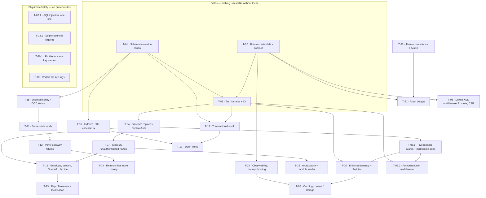

# 08 — Technical Recommendations

## 0. How to read this document

### 0.1 What this document is, and what it is not

This is the **action plan** derived from the audit. It answers three questions and nothing else:

1. For each significant component of the system, do we **keep it, improve it, throw it away, or build something that does not exist**?
2. For each major piece of work, **why does it need doing, what does it fix, can we reuse what is there, what can go wrong, and what has to happen first**?
3. In what **order** should the money be spent?

It is not a findings document — the evidence lives in `00`–`07`. Findings are cited here only to the extent needed to justify a decision.

### 0.2 Decision vocabulary

| Decision | Meaning |
|---|---|
| **PRESERVE** | Keep as-is. It works, or its defects are not worth the risk of touching it. Changes are limited to configuration. |
| **REFACTOR** | Keep the component and its data, change how it behaves. Reuse-first: the existing code is the starting point and usually most of the answer. |
| **REPLACE** | Delete and substitute. Reserved for components that are actively harmful, are dead weight, or whose correct version is a library the project already owns. |
| **ADD** | Does not exist. Must be built or adopted. |

Status, implementation, severity and priority vocabularies are used exactly as defined in the audit: status **VERIFIED / PARTIAL / MISSING / UNKNOWN / BLOCKED**; implementation **IMPLEMENTED AND VERIFIED / IMPLEMENTED BUT NOT VERIFIED / PARTIALLY IMPLEMENTED / PLACEHOLDER OR MOCK / MISSING / UNKNOWN**; severity **CRITICAL / HIGH / MEDIUM / LOW**; business priority **P0 / P1 / P2 / P3**.

### 0.3 The ranking method

Everything is ranked by **impact ÷ effort**, where:

- **Impact** is scored 1–5 on what the work prevents or unlocks: data breach and money loss score highest, then launch blockers, then merchant-visible correctness, then velocity.
- **Effort** is scored 1–5 on engineer-weeks, adjusted upward where there is no test coverage to make the change safely — which, in this codebase, is almost everywhere (`repo-A tests/` is 10 files of unmodified Laravel Breeze scaffolding; verified: `find tests -name '*.php' | wc -l` = 10).

The ratio is a sorting device, not a budget. Three items in the shortlist have a poor ratio and are still first, because nothing else can be tested until they are done. Those are called **gates** and are marked as such.

### 0.4 The reuse-first rule, stated plainly

This platform is a customised copy of the commercial WorkDo **"eCommerceGo SaaS"** product v8.8.2 (`repo-A config/verification.php:4-5`) on a current Laravel 11 base. **The product works.** Merchants self-register and get a store, plans enforce quotas, there is a super-admin panel, a merchant panel, three storefront themes and a working Flutter merchant console whose 83 endpoint paths all resolve to real routes in Repo A.

Almost every recommendation below is therefore a **deletion, a copy of a correct pattern that already exists ten lines away, or a configuration change**. Where a dossier found a defect, it usually also found the correct implementation of the same thing elsewhere in the same file — for example the token verification `CustomAuth` omits is written correctly in `repo-A app/Http/Controllers/Api/DashboardController.php:620-633`, and the transactional stock pattern the checkout lacks is written correctly in `repo-A app/Services/OrderFinancialService.php:19-23`. That is the single most important fact for costing this work: **the team is capable of the correct pattern; the problem is that nothing enforced it.**

### 0.5 The three gates

No security fix, no money fix and no refactor in this document can be *verified* until these exist. They are not optional sequencing preferences.

| Gate | Why it gates everything |
|---|---|
| **G1 — The schema is in version control** | 15 tables that live code reads and writes have no migration anywhere. There is no environment in which any other change can be tested. |
| **G2 — Credentials are rotated and the docroot is settled** | Secrets committed to git must be assumed public. Fixing authorization while the `APP_KEY` that signs sessions is in a git commit is theatre. |
| **G3 — There is a test harness and a CI runner** | With zero business-logic tests, every change below is a manual-verification cost and silently regressible. The first test to write is the one that proves the authentication fix landed. |

---

## 1. Do these first — the shortlist

This is the first eight weeks. Rank 1–3 are the gates; 4–9 stop active bleeding and are each small, local and independently shippable.

| # | Action | Ref | Impact | Effort | Ratio | Status today |
|---|---|---|---|---|---|---|
| **1** | **Fix the SQL injection** — one line, bound parameter | T-07.1 | 4 | 0.2 | **20.0** | VERIFIED defect, unauthenticated |
| **2** | **Rotate every credential in the committed `.env` and in `config/services.php`** | T-02 | 5 | 1 | **5.0** | VERIFIED, secrets in git |
| **3** | **Replace `CustomAuth` with Sanctum verification; 401 on missing header** | T-04 | 5 | 1 | **5.0** | CRITICAL / P0 |
| **4** | **Close the 22 unauthenticated API routes and the `web.php:940-975` block** | T-07 | 5 | 1 | **5.0** | CRITICAL / P0 |
| **5** | **Recompute order totals server-side; verify every gateway return** | T-11, T-12 | 5 | 2.5 | **2.0** | CRITICAL / P0 — NO-GO on live payments |
| **6** | **Add the missing permission guards: roles, payouts, password reset, impersonation, module/theme install** | T-06.1, T-09 | 5 | 1.5 | **3.3** | CRITICAL / P0, four takeover paths |
| **7** | **GATE G1 — Reconstruct the 15 missing migrations from the live schema** | T-01 | 5 | 2 | **2.5** | CRITICAL / P0, not reproducible |
| **8** | **GATE G3 — CI runner + `.env.testing` + the first 20 tests (auth, tenancy, totals)** | T-03 | 4 | 2 | **2.0** | MISSING |
| **9** | **Strip credential logging on both sides; turn off `APP_DEBUG`** | T-10, T-23.1 | 4 | 0.5 | **8.0** | VERIFIED, plaintext passwords to disk |

**One caveat on ordering.** Items 1 and 9 have the best ratios in the whole document and no prerequisites — ship them this week, before the planning for anything else is finished. Item 2 must precede item 8, because a CI runner that resolves the committed `.env` would point PHPUnit at the production database: `repo-A phpunit.xml:25-26` has the SQLite override commented out and there is no `.env.testing`, so the 8 `RefreshDatabase` test classes would run `migrate:fresh` against the live MySQL instance named in the committed `.env`. **Do not run the test suite from a checkout carrying that `.env`.**

---

## 2. Component decision table

Every significant component, with its decision. Contentious rows are expanded in §2.1.

| Component | Evidence of current state | Decision | One-line reason |
|---|---|---|---|
| **Laravel 11 core / PHP 8.2** | `laravel/framework v11.47.0`, `php ^8.2`; `php -l` clean across 3,113 files | **PRESERVE** | Current, supported, and not the problem. |
| **WorkDo addon system (69 modules)** | Not in Composer at all — `repo-A composer.json:137-145` declares a path repository, and `grep -c '"workdo/' composer.lock` = **0**; loaded at runtime from the `add_on_managers` table by `repo-A app/Providers/PackageServiceProvider.php:25-42,55-82`, with `catch (\Exception $e) { // Handle silently }` at `:39-41` | **REFACTOR** | The modules are pristine and upgradeable — the *loader* is the defect. Cache it, log its failures, stop double-registering routes. |
| **`packages/workdo/Marketing`** | 52,107 of 58,982 tracked files, 535 MB, 88.3% of the repo; its models are `CardProduct`, `Storeqr`, `StoreHours`, `Appoinment` — WorkDo's digital-business-card product, not store marketing | **REPLACE** (with nothing — delete) | Unrelated product line. Deleting it is a `git rm` with no Composer coupling. |
| **Theme system (3 themes + `qirolab/laravel-themer`)** | 16/13/15 Blade files per theme (`themes/greentic|stylique|techzonix`); the real storefront is 104 shared files in `repo-A resources/views/front_end`; `repo-A config/theme.php:12` and `:24` set `active` and `parent` to the **same** theme | **REFACTOR** | Mechanism works and theme views genuinely win the view-path race. Settle precedence, delete the 26 shadowed duplicates, fix the parent-theme config. |
| **DataTables admin layer (39 classes)** | `ls app/DataTables/*.php \| wc -l` = **39**; 8 carry no tenant filter; renders raw HTML and holds tenancy logic | **PRESERVE** + targeted REFACTOR | It works and the merchant staff use it daily. Fix the 8 unscoped queries; do not rewrite 39 classes. |
| **Tenancy model — shared DB + `store_id`** | Model (A); `repo-A app/Helper/helper.php:357-381` `getCurrentStore()` called 1,281 times; **487** explicit `where('store_id', getCurrentStore())` call sites across `app/` and `packages/` (`grep -rn "where('store_id', *getCurrentStore()" app/ packages/ --include=*.php \| wc -l` = **487**; **330** of them in `app/` alone), and **1,260** `where('store_id', …)` clauses in total counting any second argument; **zero** global scopes, **zero** policies, `repo-A app/Providers/AuthServiceProvider.php:15-17` has an empty `$policies` | **PRESERVE the model, ADD the enforcement** | Nothing in the evidence forces schema- or DB-per-tenant. The defect is missing enforcement, not the shared schema. See §6.3. |
| **API layer (211 route registrations)** | `repo-A routes/api.php`; **211** route registrations (`grep -cE "Route::(get\|post\|put\|patch\|delete\|any\|match\|resource\|apiResource)" routes/api.php` = **211**; 213 lines contain the string `Route::`); 83 of them are the Flutter app's complete contract | **PRESERVE the surface, REFACTOR the contract** | The shape is adequate and the client already works against it. Version it, document it, fix the envelope. |
| **API auth scheme — `CustomAuth`** | `repo-A app/Http/Middleware/CustomAuth.php:32-34` resolves `personal_access_tokens` **by row id only** and never compares the token hash; `:54` returns `$next($request)` when no header is sent | **REPLACE** | A 55-line file that defeats authentication on 189 route registrations. Sanctum is already a dependency and already mints these tokens. |
| **API auth scheme — JWT** | `repo-A config/jwt.php:18` ships a hardcoded default signing secret with no `JWT_SECRET` in `.env`; `config/auth.php` defines no `api` guard | **REPLACE** (with nothing — remove) | A second, unused, pre-compromised auth scheme. Remove the shipped secret and the dependency. |
| **API logging middleware (`APILog`, `AdminApiLog`)** | Byte-identical pass-throughs; `handle()` at `:19-22` in both is `return $next($request);`; `terminate()` at `:24-35` logs the full request and response — plaintext passwords and issued bearer tokens — to a 15-day channel | **REFACTOR** (collapse two into one, redact) | Keep observability, delete the credential store. |
| **Payment layer (~52 wired methods)** | Shipping, tax and coupon amounts taken from the HTTP request; `return_type=success\|cancel` generated at `repo-A app/Services/PaymentService.php:366` and **read nowhere** in the commerce core; `repo-A app/Services/PaymentService.php:2280` sets `payment_status = 'Paid'` unconditionally; inbound verification exists for 2 gateways properly and 2 partially, signature verification for **zero** | **REFACTOR, and cut the surface** | Recompute totals server-side, verify every return, and ship 3 gateways not 52. See §6.6. |
| **Refund path** | `repo-A app/Http/Controllers/OrderRefundController.php:229-249` writes a status string and an operator-supplied amount; **no gateway refund call exists anywhere** — three refund clients are present with zero call sites | **ADD** | "Refunded" currently means nothing moved. This is a chargeback and legal exposure, not a feature gap. |
| **Blade frontend (admin)** | 1,232 Blade files / 174,606 lines; 670 files and 105,502 lines of it inside the 69 addon modules; 263 modal endpoints return **rendered HTML**, not JSON; `grep -rl "@vite" resources/views themes` = **0** | **PRESERVE and improve in place** | Migrating it means first building a JSON API for 263 endpoints and forking the addon contract. See §6.1 — this is the single most important restraint in the document. |
| **Vite / Tailwind / npm toolchain** | Entirely vestigial: 0 `@vite` directives, no `public/build`, `resources/js/echo.js` imports two packages absent from `package.json`, `package-lock.json` is `lockfileVersion: 1` | **REPLACE** | Either delete it or make it real for the storefront only. Leaving it ambiguous costs every new developer a day. |
| **Storefront themes (the ~44-file theme layer)** | Not addon-coupled the way the admin is; compiles Tailwind **in the browser** via a 477 KB runtime | **REFACTOR now, candidate for REPLACE later** | The only defensible future migration target — and not before the Arabic defects are closed. |
| **Flutter merchant app (Repo B)** | 197 `.dart` files under `lib/`; GetX; all 83 endpoints resolve against Repo A; `grep -rn "kReleaseMode\|kDebugMode" lib` = **0 matches** | **PRESERVE and harden** | Architecturally coherent and functionally complete. Its blockers are release-readiness, not features. |
| **Flutter release config** | `repo-B android/app/build.gradle.kts:41` — `signingConfig = signingConfigs.getByName("debug")`, with the generated TODO comment still above it | **REPLACE** | Play rejects debug-signed uploads. There is no release path today. |
| **Test suite** | 10 files of unmodified Breeze scaffolding; zero tests across 95 models, 158 `app/Http` files and 69 modules; `repo-A phpunit.xml:25-26` points the suite at the live database | **ADD** (and fix the live-DB hazard first) | Gate G3. |
| **CI / CD** | No `.github/` (verified: `ls -d .github` → no such file); no Dockerfile, no compose file, no deploy script, no release process | **ADD** | Nothing mechanically prevents a regression of anything in this document. |
| **Deployment configuration** | No vhost, nginx, Docker or Procfile anywhere in the repo; `repo-A index.php:17-21` is the stock Laravel `server.php` shim at the **application root**; `repo-A .htaccess:6-9` is the only access-control directive in the repository | **ADD** | Deployment is, on the evidence, a manual file copy to cPanel. |
| **Observability** | `repo-A config/logging.php:56` ships every log line to the third-party larabug SaaS, unconfigured; no APM, no uptime check polling the `/up` endpoint Laravel exposes; `audit_logs` has no migration so every audit write is a dead end | **ADD** | After `APP_DEBUG=false`, the team currently has *no* channel through which to see a production error. |
| **Database schema** | 105 core migrations + 102 module migrations = 207, all internally valid; **15 tables live code queries have no `Schema::create` anywhere** (verified: 0 hits for `store_wallets`, `currency_rates`, `audit_logs`, `store_withdrawals`, `delivery_earnings`); **zero** `decimal()` columns in 105 migrations; `deleted_at`/`softDeletes` appears in **0** migration files while `repo-A app/Models/Customer.php:20` applies `SoftDeletes` | **REFACTOR urgently** | Gate G1. `migrate` succeeds; the application then cannot run against what it produced. |
| **Caching** | `genealabs/laravel-model-caching` on **78 of 95** models (verified); **no** `config/model-caching.php`; `.env:16-17` sets the cache store to `file`, which is not taggable | **REFACTOR** | Nobody can currently say what is cached, for how long, or when it clears. Either configure it deliberately on Redis, or remove the trait. |
| **Queues** | `.env:19` sets `QUEUE_DRIVER`, which Laravel 11 does not read — the effective connection is the `database` default; **20** `ShouldQueue` classes exist; **no** `app/Jobs` directory; no worker process defined anywhere in the repo | **REFACTOR** | 20 classes are queued into a table nothing drains. Rename the key, run a worker, then move the money path's outbound I/O off the request. |
| **Storage** | `repo-A public/storage` is committed as a **regular ASCII text file** containing the upstream vendor's absolute build path, not a symlink — so every `asset('storage/...')` URL 404s on a fresh deploy; `repo-A config/filesystems.php:47-51` roots the `theme` disk at `base_path('')`; 407 files of customer uploads are tracked in git at the repo root | **REFACTOR** | Three independent, cheap, highly visible defects. |

### 2.1 Notes on the contentious rows

**The addon system is the strategic asset, not the liability.** All five post-import commits touched **zero** files under `packages/workdo/` while rewriting 23 models, 21 `app/Http` files, 11 services, `helper.php` and `routes/`. That means the vendor modules are still upgradeable and the **core is not**. Any decision that forks the addon contract — notably a frontend framework migration — permanently forfeits upstream security updates, which is the main reason to be on a commercial product at all. This is the evidentiary basis for the restraint in §6.1.

**`CustomAuth` is a REPLACE, not a REFACTOR, and it is the highest-leverage single change in the audit.** Two independent skeptics confirmed it at CRITICAL/P0. The precise defect, in the corrected wording: it validates the *existence* of a token row while ignoring the *ownership proof*, and it falls open when no `Authorization` header is sent. Ten other CRITICAL findings are either caused by it or made reachable by it. The correct hash comparison already exists in the same codebase, 20 lines from a vulnerable call site (`repo-A app/Http/Controllers/Api/DashboardController.php:620-633`, `hash_equals($token->token, hash('sha256', $tokenValue))`).

**The tenancy model stays.** The original audit wording — "isolation is enforced by nothing" — was corrected by a skeptic and must not be repeated: isolation *is* implemented, as a pervasive manual per-query convention (1,281 `getCurrentStore()` call sites, **487** explicit `where('store_id', getCurrentStore())` filter call sites, 362 `isAbleTo()` authorization sites across 59 controllers). The filter count is reproducible as published: `grep -rn "where('store_id', *getCurrentStore()" app/ packages/ --include=*.php | wc -l` → **487**, the same command restricted to `app/` → **330**, and the wider count of *all* `where('store_id', …)` clauses whatever the second argument, `grep -rnE "where\((['\"])store_id\1," app/ packages/ --include=*.php | wc -l` → **1,260**. Either way the conclusion is the same and is the basis of the reuse-first decision below: isolation is a pervasive, deliberately-applied manual convention, which is worth **systematising** rather than replacing. The defect is precise: those checks answer *"may this role touch coupons?"* and never *"does this record belong to the caller's store?"*, and there is no backstop when a developer omits the filter — which happens systematically on route-model-bound single-record lookups.

---

## 3. Major recommendations

Each recommendation carries the five required answers as labelled sub-points.

---

### A. Gates

#### T-01 — Reconstruct the database schema into version control *(GATE G1)*

**Decision: REFACTOR · Severity CRITICAL · Priority P0 · Effort ~2 engineer-weeks**

- **WHY IT IS NEEDED.** Fifteen tables that routed, live code reads and writes have no `Schema::create` anywhere in the repository. Verified by direct search: `store_wallets` (`repo-A app/Models/StoreWallet.php:9`), `store_wallet_transactions`, `store_withdrawals`, `store_order_financials` (`repo-A app/Services/OrderFinancialService.php:28`), `currency_rates` (`repo-A app/Models/CurrencyRate.php:9`), `delivery_earnings` (`repo-A app/Models/DeliveryEarning.php:9`), `audit_logs` (`repo-A app/Models/AuditLog.php:9`), `otp_integrations`, `chatwoot_integrations`, `chatwoot_notification_templates`, `delivery_boy_devices`, `delivery_boy_notifications`, `zid_stores`, `zid_orders`, `zid_events`. Six are money-bearing. Separately, `orders.currency_code` and `orders.currency_symbol` are written on **every** order insert by the `static::creating` hook at `repo-A app/Models/Order.php:63-80` and exist in no migration; and `repo-A app/Models/Customer.php:20` applies the `SoftDeletes` trait while `deleted_at` appears in **zero** migration files repo-wide.
- **WHAT PROBLEM IT SOLVES.** It makes the repository a reproducible source of truth. Today there is no staging environment, no disaster recovery from source, no way to onboard a second developer, and no environment in which any other recommendation in this document can be tested. **Precise mechanism, per the skeptic's correction:** `php artisan migrate` itself *succeeds* — all 207 migrations are internally valid and none references the missing tables. What fails is the application running against the schema they produce. Three failures are then deterministic: every `Customer` query fails with unknown column `customers.deleted_at` (so there is no working customer authentication at all), every order insert fails on unknown column `currency_code`, and every finance route fails with base-table-not-found. One of them fails *silently* and is the worst: `repo-A app/Observers/OrderObserver.php:15-20` wraps the financial write in `catch (\Exception $e) { \Log::error(...) }`, and `QueryException` descends from `\Exception` — so the storefront keeps taking orders while the wallet credit and the ledger row are dropped to a log file.
- **CAN THE EXISTING IMPLEMENTATION BE REUSED.** **Yes, and this is the cheap part.** Each missing table already has an Eloquent model declaring `$fillable` and `$casts`, which is most of the column list; `repo-A app/Services/OrderFinancialService.php:90-120` documents every `store_order_financials` column with its semantic. The authoritative source is `mysqldump --no-data` against production, reviewed against those models. Write one catch-up migration per table, each guarded with `Schema::hasTable()` / `Schema::hasColumn()` so it is a no-op against production and creates the table on a fresh install — the idempotent-guard pattern is already used in this repo at `repo-A database/migrations/2024_11_08_111424_add_product_order_status_to_orders_table.php:17`. Add `orders.currency_code`, `orders.currency_symbol` and `customers.deleted_at` in the same pass.
- **WHAT RISKS IT INTRODUCES.** If the live schema already differs between environments, one dump will not match all of them — dump every environment and diff first. Hand-transcription risks subtle type and nullability mismatches that surface only under load; mitigate by diffing a freshly-migrated schema against the production dump column by column. Adding `customers.deleted_at` is additive and safe. The honest bound on this finding: **the production database almost certainly already contains these objects**, created by hand outside version control, so this is a reproducibility and disaster-recovery defect rather than a current outage. With no CI and no schema dump, a disk loss or a host migration is currently unrecoverable from source.
- **WHAT DEPENDENCIES MUST BE ADDRESSED FIRST.** Read access to the production schema (not data). An agreement that git becomes the source of truth — which means ending the practice of authoring on the server that produced this gap in the first place (the one substantive local commit added 1,487 files and **zero** migrations; its only `database/` entry is a modified seeder). A throwaway database on which to prove `migrate:fresh --seed` boots.

---

#### T-02 — Rotate every credential, then settle the document root *(GATE G2)*

**Decision: REFACTOR · Severity CRITICAL (secrets) / HIGH (docroot) · Priority P0 · Effort ~1 week + a maintenance window**

- **WHY IT IS NEEDED.** Two separate problems that must be sequenced together. **(a) Secrets in source.** `.env` is tracked in git (verified: `git ls-files --error-unmatch .env` succeeds) with populated `DB_PASSWORD`, `MAIL_PASSWORD`, `REVERB_APP_SECRET` and `APP_KEY`; live third-party secrets are additionally hardcoded in `repo-A config/services.php` (Zid `client_secret` and webhook password) and `repo-A config/myfatoorah.php:10`, which is **worse** than `.env` because `config/` is tracked by design and cannot be gitignored; and `repo-A config/jwt.php:18` ships a default HMAC signing secret with no `JWT_SECRET` override. **(b) Document root.** `repo-A index.php:17-21` is the stock Laravel `server.php` shim sitting at the application root, and `repo-A .htaccess:33-36` rewrites static prefixes *into* `public/` — rules that are meaningless unless requests land at the app root. The committed `repo-A error_log:1` independently places `app/` directly inside `/home/<redacted-account>/public_html`, which is the cPanel document root.
- **WHAT PROBLEM IT SOLVES.** It stops ongoing exposure. **State the docroot consequence precisely, because two skeptics corrected the original claim in opposite directions and both corrections matter.** Confirmed: an anonymous visitor can fetch the non-PHP files at the app root — `/composer.lock` (616 KB, the exact pinned version of every dependency, i.e. a ready-made CVE target list), `/composer.json`, `/package-lock.json`, `/error_log` (which leaks the absolute server path and internal controller names), `/composer.phar`, and `/uploads/**` (407 tracked customer files, served with no auth and no signed URL). **Refuted:** "the full source is disclosed" — `.php` files under the app root are *executed* by the PHP handler, not emitted as text, and `error_log:1-5` is itself positive proof that PHP executes under this root. **Also protected:** the live `.env` *is* denied, by the single `<Files .env>` block at `repo-A .htaccess:6-9`. **UNKNOWN and decisive:** whether a `.git/` directory exists in the deployed document root. Nothing in either `.htaccess` denies dotted directories. If it does, the committed `.env` with live credentials is web-reachable and this becomes CRITICAL. The live probe that would settle it was BLOCKED by the sandbox egress proxy. The two skeptics scored the verified limb HIGH/P1 and MEDIUM/P2 respectively; this document carries the higher of the two.
- **CAN THE EXISTING IMPLEMENTATION BE REUSED.** Yes, and the docroot half is mostly *deletion*: `repo-A public/index.php` and `repo-A public/.htaccess` are already the correct stock Laravel front controller. Point the vhost `DocumentRoot` at `public/`, delete the root `index.php`, and reduce the root `.htaccess` to nothing. For the secrets half, the surrounding blocks in the same file already use `env()` (`repo-A config/services.php` uses `env()` correctly for most providers), so each hardcoded literal is a one-line change, and `repo-A config/jwt.php:18` just needs its second argument deleted.
- **WHAT RISKS IT INTRODUCES.** **Rotating `APP_KEY` invalidates every `Crypt::`-encrypted column and every session.** The Zid OAuth tokens are `Crypt`-encrypted; those rows must be decrypted and re-encrypted under the old key *before* rotation, or merchants must re-authorise. Inventory `Crypt`-encrypted columns first. Deleting the shipped `jwt.secret` default without setting `JWT_SECRET` everywhere breaks API auth immediately — and because the current value is public, every issued token must be treated as compromised anyway, so expect all Repo B sessions to end at once; coordinate with the app release. The docroot move is **the one change here that can visibly break the live site**: `asset('public/assets/...')` calls in the admin layout only resolve today because of the root rewrite, and module favicons are referenced by absolute `/packages/workdo/...` URL. Grep and stage on a copy. Rotate *first* and purge history *second* — purging does not un-leak a repository someone has already cloned, and with only six commits the rewrite itself is cheap.
- **WHAT DEPENDENCIES MUST BE ADDRESSED FIRST.** Hosting control over the vhost (the evidence points at Webuzo). A staging copy. An inventory of absolute `/packages/workdo/...` and `/themes/...` asset references. A maintenance window for the `APP_KEY` rotation. If the docroot genuinely cannot move on this host, the strictly second-best fallback is explicit deny rules for dotfiles, `.git`, `*.lock`, `*.json`, `*.log`, `error_log` and `*.phar`, placed **outside** any `<IfModule>` wrapper — note that the existing single deny is *inside* the `mod_rewrite` guard opened at `repo-A .htaccess:1`.

---

#### T-03 — Build the test harness and the CI runner *(GATE G3)*

**Decision: ADD · Severity HIGH · Priority P0 · Effort ~2 weeks to a useful baseline, then ongoing**

- **WHY IT IS NEEDED.** There is no mechanism by which anything in this document stays fixed. `repo-A tests/` is 10 files of unmodified Laravel Breeze scaffolding (verified), with zero tests across 95 models, 158 `app/Http` files and all 69 addon modules. There is no `.github/` and therefore no CI (verified). Every finding in the audit is of the class a test pins trivially, and every fix below is a one-line guard that the next refactor can silently delete.
- **WHAT PROBLEM IT SOLVES.** It makes T-04, T-05, T-06, T-11, T-12 and T-13 *reversible instead of speculative*. It also removes an active hazard: today, running the suite is itself destructive.
- **CAN THE EXISTING IMPLEMENTATION BE REUSED.** Yes, cheaply. `repo-A phpunit.xml` exists and the SQLite override at `:25-26` is **already written, merely commented out** — uncommenting it plus adding a committed `.env.testing` is the single highest-value hour in this document. `laravel/pint` and `phpunit/phpunit ^11` are already in `require-dev`, unconfigured and unrun. `repo-A tests/TestCase.php` and the Breeze tests give a working harness shape. The seeders `AddonSeeder`, `DefaultSetting`, `PermissionTableSeeder` and `PlansTableSeeder` already exist and can build a fixture tenant. The first CI job can be nothing more than `composer validate`, `pint --test`, `php -l` over changed files, and a secret scan — that alone would have caught the committed secrets, the dev-stability pin and the committed junk. **The clean `php -l` result across 3,113 files is a genuine asset; CI is how you keep it.**
- **WHAT RISKS IT INTRODUCES.** CI will go red on the first run. The Breeze tests look stale (there is a redirect-target mismatch between `tests/Feature/ProfileTest.php` and the controller), so budget time to fix or quarantine them rather than starting with a red build everyone learns to ignore. `pint` across 58,982 files produces an enormous first diff — scope it to changed files only. Seeding a realistic tenant across 207 migrations is non-trivial and may surface migration-ordering problems. Writing tests against a vendor product of this size will expose defects faster than they can be fixed; prioritise by money-path, not by coverage percentage.
- **WHAT DEPENDENCIES MUST BE ADDRESSED FIRST.** **T-02 is mandatory** — do not let a CI runner resolve the committed `.env`. T-01, for a database the tests can migrate. A throwaway MySQL for CI. A branch-and-PR flow, so CI has something to gate — the current history is six commits, one squashed import plus five "adjustments on server".
- **The first three tests to write, in order.** (1) For every route in `repo-A routes/api.php`, assert HTTP 401 with no `Authorization` header and with a forged `<id>|wrong-secret` token — write this *before* T-04, so it proves the fix landed. (2) A two-tenant isolation test asserting store A cannot read or mutate store B's orders, products, coupons, categories or customers by id. (3) A totals test asserting that a checkout with attacker-supplied `tax_price` charges the server-computed amount.

---

### B. Security modernization

#### T-04 — Replace `CustomAuth` with Sanctum verification

**Decision: REPLACE · Severity CRITICAL · Priority P0 · Effort ~1 week including the coordinated app release**

- **WHY IT IS NEEDED.** `repo-A app/Http/Middleware/CustomAuth.php` guards 189 of the 211 route registrations in `routes/api.php`. It takes the `Authorization` header, strips `Bearer `, splits on `|`, keeps **only the first segment** as `$tokenId`, and authenticates on the existence of that row alone — `\DB::table('personal_access_tokens')->where('id', $tokenId)->first()` at `:32-34` — then calls `auth('customers')->login()` at `:38`, `auth()->login()` at `:41` or `auth('deliveryboy')->login()` at `:44` depending on `tokenable_type`. The second segment, the actual secret, is parsed at `:28` and discarded; the `token` column (stock Sanctum sha256, per `repo-A database/migrations/2019_12_14_000001_create_personal_access_tokens_table.php:20`) is never read, and `expires_at` and `abilities` are never checked. Because the table uses auto-increment `$table->id()`, ids are trivially enumerable. Separately, the `if ($token)` at `:24` has no `else` branch, so when the header is absent execution reaches `return $next($request);` at `:54` with no authenticated user — the 401 at `:48` fires only for a *present* header bearing a non-existent id.
- **WHAT PROBLEM IT SOLVES.** It restores authentication to the API that the Repo B merchant app depends on. `Authorization: Bearer <any-existing-row-id>|anything` currently authenticates the caller as that token's owner, up to and including a `super admin`; and token-less requests reach controllers that take identity from the request body, giving unauthenticated PII disclosure — `repo-A app/Http/Controllers/Api/ApiController.php:5279-5312` (`user_detail`, routed at `routes/api.php:97`) validates only that `customer_id` is present and returns that customer's name, email, mobile and delivery address. Ten other CRITICAL findings collapse into this one fix.
- **CAN THE EXISTING IMPLEMENTATION BE REUSED.** **Yes — the correct code is already in this repository.** `repo-A app/Http/Controllers/Api/DashboardController.php:620-633` performs `hash_equals($token->token, hash('sha256', $tokenValue))`, which proves both the hash scheme and that the omission is a defect rather than an alternate design. `laravel/sanctum ^4.0` is already a dependency (`repo-A composer.json:35`), `HasApiTokens` is already on `User` and `Customer`, and the tokens in use are already real Sanctum `plainTextToken`s minted at `repo-A app/Http/Controllers/Api/DashboardController.php:585` and `app/Http/Controllers/Api/AuthController.php:127,207,369`. Two options: delete the middleware and use `auth:sanctum` on route groups; or, if the three-guard dispatch on `tokenable_type` must be kept, retain the class and replace `:32-34` with `PersonalAccessToken::findToken($plainTextToken)` — which hashes and compares correctly and checks expiry — and make a missing or invalid token a **401** instead of a fall-through. Note that `PersonalAccessToken` is already imported, and unused, at `repo-A app/Http/Middleware/APILog.php:8`.
- **WHAT RISKS IT INTRODUCES.** **This is a behavioural change with real blast radius.** Every endpoint that currently works anonymously starts returning 401. The `*-guest` routes in `repo-A routes/api.php` look deliberately public and must be moved into a genuinely public group *before* the switch, or the storefront breaks. `repo-A app/Http/Controllers/Api/ApiController.php` contains **zero** occurrences of `auth()->user()` across 7,404 lines, which suggests a large part of the customer API is written assuming an optionally-present identity. On the client side, `repo-B lib/network/network.dart` omits the header entirely when the token is empty and force-logs-out on 401, so a mis-sequenced pre-login call boots the user to the login screen. One labelled residual uncertainty from the skeptics, carried honestly: that `auth()->login()` on the session-backed `web` guard persists through a stateless API request is *inferred*, not executed — supported by every admin controller consuming `auth()->user()` and by Repo B shipping against these endpoints. If that were disproved, the finding degrades from impersonation to a fail-open defect; the header-absent IDOR path is unaffected either way because it needs no token.
- **WHAT DEPENDENCIES MUST BE ADDRESSED FIRST.** An endpoint-by-endpoint decision on which of the 189 routes are genuinely public. T-03 test (1), written first, so the fix is provable. A staging build of Repo B to retest against. T-18's versioning, if the team wants to ship this without breaking app binaries already in users' hands — note that `repo-B lib/utils/base_api.dart:3` hardcodes the base URL as a compile-time constant and there is no remote-config kill switch, so **there is currently no way to force an app upgrade**. Encouragingly, the one change that needs no app release is adding the middleware to the currently-unguarded endpoints: the client already sends `Authorization: Bearer <id>|<secret>` on every call.

---

#### T-05 — Enforce tenancy in the framework, not in 487 hand-written filters

**Decision: ADD (enforcement) · PRESERVE (the model) · Severity CRITICAL · Priority P0 · Effort ~3 weeks for the top 12 models, then incremental**

- **WHY IT IS NEEDED.** There is no framework-level tenant isolation: zero Eloquent global scopes, zero tenant traits, no `app/Policies` directory, an empty `$policies` array at `repo-A app/Providers/AuthServiceProvider.php:15-17`, zero `authorize()` calls, and Laratrust's teams feature explicitly disabled at `repo-A config/laratrust.php:242` (`'enabled' => false`). Isolation is a manual convention applied at **487** explicit `where('store_id', getCurrentStore())` call sites (**1,260** `where('store_id', …)` clauses in all; commands published in §2), and it is omitted systematically on route-model-bound single-record lookups: `repo-A app/Http/Controllers/CouponController.php:135` (edit, no check of any kind) and `:231-241` (destroy), `app/Http/Controllers/OrderController.php:626-638` (destroy, deletes four tables by raw id), `:640-650` (`updateStatus` — `Order::find($id)` with **no** permission check at all), `:677-691` (`order_assign`, validated only as `exists:orders,id`, i.e. "exists in *any* store"), `app/Http/Controllers/CategoryController.php:174-176`. The same inconsistency appears *within one method*: `CategoryController.php:276` binds a category unfiltered while the child check at `:279` correctly filters by `getCurrentStore()`.
- **WHAT PROBLEM IT SOLVES.** It converts tenant isolation from "every developer must remember, 120 times" into "the framework enforces it; opting out is explicit and greppable". It is the only change that fixes the *class* of bug rather than instances — and the evidence that instance-by-instance fixing fails is that the same file gets it right and wrong in adjacent methods (`OrderController::orderDetails:572` scopes by store; `::orderComplete:362` does not, and that omission is a confirmed **unauthenticated cross-tenant order IDOR**: `GET /{anyStoreSlug}/order-complete?data[order_id]=N` reaches `Order::find()` with no tenant filter and the response emits `Crypt::encrypt($order->id)` — the exact capability token the `order.details` route accepts).
- **CAN THE EXISTING IMPLEMENTATION BE REUSED.** Yes, substantially. `getCurrentStore()` (`repo-A app/Helper/helper.php:357-381`) already exists and is the resolver, so no new tenancy concept is introduced. The tenant-scoped models already carry `store_id`: **119 of 188** model files platform-wide reference it (**57 of 95** in `app/Models/` alone), so **no data migration is needed** for the dominant convention — reproduce with `find app/Models packages -type f -name '*.php' \( -path '*/Models/*' -o -path '*/Entities/*' \) | wc -l` → **188** and the same `find` piped to `xargs grep -l "store_id" | wc -l` → **119**; for `app/Models/` alone, `ls app/Models/*.php | wc -l` → **95** and `grep -l store_id app/Models/*.php | wc -l` → **57**. Write one `BelongsToStore` trait with `addGlobalScope` in `booted()` plus a `creating` hook that stamps `store_id` — the `booted()` + `creating` idiom is already present and working at `repo-A app/Models/Order.php:63-80`. Apply it first to the 12 highest-value models (`Order`, `Product`, `ProductVariant`, `Customer`, `Category`, `Coupon`, `Cart`, `Page`, `DeliveryBoy`, `OrderNote`, `OrderRefund`, `Role`) rather than all 119. Add Policies for the same 12 and switch the route-model-bound actions from `isAbleTo('X')` to `$this->authorize('x', $model)`: the 362 existing Laratrust checks stay and become the *capability* half, with the Policy supplying the *ownership* half. Register the super-admin bypass once in the scope and in a `Gate::before`, replacing the roughly 80 ad-hoc `users.type == 'super admin'` comparisons.
- **WHAT RISKS IT INTRODUCES.** **This is the highest-risk change in the document and must not be done first.** (a) Super-admin and cross-store screens will break loudly: the 8 unscoped DataTables and every super-admin listing legitimately need all tenants and must be migrated to `withoutGlobalScope()` *before* the scope lands, or they silently start returning store 1's data. (b) Queue jobs, console commands and payment webhooks have no authenticated user, so `getCurrentStore()` returns null there — `ZidProcessEvents`, `ZidRefreshTokens` and the gateway callbacks all run outside a session. The scope must treat "no current store" as "do not filter" **only** in explicitly-marked console or webhook context, never as a silent HTTP default, or it becomes a new leak. Build a deliberate `runForStore($id, fn)` helper. (c) That `null` return is **load-bearing** for safety elsewhere: it is what accidentally prevents anonymous exploitation of the ungated payout endpoints (T-06.2) — a refactor that makes it fall back to a default store would make those endpoints anonymously exploitable. (d) The tables with **no** discriminator at all (`order_billing_details`, which carries PII, plus `order_tax_details`, `order_coupon_details`, `user_coupons`, `coupon_requests`) cannot be scoped as-is and need a backfilled `store_id` from their parent. (e) `email_templates` is `created_by`-scoped, not `store_id`-scoped; a naive scope breaks it entirely. (f) 78 of 95 models use `genealabs/laravel-model-caching`; **the cache keys must incorporate the scope or one tenant will serve another's cached rows**. That is the single sharpest hazard and must be tested first.
- **WHAT DEPENDENCIES MUST BE ADDRESSED FIRST.** T-01 (a test database must exist). T-04 (a scope that protects an open door is decoration). T-03 test (2) — roughly 20 two-tenant isolation tests, written *before* the change, which are simultaneously the safety net and the proof it worked. A decision on the `email_templates` grain. T-20's caching decision, because of hazard (f).

---

#### T-06 — Move authorization into middleware, and add the guards that are simply missing

**Decision: REFACTOR · Severity CRITICAL · Priority P0 · Effort ~1.5 weeks for the missing guards, ~3 weeks for the middleware migration**

- **WHY IT IS NEEDED.** Authorization is advisory: **one** of roughly 1,193 routes carries a permission middleware (`repo-A routes/web.php:164`, `permission:View Finance Dashboard`). The pattern "every method re-implements its own `if (isAbleTo(...))`" has failed open in at least 25 places, and the failure mode is silent — a method with no check looks exactly like a method with one. Five instances are each independently sufficient for platform takeover, and all five were confirmed by skeptics:
  1. **Password overwrite of any user, including the super admin.** `repo-A app/Http/Controllers/StoreController.php:646-669` validates only the new password, then `User::find($id)` and `forceFill(['password' => Hash::make(...)])->save()` with **no authorization check of any kind** — no `isAbleTo`, no type check, no ownership check. The route at `repo-A routes/web.php:663` is bare inside the `['auth','xss','setlocate','verified']` group at `:326`. Note the GET sibling at `:640` decrypts the id while the mutating POST takes a raw integer, so victim selection is enumeration of small integers. The actor does not even need to be an insider: public registration is open and `repo-A app/Http/Controllers/Auth/RegisteredUserController.php:104,111,128` creates a `type = 'admin'`, `is_active = 1` account and logs it in immediately.
  2. **Platform RBAC takeover by any self-registered merchant.** `RoleController::update()` and `::destroy()` take the tenant-global `Role` by implicit route-model binding with no `store_id` or `created_by` scoping; `repo-A app/Http/Controllers/RoleController.php:182-183` then rewrites `users.type` for every holder of the bound role, and `:186` re-stamps the super-admin role's `store_id` to the attacker's store. The ability is not merely present — `Utility::addNewData()` grants the shared global `admin` role both "Edit Role" and "Delete Role" on **every login** (`repo-A app/Http/Controllers/Auth/AuthenticatedSessionController.php:83`), so an operator who revokes it has it silently restored. `RoleController::edit()` at `:133` has **no** ability check at all, so the super-admin role's edit form renders for any authenticated user. The one mitigation that exists — `repo-A app/DataTables/RoleDataTable.php:46` hides the role from the listing — is defeated by that unguarded `edit()` and by the id being guessable.
  3. **Three authenticated-user code-execution paths.** `AddonController::ThemeInstall` extracts an arbitrary zip into `themes/` (`repo-A app/Http/Controllers/AddonController.php:65`) with no validation and `chmod 0777`; `ModuleController::install` extracts into `packages/workdo/` (`:251`) and inserts an `add_on_managers` row whose module name comes from the attacker's own `module.json`, which `repo-A app/Providers/PackageServiceProvider.php:32` then plucks **with no `is_enable` filter** and `:79` registers as a service provider; and `BackupRestoreController::store` interpolates a `required`-only `database_name` into a `shell_exec` mysqldump string. Sibling methods in the *same two controllers* do check (`AddonController.php:21`, `ModuleController.php:24`), which proves these are omissions. Paths 1 and 2 are reachable by an anonymous visitor via self-registration; path 3 requires plan entitlement.
  4. **Unguarded payout state transitions.** `POST /finance/withdrawals/{id}/approve|reject|pay` (`repo-A routes/web.php:186,189,192`) sit at file top level — the nearest auth group, `:164`, **closes at `:167`**, 19 lines earlier — and `StoreFinanceController::approveWithdrawal/rejectWithdrawal/payWithdrawal` contain no check, while **six sibling methods in the same controller each open with an explicit Laratrust gate** (`:19, :71, :315, :396, :494, :624`). Corrected severity **HIGH**, not CRITICAL: `payWithdrawal` performs no gateway call at all, the `store_id` scoping holds so there is no cross-tenant reach, and an anonymous caller is accidentally blocked because `getCurrentStore()` returns null. The real impact is destruction of maker-checker separation plus forged `reviewed_by` attribution.
  5. **Unguarded order and refund mutation.** `repo-A routes/web.php:940-975` sits inside the `web` group opened at `:305` but **outside** the auth group, which spans `:326-938`. So `order-status-change/{id}` (`:949`), `order-payment-status` (`:950`), `update-order-status/{id}` (`:953`), `order-return-request` (`:955`), `update-refund-status` (`:957`), `refund-stock` (`:959`) and `refund-amount/{id}` (`:961`) carry only `themelanguage`, which sets a locale. Their controller methods contain no auth, no store scope and no validation. Marking an arbitrary order `Paid` fires `OrderObserver` → `OrderFinancialService::markFinancialAsPaid`, which credits `available_balance` — and `available_balance` is what gates withdrawal requests.
- **WHAT PROBLEM IT SOLVES.** The missing-guard half (6.1–6.5) closes five takeover and money paths. The middleware half converts "secure unless someone remembered" into "secure unless someone opted out", which is the only version that is auditable with `grep`.
- **CAN THE EXISTING IMPLEMENTATION BE REUSED.** Yes, heavily, and the guards are copies not inventions. Laratrust auto-registers its own `role:` and `permission:` middleware (`repo-A config/laratrust.php:195` `'register' => true`) and is configured to abort 403, and `repo-A routes/web.php:164` already uses it — the mechanism is live and proven in this codebase. The permission *names* already exist in `repo-A app/Models/Utility.php:2645-2848`, so no new vocabulary is needed. The 362 existing `isAbleTo()` calls are an accurate map of the intended permission per method: **mine them to generate the route-level middleware rather than re-deriving the model.** For the five specific gaps, copy `if (auth()->user() && auth()->user()->type == 'super admin')` from `StoreController.php:43` into the four unguarded `StoreController` methods; copy the `isAbleTo` shape from `StoreFinanceController.php:494` into the three payout methods; move `routes/web.php:940-975` inside the group that closes at `:938` and `:168-197` inside the group at `:164`; and add `custom.auth` (post-T-04, `auth:sanctum`) to `routes/api.php:163-169`.
- **WHAT RISKS IT INTRODUCES.** **The sequencing trap is specific and will lock the platform owner out if ignored.** The six Finance permissions — `View Finance Dashboard`, `Add Finance Balance`, `Deduct Finance Balance`, `Request Finance Withdrawal`, `View Finance Withdrawal Requests`, `Edit Finance Payment Status` — are **created by nothing**: a full-repo search finds only consumer sites, no producer, and the Laratrust admin panel that could create them at runtime is disabled at `repo-A config/laratrust.php:285`. So six of the ten finance endpoints are already fail-closed 403 for everyone including the super admin, and adding guards to the other three without seeding the permissions makes the whole module unreachable. The same applies to RBAC itself: the super-admin role is never granted `Manage Role`. **Seed the permissions in the same change as the guards.** Beyond that: `Route::resource` generates seven routes per call and several controllers implement only some of them, so `->only([...])` must be added at the same time or 500s become 403s and hide the real bug; adding middleware to 1,192 routes will break things loudly, so stage it starting with the destructive and financial routes and keep the inline checks as belt-and-braces rather than deleting them; and splitting `routes/web.php:940-975` requires deciding *per endpoint* who the intended caller is — `order-return` and `status_cancel` have legitimate customer-facing variants, so blanket-`auth` would break the storefront. Those need `auth:customers` plus an `orders.customer_id` ownership check, not the merchant guard. Finally, do **not** set `config/laratrust.php:285` to `true` without first fixing `:327`, whose middleware list is `['web']` with no `auth` — that would publish an unauthenticated role editor.
- **WHAT DEPENDENCIES MUST BE ADDRESSED FIRST.** A correct, idempotent and *complete* permission seed, including the six Finance names and the role-management names, must land first or concurrently. T-03 test (2), so a correct 403 can be told from a regression. A short route-ownership table naming the intended caller for each of the currently-exposed endpoints. An audit of existing `roles` rows for cross-tenant `store_id` values, and of `plan_orders` for rows approved by non-super-admins, before enforcement changes what is possible.

---

#### T-07 — Close the unauthenticated endpoints and delete the debug leftovers

**Decision: REFACTOR / REPLACE · Severity CRITICAL · Priority P0 · Effort ~1 week**

- **WHY IT IS NEEDED.** Independent of T-04, 22 of 211 api route registrations carry no auth middleware at all. Seven are the worst: `repo-A routes/api.php:163-169` registers `categorylist`, `productlist`, `variantlist`, `orderlist`, `couponlist`, `shippinglist` and `taxlist` with `['AdminApiLog']` only — and `repo-A app/Http/Middleware/AdminApiLog.php:19-22` is a bare pass-through, `return $next($request);`. The enclosing group at `routes/api.php:133` is `Route::prefix('admin')->as('admin.')->group(` — prefix and name only, no middleware — and the sole `auth:sanctum` in the file is commented out at `:26`. `repo-A app/Http/Controllers/Api/DashboardController.php:909-916` then validates `store_id` merely as a required integer and returns `Order::where('store_id', $store->id)` paginated. The mechanism matters for the write-up: **these queries do filter by `store_id` — the tenant is simply chosen by an attacker-supplied parameter with no authorization that the caller belongs to it.** Iterating `store_id` enumerates every merchant on the platform, unthrottled, and the response carries `product_json`, prices, `payment_status`, `customer_id` and an appended `user_name` accessor returning the customer's name or email. Beyond those seven: `POST /api/{slug}/forgot-password-save` resets any `users` row's password with no OTP or token; `POST {slug}/change-password` resets any customer with no old-password check; `GET /zid/show-token` (`repo-A routes/web.php:1146`) prints decrypted Zid OAuth credentials to anyone sending `key=12345678`; `GET /zid/{storeId}/orders` is unauthenticated while the adjacent line is correctly guarded; and there is one **confirmed SQL injection** at `repo-A app/Http/Controllers/Api/ApiController.php:4495`, anonymously reachable via `POST /api/{slug}/search`.
- **WHAT PROBLEM IT SOLVES.** It removes pre-authentication, cross-tenant read and write access to the order book, catalogue, cost prices and customer PII of every merchant on a multi-tenant SaaS. Several of these need no credential at all, so they are exploitable today with `curl`.
- **CAN THE EXISTING IMPLEMENTATION BE REUSED.** Yes, and three of these are pure deletion. **T-07.1, the injection, is one line and should ship today**: change `whereRaw('ROUND(average_rating) =' . $request->rating)` to the bound form `whereRaw('ROUND(average_rating) = ?', [(int) $request->rating])` and add `'rating' => 'nullable|integer|between:1,5'`. The correct bound idiom is already used in the *same file* at `ApiController.php:4351`. For the rest: add `custom.auth` to `routes/api.php:163-169` — already applied to every sibling route; copy `->middleware('auth')` from the adjacent correct line onto `routes/web.php:978`; **delete** `GET /zid/show-token`, the `zid-statuses-test` endpoint, and the closure duplicate of the Delivery Syria status webhook at `routes/web.php:1026-1138` (the authenticated controller already supersedes it, and two copies of unauthenticated logic is how one gets fixed and the other forgotten); and for the remaining webhook, copy the `hash_equals` shared-secret verification the sibling `DeliverySyriaOrderController` already performs. Then add a CI grep gate for `whereRaw`/`selectRaw`/`orderByRaw` containing string concatenation.
- **WHAT RISKS IT INTRODUCES.** Low for most, with two specific coordination risks. If Delivery Syria is live and posting to the endpoint that is about to require a secret, status callbacks stop until the partner has the secret — **confirm which of the two URLs receives real traffic before deploying.** And `base_url` (`routes/api.php:160`) may be called by Repo B *before* login; check the call order before gating it, and if it is pre-auth, leave it public and strip it to the two URL strings it returns. One genuinely encouraging note: adding middleware to `:163-169` **breaks nothing in Repo B**, because the client already sends `Authorization: Bearer <id>|<secret>` on every call. That makes this the rare P0 that ships without an app release.
- **WHAT DEPENDENCIES MUST BE ADDRESSED FIRST.** None for the injection fix and the three deletions — ship them immediately. For the webhook secret, a contact at Delivery Syria and a shared secret in `.env` (not hardcoded, which is the T-02 defect). For the seven list endpoints, a check of Repo B's pre-login call sequence.

---

#### T-08 — Delete the XSS middleware; fix output escaping; add security headers

**Decision: REPLACE · Severity MEDIUM (middleware) / HIGH (the real XSS surface) · Priority P1 · Effort ~2 weeks including a stored-data cleanup**

- **WHY IT IS NEEDED.** `repo-A app/Http/Middleware/XSS.php` calls `htmlspecialchars_decode()` on every string in `$request->all()` at `:55`, has its only real tag-stripping regex commented out at `:56`, then applies `str_replace(['&lt;','&gt;','javascript','alert'], '', $value)` at `:57` and merges the mutated values back at `:60`. **The skeptic's correction to the original claim is important and must be used.** The asserted mechanism — that the decode converts a blocked payload into a live one — is wrong: the denylist never removes literal `<` or `>`, only their entity forms, so a raw `` traverses the middleware essentially untouched with or without the decode. What the decode-before-entity-denylist ordering actually proves is that the middleware is **self-defeating and approximately a no-op for XSS**, not an amplifier of it. "Net-negative" is nevertheless correct, on data-integrity grounds the original audit missed: the blind `str_replace` silently corrupts credential fields. `repo-A routes/web.php:782` (`PUT user-password-update`) is inside the xss group, and `repo-A app/Http/Controllers/UserController.php:400,406` read `old_password` and `new_password` **post-merge**; `POST login` (`repo-A routes/auth.php:23`) carries only `throttle:auth` and **not** `xss`. So a user whose password contains the substring `alert` or `javascript` has it silently truncated when setting it but not when logging in — a permanent, unexplained self-lockout, with the same corruption applied to every string field across roughly 610 lines of admin routes.
- **WHAT PROBLEM IT SOLVES.** Removing the middleware stops silent credential and content corruption and removes a false sense of coverage. The *actual* stored-XSS exposure is addressed separately and is real: there are **2,304** `{!! !!}` occurrences across `resources/views` and `packages/workdo`, including raw model data at `repo-A resources/views/category/create.blade.php:22`, `category/edit.blade.php:23`, `testimonial/create.blade.php:17` and `plans/stripe.blade.php:1252`. Combined with the near-total absence of a validation layer — `repo-A app/Http/Requests/` contains only `ProfileUpdateRequest.php` plus `Auth/`, i.e. **2 FormRequest classes against 1,330 controller methods**, versus 428 inline validation sites — a merchant can plant persistent script in a field such as a category name and have it execute in a super-admin view. The root cause is those sinks plus the missing validation, **not** this middleware.
- **CAN THE EXISTING IMPLEMENTATION BE REUSED.** Partly. Blade's `{{ }}` already escapes, so most of the work is auditing the `{!! !!}` sinks and deciding which fields are intentionally rich text. For those that are, a real sanitiser is required and **no sanitiser exists in `composer.json`** — this is one of the few places a new dependency is genuinely needed (HTMLPurifier or `mews/purifier`), applied **on write** to product descriptions, blog bodies, testimonials and helpdesk tickets. For JavaScript-context sinks, HTML escaping is the wrong fix; use `@json()`. The one piece of `XSS.php` worth keeping is the pending-migration check at `:27-49`, which should become an artisan command or a deploy gate rather than request middleware — `repo-A app/Console/Commands/PackageMigrate.php` already exists and is the natural home. Note that reach is wider than the original audit recorded: there are **three** applications of the alias, not two, and the third — `repo-A packages/workdo/LandingPage/src/Routes/web.php:350` — is unauthenticated, though its single `email` parameter is validated and rendered through an escaped sink, so it yields no exploit.
- **WHAT RISKS IT INTRODUCES.** Removing the input mangling may **unmask stored payloads** that were only neutered on the way in, so a one-off cleanup pass over user-supplied text columns is part of the work, not a follow-up. Sanitising on write does not retroactively clean existing rows. Removing the migration redirect means a half-migrated deployment no longer self-announces; replace it with a deploy gate. A Content-Security-Policy will break inline scripts — this app has roughly 633 inline `<script>` blocks in Blade — so ship it in `Content-Security-Policy-Report-Only` first and promote it only after the report is clean. There are currently **no** security headers of any kind.
- **WHAT DEPENDENCIES MUST BE ADDRESSED FIRST.** An inventory of every `{!! !!}` in `resources/views`, `themes/*/views` and the roughly 670 module Blade files, with a per-field decision on rich text. The storefront theme-settings writer at `repo-A app/Http/Controllers/ThemeCustomizeController.php` has its permission check commented out and writes arbitrary keys that render through 62 unescaped outputs — that is a separate, specific instance to close at the same time, and its commented-out check may have been a workaround for a permission name that is not seeded, so verify against the seeders before simply uncommenting.

---

#### T-09 — Fix the upload chokepoint and close the remaining code-execution paths

**Decision: REFACTOR · Severity CRITICAL · Priority P0 · Effort ~1.5 weeks**

- **WHY IT IS NEEDED.** `repo-A config/files_types.php` is an admin-mutable extension map that includes `php` (`:54`), `phtml` (`:53`), `html`, `js` and `exe`, and it populates the storage-settings picker at `repo-A app/Http/Controllers/SettingController.php:1619`. The upload helper `Utility::upload_file` has a validator bypass in its sixth argument, and the `theme` disk is rooted at `base_path('')` (`repo-A config/filesystems.php:47-51`) — i.e. at the application root, which under the current deployment is the webroot. Together with the three zip- and shell-based paths in T-06.3, that is an authenticated arbitrary-file-write into executable space.
- **WHAT PROBLEM IT SOLVES.** It is the difference between "a compromised staff account leaks one merchant's data" and "a compromised staff account owns the host and every tenant's database".
- **CAN THE EXISTING IMPLEMENTATION BE REUSED.** **Strongly yes — this is the best leverage in the security section**, because every upload in the application already funnels through one helper, with **zero** direct `->store(` or `->move(` calls anywhere. Fix the chokepoint and all 146 call sites inherit it. In order: (a) validate unconditionally by removing the `empty($image)` guards so the bypass path is validated too; (b) add a **hardcoded code-level** extension allowlist that the database setting can only *narrow*, never widen; (c) **generate filenames server-side** as `Str::uuid() . '.' . $safeExt` and stop appending `getClientOriginalName()` — this single change kills the attacker-controlled extension across all sites at once; (d) move the `theme` disk root out of the webroot and serve through a controller; (e) replace the `0777` chmods and `umask(0)` with `0755`. Apply the same change to the four sibling helpers. For the zip paths, iterate `ZipArchive::getNameIndex()` and reject any entry whose `realpath` escapes the destination rather than calling `extractTo()` on the whole archive; for the shell path, use `Symfony\Component\Process\Process` with an argument array and pass the password via `MYSQL_PWD` in the environment rather than on the command line — `symfony/process` is already a Laravel dependency.
- **WHAT RISKS IT INTRODUCES.** Existing database rows store paths built the old way, so changing the naming scheme or the disk root requires migrating stored paths or adding a compatibility shim on read. **That is the main cost**, and it is why (a), (b) and (c) should ship before (d). Dropping `0777` may break writes if the deployment's file ownership is wrong — check the web user's ownership of `storage/`, `bootstrap/cache/`, `themes/`, `packages/workdo/` and `uploads/` first; note that `repo-A config/installer.php:46-53` currently *prescribes* 777 on six paths, and that guidance should go regardless. Disabling the browser upload routes for modules and themes makes installation a deploy activity; confirm no operational process depends on it. One honest limit: if the deployed `php.ini` sets `disable_functions=shell_exec`, the backup path specifically fails closed — that is UNKNOWN from the repository. The two zip paths do not depend on any PHP configuration.
- **WHAT DEPENDENCIES MUST BE ADDRESSED FIRST.** An inventory of stored image paths. T-02's docroot decision, because it changes where a written file lands — and note that neither outcome refutes the finding: if the docroot moved to `public/`, `ModuleController`'s relative writes would land in `public/packages/workdo/`, which is *more* directly executable.

---

#### T-10 — Stop writing credentials to disk

**Decision: REFACTOR · Severity HIGH · Priority P1 · Effort ~0.5 week**

- **WHY IT IS NEEDED.** `repo-A app/Http/Middleware/APILog.php` and `AdminApiLog.php` are byte-identical apart from the class name. Both are pass-throughs whose `terminate()` at `:24-35` serialises the full request **and response** into a log channel retained for 15 days — which means plaintext passwords, OTPs, issued bearer tokens, SMTP and gateway secrets, and customer PII. They are attached to the register, login and forgot-password endpoints. The log file sits under a path that, on the current deployment shape, is inside the document root.
- **WHAT PROBLEM IT SOLVES.** It removes a credential store that nothing treats as secret.
- **CAN THE EXISTING IMPLEMENTATION BE REUSED.** Yes. Delete one of the two classes and re-alias the removed name to the survivor in `repo-A bootstrap/app.php:19-20`, so the existing route usages keep working with no route edits. Then log method, path, status, duration and user id plus a redacted body. The redaction list is already written in this repo: `repo-A app/Exceptions/Handler.php:18-22` declares `$dontFlash = ['current_password','password','password_confirmation']`. `repo-A app/Http/Controllers/Api/DeliverySyriaOrderController.php` demonstrates the right style — structured context logging lengths, not values.
- **WHAT RISKS IT INTRODUCES.** None functional; reduced forensic detail. Offer an opt-in verbose mode gated on `APP_DEBUG`. The operational consequence is real: anyone who debugs integrations by reading that log loses the channel, so pair this with T-24's structured logging.
- **WHAT DEPENDENCIES MUST BE ADDRESSED FIRST.** **Treat the existing log files as a credential breach**: preserve a copy under restricted access as evidence of what has already been exposed, revoke every token found in them, and then purge. Decide a retention period — 15 days is long for request logs.

---

### C. Money and commerce correctness

#### T-11 — Recompute the authoritative order total server-side

**Decision: REFACTOR · Severity CRITICAL · Priority P0 · Effort ~2 weeks**

- **WHY IT IS NEEDED.** Product subtotals are computed server-side, but shipping cost, tax amount and coupon discount are accepted directly out of the HTTP request and written into the order total — and in the tax case into the amount charged by the gateway. `repo-A app/Http/Controllers/PaymentController.php:764` reads `$tax_price = $request->tax_price ?? 0;` and, when `shipping_method != 'on'` or `method_id` is empty, returns it unchanged at `:766-771`; `:792` then computes `'cartlist_final_price' => $cartlist_final_price + $delivery_price + $tax_price`, which every gateway handler uses verbatim as the charge amount. A **negative** `tax_price` therefore lowers what the customer is charged. The skeptic's scope corrections are carried: shipping (`repo-A app/Models/Cart.php:198`, `app/Http/Controllers/Api/ApiController.php:188`) and coupon discount (`PaymentController.php:728-733`) corrupt the *persisted* order total and the coupon and tax records but do **not** reach the gateway amount; and the mobile `place-order` path is **not** affected for tax or coupon, because `repo-A app/Http/Controllers/Api/ApiController.php:2985-3024` recomputes both server-side. This is a **web-checkout** defect, not a codebase-wide one.
- **WHAT PROBLEM IT SOLVES.** An anonymous visitor — guest checkout is supported — can currently add 100,000 of goods to a cart, post `tax_price=-99999` with `method_id` omitted, and have the gateway asked to charge 1. Loss is bounded only by the merchant's catalogue.
- **CAN THE EXISTING IMPLEMENTATION BE REUSED.** Yes, substantially: the correct server-side computation already exists and is simply bypassed. `repo-A app/Models/Cart.php:876` (`getProductTaxAmount`) and `app/Http/Controllers/CartController.php:398` (`get_shipping_method`) are the real calculators. Introduce one `OrderTotalCalculator::compute(...)` that takes **only** cart rows, store id, the persisted address, a coupon resolved by code *scoped to the store*, and a `method_id` validated against `store_id` and zone. Call it once in `processOrder` and **again** in the order creator, and abort on mismatch. The mobile path's recomputation is the reference implementation.
- **WHAT RISKS IT INTRODUCES.** High regression surface — every gateway reads `$request['cartlist_final_price']`, so keep the request key name and change only who writes it. The existing `(int)` casts truncate, so moving to `decimal` (T-15) changes displayed totals. The tax region matcher additionally has a per-iteration fallback that over-taxes out-of-zone customers; restructure it as "collect matches, then apply the fallback once, outside the loop" in the same pass.
- **WHAT DEPENDENCIES MUST BE ADDRESSED FIRST.** T-01 and T-03 — a staging database with representative tax, shipping and coupon configuration, plus a characterisation test per live gateway. Confirmation of the correct Syrian tax treatment, which is UNKNOWN from the repository.

---

#### T-12 — Verify every gateway return server-side, and cut 52 gateways to three

**Decision: REFACTOR (verification) + REPLACE (the shared trust-the-redirect handler) · Severity CRITICAL · Priority P0 · Effort ~2 weeks for three gateways**

- **WHY IT IS NEEDED.** The shared "payment succeeded" handler never checks whether payment succeeded. `return_type=success|cancel` is generated at `repo-A app/Services/PaymentService.php:366` and written in 11 places, and is **read in zero places** in the commerce core — the single repo-wide reader is in the unrelated Campaigns addon. So Stripe's `cancel_url`, PaymentWall's error callback and Paymera's decline branch all land on a handler that creates an order with `payment_status = 'Paid'` (`repo-A app/Services/PaymentService.php:2280`, `app/Http/Controllers/PaymentController.php:1354`). Worse, PayPal and Skrill send success *and* failure to this same endpoint with byte-identical URLs and no distinguisher at all, so no reader could ever have been written. For Paystack, Razorpay, Flutterwave and PaymentWall the browser JS simply sets `window.location.href = <success url>` and the transaction reference is never sent to the server. Of roughly 52 wired payment types, exactly **two verify properly** (Tap, PhonePe), two partially, **zero verify the amount**, and **zero verify any inbound signature**. And `repo-A app/Http/Controllers/PaymentController.php:101-107` shows paymera's own callback explicitly redirecting a *not-approved* payment into the order-creating handler — so every declined paymera transaction books a `Paid` order automatically, with no attacker involved.
- **WHAT PROBLEM IT SOLVES.** It is the difference between a platform that takes money and a platform that gives goods away. This, with T-11, is the basis for the audit's **NO-GO on live payments**.
- **CAN THE EXISTING IMPLEMENTATION BE REUSED.** Yes. `PhonePe::checkStatus` (`PaymentController.php:912`) and `Tap::getCharge` (`:944`) are the correct shape — generalise them into a `PaymentVerifier` interface with one adapter per gateway, each returning status, gateway amount, gateway currency and gateway reference. Then: read `return_type` and reject `cancel`; require a gateway reference; compare the gateway amount to the recomputed total from T-11; store the reference with a unique index for idempotency; and prefer webhooks over redirects — the Stripe SDK with `Webhook::constructEvent` is already a dependency. The `switch` at `repo-A app/Services/PaymentService.php:88`, inside `process()` at `:86`, dispatches to `process*` methods that share an **identical signature** (verified: 51 `function process` definitions in the file), which is a strategy interface waiting to be extracted — so this refactor has a natural seam.
- **WHAT RISKS IT INTRODUCES.** Gateways with no status API cannot be verified and must be **disabled, not shipped**. Adding verification converts currently-silent failures into visible errors, so expect a support spike. The bigger risk is scope: `repo-A app/Services/PaymentService.php` is a 4,317-line switch and the order-creation core (`getProductStatus`) is 1,028 lines, with gateway logic *also* duplicated across 25-plus `*PaymentController` classes — extracting the service without reconciling the controllers doubles the surface rather than halving it. Do not refactor a gateway you cannot exercise in a sandbox.
- **WHAT DEPENDENCIES MUST BE ADDRESSED FIRST.** T-11 (you cannot compare the gateway amount to a total you do not compute). Sandbox credentials per gateway. **A product decision to cut the gateway list.** The strong recommendation from the commerce dossier, which this document endorses: **ship COD + Paymera + Stripe for launch.** 52 unverified gateways is 52 attack surfaces nobody can test, and establishing which gateways are actually live is the single biggest cost lever in the entire money workstream — if only two or three are in use, the scope of T-11, T-12 and T-13 collapses dramatically.

---

#### T-13 — Make stock movement atomic, floored and auditable

**Decision: REFACTOR · Severity CRITICAL · Priority P0 · Effort ~1.5 weeks**

- **WHY IT IS NEEDED.** The checkout stock decrement is a plain Eloquent read-modify-write with no row lock, no transaction, no check that available stock covers the ordered quantity and no floor at zero: `repo-A app/Services/PaymentService.php:2162-2164` (non-variant) and `:2090-2092` (variant). A repo-wide search finds **zero** `DB::` calls in that entire file and zero in `PaymentController.php`, so no enclosing transaction exists anywhere on the chain. The schema offers no backstop either — `repo-A database/migrations/2023_12_26_092822_create_products_table.php:33` is a **signed** `integer`, so negative stock is persisted, not rejected. The only pre-checkout guards compare *current* stock against a threshold and never compare the requested quantity, and `repo-A app/Http/Controllers/CartController.php:189` takes `$qty = $request->qty ?? 0;` raw with no validation. **A single request with `qty` greater than stock drives stock negative; no race is required.** Separately, both stock-restore paths are a silent no-op for non-variant products: `repo-A app/Models/Order.php:620-625` and `app/Http/Controllers/OrderController.php:461-466` do `$product = Product::find($product_id)` *inside* `foreach ($product_json as $key => $product)`, so the Eloquent model shadows the loop array and `$product['qty']` resolves through ArrayAccess to a `qty` attribute that does not exist on `Product` (verified: zero `qty` references in `repo-A app/Models/Product.php`, and it is absent from `$appends`). The expression is `null`, `+= null` adds nothing, and returned inventory is never restocked. The variant branches are correct, so the drift is **silent and selective** — the pattern hardest to notice from a dashboard. And `status_cancel` restocks *before* checking whether the status change succeeded (`repo-A app/Http/Controllers/OrderController.php:602-615` versus the check at `:615`), so repeated calls inflate stock without bound.
- **WHAT PROBLEM IT SOLVES.** Overselling, negative stock, permanent downward inventory drift on every non-variant return, unbounded customer-driven stock inflation, and lost updates between POS terminals.
- **CAN THE EXISTING IMPLEMENTATION BE REUSED.** Yes, and the correct pattern is in this repository twice. `repo-A app/Services/OrderFinancialService.php:19-23` demonstrates `DB::transaction` + `lockForUpdate()` + an idempotency existence check; `repo-A app/Http/Controllers/StoreFinanceController.php:513-523` shows the same with a balance guard; and `repo-A app/Http/Controllers/OrderController.php:71-192` (the admin manual order) is a clean `beginTransaction`/`commit`/`rollBack` with stock checks inside the transaction — it is the best-written order path in the repository and should be the template. Generalise into one `StockService` with `reserve()` and `release()`, each wrapping a `lockForUpdate()` plus a `WHERE stock >= qty` conditional update, backed by an append-only `stock_movements` ledger keyed for idempotency. Then make all five write paths delegate: `PaymentService`, `OrderController::store`, `PosController::store`, the two return paths, and `OrderRefundController::RefundStock` (which additionally looks the variant up **by product id** and needs that fixed).
- **WHAT RISKS IT INTRODUCES.** This touches the revenue path on a live store. Lock contention on hot SKUs is real, and locks must be ordered deterministically by primary key to avoid deadlocks. Critically, `getProductStatus` mixes stock, order creation, email, SMS and an outbound carrier POST — **the external I/O must move outside the transaction** or it will hold row locks across network calls. Ship the service behind a setting, dual-write to the ledger, reconcile, then cut over. Agree explicitly that negative stock is never valid: `products.stock_order_status` already models backorder intent (`on_backorder`/`allow`/`not_allow`), so honour it rather than expressing it as a negative number.
- **WHAT DEPENDENCIES MUST BE ADDRESSED FIRST.** T-01 (the `stock_movements` migration). Confirmation that the storage engine is InnoDB. Extraction of the outbound I/O first. T-07, because `status_cancel` must be authenticated and ownership-checked before the restock reorder matters.

---

#### T-14 — Build a refund that moves money

**Decision: ADD · Severity HIGH (access control) / P0 (the money gap) · Effort ~1.5 weeks**

- **WHY IT IS NEEDED.** `repo-A app/Http/Controllers/OrderRefundController.php:229-249` is the entire refund action: it resolves `OrderRefund::findorFail($request->refundId)` by raw id, writes `refund_status => 'Refunded'` and an operator-supplied `refund_amount`, and returns JSON. **No gateway refund call is invoked anywhere in the application** — a search for call sites of every refund method in `app/` and all 69 addons returns zero, even though three refund clients are present and wired for other purposes (`repo-A app/Package/Payment.php:231` posts to Tap's live refunds endpoint; `app/Libraries/PhonePe/PhonePe.php:107`; `app/Libraries/Easebuzz/refund.php`). The method also has no permission check and no store scope, while its sibling `index()` at `:27` *does* gate on `isAbleTo('Manage Order Refund Request')` — so the read view is protected and the mutating endpoint is not, which is why this was easy to miss. The only replay suppression is client-side `localStorage`.
- **WHAT PROBLEM IT SOLVES.** The genuinely critical half is not the access control — it is that **every refund in this platform currently requires a manual out-of-band payout while the system reports "Refunded"**, with no reconciliation record distinguishing paid from unpaid. That is a chargeback and legal exposure. The access-control half is a same-tenant privilege escalation plus a cross-tenant write, and the written amount moves no money in either direction (it is consumed only by a Blade display), so the corrected severity on that half is HIGH, not CRITICAL.
- **CAN THE EXISTING IMPLEMENTATION BE REUSED.** Partially. The three existing refund clients are the adapters; they need callers. For COD and Paymera a gateway refund is not the right model and a manual-settlement ledger is needed instead. Fix the `ProductVariant::find($product->id)` lookup in the same pass, add the `isAbleTo` guard its sibling already has, and scope `refundId` by `getCurrentStore()`.
- **WHAT RISKS IT INTRODUCES.** Partial and multi-item refunds need a per-line snapshot that `orders.product_json` provides but that nothing validates against — which is one of the reasons T-17 exists. Refunding against a payment whose gateway reference was never captured is impossible, so this genuinely cannot precede T-12.
- **WHAT DEPENDENCIES MUST BE ADDRESSED FIRST.** **T-12 first**, for the gateway reference. A business decision on what "refund" means per rail: gateway reversal, store credit, or recorded manual payout.

---

#### T-15 — Make money representable: `decimal`, and stop forcing `'Paid'`

**Decision: REFACTOR · Severity CRITICAL · Priority P0 · Effort ~2 weeks plus a maintenance window**

- **WHY IT IS NEEDED.** Two independent defects, both cheap to fix and both corrupting the ledger. **(a)** `repo-A app/Services/PaymentService.php:2280` sets `payment_status = 'Paid'` for **every** order with no branch on `payment_type`, and `repo-A app/Observers/OrderObserver.php` then credits the merchant wallet on that basis — so COD revenue is booked as collected the moment a customer clicks buy, and the merchant's withdrawable balance includes cash nobody has collected. **(b)** There is not a single `decimal()` column in the 105 core migrations (verified); every money column is `float`, `double` or `string`, and `orders.final_price` is a bare `float`, which cannot exactly represent SYP integers above roughly 16.7 million. For a Syrian-pound store that is not a rounding nit; it is the normal transaction size.
- **WHAT PROBLEM IT SOLVES.** Order totals stop losing precision at SYP magnitudes, COD stops being booked as collected at checkout, and merchant balances and withdrawals become real numbers.
- **CAN THE EXISTING IMPLEMENTATION BE REUSED.** **Heavily — this is among the cheapest high-value fixes in the audit.** The reconciliation machinery already exists and is permission-gated: `OrderFinancialService::normalizePaymentStatus` already maps `'pending'` correctly, `markFinancialAsPaid` already exists, and `StoreFinanceController::updateFinancialPaymentStatus` already provides the human mark-paid step. Two changes make it correct: branch at `PaymentService.php:2280` so offline rails (`cod`, `bank_transfer`, and the WhatsApp and Telegram pseudo-rails) write `'Pending'` and only verified gateway callbacks write `'Paid'`; and migrate the money columns to `decimal` sized for the magnitude rather than the subunit (`decimal(20,4)` comfortably holds billions of SYP with headroom), changing `StoreCurrencyConversionService`'s `float` signatures and replacing bare `round($amount, 2)` with currency-aware rounding.
- **WHAT RISKS IT INTRODUCES.** The `decimal` migration rewrites every money column on a live database: it needs a maintenance window, a dump and a reconciliation pass over existing rows, which already carry accumulated float error. Flipping COD to unpaid **will** reduce every merchant's displayed balance — brief merchants first and expect existing COD orders to need a one-off reconciliation. `products.price` feeds caches and the API, so the storefront and the app both need re-testing. State plainly to the business that historical balances will be restated.
- **WHAT DEPENDENCIES MUST BE ADDRESSED FIRST.** T-01. A production dump. An agreed rounding rule for SYP. Sign-off that historical balances will be restated. This must also precede the currency-rate work, because fixing rates on `float` columns re-introduces the precision loss — and the rate defect is severe in its own right: SYP is seeded at `rate_per_usd = 1`, i.e. 1 SYP = 1 USD, in four duplicated places.

---

### D. Database improvements

#### T-16 — Add the indexes, foreign keys and unique constraints the schema is missing

**Decision: REFACTOR · Severity HIGH · Priority P1 · Effort ~1 week for the safe part, ~3 weeks incremental for constraints**

- **WHY IT IS NEEDED.** There are 63 foreign-key constraints across 39 of 105 core migrations, and only **five** point at `stores` — so deleting a store orphans the entire catalogue, and `products.category_id` cascades on delete, meaning one mis-click destroys a merchant's catalogue irrecoverably because there are no soft deletes. Index coverage on hot columns is thin to absent: no index on any `slug`, one index on `orders`. Slug generation is additionally **global rather than per-store**, which is both a tenant-namespace leak and an unindexed full-table scan across all tenants on every product save, so storefront latency grows with total *platform* size rather than per-store size. And `orders.product_order_id` is collision-prone with no unique constraint, yet is used as a cross-tenant lookup key.
- **WHAT PROBLEM IT SOLVES.** Orphan data no query will surface but that still appears in exports; latency that scales with the wrong quantity; duplicate order numbers resolving to the wrong tenant's order; and the single worst data-loss path in the schema.
- **CAN THE EXISTING IMPLEMENTATION BE REUSED.** Partly — the five existing `foreign('store_id')` declarations are the template to copy, and index additions are pure additive DDL. **Order of work, cheapest and safest first.** (1) Indexes only, no constraints: `unique(['store_id','slug'])` on `products` and `categories` after dedup, a plain index on `stores.slug`, composite `['store_id','delivered_status']` and `['store_id','created_at']` on `orders`, and indexes on `orders.customer_id`, `orders.product_order_id`, `orders.deliveryboy_id` and `carts.cookie_session_id`. Zero behavioural risk, immediate latency win. (2) Unify `product_order_id` generation on the collision-free scheme that already exists at `repo-A app/Http/Controllers/OrderController.php:139` (`'ORD-' . strtoupper(uniqid()) . '-' . rand(1000, 9999)`), then add `unique(['store_id','product_order_id'])`. (3) **Change `products.category_id` from `onDelete('cascade')` to `set null`** — the highest-value single change in this recommendation. (4) Then add `foreign('store_id')` constraints table by table, each preceded by an orphan-cleanup query, preferring `ON DELETE RESTRICT` over `CASCADE`, which turns store deletion into a loud error instead of silent orphaning. (5) Rewrite `StoreController::destroy` so it takes a *store* id rather than a *user* id and deletes that store's data explicitly inside a transaction — as written, it deletes the owner and all their stores.
- **WHAT RISKS IT INTRODUCES.** Adding a foreign key to a table with existing orphans fails, so every constraint needs a cleanup query first — and those queries are **destructive**, requiring a verified backup and a dry-run count. `unique(['store_id','slug'])` fails if duplicates exist today. Index DDL on large MySQL tables needs an online-DDL plan and a sized lock window. Scoping slug generation per store means a previously globally-unique slug may now collide within a store, which is intended and already handled by the `-1` suffix logic — but note the collision loop returns `null` after 100 attempts and needs a fallback.
- **WHAT DEPENDENCIES MUST BE ADDRESSED FIRST.** T-01. A verified backup. Per-table row counts.

---

#### T-17 — Normalise order lines out of `orders.product_json`

**Decision: ADD · Severity MEDIUM · Priority P2 · Effort ~3 weeks including a dual-write period**

- **WHY IT IS NEEDED.** Order lines are a `text` JSON blob plus a CSV id column. Nothing can be aggregated in SQL, every consumer re-parses with slightly different key expectations — the POS branch emits `quantity` while the storefront branch emits `qty`, which is exactly the inconsistency that makes T-13's restock bug selective — and refunds address lines by array index. It is the root cause behind the restock no-op, the "top selling" computation, the index-aligned refund arrays, and an export that calls `Product::find('1,2,3')`.
- **WHAT PROBLEM IT SOLVES.** It makes order data queryable and makes per-line refunds, cost-of-goods and inventory reconciliation possible at all.
- **CAN THE EXISTING IMPLEMENTATION BE REUSED.** Yes — `repo-A app/Models/Order.php:242-495` (`order_detail`) already contains the canonical normalisation logic *including* the `qty`/`quantity` fallbacks, so it is the specification for the backfill. Add an `order_items` table (`order_id`, `product_id`, `variant_id`, `name`, `qty`, `unit_price`, `line_total`, `cost_price_snapshot`, `returned_qty`), dual-write it, backfill from `product_json`, then migrate readers.
- **WHAT RISKS IT INTRODUCES.** The largest change in the database workstream. `product_json` is read in dozens of places including addon packages that are vendor code, so keep writing it for a full release cycle and migrate readers behind the dual-write.
- **WHAT DEPENDENCIES MUST BE ADDRESSED FIRST.** T-01, T-13 (the stock ledger and `order_items` are natural companions), and a decision on how long to dual-write. This is deliberately P2: it is the right destination, and it must not jump ahead of the security and money fixes.

---

### E. API standardization

#### T-18 — One envelope, correct status codes, a version prefix, a written contract, and rate limiting

**Decision: REFACTOR · Severity HIGH · Priority P1 · Effort ~2 weeks for A-only parts, plus one coordinated app release**

- **WHY IT IS NEEDED.** Five related gaps. **(a) The envelope lies.** `repo-A app/Traits/ApiResponser.php:54` declares `protected function error($data = [], $message = 'fail', int $code = 200, ...)` — the error helper defaults to **HTTP 200** (verified). Four incompatible envelope shapes coexist, and because the dominant one returns 200 on failure while the Flutter client branches on the status code, **two app flows report success to the merchant when the server rejected the operation**. It also means an enumeration probe against the unauthenticated list endpoints cannot be distinguished by status code, which defeats WAF heuristics. **(b) No version.** 126 live endpoints with no version segment, so every future fix to the envelope, the tenancy model or a status enum is a hard cutover against binaries that cannot be updated. **(c) No contract.** No OpenAPI, no Postman, no shared types, no contract test on either side; the only doc artefact is untouched stock vendor JSON covering 38 of 83 endpoints — every endpoint the Syria team added is undocumented. **(d) No rate limiting.** `repo-A bootstrap/app.php:15-29` never calls `throttleApi()`, so the Laravel 11 `api` group is bindings-only; exactly two of 211 routes are throttled and the login throttle is bypassable because the same action is also registered at an unthrottled alias. The `api` limiter is *defined* at `repo-A app/Providers/RouteServiceProvider.php:27-29` and simply never referenced. **(e) Debug on.** `APP_DEBUG=true` is committed with no API exception shaping, so API errors return full stack traces.
- **WHAT PROBLEM IT SOLVES.** It makes the integration reviewable and changeable. Without a version boundary, T-04 and T-05 cannot be rolled out without breaking installed app builds. Without rate limiting, token-id enumeration, OTP brute force and `store_id` iteration are all practical in minutes. Without a written contract, nothing prevents a server-side rename from bricking the shipped app — and the git evidence is that Repo A is a production-server snapshot, so that is not hypothetical.
- **CAN THE EXISTING IMPLEMENTATION BE REUSED.** Yes, at every point. The rate limiters **already exist** and this is a three-line change: add `$middleware->throttleApi()`, delete or throttle the duplicate login route, add `throttle:auth` to the forgot-password trio and a tighter per-account limiter to OTP verification, and key the limiter on user id rather than IP so one NAT'd office cannot be locked out. For versioning, wrap the existing `Route::prefix('admin')` group at `repo-A routes/api.php:133` in `Route::prefix('v1')` and register the current unversioned group as a **literal alias** of the same controllers rather than a copy — Repo B then changes exactly one line. For the contract, a generator such as `dedoc/scramble` or `knuckleswtf/scribe` produces OpenAPI from existing routes plus the `$request->validate([...])` arrays many handlers already have, which is real machine-readable input already in the code; `repo-B lib/utils/base_api.dart` is a ready-made list of the endpoints that actually matter and should be documented and regression-tested first. The in-app docs *viewer* in `packages/workdo/Api` is working, correctly permission-gated code — only its JSON is stale. For the envelope, the `status`/`message`/`data` shape is already consistent and worth keeping; the client's `_handleErrorResponse` already switches on 400/401/404/500 and already extracts validation errors, so **the client side is largely written**.
- **WHAT RISKS IT INTRODUCES.** **Changing `error()`'s default code changes behaviour at every call site at once**, and it is a breaking change for every client — including two clients that exist outside these two repositories (a storefront consumer of 81 routes and a delivery-rider consumer), whose owner is currently **UNKNOWN**. Do not change `ApiResponser` in place while the current app build is in the field; ship the new shape on the versioned path and keep the old one on the unversioned path until clients migrate. Correct status codes will make the client's unauthorized handler start firing, so users will be logged out on errors that previously passed silently. Rate limits need measuring before picking a number: the app's catalogue screens paginate and the dashboard fans out across several endpoints on open, so 60/min/IP may be too tight for a merchant on a shared connection. Generated specs are only as honest as the validation rules, so handlers with no `validate()` call produce empty schemas and false confidence — treat the generated spec as a starting inventory and fill the top 20 response schemas by hand.
- **WHAT DEPENDENCIES MUST BE ADDRESSED FIRST.** T-04 and T-05 scoped first, since a version boundary is only useful if there is something to put behind it; and the limiter can only key on identity once authentication resolves. **A release process for Repo B, which does not currently exist** — 68 commits with messages such as "new", "ي" and "ب", no CI, no tags, and `pubspec.yaml` still at `1.0.0+1`. "Coordinated release" is itself a capability that must be built before any breaking API change, and `firebase_remote_config` is already a declared dependency in Repo B that can carry a minimum-supported-version flag.

---

### F. Practical performance improvements

#### T-19 — Make `route:cache` possible, then fix the per-request module and tenancy I/O

**Decision: REFACTOR · Severity MEDIUM · Priority P1 · Effort ~2 weeks**

- **WHY IT IS NEEDED.** `php artisan route:cache` cannot run at all, because `repo-A routes/web.php` contains six live closure routes. So roughly 1,891 lines of core routes plus 606 addon route statements — **each registered twice**, because every module's service provider calls `loadRoutesFrom` *and* registers a module `RouteServiceProvider` that loads the same file again — are re-parsed on every single request. On top of that, `repo-A app/Providers/PackageServiceProvider.php` re-reads the `add_on_managers` table and up to 69 module `composer.json` files from disk per request to decide what code exists; and `repo-A app/Providers/ViewServiceProvider.php` performs **2–5 raw SQL queries during the container register phase** — before middleware, before session, and on every console command — to pick the theme view path, inside a bare `try/catch`. Tenancy and theme resolution are each re-implemented three to four times across provider-register, middleware, controller and view composer, with different rules.
- **WHAT PROBLEM IT SOLVES.** This is the largest cheap latency win available and it needs no redesign. It also forces the closures — which is where the worst code lives, including the endpoint that dumps decrypted OAuth tokens — into controllers where they can be reviewed and tested.
- **CAN THE EXISTING IMPLEMENTATION BE REUSED.** Yes throughout. The Zid closures have a natural home: `ZidOAuthController` already exists, as do the `ZidProcessEvents` and `ZidRefreshTokens` commands. For the double registration, delete *either* the `loadRoutesFrom` call *or* the nested `RouteServiceProvider` registration — one line per module — and fix `stubs/workdo-stubs/providers/routeserviceprovider.stub` and `stubs/workdo-stubs/routes/api.stub` at the same time, or the next generated module reintroduces both bugs. The repository already ships the verification tool: `repo-A app/Console/Commands/FindDuplicateRouteNames.php` declares `route:find-duplicates`, which is itself corroborating evidence that this is a known, lived-with problem. For the module loader, cache the enabled set and the merged manifest under one versioned key and invalidate it in `Module::enable()/disable()`, which already calls `moduleCacheForget()`; namespace the cache keys instead of using the bare module name; and stop caching live object instances `rememberForever`. For the theme SQL, `qirolab/laravel-themer` is already installed and `Theme::set()` already works from middleware (`repo-A app/Http/Middleware/ActiveTheme.php:33`) — delete the `registerViewFinder()` override and let one `ResolveStore` middleware call `Theme::set()` once. Also delete the 67 stub `api.php` files that register `auth:api` endpoints on a guard `config/auth.php` does not define; nothing references them and each one throws a stack trace when hit.
- **WHAT RISKS IT INTRODUCES.** Medium and specific. The first `route:cache` **will** surface the duplicate route names and the double registration of all 68 addon route files as hard failures or silent last-wins changes — expect the first attempt to break pages. Deciding *which* of the two route-loading paths to keep changes the effective middleware stack for all 355 addon routes, because one path wraps them in `web` and the other does not, and the module route files themselves also declare `'web'` inline — so test auth and plan-gating behaviour on module routes specifically. `PackageServiceProvider` registers addon providers inside a `booted()` callback, *after* routes are loaded, so route caching may not capture addon routes at all until that moves into `register()`. Caching the addon set means enabling an addon no longer takes effect instantly. Removing the register-phase theme SQL risks the custom-domain and subdomain flows, which depend on the override today — use the duplicate implementation in `HomeController` as the specification, and note that the `storage/installed` gate currently *disables* that code path in any fresh clone, so removing the gate may **enable code that has never run in production**.
- **WHAT DEPENDENCIES MUST BE ADDRESSED FIRST.** T-07 (which deletes three of the six closures). Resolution of the duplicate route names via the existing artisan command. A `php artisan route:list` snapshot before and after — which requires `composer install`, i.e. resolving the BLOCKED item. Pick one module (ProductReview is the smallest complete example) as the reference implementation and verify it before applying mechanically to 69; do not attempt all 69 blind.

---

#### T-20 — Decide the caching, queue and storage strategy deliberately

**Decision: REFACTOR · Severity MEDIUM · Priority P1 · Effort ~1.5 weeks plus infrastructure**

- **WHY IT IS NEEDED.** Three subsystems are mis-wired by **configuration drift alone**, because the committed `.env` uses Laravel 10 variable names that Laravel 11 does not read. Verified in the file: `BROADCAST_DRIVER` at `:15`, `CACHE_DRIVER` at `:16`, `QUEUE_DRIVER` at `:19` and `MAIL_DRIVER` at `:25` — with **no** `BROADCAST_CONNECTION`, `QUEUE_CONNECTION`, `MAIL_MAILER` or `FILESYSTEM_DISK` anywhere. The consequences follow from the Laravel 11 config defaults: **mail falls back to the `log` transport, so no email is sent at all** — order confirmations, password resets and verification mails are appended to a log file; broadcasting falls back to `null`, so the ten carefully-configured Reverb variables are inert; and the queue falls back to `database`, so the 20 `ShouldQueue` classes persist to a `jobs` table that nothing drains, because **no worker process is defined anywhere in the repository**. On caching, `genealabs/laravel-model-caching` is applied to **78 of 95** models with **no** `config/model-caching.php` published and the store set to `file`, which is not taggable. On storage, `repo-A public/storage` is a committed regular text file holding the upstream vendor's absolute build path rather than a symlink, so every `asset('storage/...')` URL 404s on a fresh deploy, and 407 customer upload files are tracked in git.
- **WHAT PROBLEM IT SOLVES.** "No order emails are being sent" is a revenue bug, not a configuration nit, and renaming four variables is the cheapest high-impact change in the whole document. The caching work removes a large unknown — nobody can currently say what is cached, for how long, or when it clears — and stale reads of settings, themes and currency present to merchants as "the app ignored my change". The storage fix restores every broken image in the admin and the storefront.
- **CAN THE EXISTING IMPLEMENTATION BE REUSED.** Yes, entirely, and `repo-A .env.example` is already correct Laravel 11 and is the authority to copy from. For caching, the simplest correct action is **removal** of the `Cachable` trait from models where caching is not demonstrably needed — a deletion, not new code. If caching is kept, publish the config, move to Redis so tags work (and `REDIS_HOST` is already configured), and replace the four raw `DB::table()` writes that bypass invalidation with Eloquent so events fire. For storage, `git rm --cached public/storage`, gitignore it, and run `php artisan storage:link` at deploy time; move the tracked uploads to object storage, for which `league/flysystem-aws-s3-v3` is already a dependency and `wasabi`/`s3` disks are already defined.
- **WHAT RISKS IT INTRODUCES.** Each of the four renames changes behaviour immediately, which is the point, and each has a specific consequence to plan for. Enabling SMTP means a backlog of previously log-only mail may fire, and it will send to **real customers** — verify templates and the from-address on a staging mailbox first. Switching the queue to `sync` makes every queued job run inline and slows the request; keeping `database` requires actually running a supervised worker. Turning on broadcasting requires a running Reverb server. **Turning off `APP_DEBUG` will surface the fact that exception handling is entirely default** — `repo-A bootstrap/app.php:66-68` passes an empty `withExceptions` closure and the legacy `app/Exceptions/Handler.php` is never bound under Laravel 11, so it is dead code and has never run. Pair the debug change with T-24, or the team loses its only diagnostic channel. Removing model caching may expose N+1 patterns as a visible latency regression, because the cache may currently be masking them — measure before and after. Deleting a committed `public/storage` on a live host before re-linking leaves a window with no images. And **caching a multi-tenant storefront requires the cache key to include store, theme, locale and currency**, or tenant A's page is served to tenant B; introduce a full-page cache only after T-05, and start with the query-level fixes, which are risk-free by comparison.
- **WHAT DEPENDENCIES MUST BE ADDRESSED FIRST.** T-24 (error visibility) before `APP_DEBUG=false`. T-05 before any response caching. A process supervisor and a Redis instance, which is a hosting question (T-24.3) — several of these fixes assume capabilities that cPanel shared hosting typically withholds. `composer install` to inspect the caching library, which is a BLOCKED item.

---

#### T-21 — Cut the asset budget and the per-request query storms

**Decision: REFACTOR · Severity MEDIUM · Priority P1 · Effort ~3 weeks**

- **WHY IT IS NEEDED.** Every admin page ships roughly 3.58 MB of uncompressed JS and CSS in 54 requests regardless of what the page needs, four of them guaranteed 404s from a `public/` path-prefix bug that also breaks the main layout's inline script, and `?v=time()` on six assets makes roughly 280 KB permanently uncacheable. The storefront compiles Tailwind **in the browser** via a 477 KB blocking runtime. 916 of 2,076 tracked JS/CSS files are byte-identical copies and FontAwesome's 1.12 MB bundle is committed 30 times. 246 MB of PNGs are tracked with no `srcset` and lazy-loading on 3% of images. On the query side, the image-URL helper costs **two queries per image URL**, `ORDER BY RAND()` runs on the homepage and every product and article page, the view composer loads every product name in the store on every page, the PWA helper does three round-trips in `<head>`, the menu builder N+1s per node in three places, and a visitor row is written per request. For a low-bandwidth market this is the dominant frontend cost and it is entirely self-inflicted.
- **WHAT PROBLEM IT SOLVES.** Realistically a 65% reduction in per-page JS on the common list and form pages, a 70–85% reduction in storefront image bytes, and the removal of a blocking runtime from the critical path.
- **CAN THE EXISTING IMPLEMENTATION BE REUSED.** Yes, and the mechanism is already wired and already used. `@stack('scripts')` and `@stack('css')` exist in the admin layout and are already used 84 times, and `repo-A resources/views/components/datatable.blade.php` is a working precedent for pushing a vendor bundle from a component — so keep only jQuery, popper, bootstrap, feather, the dashboard script, the notifier, `custom.js`, the loader and sweetalert in the global footer, and push the rest from the dozen views that need them. The `product-card` and `blog-card` components are used 15 and 4 times respectively, so the image pipeline is a handful of files. All the query fixes are small and local: memoise the settings lookup in the image helper, replace `inRandomOrder()` with a cached periodically-shuffled id list, delete the eager product-name load, fix the menu builder to use the already-eager-loaded relation instead of re-querying, cache the nav menu per id, and gate the visitor write on a bot check and move it to a queued job.
- **WHAT RISKS IT INTRODUCES.** Any inline `<script>` in a Blade view that assumes a global such as `moment`, `Swal` or `flatpickr` breaks when its dependency leaves the global footer — grep the roughly 633 inline blocks for each library's global before removing it, and migrate one library per change, starting with the narrowest use. A global find-and-replace on the `asset('public/` prefix would break the handful of places where the prefix is intentional, so review each of the dozen hits individually. For Tailwind, every class source must be enumerated or the storefront loses styles; the dynamic class strings and theme-settings-driven classes need safelisting, and one theme's inline Tailwind config must be migrated into the build config. A Node build step requires a build environment that a shared-hosting target may not have — budget for building artefacts in CI and shipping them.
- **WHAT DEPENDENCIES MUST BE ADDRESSED FIRST.** T-02's docroot decision, because it determines which asset-path convention is correct — fixing paths before that is chasing phantom failures. T-22's theme-precedence decision, so Tailwind's content paths point at the Blade files that are actually live. A CI build step (T-03).

---

### G. Frontend modernization

#### T-22 — Improve the Blade frontend in place, and fix Arabic properly

**Decision: PRESERVE the architecture · REFACTOR the defects · Severity HIGH · Priority P0 for the Arabic defects, P1 for the rest · Effort ~4 weeks for the P0 set**

- **WHY IT IS NEEDED.** Arabic is genuinely better covered than any other locale — 4,462 of 5,018 distinct translation keys, 88.9% — but the 556 gaps cluster **precisely in the Syria-specific custom code**: finance 54.0%, delivery-syria 60.7%, `app/Services` 64.7%. And four Arabic defects are structural rather than key-count. **(a)** `repo-A resources/lang/ar/` is missing `validation.php`, `auth.php`, `passwords.php` and `pagination.php` — verified: it contains only `chatwoot.php`, `installer_messages.php` and `myfatoorah.php`, while `repo-A resources/lang/he/` ships **all four** — so every server-side validation message across 428 validation sites renders in English for Arabic users. **(b)** No Arabic-capable webfont exists anywhere in the repository: the admin uses Open Sans and all three storefront themes use Poppins, neither of which has Arabic glyphs, so Arabic renders in an uncontrolled OS fallback with metrics unrelated to the layout. **(c)** All dates use locale-insensitive `date()` with **zero** `translatedFormat` or `Carbon::setLocale` calls. **(d)** The global client-side validator hardcodes English. On the storefront specifically, the shared cart, checkout and product pages — which are *not* themeable — carry roughly 150 unguarded physical directional utilities, so the Arabic checkout, which is the conversion path, is mis-mirrored.
- **WHAT PROBLEM IT SOLVES.** It makes an Arabic-first product actually Arabic-first. The validation files alone are the single largest *volume* of English text an Arabic merchant sees, for the lowest effort in this document.
- **CAN THE EXISTING IMPLEMENTATION BE REUSED.** Yes at almost every point. The `en` message files are the exact template for the four missing `ar` files, and `resources/lang/he/` proves the shape works in this app. `public/css/custom.css` and `rtl-custom.css` already exist as per-deployment override layers, so an Arabic webfont can be declared there without touching the 590 KB base stylesheets, and `public/assets/fonts/` already hosts four icon-font families. The RTL work is mechanical logical-property substitution, and 31 logical utilities plus 51 `rtl:` variants already exist in those files, so the convention is established. The translation exporter `kkomelin/laravel-translatable-string-exporter` is already a dependency and only needs `packages` added to its config. **Do not route the missing keys through the in-app translation editor**: it cannot display keys that are absent, and its PHP-message save path calls an undefined method. Merge translations as reviewed git commits.
- **WHAT RISKS IT INTRODUCES.** One significant correction to carry: the original audit reported that the Arabic storefront loads `rtl-main-style.css` and `rtl-custom.js`, which exist in no theme, and concluded the Arabic storefront renders unstyled. A skeptic **refuted** that: the auditor read a dead layout. Each theme ships its own `front_end/layouts/app.blade.php` override and the themer **prepends** the active theme's view directory, which is independently proven by the fact that `main_file` exists *only* under `themes/` while the controller gates the homepage on `view()->exists('main_file')` — the homepage could not render at all otherwise. The live theme layouts load `main-style.css` and `custom.js` unconditionally. The real, narrower defect is that they set `dir="rtl"` for Arabic while loading only the LTR stylesheet and no RTL override, so an Arabic storefront is **mis-mirrored but fully styled and scripted** — MEDIUM/P2, not CRITICAL. The stale references do still 404 on three standalone payment pages that have no theme override. Beyond that: changing the webfont will cause line-height and button-height regressions where the Bootstrap layout was tuned to Open Sans metrics, so budget a visual pass; the logical-utility substitution requires verifying that the pinned browser-side Tailwind version supports logical utilities before doing 150 of them; translating carelessly risks placeholder drift, so diff the placeholder sets between `en` and `ar` before merging; and the exporter may remove keys on rewrite, so run it on a branch and diff key counts.
- **WHAT DEPENDENCIES MUST BE ADDRESSED FIRST.** Settle theme-path precedence first and delete `themes/stylique/views/layouts/app.blade.php` regardless of the outcome — it is a 27-line stub containing a literal `// ... existing code ...` placeholder sitting on the same Blade view name as the 423-line admin layout, which is the only total-admin-outage candidate in the frontend. An Arabic reviewer familiar with Syrian commercial terminology. A licence check on the chosen font family. And `composer install` plus a browser, which are BLOCKED here — the theme-precedence question should be settled by dumping the view finder's paths on a running instance before anything is deleted.

---

### H. The Flutter merchant app

#### T-23 — Make Repo B shippable

**Decision: PRESERVE and harden · Severity CRITICAL (logging, signing) · Priority P0 · Effort ~2 weeks for the P0 set**

- **WHY IT IS NEEDED.** The app is architecturally coherent and functionally complete — 197 `.dart` files, GetX with bindings, a repository layer, a `Result` sum type, 640 of 642 translation keys at en/ar parity, and a complete API contract against Repo A. Its blockers are release-readiness. **(a)** The login email and plaintext password are written to the device log: `repo-B lib/core/controller/auth/auth_controller.dart:150` builds `Map<String, dynamic> data = {"email": email, "password": password};` and `:152` passes `json.encode(data)` straight into `log(...)`, and every API response body including the bearer token is logged by the network layer — with **zero** `kReleaseMode` or `kDebugMode` guards anywhere in `lib/` (verified: `grep -rn "kReleaseMode\|kDebugMode" lib` returns **0 matches**) across 180 bare `print(` calls in 33 files. **(b)** The Android release build is signed with the debug keystore: `repo-B android/app/build.gradle.kts:41` is `signingConfig = signingConfigs.getByName("debug")`, with the generated TODO comment still above it — Play rejects debug-signed uploads, so **there is no release path today**. **(c)** Crashlytics is fully wired in Dart but collection is disabled by `repo-B android/app/src/main/AndroidManifest.xml:36-37` (`firebase_crashlytics_collection_enabled` = `false`), so the crash telemetry the owner believes exists does not. **(d)** `flutter_localizations` is declared and never wired: `repo-B lib/store_go.dart:32-58` constructs `GetMaterialApp` with `translations`, `locale` and `fallbackLocale` but **no** `localizationsDelegates` and no `supportedLocales`, so an Arabic-default, Arabic-fallback app renders with global LTR direction and its 34 directional layout calls resolve the wrong way.
- **WHAT PROBLEM IT SOLVES.** (a) removes the only finding in the app audit that is a plausible real-world account-compromise path and the one most likely to matter under any data-protection obligation. (b) makes a shippable artefact possible at all. (c) restores the *only* production feedback channel this project would have, given zero tests and no CI. (d) is the largest **product** defect in the app: this is an Arabic-first product for a Syrian market whose layout mirroring and text direction are currently wrong for its primary users.
- **CAN THE EXISTING IMPLEMENTATION BE REUSED.** Yes, cheaply, and (d) is a pleasant surprise. All logging funnels through four helpers in one file, so adding a release filter to the single `Logger` construction silences the whole network layer at once; then **delete** the two password lines outright rather than guarding them — a password should never reach a logger in any build — and truncate the FCM token logging to the 20-character form the team already uses correctly elsewhere. For signing, the `.gitignore` hygiene is already correct (`key.properties`, `*.jks` and `*.keystore` are excluded), so the standard recipe drops in with no new risk of committing a secret; add `isMinifyEnabled` and `isShrinkResources` in the same edit. Crashlytics is one line in the manifest. And for localisation **the translation content is already done**: the fix is roughly six lines adding the three `Global*Localizations` delegates and `supportedLocales: TranslationService.locales`, where that locale list already exists; `TranslationService.isRTL` also already exists for anything that genuinely needs the flag.
- **WHAT RISKS IT INTRODUCES.** The keystore becomes a single point of failure — lose it and the app can never be updated under that package name, so it must be escrowed outside the repository, in two places, **before** first upload; and if the current agency already holds a keystore used for any prior upload, that needs transferring. Enabling R8 can break reflection-based code, so test a release build before trusting it. Land Crashlytics **after** the logging fix, so logged passwords are not shipped to Crashlytics breadcrumbs. The localisation flip is the one with real UI risk: every screen must be re-reviewed visually, layouts hand-tuned against an incorrect LTR direction will shift, and the existing hard-coded `TextDirection.ltr` overrides — several of which are compensating for the missing global direction — will double-invert. Budget a full UI pass, not a one-line change; chart and numeric axes legitimately want LTR and should keep explicit overrides.
- **WHAT DEPENDENCIES MUST BE ADDRESSED FIRST.** Nothing for (a), which can land today and is the highest value-per-hour item in the app. (a) before (c). An owner-generated and owner-escrowed upload keystore for (b) — that is a decision for the owner, not the dev team, and it has a lead time. A device or emulator and an Arabic reader to sign off (d); this environment has no Flutter SDK, so all four items are **BLOCKED** from verification here and are static reads.
- **Also in scope, ranked below the four above.** The **Syncfusion licence question** must be answered before any release: a commercial charting library is used in two live screens with no registered key, which is a legal exposure and a visible licence banner on the two screens a merchant sees first. It needs a commercial answer from the owner and has a long lead time either way — ask early. Then: move the bearer token from plaintext `GetStorage` to platform secure storage (all token access already funnels through two methods and one header builder, so the change is contained — but migrate existing sessions or users are logged out on upgrade); establish a build gate (correct the `pubspec.yaml` SDK constraint, which currently claims Dart 3.1.3 while the lockfile needs 3.9.0; pin the Flutter version; **delete** the stock counter widget test, which asserts against a merchant console and cannot pass, so the suite goes from red to honestly empty; then add CI running `pub get`, `analyze` and `test`, non-blocking at first with the issue count snapshotted as a baseline); remove the merchant-avatar fallback that points at the upstream vendor's demo server, so every merchant's device stops calling a third party nobody has a contract with; align the three product identities; and make the base URL build-time configurable, since `flutter_dotenv` and an `assets/.env` already exist carrying only a demo-mode flag.

---

### I. Observability, reliability and deployment

#### T-24 — Build the operational layer that does not exist

**Decision: ADD · Severity HIGH · Priority P0 for backup, P1 for the rest · Effort ~3 weeks plus a hosting decision**

- **WHY IT IS NEEDED.** The operational readiness scorecard has **MISSING** against automated tests, test-database isolation, CI/CD, containerisation, deployment automation, release process, versioning, rollback, queue workers, APM, restore and static analysis; **BROKEN** against secret management and config correctness. Three items are acute. **(a) There is no recovery capability.** The only backup mechanism is manual with no RPO, unencrypted, stored on the same disk it protects, containing the production `.env`, world-readable at 0777, triggerable without a permission check, a shell-injection vector — and it **cannot restore anything**, because its `show`, `edit` and `update` methods are empty stubs. An untested, unrestorable backup is not a recovery capability. **(b) The scheduler is broken and almost nothing is scheduled.** `repo-A routes/console.php:9` calls `Schedule::command('zid:process-events')` with **no `Schedule` import** and no facade aliases registered anywhere (verified: the file imports only `Inspiring` and `Artisan`), which the testing dossier assesses breaks every artisan invocation — unverifiable here because `vendor/` is absent, and settleable with one command after `composer install`. Even if it works, it is the **only** scheduled job: five registered commands are never scheduled, so auction orders, pre-orders, partial payments, lotteries and Zid token refresh have engines with no ignition, and whether `schedule:run` is even in the host's crontab is UNKNOWN. Plan expiry is likewise evaluated only at login, with its enforcement **commented out** — so a merchant who stays logged in keeps an expired plan indefinitely, which is a direct subscription revenue leak on the platform's only revenue rail. **(c) Exceptions are reported nowhere.** `repo-A bootstrap/app.php:66-68` passes an empty `withExceptions` closure, the legacy handler is unbound dead code, and `repo-A config/logging.php:56` ships the default stack to the third-party larabug SaaS with no key configured. A PHP fatal error has already reached production once and was fixed by editing files on the live server — the committed `error_log` is the artefact.
- **WHAT PROBLEM IT SOLVES.** It makes the platform operable by someone other than the person who built it, and it makes `APP_DEBUG=false` safe to set.
- **CAN THE EXISTING IMPLEMENTATION BE REUSED.** Partly. For backup, little of the existing module is salvageable — adopt `spatie/laravel-backup`: scheduled daily, encrypted with a key held outside the repository, written to off-box object storage (for which the S3 flysystem adapter is already a dependency), excluding `.env` and `vendor/`, with a retention policy and failure notifications. Keep the existing `BackupRestoreLog` model, its migration and its DataTable as the audit and UI layer over that backend. **Then write and rehearse a restore runbook**, which does not exist. For the scheduler, the commands and the queue tables already exist, so this is wiring: add the import, schedule the five orphans with `->withoutOverlapping()`, install the cron entry and a supervised `queue:work`. For expiry, `repo-A app/Models/User.php:167-293` (`assignPlan`) **already implements the full downgrade** — it reassigns the plan, rewrites the active module set and deactivates over-quota users and stores — so a scheduled command only needs to find expired admins and call it, which is the highest value-per-line fix in the business layer. For error tracking, either configure larabug properly or replace it with a maintained service. For exception shaping, port the two branches from the dead `app/Exceptions/Handler.php:28-39` into the `withExceptions()` closure using `$exceptions->render(...)` and then delete the class — the API 405 handling there is worth keeping. For deployment, `laravel/sail` is already a dev dependency with no compose file, so there is a starting point for a Dockerfile plus compose with PHP-FPM, MySQL, Redis, a queue worker and a schedule sidecar. For documentation, the stock Laravel README must be replaced with a real install, deploy and runbook document including the module-migration step, and the `storage/` skeleton must be committed with `.gitkeep` files, narrowing the `/storage/` gitignore — **a fresh clone currently cannot boot Laravel at all.**
- **WHAT RISKS IT INTRODUCES.** Restore is the dangerous half and overwrites a live database: gate it behind a confirmation, a maintenance mode and a pre-restore snapshot, and never expose it to a non-super-admin. Decide explicitly whether a *merchant* should ever be able to dump the shared platform database — today that capability can be sold into a plan. Encryption keys need their own custody plan; a lost key makes backups worthless. Scheduling the orphaned commands on live data for the first time may process a backlog of stale auctions and draws, so dry-run against a database copy. Re-enabling plan expiry **will lock out every merchant currently running on a lapsed plan** — reconcile and notify first, or honour a grace period, and verify the redirect does not loop on the plan page itself. Error tracking will reveal a backlog of latent production exceptions, which is the point but needs triage capacity.
- **WHAT DEPENDENCIES MUST BE ADDRESSED FIRST.** T-02, so `.env` is no longer the thing leaking into the archive. **A hosting decision, which gates four other items.** `mysqldump` on PATH, outbound network access to object storage, a cron entry, a long-running worker process and a document-root change are all capabilities that cPanel shared hosting typically withholds — and T-20's queue and cache work, T-24's backup and scheduler work, T-02's docroot move and T-03's reproducible builds all assume them. Deciding this once unblocks four recommendations and replaces "manual file copy, debug on the live server" with a repeatable artefact. The business must also supply RPO and RTO targets and an object-storage target with credentials.

---

## 4. Ranked backlog

Impact and effort are 1–5 as defined in §0.3. "Gate" overrides the ratio.

| Ref | Work | Dec. | Sev | Pri | Impact | Effort | Ratio | Phase |
|---|---|---|---|---|---|---|---|---|
| T-07.1 | Fix the SQL injection (one bound parameter) | REFACTOR | HIGH | P0 | 4 | 0.2 | **20.0** | 1 |
| T-23.1 | Strip credential logging in Repo B; flip Crashlytics on | REFACTOR | CRITICAL | P0 | 4 | 0.4 | **10.0** | 1 |
| T-20.1 | Rename the four Laravel 10 env keys; `APP_DEBUG=false` | REFACTOR | HIGH | P0 | 4 | 0.5 | **8.0** | 1 |
| T-10 | Collapse and redact the API log middleware | REFACTOR | HIGH | P1 | 3 | 0.5 | **6.0** | 1 |
| T-03.1 | Uncomment the PHPUnit SQLite override; add `.env.testing` | ADD | HIGH | P0 | 3 | 0.2 | **15.0** | 1 |
| T-02 | Rotate credentials; move the document root | REFACTOR | CRITICAL | P0 | 5 | 1 | **5.0** | 1 *(gate)* |
| T-04 | Replace `CustomAuth` with Sanctum verification | REPLACE | CRITICAL | P0 | 5 | 1 | **5.0** | 1 |
| T-07 | Close the 22 unauthenticated routes; delete the debug leftovers | REFACTOR | CRITICAL | P0 | 5 | 1 | **5.0** | 1 |
| T-06.1 | Add the five missing authorization guards + seed the permissions | REFACTOR | CRITICAL | P0 | 5 | 1.5 | **3.3** | 1 |
| T-09 | Fix the upload chokepoint; close the RCE paths | REFACTOR | CRITICAL | P0 | 5 | 1.5 | **3.3** | 1 |
| T-01 | Reconstruct the 15 missing migrations | REFACTOR | CRITICAL | P0 | 5 | 2 | **2.5** | 1 *(gate)* |
| T-15 | `decimal` money; stop forcing `payment_status='Paid'` | REFACTOR | CRITICAL | P0 | 5 | 2 | **2.5** | 2 |
| T-03 | CI runner + the first 20 tests | ADD | HIGH | P0 | 4 | 2 | **2.0** | 1 *(gate)* |
| T-11 | Recompute order totals server-side | REFACTOR | CRITICAL | P0 | 5 | 2.5 | **2.0** | 2 |
| T-12 | Verify gateway returns; cut 52 gateways to 3 | REFACTOR | CRITICAL | P0 | 5 | 2.5 | **2.0** | 2 |
| T-13 | Transactional, floored, audited stock | REFACTOR | CRITICAL | P0 | 5 | 2.5 | **2.0** | 2 |
| T-22.1 | The four missing Arabic message files + an Arabic webfont | ADD | HIGH | P0 | 4 | 1 | **4.0** | 2 |
| T-24.1 | Real backup + a rehearsed restore; fix the scheduler; re-enable plan expiry | ADD | HIGH | P0 | 4 | 1.5 | **2.7** | 2 |
| T-14 | Build a refund that moves money | ADD | HIGH | P0 | 4 | 1.5 | **2.7** | 2 |
| T-18 | API envelope, status codes, version, OpenAPI, rate limiting | REFACTOR | HIGH | P1 | 4 | 2 | **2.0** | 2 |
| T-23 | Repo B release signing, localisation wiring, secure token, build gate | REFACTOR | CRITICAL | P0 | 4 | 2 | **2.0** | 2 |
| T-19 | Make `route:cache` possible; fix the module and theme per-request I/O | REFACTOR | MEDIUM | P1 | 3 | 2 | **1.5** | 3 |
| T-08 | Delete the XSS middleware; fix the `{!! !!}` sinks; add CSP | REPLACE | MEDIUM | P1 | 3 | 2 | **1.5** | 3 |
| T-16 | Indexes, then FKs, then the cascade fix | REFACTOR | HIGH | P1 | 4 | 2.5 | **1.6** | 3 |
| T-20 | Caching, queue and storage strategy | REFACTOR | MEDIUM | P1 | 3 | 1.5 | **2.0** | 3 |
| T-05 | Enforced tenancy: `BelongsToStore` + Policies | ADD | CRITICAL | P0 | 5 | 3.5 | **1.4** | 3 |
| T-22 | The rest of the Arabic/RTL work; frontend defect fixes | REFACTOR | HIGH | P1 | 4 | 3 | **1.3** | 3 |
| T-24 | The rest of observability, deployment config, hosting decision | ADD | HIGH | P1 | 4 | 3 | **1.3** | 3 |
| T-06.2 | Migrate authorization into route middleware | REFACTOR | HIGH | P1 | 4 | 3 | **1.3** | 4 |
| T-21 | Asset budget and query-storm work | REFACTOR | MEDIUM | P1 | 3 | 3 | **1.0** | 4 |
| T-17 | Normalise `order_items` | ADD | MEDIUM | P2 | 3 | 3.5 | **0.9** | 4 |

**On T-05's placement.** It is the highest-impact structural fix in the document and it sits in phase 3, not phase 1. That is deliberate and is the most important sequencing judgement here: a global scope rewrites the result of hundreds of queries, including every super-admin cross-store view and 78 models' cache keys, and there is currently nothing that would catch the resulting regressions. T-06.1 and T-07 buy the immediate safety cheaply; T-03 then makes T-05 survivable. Attempting T-05 before the tests exist is how a remediation project becomes an outage.

### 4.1 Phasing

| Phase | Theme | Exit criterion |
|---|---|---|
| **1 — Stop the bleeding and open the gates** (≈8 weeks) | Secrets, authentication, the unauthenticated endpoints, the five missing guards, the RCE paths, schema recovery, a CI runner and the first 20 tests | A fresh clone migrates and boots; `Bearer 1|anything` returns 401; no route listed in the audit as unauthenticated is reachable anonymously; the test suite cannot touch production |
| **2 — Make the money correct** (≈10 weeks) | Server-side totals, gateway verification on three gateways, transactional stock, `decimal` money, COD status, refunds, backup and restore, the API contract, the Arabic P0 set, Repo B release readiness | A pilot with real money is defensible; a signed Android release exists; a restore has been rehearsed |
| **3 — Make it maintainable** (≈12 weeks) | Enforced tenancy, route caching and the module loader, caching/queue/storage, indexes and foreign keys, the XSS and escaping work, the rest of Arabic/RTL, observability and the hosting decision | A tenancy regression fails a test rather than leaking data; p95 latency is measured and improving |
| **4 — Pay down structure** (ongoing) | Authorization-in-middleware across the route table, the asset budget, `order_items`, form components, the storefront question re-opened with real Lighthouse numbers | Each new feature lands in a reviewable unit, not a 1,000-line method |

### 4.2 Dependency graph

---

## 5. Cross-cutting notes

### 5.1 What the audit found working, which the plan must not break

Stated explicitly, because a remediation plan that reads as unrelieved criticism invites over-correction.

| Working today | Evidence |
|---|---|
| The SaaS machinery is genuine | Merchants self-register and get a `Store` in the same request; product, user, store and storage quotas are enforced **server-side** in controller bodies; plans, a super-admin panel, a merchant panel, three themes and 26 plan-payment gateways all exist |
| The Flutter integration is complete and correct | All 83 endpoint paths the app calls resolve to real routes in Repo A's admin group — **zero orphans in either direction** |
| Custom-domain resolution is real, custom, in-house code | Webuzo provisioning with Arabic comments — the most valuable non-vendor asset in the storefront area; its defects are configuration, not design |
| The wallet and withdrawal ledger is well-engineered | `StoreWalletTransaction` carries `balance_before`, `balance_after`, `reference_type` and `reference_id` — a sound double-entry shape; it is the best custom code in the repository |
| The correct patterns exist in-repo and can be copied | Token hash verification at `repo-A app/Http/Controllers/Api/DashboardController.php:620-633`; `DB::transaction` + `lockForUpdate` at `app/Services/OrderFinancialService.php:19-23`; a correct transactional order path at `app/Http/Controllers/OrderController.php:71-192`; bound `whereRaw` at `app/Http/Controllers/Api/ApiController.php:4351`; a correct Laratrust permission route at `routes/web.php:164` |
| The addon modules are untouched and upgradeable | All five post-import commits touched **zero** files under `packages/workdo/` |
| Injection exposure is concentrated, not uniform | Of 230 raw-SQL call sites, **one** interpolates request input; the DataTables layer has no dynamic-column injection; the Zid webhook does verify a shared secret; the Paymera callback does correctly re-poll the gateway |
| Guard separation is real | Storefront customers authenticate on a separate `customers` guard against a separate model, so a customer session cannot reach the admin web routes — this genuinely narrows several findings |
| The code parses | `php -l` across all 3,113 PHP files: **zero** syntax errors; `composer.json` valid; the git tree clean |
| Arabic is better than any other locale | 88.9% key coverage, and the app side is at 640/642 en/ar parity |

### 5.2 Two questions engineering cannot answer, which gate the budget

Neither can be resolved by reading code, and both can invalidate the plan. **Settle them before phase 1 is funded.**

1. **The licence.** The repository demonstrably contains WorkDo eCommerceGo SaaS 8.8.2 and there is **no licence file of any kind** in it — no purchase-code check, only stub `MIT` declarations inherited from the Laravel skeleton and the module generator. Whether the licence permits multi-tenant SaaS resale cannot be read from the code and must come from the vendor plus the purchase record. If it does not, the product may need relicensing or replacing, which changes the answer regardless of code quality. This is also the input to the upgrade-posture decision: given that the addons are pristine and the core is rewritten, the three honest options are **track upstream** (highest cost, preserves security updates), **fork deliberately** (lowest friction, no upstream security fixes, viable only with a standing security capability), or **status quo** (cheapest today, most expensive the first time a vendor advisory lands with no safe way to apply it).
2. **Payment acquiring.** Whether a Syrian-operated commercial service can hold a working card rail is a commercial question, not a technical one. Paymera is the only Syria-oriented gateway in the codebase and it is hardcoded to a test host and verifies payments using a config key that does not exist. Get a written answer from Paymera — production host, amount units, whether the status poll needs auth — and from at least one alternative acquirer. Note the related good news, which is cheap: **fulfilment and online payment are blocked by configuration, not by sanctions.** Both Delivery Syria calls post to an ephemeral ngrok free tunnel and tell the courier `cash_collection = '0'`, so the courier is never told how much cash to collect — and the correct COD formula **already exists** elsewhere in the repository and can be reused verbatim. The same applies to the hosting, CDN, email deliverability, SMS routing and app-store distribution questions in the market dossier: each needs a written answer from the relevant provider, and none of them is a code finding.

---

## 6. Recommendations we deliberately do NOT make

Restraint is part of this deliverable. Each refusal below is reasoned from measured evidence, not from caution. Where the evidence would later change the answer, the trigger is named.

### 6.1 Do NOT migrate the admin frontend to React, Next.js or Inertia

The coupling was **measured, not assumed**: all **69 of 69** addon modules ship Blade views — 670 files and 105,502 lines — theme switching is itself a Blade view-path swap, and 263 of the admin's modal endpoints return **rendered HTML fragments, not JSON**. Migrating to any JavaScript framework therefore requires first building a JSON API for all 263 endpoints, then re-rendering 1,232 Blade templates, then re-implementing a Blade-coupled theme engine, then persuading 69 modules of a commercial ecosystem you do not control to ship a second frontend. **The moment you fork the addon contract you lose the ability to take upstream WorkDo updates, which is the main reason to be on a commercial product at all.** Realistic cost: 12–24 engineer-months with a high probability of a half-migrated codebase. Against that, the measured frontend defect list is roughly 25–35 engineer-days and fixes what Syrian users actually experience. The expected-value comparison is not close. Inertia is a better fit than Next.js because it keeps Laravel routing, but it is the same 1,232-view rewrite and it does not survive the addon-Blade constraint; it can coexist per-route, so it is not permanently closed, but it is not this year's project. **Where a framework does fit is narrow and selective:** Livewire 3 composes *inside* Blade and is the only option that does not fight the addon system — the 263 modals are a defensible, independently shippable, independently reversible candidate at roughly 2–4 weeks, confined to islands that jQuery does not touch.

### 6.2 Do NOT rewrite the platform

Nothing in the evidence forces it. What the audit found is a working commercial product with customisations layered on without migrations, tests or authorization — that is a remediation project with a clear, ordered backlog, not a rewrite. A rewrite would discard the parts that genuinely work (§5.1), restart the Flutter contract from zero, and take the one thing the project cannot afford: time during which the existing system still has every defect in this document.

### 6.3 Do NOT change the tenancy model

The shared-database, `store_id`-column model stays. There is no tenancy library to rip out, no connection-switching code to unwind (zero hits for `setDatabaseName`, connection purging or dynamic database config across `app/`), and no cross-tenant query that a shared schema makes impossible. Conversely the cost of moving would be severe: 23 order-creation sites, 69 addon modules with 102 migrations, a caching trait on 78 models and roughly 70 API endpoints would all need connection-awareness — and `packages/workdo` is vendor code that the next upstream update overwrites. **Decisively: the leaks are caused by missing enforcement, not by the shared-schema choice.** A per-tenant database would be isolated by construction and would still be reached through a middleware that authenticates anyone. Fixing authentication and adding a global scope addresses the same risk at a fraction of the cost.

### 6.4 Do NOT rewrite the DataTables admin layer

39 DataTable classes work, are in daily use by merchant staff, and are localised through one custom helper that already handles most of the chrome. Eight carry no tenant filter and one is a confirmed cross-tenant read — **fix those nine**. Rewriting 39 classes to chase a cleaner presentation layer buys nothing a merchant can see and would have to be re-done against whatever the addon ecosystem expects.

### 6.5 Do NOT start the storefront rebuild now

The storefront is the one defensible future migration target: roughly 44 theme Blade files plus 104 shared files, not addon-coupled the way the admin is, where the customer-facing revenue sits, and currently carrying the worst performance profile because it compiles Tailwind in the browser. A Nuxt or Next storefront against a JSON API would be a genuine 2–4 month project with a real payoff in Core Web Vitals, RTL and Arabic typography. **But it must not start before the Arabic defects are closed and the theme-precedence question is settled.** Starting now means building on an unresolved question about which layout is even live, and maintaining a second storefront while the first is still broken. Re-open this decision when phase 3 completes, with real Lighthouse numbers in hand.

### 6.6 Do NOT fix all 52 payment gateways

Verify three and **disable the rest**. Of roughly 52 wired payment types, two verify properly, two partially, zero verify the amount and zero verify any signature. Building and testing verification adapters for 52 gateways is months of work against sandboxes the team does not have, for gateways no Syrian merchant will use. 52 unverified gateways is 52 attack surfaces nobody can test. Ship COD, Paymera and Stripe; leave the rest disabled behind the per-store enabled flag that `PaymentSettingController` already defines and that the order path currently ignores. **Caution when deleting the packages rather than merely disabling the methods:** the CSRF exemption list in `repo-A bootstrap/app.php:33-64` exempts 29 payment callback URIs, several of which map to gateways whose packages would be removed — a stale exemption list is itself a CSRF surface, so prune the list in the same change.

### 6.7 Do NOT delete `app/Helper/helper.php` or refactor `PaymentService` wholesale yet

The 2,560-line helper with 72 global functions and the 4,317-line `PaymentService` are the two worst files in the repository, and both are on the revenue path with roughly 40 external integrations and **zero** test coverage. The right move is to carve along the seams that already exist — the `switch` at `repo-A app/Services/PaymentService.php:86` already names 40 `process*` methods with an *identical* signature, which is a strategy interface waiting to be extracted — and to do it **one gateway at a time, after the tests exist, and only for gateways that can be exercised in a sandbox**. A sweeping refactor of these two files before phase 3 is the single most likely way to turn this remediation into an incident.

### 6.8 Do NOT rename the Flutter Dart package

`store_go_app` is visibly inconsistent with the product name, and renaming it touches the import line of all 197 files for **zero user-visible benefit**. Fix the user-visible identities instead: align the Android label with the iOS display name, replace the vendor-demo avatar fallback, and delete the four unused platform targets, which removes 62 tracked files of dead scaffolding more cheaply than renaming anything.

### 6.9 Do NOT purge git history before rotating credentials

Order matters and getting it wrong wastes the effort. Rotating stops the bleeding; purging does not un-leak a repository that has already been cloned. Rotate first, purge second, and expect the rewrite itself to be cheap — there are only six commits. And do not rotate `APP_KEY` before inventorying what is encrypted at rest: the Zid OAuth tokens are `Crypt`-encrypted and will become permanently undecryptable.

### 6.10 Do NOT adopt the default PDF engine for Arabic invoices without verifying shaping

There are no order invoices at all today, so this is an **ADD**, and the obvious choice is wrong. `barryvdh/laravel-dompdf` is already a dependency and is already used for shipping labels, which makes it the path of least resistance — but on its unpublished configuration it renders Arabic as disconnected, reversed glyphs, and that will be discovered by a customer rather than by the team. Either publish the config with an Arabic font and **verify shaping end to end on a rendered sample signed off by an Arabic reader**, or use a browser-based renderer, or generate client-side — Repo B already bundles PDF and printing packages.

### 6.11 Do NOT enable the Laratrust admin panel to solve the missing-permissions problem

It looks like a shortcut: the panel can create permissions at runtime and `create_permissions` is already `true`. But the panel is registered with a middleware list of `['web']` and **no `auth`**, so enabling it publishes an unauthenticated role-and-permission editor. Seed the permissions in code, in the same change as the guards that depend on them.

---

## 7. What could not be verified, and what it changes

Carried forward so no reader mistakes an inference for a measurement.

| Item | Status | What it would change |
|---|---|---|
| The PHPUnit suite, `php artisan`, `composer install`, static analysis | **BLOCKED** — no `vendor/` in the checkout; the read-only mandate forbids installing it | Settles the broken-scheduler assessment (`repo-A routes/console.php:9`) with one `php artisan schedule:list`; settles the effective route table, the real duplicate-registration count, and the caching library's behaviour on a non-taggable store. **The suite was NOT EXECUTED; it did not fail.** |
| `flutter analyze`, `flutter test`, `flutter build` | **BLOCKED** — no Flutter or Dart SDK in this environment | Every Repo B finding is a static read. The first CI run may reveal the project does not build cleanly on a stock SDK — better learned in CI than at release. |
| The live production schema | **UNKNOWN** — no database access | Whether the 15 missing tables and 3 missing columns exist in production. They almost certainly do, which is why T-01 is framed as reproducibility and disaster recovery rather than a current outage. |
| Whether `/.git/` exists in the deployed document root | **UNKNOWN** — the live probe was BLOCKED at the sandbox egress proxy (HTTP CONNECT refused) | **The single most valuable manual check in this document.** If `GET /.git/config` returns 200, the committed `.env` with live credentials is web-reachable and T-02's docroot half becomes CRITICAL rather than HIGH. One `curl` from outside settles it. |
| Whether `/install` and `/update` are reachable on the live host | **UNKNOWN** — depends on a `storage/installed` marker on the production filesystem, and the gating middleware is in the absent `vendor/` | The installer is an abandoned 2020 package whose `/update` route runs migrations over HTTP and whose wizard rewrites `.env`. If reachable, it is an unauthenticated takeover of the instance. Probe both paths by hand. |
| Whether `schedule:run` is in the host's crontab | **UNKNOWN** — not determinable from the repository | If it is not, even the single scheduled job never fires. |
| Which payment gateways are actually enabled per store | **UNKNOWN** — requires database access | **The single biggest cost lever in the money workstream.** If only two or three are live, the scope of T-11, T-12 and T-13 collapses. Establish this first. |
| Which of the 69 addon modules are live | **UNKNOWN** — the active set comes from the `add_on_managers` table at boot | Determines the real route table, the real migration set, and whether `packages/workdo/Marketing` can simply be deleted. One read-only `SELECT`. |
| Who owns the other two API clients | **UNKNOWN** — a storefront consumer of 81 routes and a delivery-rider consumer, neither present in these repositories | Sets the blast radius of T-18's envelope and versioning changes. A one-question answer from the project owner that no amount of code reading will produce. |
| Whether the 83-endpoint match table holds at runtime | **IMPLEMENTED BUT NOT VERIFIED** — every row is a route-resolution claim proven from source; no HTTP request was issued | Once T-18 produces a spec, run a read-only smoke suite of the GET endpoints against **staging, not production** — because several of those calls currently require no credential and would be indistinguishable from an attack in the logs. |
| The WorkDo/Envato licence terms | **UNRESOLVED (legal, not technical)** — the repository contains no licence artefact to cite | §5.2. Gates the budget. |
| Whether Paymera and Delivery Syria can be made production-ready | **UNRESOLVED (commercial)** | §5.2. Gates the launch date. |
