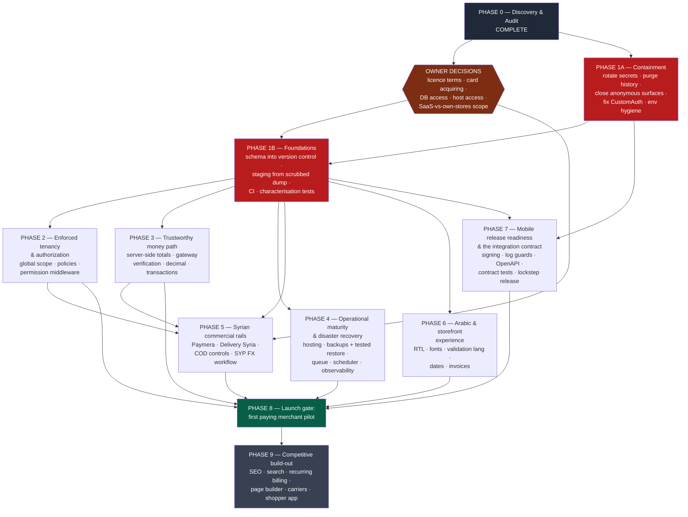

# 09 — Development Roadmap

## How to read this document

Ten phases. Phase 0 is this audit and is complete. Phases 1–8 form the path to a first paying
merchant; Phase 9 is what comes after that gate. Each phase carries the same nine headings —
Objective, Technical scope, Business value, Dependencies, Risks, Acceptance criteria, Recommended
implementation order, Relative effort, Launch criticality — so phases can be compared and
re-sequenced by the owner without re-reading prose.

Three conventions, used strictly:

- **Status** vocabulary: VERIFIED / PARTIAL / MISSING / UNKNOWN / BLOCKED.
- **Implementation** vocabulary: IMPLEMENTED AND VERIFIED / IMPLEMENTED BUT NOT VERIFIED /
  PARTIALLY IMPLEMENTED / PLACEHOLDER OR MOCK / MISSING / UNKNOWN.
- **Severity** CRITICAL / HIGH / MEDIUM / LOW; **business priority** P0 / P1 / P2 / P3.

**Effort is relative, never calendar.** Sizes are XS, S, M, L, XL, and each phase also carries a
relative point total on a Fibonacci-style scale so phases can be compared to each other (Phase 1 is
the reference at 100 points). Points are a comparison device, not a commitment: there is no
measured team velocity in evidence, and the audit could not execute a single test. **§16 — "Team
shape, effort aggregation and how to turn this into a budget" — aggregates those points and doc 08's
engineer-week figures into a per-phase engineer-week band, states the skill mix each phase needs, and
gives the formula for converting the result into money. It adds no calendar and no currency figure,
and it explains why.**

**Reuse-first is a rule, not a preference.** Where this codebase already contains a correct
implementation of something it does wrong elsewhere, the work item names that exemplar and the task
is to generalise it. No phase below recommends rewriting working code for modernization's sake.

---

## 1. How this differs from the hypothesised phasing, and why

The pre-audit framing that reaches this roadmap through the brief is a **feature-led** sequence:
localise the product for Syria, then switch on payments and launch, then finish the mobile app, then
add SaaS scale features — with security, testing and infrastructure treated as hardening to be done
alongside or afterwards.

*(Statement of provenance, so this section is not mistaken for a quotation: the pre-audit phase
hypothesis is **reconstructed from the brief's framing**, not quoted from an owner document. The
adjustments below are not inferred — each is anchored in verified evidence.)*

That sequence is wrong for this codebase in eight specific ways. Each adjustment below is a change
to the phasing, with the evidence that forces it.

| # | Adjustment | Why the evidence forces it |
|---|---|---|
| 1 | **Security moves from "hardening alongside" to Phase 1, and Phase 1 starts with credential rotation and a git-history purge.** | The `.env` with populated `APP_KEY` (`repo-A .env:3`), `DB_PASSWORD` (`:13`), `MAIL_PASSWORD` (`:29`), `REDIS_PASSWORD` (`:22`), all `PUSHER_*` (`:32-34`), all `REVERB_*` (`:36-38`) and `FIREBASE_CREDENTIALS` (`:52`) is committed in `3c39c160`, and `.gitignore` is a 5-line fragment that never mentions `.env` (verified: the file's entire contents are `/public/uploads/`, `/storage/app/public/`, `/vendor/`, `/storage/logs/*.log`, `/storage/`). Live third-party secrets are additionally in non-ignorable tracked config: `repo-A config/services.php:31` (`zid.client_secret`), `:34` (`zid.hook_pass`), `:44` (`deliverysyria.api_key`), plus a shipped default JWT signing secret at `repo-A config/jwt.php:18`. These values must be treated as public **today**. No feature work changes that; rotation does. |
| 2 | **Schema recovery is promoted into Phase 1.** It appears in no hypothesised phase. | Fifteen tables that routed code reads and writes have no `Schema::create` anywhere across all 207 migrations (105 in `database/migrations`, 102 under `packages/workdo/*/src/database/migrations` — both counts measured). Six are money-bearing (`repo-A app/Models/StoreWallet.php:9`, `StoreWalletTransaction.php:9`, `StoreWithdrawal.php:9`, `CurrencyRate.php:9`, `DeliveryEarning.php:9`, and `store_order_financials`, queried raw at `repo-A app/Services/OrderFinancialService.php:28`). `repo-A app/Models/Customer.php:16,20` applies `SoftDeletes` while `deleted_at` appears in zero migrations repo-wide. **Nothing in any later phase is testable until a fresh environment can be stood up**, so this is a gate, not a task. |
| 3 | **Testing and CI move from a late phase into Phase 1, as a prerequisite rather than a deliverable.** | `repo-A tests/` contains exactly 10 files, all unmodified Laravel Breeze scaffolding, and there is no `.github/` directory (both verified by direct listing). Five of the structural fixes in Phases 2–3 change the behaviour of hundreds of queries at once; with zero business-logic tests there is nothing to catch a regression. Worse, the harness is currently a loaded weapon: `repo-A phpunit.xml:25-26` has the SQLite override commented out and no `.env.testing` exists, so the 8 `RefreshDatabase` classes would run `migrate:fresh` against the live database named in the committed `.env`. |
| 4 | **"Localisation" is demoted from Phase 1 to Phase 6.** | Arabic is the product's **strongest** locale, not its weakest: 4,462 of 5,018 distinct `__()` keys are translated (88.9%). The real Arabic defects are structural rather than volume — `repo-A resources/lang/ar/` contains only `chatwoot.php`, `installer_messages.php` and `myfatoorah.php`, while `repo-A resources/lang/he/` contains `auth.php`, `pagination.php`, `passwords.php` and `validation.php` (both listings verified), so server-side validation messages fall back to English. These are genuine HIGH/P1 defects that make the product feel unfinished to an Arabic merchant. They are not what stops a launch: an anonymously exploitable platform is. |
| 5 | **"Payments" splits into two phases that are blocked on different things.** | The *correctness* work is pure engineering: `repo-A app/Http/Controllers/PaymentController.php:764` takes `tax_price` straight from the request, `:1354` sets `payment_status = 'Paid'` on the straight-line path, and the `return_type` marker that would distinguish success from cancel is generated at `repo-A app/Services/PaymentService.php:365-366` and read nowhere in the commerce core. The *Syrian rails* work is configuration plus a commercial agreement: `repo-A app/Services/PaymentService.php:216` hardcodes a test gateway host, `:2805` and `repo-A app/Http/Controllers/DeliverySyriaController.php:54` post to an ephemeral tunnel, and `repo-A app/Services/PaymentService.php:2756` tells the courier `'cash_collection' => '0'`. One is Phase 3; the other is Phase 5 and starts with questions only the owner can answer. |
| 6 | **Mobile is separated from backend work and explicitly gated on the integration contract.** | Repo B is Repo A's client — its single base URL is `https://storesyria.com/api/admin` (`repo-B lib/utils/base_api.dart:3`) and all 83 endpoint paths it calls resolve to routes inside the `Route::prefix('admin')` group at `repo-A routes/api.php:133`. But `repo-A app/Http/Middleware/CustomAuth.php:32-34` authenticates on the token row id alone and `:54` returns `$next($request)` when no header is present, so **fixing authentication changes the contract the shipped app depends on**. Backend and app must ship in lockstep, which is itself a capability Repo B does not have (68 commits, no CI). |
| 7 | **A modernization or re-platform phase is dropped entirely.** | All 69 addon modules ship Blade (670 files / 105,502 lines) and theme switching is a Blade view-path swap, so a framework migration invalidates the paid addon ecosystem and the theme system simultaneously. Separately, the entire Vite/Tailwind/npm toolchain is already dead code: `@vite` appears 0 times in all 1,232 Blade files. The defensible modernization target is narrow (the ~44-file storefront theme layer) and sits in Phase 9, after the Arabic defects are closed. |
| 8 | **Multi-tenancy is promoted from a "scale" concern to a P0 phase of its own.** | There is no enforcement layer at all: `app/Policies` does not exist, `repo-A app/Providers/AuthServiceProvider.php:15-17` is an empty `$policies` array, and isolation rests on hand-written `store_id` filters. Where one is missing it breaks immediately — `repo-A app/Http/Controllers/OrderController.php:360-362` does `Order::find($order_id)` on an attacker-supplied id with no tenant predicate, on the unauthenticated route `repo-A routes/customer.php:144`, and `:373` hands back `Crypt::encrypt($order->id)`, the exact token the order-detail route accepts. A platform cannot onboard a second merchant in this state. |

**Two framing corrections that change the shape of the plan, not just its order.**

First, three of the four highest-profile "deployment exposure" claims were **downgraded** by adversarial
verification, and the roadmap reflects the corrected severity rather than the original. The web
document root being the application root rather than `public/` (`repo-A index.php:17-21`,
`.htaccess:25`, `error_log:1`) is established as **HIGH / P1 disclosure** — `composer.lock`, internal
paths and 407 tracked customer uploads — not as source-code disclosure, because `.php` files under
that root are executed by the PHP handler rather than emitted as text. Whether `/.git/` is web-reachable
is **UNKNOWN / BLOCKED** and is the single manual check that would move it to CRITICAL. That check is
an owner action in Phase 1, not an engineering task.

Second, the roadmap deliberately does **not** schedule work on the XSS middleware as a security fix.
Verification established that `repo-A app/Http/Middleware/XSS.php:55` decodes HTML entities and `:57`
strips only `&lt;`, `&gt;`, `javascript` and `alert` — never literal `<` or `>` — so it is approximately
a no-op for XSS, and the real exposure is the unescaped output sinks. Its **verified** harm is
data-integrity: it silently truncates any password containing the substring `alert` or `javascript`
on the password-change route while leaving login untouched, producing permanent self-lockout. It
therefore appears in Phase 2 as a deletion, priced as MEDIUM/P1, and the escaping work appears
separately. Paying CRITICAL-level attention to it would be paying for the wrong thing.

---

## 2. Phase dependency map

Ordering is relative. No dates, no durations — an arrow means "must not start before".

Four properties of this graph are load-bearing:

1. **Phase 1A has no technical prerequisite.** Rotation and purge can begin immediately; they do not
   wait on database access or on the licence answer.
2. **Phase 1B is the universal gate.** Phases 2, 3, 4, 5, 6 and 7 all pass through it, because none of
   them can be verified in an environment that cannot be built from source.
3. **Owner decisions are on the critical path twice** — into 1B (database and host access) and into 5
   (licence, card acquiring). They should be chased in parallel with 1A, not after it.
4. **Phase 6 (Arabic) depends only on 1B** and is the most parallelisable phase in the plan. If a
   second, independent resource exists, this is where it goes — it shares almost no files with
   Phases 2–3.

---

## 3. PHASE 0 — Discovery & Audit  **[COMPLETE]**

### Objective
Establish, from code rather than from assertion, what the two repositories are, what works, what does
not, and whether development and launch should proceed.

### Technical scope (delivered)
Sixteen specialist dossiers and eight synthesis documents under `repo-A docs/discovery/`, covering:
repository inventory and provenance; as-built system architecture; a feature matrix with per-feature
implementation status; database and multi-tenancy; a security and quality audit; a UI/UX assessment;
a SaaS gap analysis; and this roadmap. Product identity was fixed to WorkDo "eCommerceGo SaaS"
v8.8.2 at `repo-A config/verification.php:4-5`. Repo B's role was settled definitively as a
**merchant/admin console** (no cart, no checkout anywhere in `repo-B lib/view/screen/`), and the
inter-repo relationship was proven rather than assumed: 83 of 83 endpoint paths the app calls resolve
to routes in Repo A. The 26 highest-stakes claims were then re-tested by independent skeptics, which
**overturned or materially corrected eight of them** — including downgrading four asserted CRITICALs
to HIGH or MEDIUM and refuting one outright.

### Business value
Converts an unpriced risk into a costed, ordered backlog, and produces the two verdicts the owner
asked for: **CONDITIONAL GO on beginning development**, **NO-GO on production launch**. It also
identifies the small number of questions that engineering cannot answer — licence terms, card
acquiring, whether `/.git/` is web-reachable — so budget is not spent before they return.

### Dependencies
None. Read-only access to both checkouts, which was sufficient for everything not listed as BLOCKED.

### Risks (realised, and carried forward)
Four verification routes were BLOCKED and the roadmap inherits them as UNKNOWNs rather than
assumptions: no `vendor/` so no suite run and no library internals; no Flutter SDK so every Repo B
finding is a static read; no database so the live schema is unconfirmed; no egress to the production
host so the deployment layout is inference from committed artefacts. Each is named at the point of
use below.

### Acceptance criteria (met)
- Every material claim carries a `path:line` citation. **Met.**
- The highest-stakes claims were adversarially re-tested and corrected wording is used downstream. **Met** (26 claims).
- `php -l` across all 3,113 PHP files: **zero syntax errors**. **Met.**
- Two separate verdicts (development vs launch) with stated conditions. **Met.**

### Recommended implementation order
Complete. The one residual Phase 0 action is an **owner** action, not engineering: run the two
BLOCKED external checks by hand (`GET /.git/config`, `GET /composer.lock` against the production
host). If the first returns 200, Phase 1A item 1 escalates from priority to emergency.

### Relative effort
**Complete** — not re-estimated. For comparison, roughly **L**.

### Launch criticality
Prerequisite to everything; satisfied.

---

## 4. PHASE 1 — Critical Stabilization

Phase 1 runs as two tracks. **1A Containment** stops an exposure that is live now. **1B Foundations**
makes the system reproducible and changes verifiable. They are one phase because neither is
independently sufficient: containment without foundations cannot be tested, and foundations without
containment leaves the platform open while the work proceeds.

### Objective
End the ongoing, anonymously exploitable exposure; and make the repository a source of truth from
which a working environment can be built, so that every later phase can be verified instead of hoped
for.

### Technical scope

#### Track 1A — Containment (strictly ordered; item 1 first)

**1A.1 — Rotate every exposed credential, then purge git history. Rotation first.**
Severity CRITICAL / P0. Purging does not un-leak an already-cloned repository, so rotation is the
non-negotiable half. Rotate: `APP_KEY` (`repo-A .env:3`), `DB_PASSWORD` (`:13`), `REDIS_PASSWORD`
(`:22`), `MAIL_PASSWORD` (`:29`), all `PUSHER_*` (`:32-34`), all `REVERB_*` (`:36-38`),
`FIREBASE_CREDENTIALS` (`:52`), plus `zid.client_secret` (`repo-A config/services.php:31`),
`zid.hook_pass` (`:34`) and `deliverysyria.api_key` (`:44`). Replace the `config/services.php`
literals with `env()` calls — the correct pattern already exists two blocks away at
`repo-A config/services.php:120-124`, which uses `env()` for the Webuzo keys. Add `JWT_SECRET` to the
environment so the shipped default at `repo-A config/jwt.php:18` is never used. Then rewrite history
across the 6 commits (`3c39c160` … `efe05d9f`) to drop `.env`, `error_log`, `composer.phar`,
`` `_active', 1)` `` and `uploads/`, and replace the 5-line `.gitignore` with the stock Laravel 11
file plus `/uploads/`, `bootstrap/cache/*.php`, `error_log`, `composer.phar`, `_active*`.
*Sequencing hazard, to be planned not discovered:* rotating `APP_KEY` invalidates every session **and
breaks decryption of every `Crypt`-encrypted column**, including the Zid credential rows read at
`repo-A app/Services/Zid.php:15-16`. Decrypt and re-encrypt those rows under the old key first, or
re-authorise the merchants.

**1A.2 — Disarm the test harness before anything else is run.** Severity CRITICAL / P0, effort XS.
Uncomment `repo-A phpunit.xml:25-26` (`DB_CONNECTION=sqlite`, `DB_DATABASE=:memory:` — verified
present and commented) and commit a `.env.testing`. Until this lands, **nobody runs the suite from a
checkout carrying the committed `.env`**, because the 8 `RefreshDatabase` classes would
`migrate:fresh` the live database. This is a two-line edit standing in front of total data loss.

**1A.3 — Replace `CustomAuth` with real token verification.** Severity CRITICAL / P0. One 55-line
file defeats authentication on 189 route registrations: `repo-A app/Http/Middleware/CustomAuth.php:32-34`
looks `personal_access_tokens` up by row id and never compares the secret, and `:54` returns
`$next($request)` when the `Authorization` header is absent. **Reuse, do not invent:** the correct
comparison already exists in this codebase at
`repo-A app/Http/Controllers/Api/DashboardController.php:627`
(`hash_equals($token->token, hash('sha256', $tokenValue))`), and `laravel/sanctum` is already
installed with `HasApiTokens` already on the models. Make a missing header a 401.
*Precondition:* enumerate the `*-guest` endpoints that currently depend on the fall-through and move
them into an explicitly public group first, or the storefront and Repo B break together. Repo B must
be re-tested and released in lockstep (Phase 7).

**1A.4 — Close the unauthenticated surfaces.** Severity CRITICAL / P0.
- Add authentication and server-derived tenancy to the seven list endpoints at
  `repo-A routes/api.php:163-169` (`categorylist`, `productlist`, `variantlist`, `orderlist`,
  `couponlist`, `shippinglist`, `taxlist` — all verified present, each carrying only
  `->middleware(['AdminApiLog'])`, inside the middleware-less group at `:133`). Note that the only
  `auth:sanctum` reference in the file is commented out at `:26`.
- Move the order and refund mutators inside the auth group. The `web` group opens at
  `repo-A routes/web.php:305` and the auth group at `:326` and **closes at `:938`** (all three lines
  re-read), while the mutators sit at `:945` (`order-return`), `:950` (`order-payment-status`),
  `:953` (`update-order-status/{id}`), `:955` (`order-return-request`) and `:957-961`
  (`update-refund-status`, `cancel-refund-status`, `refund-stock`, `update-final-price/{id}`,
  `refund-amount/{id}`) — inside `web`, outside `auth`.
- Add `auth:customers` plus a customer-ownership check to `repo-A routes/customer.php:142` (`status-cancel`),
  `:143` (`order.details`) and `:144` (`order.complete`).
- Add a permission check, an ownership check and the `Crypt::decrypt` its GET sibling already performs
  to `repo-A routes/web.php:663` → `StoreController::storeResetPasswordUpdate`. Verified: the handler
  validates only `'password' => 'required|confirmed|same:password_confirmation'`, then
  `forceFill(['password' => Hash::make(...)])->save()` on a raw integer id, while the GET sibling at
  `repo-A app/Http/Controllers/StoreController.php:640` does `\Crypt::decrypt($id)`.
- Add `type == 'super admin'` checks to the two zip-extraction endpoints,
  `repo-A routes/web.php:787` → `AddonController::ThemeInstall` (extracts to `themes/` at
  `repo-A app/Http/Controllers/AddonController.php:65`) and `repo-A routes/web.php:913` →
  `ModuleController::install` (extracts to `packages/workdo/` at
  `repo-A app/Http/Controllers/ModuleController.php:251`). **Reuse:** sibling methods in the same
  controllers already check — `repo-A app/Http/Controllers/AddonController.php:21`. Also add an
  `is_enable = 1` filter at `repo-A app/Providers/PackageServiceProvider.php:32`, which currently
  registers providers for every `add_on_managers` row regardless of state.
- Add authentication and permission checks to the three payout state transitions at
  `repo-A routes/web.php:186`, `:189`, `:192` (`approve`, `reject`, `pay`), which sit at file top level
  while the guarded sibling group opens at `:164`. **Reuse:** six sibling methods in the same
  controller already gate correctly — `repo-A app/Http/Controllers/StoreFinanceController.php:19, 71,
  315, 396, 494, 624` — and the six Finance permission names they require are created by no seeder, so
  seed them in the same change.

**1A.5 — Stop logging credentials, and treat the existing logs as a credential dump.** Severity
CRITICAL / P0. Collapse the two byte-identical log middlewares into one with an explicit field
allowlist, redacting `password`, `password_confirmation`, `old_password`, `new_password`, `otp`,
`token`, and remove response-body logging entirely because it contains issued tokens. Then revoke
every token found in `storage/logs/api.log*` on the server.

**1A.6 — Production environment hygiene.** Severity HIGH / P1. Set `APP_ENV=production` and
`APP_DEBUG=false` (`repo-A .env:2`, `:4`), and fix the Laravel 10 → 11 key drift that makes three
subsystems silently wrong: `MAIL_DRIVER` (`:25`), `QUEUE_DRIVER` (`:19`), `BROADCAST_DRIVER` (`:15`)
and `APP_LOG_LEVEL` (`:5`) are Laravel 10 names; Laravel 11 reads `MAIL_MAILER`, `QUEUE_CONNECTION`,
`BROADCAST_CONNECTION` and `LOG_LEVEL`, none of which is present — so mail falls back to the log
transport, broadcasting to null, and the queue to database with no worker. *Hazard:* flipping
`APP_DEBUG` off converts today's visible errors into opaque 500s, so observability (Phase 4) must land
alongside it, and turning mail on for real immediately starts sending to real customers — verify
templates against a staging mailbox first.

**1A.7 — Enable rate limiting.** Severity CRITICAL / P0, effort XS. `throttleApi()` is never called,
so the API is unthrottled and token-id enumeration against 1A.3's token space is free. This must ship
with 1A.3, not after it.

#### Track 1B — Foundations

**1B.1 — Reconstruct the schema into version control.** Severity CRITICAL / P0 — the gate on
everything. Dump the production schema (`mysqldump --no-data`), diff it against what the 207
migrations produce, and commit the difference as new migrations: 15 tables plus `orders.currency_code`,
`orders.currency_symbol` and `customers.deleted_at`. Guard every statement with `Schema::hasTable()` /
`hasColumn()` so the migration is a no-op against production and creates the object on fresh installs.
**Reuse:** the specifications already exist in committed code — each model declares `$fillable` and
`$casts`, and `repo-A app/Services/OrderFinancialService.php:90-116` enumerates every
`store_order_financials` column with its meaning. Then prove `migrate:fresh --seed` boots a working
application, which also forces fixing the seeder defects.

**1B.2 — Stand up staging from a scrubbed production dump.** Severity CRITICAL / P0. This is the
environment every later phase is verified in, and it is a condition of the CONDITIONAL GO: all work
happens here, never on production.

**1B.3 — Stand up CI.** Severity HIGH / P1. `composer validate`, the `php -l` sweep (already green
across 3,113 files — lock that in), `pint --test`, and `phpunit` against SQLite; plus `composer audit`.
Add `flutter pub get && flutter analyze && flutter test` for Repo B, **non-blocking at first**.
*Expect the first run to go red.* Snapshot the baseline and block only new issues rather than
disabling CI.

**1B.4 — Write the four characterisation tests that prove the 1A fixes landed.** Severity CRITICAL / P0.
These are the deliverable that converts Phase 2 from hope to engineering, and two of them should be
written **before** 1A.3 ships so the fix is demonstrable:
(a) an API request with no `Authorization` header returns 401;
(b) a forged `<id>|wrong-secret` token returns 401;
(c) an anonymous `GET /{slug}/order-complete?data[order_id]=N` for another tenant's order returns 404;
(d) `POST /api/admin/changestore` with a store the caller does not own returns 403 and leaves
`current_store` unchanged — the discriminator write at
`repo-A app/Http/Controllers/Api/DashboardController.php:3550` (`$store = Store::find($request->store_id);`,
inside `ChangeStore` at `:3534`) currently has no ownership predicate, and the correct predicate exists
in the same class at `DeleteStore`.

**1B.5 — Resolve the duplicate route registration.** Severity MEDIUM / P1, effort XS, but **do it
first within 1B**. `repo-A bootstrap/app.php:8-14` registers `web.php` and `api.php` via
`withRouting()`, and `repo-A app/Providers/RouteServiceProvider.php:35-42` registers them again. Which
registration serves a request determines the effective middleware stack, so a test written against the
wrong stack is worthless. One `php artisan route:list` on staging settles it — a command this audit
could not run (BLOCKED, no `vendor/`).

### Business value
This is the phase that changes the owner's two verdicts. It converts "a live platform that anonymous
internet users can read and write across tenants, with no forensic trail" into "a platform with a
closed front door and a rebuildable database". It is also the cheapest phase per unit of risk removed:
items 1A.2, 1A.7 and 1B.5 are each hours of work, and 1A.1 is dominated by coordination rather than
code. Without 1B specifically, every subsequent phase is unverifiable and the business carries an
unbounded disaster-recovery risk — the real schema currently exists only on the production server.

### Dependencies
- **Owner, blocking 1B.1 and 1B.2:** read access to the production database, or a dump. This is the
  hardest blocker in the whole roadmap.
- **Owner, blocking 1A.1 closure:** authorisation to rotate every secret, and a maintenance window.
- **Owner, informational but urgent:** the two external BLOCKED checks (`/.git/config`, `/composer.lock`).
- **Owner, blocking 1A.6:** confirmation of whether live merchants and real orders exist today, which
  sets the urgency of the whole track.
- 1A.3 depends on 1B.5 (which middleware registration applies) and on 1A.7 (throttling) shipping together.
- 1B.3's PHPUnit job depends on 1A.2.

### Risks
| Risk | Why it is real here | Mitigation in scope |
|---|---|---|
| `APP_KEY` rotation breaks encrypted columns | `repo-A app/Services/Zid.php:15-16` decrypts stored merchant credentials | Decrypt/re-encrypt under the old key as part of 1A.1; or re-authorise the affected merchants |
| Fixing authentication breaks the shipped mobile app | `repo-B lib/utils/base_api.dart:3` is an unversioned hardcoded base URL and 8 endpoints the app uses are currently anonymous | Enumerate intended-public endpoints first; coordinate with Phase 7; consider freezing the current surface as `/api/v1` and shipping fixes behind a new prefix |
| Closing anonymous endpoints breaks an unknown client | Verified that `orderlist`, `productlist` and `categorylist` are called by Repo B | If a client depends on an unauthenticated endpoint, **that dependency is itself the vulnerability** — fix the client |
| History rewrite invalidates every SHA | 6 commits in Repo A, so the rewrite itself is cheap | Coordinate re-clones; check whether any Repo B pipeline pins a Repo A commit |
| CI goes red on first run and gets switched off | Repo B alone has ~314 deprecated `withOpacity` calls | Baseline-and-block-new, non-blocking for Repo B initially |
| A reconstructed migration disagrees with production | Two different schemas are reachable from one migration set | Reconstruct **from** the live schema, then verify by diffing a fresh `migrate` against the dump; dump every environment and diff them first |
| Tests are written against the wrong middleware stack | The duplicate route registration (1B.5) | Resolve 1B.5 before writing tests |

### Acceptance criteria
1. No secret value appears anywhere in the tracked tree or in git history: `git log -p --all` for the
   rotated variable **names** returns no value-bearing hit, and `.gitignore` contains `.env`.
2. Every credential listed in 1A.1 has a new value in the production environment, and the old values
   are revoked at the provider.
3. `vendor/bin/phpunit` from a fresh clone connects to SQLite in memory and **cannot** reach a MySQL
   host — demonstrated by running it with the production host unreachable.
4. An API request with no `Authorization` header returns **401**, and `Bearer <valid-id>|wrong-secret`
   returns **401**. Both proved by test (b) and (a), run in CI.
5. `GET /api/admin/orderlist?store_id=N` with no credentials returns 401 for every N; the same request
   with merchant A's valid token and `store_id` = B's store returns 403 or 404.
6. Anonymous `POST` to each of the nine routes at `repo-A routes/web.php:945-961` returns 401 or 403,
   and the target order's `payment_status` and `delivered_status` are unchanged in the database.
7. `POST /store-reset-password-update/{id}` as a merchant staff account against another user's id
   returns 403, and that user's password hash is unchanged.
8. `POST /theme-addon` and `POST /install-modules` as a self-registered merchant return 403, and no
   file is written under `themes/` or `packages/workdo/`.
9. `POST /finance/withdrawals/{id}/pay` with no session returns 401; with a permissionless same-tenant
   session returns 403; wallet balances unchanged in both cases.
10. `php artisan migrate:fresh --seed` on an empty database produces a schema against which: a customer
    can register and log in; an order can be placed; `GET /finance` loads; and the merchant product
    API the Flutter app calls returns 200. **This is the Phase 1 exit gate.**
11. A staging environment exists, built only from the repository plus a scrubbed dump, with no manual
    DDL step.
12. CI runs on every push and is green; `php -l` across all PHP files is enforced, not merely observed.
13. `php artisan route:list` executes, and exactly one registration path for `web.php`/`api.php` exists.
14. An unthrottled request flood against the API login endpoint is rejected.

### Recommended implementation order
1A.1 → 1A.2 → 1B.5 → 1B.4(a,b) → 1A.3 + 1A.7 together → 1A.4 → 1A.5 → 1B.1 → 1B.2 → 1A.6 → 1B.3 →
1B.4(c,d). The two reorderings that matter: **1A.2 before anything is executed** (it is the difference
between a test run and a data-loss incident), and **1B.4(a,b) before 1A.3** (so the authentication fix
is provably landed rather than asserted).

### Relative effort
**L** overall — **100 relative points** (the reference). Internal split: 1A.1 **M** (25, dominated by
coordination and the re-encryption plan, not by code); 1A.2 **XS** (2); 1A.3 **S** (8); 1A.4 **M**
(15); 1A.5 **S** (5); 1A.6 **S** (5); 1A.7 **XS** (2); 1B.1 **M** (20); 1B.2 **S** (8); 1B.3 **S**
(6); 1B.4 **S** (8); 1B.5 **XS** (1). The largest single item is schema reconstruction, and its size
is driven by the 15 tables, not by difficulty — the specifications are already in committed code.

### Launch criticality
**LAUNCH-BLOCKING, and development-blocking.** No other phase can be verified before 1B closes, and
the platform should not continue to serve traffic in its current state while later phases proceed.

---

## 5. PHASE 2 — Enforced Tenancy & Authorization

### Objective
Replace a tenancy convention with a tenancy mechanism, and replace per-method authorization checks
with enforced route-level and policy-level authorization — so that a forgotten filter stops being a
cross-tenant breach.

### Technical scope

**2.1 — Make the tenant discriminator unwritable.** CRITICAL / P0, effort XS, highest security return
per character in the roadmap. Add the ownership predicate to the `current_store` write at
`repo-A app/Http/Controllers/Api/DashboardController.php:3550`; the correct predicate already exists
in the same class at `DeleteStore`. Until this lands, no tenant scope means anything, because the
attacker simply chooses their tenant.

**2.2 — Add a `BelongsToStore` trait with a global scope that fails closed.** CRITICAL / P0.
**Reuse:** build it on `getCurrentStore()` (`repo-A app/Helper/helper.php:357`), so no new tenancy
concept is introduced and the existing call sites keep their meaning; and follow the `creating`-hook
idiom already working at `repo-A app/Models/Order.php:63-80` for the auto-stamp. The scope must throw
on a null tenant rather than silently skipping the filter — `getCurrentStore()` returns null for
console commands, payment-gateway callbacks and unauthenticated requests, and a scope that skips
filtering in that case is a **new** leak. Console and webhook paths opt in explicitly.
**Apply to 12 models first, not all 119** (`Order`, `Product`, `Customer`, `Category`, `Coupon`, `Cart`,
`Setting`, `Page`, `DeliveryBoy`, `ProductVariant`, `OrderNote`, `OrderRefund`), which covers every
CRITICAL web-route finding, then roll the rest behind the tests.
**Exempt the known cross-store surfaces before the scope lands**, or they silently start returning one
store's data: the 8 DataTables with no `store_id`, the super-admin listings, the 4 tables with no
discriminator (backfill `store_id` from the parent first), and `email_templates`, whose grain is
`created_by` and must be decided before scoping.
**Hazard to test first:** `GeneaLabs\LaravelModelCaching\Cachable` is applied to `Product` and `Order`,
so cache keys must incorporate the scope or one tenant will serve another's cached rows. Library
internals are UNKNOWN (BLOCKED — `vendor/` absent), so this must be tested, not reasoned about.

**2.3 — Add Policies for the same 12 models and scope the route-model-bound actions.** CRITICAL / P0.
`app/Policies` does not exist and `repo-A app/Providers/AuthServiceProvider.php:15-17` is an empty
`$policies` array — which is also the ready-made registration point. The existing `isAbleTo()` calls
stay and become the **capability** half; the Policy supplies the **ownership** half.

**2.4 — Fix the role-table tenant-escape primitive.** CRITICAL / P0. `RoleController::update` and
`::destroy` take the tenant-global `Role` by implicit binding with no ownership scoping, and
`:182-183` rewrites `users.type` for every holder of the bound role; `repo-A routes/web.php:335`
registers the resource inside the auth-only group. The actor is **any self-registered merchant**,
because `repo-A app/Models/Utility.php:2872-2873` grants `"Delete Role"` and `"Edit Role"` to the
shared `admin` role (both lines verified verbatim) and the grant is re-applied on every login. Scope
the binding, remove those two permissions from the bulk grant, and add the missing ability check to
`edit()`.

**2.5 — Patch the known unscoped holes with the pattern that already exists ten lines away.** HIGH / P1,
ships independently and early. `orderComplete` (`repo-A app/Http/Controllers/OrderController.php:360-362`)
gets the predicate from `orderDetails` plus a customer-ownership check; `order_assign`, `updateStatus`,
`order_return_request` and `destroy` move from `Order::find($x)` to a store-scoped `firstOrFail()`, and
their `exists:orders,id` rules become store-scoped; `HomeController::customPage`
(`repo-A app/Http/Controllers/HomeController.php:1708`, verified: `Page::where('page_slug', ...)->where('page_status', 1)->first()`
with the store already resolved at `:1706`) gets `->where('store_id', $store->id)` plus a
`(store_id, page_slug)` unique index plus escaping of the `{!! !!}` sink; and the ~70
`Store::find($request->store_id)` sites get a scripted ownership assertion plus review.

**2.6 — Convert the existing inline checks into route-level middleware, and seed the missing
permissions.** HIGH / P1. Laratrust's `permission:` middleware is already auto-registered and already
in use at `repo-A routes/web.php:164`, so the mechanism is live and proven in this codebase. Mine the
existing `isAbleTo()` call sites to generate route middleware, **stage it starting with destructive and
financial routes**, and keep the inline checks as belt-and-braces. Seed the six Finance permissions
first, or the new middleware locks out the super admin.

**2.7 — Remove privilege-escalating mass assignment.** CRITICAL / P0. Remove `type`, `created_by`,
`plan_id`, `is_active`, `is_enable_login`, `current_store` and `remember_token` from `User::$fillable`
and replace `$user->fill($request->all())` with explicit assignment.

**2.8 — Delete the XSS middleware, and fix escaping properly.** MEDIUM / P1 for the deletion (it
corrupts passwords today: `repo-A app/Http/Middleware/XSS.php:55` decodes entities and `:57` strips
`alert`/`javascript` from every string including `new_password`), HIGH / P1 for the escaping work.
Extract the pending-migration redirect logic out of the same file first, then delete the filter and the
`'xss'` alias. Add a real HTML sanitiser applied **on write** to rich-text fields — one of the few
places a new dependency is genuinely required — convert the identified raw sinks to `{{ }}`, use
`@json()` in JS contexts, and ship a CSP in report-only mode first. A one-off cleanup pass over
existing stored rows is required: sanitising on write does not clean history.

### Business value
This is the phase that makes **multi-tenant SaaS** a defensible product claim rather than an
aspiration. Until it closes, the platform cannot onboard a second merchant without exposing the
first, which caps the business model at "our own stores" regardless of what the sales material says.
It also removes the whole class of defect that produced most of the audit's CRITICAL findings, so the
marginal cost of every future feature drops.

### Dependencies
Phase 1B in full — particularly 1B.1 (nothing is testable without a schema) and 1B.4 (the
cross-tenant denial suite is the artifact that makes 2.2 safe). 2.1 depends on nothing but 1B and
should ship immediately. 2.6 depends on 2.3 landing first for the models it covers.

### Risks
**This is the highest-risk phase in the roadmap, by a wide margin.** A global scope changes the results
of hundreds of queries at once, including 39 DataTables and the legitimate super-admin cross-store
views; adding middleware to roughly 1,192 route registrations breaks things loudly. Four specific
hazards: (a) the model cache may serve one tenant's rows to another if keys do not incorporate the
scope — UNKNOWN, must be tested; (b) treating `getCurrentStore()`'s null return as "no filter" instead
of "fail closed" would turn several HIGH findings CRITICAL; (c) tightening the `exists` rules may
reject legitimate super-admin actions — confirm whether super admins call `order-assign`; (d) the
permission middleware will lock out roles whose permissions were never seeded, which is why 2.6 seeds
first. Mitigation is structural: ship in the stated order, 12 models before all 119, destructive routes
before read routes, and never without the Phase 1B tests.

### Acceptance criteria
1. The cross-tenant denial suite from 1B.4 is extended to **every** list and mutate endpoint and is
   green: merchant A receives 403 or 404 for each, and the target row is byte-identical afterwards.
2. `POST /api/admin/changestore` with a non-owned store id returns 403 and `current_store` is unchanged.
3. For each of the 12 scoped models, a test proves that a query issued in merchant A's context returns
   zero of merchant B's rows, **and** that a query with no tenant context raises rather than returning
   unfiltered rows.
4. A merchant with `Edit Role` receives 403 on `PUT /roles/{id}` for a role they do not own; the
   platform owner's `users.type` is unchanged; and `Edit Role`/`Delete Role` are absent from the bulk
   grant after a fresh login (which re-runs the grant).
5. `POST /users/{id}` cannot set `type`, `plan_id`, `current_store` or `is_active` from request input —
   asserted by test.
6. Anonymous `GET /{slug}/order-complete?data[order_id]=N` returns 404 for an order of another store,
   and the response body contains no `Crypt`-encrypted id.
7. `/{slugA}/page/terms` and `/{slugB}/page/terms` return each store's own page, and the rendered
   output of a `<script>` payload stored in `page_content` is escaped.
8. A password containing the substring `alert` can be set and then used to log in — the XSS-middleware
   regression test.
9. Every route that mutates money or deletes data carries route-level `permission:` middleware,
   verified by a test that enumerates the route list and asserts the middleware is present.
10. No super-admin function is unreachable: a parameterised test asserts 200 for the super admin and
    403 for merchant staff on every platform-admin route.

### Recommended implementation order
2.1 → 2.5 (cheap, local, independently shippable) → extend 1B.4 into the full denial suite → 2.4 →
2.7 → 2.2 on 12 models → 2.3 on the same 12 → 2.6 staged from destructive routes outward → 2.8 → roll
2.2/2.3 across the remaining models incrementally. The deliberate choice here is to ship the
**cheap local patches before the structural fix**: they close known exploited paths in days while the
global scope is still being tested, and they are independently reversible.

### Relative effort
**XL** — **160 relative points**. Split: 2.1 **XS** (1); 2.2 **L** (40, dominated by the exemption
analysis and cache testing, not the trait); 2.3 **M** (25); 2.4 **S** (8); 2.5 **M** (20); 2.6 **L**
(45, the staging and lock-out testing dominate); 2.7 **S** (6); 2.8 **M** (15, mostly the stored-row
cleanup pass).

### Launch criticality
**LAUNCH-BLOCKING** if the product is sold as multi-tenant SaaS to third-party merchants. If the owner
decides Store Syria operates only the owner's own stores, 2.2/2.3/2.6 can be de-scoped to the
authorization half and this phase shrinks substantially — which is exactly why the scope decision is
on the owner-decision list.

---

## 6. PHASE 3 — A Trustworthy Money Path

### Objective
Make the recorded amount, the charged amount and the collected amount the same number, and make the
platform's ledger a record of what happened rather than of what was requested.

### Technical scope

**3.1 — Recompute every money component server-side at order creation.** CRITICAL / P0. Today
`repo-A app/Http/Controllers/PaymentController.php:764` reads `$tax_price = $request->tax_price ?? 0;`
and that value reaches the amount the gateway is asked to charge, so a negative `tax_price` lowers the
charge. Shipping and coupon discount are likewise taken from the request and written into the persisted
total. **Reuse:** the server-side computation already exists and is simply bypassed — `Cart`'s tax
computation and `CartController`'s shipping computation — and the mobile API order path **already
recomputes both correctly** (`repo-A app/Http/Controllers/Api/ApiController.php:2985-3024`: the coupon
is re-applied server-side from `coupon_code` alone, and tax is derived from the selected shipping
method or summed from the store's own tax rows), so the web checkout should be brought to the API
path's behaviour, not the reverse.
Treat client figures as display hints to be compared, and reject on mismatch.

**3.2 — Verify every gateway return server-side.** CRITICAL / P0. The `return_type=success|cancel`
marker is generated at `repo-A app/Services/PaymentService.php:365-366` (verified: the closure returns
`'&return_type=' . $return_type . '&payment_processor=stripe'`) and read nowhere in the commerce core,
while `repo-A app/Http/Controllers/PaymentController.php:1354` sets `payment_status = 'Paid'` on the
straight-line path. Consequence: a cancelled Stripe checkout, a declined Paymera transaction and a
direct URL visit inside a live checkout session all create a paid order with stock decremented.
**Reuse:** `handlePaymeraCallback` is the correct template — re-poll the gateway, check status, guard
replay — and the Tap and PhonePe handlers show the correct verify-then-create shape. Compare the
**captured amount** to the order total, not just the status. **Strong recommendation: cut the launch
set to COD, one card rail and bank transfer.** Of roughly 52 wired payment types, 2 verify properly, 0
verify the amount and 0 verify an inbound signature; 52 unverified gateways is 52 attack surfaces
nobody can test, and leaving disabled gateways disabled is free.

**3.3 — Stop booking offline payments as collected.** CRITICAL / P0, and the cheapest high-value fix
in the audit. `repo-A app/Services/PaymentService.php:2280` is `$order->payment_status = 'Paid';` with
no branch on `payment_type`, so every COD order credits the merchant's withdrawable wallet at
checkout. **Reuse: the entire correction already exists.** `OrderFinancialService::normalizePaymentStatus`
(`repo-A app/Services/OrderFinancialService.php:570`) already maps `'pending'` correctly,
`markFinancialAsPaid` (`:284`) is the human mark-paid step, and
`repo-A app/Http/Controllers/StoreFinanceController.php:19` is its permission gate. The change is to
branch on `payment_type` so offline rails write unpaid and only verified callbacks write `'Paid'`.

**3.4 — Make order creation transactional and locked.** CRITICAL / P0. Checkout runs with zero DB
transactions and zero row locking, and stock is decremented by an unlocked read-modify-write:
`repo-A app/Services/PaymentService.php:2162-2164` (verified verbatim:
`$remain_stock = $Product->product_stock - $qtyy;` then assign and `save()`), with the ordered quantity
taken raw at `repo-A app/Http/Controllers/CartController.php:189` (`$qty = $request->qty ?? 0;`) and
never compared against available stock. A single request with `qty` greater than stock drives
`product_stock` negative — the column is a signed `integer` with no floor. **Reuse:** the correct
locking idiom exists twice in this repo, including at `repo-A app/Services/OrderFinancialService.php:19-22`,
and the manual order-creation path already wraps itself in `DB::beginTransaction()`. Extract one
`PlaceOrderService::place()` from that correct path, wrap it, take `lockForUpdate()` ordered by primary
key, add a quantity-vs-stock guard and a floor at zero, and move mail, SMS and carrier I/O outside the
transaction.

**3.5 — Fix the stock-restore no-op.** HIGH / P1. `repo-A app/Models/Order.php:620-625` (verified:
`$product = Product::find($product_id); ... $product->product_stock += $product['qty'];`) overwrites
the loop array with an Eloquent model, and `products` has no `qty` column, accessor, cast or append —
so `+= null` adds nothing and returned non-variant inventory is never restocked, silently and
selectively, while the variant branch works. The same defect exists in the controller copy, in the API
entry point, and in an addon copy. Four edits.

**3.6 — Decide what "refund" means, then implement it.** CRITICAL / P0 for the money-movement gap,
HIGH / P1 for the access control. `repo-A app/Http/Controllers/OrderRefundController.php:229`
(`RefundAmonut`) writes two columns and returns JSON; a repo-wide search for call sites of every
vendored refund client returns zero. Every refund today requires an out-of-band manual payout while
the system reports "Refunded", with no record distinguishing paid from unpaid. Either implement gateway
refunds (depends on 3.2, because a payment whose gateway reference was never captured cannot be
refunded) or make the manual process explicit with a `refund_paid_at` / `refund_paid_by` record — but
do not leave a status string masquerading as a payout. Add the missing permission and store-scope
checks in the same change.

**3.7 — Make money columns `decimal`.** CRITICAL / P0. Zero `decimal()` columns exist across the 105
core migrations; `orders.final_price` is a bare float, which cannot hold SYP integers above roughly
16.7 million exactly. Size for the magnitude, not the subunit. *This must precede any FX work in
Phase 5, or fixing rates on float columns re-introduces the precision loss.*

**3.8 — Close the subscription revenue leak.** CRITICAL / P0. 100% of platform revenue runs through a
rail that is both unenforced and self-approvable: `repo-A routes/web.php:467-468` registers
`order_approve/{id}` and `order_reject/{id}` → `BankTransferController::orderapprove` (`:119`) /
`orderreject` (`:139`) inside the auth-only group with no role check, and plan-expiry enforcement is
commented out at `repo-A app/Http/Middleware/SetLocate.php:79` and `:87-88` while `:73-75` *assigns an
`Unlimited` plan* to a merchant whose plan has lapsed (all four lines verified). **Reuse:** the gate
pattern is two files away, and `repo-A app/Models/User.php:167` (`assignPlan`) already implements the
full downgrade including over-quota deactivation, so a scheduled expiry command only needs to find
expired merchants and call it. Prefer route-level middleware so a new entry point cannot bypass the
gate. Audit `plan_orders` for rows approved by non-super-admins before deploying.

### Business value
This is the phase after which the platform can take real money without the owner carrying unbounded
settlement risk. Three of its items also directly restore revenue rather than merely protecting it:
3.8 stops merchants using the platform free after expiry and granting themselves paid plans, 3.3 makes
merchant wallet balances real so payouts stop being made against fiction, and 3.1/3.2 stop goods
shipping for a fraction of their price. It is also the phase that makes merchant trust possible: a
merchant whose dashboard revenue is wrong will not stay.

### Dependencies
Phase 1B in full. 3.6 depends on 3.2 (gateway references must be captured before a refund can
reference them). 3.7 should precede 3.3's reconciliation pass so restated balances are computed on
exact columns. Phase 2's tenancy scope is **not** a hard prerequisite, but 2.1 should land first so
money fixes are not tested in a system where the tenant is attacker-chosen. The decision on which
gateways are live for Syria is an owner input and is the single biggest cost lever in this phase.

### Risks
Touching live checkout is the headline risk; mitigate by doing it **gateway by gateway, starting with
whichever is actually enabled**, and by leaving disabled gateways disabled. The `decimal` migration
rewrites every money column on a live database: it needs a maintenance window, a dump, and a
reconciliation pass over rows that already carry float error, plus explicit sign-off that historical
balances will be restated. Flipping COD to unpaid **will** reduce every merchant's displayed balance —
brief merchants first and expect a one-off reconciliation of existing COD orders. Making stock
decrement transactional may surface latent deadlocks under concurrency; lock ordering by primary key is
in scope for exactly this reason. Finally, `products.price` feeds caches and the API, so the storefront
and the Flutter app must both be re-tested after 3.7.

### Acceptance criteria
1. A checkout submitted with `tax_price = -99999` produces an order whose total equals the
   server-recomputed total, and the amount sent to the gateway equals that same figure — asserted by
   test, for each enabled gateway.
2. Cancelling at the gateway produces **no** order with `payment_status = 'Paid'`; the corresponding
   order is either absent or recorded unpaid. Tested per enabled gateway, including a direct visit to
   the return URL inside a live session.
3. A gateway callback whose captured amount differs from the order total is rejected and logged, and no
   order is marked paid.
4. A COD order is created with an unpaid status and credits **no** wallet balance; the balance moves
   only after the permission-gated mark-paid step, and the resulting ledger entry carries the acting
   user.
5. Two concurrent checkouts for the last unit of stock result in exactly one successful order; a single
   request for more than available stock is rejected; `product_stock` is never negative in any test run.
6. A return on a non-variant product increases `product_stock` by exactly the returned quantity —
   the test that currently would fail.
7. No money column remains a float: a schema assertion over the migration output enumerates money
   columns and asserts `decimal`. A before/after per-store sum reconciliation is recorded and signed off.
8. `order_approve/{id}` returns 403 for a merchant and 200 only for the super admin; a merchant cannot
   grant themselves a plan — asserted by test.
9. A merchant whose plan has expired is blocked (or grace-period-handled per the owner's decision) and
   is **not** auto-assigned an `Unlimited` plan.
10. Refund: either a gateway refund is issued and recorded with its gateway reference, or the record
    distinguishes "refund approved" from "refund paid", with a permission check and store scoping on
    the endpoint. No state exists in which the UI says "Refunded" and nothing is recorded about payout.

### Recommended implementation order
3.8 (independent, pure revenue, cheap) → 3.3 → 3.7 → 3.1 → 3.2 per enabled gateway → 3.4 → 3.5 →
3.6. The reasoning: 3.8 touches nothing in the checkout path and can ship in parallel; 3.3 before 3.1/3.2
because it is a one-line branch with a large ledger effect; 3.7 before the reconciliation work so
restated figures are computed once on exact columns; 3.6 last because it depends on 3.2's captured
references.

### Relative effort
**XL** — **145 relative points**. Split: 3.1 **M** (20); 3.2 **L** (40, and it scales with the number
of gateways kept — cutting the launch set is the main lever); 3.3 **S** (6 for the code; the merchant
communication and reconciliation are the real cost); 3.4 **M** (25); 3.5 **XS** (3); 3.6 **M** (20,
mostly a product decision); 3.7 **M** (20, dominated by the migration window and reconciliation); 3.8
**S** (11).

### Launch criticality
**LAUNCH-BLOCKING.** Items 3.1, 3.2, 3.3 and 3.4 are each independently sufficient to block a launch
that takes real money. The audit's standing recommendation is NO-GO on live payments until 3.1 and 3.2
are complete and test-verified.

---

## 7. PHASE 4 — Operational Maturity & Disaster Recovery

### Objective
Make the system recoverable, observable and deployable — and end the practice that caused the worst
finding in the audit, which is that code was authored on the production server and committed back
afterwards.

### Technical scope

**4.1 — Decide the hosting model.** HIGH / P1, and **do it first**, because four other items depend on
capabilities that shared hosting typically withholds. Evaluate moving off cPanel shared hosting; produce
a `Dockerfile` plus `docker-compose.yml` (PHP-FPM, MySQL, Redis, a `queue:work` worker, a
`schedule:run` sidecar, Reverb) and either make `laravel/sail` functional or remove it. Deciding this
once unblocks 4.2, 4.3 and 4.5.

**4.2 — Replace the backup module with real, scheduled, encrypted, off-site backups — and build a
tested restore.** CRITICAL / P0 on business-continuity grounds. The current module is manual-only (so
there is no RPO), unencrypted, written to the same disk it protects, archives the production `.env`,
chmods `0777`, has **no restore function at all**, and `shell_exec`s unvalidated user input from a
method missing the permission check its siblings have. Adopt a maintained backup package: scheduled,
encrypted with a key held outside the repository, off-box destination, `.env` and `vendor/` excluded,
retention policy, failure notifications. **Then write and rehearse a restore runbook** — there is none.
An untested backup is not a recovery capability.

**4.3 — Wire the scheduler and the queue.** HIGH / P1. `repo-A routes/console.php:9` calls
`Schedule::command('zid:process-events')` with **no import** (verified: the file's only imports are
`Inspiring` and `Artisan`), which is assessed to break console boot — unverifiable here, BLOCKED,
`vendor/` absent, and one `php artisan schedule:list` on staging settles it. Add the import, schedule
the five registered-but-never-scheduled commands with `->withoutOverlapping()`, install the
`schedule:run` cron entry and a supervised `queue:work`, and push the courier call, mail, SMS and push
notifications off the request path. Regenerate `.env.example` from the union of both key sets — 25 keys
in `.env` are missing from it, including all six `DB_*`.

**4.4 — Fix observability, in this order.** HIGH / P1. Configure the installed error tracker properly
(it is wired into the default log stack and entirely unconfigured) or replace it, **before** Phase 1A.6
turns `APP_DEBUG` off, or the team loses the diagnostics it currently depends on. Then enable
Crashlytics collection in Repo B by flipping `repo-B android/app/src/main/AndroidManifest.xml:35-37`
(verified: `firebase_crashlytics_collection_enabled` is `"false"`) — but **only after** Phase 7's log
guards, so logged passwords do not reach Crashlytics.

**4.5 — Move the document root to `public/`.** HIGH / P1. `repo-A index.php:17-21` is a stock
`server.php` shim at the application root and `repo-A .htaccess:25` (`RewriteCond %{REQUEST_FILENAME} !-f`)
means any real file under that root is served by the web server and never reaches Laravel; the only
access-control directive in the repository is a single-filename deny for `.env` at `.htaccess:6-9`, and
`error_log:1` independently places the application at `/home/<redacted-account>/public_html`. Point
`DocumentRoot` at `public/` and delete the root `index.php` and `.htaccess` — **on staging first**,
since this is the one change that can visibly break the site. If the document root cannot move, add
explicit denies for dotfiles, `.git`, `*.lock`, `*.json`, `*.log`, `error_log` and `*.phar`, and
relocate `uploads/` behind signed URLs. Close the installer and the HTTP `/update` route in the same
change.

**4.6 — Establish a deploy pipeline and write the runbooks.** HIGH / P1. There is no deploy script, no
release process and the README is stock Laravel. The missing documentation that matters operationally
is small and specific: install, deploy, the `package:migrate` step that is documented nowhere, the
restore runbook from 4.2, and the secret-rotation runbook from 1A.1. **This item is what makes the
other technical fixes durable** — every one of them is undone by the next direct edit on the server.

**4.7 — Address the abandoned dependencies.** MEDIUM / P2. Three packages are upstream-declared
abandoned, two of them on the money path or the install/upgrade path. Replace or migrate them and add
`composer audit` to CI.

### Business value
Directly addresses the audit's **second-ranked risk**: if the production database is lost, the product
is lost. Phase 1B.1 fixes the schema half; 4.2 fixes the data half, and only a rehearsed restore
closes it. 4.3 also removes a live customer-facing defect — no email is being sent at all today, so no
merchant or customer can receive a password reset or an order confirmation — and takes the courier call
off the checkout request path. 4.6 is the item with the longest tail of value: it is the difference
between a remediation that holds and one that decays.

### Dependencies
4.1 gates 4.2, 4.3 and 4.5. 4.4's first half should land **before** 1A.6's `APP_DEBUG=false`; its
second half must land **after** Phase 7's log guards. 4.2 depends on 1A.1 (so the `.env` is no longer
the thing leaking) and on business decisions about RPO and RTO. 4.5 depends on host access, an owner
input.

### Risks
Changing the document root breaks the rewrites that currently map `/uploads/`, `/storage/` and
`/packages/workdo/` into place — audit asset URLs before and after, on staging. Turning real mail on
starts sending to real customers immediately. Scheduling the never-scheduled commands on live data may
process a backlog of stale auctions and draws — dry-run against a database copy. Backups need
`mysqldump` on PATH and an outbound route to object storage, both commonly restricted on shared
hosting, which is why 4.1 comes first; and a lost encryption key makes the backups worthless, so key
custody is a decision, not a detail. Error tracking will reveal a backlog of latent production
exceptions — that is the point, but it needs triage capacity.

### Acceptance criteria
1. A full backup is produced on a schedule, is encrypted, is stored off-box, and **excludes** `.env`.
2. A restore into a clean environment has been **performed and timed at least once** from a backup
   artefact alone, with the runbook followed by someone who did not write it. Recorded RPO and RTO
   figures exist and are signed off by the business.
3. `php artisan schedule:list` executes and lists every intended job; a queue worker is supervised and
   its restart is automatic; the `jobs` table drains under load.
4. A test email is received at a real mailbox from staging, in Arabic, and the order-confirmation and
   password-reset paths are both exercised.
5. An unhandled exception on staging appears in the error tracker within one minute, with environment
   correctly reported.
6. `GET /composer.lock`, `/error_log`, `/composer.json`, `/.env.example`, `/.git/config` and an
   `uploads/` path all return 403 or 404 on staging after 4.5 — and the same set is re-checked on
   production after the change.
7. A deploy to staging is performed by running the documented pipeline, with no manual file copy and no
   editing on the server. The repository is the only source of deployed code.
8. `composer audit` runs in CI and no abandoned package remains on the money or install path.

### Recommended implementation order
4.4 (first half) → 4.1 → 4.3 → 4.2 → 4.5 → 4.6 → 4.7 → 4.4 (second half, after Phase 7). Observability
leads because Phase 1A.6 is waiting on it; hosting is next because three items depend on the answer.

### Relative effort
**L** — **95 relative points**. Split: 4.1 **M** (20, mostly evaluation and decision); 4.2 **M** (25,
and the rehearsed restore is most of it); 4.3 **S** (12 — this is wiring, not building: the commands,
queue tables and Redis settings all already exist); 4.4 **S** (8); 4.5 **S** (10, plus an asset-URL
audit); 4.6 **M** (15); 4.7 **S** (5).

### Launch criticality
**LAUNCH-BLOCKING for 4.2, 4.3, 4.4 and 4.5.** A pilot cannot responsibly take a merchant's catalogue
and a shopper's order without a tested restore, working email and error visibility. 4.1, 4.6 and 4.7
are **strongly advised before launch** but are not themselves gates.

---

## 8. PHASE 5 — The Syrian Commercial Rails

### Objective
Make the two custom Syrian integrations work against production endpoints with correct payloads, and
give merchants the currency and cash-handling controls the Syrian market actually requires.

### Technical scope

**5.1 — Settle the two questions code cannot answer. This precedes the engineering.** CRITICAL / P0.
No WorkDo/Envato licence file exists anywhere in Repo A, so SaaS-resale terms cannot be read from code;
and whether any card acquiring is commercially available is not a code question. **Do not spend this
phase's budget before both return** — either answer can change the product.

**5.2 — Point Paymera at production and verify properly.** CRITICAL / P0.
`repo-A app/Services/PaymentService.php:216` hardcodes a test gateway host and `:217` hardcodes the
callback base (both verified as literal URLs in source). Move all hardcoded hosts to config plus
environment, add the missing `services.paymera` config block so the controller's lookup resolves (or
better, reuse the per-store credential the payment path already reads), replace the hardcoded base with
`route()`/`config('app.url')` so custom domains work, and pass the **server-computed** total to the
gateway rather than the request's figure. Delete the four dead backup copies of the Paymera handlers.

**5.3 — Point Delivery Syria at production and tell the courier the real COD amount.** CRITICAL / P0.
Both calls post to an ephemeral tunnel — `repo-A app/Http/Controllers/DeliverySyriaController.php:54`
and `repo-A app/Services/PaymentService.php:2805` — and the courier is told
`'cash_collection' => '0'` (`repo-A app/Services/PaymentService.php:2756`, verified verbatim), so it is
never told how much cash to collect. **Reuse, verbatim:**
`config('services.deliverysyria.url')` already exists and is already used correctly by the Zid
command, and the same command already contains the correct COD formula. Replace the
`method_name === 'Delivery Syria'` string match with a provider id column on `shipping_methods`.

**5.4 — Build the minimum COD controls.** HIGH / P1. For a COD-primary market, a per-order ceiling,
per-zone availability, a COD surcharge, a blocked-customer list and a
`cash_collected`/`collected_at`/`collected_by` record on the order are fraud and reconciliation basics,
not refinements — and Phase 3's ledger needs something to reconcile **against** rather than inferring
from `payment_status`. **Reuse:** `shipping_zones`/`shipping_methods` absorb the per-zone rules, and
the in-house delivery-boy module is a ready fulfilment fallback for a courier outage.

**5.5 — Fix currency defaults and give merchants a usable FX workflow.** CRITICAL / P0. SYP is seeded
at a rate of 1, and a merchant switching currency at that default rewrites their price list
irreversibly. Replace the four duplicated seed lists with one, require an explicit rate before a
non-USD currency can be activated, seed `currency_rates` on self-registration as the store-creation
path already does, add rate history, a "last updated" display and a staleness warning, block
conversion when the rate is default or stale, snapshot prices before any in-place rewrite, and fix the
seeded SYP symbol. **Depends on Phase 3.7** — fixing rates on float columns re-introduces the
precision loss.

**5.6 — Decide the WorkDo relationship explicitly.** MEDIUM / P2, but decide it in this phase rather
than discovering it during an emergency. The evidence: the 69 addon modules are pristine and therefore
upgradeable, while `app/` is heavily rewritten with no upstream baseline in git. Three honest options —
track upstream (highest cost, preserves security updates), fork deliberately (lowest friction, no
upstream security fixes, requires a standing security capability), or status quo (cheapest today, most
expensive the first time an advisory lands). Also remove the runtime fetch of executable configuration
from the vendor's demo server.

### Business value
Without 5.2 and 5.3 the platform has **no online payment and no local fulfilment** — which means it
cannot serve its market regardless of how good the rest of the code is. The verified good news is that
these are launch-blocked by **configuration and payload**, not by sanctions or by missing code: the
structure is sound and much of the correct implementation already exists elsewhere in the repository.
5.4 and 5.5 are what make the platform safe to operate commercially in a cash-dominant, high-inflation
currency environment.

### Dependencies
5.1 gates everything in this phase. 5.2 and 5.3 depend on Phase 1B (to test) and on Phase 3.1/3.2 (so
the amount handed to the gateway is the server's figure, verified on return). 5.4 depends on Phase 3.3
(COD must stop being booked as collected before collection controls mean anything). 5.5 depends on
Phase 3.7. Owner inputs: production Paymera credentials, amount-unit convention and whether the
status poll requires authentication; the production Delivery Syria base URL, contract and a real API
key; the owner's actual COD policy (fee, ceiling, governorate coverage); and which FX rate is
authoritative.

### Risks
Changing the amount computation touches live payments — test against a gateway sandbox with a signed-off
amount convention before deploying. The real Delivery Syria API contract may differ from whatever the
tunnel accepted, so treat the current payload as unverified. Currency switching rewrites product rows
irreversibly, so the price snapshot must land **before** anything else in 5.5; any store already
switched at rate 1 has corrupt prices and needs manual repair. More checkout configuration surface
means more for merchants to get wrong — ship sane defaults.

### Acceptance criteria
1. No gateway or courier host appears as a literal in source: a grep for `http` under `app/` and
   `config/` returns only `env()`/`config()`-sourced values or documentation.
2. A sandbox Paymera payment succeeds, is verified server-side by re-polling, and the captured amount
   equals the order total; a declined payment produces **no** paid order.
3. A courier booking is created against the production Delivery Syria endpoint with
   `cash_collection` equal to the order's COD amount — asserted by test against the formula, and
   confirmed once in a real sandbox booking.
4. Courier selection does not depend on a merchant-editable English string: a provider id is used, and
   a renamed shipping method does not change behaviour.
5. A COD order above the configured ceiling is rejected; COD is unavailable in a zone configured
   without it; and a delivered COD order records `cash_collected`, `collected_at` and `collected_by`,
   which the ledger reconciles against.
6. A merchant cannot activate a non-USD currency without entering an explicit rate; a stale rate shows
   a warning and blocks conversion; a currency switch creates a restorable price snapshot first; and a
   newly self-registered merchant has seeded `currency_rates`.
7. Written answers exist, on file, to: the licence/resale question, card acquiring, the COD policy, and
   the authoritative FX rate.

### Recommended implementation order
5.1 (in parallel with Phase 1, since it is an owner action with a long lead time) → 5.5's price
snapshot → 5.2 → 5.3 → 5.4 → 5.5 remainder → 5.6. The snapshot comes first within 5.5 because it is
the only irreversible-data protection in the phase.

### Relative effort
**L** — **85 relative points**. Split: 5.1 **XS** engineering (0 — owner effort, long lead time);
5.2 **M** (20); 5.3 **M** (20); 5.4 **M** (25); 5.5 **M** (18); 5.6 **S** (2 engineering for the
phone-home removal; the decision itself is owner effort). Note how small this phase is relative to its
business importance — that is the verified finding that the rails are misconfigured rather than missing.

### Launch criticality
**LAUNCH-BLOCKING** for 5.1, 5.2, 5.3 and 5.5. 5.4 is **LAUNCH-BLOCKING for a COD-primary market**,
which this is. 5.6 is not a launch gate but should be decided before the first upstream security
advisory arrives.

---

## 9. PHASE 6 — Arabic & Storefront Experience

### Objective
Make the Arabic experience correct on the surfaces customers and merchants actually meet — not more
translated, but correctly laid out, correctly rendered and correctly validated.

### Technical scope

**6.1 — Add the four missing Arabic framework language files.** HIGH / P1, and the highest
value-per-unit-effort item in the phase. `repo-A resources/lang/ar/` contains only `chatwoot.php`,
`installer_messages.php` and `myfatoorah.php`, while `repo-A resources/lang/he/` contains `auth.php`,
`pagination.php`, `passwords.php` and `validation.php` — so every server-side validation message
renders in English for an Arabic user. Copy the four `en/` files and translate. Commit to git; do not
route this through the in-app translation editor, which throws. Gate the merge on a placeholder-set
diff against `en`.

**6.2 — Self-host an Arabic webfont.** HIGH / P1. No Arabic-capable font is declared or loaded anywhere
in the repository — the admin uses Open Sans with no Arabic subset and all three storefront themes use
Poppins, which has no Arabic glyphs — so Arabic text renders in an uncontrolled OS fallback. One change
fixes admin and storefront together, and also removes a third-party font-host availability dependency.
Expect button-height regressions: the existing line-heights were tuned to Latin metrics.

**6.3 — Fix RTL on the shared storefront pages, starting with checkout.** HIGH / P1. The live theme
layouts set `dir="rtl"` for Arabic but load only the LTR stylesheet, so an Arabic storefront is fully
styled and fully scripted but **mis-mirrored**. *(This is the corrected finding: an earlier claim that
the Arabic storefront loads no stylesheet at all was **REFUTED** — the theme layouts override the stock
layout and load `main-style.css` unconditionally. The dead stock layout that references non-existent
RTL assets should be deleted, and the stylesheet that one theme already ships but never loads should be
wired.)* The remaining work is mechanical: convert directional utilities to logical properties across
the shared `front_end` pages, wrap prices in `<bdi>`, and start with checkout and cart because that is
the conversion funnel. One fix serves all three themes, because these files are not themeable.

**6.4 — Localise dates.** HIGH / P1. All dates use locale-insensitive formatting with zero
`translatedFormat` calls, so month and day names are English in every Arabic screen, invoice and email.
One helper is the chokepoint for most call sites.

**6.5 — Translate the remaining keys, prioritised by surface.** MEDIUM / P2. 556 keys are missing and
they cluster precisely in the Syria-specific custom code — finance at 54.0%, delivery-syria at 60.7%,
`app/Services` at 64.7%. Prioritise finance first: those are the money screens a merchant uses daily.
Needs a reviewer fluent in Syrian commercial terminology (withdrawal, settlement, delivery zone), not a
generic translator.

**6.6 — Fix the Arabic email defects.** MEDIUM / P2. Arabic merchants currently receive Arabic bodies
under English subjects in LTR shells. The per-language subject column already exists; the fallback
pattern to copy already exists in a sibling controller.

**6.7 — Ship an Arabic-capable order invoice, and choose the engine deliberately.** HIGH / P1. There is
no order invoice at all, and the bundled PDF engine on its unpublished defaults will render Arabic as
disconnected reversed glyphs — which would be discovered by a customer. Test one Arabic invoice first
(half a day of work that decides a multi-day branch), then either publish the PDF config with an
embedded Arabic font, use a browser-based renderer, or generate client-side — Repo B already bundles a
PDF toolchain and already handles text direction.

**6.8 — The storefront repair items that are cheap and visible.** MEDIUM / P2. Give the 263 AJAX modal
error callbacks a real body (this is what makes every other defect in the product diagnosable from the
UI), delete the duplicated modal click handler that fires every request twice, load the notifier assets
the storefront layouts call but never include, and fix the committed `public/storage` path artefact that
404s image URLs on a fresh deploy. These are hours each and improve the product's perceived quality more
than their size suggests.

### Business value
"Store Syria" cannot credibly launch with English validation errors, an uncontrolled Arabic font and a
mis-mirrored checkout. This phase is also the cheapest reputational insurance in the roadmap: the
defects are highly visible to every user and individually small to fix. 6.7 additionally removes a
commerce blocker — there is currently no order invoice of any kind.

### Dependencies
Phase 1B only. **This is the most parallelisable phase in the roadmap** and shares almost no files with
Phases 2–3, so it is where a second independent resource should go. 6.7's engine decision should be
taken before any invoice work starts. One external dependency that is not negotiable: an
Arabic-speaking reviewer must walk the full shopper journey — the audit could make **no** visual or
interactive judgement at all (BLOCKED: no browser, no device, no rendering of any kind), so nothing in
the audit establishes whether the product *looks* acceptable in Arabic.

### Risks
Enabling RTL on pages that have never rendered RTL will expose CSS that assumed LTR — budget a visual
pass over the storefront and all three themes, and verify one converted utility in a real browser before
converting the rest. Changing the seeded email templates only changes the **seed**: stores already
provisioned keep their database copy and need a data fix. The string-extraction tooling does not scan
the `packages/` tree today, and whether running it would delete `packages/`-only keys is UNKNOWN — run
it on a branch and diff key counts. The font change will shift layout metrics.

### Acceptance criteria
1. A failed form submission in Arabic renders **every** message in Arabic, including framework
   validation, authentication and pagination strings. Verified on at least the registration, login,
   product-create and checkout forms.
2. A placeholder-set diff between `resources/lang/ar/validation.php` and the `en` original is empty —
   no `:attribute`-class token is lost in translation.
3. Arabic text renders in a self-hosted, declared font on both admin and storefront, with the font
   served from the application's own origin.
4. An Arabic shopper can complete the full journey — product list, product detail, cart, checkout,
   order confirmation, account — with correct direction, correct alignment and correctly rendered
   prices, confirmed by an Arabic-speaking reviewer on a real mid-range Android device.
5. Dates render with Arabic month and day names in screens, emails and documents.
6. Arabic translation coverage on the finance, delivery and settings surfaces is at parity with the
   rest of the admin, and a CI check fails on coverage regression.
7. An Arabic order invoice is generated and signed off by an Arabic reviewer, with correct glyph
   shaping and correct bidirectional ordering.
8. A fresh deployment serves every storefront image and manifest URL without a 404; a failed AJAX modal
   shows an error to the user; and one modal click produces exactly one server request.

### Recommended implementation order
6.8 and 6.1 (both cheap, both immediately visible) → 6.2 → 6.3 starting with checkout → 6.4 → 6.7's
half-day engine test, then the engine work → 6.5 finance-first → 6.6. Put the Arabic reviewer in place
before 6.3 begins, not after.

### Relative effort
**L** — **80 relative points**. Split: 6.1 **S** (8); 6.2 **S** (8 plus a visual pass); 6.3 **M** (25,
almost all of it the visual pass rather than the edits); 6.4 **S** (10); 6.5 **M** (18, mostly
translation and review, not engineering); 6.6 **S** (8); 6.7 **S**–**M** (12, branch-dependent on the
half-day test); 6.8 **XS** (5).

### Launch criticality
**LAUNCH-BLOCKING** for 6.1, 6.2, 6.3 and 6.7 — a Syrian storefront with English validation errors, an
uncontrolled Arabic font, a mis-mirrored checkout and no invoice is not launchable under the product's
own name. 6.4, 6.5, 6.6 and 6.8 are **strongly advised before launch** but are not gates.

---

## 10. PHASE 7 — Mobile App Release Readiness & the Integration Contract

### Objective
Make the Android merchant app distributable and safe, and convert an undocumented coincidence of string
literals into a written, versioned, tested contract between the two repositories.

### Technical scope

**7.1 — Strip credential and PII logging; gate all logging on build mode.** CRITICAL / P0. The login
request body — e-mail and plaintext password — is written to the device log at
`repo-B lib/core/controller/auth/auth_controller.dart:152` (verified: the `log()` call JSON-encodes the
`{"email", "password"}` map built at `:150`), and the network layer logs every response body including
the bearer token from `repo-B lib/network/network.dart:125`. There is not one `kReleaseMode` or
`kDebugMode` guard anywhere in `lib/` across 180 bare `print(` calls in 33 files. One logger-construction change silences
the network layer in release; the two auth log lines should be deleted outright. **Do this before 4.4's
Crashlytics flip**, or logged passwords start reaching a crash-reporting backend.

**7.2 — Create a real release signing configuration.** CRITICAL / P0.
`repo-B android/app/build.gradle.kts:38-41` is the unmodified `flutter create` placeholder — verified
verbatim, including the comment "Signing with the debug keys for now" above
`signingConfig = signingConfigs.getByName("debug")`. The release build is therefore signed with the
debug keystore, which Google Play will reject and which means the app's signing identity is not under
the owner's control. Create a release config, add minify and shrink (both absent), and **escrow the
keystore outside the repository, in two places, before the first upload** — losing it means the app can
never be updated. One hygiene credit: no keystore or password is committed today, and both `.gitignore`
files correctly exclude them, so this is a *missing* configuration, not a *leaked* one.

**7.3 — Wire `flutter_localizations` and make RTL real.** HIGH / P1. The package is declared at
`repo-B pubspec.yaml:34` and never wired into `GetMaterialApp`, which begins at
`repo-B lib/store_go.dart:32` and does set `locale:` (`:45`) and `fallbackLocale:` (`:46`) — but
`localizationsDelegates` and `supportedLocales` appear **nowhere** in `repo-B lib/` (verified by
repo-wide grep, zero hits), so an Arabic-default, Arabic-fallback app
renders with global LTR direction and its 34 `*Directional` layout calls resolve the wrong way. The code
change is a handful of lines; the cost is the full RTL visual pass over 47 screens, which is where the
estimate sits.

**7.4 — Resolve the Syncfusion licence question.** HIGH / P1, **long lead time — ask now**.
`repo-B pubspec.yaml:43` declares `syncfusion_flutter_charts`, a commercial library, used on two live
screens with no licence evidence in the repository. This has a cost either way (licence fee, or
replacement work) and it blocks store submission.

**7.5 — Move the token to platform secure storage, and cut the vendor leaks.** HIGH / P1. The auth
token is not in platform secure storage, and the merchant avatar fallback points at the upstream
vendor's demo server — an availability and branding leak. Also reconcile the product identity: the iOS
and Android display names disagree, and the Dart package is still named `store_go_app`
(`repo-B pubspec.yaml:1`) — rename the *display* identity, not the package, since renaming the package
touches the import line of all 198 files for no user-visible benefit.

**7.6 — Establish a build gate for Repo B.** HIGH / P1. Fix the SDK constraint, pin the Flutter
version, delete the stock counter widget test so the suite goes from red to honestly empty, and add CI
(`pub get`, `analyze`, `test`). **Every Repo B finding in this audit is a static read** — no Flutter or
Dart SDK exists in this environment, so `analyze`, `test` and `build` are all BLOCKED. The first real
`analyze` run is expected to produce a large baseline (~314 deprecated opacity calls alone); snapshot it
and block only new issues.

**7.7 — Write the contract down, then version it.** HIGH / P1. There is no OpenAPI, no collection
covering the custom endpoints, no shared types, no version segment and no contract test on either side;
the only doc artefact is untouched vendor documentation covering 38 of the 83 endpoints. Generate
OpenAPI from the routes, then introduce `/api/v1/admin/...` as an alias and freeze the unversioned
paths, so authentication fixes can ship without bricking installed app builds. **Reuse:**
`repo-B lib/utils/base_api.dart` is a ready-made list of exactly the endpoints the app depends on and
should be the first thing documented and regression-tested.

**7.8 — One response envelope, correct HTTP status codes, and contract tests in CI on both sides.**
HIGH / P1. Four incompatible JSON envelopes coexist and the dominant one returns HTTP 200 on failure,
which makes two app flows — order-note creation and order-status update — **report success to the
merchant when the server rejected the operation**. Fix the server to return real status codes, fix the
client to read the envelope, and add contract tests to both CI pipelines so a server-side rename fails a
build instead of bricking a shipped app.

**7.9 — Make the base URL build-time configurable, and add a minimum-version kill switch.** MEDIUM / P2.
`repo-B lib/utils/base_api.dart:3` hardcodes the production host (with a commented-out tunnel URL on the
next line). Remote Config is already a dependency, so a minimum-version gate is configuration rather
than a build — and it is the mechanism that makes a breaking API change survivable.

### Business value
Without 7.1 and 7.2 the app cannot be distributed at all, so every merchant-facing mobile capability in
the product is currently unshippable. 7.7 and 7.8 address the audit's fourth-ranked risk: the repos are
technically coupled and organisationally uncoupled, so a server-side rename silently bricks the shipped
app — and a coordinated release is itself a capability Repo B does not yet have. 7.3 is the app's
product-defining UI bug: an Arabic-first merchant console that renders LTR.

### Dependencies
7.1 must precede Phase 4.4's Crashlytics flip. **7.7 and 7.8 must be coordinated with Phase 1A.3**:
fixing `CustomAuth` changes the contract the shipped app ships against, so either the app releases in
lockstep or the versioned-alias approach in 7.7 is adopted first. 7.4 is an owner decision with a long
lead time and should be raised in Phase 1. 7.6 is a prerequisite for 7.3's visual pass being verifiable
at all.

### Risks
Releasing a backend authentication fix without a coordinated app release breaks every installed build —
this is the single most likely way to turn a security improvement into an outage, and 7.7's versioned
alias is the mitigation. The first `flutter analyze` run will be red; budget for triage rather than
disabling it. Enabling Crashlytics before 7.1 would ship customer credentials to a third party. iOS
needs an explicit decision: the target has a stale vendor bundle id, no tracked Podfile and a
placeholder privacy string, so there is no evidence it has ever been built — either clear that path or
scope iOS out explicitly and ship Android first. Note also that the `widget/` vs `new_widgets/`
duplication was investigated and **REFUTED** as an abandoned layer (both are live) — do not fund a
consolidation project on that premise; it is a naming and duplication debt, MEDIUM/P2 at most.

### Acceptance criteria
1. A release build contains no log output of request bodies, response bodies or tokens — verified by
   inspecting a release artefact's log output on a device, not by reading the source.
2. A release artefact is signed with a non-debug keystore whose backup location is documented, and
   minify and shrink are enabled.
3. The app renders RTL globally in Arabic, the local direction workarounds are removed, and an
   Arabic-speaking reviewer has walked all primary screens on a real device.
4. The Syncfusion position is resolved in writing: licensed, or replaced.
5. The auth token is stored in platform secure storage, and no request in the app resolves to a
   third-party vendor host.
6. CI for Repo B runs `pub get`, `analyze` and `test` on every push; the suite is green (even if
   minimal); the analyzer baseline is snapshotted and new issues fail the build.
7. An OpenAPI document covers **all** endpoints the app calls, generated from the routes rather than
   hand-maintained, and is committed.
8. Contract tests run in both pipelines. Renaming or removing a server route that the app calls fails a
   build. A server-side failure produces a non-2xx status and the app surfaces an error — specifically,
   a rejected order-note write and a rejected status update both show failure to the merchant.
9. The base URL is build-time configurable, and a minimum-version gate can block an outdated build from
   calling the API.

### Recommended implementation order
7.4 raised as an owner question immediately → 7.6 → 7.1 → 7.2 → 7.7 → 7.8 → 7.3 → 7.5 → 7.9. The build
gate comes before the code changes so that every subsequent change is verifiable; 7.7 precedes 7.3 so
the app is not re-tested twice against a moving contract.

### Relative effort
**M** — **70 relative points**. Split: 7.1 **XS** (4); 7.2 **S** (6 plus key custody); 7.3 **M** (20,
almost entirely the 47-screen visual pass); 7.4 **XS** engineering (owner decision, long lead time);
7.5 **S** (8); 7.6 **S** (10, plus analyzer triage); 7.7 **S** (10); 7.8 **M** (18, both sides); 7.9
**XS** (4). **Confidence in this estimate is lower than for any other phase**, because nothing in
Repo B could be compiled, analysed or run.

### Launch criticality
**LAUNCH-BLOCKING** for 7.1, 7.2, 7.7 and 7.8 if the merchant app is part of the launch offer.
**LAUNCH-BLOCKING** for 7.3 if Arabic merchants are the target, which they are. 7.4 blocks store
submission. If the owner decides to launch web-only and ship the app later, this entire phase moves
behind Phase 8 — **except 7.7 and 7.8**, which protect the contract whenever the app does ship and
should be done while the API is being changed anyway.

---

## 11. PHASE 8 — Launch Gate: First Paying Merchant Pilot

### Objective
Prove, on production, with one real merchant and real money, that the remediation holds — and establish
the operational muscles (support, incident response, merchant onboarding) that no amount of code review
can validate.

### Technical scope
- **Re-verify every Phase 1–7 acceptance criterion on production**, not only on staging. The three
  checks that must be re-run against the live host are the ones that were BLOCKED for this audit:
  `GET /.git/config`, `GET /composer.lock` and an `uploads/` path should all fail; `migrate:fresh` on a
  clean environment should still boot.
- **An independent security re-test** of the specific items this audit could not execute: a live
  authentication probe against the fixed `CustomAuth`, cross-tenant probes with two real accounts, and
  the two zip-upload paths. The audit was static; the gate should not be.
- **A rehearsed restore**, performed by someone who did not write the runbook, timed, with the RPO and
  RTO recorded (Phase 4.2's criterion, re-run against production artefacts).
- **One merchant, onboarded by the documented flow**, with a real catalogue, real Arabic content, a real
  Paymera transaction and a real Delivery Syria booking, and their first withdrawal paid end to end
  through the Phase 3 ledger.
- **Merchant-facing documentation and a support process**: how to get help, what the SLA is, who is on
  call, and how an incident is declared. None exists today.
- **A load sanity check** on the storefront and the admin. The admin ships roughly 3.58 MB of
  uncompressed JS and CSS in 54 requests per page and the storefront compiles Tailwind in the browser;
  on Syrian connection speeds this is a conversion problem, not a tidiness problem. The check decides
  whether Phase 9's asset work is urgent or merely desirable.
- **A go/no-go review against the audit's own blockers**, reusing this document's acceptance criteria as
  the checklist.

### Business value
This is the phase that converts a remediated codebase into a revenue-generating product, and it does so
with a blast radius of one merchant instead of all of them. It also surfaces the failures that only
reality produces — a merchant who enters a price in SYP with a decimal separator, a courier whose API
rejects a payload the sandbox accepted, a shopper on a slow connection.

### Dependencies
Phases 2, 3, 4, 5, 6 and 7 at their launch-blocking items. One merchant who has agreed to pilot, and
an owner decision on what they are charged during it.

### Risks
The pilot is on production with real money, so a defect here has a real victim; keep the merchant small
and the catalogue bounded, and agree in advance how a failed order or a failed payout is made good.
Pilot findings will generate unplanned work — reserve capacity for it rather than treating the pilot as
a sign-off ceremony. There is also a sequencing trap: do not let the pilot start before 4.2's restore
rehearsal, because the first real catalogue is also the first thing worth losing.

### Acceptance criteria
1. Every acceptance criterion marked LAUNCH-BLOCKING in Phases 1–7 passes **on production**.
2. An independent security re-test finds no CRITICAL and no HIGH issue in the remediated areas.
3. A restore of production data into a clean environment has been performed and timed, by someone who
   did not write the runbook.
4. One merchant has: completed onboarding unaided from the documentation; taken at least one real card
   order and one real COD order; had a courier booking collect the correct cash amount; and received one
   withdrawal paid through the ledger with the balance reconciling to the order record.
5. One full refund has been processed end to end, and the record distinguishes approved from paid.
6. An intentionally triggered error appeared in the error tracker and in the on-call path within the
   agreed response time.
7. No `payment_status` value in the database was written by anything other than a verified gateway
   callback or a permission-gated human action — verified by query against the ledger.
8. The owner signs a go/no-go against this document's checklist.

### Recommended implementation order
Production re-verification → restore rehearsal → independent security re-test → merchant onboarding →
first real transactions → load sanity check → go/no-go review. The restore rehearsal deliberately comes
before the merchant's data exists.

### Relative effort
**M** — **55 relative points**, of which roughly half is unplannable pilot-response capacity. The
independent security re-test is an external cost, not an engineering one.

### Launch criticality
**This phase is the launch.** It is the gate at which the audit's NO-GO verdict can be revisited.

---

## 12. PHASE 9 — Competitive Product Build-out

### Objective
Move from "a working Syrian store platform" to "a platform a merchant would choose over Salla or Zid".
Everything here is **post-launch** and none of it is a gate.

### Technical scope (ordered by when it starts to cost deals, not by size)

| # | Item | Status today | Priority | Note |
|---|---|---|---|---|
| 9.1 | **SEO: meta, canonical, sitemap, structured data, server-rendered listings** | MISSING | P1 | Exhaustive greps for `sitemap`, `canonical`, `ld+json` and `schema.org` return nothing; the per-page meta helper is never passed any data, so every page emits the app name as its title and description; product listings are 100% client-side AJAX, so there is nothing to index. A store on this platform is close to invisible to search. **Reuse:** the meta helper is the right seam and the existing paginated listing renderer can be server-rendered |
| 9.2 | **A search results page and a real search index** | MISSING | P1 | There is no results page at all — search teleports the shopper to an arbitrary unranked first match, and zero-result queries land on an error page. Arabic additionally needs alef, hamza, tatweel and diacritic normalisation that `LIKE` cannot provide. **This is the one storefront area needing redesign rather than repair** |
| 9.3 | **Tracking-pixel rendering** | PLACEHOLDER OR MOCK | P1 | A merchant can enter a pixel id, the UI confirms it, and nothing is ever emitted — so every paid-acquisition campaign on this platform is unmeasurable. The CRUD, model, migration and render loop all exist; one view composer completes it. **Store the id, not a script body**, or a naive fix converts a dead feature into an injection feature |
| 9.4 | **Recurring billing, dunning, self-service upgrade and downgrade** | MISSING | P1 | A subscription SDK is installed and entirely unused; every plan payment is a one-shot charge. Phase 3.8 makes expiry *enforced*; this makes renewal *automatic* |
| 9.5 | **Platform invoicing of merchants, with tax** | MISSING | P1 | No invoice entity, no sequential numbering, no VAT handling — merchants cannot get a document for what they paid, and the platform cannot report its own revenue. Numbering must be gap-free and row-locked |
| 9.6 | **Storefront asset build and page caching** | MISSING | P1 | ~470 KB of blocking browser-side CSS compilation per pageview, no purge, no minification, no cache-busting, no page cache. **Improve in place** — the measured constraint is that all 69 addon modules ship Blade. Caching must key on store, theme, locale and currency, and must come after Phase 2 closes the cross-tenant read defects, or the cache will serve one tenant's page to another |
| 9.7 | **An image pipeline** | MISSING | P1 | Originals served at display size, no thumbnails, no `srcset`, no modern formats; typically a 70–85% byte reduction is available on storefront image weight, which dominates a product grid |
| 9.8 | **Normalised order lines** | MISSING | P2 | Order lines are a JSON blob plus a CSV id column — the root cause of the broken stock restore, the wrong "top selling" ranking and an export that resolves only the first product. The existing normalisation method is the specification for a backfill |
| 9.9 | **A guided merchant onboarding flow** | PARTIALLY IMPLEMENTED | P2 | Registration is a four-field form that provisions an incomplete store. **Reuse:** extract the store-creation path into one provisioning service inside a transaction and call it from both registration paths |
| 9.10 | **Custom domains: DNS verification, TLS automation, self-service** | PARTIALLY IMPLEMENTED | P2 | Resolution works and is genuinely custom Syria-team code, but provisioning requests no certificate (`issueSsl` is hardcoded `false` at both call sites) and the integration is **currently non-functional anyway** because its credentials are unconfigured — so the TLS defect is LATENT, MEDIUM/P2, not an active CRITICAL. Also: no ownership proof, no uniqueness constraint, and internal links re-inject the slug, producing two URL spaces with no canonical |
| 9.11 | **Carrier redundancy behind a provider abstraction** | PARTIALLY IMPLEMENTED | P2 | One courier integration means a courier outage is a platform outage. The in-house delivery-boy module is the ready fallback |
| 9.12 | **Per-governorate tax correctness** | PARTIALLY IMPLEMENTED | P1 | The tax-matching loop has a per-iteration fallback **inside** the loop, so a store with per-governorate rates over-taxes out-of-zone customers; the inclusive branch has the mirror defect; and the tax ledger table has no tenant discriminator |
| 9.13 | **Super-admin / merchant separation** | MISSING | P2 | One route group, one guard, one User model and one URL space, with separation implemented as hand-written `if` statements — the structural cause of most Phase 2 findings. **Do this after Phase 2's guards land, not before**: the guards are what make the system safe to operate while this refactor is in flight |
| 9.14 | **A form-component set and FormRequest validation** | MISSING | P2 | 2 FormRequest classes against roughly 1,330 controller methods. Extracting a component set is the structural precondition for Phase 6's i18n and RTL fixes not regressing: it converts every future fix from a 33-file edit into a one-file edit. **Start with the finance screens** — the newest code, the worst-translated, and the money path |
| 9.15 | **A customer-facing shopper app** | MISSING | P1 | Repo B is a merchant console; the storefront API exists but no shopper app is in either repo. Salla and Zid both ship one. This is a product decision, not a defect |
| 9.16 | **A storefront page builder, and GMV-based monetization** | PARTIALLY IMPLEMENTED / MISSING | P2 | Section markup and order are hard-coded in Blade and the re-ordering feature is persisted but never read at render time. Salla and Zid compete on exactly this. Separately, subscriptions-only leaves no way to monetize a merchant whose volume outgrows their tier |
| 9.17 | **Accessibility, both repos** | MISSING | P2 | One `aria-live` region across 263 AJAX modals and 65 AJAX tables; zero `Semantics` wrappers across 198 Dart files, so every icon-only control is unlabelled to screen readers |

### Business value
Competitive differentiation and acquisition economics. 9.1, 9.2, 9.3, 9.6 and 9.7 together determine
whether a merchant on this platform can be **found** and can **convert** — which is the thing a merchant
is actually buying. 9.4 and 9.5 determine whether the platform can bill at scale without manual work.
9.13 and 9.14 are the items that lower the cost of everything after them.

### Dependencies
Phase 8. Within the phase: 9.6 depends on Phase 2 (cache poisoning across tenants), 9.13 depends on
Phase 2's guards landing first, 9.14 should precede any further Arabic or accessibility work, and 9.4
depends on Phase 3.8.

### Risks
The main risk in this phase is **doing it too early**. Every item here is visible and attractive, and
several of them (page builder, shopper app, GMV monetization) are the kind of work that displaces
remediation in a backlog. The second risk is scope: 9.15 is a new product, not a feature, and should be
decided as such. 9.6's caching is actively dangerous before Phase 2 closes.

### Acceptance criteria
Per item, defined at the point of scheduling. Phase-level: the platform has (1) indexable,
canonicalised, server-rendered storefront pages with a sitemap; (2) a real search results page with
Arabic normalisation; (3) working pixels; (4) automatic subscription renewal with dunning; (5) merchant
invoices with gap-free numbering; and (6) a measured storefront page weight at least 50% below the
Phase 8 baseline. Each item ships behind the CI and tests established in Phase 1.

### Recommended implementation order
Acquisition economics first, because that is what a merchant is buying: 9.1 → 9.2 → 9.3 → 9.7 → 9.6
(and 9.6 strictly after Phase 2, or the page cache becomes a cross-tenant leak). Then billing at
scale: 9.4 → 9.5. Then the cost-reducers, in this order because each makes the next cheaper: 9.14 →
9.13 → 9.8. Then correctness and resilience as they become relevant to the merchant base: 9.12 → 9.11
→ 9.10 → 9.9 → 9.17. Finally the two items that are product decisions rather than backlog: 9.15 and
9.16, which should be scoped by the owner rather than sequenced by engineering. The one ordering
constraint that is non-negotiable is 9.6 after Phase 2; the rest should be re-prioritised against what
the Phase 8 pilot actually reveals, which is why this phase is deliberately not decomposed further.

### Relative effort
**XL and open-ended** — **250+ relative points**, deliberately not decomposed further. This is a product
backlog, not a remediation plan, and estimating it in detail before Phase 8 would be false precision.

### Launch criticality
**POST-LAUNCH.** No item here blocks the Phase 8 gate. Several are P1 because they start costing deals
immediately after launch, which is a different statement from blocking it.

---

## 13. Effort summary

Relative points only. Phase 1 is the reference at 100. No dates, no durations, and no implied team size.

| Phase | Name | Size | Relative points | Launch criticality |
|---|---|---|---|---|
| 0 | Discovery & Audit | L | — (complete) | Prerequisite, satisfied |
| 1 | Critical Stabilization | L | 100 | LAUNCH- **and development**-blocking |
| 2 | Enforced Tenancy & Authorization | XL | 160 | LAUNCH-BLOCKING if sold as multi-tenant SaaS |
| 3 | A Trustworthy Money Path | XL | 145 | LAUNCH-BLOCKING |
| 4 | Operational Maturity & DR | L | 95 | LAUNCH-BLOCKING (4.2–4.5) |
| 5 | The Syrian Commercial Rails | L | 85 | LAUNCH-BLOCKING (5.1–5.3, 5.5) |
| 6 | Arabic & Storefront Experience | L | 80 | LAUNCH-BLOCKING (6.1–6.3, 6.7) |
| 7 | Mobile Release & Integration Contract | M | 70 | LAUNCH-BLOCKING if the app is in the launch offer |
| 8 | Launch Gate: first paying merchant | M | 55 | This phase **is** the launch |
| 9 | Competitive Build-out | XL | 250+ | POST-LAUNCH |

Three observations the owner should take from this table. First, **the two most expensive phases (2 and
3) are both remediation, not features** — that is the honest cost of the finding that the custom layer
was committed without migrations, tests, CI or an authorization model. Second, **Phase 5, which carries
the most business-critical items in the roadmap, is one of the cheapest** — because the Syrian rails are
misconfigured rather than missing, which is the single most favourable finding in the audit. Third,
**the sum of Phases 1–8 is smaller than Phase 9**, which is the quantified case against a rewrite: the
remediation is bounded, and the product work beyond it is where the open-ended spend lives.

---

## 14. The single recommended next action

**Rotate every credential listed in Phase 1A.1, starting with `DB_PASSWORD`, `APP_KEY` and the two Zid
secrets — and before touching `APP_KEY`, decrypt and re-encrypt the stored merchant credential rows
read at `repo-A app/Services/Zid.php:15-16` under the old key.**

Why this and nothing else first:

- It is the only item in the roadmap that addresses an exposure which is **live right now and
  worsening**: the values are in commit `3c39c160` and in tracked config at
  `repo-A config/services.php:31, :34, :44`, so anyone who has ever cloned the repository has them, and
  every day they remain valid is a day of unbounded access to the production database, the mail account
  and the merchants' Zid integrations.
- It has **no technical prerequisite**. It does not wait on database access, on host access, on the
  licence answer or on a staging environment — all of which gate almost everything else.
- It is **cheap and reversible in the only direction that matters**: a rotated credential can be rotated
  again; a leaked one cannot be un-leaked.
- It forces the owner conversation that unblocks the rest of Phase 1, because rotation needs a
  maintenance window, and that window is the natural moment to settle database access, host access and
  the two BLOCKED external checks.

Two things to do in the same sitting, because they cost minutes and prevent accidents:
**uncomment `repo-A phpunit.xml:25-26` and commit a `.env.testing`** (Phase 1A.2 — until then nobody can
safely run a single test), and **run the two external checks by hand** (`GET /.git/config`,
`GET /composer.lock` against the production host). If `/.git/config` returns 200, the credential
rotation stops being a priority and becomes an incident.

---

## 15. What we are explicitly deferring

Named deliberately, so these are decisions rather than oversights. Each is deferred for a stated reason,
not because it is unimportant.

| Deferred | Until | Why this is the right call |
|---|---|---|
| **Any framework migration or re-platform** (React, Next.js, Inertia as a wholesale move) | Indefinitely — not planned | All 69 addon modules ship Blade (670 files / 105,502 lines) and theme switching is a Blade view-path swap, so a migration invalidates the paid addon ecosystem and the theme system at once. The defects are concentrated in identifiable files and several have single-line fixes. Reuse-first |
| **The tenancy model itself** (database-per-tenant, schema-per-tenant) | Indefinitely — not planned | Nothing in the evidence forces it. The bones are sound: an indexed `store_id` on 52 core and 66 addon tables, a working resolver at `repo-A app/Helper/helper.php:357`, and hundreds of correct filters already in place. Phase 2 hardens the existing model; a re-platform would discard the working filters to re-solve problems that have single-line fixes |
| **Livewire, selectively, for the admin's modal CRUD layer** | After Phase 8 (Phase 9.13/9.14) | Defensible as islands, one entity at a time — but Phase 6.8 makes the *current* pattern tolerable in hours, and that must not become an excuse to skip the structural work later. Not before the money and tenancy phases |
| **Rewriting the storefront theme layer as a JavaScript app** | After Phase 9.1 and 9.2 | It is the only defensible migration target in the product (~44 files), but only after the Arabic defects are closed and the SEO/search redesign has defined what the pages must do |
| **iOS** | An explicit owner decision, in Phase 7 | The target has a stale vendor bundle id, no tracked Podfile and a placeholder privacy string, so there is no evidence it has ever been built. Either clear the path deliberately or **scope it out and ship Android first** — but say which |
| **A customer-facing shopper app** | Phase 9.15, as a product decision | This is a new product, not a feature. The storefront API exists; nothing else does |
| **Deleting the bundled vCard module** (88.3% of the repository: 52,107 of 58,982 tracked files, 535 MB) | Phase 9, as hygiene | It is dead weight and a repository-size problem, not a risk. Deleting it is cheap but touches the module loader, so it waits until there are tests |
| **The Dart package rename** (`store_go_app`, `repo-B pubspec.yaml:1`) | Not planned | It touches the import line of all 198 files for zero user-visible benefit. Fix the *display* identity instead (Phase 7.5) |
| **Repo B's structural debt** (ad-hoc dependency injection, global mutable colour state, the two widget layers, duplicate bottom sheets) | After Phase 7.6 | Pure refactoring with no tests is how working software breaks. Also: the "abandoned widget layer" hypothesis was **REFUTED** — both layers are live — so do not fund a consolidation project on that premise |
| **Certificate pinning, and accessibility in the mobile app** | Phase 9.17 | Real but lower-order than a release build that logs the merchant's password |
| **Extending the audit log to settings** | After secrets are encrypted | Otherwise secrets land in the audit table. The model itself is well-formed and only needs the Phase 1B.1 migration plus a reader |
| **Enabling the Laratrust admin panel** | After its own configuration defect is fixed | It is disabled today; enabling it without fixing the permission-creation setting would add a new privilege-escalation surface |
| **"Fixing" the four REFUTED findings** | Never | Do not pay for these: the Arabic storefront does **not** load a missing stylesheet (the theme layouts override the dead stock layout); the CMS-page leak is **not steerable** and discloses nothing already private, though it is a real HIGH integrity bug; the custom-domain TLS defect is **latent**, because the integration's credentials are unconfigured and it fails closed; and the XSS middleware is approximately a **no-op** for XSS, so its real severity is MEDIUM data-corruption, not CRITICAL. Spending CRITICAL-level budget on any of them buys nothing |

**One deferral that is not technical and should be made explicit.** The audit cannot answer whether
Store Syria may legally be resold as multi-tenant SaaS, because no WorkDo or Envato licence file exists
anywhere in Repo A. Phase 5.1 treats that as a gate on the Syrian rails budget, but it is really a gate
on the *business model*: if the answer is unfavourable, Phase 2's cost calculus changes — tenant
isolation stops being P0 and the product becomes the owner's own stores. That is the one question whose
answer could reorder this entire roadmap, which is why it is first in Phase 5 and on the owner-decision
list in the Executive Summary.

---

## 16. Team shape, effort aggregation and how to turn this into a budget

Every other section of this roadmap prices work in **relative points**, and
`08-TECHNICAL-RECOMMENDATIONS.md` §4 prices individual work items in **engineer-weeks**. Neither is a
budget, and neither is a hiring plan. This section converts the two effort vocabularies the audit
already published into a per-phase **engineer-week band**, states the **skill mix** each phase
requires, explains **why no calendar appears anywhere**, and gives the owner the arithmetic to turn
engineer-weeks into money at the owner's own day rates.

Two rules govern every number below.

- Each figure is marked **[derived]** — arithmetic on effort figures already published in this audit —
  or **[UNSIZED]** — work this audit never sized. **No new effort figure is invented for unsized
  work.** Where a phase is unsized, it is named as unsized rather than filled in.
- Ranges are **bands, not point estimates**. A band's floor is what the report actually priced; its
  ceiling extrapolates that phase's own observed rate across the sub-items the report left unpriced.
  Nothing in this section is a date, a duration or a delivery commitment (see §16.6).

### 16.1 The derivation, stated so the owner can audit it

**Two effort sources exist in the audit, and only two.**

1. `08-TECHNICAL-RECOMMENDATIONS.md` §4's ranked backlog: 31 items (T-01 … T-24.1) with an `Effort`
   column which that document defines as "scored 1–5 on engineer-weeks" (its §0.3), and whose per-item
   prose restates the same figures in weeks — T-01 "~2 engineer-weeks", T-02 "~1 week", T-05 "~3 weeks
   for the top 12 models". The `Effort` column summed across all 31 items is **56.3 engineer-weeks**
   [derived].
2. This document's per-phase `Relative effort` headings (§4–§12), each of which publishes a sub-item
   point split — for example Phase 2's "2.2 **L** (40) … 2.6 **L** (45)".

**Step 1 — map each sized item onto a sub-item of this roadmap.** Doc 08's own `Phase` column uses
*its* four-phase grouping ("Stop the bleeding", "Make the money correct", "Make it maintainable", "Pay
down structure" — its §4.1), not this document's ten phases, so the mapping in §16.2 is made against
sub-item *descriptions*, not against that column.

**Step 2 — per phase, compute the covered share.** *Covered points* = the points of the sub-items that
a sized item covers. *Covered engineer-weeks* = the sum of those items' effort figures. *Local rate* =
covered engineer-weeks ÷ covered points.

**Step 3 — form the band.** The **floor** is the covered engineer-weeks: it prices only what the audit
priced. The **ceiling** is the phase's full sub-item point total × that phase's own local rate — i.e.
the phase's unpriced sub-items are extrapolated at the phase's own observed rate rather than at a rate
borrowed from elsewhere.

Three arithmetic disclosures, so the numbers reconcile:

1. The published sub-item splits sum to **105** (Phase 1), **94** (Phase 6) and **80** (Phase 7)
   against stated phase totals of 100, 80 and 70. The derivation below uses the published splits,
   because the sub-item shares are expressed in them; §13's stated totals remain the right figures for
   cross-phase comparison. The difference moves no band by more than one engineer-week.
2. **Phases 5 and 8 contain no item that doc 08 sized at all.** They are **[UNSIZED]**. They are
   bracketed only by applying the observed cross-phase rate band (0.058–0.119 engineer-weeks per
   relative point, the lowest and highest local rates in §16.2) to their point totals. That is an
   extrapolation from other phases' ratios, **not a sizing of their work**.
3. Every one of doc 08's 31 items is accounted for exactly once: **45.1** engineer-weeks land in
   Phases 1–8, **6.5** in Phase 9, and **4.7** have no named item in any phase scope in this document
   (§16.3). 45.1 + 6.5 + 4.7 = **56.3** ✓ — the full backlog total.

### 16.2 Which sized items land in which phase

| Phase | Sub-items the sized items cover | Sized items (engineer-weeks, doc 08 §4) | Covered pts | Covered e-w | Local rate (e-w/pt) | Sub-items left unpriced (pts) |
|---|---|---|---|---|---|---|
| 1 | 1A.1, 1A.2, 1A.3, 1A.4, 1A.5, 1A.6, 1B.1, 1B.3+1B.4 | T-02 1.0; T-03.1 0.2; T-04 1.0; T-07 1.0 + T-06.1 1.5 + T-09 1.5 (all three land in 1A.4); T-10 0.5; T-20.1 0.5; T-01 2.0; T-03 2.0 | 94 | **11.2** | 0.119 | 1A.7 (2), 1B.2 (8), 1B.5 (1) |
| 2 | 2.2, 2.3, 2.6, 2.8 | T-05 3.5 (covers 2.2+2.3); T-06.2 3.0 (2.6); T-08 2.0 (2.8) | 125 | **8.5** | 0.068 | 2.1 (1), 2.4 (8), 2.5 (20), 2.7 (6) |
| 3 | 3.1, 3.2, 3.3, 3.4, 3.5, 3.6, 3.7 | T-11 2.5 (3.1); T-12 2.5 (3.2); T-15 2.0 (3.3+3.7); T-13 2.5 (3.4+3.5); T-14 1.5 (3.6) | 134 | **11.0** | 0.082 | 3.8 (11) |
| 4 | 4.1, 4.2, 4.3, 4.4, 4.6 | T-24 3.0 (4.1+4.4+4.6); T-24.1 1.5 and T-20 1.5 (4.2+4.3) | 80 | **6.0** | 0.075 | 4.5 (10), 4.7 (5) |
| 5 | — | none — no Syrian-rails item is sized anywhere in the audit | 0 | **[UNSIZED]** | — | all six items (85) |
| 6 | 6.1, 6.2, 6.3, 6.7 — this document's own launch-blocking set for the phase | T-22.1 1.0 + T-22 3.0 = 4.0, which doc 08's prose attributes to "the P0 set" | 53 | **4.0** | 0.0755 | 6.4 (10), 6.5 (18), 6.6 (8), 6.8 (5) |
| 7 | 7.1, 7.2, 7.3, 7.5, 7.6, 7.7, 7.8 | T-23.1 0.4 (7.1); T-23 2.0 (7.2+7.3+7.5+7.6); T-18 2.0 (7.7+7.8) | 76 | **4.4** | 0.058 | 7.4 (0 engineering), 7.9 (4) |
| 8 | — | none — the pilot is sized nowhere | 0 | **[UNSIZED]** | — | the whole phase (55) |
| 9 | 9.6, 9.7, 9.8 | T-21 3.0 (9.6+9.7); T-17 3.5 (9.8) | not decomposed | **6.5** | — | the other 14 items |

**Two items deliberately counted once.** T-18 covers 7.7/7.8 *and* the rate limiting in 1A.7 (2 points
in Phase 1); T-02 covers 1A.1's rotation *and* the document-root move in 4.5 (10 points in Phase 4).
Each is counted in the phase carrying the bulk of it, and the small slice appears in the other phase's
"left unpriced" column rather than being double-counted.

### 16.3 Engineer-week band per phase

| Phase | Points (§13) | Floor (sized e-w) | Ceiling (e-w) | **Band** | Basis |
|---|---|---|---|---|---|
| 0 | — (complete) | — | — | **not re-estimated** | §3 |
| 1 — Critical Stabilization | 100 | 11.2 | 12.5 (105 × 0.119) | **11–13** | [derived]; the best-covered phase in the audit — 94 of 105 points are priced |
| 2 — Enforced Tenancy & Authorization | 160 | 8.5 | 10.9 (160 × 0.068) | **8.5–11** | [derived]; 35 points unpriced, all of them the cheap local patches |
| 3 — Trustworthy Money Path | 145 | 11.0 | 11.9 (145 × 0.082) | **11–12** | [derived]; only 3.8 unpriced |
| 4 — Operational Maturity & DR | 95 | 6.0 | 7.1 (95 × 0.075) | **6–7** | [derived]; excludes the hosting bill itself, which is a running cost, not effort |
| 5 — Syrian Commercial Rails | 85 | **[UNSIZED]** | **[UNSIZED]** | **5–10, extrapolated only** | [UNSIZED]; 85 × 0.058 and 85 × 0.119. An extrapolation from other phases' ratios, not a sizing of this work |
| 6 — Arabic & Storefront Experience | 80 | 4.0 | 7.1 (94 × 0.0755) | **4–7** | [derived]; the floor prices only the P0 set (6.1, 6.2, 6.3, 6.7) |
| 7 — Mobile Release & Integration Contract | 70 | 4.4 | 4.6 (80 × 0.058) | **4–5, LOW CONFIDENCE** | [derived], but §10 already records that "confidence in this estimate is lower than for any other phase", because nothing in Repo B could be compiled, analysed or run |
| 8 — Launch Gate | 55 | **[UNSIZED]** | **[UNSIZED]** | **3–7, extrapolated only** | [UNSIZED]; §11 states roughly half of it is unplannable pilot-response capacity and the independent security re-test is an external cost, not engineering |
| 9 — Competitive Build-out | 250+ | 6.5 | open-ended | **≥6.5, open-ended** | [UNSIZED] for 14 of its 17 items; §12 declines to decompose it, and this section does not override that |

**Phases 1–8 together: ≈45 engineer-weeks of work the audit actually priced**, rising to **≈71** once
the two unsized phases are bracketed and every phase's unpriced sub-items are extrapolated at its own
rate [derived]. Adding the 4.7 engineer-weeks that have no phase home (below) gives the planning band
for everything short of Phase 9: **≈50–76 engineer-weeks** [derived]. Phase 9 is deliberately outside
that band.

**4.7 engineer-weeks of sized work has no named item in any phase scope in this document** [derived],
and is named here rather than silently absorbed: **T-07.1** (0.2 — the one-line SQL-injection fix;
closest home is 1A.4), **T-16** (2.5 — indexes, foreign keys and the cascade fix; closest home is 1B.1
or Phase 4) and **T-19** (2.0 — making `route:cache` possible and fixing the per-request module and
theme I/O; closest home is Phase 4 or 9.6). An owner building a budget should add these to a phase
explicitly rather than assume they are inside one.

**What no engineer-week figure in this section covers at all**, and must be budgeted separately:
owner and commercial effort (5.1, 5.6, 7.4 and the open decisions in doc 10); the independent security
re-test in Phase 8; translation and linguistic review inside 6.5; the Arabic visual pass in 6.3 and
7.3 to the extent it is review rather than engineering; pilot-response capacity in Phase 8; and all
running costs — hosting (4.1), gateway fees, courier fees, store-listing fees.

### 16.4 Skill mix, grounded in what the audit found

| Capability | What in this audit creates the need | First needed | Unavoidable for Phase 1? |
|---|---|---|---|
| **Senior Laravel engineer able to work inside a Workdo-derived codebase** | The platform is a customised copy of the commercial WorkDo eCommerceGo SaaS product on Laravel 11 (`repo-A config/verification.php:4-5`), with 69 addon packages under `packages/workdo/` injected at runtime from a database table rather than wired through Composer. Almost every recommendation is a deletion, a configuration change, or generalising a correct pattern that already exists in the same file — which is reading-comprehension work in someone else's large codebase, not greenfield work | Phase 1A.1 | **YES — unavoidable.** Nothing in 1A can be done by someone who has to learn the codebase first |
| **An engineer who can write the tenancy-scoping trait *and its tests*** | Isolation today rests entirely on hand-written filters. **487** explicit `where('store_id', getCurrentStore())` call sites exist across `app/` and `packages/` — `grep -rn "where('store_id', *getCurrentStore()" app/ packages/ --include=*.php \| wc -l` = 487, and the same command against `app/` alone = 330 — within a wider **1,260** `where('store_id', …)` clauses of any second argument: `grep -rnE "where\((['\"])store_id\1," app/ packages/ --include=*.php \| wc -l` = 1260. **119 of 188** model files platform-wide carry `store_id` (`find app/Models packages -type f -name '*.php' \( -path '*/Models/*' -o -path '*/Entities/*' \) \| wc -l` = 188; the same `find` piped to `xargs grep -l "store_id" \| wc -l` = 119), and **57 of 95** in `app/Models/` alone (`ls app/Models/*.php \| wc -l` = 95; `grep -l store_id app/Models/*.php \| wc -l` = 57). A global scope changes the result of every one of those queries at once | Phase 2.2 | No — but **must be identified before 2.2 starts**, not when it starts. This is the single highest-risk change in the roadmap |
| **Flutter engineer for Repo B** | 198 Dart files; Repo B is Repo A's client and its 83 endpoint paths all resolve into Repo A's `admin` route group, so 7.7/7.8 are two-sided work | Phase 7 | No — deferrable in full if the owner launches web-first, **except** 7.7 and 7.8, which §10 already says should be done while the API is being changed anyway |
| **DevOps / platform engineer** | There is no CI/CD, deployment or backup story to inherit: **no `.github/` directory exists in either repository** (verified by direct listing in both checkouts), `vendor/` and `node_modules/` are absent from Repo A, and Phase 4 exists precisely because hosting, backups, the queue, the scheduler and observability are MISSING | Phase 1B.2/1B.3 | **YES, part-time.** Staging and CI are Phase 1 gates. The *bulk* of the role is Phase 4 and can wait |
| **QA engineer** | `repo-A tests/` contains exactly 10 files, all unmodified Laravel Breeze scaffolding (`find tests -name '*.php' \| wc -l` = 10) — zero business-logic tests. The audit could not execute the PHPUnit suite at all: BLOCKED, not failed | Phase 1B.4 | **YES, part-time**, for the four characterisation tests that prove the 1A fixes landed. Full-time from Phase 2, where the structural changes begin |
| **Arabic-language product and QA capability** | `repo-A resources/lang/ar/` contains only `chatwoot.php`, `installer_messages.php` and `myfatoorah.php` — no core framework translations at all — while `repo-A resources/lang/he/` contains `auth.php`, `installer_messages.php`, `pagination.php`, `passwords.php` and `validation.php` (both listings verified by direct `ls`). The shipped product therefore translates Laravel's core strings into Hebrew but not into Arabic. Separately, no Arabic-capable webfont is declared anywhere: `grep -rliE "Noto Sans Arabic\|Cairo\|Tajawal\|Almarai\|Amiri" resources/views themes public/css` returns nothing, which is also what makes 6.7's invoice engine a real question | Phase 6.3 | No — but §9's implementation order already requires the Arabic reviewer to be in place **before** 6.3 begins, not after |
| **Owner / commercial capacity** (not an engineering role, but on the critical path) | D-01 (licence and SaaS resale rights), D-04 (card acquiring), D-10 (hosting and jurisdiction), M-02 (whether a live deployment exists), M-04 (the upstream Workdo package and licence) and M-09 (third-party credentials and contracts) are all owner actions with external lead times | Phase 1, in parallel | **YES.** 5.1 is explicitly sequenced in parallel with Phase 1 for this reason |

**The short version.** Phase 1 cannot start without the senior Laravel engineer, part-time
DevOps/platform and part-time QA, plus owner availability. Everything else can wait, subject to two
ordering constraints that are already in the phase text: the tenancy engineer before 2.2, and the
Arabic reviewer before 6.3.

### 16.5 Three team shapes, and what each one trades away

Expressed in capacity and risk, not in calendar.

| Shape | Composition | Parallel capacity | Bus factor | What it defers | Where it breaks |
|---|---|---|---|---|---|
| **A — Minimum viable (2 people)** | 1 senior Laravel + 1 DevOps/QA hybrid | Essentially **sequential**. The phase dependency map in §2 fans out after 1B into four independent branches (Phases 2, 3, 4, 6) and this shape can work only one at a time | **1.** One person holds all platform knowledge. A departure stops the programme | Phase 7 entirely (web-first launch); 6.4–6.6 and 6.8; the whole non-launch-blocking half of Phase 4 | At **2.2**. A global scope over 119 `store_id`-bearing model files and 487 filter call sites, with no business-logic tests and no second reviewer, is the change most likely to produce a silent cross-tenant regression. If this is the shape, 2.2 should be staged model-by-model and 2.5's cheap local patches should carry the launch instead |
| **B — Balanced (4–5 people)** | 1 senior Laravel (lead) + 1 Laravel/tenancy + 1 DevOps/platform + 1 QA + Flutter and Arabic review contracted in | Can run the four post-1B branches **in parallel**, which is what the §2 map is drawn for. Phase 3 and Phase 4 in particular share no code | **2–3** on the platform; still **1** on Flutter unless that is permanent | Little that is launch-blocking. Phase 9 remains out of scope | At the **integration contract**. Four parallel branches all change the API surface; without 7.7's written contract landing early, Repo B and the storefront drift. This shape must do 7.7/7.8 early even if the app ships later |
| **C — One contractor** | 1 senior full-stack | Sequential, and narrower than A because there is no second skill set | **1**, with no redundancy of any kind | Everything except a subset of Phase 1 | **What it can do:** all of 1A (rotation, the authentication fix, the unauthenticated surfaces, log redaction, env hygiene, rate limiting), 1B.1's schema reconstruction, 1B.5, and the high-ratio one-liners. That is genuine, independently valuable risk reduction and it is the correct first engagement. **What it cannot do:** 1B.2/1B.3 (staging and CI need platform work and access the owner has not yet granted — D-13), Phase 2's structural fix safely, Phase 4 at all, and nothing in Repo B (no Flutter capability, and B-05 means even compilability is UNKNOWN). A contractor engagement should be scoped to Phase 1A plus 1B.1 and stop there deliberately, not drift into Phase 2 |

### 16.6 Why this roadmap gives no calendar dates, and what must close before one is credible

Four independent reasons, in order of how hard they are to remove.

1. **The brief forbids unrealistic deadlines, and this audit has no measured throughput.** There is no
   team velocity in evidence — no CI history, no issue tracker, no completed-work baseline — so any
   conversion of effort to duration would be a guess presented as a plan. §13 states this already; this
   section does not soften it.
2. **The audit could not execute anything, so the estimates themselves carry asymmetric risk.**
   `vendor/` and `node_modules/` are absent, so the PHPUnit suite, `php artisan` and static analysis
   were **not executed** — BLOCKED, not failed — and there is no Flutter/Dart toolchain, so Repo B was
   never compiled, analysed or built. Phase 7's band is the one most likely to move for this reason,
   and it is marked LOW CONFIDENCE above.
3. **Three unknowns in `10-OPEN-QUESTIONS-AND-DECISIONS.md` gate the critical path**, and until they
   close, effort cannot be converted to duration at all:
   - **M-02 — whether a live deployment exists, who operates it and who has access.** This decides
     whether Phase 1A is a remediation project or an incident response, and it decides D-14 (freeze,
     pilot, or keep selling) which in turn decides whether Phase 1 can take maintenance windows freely.
   - **M-05 — the actual production database state.** Fifteen tables the running code reads and writes
     have no `Schema::create` anywhere in the 207 migrations, six of them money-bearing. 1B.1
     reconstructs them *from committed model declarations*, which is a reconstruction, not a
     transcription: if the production schema differs, the work is larger and Phase 3's money fixes
     inherit the difference. No band in §16.3 can be tightened before this is answered.
   - **D-01 / M-04 — the Workdo and Envato licence position.** No licence artefact exists anywhere in
     Repo A, and the upstream package at the matching version is not available, so local
     customisations cannot be diffed against the vendor baseline. §15 already states that an
     unfavourable answer reorders this entire roadmap: Phase 2's 160 points stop being P0 if the
     product is the owner's own stores rather than multi-tenant SaaS.
4. **Two access decisions are prerequisites to the first commit.** D-13 (may the repositories be
   modified in Phase 1, and what git workflow replaces editing on the server) and D-11 (are the
   committed credentials live, and who authorises rotation) gate the single recommended next action in
   §14. Work cannot be scheduled before the authority to do it exists.

**A date becomes credible when M-02, M-05, D-01, D-11 and D-13 are answered** — and doc 10 prices the
checks that answer most of them in minutes, not weeks. Until then this section gives bands, and §13
gives points, and neither gives a day.

### 16.7 The cost drivers the owner controls, and the formula

**No currency figure appears in this audit, by design.** Day rates are the owner's local market
variable — a Damascus-based team, a regional agency and an offshore contractor differ by multiples, and
the audit has no basis for choosing among them. The conversion is therefore left as arithmetic the
owner can run with one input:

> **budget ≈ (engineer-weeks from §16.3) × (blended weekly rate) + non-engineering line items**

where the non-engineering line items are the ones enumerated at the end of §16.3 — the independent
security re-test, translation and linguistic review, hosting and running costs, gateway and courier
fees, store-listing fees, and owner time. A blended rate is the right input rather than per-role rates,
because §16.4 shows most phases need two or three roles at once in proportions that shift by phase.

**Four levers move the engineer-week total materially, and all four are owner decisions, not
engineering ones.**

| Lever | Which band it moves | Effect |
|---|---|---|
| **1. The scope of Phase 1 hardening** | Phase 1: 11–13 e-w | The floor of this band is not reducible — 1A.1, 1A.3, 1A.4 and 1B.1 price the two gates and the actively exploitable paths, and §14 argues 1A.1 is not deferrable at any price. What *is* optional is how much of 1B.2/1B.3 (staging and CI) is built now versus minimally: building less here does not save money, it moves cost into Phases 2 and 3 as rework, because nothing in them is verifiable without it |
| **2. Multi-tenant SaaS, or the owner's own stores** | Phase 2: 8.5–11 e-w | The largest single lever in the roadmap. §5's launch criticality already states that if Store Syria operates only the owner's own stores, 2.2/2.3/2.6 can be de-scoped to the authorization half — which is most of the phase's 160 points. This is gated on D-01, not on preference |
| **3. Keep the Workdo code, or progressively own it** | Phase 9, and the running cost of every later phase | D-02. Keeping it is cheapest now and keeps the 69-addon ecosystem and the theme system intact (§15's first deferral). Progressively owning it is an open-ended spend that buys upgrade freedom. §15 and doc 08 §6.2 both recommend against a wholesale rewrite; the real choice is the *rate* of progressive ownership, which the owner sets |
| **4. Whether a customer-facing shopper app is also needed** | Outside every band above | 9.15 / D-07. §15 states plainly that this is a new product, not a feature: the storefront API exists and nothing else does. It is **[UNSIZED]** and must be budgeted as its own programme, not as a line in this roadmap |

**One cost the owner does not control**, stated so it is not mistaken for a lever: the credential
rotation in 1A.1 and the re-encryption of the stored merchant credential rows it depends on. Those
values must be treated as public today (§1, adjustment 1). Deferring that work does not defer its cost;
it accrues it.
