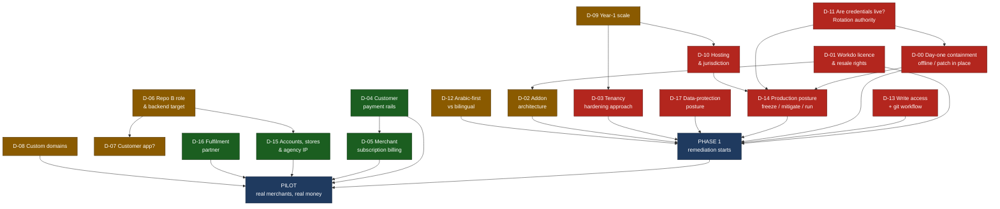
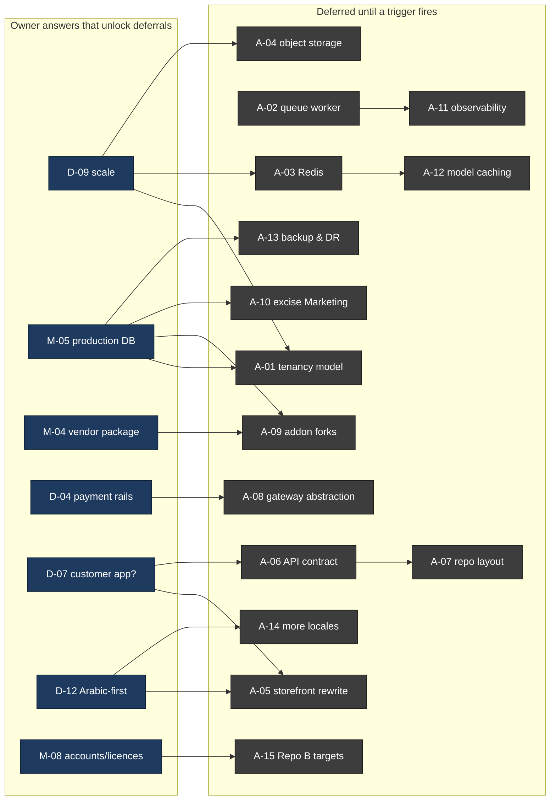

# 10 — Open Questions, Owner Decisions and Deferred Architecture

## How to read this document

The other nine documents in this set tell you what the code **is**. This one tells you what the code
**cannot** tell you, and what only you can decide. It has three parts:

| Part | Contents | Who acts |
|---|---|---|
| **Part 1 — Decisions required from the project owner** | 18 decisions that gate Phase 1 engineering (D-00, then D-01 … D-17). Each has options, trade-offs, our recommendation, what it blocks, and urgency. | You, with counsel and commercial counterparties |
| **Part 2 — Missing information** | 12 information classes the audit could not obtain from code, plus the full consolidated BLOCKED/UNKNOWN register from all sixteen dossiers | You, your host, your bank, your developer |
| **Part 3 — Architectural decisions deferred** | 13 decisions we are deliberately **not** making now, each with the concrete trigger condition that should force it later | Engineering, when the trigger fires |

Two framing facts you should carry into every decision below.

**Fact 1 — this is a customised copy of a commercial product, not bespoke software.** Repo A
self-identifies as WorkDo "eCommerceGo SaaS" version 8.8.2
(`repo-A config/verification.php:4-5`), with 69 addon modules under `packages/workdo/`
(directory count: 69). The only `license` declaration in the repository is the untouched Laravel
skeleton header — `"name": "laravel/laravel"`, `"description": "The skeleton application for the
Laravel framework."`, `"license": "MIT"` (`repo-A composer.json:2,4,9`). That describes Laravel. It
does not license eCommerceGo. There is no vendor EULA, Envato certificate or purchase code anywhere
in the tree.

**Fact 2 — git is not currently the source of truth, so several questions below cannot be answered
by reading code at all.** Repo A has six commits, all authored as `root`, one of them titled
"Update: Controllers, DataTables and Helper adjustments **on server**" (`f33e8525`). Repo B has 68
commits from four authors (`tala` ×60, `flutter02sy` ×4, `fluttertala990-png` ×2, `yazan` ×2). The
pattern is a production server that was `git init`-ed and pushed, not a repository that was deployed.
That is why 15 tables the running code reads have no migration (verified independently by two
skeptics, V7 and V18), and why the production schema, the live settings rows and the enabled-addon
list are all genuinely unknowable from the checkout.

---

# Part 1 — Decisions required from the project owner

## 1.1 Summary table

Urgency key: **DAY ONE** = must be answered before everything else in this table, including the
other **NOW** items; **NOW** = blocks the start of Phase 1; **WEEK 1** = blocks Phase 1 sequencing but not
its start; **BEFORE PILOT** = must be settled before any real merchant or real money touches the
system; **BEFORE LAUNCH** = must be settled before public commercial launch.

| # | Decision | Why it blocks engineering work | Options (with trade-offs) | Our recommendation | What it blocks | Urgency |
|---|---|---|---|---|---|---|
| **D-00** | **Day-one containment: is the platform live with real merchant and customer data, and if so should it be taken offline or patched in place?** | Because this is the one decision that cannot wait for any of the others, and because the audit cannot make it for you. Whether a live deployment exists at all is **UNKNOWN** (Part 2, **M-02**), and the reason is a limit of this audit rather than a judgement: the audit container had **no outbound network access** — every HTTPS request to `storesyria.com` was refused by the sandbox egress proxy (curl 56 / CONNECT 403), so the host was never probed and nothing is asserted about what it currently serves. If it *is* live, defects confirmed in this report are exploitable by an anonymous caller right now: the seven unauthenticated `GET api/admin/*` list endpoints at `repo-A routes/api.php:163-169`, whose only middleware is a pass-through that authenticates nothing (`repo-A app/Http/Middleware/AdminApiLog.php:19-21` is `return $next($request);`), and the password-overwrite route `POST /store-reset-password-update/{id}` (`repo-A app/Http/Controllers/StoreController.php:646`). Until this is answered, no Phase 1 ordering is correct, because containment either comes first or does not happen. | **(a) Take offline / maintenance mode** until the P0 block lands — safest; costs whatever revenue and merchant goodwill exist today, and nothing else. **(b) Patch in place** — keep serving, but close the anonymous endpoints and the takeover routes at the edge and rotate credentials *first*, in hours, then run the programme; keeps revenue, but needs someone with host access available immediately and accepts that the system stays exposed until the edge rule is live. **(c) Accept and monitor** — cheapest today and not defensible once these findings are written down, because the exposure is anonymous, unauthenticated and trivially scriptable. | **Conditional on three facts only you can establish, each in minutes:** is it reachable from the public internet; does the database hold real customers and orders; are the committed credentials the live ones? → **Live + real data + live credentials: (a) then (b)** — rotate with no traffic on the system. **Live + real data, credentials differ: (b) if host access can act within hours, otherwise (a).** **Live + demo data only: (b)**, urgency set by the credentials alone. **Dormant or DNS not pointed: (a) is unnecessary** — confirm it in writing, proceed in order, and rotate the committed credentials anyway because they are in git history. **Still UNKNOWN after asking: treat it as the worst of those rows.** The decision tree and the ordered containment checklist are in `11-RELEASE-READINESS.md` §6 (§6.2, §6.3); **D-00 is the first hours, D-14 is the posture for the months after.** | Phase 1 sequencing in its entirety; D-14, and the order of D-10 and D-11 | **DAY ONE** |
| **D-01** | **Workdo / Envato licence and SaaS resale rights.** Which licence tier was bought, and does it permit multi-tenant SaaS where end users pay? | No licence artefact exists in the repo (`repo-A composer.json:9` is Laravel's MIT, not the product's). If resale is not permitted, every hour spent remediating the Workdo core is spent on an asset you may not be allowed to operate. | **(a)** Confirm an Extended-class entitlement and proceed — cheapest, but you must have it in writing. **(b)** Buy up to the correct tier now — small cost, removes the risk. **(c)** Re-platform onto an open-source base (Bagisto, Medusa, Saleor) — removes licence risk permanently but discards ~85% of the working feature set and restarts Phase 0. | **(a) or (b), decided in writing before any Phase 1 work order is signed.** Do not start remediation on option (c)'s assumptions. | Everything. This is the only finding in the audit that engineering cannot fix. | **NOW** |
| **D-02** | **Addon architecture: stay on Workdo's 69 modules, or progressively own the code.** | The 69 modules are PSR-4-injected at runtime from the `add_on_managers` DB table rather than wired through Composer (dossier 01, F-08/F-09), so `route:cache` and `optimize` cannot produce a correct artefact and nobody can tell from source which modules are live. Any refactor plan needs this answered first. | **(a)** Keep addons pristine and upgradeable; confine all custom work to `app/` — preserves the vendor upgrade path, but you inherit vendor defects and cannot patch them cleanly. **(b)** Fork the addons you depend on and own them — you can fix them, but you lose vendor updates forever. **(c)** Hybrid: pristine by default, fork-on-demand with a written register of forks. | **(c) Hybrid.** Dossier 16 found addons are still pristine while `app/` has been rewritten — that is the right split and it already exists. Formalise it: a `FORKS.md` register, and a rule that nothing is forked without an entry. Separately, excise `packages/workdo/Marketing` (52,107 files / 535 MB / 88.3% of the repo, for an unrelated digital-business-card product). | Refactor sequencing; CI design; repo size; the upgrade story | **WEEK 1** |
| **D-03** | **Tenancy hardening approach.** | Tenancy is shared-DB + `store_id` with **zero** enforcement: no global scopes, no tenant traits, no Policies, no `authorize()` calls across the model files that carry `store_id` — **119 of 188** platform-wide, **57 of 95** in `app/Models/` alone (V8, CONFIRMED; `find app/Models packages -type f -name '*.php' \( -path '*/Models/*' -o -path '*/Entities/*' \) \| wc -l` = 188 and the same `find` piped to `xargs grep -l "store_id" \| wc -l` = 119; `ls app/Models/*.php \| wc -l` = 95 and `grep -l store_id app/Models/*.php \| wc -l` = 57). Isolation rests instead on hand-written filters — **487** explicit `where('store_id', getCurrentStore())` call sites across `app/` and `packages/` (`grep -rn "where('store_id', *getCurrentStore()" app/ packages/ --include=*.php \| wc -l` = 487; the same command against `app/` alone = 330), inside a wider **1,260** `where('store_id', …)` clauses of any second argument (`grep -rnE "where\((['\"])store_id\1," app/ packages/ --include=*.php \| wc -l` = 1260) — and they are systematically omitted on single-record lookups. The fix shape determines weeks of work. | **(a)** Harden model (A) in place: one `BelongsToStore` trait + Eloquent global scope + Policies on the ~12 highest-value models — reuses `getCurrentStore()` (`repo-A app/Helper/helper.php:357-381`), no data migration, fixes the *class* of bug. **(b)** Schema-per-tenant — strong isolation, but a rewrite of 207 migrations, the addon loader and every report, with no evidence anything forces it. **(c)** Keep patching individual queries — cheapest per fix, but the same file already gets it right in one method and wrong in another (`OrderController::orderDetails:572` scoped vs `::orderComplete:362` unscoped), so it will keep regressing. | **(a) Harden model (A).** Every dossier that looked at this reached the same conclusion independently. Nothing in the evidence forces a rewrite. | Every security P0; the API fix; any pilot | **NOW** |
| **D-04** | **Customer payment rails for Syria.** | Of ~52 wired payment types, exactly 2 verify the payment properly, 0 verify the amount and 0 verify any inbound signature (dossier 08). The one Syrian card rail, Paymera, is hardcoded to what appears to be a test host (`repo-A app/Services/PaymentService.php:216`). Engineering cannot choose your acquirer, and the amount of work differs by an order of magnitude between "COD only" and "live cards". | **(a)** COD + offline bank transfer only for the pilot — both rails already exist, lowest engineering cost, but revenue collection is manual and COD is currently booked as collected at checkout (must be fixed either way). **(b)** COD + one verified card rail (Paymera or an alternative) — needs a signed acquirer agreement, a production host, and server-side verification built properly. **(c)** Keep all 52 gateways configurable — maximum surface, maximum audit cost, no benefit in this market. | **(b), staged: ship (a) for the pilot while (b) is contracted.** Then prune hard: delete the gateways you will never use, and the stale payment-callback CSRF exemption list that goes with them (`repo-A bootstrap/app.php:33-64`). | The whole commerce-core P0 block; the go/no-go on taking money | **BEFORE PILOT** |
| **D-05** | **How merchants pay for their subscription.** | There is no recurring billing: `cashier-paddle` is installed but unused, and plan expiry is evaluated **only at login** (`repo-A app/Http/Controllers/Auth/AuthenticatedSessionController.php:85-101`) with no scheduled job. There is a working offline bank-transfer rail (`repo-A app/Http/Controllers/BankTransferController.php:17`, `planPayWithbank`) — which for Syria may be the *right* answer rather than a gap. | **(a)** Offline/manual: bank transfer + receipt upload + admin approval — already built, Syria-viable, but needs the approval endpoint secured (`order_approve/{id}` at `repo-A routes/web.php:467` sits in an auth-only group with no role check, so a merchant can approve their own plan). **(b)** Add a real recurring rail — correct long-term, but depends entirely on D-04's acquirer answer. **(c)** Free/invoiced for the pilot cohort — zero engineering, zero revenue, buys time. | **(c) for the pilot, then (a).** Defer (b) until D-04 resolves. Fix the `order_approve` role check and add a scheduled expiry job regardless of which option you pick. | Billing work; the pilot's commercial terms | **BEFORE PILOT** |
| **D-06** | **Repo B's role, audience, and which backend it targets.** | The audit proved what it *is* but not what you *intend*. It is a merchant/store-owner admin console (five tabs Home/Orders/Products/Categories/More, `repo-B lib/core/controller/dashboard_manager_controller/dashboard_manager_controller.dart:14-20`; it assigns orders to drivers rather than receiving them), and it targets `https://storesyria.com/api/admin` hardcoded in source (`repo-B lib/utils/base_api.dart:3`) with a developer's ngrok tunnel still commented out on the next line (`:4`). There is no build-time configuration, so dev/staging/prod are switched by editing a constant. | **(a)** Confirm merchant-console scope, add `--dart-define` base-URL configuration, ship it — small, correct. **(b)** Broaden it into a merchant + driver app — the driver endpoints exist server-side (`repo-A routes/api.php:36`) but are never called from B; this is new product work. **(c)** Retire it and give merchants the responsive web admin — saves the whole mobile release problem but discards a substantially complete app. | **(a).** It is a coherent merchant console with a 100%-resolving API contract (83/83 endpoint paths resolve, dossier 15). Keep it, configure its base URL properly, and fix the release blockers (debug-keystore signing at `repo-B android/app/build.gradle.kts:41`; credential logging; unwired `flutter_localizations`). | The mobile release plan; the API lock-down sequencing | **WEEK 1** |
| **D-07** | **Is a customer-facing shopping app also needed?** | No customer app exists in either repo — there is no cart, no checkout and no wishlist screen anywhere in `repo-B lib/view/screen/`. But Repo A's API carries 81 `{slug}/…` routes shaped for exactly such a client, implying either a planned or an already-built third client the audit never saw (dossier 15, UNKNOWN #5). Whether those 81 routes are a maintenance liability or a product foundation depends on your answer. | **(a)** No customer app; customers use the responsive storefront — cheapest; the storefront exists (3 themes) and needs the Arabic/RTL and `public/storage` fixes anyway. **(b)** Build a customer app after the merchant app is stable — a new project, 3-6 months, and it makes the API contract work mandatory rather than optional. **(c)** A customer app already exists somewhere and was not provided — then the audit's API conclusions are incomplete and we need the repo. | **(a) for 12 months.** Fix the storefront, then revisit. Tell us immediately if (c) is true — it changes the API lock-down plan, because closing the unauthenticated endpoints would break an app we have never seen. | Storefront investment; API versioning; the 81 `{slug}/…` routes' fate | **WEEK 1** |
| **D-08** | **Custom-domain support: keep, defer, or drop.** | The feature is genuinely custom Syria-team code (Webuzo provisioning, Arabic comments) but it is non-functional today: `WEBUZO_HOST`/`WEBUZO_USERNAME`/`WEBUZO_API_KEY` are resolved through bare `env()` with no defaults (`repo-A config/services.php:119-124`) and are absent from the committed `.env`, so every call throws; the custom-domain path converts that to an error banner while the subdomain path 500s (V22). When it *does* run it requests no TLS certificate — both call sites pass `false` (`repo-A app/Http/Controllers/AppSettingController.php:755` and `:868-872`) into a parameter that sends `issue_lecert => 0` (`repo-A app/Services/WebuzoDomainService.php:29,43`). It also enforces no uniqueness on domains across tenants. | **(a)** Drop for now: merchants get `storesyria.com/{slug}` only — removes a whole class of TLS, uniqueness and SEO problems at zero cost, and slug addressing already works. **(b)** Finish it properly: credentials configured, `issueSsl = true`, uniqueness constraint, canonical URLs, exception handling — days of work plus a dependency on your host's panel API. **(c)** Leave it half-wired — merchants see errors, and the day someone configures the credentials they silently get certificate-less storefronts. | **(a) now, (b) when a paying merchant asks for it.** Option (c) is the current state and is the one unacceptable answer. | Storefront SEO work; the TLS story; merchant onboarding copy | **WEEK 1** |
| **D-09** | **Target scale in year 1: how many merchants, how many orders/day?** | This single number decides the tenancy answer (D-03), the hosting answer (D-10), whether a queue worker and object storage are needed now or later, and whether `genealabs/laravel-model-caching` on a `file` cache driver (`repo-A .env:16-17`, `config/cache.php:18`) is adequate or must be replaced. Today nothing is measured because nothing is instrumented. | **(a)** 10-50 merchants (pilot) — shared DB, one box, file cache, no worker: current architecture is adequate once secured. **(b)** 100-500 merchants — needs Redis, a queue worker, object storage for `uploads/`, and real monitoring. **(c)** 1,000+ — needs the above plus read replicas and a serious look at per-tenant data volume. | **State a number, even approximate.** We will plan for (a) and design so (b) is a configuration change, not a rewrite. An unstated target guarantees over- or under-building. | Infrastructure sizing; caching; queue; object storage; monitoring budget | **WEEK 1** |
| **D-10** | **Hosting and jurisdiction.** | The deployment is inferred to be cPanel/Webuzo shared hosting with the Laravel application root as the document root (`repo-A index.php:17-21`, `.htaccess:24-26,33-36`, and `error_log:1` recording the absolute path `/home/<redacted-account>/public_html/...`). Under that layout any real file at the app root is served without PHP ever running, which is why `/composer.lock`, `/error_log` and 407 tracked files under `uploads/` are fetchable (V1, HIGH). The only access-control directive in the entire repo is a single-filename deny for `.env` (`.htaccess:6-9`). We cannot change the document root without your host. | **(a)** Stay on the current host, move `DocumentRoot` to `public/` — cheapest, fixes the exposure class in one change, but keeps you on shared hosting with no redundancy and whatever that provider's terms allow. **(b)** Move to a VPS/managed Laravel host you control — proper deploys, a worker, backups, staging; a migration project. **(c)** Move to a regional/neutral-jurisdiction provider — may be required by your payment or app-store counterparties. | **(a) immediately as a stop-gap, (b) before the pilot.** You cannot run a payment-bearing multi-tenant SaaS from a tree where the webroot is the source tree. | The entire exposure class; deploys; backups; staging | **NOW** for (a) |
| **D-11** | **Are the committed credentials live production credentials, and who authorises rotation?** | `.env` is committed in `3c39c160` with populated `DB_PASSWORD`, `MAIL_PASSWORD`, `REVERB_APP_SECRET` and `APP_KEY`, and live third-party secrets are hardcoded in the non-gitignorable `repo-A config/services.php:31,34,44` plus a shipped default JWT signing secret at `repo-A config/jwt.php:18`. We will not touch any of them without your instruction, and **rotating `APP_KEY` invalidates every `Crypt::`-encrypted column**, which this codebase relies on for admin route ids and stored merchant API credentials. | **(a)** They are live → rotate everything, in a planned order, with an inventory of encrypted-at-rest columns taken **first**. **(b)** They are stale/dev → much lower urgency, but purge them anyway and verify what production actually uses. **(c)** Unknown → treat as (a). | **Answer this within 24 hours and name one person with rotation authority.** Sequence: inventory encrypted columns → rotate third-party secrets and DB/mail → rotate `APP_KEY` last, with a re-encryption plan. History rewrite (BFG/filter-repo) is a later, separate step; rotation is what stops the bleeding. | Credential hygiene; any history rewrite; the mobile release (a JWT/token rotation logs every app session out) | **NOW** |
| **D-12** | **Arabic-first or bilingual product?** | Arabic is already the best-supported locale (4,462 of 5,018 `__()` keys, 88.9%) and Repo B defaults *and* falls back to Arabic — but `repo-A resources/lang/ar/` contains only `chatwoot.php`, `installer_messages.php` and `myfatoorah.php`, while `repo-A resources/lang/he/` ships `validation.php`, `auth.php`, `passwords.php` and `pagination.php`. So every server-side validation message renders in English for Arabic users. No Arabic-capable webfont is declared anywhere, and Repo B declares `flutter_localizations` without wiring it, leaving an Arabic-default app in global LTR. The scope of the i18n fix differs 3× between "Arabic-first" and "fully bilingual with parity". | **(a)** Arabic-first, English as a courtesy — fix `ar/` validation files, ship an Arabic webfont, wire RTL properly; accept English gaps elsewhere. **(b)** Full bilingual parity — add the 556 missing keys (they cluster precisely in the Syria-specific custom code: finance 54.0%, delivery-syria 60.7%) and maintain both forever. **(c)** English-first — contradicts the market and the existing investment. | **(a) Arabic-first.** It matches the market, the existing translation investment and Repo B's defaults. The four missing `ar/` catalogue files are a one-day fix with the highest user-visible return in the audit. | i18n scope; font licensing; QA matrix; Repo B's localisation wiring | **WEEK 1** |
| **D-13** | **May we modify the repositories in Phase 1, and what git workflow replaces editing on the server?** | Phase 0 was strictly read-only. Nothing can be fixed without write access. More importantly, the current practice — commits authored as `root` with the message "adjustments **on server**" (`f33e8525`) — means a server-side edit can silently diverge from git, and a server-side rename can brick the shipped mobile app with nothing in between to catch it. | **(a)** Full write access + branch/PR workflow + a minimal CI gate (`composer validate`, `pint --test`, `php -l` on changed files, a secret scan) — and an explicit end to editing on the server. **(b)** Write access to a fork only, with you merging — slower, acceptable, keeps your control. **(c)** Read-only continues — then Phase 1 cannot happen. | **(a).** The first commit of Phase 1 should add `.github/workflows/` (there is no `.github/` today) and `.env.testing` — because `repo-A phpunit.xml:25-26` has the SQLite override commented out, so running the suite from a checkout carrying the committed `.env` would run `migrate:fresh` against the live database. | All of Phase 1 | **NOW** |
| **D-14** | **Production posture during remediation: freeze, pilot, or keep selling?** | We could not determine whether a live deployment with real merchants and real orders exists (see Part 2, M-02). If it does, several confirmed defects are actively exploitable right now — anonymous cross-tenant order and PII reads (V5, V16), an unauthenticated password overwrite of any user including super admin (V13), two self-registration-to-RCE paths (V14). The remediation sequence for a live system with customers is materially different from one for a dormant one. | **(a)** Freeze/take offline until the P0 block lands — safest, costs whatever revenue exists. **(b)** Keep running with emergency mitigations first (WAF rules or `.htaccess` denies on the seven unauthenticated `api/admin/*` list endpoints at `repo-A routes/api.php:163-169`, docroot move, credential rotation) then the real fixes — pragmatic if revenue is real. **(c)** Keep running unmitigated — not defensible once the defects are documented. | **(b) if real merchants exist, (a) if they do not.** Either way the four items in D-11/D-10 land first. | The remediation sequence; the disclosure question if customer data is involved | **NOW** |
| **D-15** | **Who owns the Firebase projects, the app-store accounts, and the agency's IP and attribution?** | Repo B's Android config points at Firebase project `syria-store-app` (`repo-B android/app/google-services.json:4`) while its iOS config still points at a *different* project, `flutter-projects-93f3a`, under the stock Workdo bundle id `com.ecommerce.ecommercegoapp` (`repo-B ios/Runner/GoogleService-Info.plist:18,20`) — so iOS push and analytics are not attributed to this product and may fail outright. The Android `applicationId` is `com.syriastore.app` (`repo-B android/app/build.gradle.kts:27`). The login screen carries a "Powered by Lynomia" link to `https://lynomia.com` (`repo-B lib/view/widget/powered_by_lynomia.dart:14,18`), and the Dart package is named `store_go_app` (`repo-B pubspec.yaml:1`). | **(a)** You own all accounts; re-register the iOS app under your own Firebase project and bundle id; decide the Lynomia attribution deliberately. **(b)** The agency holds the accounts — then transfer is a contractual precondition to any release, because losing a release keystore or a Play listing is unrecoverable. **(c)** Leave as-is — iOS telemetry stays broken and you cannot ship iOS. | **(a), with written transfer of every account and the signing keystore escrowed in two places before the first store upload.** Settle the Lynomia placement explicitly — it is a commercial question, not a bug. | Any mobile release; iOS entirely; crash telemetry | **BEFORE PILOT** |
| **D-16** | **Fulfilment: is Delivery Syria (and Zid) contracted, and against which endpoints?** | Both Delivery Syria calls post to an ephemeral ngrok free tunnel — `repo-A app/Services/PaymentService.php:2805` and `repo-A app/Http/Controllers/DeliverySyriaController.php:54` both target `jingle-name-buddhism.ngrok-free.dev` — and the courier is told `'cash_collection' => '0'` as a literal string (`repo-A app/Services/PaymentService.php:2756`), so on a COD order the courier is never told how much cash to collect. The `zid_stores`/`zid_orders`/`zid_events` tables have no migration at all, so we cannot establish that channel ever ran. | **(a)** Delivery Syria is contracted → get the production base URL and API credentials, move them to config, and fix `cash_collection` to carry the real COD amount. **(b)** Not contracted → the only fulfilment integration is dead code; decide between manual fulfilment for the pilot and a different courier. **(c)** Zid is in scope → we need its credentials and the missing schema; otherwise delete the channel. | **(a) with the COD amount fixed before any COD order ships.** If (b), say so and we will remove the integration rather than leave an ngrok URL in a payment path. | Fulfilment entirely; COD reconciliation | **BEFORE PILOT** |
| **D-17** | **Customer-data protection posture.** | 407 customer-uploaded files are tracked in git under `uploads/` (including `uploads/receipt/` and `uploads/profile/`) and, under the inferred document root, are served with no authentication and no signed URL (V1). Separately, Repo A's API logging middleware writes plaintext passwords and bearer tokens to a log file under the webroot, and Repo B writes the login e-mail, the plaintext password and every API response body (bearer token included) to the device log with **zero** release-mode guards. Whether any of this triggers a notification obligation is a question for your counsel, not for us. | **(a)** Treat it as a data-protection matter: counsel review, stop the logging, move uploads behind signed URLs, purge what can be purged. **(b)** Treat it as a hygiene matter and just fix the code. **(c)** Do nothing. | **(a).** Stopping the logging and moving `uploads/` are engineering tasks we can start immediately; the notification question is yours and should be asked now rather than after an incident. | Logging fixes; upload storage; any compliance claim you make to merchants | **NOW** |

## 1.2 Decision dependencies

Several of these cannot be answered in parallel. This is the order the dependencies impose.

**The critical path to starting Phase 1 is six answers: D-00, D-01, D-13, D-11, D-10, D-14** — plus a
stated number for D-09 and a direction for D-03. Everything else can be settled during Phase 1
without stalling it.

---

## 1.3 What we need from you in writing

Not opinions — artefacts. Each of these is a document, a credential, or a one-line answer.

| # | Artefact | For decision |
|---|---|---|
| 1 | The CodeCanyon/Envato purchase record and the licence tier, plus the vendor's written answer on multi-tenant SaaS resale | D-01 |
| 2 | A named person with authority to rotate production credentials, and a yes/no on whether the committed values are live | D-11 |
| 3 | Hosting provider name, plan, and whether you can change the vhost `DocumentRoot` | D-10 |
| 4 | A yes/no: are there real merchants and real orders in production today? Approximate counts. | D-14, M-02, M-03 |
| 5 | A number for year-1 merchants and orders/day, even a rough one | D-09 |
| 6 | Write access to both repositories, or a fork you will merge | D-13 |
| 7 | Acquirer position in writing (Paymera and at least one alternative): can they onboard you, at what settlement terms | D-04 |
| 8 | Delivery Syria's production base URL and credentials, or a statement that no contract exists | D-16 |
| 9 | Transfer of the Google Play, Apple Developer and Firebase accounts, and a decision on the "Powered by Lynomia" placement | D-15 |
| 10 | A one-line product direction: Arabic-first, or bilingual parity | D-12 |

---

# Part 2 — Missing information the audit could not obtain from code

Everything in Part 2 is a gap in *information*, not a defect. We list it because several Phase 1
estimates cannot be firmed up without it, and because two of these gaps (M-02, M-05) can change a
severity rating in either direction.

## 2.1 The twelve information classes

| # | What we need | Why it matters | Where the audit stopped, and why | Who can supply it |
|---|---|---|---|---|
| **M-01** | **Production environment details:** the vhost `DocumentRoot`, the web server (Apache vs nginx/LiteSpeed), whether `mod_rewrite` and `mod_access_compat` are loaded, the PHP version and `disable_functions`, and whether `/home/<redacted-account>/public_html/.git` exists on disk. | The single highest-value unknown in the whole audit. If `.git/` is web-reachable, the committed `.env` and the full history are retrievable and the exposure finding goes from HIGH to CRITICAL (V1, V4 both flagged this explicitly). If the docroot is already `public/`, a whole class of findings becomes unreachable. If `disable_functions` includes `shell_exec`, one of the three RCE paths fails closed. Both `.htaccess` files in the repo are Apache-only and are inert under nginx. | **BLOCKED.** No deploy config of any kind exists in the repo (no vhost, nginx conf, `web.config`, Dockerfile, compose file or Procfile — exhaustively searched). Outbound HTTPS to `storesyria.com` was refused by the sandbox egress proxy (curl 56 / CONNECT 403), so all 13 probe paths returned nothing. Every statement about the deployed layout is inference from `repo-A index.php:17-21`, `repo-A .htaccess:6-9,24-26,33-36` and the absolute path recorded in the committed `repo-A error_log:1`. | You, or your host. **Three `curl -I` commands from any machine outside the host settle it:** `/.git/config`, `/composer.lock`, `/.env`. |
| **M-02** | **Whether a live deployment exists, who operates it, and who has access.** | Decides D-14 entirely, and decides whether the confirmed anonymous data-read paths (V5, V16) are a theoretical finding or an active incident. Also decides whether the "cannot rebuild from source" finding (V7, V18) is a disaster-recovery risk or a present outage. | **UNKNOWN.** The repo's own evidence points to a live server — `repo-A .env:6` names `APP_URL`, `repo-A error_log:1` records a server-side PHP fatal at `/home/<redacted-account>/public_html/...`, and commit `f33e8525` is titled "adjustments **on server**" — but the audit could not confirm it. | You. Also: a list of everyone with SSH, cPanel, database and GitHub access, which you will need for D-11 anyway. |
| **M-03** | **Real merchant, customer and order counts; current GMV; which stores are active.** | Drives D-09, and drives severity triage: a cross-tenant leak across 3 test stores and across 300 live stores are different business events. Also needed to size the schema-reconstruction work (M-05) and to decide whether `uploads/` contains real customer documents or test files. | **BLOCKED.** No database access was permitted, and the audit rules forbid artisan commands that touch a database. | You, from the production database or your own records. |
| **M-04** | **The upstream Workdo eCommerceGo SaaS package at the matching version, plus the licence.** | Repo A has one squashed import commit (`3c39c160`), so git cannot diff local customisations against the vendor baseline. Without the original package we cannot tell you (a) which of the 69 addons are genuinely pristine and therefore upgradeable, (b) what a vendor upgrade would overwrite, or (c) whether the ~48 missing default theme images can simply be recovered from the original zip (dossier 07 believes they can). | **BLOCKED by design.** `repo-A config/verification.php:4-5` states `EcommerceGo SaaS` / `8.8.2`; nothing else in the tree records provenance, and no `codecanyon`/`envato` string appears anywhere in `app/`, `config/`, `resources/`, `database/` or `routes/`. | You, from your CodeCanyon downloads. The original 8.8.2 zip is the single most useful artefact you can hand us after the licence. |
| **M-05** | **The actual production database state:** `SHOW CREATE TABLE` for all tables, the `settings` key/value rows, the `add_on_managers` rows, the `permissions`/`roles` rows, and whether the seeded default super-admin credentials were ever rotated. | Fifteen tables the running code reads have **no migration anywhere** (V7 and V18, both CONFIRMED CRITICAL) — six of them money-bearing (`store_wallets`, `store_wallet_transactions`, `store_withdrawals`, `store_order_financials`, `currency_rates`, `delivery_earnings`) — plus `orders.currency_code`/`currency_symbol` and `customers.deleted_at` (`repo-A app/Models/Customer.php:16,20` applies `SoftDeletes` against a column that appears in zero migrations repo-wide). The production schema is therefore the only authoritative copy and exists nowhere in version control. Separately, almost every behavioural question in the audit is settings-driven: which of ~52 gateways are enabled, whether `stock_management` is on, whether `email_verification` is on, which of the 69 addons are live, whether any store has `enable_domain = 'on'`. | **BLOCKED.** No database access. Confirmed by exhaustion that no `.sql` dump, no `database/schema/` squash, no raw `CREATE TABLE` and no seeder-based DDL exists in the repo. | You. A `mysqldump --no-data` plus four `SELECT`s (`settings`, `add_on_managers`, `permissions`, `roles`) unblocks the single largest P0 in the audit. |
| **M-06** | **Design assets and brand definition:** logo files, brand palette, Arabic typeface licence, and the intended visual direction for the storefront and the merchant app. | 48 of 109 default theme images are missing (dossier 07); no Arabic-capable webfont is declared anywhere in Repo A (admin uses Open Sans with no Arabic subset requested; all three themes use Poppins, which has no Arabic glyphs), so Arabic text renders in an uncontrolled OS fallback. We cannot fix Arabic typography without knowing which typeface you are licensed to use. | **NOT IN SCOPE OF CODE.** The audit established the absence; design intent cannot be read from a repository. | You, or your designer. |
| **M-07** | **Repo B's deployment provenance:** which backend the currently-shipped build targets, whether any build was ever published, and the iOS build history. | `repo-B lib/utils/base_api.dart:3` hardcodes `https://storesyria.com/api/admin` with an ngrok tunnel commented out at `:4`, and the base URL is changed by editing source — so we cannot tell from HEAD what a shipped binary points at. No `ios/Podfile` or `Podfile.lock` is tracked, the iOS Firebase registration is still the stock Workdo one (`repo-B ios/Runner/GoogleService-Info.plist:18,20`), and the release build is signed with the debug keystore (`repo-B android/app/build.gradle.kts:41`) — which means **no release build has ever been accepted by Google Play under that configuration.** | **BLOCKED.** No Flutter or Dart SDK in this environment, so nothing could be analysed, tested or built; and we did not bisect Repo B's 68 commits to date the ngrok URL. | You, or the agency. The Play Console and App Store Connect histories answer it definitively. |
| **M-08** | **App-store and Firebase account ownership and status.** | Repo B's Android and iOS Firebase configs point at two **different** projects (`syria-store-app` vs `flutter-projects-93f3a`), so somebody holds at least two Firebase projects. Whether a Syrian-domiciled publisher can hold and keep Google Play and Apple Developer accounts, and whether Firebase services are available to that account, is a commercial fact we will not assert. | **NOT A CODE QUESTION.** Dossier 16's T5 table flags it as an owner confirmation and deliberately makes no assertion. We follow that. | You, plus written confirmation from Google and Apple. |
| **M-09** | **Third-party credentials and contracts:** Paymera (production host, API docs, whether `/payment-status` needs the bearer token, whether `amount` is major or minor units); Delivery Syria (production base URL, API key — `repo-A config/services.php:44`'s value has placeholder shape); Zid; the SMS/OTP provider that actually delivers to Syriatel and MTN; the mail provider and its deliverability into Syrian and regional inboxes. | Three launch-blocking questions hinge on these and none is answerable from code. Paymera's host is hardcoded to what reads as a test endpoint and it verifies payments with a config key that does not exist. The OTP feature stores its configuration in `otp_integrations` — a table with no migration. `repo-A .env:25` uses the Laravel 10 name `MAIL_DRIVER`, which Laravel 11 ignores, so the effective mail transport is `log`: **no transactional mail is being delivered at all.** | **BLOCKED / NOT A CODE QUESTION.** No network calls were made; provider API semantics are outside both repos. | You, from each provider in writing. |
| **M-10** | **Which compliance regimes bind the operator:** whether the business is inside **PCI-DSS** scope and which SAQ type this architecture implies, and which **data-protection** regime governs Syrian and Kuwaiti customer data, including the cross-border transfers the code already performs. | Raised in `05-SECURITY-AND-QUALITY-AUDIT.md` §8.1 and §8.2, which prove the technical premises and stop there: raw card number and CVV reach the application's own server on at least two wired rails, and customer data is already forwarded to third-party acquirers, to two separate Firebase projects (`repo-A config/services.php:108-111` and `:114-117`) and — if either disk is selected — to S3 or Wasabi storage (`repo-A config/filesystems.php:53-63,65-72`). Which obligations follow decides whether some gateways must be taken **out of scope by deletion** rather than fixed (D-04), whether a breach-notification duty attaches to the confirmed anonymous read paths, and therefore part of the Phase 1 ordering. | **NOT AN ENGINEERING QUESTION, and deliberately not answered.** No lawyer, no PCI Qualified Security Assessor and no data-protection adviser was involved in this audit; doc 05 §8 states its premises and draws no legal conclusion. | **Qualified counsel in the relevant jurisdictions, plus your acquirer in writing** — the SAQ type is the acquirer's determination, not ours. This is the one gap in Part 2 that engineering cannot resolve even with full access. |
| **M-11** | **Your local engineering day rates, and the team actually available to you:** a blended weekly rate, which roles you can staff in-house versus contract, and your own capacity for the owner-side items. | `09-DEVELOPMENT-ROADMAP.md` §16.3 publishes a per-phase **engineer-week band** and §16.7 gives the conversion as arithmetic — `budget ≈ engineer-weeks × blended weekly rate + non-engineering line items` — with **no currency figure anywhere, by design**, because day rates are your local market variable and the audit has no basis for choosing among a Damascus team, a regional agency and an offshore contractor. Without a rate and a team shape those bands cannot become a budget, §16.4's skill mix cannot become a hiring plan, and the separately-budgeted lines §16.3 enumerates (independent security re-test, translation and linguistic review, hosting and running costs, gateway and courier fees, store-listing fees, owner time) stay unpriced. | **NOT A CODE QUESTION, by design.** The roadmap declines to invent money figures or calendar dates; §16.6 states why no date appears until these inputs exist. | You. One blended weekly rate and a list of who is available is enough to turn §16.3 into a budget. |
| **M-12** | **Gateway-by-gateway verification status for the ~44 of ~52 payment callbacks that were not read line-by-line.** | Dossier 08 read roughly 8 of the ~52 wired payment types line-by-line and found exactly **2** that verify the payment server-side, **0** that verify the amount and **0** that verify any inbound signature (D-04). For the other **~44 the status is UNKNOWN — not "absent", UNKNOWN**; the API layer additionally has ~20 payment IPN/callback endpoints that were never opened. Because `return_type` is unread globally (V23, CONFIRMED CRITICAL) the dossiers *expect* most of these to resolve to NO, but **no claim is made for a callback nobody read**. This is the largest single block of unassessed money-path surface in the audit; it is recorded at §2.2 (rows "08 Commerce core" and "09 API layer") and named here so it is not mistaken for closed work. | **PARTIAL — not done, and not blocked by the environment.** The files are readable; the volume exceeded Phase 0's budget, and the audit declines to generalise from the 8 that were read to the 44 that were not. | Engineering, as a scoped gateway-by-gateway review — but **after D-04 prunes the list**, because every gateway you will never use is a file to delete rather than audit. |

## 2.2 Consolidated BLOCKED / UNKNOWN register

Every item the sixteen dossiers could not resolve, with what resolves it. This is the complete
register; it is the honest boundary of the audit.

### Environment-level blocks (affect every dossier)

| ID | Blocked item | Status | Resolved by | Cost |
|---|---|---|---|---|
| B-01 | `vendor/` is absent in Repo A, so no framework or package source could be read. Every "Laravel/Laratrust/Sanctum/themer behaves like X" statement is inference from `composer.lock` plus the absence of an opt-in call in app code. | BLOCKED | `composer install` in a throwaway copy | 1 hour |
| B-02 | `node_modules/` absent; no asset build could be attempted. | BLOCKED | `npm ci` in a copy | 30 min |
| B-03 | No running app and no database: `php artisan route:list`, `config:show`, `about`, `migrate:status`, `schedule:list` were all impossible. Route-table, effective-middleware and driver-resolution claims are read from source. | BLOCKED | A staging copy | 1 day to stand up |
| B-04 | PHPUnit was **not executed** — it did not fail. Independently, it must not be run from a checkout carrying the committed `.env` (`repo-A phpunit.xml:25-26` has the SQLite override commented out and there is no `.env.testing`). | BLOCKED | `.env.testing` + `composer install` | 1 hour |
| B-05 | No Flutter/Dart SDK: `flutter analyze`, `flutter test`, `flutter pub outdated` and every build were impossible. Whether Repo B **compiles at all** is UNKNOWN. | BLOCKED | A Flutter SDK | 1 hour |
| B-06 | No HTTP access to `storesyria.com` (egress proxy refused CONNECT). No finding was confirmed against the live host. | BLOCKED | Three `curl -I` calls from outside | 5 minutes |
| B-07 | No static analysis: PHPStan/Psalm/Pint are neither installed nor configured in Repo A. | BLOCKED + MISSING | Add to `composer.json` dev deps | 2 hours |
| B-08 | No visual, rendering, accessibility or performance verification anywhere — no browser, no device. All RTL, contrast, font-fallback, CLS and layout findings are derived from markup, CSS and asset facts only. | BLOCKED | One browser session per locale; one device per platform | 1 day |

### Area-specific unknowns, by dossier

| Dossier | Unresolved item | Status | Resolved by |
|---|---|---|---|
| 01 Stack | Whether `composer.lock`'s content hash still matches `composer.json`; the vendored `composer.phar` version; whether `serviceWorker.js` is ever registered; the `PhonePe` autoload path. | UNKNOWN | `composer validate`; one grep over `public/js` after B-02 |
| 01 Stack | Whether `/install` and `/update` are reachable — the gate is a `storage/installed` marker and `storage/` is gitignored, so absent from every clone. | PARTIAL | One `curl -I` against the host (B-06) |
| 02 Architecture | Whether Laravel 11 supplies the `view.finder` binding that `repo-A app/Providers/ViewServiceProvider` omits; whether the framework de-duplicates the nested `web` group; the exact `route:cache` failure for the 6 live closure routes; whether `theme_json/`'s 37 root JSON files are authoritative or vestigial. | UNKNOWN | B-01, then one `php artisan route:cache` |
| 03 Tenancy/DB | How `genealabs/laravel-model-caching` derives keys and what it does when `Cache::supportsTags()` is false (the configured driver is `file`, which is not taggable) — so the stale-read consequence is inference. 69 addon modules were audited only at migration/model-census level; **their controllers were not read, so module-level tenant leaks are UNKNOWN and likely numerous.** | UNKNOWN / PARTIAL | B-01; a scoped follow-up audit of the live addons once M-05 names them |
| 04 SaaS model | Laratrust 8.3's `isAbleTo()` resolution (whether any super-admin bypass or wildcard exists); lab404 `ImpersonateManager::take()`'s internal guard; whether the seeded default super-admin credentials still exist in production; `$plan->trial`'s read semantics. | UNKNOWN | B-01; M-05 |
| 05 Platform admin | Whether `audit_logs` exists out-of-band; which addons have `is_enable = 1`; whether `Utility::addNewData()` has ever run; whether `settings.display_landing` is `'on'`; **60 of the 69 addon modules were inventoried but not read method-by-method.** | UNKNOWN | M-05; a scoped follow-up |
| 06 Merchant ops | Whether the `permission:` route-middleware alias actually resolves (it is not in `repo-A bootstrap/app.php:16-29`; Laratrust is expected to self-register it, but its source is absent) — so whether `repo-A routes/web.php:164` 403s, 500s or silently passes is UNKNOWN. Also: `Api/ApiController.php` (400 KB) and `Api/DashboardController.php` (273 KB) were read only in merchant-relevant slices. | UNKNOWN | B-01, then one request to `/finance` on staging |
| 07 Storefront | Whether `qirolab/laravel-themer` prepends or appends theme view paths — this one unknown decided which of two `front_end/layouts/app.blade.php` files runs. **Partially resolved by skeptic V21**, which proved theme views are searched first (because `main_file.blade.php` exists ONLY under `themes/*/views/` yet the storefront renders), downgrading the Arabic-stylesheet finding from CRITICAL to a MEDIUM RTL-override gap. Still UNKNOWN: whether any `stores.theme_id` points at a theme installed on the server but absent from git. | PARTIAL | M-05 (`stores.theme_id` values) |
| 07 Storefront | Webuzo panel semantics: whether `domainadd` issues a certificate regardless of `issue_lecert=0`, and whether a server wildcard certificate covers tenant subdomains. | UNKNOWN | Your host's panel documentation |
| 08 Commerce core | **~44 of ~52 payment-gateway callbacks were not read line-by-line.** Each needs the same question answered individually: does it verify the gateway's response server-side, and does it verify the amount? Given that `return_type` is unread globally (V23, CONFIRMED CRITICAL), the dossier expects most unknowns to resolve to NO. Also: sandbox-vs-live mode per gateway; whether a queue worker runs in production. | UNKNOWN | A scoped gateway-by-gateway review, after D-04 prunes the list |
| 09 API layer | The winner of the duplicate `POST /api/delivery-syria/orders/update-status` registration; route shadowing between `POST /api/{slug}` and the static `api/admin/*` paths; **~20 payment IPN/callback endpoints not opened** (named individually in the dossier); the exploitation depth of the confirmed SQL injection at `repo-A app/Http/Controllers/Api/ApiController.php:4495` (union-based exfiltration vs boolean inference); **~13,000 of the two giant API controllers' lines are UNREVIEWED.** | UNKNOWN | B-03 (`route:list`); scoped follow-up audits |
| 10 Security/authz | Which registration serves a request, since `routes/web.php` and `routes/api.php` are each registered twice (`repo-A bootstrap/app.php:8-14` and `repo-A app/Providers/RouteServiceProvider.php:35-42`) — this is flagged as the **first** thing to confirm on staging because it could shift several severities. Also: cross-guard password-reset token consumption (SUSPECTED, not executed); whether email verification and 2FA are currently on; **~58 addon modules' controllers unread**, and the ones that were read contained a hardcoded `1234` in all nine social-login controllers. | BLOCKED / SUSPECTED | B-03; M-05 |
| 11 Security/injection | Live reachability of `.env`, `composer.phar`, `error_log`, `storage/logs/api.log`, `/install`, `/update` — **"the single highest-value next check"**, one `curl -I` each. Also: whether the deployed upload allow-list differs from the seeded one; whether `deliverysyria.api_key` is real or a placeholder; **2,392 `{!! !!}` sinks were triaged, not exhaustively opened — the XSS finding is a floor, not a ceiling.** | UNKNOWN | B-06; M-05 |
| 12 Frontend/i18n | Which asset-addressing convention is live (the 5 `asset('public/…')` URLs or the ~45 `asset('assets|js|css/…')` URLs — one set must 404); whether `storage/installed` exists in the target deployment, since both `SetLocate` and the theme view-finder no-op without it; whether running the translation string exporter would **delete** Arabic keys that are only referenced from `packages/` (flagged as a hazard — do not run it against `ar.json` without a backup and a diff). | UNKNOWN | B-06; M-01; a dry run on a copy |
| 13 Testing/ops | Whether the undefined `Schedule` reference at `repo-A routes/console.php:9` actually breaks artisan (one `php artisan schedule:list` after B-01 settles it); whether the production cron runs `schedule:run` at all — if not, even the single scheduled job never fires; whether `tokenizer` and `zip` PHP extensions are present; whether the stock Breeze tests would pass. | UNKNOWN | B-01; M-01 (cron table) |
| 14 Repo B | Whether release builds really emit the logged credentials (documented Dart/`package:logger` semantics say yes; **one `flutter build apk --release` plus `adb logcat` confirms it and is the highest-value empirical check on the mobile side**); Syncfusion licence status (commercial, outside both repos); whether iOS has ever been built; whether Repo A's API emits numeric strings, which decides whether Repo B's `as int?` casts crash in production; push-notification end-to-end delivery. | UNKNOWN | B-05; M-07; M-08 |
| 15 Integration | Whether the `Api` addon and therefore `/api-docs` is active (addon state is a DB row); iOS push delivery (the FCM payload carries only an `android` block and no `apns`); the identity of the **two other API clients** the route surface implies — a storefront consumer of the 81 `{slug}/…` routes and a delivery-rider consumer of `delivery-login`/`register-device` — **neither of which is in either repo**; field-level contracts for ~75 of the 83 endpoints. | UNKNOWN | M-05; D-07; a scoped contract-definition task |
| 16 Syria/SaaS gap | Whether `egate-t.paymera.cc` is test or production; whether Paymera's `/payment-status` requires the bearer token (decides whether the integration silently cancels every payment); whether Paymera's `amount` is major or minor units; live reachability of the ngrok tunnel; whether seeded Arabic e-mail templates survive to the inbox; whether the Zid channel has ever run; real-world SMS/e-mail/CDN/app-store/acquiring availability for Syria. | UNKNOWN / BLOCKED | M-09; D-16 |

## 2.3 The seven cheap checks that resolve the most

If you do nothing else from this document, do these. Each is minutes to hours and each collapses a
cluster of unknowns.

| # | Check | Resolves | Cost |
|---|---|---|---|
| 1 | From any machine outside the host: `curl -I https://storesyria.com/.git/config`, `/composer.lock`, `/.env`, `/error_log` | M-01, B-06, V1, V4, and the HIGH-vs-CRITICAL rating of the whole exposure class | 5 min |
| 2 | `mysqldump --no-data` of the production database, plus `SELECT` on `settings`, `add_on_managers`, `permissions`, `roles` | M-05, and the single largest P0 (schema unreproducible from source) | 1 hour |
| 3 | Answer: are there real merchants and real orders in production? | D-14, M-02, M-03, and the severity triage of every cross-tenant finding | 1 minute |
| 4 | `composer install` in a throwaway copy, then `php artisan route:list` and `php artisan schedule:list` | B-01, B-03, B-04, and ~15 inference-labelled claims across dossiers 02, 06, 09, 10, 13 | 2 hours |
| 5 | `flutter build apk --release` then `adb logcat` while logging in | B-05, M-07, and the empirical half of the Repo B credential-logging finding | 2 hours |
| 6 | Produce the CodeCanyon purchase record and the original 8.8.2 package | D-01, M-04, and the "which addons are pristine" question | 1 hour |
| 7 | Open one Arabic storefront page and one Arabic admin page in a browser with devtools Network open | B-08, and every RTL/font/404 finding in dossier 12 | 30 min |

---

# Part 3 — Architectural decisions deliberately deferred

These are decisions we are **not** making in Phase 0 or Phase 1, on purpose. Deciding them now would
mean guessing at facts we do not have (chiefly D-09's scale number and M-05's production state), and
in several cases the current implementation is adequate — the audit's standing position is
**reuse-first: do not rewrite working code for modernisation's sake.**

Each row names the trigger that should force the decision, and the default that holds if the trigger
never fires.

| # | Deferred decision | Why we are not deciding it now | Trigger condition that forces it | Default if the trigger never fires |
|---|---|---|---|---|
| **A-01** | **Move from shared-DB tenancy (`store_id`) to schema-per-tenant or DB-per-tenant.** | Nothing in the evidence forces it. Tenancy model (A) is already in place with `store_id` on 119 of 188 model files (57 of 95 in `app/Models/` alone; commands in D-03) and 52 core + 66 package tables, so hardening it (D-03) needs **no data migration**; a restructure would mean rewriting 207 migrations, the runtime addon loader and every cross-store report. Three dossiers reached this conclusion independently. | Any one of: (a) a merchant contractually requires physically isolated data; (b) you pass ~500 active merchants with the largest tenant holding >20% of rows in `orders` or `products`, so index selectivity degrades; (c) you need per-tenant point-in-time restore or per-tenant export-and-delete; (d) a regulator or enterprise buyer requires it in writing. | Stay on model (A) with an enforced `BelongsToStore` global scope and Policies. Revisit annually. |
| **A-02** | **Introduce a queue worker (supervisor/systemd, later Horizon).** | Today `repo-A .env:19` uses the Laravel 10 name `QUEUE_DRIVER`, which Laravel 11 ignores, so the effective connection is `database` with **no worker running anywhere** — jobs are enqueued and never executed. The correct first move is to fix the variable name (a one-line change), not to design a queue topology. There is also no `app/Jobs` directory at all. | The moment mail is genuinely switched on (fixing `MAIL_MAILER`), because with `sync` mail latency becomes checkout latency and with `database` and no worker mail silently never sends. Also: checkout p95 above ~2s, or the first export/report that times out. | `QUEUE_CONNECTION=sync` with mail sent inline, acceptable only at pilot volume. |
| **A-03** | **Replace the `file` cache store with Redis.** | `repo-A .env:16-17` configures a `file` cache and 78 models use `Cachable` from `genealabs/laravel-model-caching`. The `file` driver does not support tags, and we could not read the package source (B-01) to determine whether a model flush degrades to a whole-cache flush. Deciding this before measuring would be guessing. | Any one of: (a) a second application node (file cache is node-local, so two nodes diverge immediately); (b) the first confirmed stale-read bug traced to model caching; (c) ~50+ active merchants. | Keep `file`, single node. Re-open together with A-12. |
| **A-04** | **Move `uploads/` to object storage behind signed URLs.** | 407 customer files are tracked in git under `uploads/` and, under the inferred document root, are served with no auth (V1). The *immediate* fix is to get them out of the webroot (D-10/D-17); choosing S3 vs Wasabi vs local-with-signed-URLs is a later, cheaper decision. The disks are already defined at `repo-A config/filesystems.php:53-71`, so the adapter work is configuration, not code. | Any one of: (a) a second application node; (b) `uploads/` passes ~5 GB; (c) the day receipts and profile documents must be access-controlled per tenant rather than merely unguessable. | Local storage under `public/` with `storage:link`, plus signed URLs for `uploads/receipt/` and `uploads/profile/`. |
| **A-05** | **Rewrite the storefront front end (SPA / SSR).** | Measured, not assumed: all 69 addon modules ship Blade (670 files / 105,502 lines) and theme switching is a Blade view-path swap, so the admin and addon surface must be improved **in place**. Only the ~44-file storefront theme layer is a defensible migration target, and migrating it before the Arabic defects are closed would carry those defects into a new stack. The Vite/Tailwind/npm toolchain is currently dead code (`@vite` appears 0 times in 1,232 Blade files; there is no `public/build`), so a rewrite would also mean building a pipeline that does not exist today. | All three together: (a) the Arabic/RTL defects of D-12 are closed and verified in a browser; (b) a measured conversion or Core-Web-Vitals target exists that the Blade storefront provably cannot meet; (c) D-07 has answered "no separate customer app", so the web storefront is the primary customer surface and worth the investment. | Improve the 3 existing themes in place: fix `public/storage`, the RTL stylesheet gap, the ~48 missing images, and add the absent SEO basics (no sitemap, no canonical, no structured data today). |
| **A-06** | **API versioning, an OpenAPI contract, and contract tests.** | There is no contract artefact of any kind for the 83-endpoint integration, and the one doc file present is untouched stock vendor documentation covering 38 of 83 endpoints. But writing an OpenAPI spec against an API whose authentication is being replaced (the P0 `CustomAuth` fix) would document a surface that is about to change. Do the auth fix first, then specify. | Either: (a) the first breaking change to any endpoint Repo B calls — because today nothing prevents a server-side rename from bricking the shipped app; or (b) a second client appears (customer app per D-07, or the rider client the route surface implies, see M-05/dossier 15). | A frozen, reviewed endpoint list committed to Repo A plus a smoke test per endpoint Repo B calls. Cheap, and it catches the rename class of failure. |
| **A-07** | **Monorepo, or keep two repositories with a release contract.** | Dossier 15's finding is that the repos are "technically coupled and organisationally uncoupled". That is fixed by process (a release contract, a shared endpoint list, CI on both) before it is fixed by repository layout. Merging repos is disruptive and solves none of the confirmed defects. | The first release that must ship a server change and an app change together — i.e. the day the `CustomAuth` fix lands and Repo B needs a matching build. | Two repos, one release checklist, the endpoint list from A-06 as the shared artefact. |
| **A-08** | **Build a single payment-gateway abstraction with uniform signature verification.** | Of ~52 wired gateways, 0 verify any inbound signature and 0 verify the amount. The correct first move is to prune to the gateways you will actually use (D-04) and fix those properly; designing an abstraction across 52 implementations you are about to delete is wasted work. | The third live gateway, or the first gateway whose webhook verification cannot be expressed in the shape used by the first two. | Two rails (COD + one card gateway) with hand-written, individually reviewed server-side verification. |
| **A-09** | **Fork policy and the vendor-upgrade path for the 69 addons.** | We cannot diff against the vendor baseline until M-04 supplies the original 8.8.2 package, and we cannot tell which addons are live until M-05 supplies `add_on_managers`. Both are owner-supplied. D-02 sets the policy; this entry is about executing a specific upgrade. | Either: (a) a security patch is needed inside a `packages/workdo/` module; or (b) a vendor release contains something you want. Both force the question "can we take it, given our local changes?". | Addons stay pristine, custom work stays in `app/`, a `FORKS.md` register records any exception. |
| **A-10** | **Excise `packages/workdo/Marketing` (52,107 files / 535 MB / 88.3% of the repository).** | The removal itself is trivial — Composer does not reference the module at all, so nothing in `composer.json`/`composer.lock` changes. But it may have an `add_on_managers` row and its 16 migrations may already have created tables other code reads. Deleting before M-05 is answered risks breaking production for a cosmetic win. | Either: (a) M-05 confirms no `add_on_managers` row named `Marketing` and no data in its tables; or (b) CI runtime, clone time or backup size becomes an operational problem. | Leave it in place but exclude it from CI paths, code search and backups. |
| **A-11** | **Observability: error tracking, APM, log aggregation, uptime monitoring.** | There is no CI, no monitoring and no error reporting today (`repo-A bootstrap/app.php` has an empty `withExceptions`, and `app/Exceptions/Handler.php` never runs under Laravel 11). But turning on error reporting while `APP_DEBUG=true` is committed and secrets sit in config files would ship those secrets to a third party. Fix the config first. | The first paying merchant cohort, or the first incident you cannot explain from the logs you have — whichever comes first. Realistically this lands in Phase 1 alongside D-14's mitigations. | Laravel's own daily log channel plus a correctly configured log level, with `storage/logs` moved out of the webroot. |
| **A-12** | **Replace or remove `genealabs/laravel-model-caching`.** | 78 models use it and four raw-write call sites bypass it, which is the classic setup for stale reads. We could not read the package (B-01) so we will not assert a defect. Removing it from 78 models is a meaningful change with a real regression surface. | The second confirmed stale-read bug, or the Redis move (A-03) — at which point the tag behaviour becomes observable and the decision becomes evidence-based. | Keep it, and add the four bypassing write sites to the fix list so they invalidate correctly. |
| **A-13** | **Backup, disaster recovery and multi-region.** | Today the only backup facility is a manual, unencrypted, on-box module that archives `.env`, chmods `0777`, has **no restore at all**, and passes unvalidated input to `shell_exec`. The right first move is host-level automated backups (D-10), not a DR architecture. More fundamentally: **DR is impossible until the 15 missing migrations are reconstructed (M-05)**, because a restore cannot be rebuilt from source today. | The first SLA or uptime commitment you make in a merchant contract, or the first time you need a staging environment refreshed from production. | Host-level daily automated database and file backups, tested by one actual restore to a scratch environment, plus the reconstructed migrations in git. |
| **A-14** | **Locales beyond Arabic and English.** | Hebrew catalogue files exist (`repo-A resources/lang/he/` has the four files Arabic is missing) and the UI exposes many locales, but adding a locale costs QA on every screen and there is no market signal in the evidence. D-12 settles the product direction; this is about expansion. | A market-entry decision for a locale you intend to sell in. | Arabic + English only, with the unused locale directories left untouched rather than deleted (they cost nothing and removing them is churn). |
| **A-15** | **Repo B: the four extra platform targets, and the Syncfusion dependency.** | `web/`, `windows/`, `linux/` and `macos/` are `flutter create` residue (62 tracked files) carrying the `store_go_app` branding, and the app is phone-locked by design (`portraitUp`, fixed `designSize`). Syncfusion is a commercial charting library used in two live screens with **no licence key registered in code** — whether you hold a licence is a commercial fact outside both repos (M-08). Deleting either is cheap; deciding needs your answer. | Either: (a) a tablet, web or desktop requirement appears; or (b) Syncfusion's licence status resolves to "not held", which forces either a purchase or a replacement in those two screens. | Delete the four dead platform targets; keep Syncfusion only if a licence is confirmed, otherwise replace the two charts with `fl_chart` or similar. |

## 3.1 Deferral map

---

# Closing notes

**What this document is not.** It contains no new defect findings — those are in documents 01-08 and
in the sixteen dossiers. It contains no effort estimates for remediation (document 08), and it makes
no claim about Syrian sanctions, payment-network eligibility, app-store eligibility or data-protection
law. Those are questions for your counsel and your counterparties, and dossier 16's own risk table
deliberately declines to assert them. We have followed that.

**Three things are true at once**, and holding all three is what makes this decision tractable.

1. The feature breadth is real and mostly reusable. Self-service merchant onboarding, plans with
   genuine server-side quota enforcement, a wallet and withdrawal ledger, 3 themes, 69 addons, a
   Syrian courier rail, a Syrian card rail, Arabic as the best-supported locale, and a merchant mobile
   app whose 83-endpoint API contract resolves 100% against the server. None of that needs rebuilding.
2. The custom layer added on top of the vendor product is the weakest code in the repository, and it
   is the layer that handles money, tenancy and authentication. That is where every CRITICAL sits.
3. **The repository is not currently a reproducible source of truth.** Fifteen tables the running
   code reads exist only in the production database. Until M-05 is supplied and those migrations are
   reconstructed, there is no staging, no disaster recovery, no second developer, and no way to test
   any fix. This is the one item that gates every other item, and the only person who can unblock it
   is you.

**Answer the seven checks in §2.3 and the six critical-path decisions in §1.2 — D-00 first — and
Phase 1 can start. Without them it cannot.**
