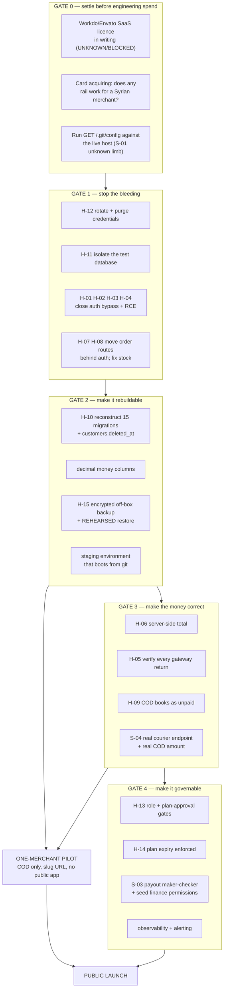

# Store Syria — Release Readiness Assessment

**Audience:** the project owner, making a go/no-go investment decision.

This document is not a score. There is no composite number, no percentage, no
traffic-light average. A readiness score invites the reader to average a
`CRITICAL` against a `LOW` and feel reassured. What follows instead is: what
state each dimension is actually in, what evidence says so, what specific thing
would change that state, and which items must be closed before money and
customer data move through this system.

The single most important sentence in this document: **the platform is
operable and demonstrably in use, but it is not safe to operate**, and those
are different claims. Nothing here says "rewrite it." A large share of the
blockers below are configuration, missing guards, and missing migrations —
cheap to fix in engineering terms, fatal if shipped unfixed.

One ordering note before the assessment. The launch verdict in §5 is about a
future act, and it can wait for a reading of the evidence. §6 is about the
present state — whether something is already serving the public, already
holding customer data, and already exposed — and that question comes **first**,
because a platform that is already live is not made safe by declining to launch
it. If you read only one section today, read §6.

---

## 1. Readiness by dimension

Vocabulary: **READY** = no blocking defect found in this dimension.
**NEEDS WORK** = defects found, none of which alone prevents a controlled
launch. **NOT READY** = at least one defect in this dimension would cause
unauthorised access, loss of money, or loss of data on day one. **UNKNOWN** =
not determinable from the evidence available, and the reason is stated.

Counted figures used below are published with the command that produces them,
so the owner can reproduce each one in the checkout:

- **API surface: 211 route registrations** in `repo-A routes/api.php` —
  `grep -cE "Route::(get|post|put|patch|delete|any|match|resource|apiResource)" routes/api.php` = 211.
  213 *lines* contain the string `Route::`, which is a different measurement;
  this document standardises on **211** as the route count.
- **Explicit tenant filters: 487** `where('store_id', getCurrentStore())` call
  sites across `app/` and `packages/` —
  `grep -rn "where('store_id', *getCurrentStore()" app/ packages/ --include=*.php | wc -l`
  = 487 (330 in `app/` alone). Counting every `where('store_id', …)` clause
  regardless of second argument —
  `grep -rnE "where\((['\"])store_id\1," app/ packages/ --include=*.php | wc -l`
  — gives **1,260**.
- **Models carrying `store_id`: 119 of 188** model files platform-wide (57 of 95
  in `app/Models/` alone) —
  `find app/Models packages -type f -name '*.php' \( -path '*/Models/*' -o -path '*/Entities/*' \) | wc -l`
  = 188 and the same `find` piped to `xargs grep -l "store_id" | wc -l` = 119;
  `ls app/Models/*.php | wc -l` = 95 and `grep -l store_id app/Models/*.php | wc -l` = 57.

| # | Dimension | Readiness | Evidence | What would make it ready |
|---|---|---|---|---|
| 1 | **Security (authentication & access control)** | **NOT READY** | `custom.auth` — the middleware on 189 of 211 route registrations in `repo-A routes/api.php` — looks a Sanctum token up by its integer row id and never compares the token secret (`repo-A app/Http/Middleware/CustomAuth.php:32-34`), and when no `Authorization` header is sent it falls through to `return $next($request);` with no authenticated user (`:54`). Independently, `repo-A app/Http/Controllers/StoreController.php:646-669` overwrites the password of any `users` row by raw id with zero authorization, reachable by anyone who self-registers. | Replace `CustomAuth` with `auth:sanctum` (or add `hash_equals` against the stored hash — the correct check already exists 20 lines from a vulnerable call site at `repo-A app/Http/Controllers/Api/DashboardController.php:620-633`), make the header-absent case a 401, and add role gates to the ~25 ungated admin endpoints enumerated in the platform-admin dossier. |
| 2 | **Data integrity (schema reproducibility)** | **NOT READY** | 15 tables that live, routed code reads and writes are created by **no migration anywhere** — `currency_rates`, `store_wallets`, `store_wallet_transactions`, `store_withdrawals`, `store_order_financials`, `delivery_earnings`, `delivery_boy_devices`, `delivery_boy_notifications`, `otp_integrations`, `chatwoot_integrations`, `chatwoot_notification_templates`, `audit_logs`, `zid_stores`, `zid_orders`, `zid_events` (e.g. `repo-A app/Models/StoreWallet.php:9`, `repo-A app/Services/OrderFinancialService.php:28`). `repo-A app/Models/Customer.php:20` applies `SoftDeletes` while `deleted_at` appears in zero migrations repo-wide. Zero `decimal()` columns exist across 105 migrations; `orders` money is bare `float` (`repo-A database/migrations/2024_01_23_061635_create_orders_table.php:22-27`). | Reconstruct the 15 missing tables as committed migrations from the live `SHOW CREATE TABLE`, add `customers.deleted_at`, migrate every money column to `decimal`, then prove it: a clean clone + `migrate` + smoke test must produce a working system. |
| 3 | **Tenant isolation** | **NOT READY** | Isolation is implemented as a manual per-query convention, not a framework guarantee: 1,281 `getCurrentStore()` call sites and 487 explicit `where('store_id', getCurrentStore())` filters exist (1,260 `where('store_id', …)` clauses in all; commands above), but there are zero Eloquent global scopes, zero tenant traits, no `app/Policies` directory, and an empty `$policies` array (`repo-A app/Providers/AuthServiceProvider.php:15-17`), with Laratrust teams disabled (`repo-A config/laratrust.php:243`). The backstop is therefore absent wherever a developer forgot the filter — e.g. `GET /api/admin/orderlist?store_id=N` has only a pass-through log middleware (`repo-A routes/api.php:166`; `repo-A app/Http/Middleware/AdminApiLog.php:19-22`) and returns any tenant's orders to an anonymous caller. | Add a tenant global scope (or a `BelongsToStore` trait) to the 119 of 188 `store_id`-bearing model files, convert the seven anonymous `/api/admin/*list` endpoints to authenticated + server-derived store, and stop taking `store_id`/`customer_id`/`order_id` from request bodies. |
| 4 | **Commerce correctness (cart, stock, order lifecycle)** | **NOT READY** | Checkout stock decrement is an unlocked, non-transactional read-modify-write with no quantity guard and no floor at zero (`repo-A app/Services/PaymentService.php:2162-2164`); a single request with `qty` greater than stock drives `product_stock` negative on a signed `integer` column. Both stock-restore paths are silent no-ops for non-variant products because the Eloquent model shadows the loop array (`repo-A app/Models/Order.php:620-625`, `repo-A app/Http/Controllers/OrderController.php:461-466`). `status-cancel` is unauthenticated and restores stock **before** checking whether the status change succeeded (`repo-A routes/customer.php:142`; `repo-A app/Http/Controllers/OrderController.php:602-615`), so repeated calls inflate stock without bound. Zero `DB::transaction` and zero `lockForUpdate` anywhere on the customer checkout path. | Wrap order creation in a transaction with `lockForUpdate` on stock (the correct pattern already exists at `repo-A app/Services/OrderFinancialService.php:19-23`), validate `qty`, floor stock at zero, fix the two variable-shadowing bugs, and move the restore loop after the success check. |
| 5 | **Payments** | **NOT READY** | The shared payment-return handler never checks whether payment succeeded: `return_type=success\|cancel` is generated in 11 places and read in **zero** on this path, and the handler unconditionally writes `$order->payment_status = 'Paid'` (`repo-A app/Http/Controllers/PaymentController.php:1354`; `repo-A app/Services/PaymentService.php:2280`). Of ~52 wired payment types, 2 verify properly (Tap, PhonePe), 2 partially, **0 verify the amount, 0 verify an inbound signature**. `tax_price` is taken straight from the HTTP request and lands in the gateway charge amount (`repo-A app/Http/Controllers/PaymentController.php:764`, `:792`). The one Syrian card rail is hardcoded to a test host (`repo-A app/Services/PaymentService.php:216`) and verifies with a config key that does not exist (`repo-A app/Http/Controllers/PaymentController.php:65`). Refunds move no money at all — `RefundAmonut` writes a status string and an attacker-chosen amount and returns (`repo-A app/Http/Controllers/OrderRefundController.php:229-249`); no refund method anywhere in `app/` or the 69 addons is ever called. | Recompute the authoritative total server-side at order creation from DB rows only; verify every gateway return server-side against amount + reference with an idempotency index; cut the live gateway set to what can actually be tested (COD + Paymera + at most one card rail); build a real refund path or state plainly that refunds are manual. |
| 6 | **Test coverage** | **NOT READY** | All 10 files under `repo-A tests/` are unmodified Laravel Breeze scaffolding (`tests/Unit/ExampleTest.php` asserts `assertTrue(true)`); zero business-logic tests; zero tests across all 69 addon modules. Effective coverage of the money path, tenancy and the 52 gateways is **0%**. `repo-B` has one file, `test/widget_test.dart`, the stock counter test, which cannot pass against this app. Execution of both suites was **BLOCKED** (`vendor/` absent; no Flutter SDK), so this is an absence-of-tests finding, not a test-failure finding. | Characterisation tests on the money path first (checkout totals, each live gateway callback, tenancy isolation), a green suite, and CI that runs it. Before writing a single test, close blocker H-11 — today the suite would point at the production database. |
| 7 | **Deployment automation** | **NOT READY** | No `.github/`, no `Dockerfile`, no `docker-compose*`, no `Procfile`, no CI config of any kind (verified by absence). No deploy script, no `Makefile`, no release tagging, no rollback path. The committed `repo-A error_log:1` places the application at `/home/<redacted-account>/public_html` — a cPanel document root — and a PHP fatal error in `Api/ApiController.php` that reached production was fixed by editing files on the live server (the duplicate imports are gone, leaving tell-tale blank lines at `repo-A app/Http/Controllers/Api/ApiController.php:38-44`). Commit `f33e8525` is literally titled "…adjustments on server". | A reproducible build artifact, a staging environment, a deploy that is a command rather than a file copy, and an end to authoring code on production. This is the single change that most reduces the probability of every other blocker recurring. |
| 8 | **Configuration management** | **NOT READY** | `.env` is committed to git and `repo-A .gitignore` (5 lines, read in full) never mentions it — so `APP_KEY`, `DB_PASSWORD`, `MAIL_PASSWORD` and `REVERB_APP_SECRET` are in history and must be treated as compromised. Production runs with `APP_ENV=local` and `APP_DEBUG=true` against `APP_URL=https://storesyria.com` (`repo-A .env:2`, `:4`, `:6`). Live third-party secrets are hardcoded as literals in a non-gitignorable file (`repo-A config/services.php:31`, `:33`, `:34`, `:44` — variable names only). `.env` uses Laravel 10 key names that Laravel 11 does not read, so mail silently falls back to the `log` transport, broadcasting to `null` and the queue to `database`. | Rotate every credential named above, purge them from history, add a real `.gitignore`, move the hardcoded literals to `env()`, rename the stale keys, and set `APP_ENV=production` / `APP_DEBUG=false` — but only after observability exists (dimension 9), or you trade visible errors for silent ones. |
| 9 | **Observability** | **NOT READY** | The only error-tracking package, `larabug`, is wired into the **default** log stack (`repo-A config/logging.php:53-58`) but has no credentials (`LB_KEY`/`LB_PROJECT_KEY` absent from `.env`, defaults are empty strings at `repo-A config/larabug.php:15`, `:27`) and is restricted to `production` while `.env:2` says `local` — dead twice over. No APM, no uptime check, no alerting. `/up` is exposed (`repo-A bootstrap/app.php:13`) and nothing polls it. `AuditLog`, `ActivityLog` and the API logs surface in **no route, controller or view**, and `audit_logs` has no table. On `repo-B`, Crashlytics is fully wired in Dart (`repo-B lib/main.dart:49-55`) and switched off in the manifest (`repo-B android/app/src/main/AndroidManifest.xml:36`), so the owner believes he has Android crash telemetry and receives none. | Working error tracking with real credentials and the real environment name, one alerting channel, log retention off the web-served path, and flipping the `repo-B` Crashlytics flag to `true` (a one-line change). |
| 10 | **Backup & recovery** | **NOT READY** | The sole backup facility is manual-trigger only — an HTTP resource route with no schedule anywhere (`repo-A packages/workdo/BackupRestore/src/routes/web.php:17-19`), so there is no RPO. It archives `base_path()` including the committed `.env`, writes the archive **inside the application tree**, `chmod`s it `0777`, applies no encryption, and its `store()` method — unlike every sibling — has no permission check (`repo-A packages/workdo/BackupRestore/src/app/Http/Controllers/BackupRestoreController.php:54`) while interpolating unvalidated `database_name` into `shell_exec` (`:186-190`). **There is no restore**: `show()`, `edit()` and `update()` are empty stubs. Combined with dimension 2, a disk loss is unrecoverable from source. | Scheduled, encrypted, off-box backups; a restore procedure that has actually been rehearsed against a real dump; and deletion or hardening of the current module. A backup you have never restored is not a backup. |
| 11 | **Performance & scalability** | **NEEDS WORK** (partly UNKNOWN) | Measured facts: `route:cache` is impossible because 6 live closure routes exist, so ~1,891 lines of core routes plus 606 addon route statements are re-parsed every request; `PackageServiceProvider` re-reads the `add_on_managers` table and up to 69 `composer.json` files per request; the admin ships ~3.58 MB of uncompressed JS+CSS in 54 requests per page and the storefront compiles Tailwind **in the browser** via a 477 KB runtime. `QUEUE_DRIVER=sync` (`repo-A .env:19`) with the wrong key name means the Delivery Syria HTTP call — budgeted up to 30s with 2 retries at `repo-A app/Services/PaymentService.php:2795-2802` — runs **inside the customer's checkout request**. `CACHE_DRIVER=file` and `SESSION_DRIVER=file` (`:16`, `:18`) pin a payment to one web node and make the Paymera double-order cache lock process-local. **UNKNOWN:** no load test was run and no production metrics were available, so absolute capacity is not asserted. | Move cache and session off `file`, run a real queue worker and push all third-party I/O onto it, remove the closure routes so `route:cache` works, and build the front-end assets once instead of per page-load. Then measure. |
| 12 | **Localization (Arabic / RTL)** | **NEEDS WORK** | Genuinely strong: `repo-A resources/lang/ar.json` holds 2,848 keys with only 26 identical to their key — a real translation; 4,462 of 5,018 distinct `__()` keys are covered (88.9%); RTL is switched on automatically for `ar` (`repo-A app/Http/Controllers/LanguageController.php:39-51`); Arabic transactional email templates are seeded and real (`repo-A app/Models/Utility.php:553`); `repo-B` **defaults** to Arabic (`repo-B lib/translations/translation_service.dart:8`). Real defects: the customer-facing storefront layout carries no `dir` attribute (`repo-A resources/views/front_end/layouts/app.blade.php:2`); the 556 untranslated keys cluster precisely in the Syria-specific custom code (finance 54.0%, delivery-syria 60.7%); `resources/lang/ar/` is missing `validation.php`, `auth.php`, `passwords.php` and `pagination.php` while `resources/lang/he/` has all four (**SUSPECTED — not independently verified**); no Arabic-capable webfont is declared anywhere; and `repo-B` declares `flutter_localizations` (`repo-B pubspec.yaml:34`) but never wires `localizationsDelegates`/`supportedLocales`, so an Arabic-default app renders with global LTR direction. **Corrected from the auditor's claim:** the Arabic storefront is *not* unstyled — the live per-theme layouts load `main-style.css` and `custom.js` unconditionally; the real defect is that `dir="rtl"` is set with **no RTL override stylesheet loaded** (greentic and techzonix ship none; `repo-A themes/stylique/assets/css/rtl.css` exists and is never referenced by the front-end layout), so Arabic storefronts are mis-mirrored rather than blank. Severity MEDIUM, not CRITICAL. | Add `dir` to the storefront layout (copy the working expression from `repo-A resources/views/layouts/app.blade.php:54`), derive direction from locale rather than the `SITE_RTL` setting so guests get it too, load or write per-theme RTL CSS, ship the four missing `ar/` framework files, self-host an Arabic font, and wire `flutter_localizations` in `repo-B`. Then have an Arabic speaker walk the entire shopper journey. |
| 13 | **Legal & licensing** | **UNKNOWN — BLOCKED** | Repo A is a customised copy of the commercial Workdo "eCommerceGo SaaS" product (`repo-A config/verification.php:4-5`). **No Workdo or Envato licence file, purchase code or EULA exists anywhere in the repo** — every licence file present belongs to a bundled front-end library (TinyMCE, FontAwesome, jQuery UI). `repo-A composer.json:9` declares `"license": "MIT"`, but that is the unmodified Laravel skeleton header sitting under `"name": "laravel/laravel"` and must **not** be read as licensing the Workdo product. Separately, `repo-B pubspec.yaml:43` uses the commercial `syncfusion_flutter_charts` in two live screens with no `registerLicense` call anywhere in `lib/`. | Written answers from Workdo/Envato on (a) which licence tier was purchased and (b) whether it permits multi-tenant SaaS operation where end users pay; and a Syncfusion licence decision. This is not fixable by engineering and it can invalidate the business, so it must be settled first. |
| 14 | **Mobile app (Repo B)** | **NOT READY** | One strong positive: the API contract is complete — all 48 endpoints in `repo-B lib/utils/base_api.dart` resolve to real routes in `repo-A routes/api.php`, with 0 orphans. But it cannot be shipped to a store as built: the Android release build is signed with the **debug keystore** (`repo-B android/app/build.gradle.kts:41`) with no minify, shrink or ProGuard config, which Google Play rejects; the login e-mail and plaintext password are written to the device log (`repo-B lib/core/controller/auth/auth_controller.dart:152`) along with every API response body including the bearer token (`repo-B lib/network/network.dart:125-158`); there are **180 `print(` calls across 33 files and zero `kReleaseMode`/`kDebugMode` guards anywhere in `lib/`**; Crashlytics is disabled on Android; RTL is unwired. | Gate all logging on build mode and strip credential/PII logging, create a real release signing config, enable Crashlytics, wire localizations, resolve the Syncfusion licence, and get one green test plus a CI build gate. These are days of work, not months — but every one of them is a hard precondition for a store submission. |
| 15 | **Support & operations** | **NEEDS WORK** | Two support surfaces exist and both are partly broken. `SupportTicketController`'s `show`/`create`/`store`/`update` are registered by `Route::resource` but the methods do not exist, so those URLs are 500s, and the super admin is explicitly *excluded* from the controller's own gate (`repo-A app/Http/Controllers/SupportTicketController.php:19`); `ticket_status_change:142` has no permission check. The Helpdesk addon's public ticket view (`show:204`) has no `auth` middleware. Platform invoicing of merchants **does not exist** — no PDF, no invoice number, no tax line. There is no runbook, no documentation of any kind (`README.md` is the unmodified stock Laravel file), and no docs/ directory existed before this audit. | Working ticket CRUD with gates, an owner-facing runbook covering deploy / restore / credential rotation / incident response, and merchant invoicing before you bill anyone. |

**Count: 0 dimensions READY, 3 NEEDS WORK, 11 NOT READY, 1 UNKNOWN.** That
distribution is the assessment. It is not softened below.

---

## 2. Blockers

A **HARD** blocker means: if you go live with this open, you should expect
unauthorised access to customer or merchant data, loss of money, or loss of
data that cannot be recovered. A **SOFT** blocker means: it will cost you
customers, merchants, reputation or staff time, but it does not by itself make
the system unsafe.

Each blocker carries a severity, the evidence, and an **exit criterion** — a
specific, checkable condition that clears it. Where an independent verifier
corrected the original auditor's severity, the corrected severity is used and
the correction is stated.

### HARD blockers — must not go live

| ID | Blocker | Severity / Priority | Evidence | Exit criterion |
|---|---|---|---|---|
| **H-01** | **API authentication does not authenticate.** `CustomAuth` resolves a Sanctum token by its integer row id and never compares the secret, so `Authorization: Bearer <any-existing-id>\|anything` executes as that token's owner — up to a `super admin`. With no header at all it passes the request through unauthenticated. 189 route registrations depend on it; nothing rate-limits id enumeration (`throttleApi()` is never called). | CRITICAL / P0 | `repo-A app/Http/Middleware/CustomAuth.php:26`, `:28-29`, `:32-34`, `:38`, `:41`, `:44`, `:54`. Token format confirmed by `createToken(...)->plainTextToken` at `repo-A app/Http/Controllers/Api/DashboardController.php:585` and `repo-A app/Http/Controllers/Api/AuthController.php:127`, `:207`, `:369`. The **correct** check exists in the same codebase at `repo-A app/Http/Controllers/Api/DashboardController.php:620-633` (`hash_equals($token->token, hash('sha256', $tokenValue))`), proving this is a defect and not an alternate design. Undefended example endpoints: `repo-A app/Http/Controllers/Api/ApiController.php:5279-5312` (`user_detail`) and `:1820-1849` (`address_list`), which validate only `customer_id` and return arbitrary customers' PII. | `auth:sanctum` (or a secret-comparing equivalent) guards every route that `custom.auth` guards today; a request with no `Authorization` header receives 401; `throttleApi()` or an explicit throttle is applied to the api group; and a test proves `Bearer 1|wrong` is rejected. |
| **H-02** | **Seven admin API endpoints are anonymous and cross-tenant.** `GET /api/admin/{categorylist,productlist,variantlist,orderlist,couponlist,shippinglist,taxlist}` carry only a pass-through log middleware inside a route group that adds no middleware, and select the tenant from an attacker-supplied `store_id`. Iterating `store_id` dumps every merchant's orders (with customer names/e-mails), catalogue, coupons, shipping and tax configuration. | CRITICAL / P0 | `repo-A routes/api.php:163-169` (each `->middleware(['AdminApiLog'])` only); `repo-A routes/api.php:133` (enclosing group is prefix/name only); `repo-A app/Http/Middleware/AdminApiLog.php:19-22` (`handle()` is `return $next($request);`); `repo-A app/Http/Controllers/Api/DashboardController.php:907-926` (`OrderList` validates `store_id` as an integer, then `Order::where('store_id', $store->id)`); `repo-A routes/api.php:26` (the only `auth:sanctum` is commented out). `repo-A app/Models/Order.php` declares no `$hidden`, so every column serialises. Note the mechanism precisely: these queries **do** filter by `store_id` — the tenant is simply chosen by the caller. | All seven endpoints require authentication, derive `store_id` from the authenticated principal rather than the query string, and reject a `store_id` the caller does not own. Verified by a test that calls each endpoint unauthenticated and asserts 401. |
| **H-03** | **Account takeover by self-registration.** `POST /store-reset-password-update/{id}` overwrites the password of any `users` row — including the platform's `super admin` — with no authorization of any kind, taking a **raw integer** id. Public self-registration creates a `type = 'admin'`, `is_active = 1` user and logs them in immediately, so the actor is an anonymous internet visitor two requests away from full platform control. | CRITICAL / P0 | `repo-A app/Http/Controllers/StoreController.php:646-669` (validates only `password`, then `User::find($id)` → `forceFill(['password' => Hash::make(...)])->save()`); route at `repo-A routes/web.php:663`, bare, whose only enclosing groups are `repo-A routes/web.php:326` (`['auth','xss','setlocate','verified']`) and `:305` (`['web']`). Self-registration: `repo-A routes/auth.php:18`; `repo-A app/Http/Controllers/Auth/RegisteredUserController.php:104` (`'type' => 'admin'`), `:111`, `:128` (`Auth::login`). The GET sibling at `:638-641` *does* `Crypt::decrypt($id)` — so the plaintext-id POST is a regression, not a design. `DemoModeMiddleware` names this exact method at `repo-A app/Http/Middleware/DemoModeMiddleware.php:77` but is applied to **zero** routes, so it mitigates nothing. | A role gate on the method **and** route-level middleware; the id is decrypted or policy-checked; and `{id}` cannot address a `super admin` row at all. Same treatment for the sibling takeover paths in the same controller: `LoginWithAdmin:716` (impersonation with only `auth()->check()`), `changeStatus:849` (merchant suspend), `ownerstoredestroy:671` (cross-tenant store deletion), `changeStore:624` (pivot `current_store` to any tenant — note `$store->is_active = 1` at `:627` is an assignment, not a comparison). |
| **H-04** | **Two anonymous remote-code-execution paths.** `POST /theme-addon` extracts an arbitrary uploaded zip into `themes/` with no authorization and `chmod 0777`, and `POST /install-modules` extracts one into `packages/workdo/` and inserts an `add_on_managers` row whose name comes from the attacker's own `module.json`; `PackageServiceProvider` then registers the attacker's service provider on the next request with no `is_enable` filter. Both are reachable by anyone who self-registers. | CRITICAL / P0 | `repo-A app/Http/Controllers/AddonController.php:54`, `:65` (`$zip->extractTo('themes/')`), `:72-74` (`mkdir(..., 0777)`), with **no** validation of mime or extension; `repo-A app/Http/Controllers/ModuleController.php:214`, `:232`, `:251`, `:279-287`; `repo-A app/Providers/PackageServiceProvider.php:32` (`AddOnManager::pluck('module')` with no `is_enable` filter), `:79` (`$this->app->register($provider)`). Sibling methods in the *same* controllers do check (`AddonController.php:21`, `:153`; `ModuleController.php:24`, `:127`, `:300`), proving the omission is a bug. Document-root reachability: `repo-A .htaccess:24-26` and `:30-31`. A third path — `BackupRestoreController::store` shell-injecting `database_name` — is real but plan-entitlement-gated, so it is not anonymous. | Both endpoints carry the `type == 'super admin'` gate their siblings already have; uploads are validated and extracted outside any autoload or web-served path; `PackageServiceProvider` filters on `is_enable`. Verified by attempting both uploads as a freshly self-registered user and receiving 403. |
| **H-05** | **The "payment succeeded" handler never checks whether payment succeeded.** `return_type=success\|cancel` is written in 11 places and read **nowhere** on this path; the shared handler unconditionally marks the order `Paid`. Stripe's own `cancel_url`, PaymentWall's error callback and Paymera's decline branch all land there. For Paystack/Razorpay/Flutterwave/PaymentWall the browser JS simply navigates to the success URL and the transaction reference is never sent to the server. Of the **8** gateway callbacks read line-by-line, **2 verify properly, 0 verify the amount, 0 verify any inbound signature**; the remaining **~44 of the ~52** wired payment types were **NOT READ** and are **UNKNOWN, not clean**. | CRITICAL / P0 | Writers: `repo-A app/Services/PaymentService.php:365-366`, `:387-400`, `:695-696`, `:3859-3860`, `:4266`; `repo-A app/Http/Controllers/PaymentController.php:105`, `:182`, `:204`, `:207`, `:264`, `:276`, `:279`. Sink: `repo-A app/Http/Controllers/PaymentController.php:1354` (`$order->payment_status = 'Paid';`), duplicated at `repo-A app/Services/PaymentService.php:2280`. Handler route is `Route::any` with no auth: `repo-A routes/customer.php:154`. The only three gateway-outcome guards are PhonePe (`PaymentController.php:913-925`), toyyibpay (`:929-939`) and Tap (`:941-953`). Paymera's own decline branch redirects *into* this handler: `repo-A app/Http/Controllers/PaymentController.php:101-107`. Session payload is stored before redirect at `repo-A app/Services/PaymentService.php:409-410`. | For every enabled gateway: the server independently confirms the payment via the gateway's own API or a signed webhook, compares the returned amount to the server-recomputed total, stores the gateway reference under a unique index for idempotency, and rejects `cancel`. Any gateway with no verifiable callback is **disabled**, not shipped. |
| **H-06** | **The customer sets their own tax, and it reaches the gateway charge.** `tax_price` is read directly from the HTTP request and, whenever the plan has shipping off **or the customer simply omits `method_id`**, returned unchanged and added into the amount sent to the gateway. A negative value lowers what is actually charged. (Corrected scope: client-supplied `shipping_final_price` and `coupon_info[coupon_discount_amount]` corrupt the **persisted** order total and the tax/coupon ledgers but do **not** reach the gateway amount, and the mobile `place-order` path recomputes tax and coupon server-side — so this is a web-checkout defect, not a codebase-wide one.) | CRITICAL / P0 | `repo-A app/Http/Controllers/PaymentController.php:764` (`$tax_price = $request->tax_price ?? 0;`), `:766-771` (returned unchanged), `:792` (`'cartlist_final_price' => $cartlist_final_price + $delivery_price + $tax_price`); consumed as the charge amount at e.g. `repo-A app/Services/PaymentService.php:210-212`, `:224`. Persisted at `repo-A app/Services/PaymentService.php:2247` and `:2463`. Shipping: `repo-A app/Models/Cart.php:198-200`, `repo-A app/Services/PaymentService.php:2032-2034`. Coupon: `repo-A app/Http/Controllers/PaymentController.php:728-733`. Validation on this path is only `customer_id`/`billing_info`/`payment_type` (`repo-A app/Services/PaymentService.php:1946-1957`), and the validator's result is **discarded** — execution continues after `$validator->fails()` (`:1958-1964`). Route is unauthenticated: `repo-A routes/customer.php:150`. | One server-side total calculator takes only cart rows, store id, the persisted address, a coupon resolved **by code and scoped to the store**, and a `method_id` validated against `store_id`; it is called once at order creation and its result — never a request field — is what the gateway is asked to charge. Negative and non-numeric money inputs are rejected. |
| **H-07** | **Unauthenticated order mutation.** `routes/web.php:940-973` sits inside the `web` group but **outside** the auth group (which closes at `:938`), so order payment-status, status-change, return, refund-status and refund-amount endpoints are reachable without logging in. `POST /order-payment-status` with `order_id` + `payment_status` writes arbitrary status onto any order in any tenant with no store filter. Marking an order `Paid` fires the observer and credits the merchant wallet; `cancel` sets `Unpaid` and debits it. | CRITICAL / P0 | Route bounds verified: `repo-A routes/web.php:305` (`['web']` opens), `:326` (auth group opens), `:938` (auth group closes), `:974` (web group closes). Exposed routes: `repo-A routes/web.php:949`, `:950`, `:953`, `:955`, `:957`, `:961`. Handler: `repo-A app/Http/Controllers/OrderController.php:556-564` — four lines, `Order::find($request->order_id)`, assign, save, no auth, no scope, no validation. Wallet chain: `repo-A app/Providers/AppServiceProvider.php:30` → `repo-A app/Observers/OrderObserver.php:32-38` → `repo-A app/Services/OrderFinancialService.php:303-345`. **Correction to the original claim:** CSRF *is* enforced (none of these paths appear in the `validateCsrfTokens` exception list at `repo-A bootstrap/app.php:33-64`), but `csrf_token()` is rendered to anonymous visitors at `repo-A resources/views/layouts/guest.blade.php:138`, so this is a two-request exploit, not a bare POST. | Every one of those routes moves inside the auth group, each handler gains a permission check and a `store_id` filter, and a test proves an anonymous session (with a valid CSRF token) receives 401/403 on each. |
| **H-08** | **Unbounded stock inflation and permanent stock loss.** `status-cancel` is unauthenticated, takes a raw sequential order id, and runs the stock-restore loop **before** inspecting whether the status change was accepted — so repeated POSTs add quantity to `products.product_stock` without bound. Conversely, the two legitimate return paths restore **nothing** for non-variant products, because the Eloquent model overwrites the loop array and `$product['qty']` resolves to `null` (`products` has no `qty` column, accessor, cast or append). | CRITICAL / P0 | `repo-A routes/customer.php:142` (no `->middleware()`; enclosing group at `:49` is `[ActiveTheme, 'themelanguage']`, no auth); `repo-A app/Http/Controllers/OrderController.php:593-615` — restore loop at `:602-613`, success check only at `:615`. `repo-A app/Models/Order.php:496-507` (no RBAC, no store scope; the early error return on repeat is what makes the loop a pure adder). Shadowing bug: `repo-A app/Models/Order.php:616`, `:620-625` and `repo-A app/Http/Controllers/OrderController.php:458`, `:461-466`; the variant branches at `Order.php:629` / `OrderController.php:470` are correct, so the drift is selective and silent. A third entry point hits the same code at `repo-A routes/api.php:110`, and a fourth copy of the shadowing bug lives at `repo-A packages/workdo/AuctionProduct/src/app/Models/AuctionProductOrder.php:308`. Oversell: `repo-A app/Services/PaymentService.php:2162-2164` (unlocked read-modify-write, no floor); `repo-A database/migrations/2023_12_26_092822_create_products_table.php:33` declares `integer` (signed). | `status-cancel` requires `auth('customers')` plus an ownership check; the restore loop runs only after success; `$product['qty']` is read from the order line, not the model; checkout decrements inside a transaction with `lockForUpdate` and a `max(0, …)` floor; `qty` is validated `integer|min:1` against available stock. |
| **H-09** | **COD revenue is booked as collected at checkout.** `payment_status` is hardcoded `'Paid'` for every order with no branch on payment type, including COD and bank transfer; the `Order` observer then credits the merchant's withdrawable wallet immediately. Merchants can request withdrawal against money nobody has collected. The courier is simultaneously never told how much cash to collect — `cash_collection` is the literal string `'0'` on every parcel. | CRITICAL / P0 | `repo-A app/Services/PaymentService.php:2280`; `:139-142` (both `cod` and `bank_transfer` route to that same writer); `:243-244` (Paymera pre-sets `'Paid'` before the customer has seen the gateway). Observer chain: `repo-A app/Providers/AppServiceProvider.php:30`; `repo-A app/Observers/OrderObserver.php:14-20`; `repo-A app/Services/OrderFinancialService.php:52-64`. Withdrawal against the inflated balance: `repo-A app/Http/Controllers/StoreFinanceController.php:492`. Courier payload: `repo-A app/Services/PaymentService.php:2756` (`'cash_collection' => '0'`). The **correct** COD formula already exists in the same repo at `repo-A app/Console/Commands/ZidProcessEvents.php:145`. Bank transfer validates only that an image was uploaded (`repo-A app/Services/PaymentService.php:1878-1880`) — no amount, no reference, no reviewer. | Offline rails (`cod`, `bank_transfer`, `whatsapp`, `telegram`) write `Pending`/`unpaid`; only a server-verified gateway callback may write `Paid`; a human marks paid through the existing permission-gated control at `repo-A app/Http/Controllers/StoreFinanceController.php:17`; the courier receives the real COD amount; and `cash_collected`/`collected_at`/`collected_by` exist on the order so the ledger has something to reconcile against. **This is the cheapest high-value fix in the whole audit** — the reconciliation machinery is already built and already permission-gated. |
| **H-10** | **The repository cannot rebuild its own database.** 15 tables that routed code reads and writes have no `Schema::create` anywhere (six of them money-bearing), `orders.currency_code`/`currency_symbol` are written on every order insert via a model hook but exist in no migration, and `Customer` applies `SoftDeletes` with no `deleted_at` column — which installs a global scope that breaks **every** customer query, including login. Migrations themselves run clean; what fails is the application running against the schema they produce. | CRITICAL / P0 | Missing tables cited per-table in dimension 2 above; exhaustiveness established four ways (207 migrations enumerated across `database/migrations` + 51 package dirs; 168 distinct created-table names; no `.sql` dump tracked anywhere; no raw `CREATE TABLE`, no `Schema::create($var)`, no installer DDL). `repo-A app/Models/Order.php:26-27` and `:63-80` (the `creating` hook always sets both currency columns, and every order insert is Eloquent — zero `DB::table('orders')->insert` exists); `repo-A database/migrations/2024_01_23_061635_create_orders_table.php:14-45` has neither column. `repo-A app/Models/Customer.php:16`, `:20`; `repo-A database/migrations/2023_12_15_112855_create_customers_table.php:14-46`. Reachable failures: `repo-A app/Http/Controllers/UserController.php:131` (`AuditLog::record` with no try/catch → 500 after the user row already committed) and `repo-A app/Http/Controllers/Api/DashboardController.php:832` (the merchant product-list API Repo B calls → 500). Silent failure: `repo-A app/Observers/OrderObserver.php:15-20` catches the exception and only `Log::error`s it, so **orders are accepted while their financial records are silently dropped**. | A clean clone of this branch plus `composer install` plus `migrate --seed` produces a schema against which customer login, checkout, the merchant finance screens and the Repo B product-list endpoint all succeed — demonstrated, not assumed. Reconstruct from the live `SHOW CREATE TABLE`, then diff a fresh migrate against a production dump. |
| **H-11** | **The test suite would run `migrate:fresh` against the production database.** The SQLite in-memory override that Laravel 11 ships *enabled* has been commented out, there is no `.env.testing` and no `database/database.sqlite`, so PHPUnit inherits `DB_CONNECTION=mysql` and the populated credentials from the committed `.env`. Eight of the ten test files `use RefreshDatabase`. | CRITICAL / P0 | `repo-A phpunit.xml:25-26` — read directly: `<!-- <env name="DB_CONNECTION" value="sqlite"/> -->` and `<!-- <env name="DB_DATABASE" value=":memory:"/> -->`, with live `CACHE_STORE`, `MAIL_MAILER`, `SESSION_DRIVER` overrides on either side. No `.env.testing`, no `phpunit.xml.dist`, no `database/database.sqlite` (all absent). `.env` is tracked (`git ls-files --error-unmatch .env` → `.env`) with `DB_CONNECTION=mysql` and populated `DB_DATABASE`/`DB_USERNAME`/`DB_PASSWORD`. `RefreshDatabase` users include `repo-A tests/Feature/ProfileTest.php:11` and `repo-A tests/Feature/Auth/AuthenticationTest.php:11`. **Status qualification:** the configuration defect is VERIFIED by direct read; that `RefreshDatabase` issues `migrate:fresh` is documented framework behaviour and was **NOT EXECUTED** here (`vendor/` absent), so the consequence is a high-confidence inference rather than a demonstrated outcome. | Uncomment the two lines, add a committed `.env.testing` pinned to SQLite, and prove it: `php artisan config:show database` under the testing environment resolves to SQLite. Until this is done, **nobody runs the test suite from any checkout carrying the committed `.env`** — which is a working instruction for the team today, not a future task. |
| **H-12** | **Credentials are in git history and in non-ignorable config.** `.env` is committed with populated `APP_KEY`, `DB_PASSWORD`, `MAIL_PASSWORD` and `REVERB_APP_SECRET`, and `.gitignore` never mentions it. A third-party OAuth client secret and webhook basic-auth credentials sit as **literals** in `config/services.php`, which cannot be gitignored. `APP_KEY` being public matters beyond secrecy: it is the key behind every `Crypt::encrypt` route id used as a capability token in the admin surface. | CRITICAL / P0 | `repo-A .gitignore` read in full — five lines, none mentioning `.env`. Secret-bearing variables by name and line only: `repo-A .env:3` (`APP_KEY`), `:13` (`DB_PASSWORD`), `:29` (`MAIL_PASSWORD`), `:38` (`REVERB_APP_SECRET`), `:22` (`REDIS_PASSWORD`), `:34` (`PUSHER_APP_SECRET`), `:52` (`FIREBASE_CREDENTIALS`). Hardcoded literals: `repo-A config/services.php:31` (`zid.client_secret`), `:33`/`:34` (`zid.hook_user`/`hook_pass`), `:44` (`deliverysyria.api_key`) — note the contrast at `:120-124`, where `env()` **is** used correctly, so the pattern was known and not followed. A legacy FCM server key is hardcoded at `repo-A app/Models/Utility.php:3365`. A shipped default JWT signing secret sits at `repo-A config/jwt.php:18` with no `JWT_SECRET` in `.env`. | Every credential above is rotated (not merely removed from HEAD — the values are in commit `3c39c160` and anyone with past read access has them); history is rewritten; `.gitignore` is replaced with the stock Laravel 11 file; the `config/services.php` literals become `env()` calls. **Before rotating `APP_KEY`**, inventory and re-encrypt `Crypt`-stored columns — `zid_stores.authorization`/`.access_token` will otherwise become permanently undecryptable. |
| **H-13** | **A merchant can take the platform owner's super-admin role, and grant themselves a paid plan.** Any self-registered merchant is assigned the shared global `admin` role, which `Utility::addNewData()` re-grants "Edit Role" and "Delete Role" to **on every login** — so revoking it does not stick. `RoleController::update` then takes the tenant-global `Role` by implicit binding with no ownership scoping, rewrites `users.type` for every holder, and re-stamps the super-admin role into the attacker's store. Separately, `order_approve/{id}` grants a paid subscription with no role check at all. | CRITICAL / P0 | `repo-A app/Http/Controllers/RoleController.php:156`, `:159` (sole guard), `:182-183` (`User::whereIn(...)->update(['type' => $input['name']])`), `:185-186`, `:216`-`:221`; `:133` (`edit()` has **no** ability check, which defeats the one mitigation — the role is hidden from the list at `repo-A app/DataTables/RoleDataTable.php:46`). Grant-on-login: `repo-A app/Http/Controllers/Auth/AuthenticatedSessionController.php:83` → `repo-A app/Models/Utility.php:2860`, `:2872-2873`, `:3058-3060`. Route: `repo-A routes/web.php:335`, with only `:326` and `:305` enclosing. Target id is seeded first: `repo-A database/seeders/PermissionTableSeeder.php:55-66`. Plan self-approval: `repo-A routes/web.php:467`; `repo-A app/Http/Controllers/BankTransferController.php:119-124` — no `type` check, no `isAbleTo`, no ownership check, while the sibling rail at `repo-A app/Http/Controllers/PlanRequestController.php:67` *does* check. | `Role` gets a policy or a tenant global scope; `edit()`/`update()`/`destroy()` cannot address a role outside the caller's store and can never address `super admin`; `Utility::addNewData()` stops granting role-administration to the shared merchant role; `order_approve`/`order_reject` carry a super-admin gate at both route and controller level; and `plan_orders` is audited for rows approved by non-super-admins before the fix lands. |
| **H-14** | **Subscription revenue is not enforced, and subscriptions are 100% of platform revenue.** Plan-expiry enforcement is detected and then deliberately not acted on — both redirects are commented out — and an expired user with an empty `plan_id` is **assigned the `Unlimited` plan**. There is no scheduled job to evaluate expiry at all; it is only looked at during a request. | CRITICAL / P0 | `repo-A app/Http/Middleware/SetLocate.php:79` and `:86-88` (commented-out redirects, read directly), with the `assignPlan` of the `Unlimited` plan at `:73-75`. No platform commission exists anywhere (exhaustive grep for `commission`/`platform_fee`/`admin_commission` returns only delivery-boy and affiliate commission), so there is no second revenue rail: `repo-A database/migrations/2023_12_08_123752_create_plans_table.php:21-24` (quota columns, all `string`-typed). Compounded by H-13's self-approval. | Expiry enforcement re-enabled with a defined grace period, the `Unlimited` auto-assign removed, a scheduled job that evaluates expiry independently of request traffic, and a reconciliation of every merchant currently running on a lapsed plan **before** enforcement goes live. |
| **H-15** | **No backup you can restore, and no way to rebuild if you lose the disk.** H-10 means the schema exists only in the production database. H-15 means the only backup facility is manual, unencrypted, on-box, archives the production `.env`, is world-writable, is triggerable by any plan holder with no permission check, is a shell-injection vector, and **has no restore function**. These two blockers multiply: today, a disk failure is unrecoverable. | CRITICAL / P0 | `repo-A packages/workdo/BackupRestore/src/app/Http/Controllers/BackupRestoreController.php:54` (`store()`, no `isAbleTo`, unlike `index()` at `:26`, `create()` at `:42`, `destroy()` at `:256`), `:144` (`'database_name' => 'required'` only), `:186-190` (`shell_exec` with the DB password on the command line and unescaped user input in the output path), `:93-113` (archives `base_path()`, excluding only `.zip`), `:78`/`:172` (destination inside the app tree), `:124-125`/`:193-194` (`chmod 0777`), `:222-246` (`show`/`edit`/`update` are empty stubs — **no restore exists**). No schedule anywhere (exhaustive grep returns only `repo-A routes/console.php:8-9`). | Scheduled, encrypted, off-box backups with a retention policy and failure alerting; `.env` and `vendor/` excluded; the current module's `store()` gated or the module removed; and — the part that actually matters — **a restore performed end-to-end into a scratch environment and signed off**, with the procedure written down. |

### SOFT blockers — fix before scale, not necessarily before a controlled pilot

| ID | Blocker | Severity / Priority | Evidence | Exit criterion |
|---|---|---|---|---|
| **S-01** | **No document-root isolation.** The app root, not `public/`, is web-served, and the front-controller rewrite is skipped for any path that resolves to a real file — so non-PHP files at the root are served verbatim: `/composer.lock` (616 KB of exact pinned versions = a ready-made CVE target list), `/composer.json`, `/package-lock.json`, `/.env.example`, `/error_log` (leaks the absolute server path), `/composer.phar`, the 52 KB junk file `_active', 1)`, and **407 tracked files under `/uploads/`** including customer-uploaded receipts and profile images with no auth and no signed URL. | **HIGH / P1** (verifier range MEDIUM–HIGH) | `repo-A index.php:17-21` (stock `server.php` at the app root); `repo-A .htaccess:24-26` (front-controller rewrite guarded by `!-f`), `:6-9` (the **only** access-control directive in the entire repo — a single-filename deny for `.env`, in Apache 2.2 syntax), `:3` (`Options -MultiViews -Indexes`, which does block directory listing), `:33-36` (static-prefix redirects into `public/` that fire only when the path is *absent* at the root); `repo-A error_log:1` places the app at `/home/<redacted-account>/public_html`. `git ls-files uploads` → 407. Exhaustive search found exactly two `.htaccess` files and no `.user.ini`, `php.ini`, `web.config` or `nginx.conf`. **Two limbs of the original claim were refuted and are not asserted:** PHP **source is not disclosed** (the handler executes it — `error_log:1-5` proves PHP runs under this root), and the live `.env` **is** denied by `:6-9`. Live probing was **BLOCKED** (proxy 403 on CONNECT). | DocumentRoot moved to `.../public_html/public` and the root `index.php`/`.htaccess` deleted; or, if the host forbids that, explicit denies for dotfiles, `.git`, `*.lock`, `*.json`, `*.log`, `error_log` and `*.phar` placed **outside** any `<IfModule>` wrapper, and `uploads/` relocated under `public/` behind signed URLs. **One manual check the owner should run today from outside the network: `GET https://storesyria.com/.git/config`.** Nothing in either `.htaccess` denies dotted directories. If that returns 200, the committed `.env` (with live `DB_PASSWORD`, `MAIL_PASSWORD` and `REVERB_APP_SECRET`) is publicly retrievable from git objects and this blocker becomes **CRITICAL and HARD**. Whether `.git/` is deployed is **UNKNOWN** from the repo. |
| **S-02** | **Cross-tenant CMS page bleed with a stored-script path.** `GET /{slug}/page/{page_slug}` resolves the page by slug and published-status only, never by `store_id`, although `$store` was resolved on the preceding line. `page_slug` has no unique constraint and eight default slugs are seeded into **every** store, so collisions are the norm. The content is rendered unescaped. | HIGH / P1 | `repo-A app/Http/Controllers/HomeController.php:1706-1711`; route `repo-A routes/customer.php:73`; unescaped sink `repo-A resources/views/front_end/pages/page.blade.php:26` (`{!! $page->page_content !!}`); no unique index (`repo-A database/migrations/2023_12_18_101105_create_pages_table.php:17`) and no `unique` rule (`repo-A app/Http/Controllers/PageController.php:43-49`); seeded defaults at `repo-A app/Helper/helper.php:911-939`. This is the **only one** of the ten `Page` queries in the codebase that omits the tenant filter — the other five scope correctly (e.g. `repo-A app/Http/Controllers/MenuController.php:85`) — so it is an oversight. **Corrected from the auditor's claim:** the bug is *not* steerable (no `ORDER BY`, `->first()`, so one fixed row wins platform-wide) and the obtainable content is already anonymously published, so the real impact is integrity and compliance (one merchant's Terms/Privacy shown on another's storefront, and that merchant's raw HTML/JS executing on the other's origin), not disclosure. Severity HIGH, not CRITICAL. | One clause — `->where('store_id', $store->id)` — plus a `(store_id, page_slug)` unique index and output escaping or sanitisation of `page_content`. |
| **S-03** | **Payout approval has no maker-checker.** The three withdrawal state-transition endpoints carry no auth middleware and no permission check, so any merchant staff account with *zero* finance permissions can approve and mark-as-paid their own store's payouts and forge the reviewer attribution. Conversely, the six Finance permissions their guarded siblings require are created by **no seeder or migration**, so the Finance dashboard is 403 for everyone including the super admin. | HIGH / P1 | `repo-A routes/web.php:186`, `:189`, `:192` — read directly, declared at file top level; the nearest auth group (`repo-A routes/web.php:164`) **closes at `:167`**, 19 lines before them. Handlers `repo-A app/Http/Controllers/StoreFinanceController.php:644-713`, `:719-884`, `:888-1016` contain zero auth checks, while six siblings in the same file each open with an explicit `isAbleTo` (`:19`, `:71`, `:315`, `:396`, `:494`, `:624`). UI-only enforcement at `repo-A resources/views/finance/withdrawals.blade.php:170`, `:204`. Permissions never created: `View Finance Dashboard` appears only at `repo-A routes/web.php:164` and `repo-A app/Http/Controllers/StoreFinanceController.php:71` — no producer anywhere; `Utility::addNewData()` contains zero finance/wallet entries; the Laratrust admin panel that could create them is disabled at `repo-A config/laratrust.php:285`. **Downgraded from CRITICAL to HIGH** because `payWithdrawal` makes **no gateway call** — it only mutates DB state — the `store_id` scoping holds so there is no cross-tenant reach, and an anonymous caller is accidentally blocked (`getCurrentStore()` returns null, so the row lookup matches nothing). | The three routes move into the auth group with a permission gate, matching in-method `isAbleTo` checks are added, and the six Finance permissions are seeded so the module is reachable at all. Both halves must ship together: fixing only the seeder arms three unprotected money endpoints. |
| **S-04** | **The only local courier rail points at a developer tunnel.** Both Delivery Syria calls — parcel list and parcel create — post to an ephemeral ngrok free tunnel, carrying customer name, address, phone, coordinates and selling price. Every parcel is sent an identical invented charge breakdown. Carrier selection is an English string equality test on a merchant-editable field, and parcel-creation failure is logged and swallowed, so the customer gets an order-complete page with no shipment behind it. | CRITICAL / P1 | `repo-A app/Services/PaymentService.php:2803-2806` (read directly) and `repo-A app/Http/Controllers/DeliverySyriaController.php:52-58`. The rest of the codebase uses the real domain for the same service — `repo-A app/Http/Controllers/SettingController.php:51`, `repo-A app/Http/Controllers/AccountProfileController.php:182`, and `config('services.deliverysyria.url')` at `repo-A app/Console/Commands/ZidProcessEvents.php:152` — so the storefront path is the odd one out. Mock charges: `repo-A app/Services/PaymentService.php:2725-2734`. String match: `:2607`. Swallowed failure: `:2617-2623`. Severity is CRITICAL as a defect; it is a SOFT blocker only because a one-merchant pilot can fulfil manually. | The two literals move to `config('services.deliverysyria.url')` (which already exists and is already used correctly elsewhere), the charge payload is derived from the real shipping calculation, the COD amount uses the formula already written at `repo-A app/Console/Commands/ZidProcessEvents.php:145`, carrier selection uses a provider id rather than a name string, and parcel-creation failure surfaces to the merchant. |
| **S-05** | **Transactional email, queues, scheduling and push are each broken in a different way.** Effective `MAIL_MAILER` is `log`, so no mail is sent. Effective `QUEUE_CONNECTION` is `database` with 20 `ShouldQueue` classes and **no worker defined anywhere**. Only one real scheduled job exists, and five functional commands — Zid token refresh, auctions, pre-orders, partial payments, lottery draws — are registered but never scheduled, so four customer-facing revenue features have engines with no ignition. `routes/console.php:9` uses `Schedule::` with no import and no registered alias. Push has a working FCM v1 path and a dead legacy path with a hardcoded key. | HIGH / P1 | Driver drift: `repo-A .env:25` `MAIL_DRIVER=smtp` vs `repo-A config/mail.php:18` `env('MAIL_MAILER', 'log')` with `MAIL_MAILER` absent; same shape for `QUEUE_DRIVER`/`QUEUE_CONNECTION` (`repo-A config/queue.php:16`) and `BROADCAST_DRIVER`/`BROADCAST_CONNECTION` (`repo-A config/broadcasting.php:18`). Exhaustive schedule grep returns only `repo-A routes/console.php:8-9`. Unscheduled commands: `repo-A app/Console/Commands/ZidRefreshTokens.php:10` and the four addon commands. No worker config exists (no supervisor, systemd, Procfile or Horizon). Missing import: `repo-A routes/console.php:9`, with no `aliases` key anywhere in `config/` and zero `Schedule` entries in `bootstrap/cache/packages.php` — **I assess** this throws on every console boot, which would make the entire CLI unusable from a clean checkout, but this could **not be executed** (`vendor/` absent) and is therefore marked PARTIAL. One command settles it after `composer install`: `php artisan schedule:list`. Legacy FCM key hardcoded at `repo-A app/Models/Utility.php:3365`. | Env keys renamed to their Laravel 11 names; a supervised `queue:work`; a `schedule:run` cron entry; the five orphaned commands scheduled with `withoutOverlapping()`; the missing `Schedule` import added and `php artisan schedule:list` shown to work; the legacy FCM sender deleted and its key rotated. |
| **S-06** | **Repo B cannot be submitted to a store.** Debug-keystore signing, no minify/shrink/ProGuard, credentials and bearer tokens in the device log with zero build-mode guards, Crashlytics off on Android, RTL unwired, an unlicensed commercial charting library in two live screens, a merchant-avatar fallback that calls the upstream vendor's demo server from every device's home screen, and a test suite consisting of the stock counter test. | CRITICAL / P1 | Signing: `repo-B android/app/build.gradle.kts:41` (read directly: `signingConfig = signingConfigs.getByName("debug")`, under the unmodified `flutter create` TODO comment) with no `key.properties`, no `.jks`, and no `isMinifyEnabled`/`isShrinkResources` in the block. Logging: `repo-B lib/core/controller/auth/auth_controller.dart:152` logs the login payload including the plaintext password; `repo-B lib/network/network.dart:125-158` logs every response body; **180 `print(` calls across 33 files and 0 `kReleaseMode`/`kDebugMode` occurrences in `lib/`** (counted). Crashlytics: `repo-B lib/main.dart:49-55` vs `repo-B android/app/src/main/AndroidManifest.xml:36`. RTL: `repo-B pubspec.yaml:34-35` declares `flutter_localizations`; no `localizationsDelegates`/`supportedLocales` anywhere; only 3 screens self-correct with an explicit `Directionality`. Syncfusion: `repo-B pubspec.yaml:43`, no `registerLicense` anywhere. Vendor host: `repo-B lib/utils/images.dart:82-86`, live in two production screens. Tests: `repo-B test/widget_test.dart` only. All `flutter` tooling **BLOCKED** — no SDK in this environment. | A release signing config under the owner's control; all logging gated on `kReleaseMode` with credential and token logging removed outright; Crashlytics enabled; localizations wired and RTL verified on a device; the Syncfusion licence resolved or the library replaced; the vendor-host fallbacks replaced with a local asset; one green test and a CI build gate. |
| **S-07** | **Arabic is unfinished exactly where customers meet it.** The storefront layout customers land on has no `dir` attribute; the theme layouts set `dir="rtl"` for Arabic but load no RTL override stylesheet, so Arabic storefronts are mis-mirrored; guests who switch to Arabic never get RTL persisted; new stores default to `en` and a hardcoded theme; the four Laravel framework translation files are missing from `ar/` while `he/` has them; no Arabic webfont is declared anywhere; and all dates use locale-insensitive `date()` with zero `translatedFormat` calls. | MEDIUM / P2 | `repo-A resources/views/front_end/layouts/app.blade.php:2` (no `dir`); `repo-A themes/{greentic,stylique,techzonix}/views/front_end/layouts/app.blade.php:2` sets `dir` and `:18` loads only `main-style.css`; `repo-A themes/stylique/assets/css/rtl.css` exists and is referenced by no front-end layout; guest gap at `repo-A app/Http/Controllers/LanguageController.php:91`; defaults at `repo-A app/Http/Controllers/Auth/RegisteredUserController.php:118`, `:121`. Missing `ar/` framework files and the absent Arabic webfont are **SUSPECTED — not independently verified**. One genuine broken reference remains in the non-overridden payment views: `repo-A resources/views/payment/nmi-payment.blade.php:5` requests `rtl-main-style.css`, which exists in no theme and 404s. | `dir` derived from locale in the storefront layout; RTL CSS written or loaded per theme; `ar/` framework files added; an Arabic webfont self-hosted; new stores default to `ar`; and an Arabic-speaking reviewer signs off the complete shopper journey on a real device. |
| **S-08** | **The public homepage runs migrations and seeders on every anonymous request,** and the platform fetches executable configuration from the vendor's demo server at runtime with no timeout. | MEDIUM / P2 | `repo-A app/Http/Controllers/HomeController.php:124-125` — read directly: `Artisan::call('package:migrate LandingPage'); Artisan::call('package:seed LandingPage');`, gated only on the `display_landing` setting being `'on'` (whether it is, is **UNKNOWN** — DB state). `repo-A app/Models/Utility.php:1073` — `file_get_contents('https://ecom-demo.workdo.io/cronjob/addon.json')` with no timeout, no TLS pinning, no schema validation and no failure handling. 1,267 files still carry upstream vendor branding. | The Artisan calls are removed from the request path; the phone-home is removed or given a timeout, a cache and failure handling; vendor branding is removed (licence permitting — see the licensing gate). |
| **S-09** | **The "XSS middleware" provides no XSS protection and silently corrupts passwords.** It HTML-entity-decodes every request value, has its only tag-stripping regex commented out, and then blind-`str_replace`s four strings — including `alert` and `javascript` — out of every string field, writing the mutated values back. | MEDIUM / P1 | `repo-A app/Http/Middleware/XSS.php:51`, `:55`, `:56` (commented-out regex), `:57`, `:60`. **Corrected from the auditor's claim:** the asserted mechanism is wrong — the denylist never removes literal `<` or `>`, so a raw payload passes through untouched with or without the decode; the middleware is approximately a no-op for XSS, not an amplifier, and there is no upstream encoder for it to undo. The genuine, verified defect is credential corruption: `repo-A routes/web.php:782` (`user-password-update`) is inside the xss group, `repo-A app/Http/Controllers/UserController.php:400`/`:406` hash the **already-stripped** value, while `POST /login` (`repo-A routes/auth.php:23`) carries only `throttle:auth` and **not** `xss` — so a password containing `alert` or `javascript` is silently truncated when set and intact when typed at login: permanent self-lockout with no explanatory error. The same mutation corrupts every string field on ~610 lines of admin routes. Severity MEDIUM, not CRITICAL. | Delete the middleware rather than repair it, and address output escaping at the real root cause: 2,304 unescaped `{!! !!}` sinks across `resources/views` and `packages/workdo` combined with a near-absent validation layer (2 FormRequest classes against ~1,330 controller methods). |
| **S-10** | **Custom-domain TLS, and the custom-domain feature generally.** The Webuzo provisioning integration always requests domains with no certificate, and the whole feature is currently non-functional because its credentials are unconfigured — the custom-domain path fails closed with an error banner, and the subdomain path raises an **uncaught exception (HTTP 500)**. | MEDIUM / P2 | `repo-A app/Services/WebuzoDomainService.php:29` (`bool $issueSsl = false`), `:43` (`'issue_lecert' => $issueSsl ? 1 : 0`), `:404`/`:417` (same for subdomains), `:383-396` (`validateConfiguration()` throws); both call sites pass `false` explicitly (`repo-A app/Http/Controllers/AppSettingController.php:755`, `:868-872`); credentials resolved by bare `env()` with no defaults at `repo-A config/services.php:120-122` and **absent** from `.env`, `.env.example` and the committed `.env` (checked by name only). The subdomain branch has no try/catch in either the service (`:410`) or the controller. Separately, Paymera callbacks are pinned to `https://storesyria.com` (`repo-A app/Services/PaymentService.php:217`), so a merchant on a custom domain is bounced off their own domain mid-payment. **Downgraded from CRITICAL to MEDIUM:** this is a latent defect, reachable only by an authenticated merchant editing their own settings, and it cannot bite until the credentials are configured. | `issueSsl` defaults to `true`; the subdomain path handles exceptions; the Paymera base URL is derived from the store rather than hardcoded; and no custom domain is provisioned for a real merchant until TLS issuance has been observed working end to end. Until then, keep every pilot store on the slug path. |
| **S-11** | **No invoices, no receipts, no platform billing documents.** There is no order-invoice PDF anywhere on the core path; both "document" endpoints render raw Blade HTML. Platform invoicing of merchants does not exist at all — no PDF, no invoice number, no tax line. And the bundled PDF engine cannot shape Arabic on its unpublished defaults. | MEDIUM / P2 | `repo-A app/Http/Controllers/OrderController.php:408` and `:423` return views, not PDFs; `barryvdh/laravel-dompdf` is required (`repo-A composer.json:16`) but invoked only twice in the whole tree, neither for an order invoice; `config/dompdf.php` was never published, so dompdf runs on vendor defaults with **no Arabic-capable font configured**. | Order receipts and merchant invoices exist with sequential numbers and a tax line. **Decide the engine before writing the feature:** dompdf on its defaults will render Arabic as disconnected reversed glyphs, and that will be discovered by a customer. The existing `repo-A resources/views/order/shippinglabel.blade.php` already carries RTL rules (`:156-165`) and a browser print engine shapes Arabic correctly — that is the cheaper, safer foundation. |
| **S-12** | **SYP is seeded at 1 SYP = 1 USD, there is no FX source, and self-registered merchants get no currency rates at all** — so any non-USD conversion throws for them, and a merchant who switches store currency before hand-fixing the rate destroys their price list irreversibly. | HIGH / P1 | `repo-A app/Http/Controllers/StoreController.php:192-205` (every `'rate' => 1`), duplicated at `:341-354`, `repo-A app/Http/Controllers/SettingController.php:1573-1590` and `repo-A app/Http/Controllers/Api/DashboardController.php:5864`. Destructive in-place rewrite: `repo-A app/Services/StoreCurrencyConversionService.php:103-108`, with no pre-conversion snapshot. Hard throw when no rate row exists: `:61-68`. Self-signup seeds none (`grep -c 'CurrencyRate' repo-A app/Http/Controllers/Auth/RegisteredUserController.php` → 0). No FX provider is integrated anywhere. And the table it all depends on, `currency_rates`, has no migration (H-10). | One shared currency seeder; a non-USD currency requires an explicit rate before it can be activated; `currency_rates` seeded at self-registration; a pre-conversion price snapshot; rate-change history and a staleness warning. Manual rate entry is arguably the right call for SYP — but the code must support operating it. |

---

## 3. Conditions for eventual production launch

A checkable pre-launch list. Each item is phrased so that the answer is yes or
no, not "in progress". Items marked **[blocked-by-fact]** cannot be ticked by
engineering alone.

### 3.1 Security

- [ ] `custom.auth` is gone; every route it guarded is behind `auth:sanctum` or an equivalent that compares the token secret. A test asserts `Bearer <valid-id>|wrong-secret` returns 401. *(H-01)*
- [ ] A request with no `Authorization` header to any `/api/*` route returns 401, never 200. *(H-01)*
- [ ] Rate limiting is applied to the api group; token-id enumeration is throttled. *(H-01)*
- [ ] The seven `/api/admin/*list` endpoints require authentication and derive `store_id` from the principal. An unauthenticated call to each returns 401. *(H-02)*
- [ ] No endpoint anywhere takes `store_id`, `customer_id`, `order_id`, `user_id` or `refundId` from the request body/path without an ownership check. *(H-02, H-07, S-03)*
- [ ] `storeResetPasswordUpdate`, `LoginWithAdmin`, `changeStatus`, `ownerstoredestroy` and `changeStore` all carry role gates; `canImpersonate()`/`canBeImpersonated()` are implemented on the `User` model; `super admin` cannot be impersonated or password-reset through any route. *(H-03)*
- [ ] `ThemeInstall` and `module.install` are super-admin-gated, validate uploads, and extract outside any autoload or web-served path; `PackageServiceProvider` filters on `is_enable`. A self-registered user attempting either receives 403. *(H-04)*
- [ ] `BackupRestoreController::store()` is permission-gated and uses array-argument process invocation, not an interpolated `shell_exec` string, with the DB password passed via environment. *(H-15)*
- [ ] Every order-mutation route is inside the auth group with a permission check and a `store_id` filter. *(H-07)*
- [ ] `Role` edit/update/destroy cannot address a role outside the caller's store and can never address `super admin`; `Utility::addNewData()` no longer grants role administration to the shared merchant role. *(H-13)*
- [ ] `order_approve`/`order_reject` carry a super-admin gate at route **and** controller level, and `plan_orders` has been audited for pre-fix self-approvals. *(H-13)*
- [ ] A tenant global scope or `BelongsToStore` trait is applied to the 119 `store_id`-bearing model files (of 188), so a forgotten manual filter fails closed. *(tenant isolation)*
- [ ] `/{slug}/page/{page_slug}` is store-scoped; `(store_id, page_slug)` is unique; `page_content` is escaped or sanitised. *(S-02)*
- [ ] The `xss` middleware is deleted and the `{!! !!}` sinks that actually matter are escaped or sanitised. *(S-09)*
- [ ] `APP_DEBUG=false` and `APP_ENV=production` — **and** error tracking works, so this does not trade visible errors for silent ones. *(configuration)*
- [ ] DocumentRoot is `public/`, or every sensitive root path is explicitly denied outside any `<IfModule>` wrapper, and `uploads/` is behind signed URLs. *(S-01)*
- [ ] **[blocked-by-fact]** `GET https://storesyria.com/.git/config` from outside the network returns 404, not 200. If it returns 200, treat every credential in git history as actively exposed and re-run the rotation. *(S-01)*
- [ ] An independent penetration test has been run against a staging copy, and its findings are closed. *(no test of any kind has been performed; this audit is code reading only)*

### 3.2 Data

- [ ] A clean clone of the repo plus `composer install` plus `migrate --seed` boots a working system — demonstrated by a witness, not asserted. *(H-10)*
- [ ] All 15 missing tables exist as committed migrations, reconstructed from the live schema and diffed against a production dump. *(H-10)*
- [ ] `customers.deleted_at` exists; customer login and every customer listing work on a schema built from source. *(H-10)*
- [ ] `orders.currency_code` and `orders.currency_symbol` exist in a migration. *(H-10)*
- [ ] Every money column is `decimal` with precision sized for SYP magnitudes, not for a subunit; `products.price`, `plans.price` and `shipping_methods.cost` are no longer `float`/`string`. *(H-10, S-12)*
- [ ] Historical float rows have been reconciled and the restatement is signed off. *(H-10)*
- [ ] `phpunit.xml` points the suite at SQLite; `.env.testing` is committed; no checkout can run `migrate:fresh` against production. *(H-11)*
- [ ] Every credential named in H-12 has been **rotated**, not merely removed from HEAD; history has been rewritten; `Crypt`-encrypted columns were re-encrypted before `APP_KEY` rotation. *(H-12)*
- [ ] `config/services.php` contains no secret literals. *(H-12)*
- [ ] Order creation runs in a transaction with `lockForUpdate` on stock, a floor at zero, and a quantity re-check inside the lock; external I/O (mail, SMS, carrier POST) is outside the transaction. *(H-08)*
- [ ] Both stock-restore paths restore the correct quantity for non-variant products, and all four copies of the shadowing bug are fixed. *(H-08)*
- [ ] An encrypted, off-box, scheduled backup exists with a retention policy and failure alerting, **and a restore has been performed end to end into a scratch environment and signed off.** *(H-15)*
- [ ] A written data-retention and customer-data-deletion position exists, given that 407 customer uploads are in git history. *(S-01, H-12)*

### 3.3 Operational

- [ ] A staging environment exists that is provisioned from git, not copied from production. *(deployment)*
- [ ] Deployment is a command with a rollback, not a file copy; nobody edits code on the production server. *(deployment)*
- [ ] CI runs on every push: `composer validate`, the `php -l` sweep (today clean across 3,113 files — lock that in), `pint --test`, and the PHP test suite against SQLite. *(test coverage)*
- [ ] A green test suite exists covering, at minimum: checkout total computation, every enabled gateway callback, tenancy isolation (can store A read store B?), and order status transitions. *(test coverage)*
- [ ] Error tracking has real credentials and the real environment name; one alerting channel is wired and has been tested with a deliberate exception. *(observability)*
- [ ] `php artisan schedule:list` runs and shows the expected jobs; a `schedule:run` cron entry is installed; the five orphaned commands are scheduled. *(S-05)*
- [ ] A supervised `queue:work` process runs; mail, SMS, push and the carrier call are queued, not inline; `failed_jobs` is monitored. *(S-05)*
- [ ] `MAIL_MAILER` is set and a real test e-mail has been received at an external address. *(S-05)*
- [ ] Cache and session are off the `file` driver; `route:cache` works (the closure routes are gone). *(performance)*
- [ ] Logs are off the web-served path and rotated. *(S-01, observability)*
- [ ] A runbook exists covering deploy, rollback, restore, credential rotation and incident response — and someone other than its author has followed it successfully. *(support/ops)*
- [ ] `storage/` can be created from documented steps on a fresh clone (today it is gitignored entirely and absent, so a fresh clone cannot boot). *(deployment)*
- [ ] The `/install` and `/update` routes are confirmed unreachable on the live host; `config/installer.php:143 'updaterEnabled'` is `'false'`. **[partly blocked-by-fact]** — the gate is a marker file under the absent `storage/`, so this must be probed against the deployed host. *(ops)*
- [ ] A load test has been run against staging at the expected concurrency, and the result is known rather than assumed. *(performance — entirely unmeasured today)*

### 3.4 Commercial & legal

- [ ] **[blocked-by-fact]** A written answer from Workdo/Envato states which licence tier was purchased and **whether it permits multi-tenant SaaS operation where end users pay.** Do not launch commercially without this. *(licensing)*
- [ ] **[blocked-by-fact]** Whether per-tenant or per-end-user licensing applies is answered in writing. *(licensing)*
- [ ] **[blocked-by-fact]** Whether removing upstream vendor branding is permitted, required or forbidden is answered in writing. *(licensing, S-08)*
- [ ] **[blocked-by-fact]** Ownership of the custom `app/` work (Paymera, Delivery Syria, Zid, the finance ledger) is established in writing. *(licensing)*
- [ ] The Syncfusion licence position for `repo-B` is resolved, or the library is replaced. *(S-06)*
- [ ] **[blocked-by-fact]** At least one card-acquiring answer exists in writing: Paymera's production host, its amount units (major or minor), and whether its status endpoint requires the bearer token. Without these three facts the only online rail cannot be made to work. *(H-05, S-04)*
- [ ] COD policy is defined by the business: surcharge, per-order ceiling, governorate coverage, blocked-customer handling. None of these controls exists in code today. *(H-09)*
- [ ] Refund policy is defined and matches reality: either a real gateway refund path is built, or the UI stops saying "Refunded" when no money has moved. Today 100% of refunds are a status string. *(H-05, S-11)*
- [ ] Merchant invoicing exists before any merchant is billed. *(S-11)*
- [ ] **[blocked-by-fact]** Hosting terms, email deliverability to Syrian/regional inboxes, SMS delivery to Syriatel/MTN, CDN reachability, and Google Play / Apple Developer account eligibility are each confirmed with the respective provider. None of these is a code question and none was asserted in this audit. *(commercial)*
- [ ] Terms of service, privacy policy and a data-processing position exist for a platform holding merchant and end-customer data. *(legal)*

---

## 4. A responsible one-merchant pilot

A pilot is the right next milestone, and it is far cheaper than a launch — but
only if it is scoped as a **controlled experiment with a cooperating merchant
who knows they are first**, not as a quiet launch with one customer. The point
of the pilot is to learn whether the operational model works (COD collection,
Arabic UX, merchant onboarding, courier handoff) without betting customer data
or real money on the blockers that are still open.

### Does the evidence support doing a pilot?

**Yes — conditionally, and the condition set is materially smaller than the
launch set.** Three findings make a pilot defensible:

1. **The platform genuinely works as a product.** Merchants self-register and
   get a store in the same request; plans exist with real server-side quota
   enforcement; there are a super-admin panel, a merchant panel, three
   storefront themes, 69 addon modules, and an Arabic-default merchant app
   whose API contract against the backend is **complete** — all 48 endpoints in
   `repo-B lib/utils/base_api.dart` resolve to real routes in
   `repo-A routes/api.php`, with zero orphans. This is not a prototype.
2. **The financial machinery that COD needs already exists and is already
   permission-gated.** `repo-A app/Services/OrderFinancialService.php` is a
   purpose-built ledger that snapshots the order's currency at order time
   (`:66-80`), moves money into and back out of the wallet with reversal
   transactions (`:284`, `:397`), and locks the wallet row
   (`:20-22`). It is fed the wrong input by one line
   (`repo-A app/Services/PaymentService.php:2280`). Fixing that line turns a
   lying ledger into a working one.
3. **A Syria-viable billing rail is already built.** Offline bank transfer with
   receipt upload and super-admin approval is complete end to end
   (`repo-A app/Http/Controllers/BankTransferController.php:19-148`), so the
   platform can bill a merchant without any card gateway. Its defect is a
   missing role check (H-13), not a missing feature.

### Pilot entry conditions

These are the HARD blockers that a one-merchant, COD-only, invite-only pilot
cannot shed. The reasoning for each inclusion is given, because the owner
should be able to challenge the list.

| Must be closed before the pilot | Why it cannot wait |
|---|---|
| **H-01, H-02, H-03, H-04** (auth bypass, anonymous admin API, account takeover, RCE) | All four are reachable by an anonymous internet visitor. A pilot does not reduce internet exposure — the moment the site is reachable, so are these. H-03 and H-04 begin with public self-registration, which the pilot cannot disable without disabling onboarding. |
| **H-07, H-08** (unauthenticated order mutation, unbounded stock inflation) | Both are anonymous and both corrupt the pilot's own data. You cannot learn anything about COD operations from a dataset a stranger can rewrite. |
| **H-10** (missing migrations) | Without it there is no staging environment, so every fix is tested in production, which is the practice that caused several of these blockers. It is also the precondition for H-15. |
| **H-11** (test DB isolation) | A two-line edit standing between the team and total data loss. There is no argument for carrying it. |
| **H-12** (credential rotation) | The credentials are in git history. A pilot with real customer data under exposed credentials is the specific scenario to avoid. |
| **H-09** (COD booked as paid) | The pilot's entire purpose is to learn whether COD works operationally. If every order books as collected at checkout, the pilot measures nothing and the merchant's balance is fiction. |
| **H-15** (no restore) | A pilot generates the first real data. Losing it unrecoverably would end the pilot and the learning with it. A rehearsed restore is the minimum. |
| **H-13** (role escalation / plan self-approval) | One friendly merchant is still a tenant with staff accounts, and the escalation path is re-granted on every login, so operator-side revocation does not hold. |

### What the pilot is explicitly allowed to defer

| Deferred | Why it is safe to defer in a one-merchant COD pilot |
|---|---|
| **H-05, H-06** (gateway verification, client-supplied tax) | Mitigated by **scope, not by code**: disable every online gateway. COD and bank transfer do not traverse the gateway-return handler's verification gap. H-06 still corrupts the recorded total on the web checkout, so the pilot must reconcile every order by hand against the merchant's own record — which is work the pilot wants to do anyway. |
| **H-14** (plan expiry) | One merchant, invoiced manually, on a plan the operator sets by hand. There is no revenue leak when there is one known payer. |
| **S-04** (courier tunnel) | The pilot merchant fulfils manually or through the in-house delivery-boy module. Do **not** enable the Delivery Syria shipping method — it would post customer PII to an ephemeral tunnel and tell the courier to collect zero cash. |
| **S-06** (mobile app) | Do not submit to any app store. The pilot merchant uses the web merchant panel. If they must use the app, give them a debug build on a device you control and tell them explicitly that their password is written to the device log. |
| **S-10** (custom domain TLS) | Keep the pilot store on the slug path (`/{slug}/home`). The feature is currently non-functional anyway. |
| **S-07, S-11** (Arabic polish, invoices) | These are what the pilot is for: discovering which Arabic and document gaps actually matter to a real merchant and real shoppers, in priority order, rather than guessing. |
| **S-12** (currency rates) | Price the pilot store in SYP only, with the rate set by hand and verified, and do not switch store currency — the switch rewrites product prices in place and irreversibly. |

### Pilot operating rules

1. **No public discovery.** `robots.txt` disallow, no marketing, no app-store listing. The pilot store is reachable only by people given the URL.
2. **COD and bank transfer only.** Every online gateway disabled in settings. One gateway enabled "just to test" reintroduces H-05 in full.
3. **Daily manual reconciliation.** Every order, every cash collection, every wallet movement, checked against the merchant's own records. Treat disagreements as findings, not as noise — H-06 and the tax fall-through guarantee some.
4. **The merchant is briefed in writing** on what is unfinished: refunds do not move money; invoices do not exist; e-mail may not arrive; the app is not shippable. A friendly merchant stays friendly when they were told first.
5. **One real end-customer data-subject process** — how the merchant handles a deletion or correction request — exercised at least once during the pilot.
6. **A written exit review** at the end, answering: did COD reconcile; did Arabic hold up for shoppers; what did the merchant hit that no dossier predicted. That last question is the pilot's main deliverable.

**Cost shape, honestly stated:** the pilot entry set is roughly nine HARD
blockers rather than fifteen, and several of them are small (H-11 is two lines;
H-09 is one line plus the reconciliation it unblocks; H-01 is replacing one
middleware with a framework one). The expensive items are H-10 (schema
reconstruction, which needs production access and careful diffing) and H-15
(backup plus a rehearsed restore, which may force a hosting decision).
Everything else on the launch list is deferred by scoping, not skipped.

---

## 5. Production-launch verdict

### Verdict: **NO-GO** for public production launch at `HEAD efe05d9f`.

This is not a close call and it is not hedged. The basis is four independent
facts, each verified by code reading and each re-tested by a skeptic:

1. **An anonymous internet visitor can read every merchant's orders and
   customer PII** through seven admin API endpoints that have no
   authentication (`repo-A routes/api.php:163-169`), and can authenticate as
   any user — including a `super admin` — by guessing a small integer
   (`repo-A app/Http/Middleware/CustomAuth.php:32-34`). A multi-tenant SaaS
   whose tenant boundary is a query parameter is not launchable.
2. **An anonymous visitor can become the platform owner.** Self-register, then
   `POST /store-reset-password-update/1`
   (`repo-A app/Http/Controllers/StoreController.php:646-669`). Two requests,
   no privilege, no exploit craft.
3. **The money path does not verify money.** The shared success handler marks
   every order `Paid` without checking whether payment succeeded
   (`repo-A app/Http/Controllers/PaymentController.php:1354`), the customer
   supplies their own tax amount into the gateway charge
   (`repo-A app/Http/Controllers/PaymentController.php:764`, `:792`), COD is
   booked as collected revenue at checkout and immediately credited to a
   withdrawable merchant wallet
   (`repo-A app/Services/PaymentService.php:2280` →
   `repo-A app/Observers/OrderObserver.php:14-20`), and refunds move no money
   at all (`repo-A app/Http/Controllers/OrderRefundController.php:229-249`).
4. **If you lose the server, you lose the business.** Fifteen tables that live
   code depends on exist in no migration, there is no `.sql` dump tracked
   anywhere, the only backup facility has **no restore function**
   (`repo-A packages/workdo/BackupRestore/src/app/Http/Controllers/BackupRestoreController.php:222-246`),
   and there is no CI, no staging and no documentation. Git is not the source
   of truth; the production server is.

Any one of those four is a NO-GO on its own. Together they describe a system
that is in use but not under control.

### The conditional path: **CONDITIONAL GO**, in two stages

**Stage 1 — CONDITIONAL GO for a one-merchant pilot**, conditional on:

- the nine HARD blockers in §4 closed and demonstrated (not reported as done — demonstrated: an unauthenticated call returns 401, a self-registered user gets 403 on the RCE endpoints, a clean clone boots, a restore has been performed);
- every online payment gateway disabled, COD and bank transfer only;
- the pilot operating rules in §4 in force, including daily reconciliation;
- the licensing question in §3.4 at least **asked** in writing, even if not yet answered.

**Stage 2 — CONDITIONAL GO for public launch**, conditional on:

- all fifteen HARD blockers closed;
- the §3 checklist complete, including the items marked **[blocked-by-fact]**;
- an independent penetration test against staging, with findings closed — note that **no security test of any kind has yet been performed**; this audit is code reading, and every "an attacker can…" statement in it is a code-path reading rather than a demonstrated exploit;
- a written Workdo/Envato answer permitting multi-tenant SaaS resale. **This one cannot be engineered around**, and if it comes back unfavourable it changes the shape of the whole project rather than its schedule.

### How this differs from the begin-development verdict, and why

The begin-development verdict in this audit is **CONDITIONAL GO** — Verdict 1
of `00-EXECUTIVE-SUMMARY.md:69`, and the word *conditional* carries weight that
an unqualified "GO" would discard. The production-launch verdict is **NO-GO**.
That is not inconsistent, and the difference is the most useful thing in this
document.

The conditions attached to Verdict 1 (`00-EXECUTIVE-SUMMARY.md:73`) are
material, and three of them are hard preconditions rather than advice:

- **(a) all work on staging with a copied, scrubbed database, never production.** Direct editing on the live server is the practice that produced the 15 uncommitted tables (blocker H-10) and it must stop on day one, not at the end of Phase 1.
- **(b) schema recovery is the first Phase 1 deliverable.** Until the 15 missing tables exist as committed migrations, no clean clone boots and nothing built on top can be tested from source (H-10).
- **(c) nobody runs the test suite from a checkout carrying the committed `.env`.** `repo-A phpunit.xml:25-26` has the SQLite override commented out and no `.env.testing` exists, so the 8 `RefreshDatabase` test classes would run `migrate:fresh` against the live database (H-11). Note that the suite was **NOT EXECUTED** in this audit — `vendor/` is absent and `composer install` was prohibited, so this is a reading of the configuration, not an observed outcome.

Verdict 1 attaches a fourth, commercial condition — **(d) licensing answered
before any resale commitment** — which §3.4 of this document carries in full.

**Begin development is a CONDITIONAL GO, under those conditions, because what
exists is worth building on.** The evidence for that is specific, not
sentimental:

- The product is real and substantially complete in breadth: multi-tenant store builder, 105 migrations, 95 models, three themes, 69 addon modules, 211 API route registrations, a merchant mobile app with a complete, zero-orphan API contract.
- The Syria-specific work that matters most is **already attempted** — a Syrian card rail (Paymera), a Syrian courier rail (Delivery Syria), a real wallet and withdrawal ledger, custom-domain resolution, a Syria-viable offline billing rail, and genuinely good Arabic translation (2,848 keys, 88.9% key coverage, Arabic-default mobile app). You are debugging localisation, not inventing it.
- The addon layer is **pristine**: zero files under `packages/workdo/` were modified by any post-import commit, so vendor module updates should drop in and the 105,502 lines of addon Blade are not a maintenance liability you created.
- The code is syntactically sound: `php -l` across all 3,113 PHP files reported **zero** errors. That is a weak signal but a real one — this is not rotten code, it is ungoverned code.
- Most blockers are **omissions, not architecture**. The correct pattern almost always exists elsewhere in the same codebase: the secret-comparing token check sits 20 lines from a vulnerable call site; `isAbleTo` guards six of nine finance methods; `DB::transaction` + `lockForUpdate` is demonstrated in the wallet service; the correct COD formula is written in the Zid command; the permission-gated mark-paid control already exists. Fixing these is wiring, not design.
- Nothing in the evidence forces a rewrite, and this document does not recommend one. The tenancy model (shared DB + `store_id`) is viable; it needs a global scope, not a new model.

**Production launch is NO-GO because of what the same evidence says about
governance, not capability.** Every one of the four decisive facts above is a
*control* failure: a missing middleware, a missing gate, a missing verification
step, a missing migration. None of them is "this cannot be built." The gap
between the two verdicts is therefore a gap in **engineering discipline**, and
the three artefacts that would close it are the three that are completely
absent today: a schema in version control, a test suite, and a deployment that
is not a file copy to production.

Put plainly:

> **The platform is a good enough asset to invest in, and a bad enough system
> to operate.** Begin development, because the thing being fixed is worth
> fixing. Do not launch, because the specific failures are the kind that are
> discovered by an attacker or an accountant rather than by a user.

### One more honest caveat

Every security finding in this document is a code-reading result. No exploit
was executed, no request was sent, no database was touched, no test was run,
and the live host could not be probed. The authorization gaps — missing
`isAbleTo`, missing `auth` middleware, missing `store_id` filters, missing
migrations — are mechanical and I regard them as certain. The **impact**
claims (account takeover, RCE, exfiltration) are inferences from documented
Laravel and PHP behaviour, held to a high standard but not demonstrated. A
penetration test against staging is therefore not a formality in the launch
checklist; it is the step that converts this document's inferences into facts,
and it may find both that some of these are less exploitable than stated and
that others are worse.

---

## 6. Day-one containment: should the platform be taken offline?

This section answers a question none of the other eleven deliverables frames,
and it is the question the owner faces first — before any roadmap, any budget
and any launch decision.

### 6.1 The decision, stated plainly

Three postures are available today, and they are mutually exclusive in the
short term:

| Posture | What it means | What it costs |
|---|---|---|
| **A — Take offline / maintenance mode** | The site stops serving the public until the P0 security block lands. | Whatever revenue and merchant goodwill currently exist. Nothing else. |
| **B — Patch in place** | Keep serving, but close the confirmed anonymous-read paths and rotate credentials *first*, in hours, then do the rest of the programme. | Requires someone with host access available immediately, and accepts that the system is exposed until the edge rule is live. |
| **C — Accept and monitor** | Keep serving unmitigated, watch the logs. | Not defensible for the confirmed findings in this report, because the exposure is anonymous, unauthenticated and trivially scriptable. |

**This audit cannot choose between them**, and it is important to say why
rather than to guess. Two facts decide it and neither is established:

- **Whether a live deployment exists at all is UNKNOWN.** `10-OPEN-QUESTIONS-AND-DECISIONS.md` records this as gap **M-02**. The repository's own artefacts point towards one — `repo-A .env:6` names an `APP_URL`, the committed `repo-A error_log:1` records a server-side PHP fatal under `/home/<redacted-account>/public_html`, and commit `f33e8525` is titled "adjustments on server" — but those are committed artefacts, not observations of a running host.
- **Probing the host was BLOCKED, not skipped and not inconclusive.** Every outbound HTTPS request to `storesyria.com` was refused by this audit container's egress proxy (curl 56 / CONNECT 403). No request ever reached the internet. This document therefore asserts nothing about what the production host currently serves, and that limitation is stated here rather than worked around.
- **Whether any live database holds real merchants, real orders and real customer PII is likewise UNKNOWN** — no database was reachable and read-only rules forbade connecting (gap M-02, and question 3 of `10-OPEN-QUESTIONS-AND-DECISIONS.md`'s owner list).

So the first question is not "what should we build" but: **is this live, and
does it hold real people's data?** The owner can answer both in minutes. The
audit cannot answer either.

### 6.2 Decision tree

Three facts, each establishable by the owner without engineering help. The
recommended posture for each combination:

| Reachable from the public internet? | Database holds real customers/orders? | Committed credentials are the live ones? | Recommended posture |
|---|---|---|---|
| No (dormant, staging-only, or DNS not pointed) | — | — | **A is unnecessary.** Confirm it in writing, then proceed to the Phase 1 programme in order. Rotate the committed credentials anyway, because they are in git history. |
| Yes | No — demo/test data only | No | **B**, at low urgency. Close the anonymous endpoints and the password-overwrite route, then continue normally. No breach assessment is owed for synthetic data. |
| Yes | No — demo/test data only | Yes | **B, immediately on the credentials.** The data is worthless but the credentials are not: they reach the live database and mail account. Rotation is the whole job. |
| Yes | **Yes — real merchants, real shoppers, real PII** | No | **B if someone with host access can act within hours; otherwise A.** The exposure is live and anonymous; the only acceptable states are "mitigated" or "offline". |
| Yes | **Yes — real merchants, real shoppers, real PII** | **Yes** | **A, then B.** Maintenance mode first, because credential rotation on a live, exposed system with committed credentials is a change you want to make with no traffic on it. Then work §6.3 in order. |
| **UNKNOWN** — cannot be established today | UNKNOWN | UNKNOWN | **Treat as the worst row until answered.** Assume live with real data. The question is hours of the owner's time, not weeks. |

How to establish each fact, without this audit's constraints:

1. **Reachable?** Open `https://storesyria.com/` from any machine outside the host. Also run the three `curl -I` probes `10-OPEN-QUESTIONS-AND-DECISIONS.md` gap M-01 asks for — `/.git/config`, `/composer.lock`, `/.env` — because a 200 on the first means the committed history, and every credential in it, is already downloadable by anyone.
2. **Real data?** `SELECT COUNT(*) FROM customers;` and `SELECT COUNT(*) FROM orders;` against the production database, plus a glance at whether the names and e-mail addresses are real.
3. **Live credentials?** Compare the `DB_USERNAME`/`DB_DATABASE` values on the server against the ones in the committed `repo-A .env` (`.env:11`, `.env:12`). Do not paste either value into a ticket, a chat message or this document.

### 6.3 Containment checklist for the "yes, live, real data" branch

Ordered. Each step is derived from a finding confirmed in this report, and the
order matters: rotation before exposure assessment, because an attacker holding
the current credentials can watch you investigate.

1. **Maintenance mode or an edge block, now.** Either take the site down, or — if revenue must keep flowing — block the seven anonymous endpoints at the edge before anything else: `GET /api/admin/{categorylist,productlist,variantlist,orderlist,couponlist,shippinglist,taxlist}`, registered at `repo-A routes/api.php:163-169` with `AdminApiLog` as their only middleware, which is a pass-through that calls `return $next($request);` and does no authentication whatsoever (`repo-A app/Http/Middleware/AdminApiLog.php:19-22`). `orderlist` is the one that returns another merchant's orders and customer names to an anonymous caller. (Blocker **H-02**.)
2. **Block or gate the account-takeover route** in the same change: `POST /store-reset-password-update/{id}` (`repo-A app/Http/Controllers/StoreController.php:646-669`), and the two upload-and-extract routes `POST /theme-addon` and `POST /install-modules`. Any self-registered account reaches all three. (Blockers **H-03**, **H-04**.)
3. **Rotate every credential in the committed `.env`.** It is in git history and `repo-A .gitignore` never mentions it, so all of these must be treated as compromised. By variable and line, values deliberately not reproduced: `APP_KEY` (`repo-A .env:3`), `DB_PASSWORD` (`:13`), `DB_USERNAME` (`:12`), `REDIS_PASSWORD` (`:22`), `MAIL_PASSWORD` (`:29`), `MAIL_USERNAME` (`:28`), `PUSHER_APP_SECRET` (`:34`), `PUSHER_APP_KEY` (`:33`), `REVERB_APP_SECRET` (`:38`), `REVERB_APP_KEY` (`:37`), `FIREBASE_CREDENTIALS` (`:52`). Note that rotating `APP_KEY` invalidates existing sessions and anything encrypted with it — plan for it rather than discover it. (Blocker **H-12**.)
4. **Rotate the hardcoded third-party keys**, which are literals in a tracked config file and therefore cannot be fixed by `.gitignore`: the Zid `client_secret` (`repo-A config/services.php:31`), `hook_user` (`:33`), `hook_pass` (`:34`), and the Delivery Syria `api_key` (`:44`). Move each to `env()` in the same change. (Blocker **H-12**.)
5. **Purge the secrets from git history** — not a follow-up commit that deletes `.env`, which leaves every value retrievable from any clone, but a history rewrite (`git filter-repo` or the BFG) and a force-push, followed by confirming that no fork, mirror, CI cache or developer clone still carries the old objects. Rotation in step 3 is what actually protects you; the purge stops the next person who clones the repo from finding them. (Blocker **H-12**.)
6. **Put the admin API behind real authentication.** The edge block in step 1 is a tourniquet, not a fix. The underlying defect is that `custom.auth` resolves a Sanctum token by its integer row id and never compares the token secret (`repo-A app/Http/Middleware/CustomAuth.php:32-34`) and falls through to `return $next($request);` when no `Authorization` header is present (`:54`). Replacing it with `auth:sanctum`, making the header-absent case a 401, and deriving `store_id` from the authenticated principal is the actual containment. (Blocker **H-01**.)
7. **Only then assess exposure.** With credentials rotated and the paths closed, the question "was this exploited" can be investigated without the investigation itself being observed.

### 6.4 Breach assessment: what would show that the anonymous paths were used

The confirmed anonymous-read paths are reachable by a plain `GET` with no
credentials, so exploitation leaves no authentication failure and no error — a
successful attack looks exactly like a successful API call. The evidence is
therefore volumetric and parametric, not an error signature. What to look for:

- **Web-server access logs** (the host's, not the application's — this repository contains no access log and no log shipping): requests to `/api/admin/orderlist`, `/productlist`, `/couponlist`, `/shippinglist`, `/taxlist`, `/categorylist`, `/variantlist`. The signature of exploitation rather than ordinary app traffic is **`store_id` enumeration**: many requests from one source address or user-agent walking `store_id=1,2,3,…`, or hitting store ids that have no corresponding merchant, or a burst of `orderlist` calls with no accompanying `adminlogin`. There is no rate limiting on these routes, so a successful enumeration of the whole platform is a short, dense burst rather than a long campaign.
- **The API log channel.** `AdminApiLog::terminate()` and `APILog::terminate()` write the full request and the full response body for every call they are attached to, to the `API_log` channel (`repo-A app/Http/Middleware/AdminApiLog.php:24-35`, `repo-A app/Http/Middleware/APILog.php:24-35`), which is a **daily file** at `storage_path('logs/api.log')` with `'days' => 15` retention (`repo-A config/logging.php:134-139`). Two consequences: these are **log files, not database tables** — there is no queryable `api_logs`/`admin_api_logs` table in this codebase, so do not expect to query one — and **anything older than 15 days is already gone**. Pull and preserve `storage/logs/api-*.log` off the server before doing anything else in §6.3; step 1 onwards will keep writing to the same channel. Because the response body is logged in full, these files themselves contain the customer PII that was returned, which makes them both the best evidence and a second disclosure surface: handle them as sensitive.
- **What is *not* available, and why that limits the finding.** There is no application audit trail to consult. `AuditLog` (`repo-A app/Models/AuditLog.php:9`, table `audit_logs`) has **no migration anywhere in the repository**, and the model surfaces in no route, controller or view; `activity_logs` does exist as a migration (`repo-A database/migrations/2023_12_18_031955_create_activity_logs_table.php:15-20`) but is keyed on `customer_id` and records customer-facing events, not administrative or API reads. So absence of evidence here is genuinely weak evidence of absence — a clean investigation does **not** establish that nothing happened.

If the logs show enumeration, or if the 15-day window has already discarded the
period in question and a live deployment with real customer data is confirmed,
then a **notification duty may follow**. The regulatory analysis — which
regime applies, what triggers notification, and what the two
already-materialised disclosure events mean — is in
`05-SECURITY-AND-QUALITY-AUDIT.md` §8 (Compliance and regulatory exposure),
specifically §8.3 "Breach notification — what the confirmed anonymous read
paths would trigger" and §8.4. **That section is an engineering reading of the
facts and is not legal advice.** Whether a duty exists, to whom, and on what
clock requires qualified counsel in the relevant jurisdictions, and that call
should be made early rather than after the technical work, because the clocks
in most regimes start at discovery rather than at remediation.

### 6.5 Why this is separate from, and prior to, Verdict 2

Verdict 2 above remains **NO-GO for public production launch**, and nothing in
this section softens it. But the two decisions are not the same decision and
they do not share a timeline:

- **Verdict 2 is about a future act** — putting this platform in front of real merchants and real shoppers' money. Declining to launch is free and reversible.
- **§6 is about a present state** — whether something is already serving, already holding PII, and already exposed.

**A platform that is already live is not made safe by declining to launch it.**
If the answer to §6.1 is "yes, it is live with real data", then the
containment checklist in §6.3 is urgent *today*, and it is urgent regardless of
whether the launch decision is ever revisited. If the answer is "no", the
containment question closes immediately and the Phase 1 programme proceeds in
the order §3 sets out. Either way, the answer costs the owner an afternoon, and
every other estimate in this report is downstream of it.
